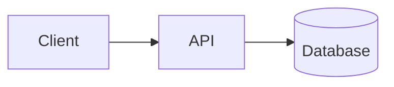
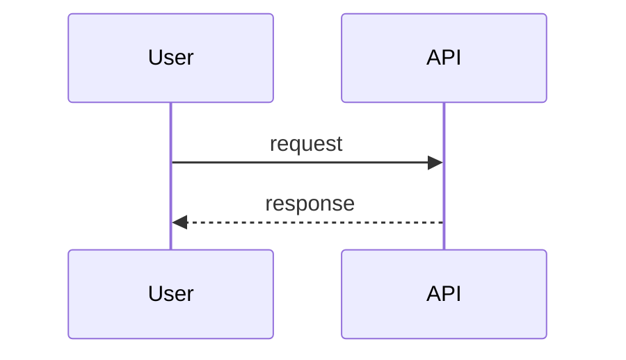
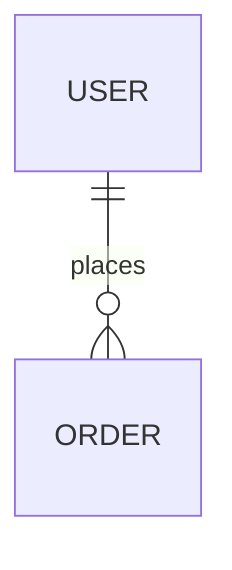

# <System name> — Specification

| Field | Value |
|---|---|
| Author | <your name> |
| Version | v1.0 |
| Last updated | YYYY-MM-DD |
| Status | Draft / Review / Final |

> **How to use this template**
> - Keep the section order and numbering. Do not delete a section; if it does not apply, write `N/A` and the reason.
> - Replace every `<...>` placeholder. Lines starting with `> Example:` show the expected level of detail; delete them when you are done.
> - IDs are permanent. Never renumber or reuse an ID. If something is removed, mark it **Deprecated** and keep the row.
>
> **ID rules**
>
> | Prefix | Used for | Example |
> |---|---|---|
> | `CR-` | Company-wide common requirement | CR-001 |
> | `FR-` | Functional requirement | FR-001 |
> | `NFR-` | Non-functional requirement | NFR-001 |
> | `CMP-` | Architecture component | CMP-001 |
> | `TBL-` | Database table | TBL-001 |
> | `API-` | API endpoint | API-001 |
> | `ERR-` | Error code | ERR-001 |

---

## 1. Company-wide common requirements

Rules every Divii / Hanriver project must follow. Each rule has an ID and must be specific enough to be checked.

| ID | Area | Rule | How it is checked |
|---|---|---|---|
| CR-001 | Authentication | <rule> | <check> |

> Example: `CR-004 | Logging | Logs are JSON, one object per line, with fields timestamp, level, requestId, userId, message. Personal data (email, phone, file contents) is never logged. | Code review + log sample review`

Cover at least these areas:

### 1.1 Authentication
### 1.2 Roles and permissions
Include a role × permission table.
### 1.3 Logging
### 1.4 Error handling
Define the **one** standard error response format used by every API.
### 1.5 Security
Secrets, CORS, input validation, rate limiting, data retention.
### 1.6 Internationalization (i18n)
### 1.7 Environments
local / dev / staging / prod — what differs between them.
### 1.8 Deployment
CI/CD, release process, rollback.

---

## 2. Coding conventions

### 2.1 Naming
| Item | Convention | Example |
|---|---|---|
| Classes | <...> | <...> |
| Variables / functions | <...> | <...> |
| DB tables / columns | <...> | <...> |
| API paths | <...> | <...> |

### 2.2 Folder / module structure
Show the folder tree for backend and frontend.

### 2.3 Branching and commits
> Example: branches `feature/FR-001-short-name`, `fix/ERR-003-timeout`; commit format `<type>(<scope>): <message>`.

### 2.4 Code review rules
### 2.5 Lint and format
Tools, config files, and when they run.

---

## 3. Requirements definition

### 3.1 Functional requirements

| ID | Title | Description | Priority | Acceptance criteria |
|---|---|---|---|---|
| FR-001 | <title> | <what the system does, who does it> | Must / Should / Could | 1. … 2. … |

> Example: `FR-003 | Reset password | A registered user can request a password reset link by email. | Must | 1. The link expires after 30 minutes. 2. The link works only once. 3. Requesting a reset for an unknown email returns the same response as a known one (no account enumeration).`

### 3.2 Non-functional requirements

| ID | Category | Requirement | Measurable target | How it is verified |
|---|---|---|---|---|
| NFR-001 | Performance | <...> | <number + unit> | <test / tool> |

Cover at least: performance, security, availability, privacy, scalability, observability.

### 3.3 Assumptions and out of scope
List what you assumed and what this spec deliberately does **not** cover.

---

## 4. Architecture

### 4.1 Component diagram



### 4.2 Components

| ID | Component | Responsibility | Technology |
|---|---|---|---|
| CMP-001 | <name> | <what it does> | <tech> |

### 4.3 Main flows
One sequence diagram per main flow.



### 4.4 External integrations

| System | Purpose | Protocol / auth | Failure handling |
|---|---|---|---|

### 4.5 Tech stack and reasons

| Layer | Choice | Why this choice |
|---|---|---|

---

## 5. ERD and database design

### 5.1 ERD



### 5.2 Tables
One block per table.

#### TBL-001 `<table_name>`
Purpose: <one line>

| Column | Type | Null | Key | Default | Constraint / note |
|---|---|---|---|---|---|
| id | uuid | NO | PK | gen_random_uuid() | |

### 5.3 Indexes

| Table | Index | Columns | Why |
|---|---|---|---|

### 5.4 Relationships and delete rules

| From | To | Cardinality | On delete |
|---|---|---|---|

---

## 6. API design

### 6.1 Common rules
- Base path:
- Auth header / cookie:
- Pagination format:
- Date / time format and timezone:
- Standard error format (must match section 1.4):

### 6.2 Endpoints
One block per endpoint.

#### API-001 `<METHOD> <path>`
- **Purpose:**
- **Auth / role:**
- **Implements:** FR-xxx

**Request**

| Field | In (path/query/body) | Type | Required | Validation |
|---|---|---|---|---|

**Response 200**

```json
{}
```

**Errors**

| HTTP | Error code | When |
|---|---|---|

### 6.3 Error code list

| ID | Code | HTTP | Message | When it happens |
|---|---|---|---|---|

---

## 7. Traceability matrix

Every FR and NFR must appear here at least once. No empty cells — write `—` only when something genuinely does not apply, and say why.

| Requirement | Component(s) | Table(s) | API(s) | Verified by |
|---|---|---|---|---|
| FR-001 | CMP-00x | TBL-00x | API-00x | <test / acceptance criterion> |

---

## 8. Change log

| Version | Date | Author | What changed | Why | Affected IDs |
|---|---|---|---|---|---|
| v1.0 | YYYY-MM-DD | <name> | Initial version | — | — |
