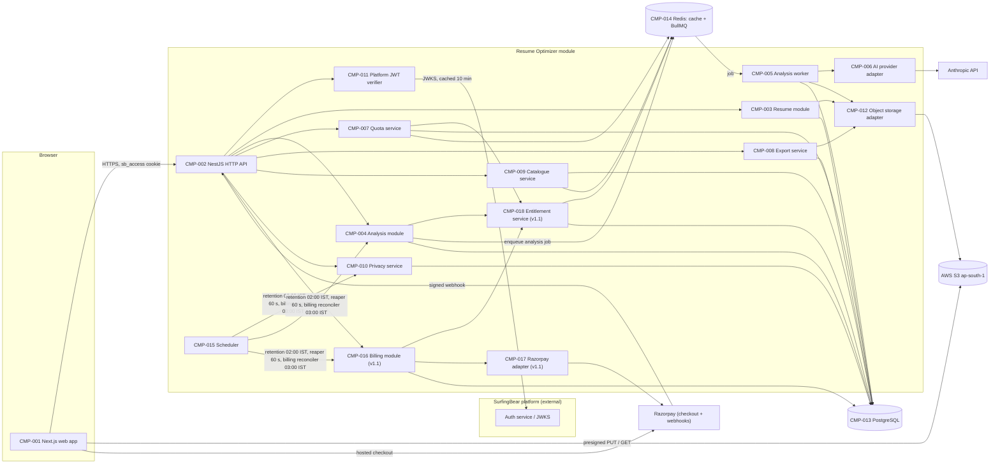
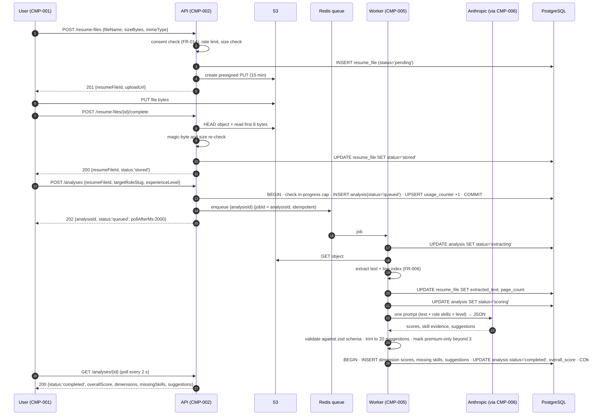
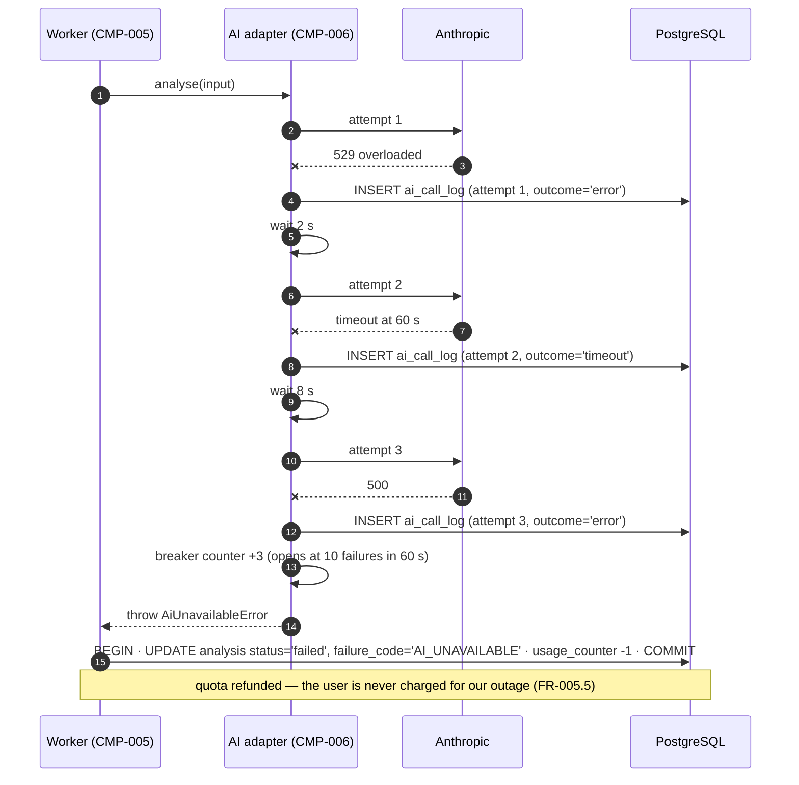
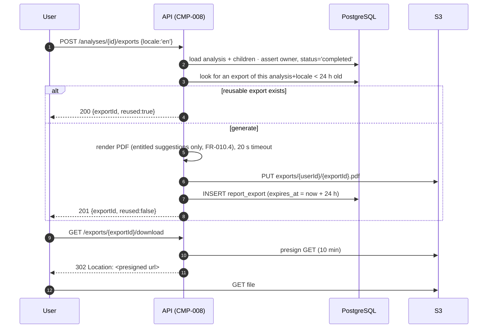
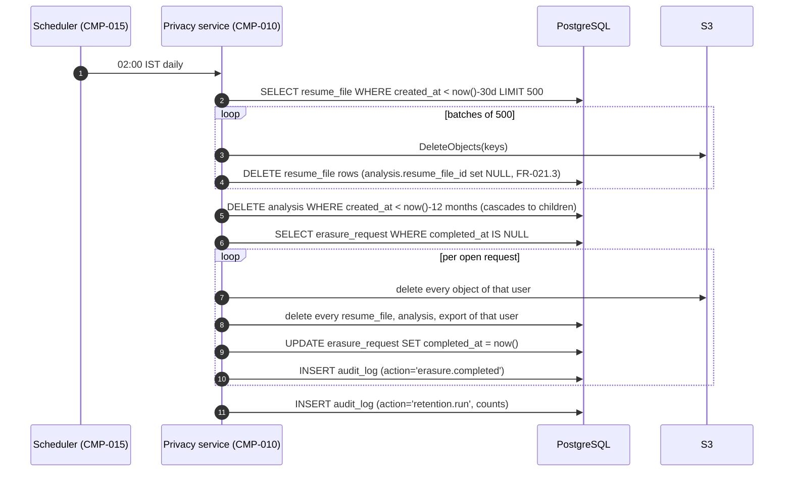
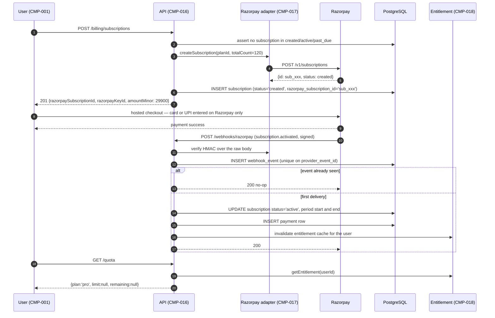
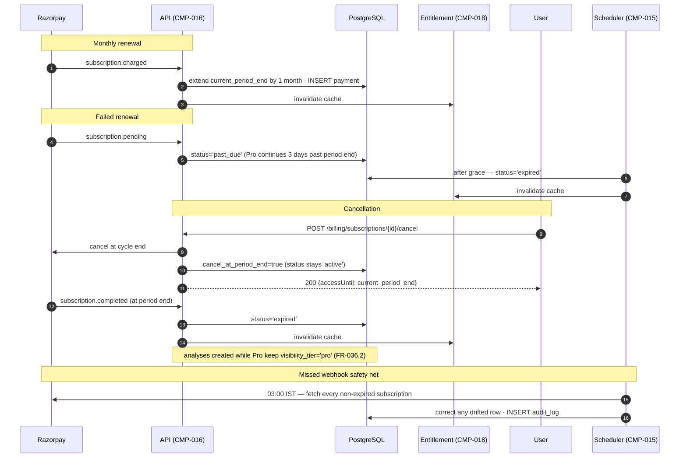
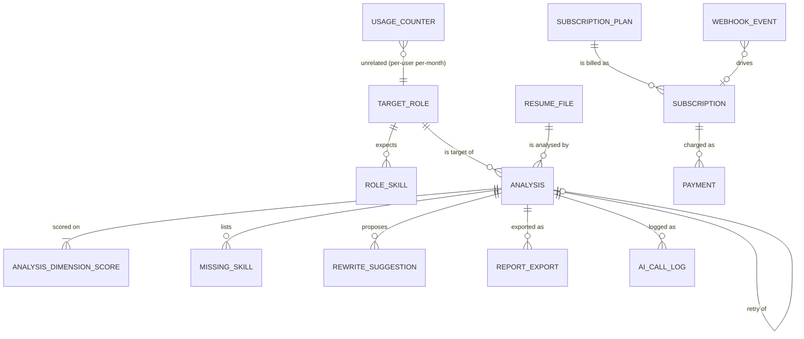

# <System name> — Specification

| Field | Value |
|---|---|
| Author | Bilal Mansuri (Frontend) |
| Version | v1.1 |
| Last updated | 2026-10-26 |
| Status | Review |

> **How to use this template**
> - Keep the section order and numbering. Do not delete a section; if it does not apply, write `N/A` and the reason.
> - Replace every `<...>` placeholder. Lines starting with `> Example:` show the expected level of detail; delete them when you are done.
> - IDs are permanent. Never renumber or reuse an ID. If something is removed, mark it **Deprecated** and keep the row.
>
> **ID rules**
>
> | Prefix | Used for | Example |
> |---|---|---|
> | `CR-` | Company-wide common requirement | CR-001 |
> | `FR-` | Functional requirement | FR-001 |
> | `NFR-` | Non-functional requirement | NFR-001 |
> | `CMP-` | Architecture component | CMP-001 |
> | `TBL-` | Database table | TBL-001 |
> | `API-` | API endpoint | API-001 |
> | `ERR-` | Error code | ERR-001 |

---

## 1. Company-wide common requirements

Rules every Divii / Hanriver project must follow. Each rule has an ID and must be specific enough to be checked.

| ID | Area | Rule | How it is checked |
|---|---|---|---|
| CR-001 | Authentication | Every request to a non-public endpoint carries a SurfingBear platform JWT (RS256). The module never issues, refreshes or stores credentials; it only verifies. Signature is verified against the platform JWKS at `${SB_AUTH_URL}/.well-known/jwks.json`, cached 10 minutes. | Integration test `auth.e2e-spec.ts`: request without token → 401 `AUTH_REQUIRED`; token signed by an unknown key → 401 `AUTH_INVALID_TOKEN` |
| CR-002 | Authentication | Access tokens are read from the httpOnly, Secure, SameSite=Lax cookie `sb_access`. `Authorization: Bearer <jwt>` is accepted only for server-to-server callers whose `aud` claim is `surfingbear-internal`. Tokens are never placed in URLs, localStorage or sessionStorage. | Code review checklist item + grep gate in CI: `localStorage` / `sessionStorage` containing `token` fails the build |
| CR-003 | Authentication | A JWT is rejected if `exp` is past, `iss` ≠ `https://auth.surfingbear.com`, or `aud` ∉ {`surfingbear-web`, `surfingbear-internal`}. Clock skew tolerance 60 s. | Unit tests in `jwt.strategy.spec.ts`, one case per rejection reason |
| CR-004 | Roles & permissions | Authorization is role-based, evaluated by a single NestJS guard (`RolesGuard`). The role comes from the JWT claim `role`. No endpoint does its own ad-hoc role check. | Static check: every controller method has either `@Roles(...)` or `@Public()`; CI fails on a method with neither |
| CR-005 | Roles & permissions | Ownership is enforced on top of roles: a `user` may only read or modify rows whose `user_id` equals the JWT `sub`. A row owned by someone else returns 404 `NOT_FOUND`, never 403, so existence is not leaked. | Integration test: user B requests user A's analysis → 404 |
| CR-006 | Logging | Logs are JSON, one object per line, with fields `timestamp` (ISO-8601 UTC), `level`, `service`, `env`, `requestId`, `userId`, `route`, `durationMs`, `message`. Written to stdout; collection is the platform's concern. | Log-sample review in PR template + `pino` schema test |
| CR-007 | Logging | Personal data is never logged: no resume file contents, no extracted resume text, no email, phone, name or address. Only opaque identifiers (`userId`, `analysisId`, `resumeFileId`) and file metadata (size, mime, page count) may be logged. Violations are treated as a P1 incident. | `pino` redaction config (`redact: ['req.body.text','*.email','*.phone','*.rawText']`) + mandatory reviewer checkbox "no PII in new log lines" |
| CR-008 | Logging | Every request gets a `requestId` (UUID v4) taken from the `X-Request-Id` header if present, otherwise generated. It is returned in the `X-Request-Id` response header and included in every error body. The same id is passed to the AI provider call log and to the worker job. | Integration test asserts the header round-trips and appears in the error body |
| CR-009 | Error handling | Every API error uses the one format in 1.4. No endpoint returns a bare string, an HTML page or a differently shaped body. | A global `HttpExceptionFilter` is the only error path; test asserts shape for 400/401/403/404/409/413/415/422/429/500/503 |
| CR-010 | Error handling | Error `code` values are stable, SCREAMING_SNAKE_CASE, and listed in section 6.3. A new code may be added; an existing code is never re-meaning-ed. | Code list in `src/common/errors.ts` is generated into section 6.3; CI diff check fails if an existing code's meaning line changes |
| CR-011 | Error handling | `message` is for developers and is always English. User-facing text is chosen by the frontend from the `code` (see CR-020). Server messages never contain user data. | Review + test: no error message interpolates a user-supplied string other than a field name |
| CR-012 | Security | All secrets come from environment variables injected by AWS Secrets Manager at deploy time. No secret, key or password is ever committed; `.env` files are git-ignored and `.env.example` holds only placeholder values. | `gitleaks` runs in CI on every push and blocks the merge on any finding |
| CR-013 | Security | TLS 1.2+ everywhere, HTTP redirected to HTTPS at the load balancer. HSTS `max-age=31536000; includeSubDomains`. | ALB listener config in IaC + `testssl.sh` run before each production release |
| CR-014 | Security | CORS allows only the exact origins `https://surfingbear.com` and `https://www.surfingbear.com` in prod, `http://localhost:3000` in local. `credentials: true`. Wildcard origin is never used. | Config test per environment; a wildcard in `cors.config.ts` fails the unit test |
| CR-015 | Security | Every request body, query and path parameter is validated by a DTO with `class-validator`, `whitelist: true`, `forbidNonWhitelisted: true`. Unknown fields are rejected with 422 `VALIDATION_FAILED`, not silently dropped. | Global `ValidationPipe` configured once in `main.ts`; test posts an unknown field and expects 422 |
| CR-016 | Security | Rate limiting is applied per user id (falling back to client IP for unauthenticated routes) at the limits in 3.3.3. Exceeding a limit returns 429 `RATE_LIMITED` with a `Retry-After` header in seconds. | Load test in staging + unit test on the throttler guard |
| CR-017 | Security | Personal data at rest is encrypted: S3 objects with SSE-KMS (customer-managed key), RDS with storage encryption, Redis with encryption in transit and at rest. | IaC review; `terraform plan` gate rejects an unencrypted bucket or instance |
| CR-018 | Security (DPDP) | Personal data is processed only on the lawful basis of the user's consent, recorded before the first upload (FR-014). Data is stored in the `ap-south-1` (Mumbai) region only. Retention and erasure follow CR-019. | Quarterly privacy review; region is pinned in IaC and asserted by a startup check that refuses to boot outside `ap-south-1` |
| CR-019 | Security (DPDP) | Retention: resume files and extracted text are deleted 30 days after upload; analysis results 12 months after creation; audit records 24 months. A user erasure request deletes all of the above within 7 days. Deletion is hard deletion of the row and of the S3 object, not a flag. | Nightly job `retention.job.ts` with a test fixture that ages rows; monthly evidence report of rows and objects deleted |
| CR-020 | i18n | The backend returns identifiers, never display text: error `code`, `dimension.key`, `skill.slug`. All user-facing strings live in the frontend bundles `locales/en.json` and `locales/ko.json`. A missing key falls back to English and logs a warning in non-prod. | CI script compares the key sets of the two locale files and fails on any key present in one and missing in the other |
| CR-021 | i18n | Supported locales: `en` (default) and `ko`. Locale comes from the `sb_locale` cookie, else the `Accept-Language` header, else `en`. Dates are rendered client-side in the user's locale; the API only ever sends ISO-8601 UTC. | Unit test of the locale resolver covering all three paths |
| CR-022 | Environments | Four environments: `local`, `dev`, `staging`, `prod`. They differ only in configuration (see the table in 1.7), never in code paths. `if (env === 'prod')` branches in business logic are forbidden. | Grep gate in CI for `NODE_ENV === 'prod'` outside `config/` |
| CR-023 | Deployment | Every merge to `main` builds one immutable Docker image tagged with the commit SHA. The same image is promoted dev → staging → prod. Nothing is rebuilt per environment. | CI pipeline definition; release checklist records the promoted SHA |
| CR-024 | Deployment | Database migrations run as a separate job before the new image is routed traffic, and every migration is backward-compatible with the previous image (expand/contract). Destructive changes are split across two releases. | Migration review checklist; staging deploy runs the previous image against the new schema as a smoke test |
| CR-025 | Deployment | Rollback is redeploying the previous image tag. The target is under 10 minutes from decision to healthy. Migrations are never rolled back; a forward fix is issued instead. | Rollback drill once per quarter, time recorded |
| CR-026 | Observability | Every service exposes `GET /health/live` (process up) and `GET /health/ready` (PostgreSQL, Redis and S3 reachable). The orchestrator uses `ready` for traffic. | Smoke test after each deploy |
| CR-027 | Audit | Every write that touches personal data (upload, delete, erasure, export) writes an audit row (TBL-010) with actor, action, target, requestId and timestamp. Audit rows are append-only; there is no UPDATE or DELETE grant on that table for the application role. | DB grant review + test asserting the application user cannot update `audit_log` |
| CR-028 *(v1.1)* | Payments | No card, UPI, netbanking or any other payment instrument data ever reaches our servers, logs or database. Payment collection happens entirely in the provider's hosted checkout; we store only the provider's opaque ids (`razorpay_subscription_id`, `razorpay_payment_id`), the amount in minor units and the status. | Code review + a test asserting the payment DTOs contain no instrument field; quarterly review of the stored columns of TBL-017 |
| CR-029 *(v1.1)* | Payments | Every inbound provider webhook is authenticated by HMAC-SHA256 signature over the raw request body before the body is parsed, and is processed at most once (`webhook_event`, TBL-018). An unverified webhook is rejected with 401 and logged with the event id only. | `webhook.e2e-spec.ts`: tampered body → 401 `WEBHOOK_SIGNATURE_INVALID`; the same event id delivered twice changes state once |
| CR-030 *(v1.1)* | Entitlements | A user's plan is never stored as a flag on a user row and never read from the client. It is derived from subscription state by one service (CMP-018) and cached for at most 60 s. Every paid-feature check in the system calls that service. | Grep gate: no column named `is_pro` or `plan` outside TBL-015/TBL-016; `entitlement.spec.ts` covers the six subscription states |

### 1.1 Authentication
### 1.2 Roles and permissions
Include a role × permission table.
### 1.3 Logging
### 1.4 Error handling
Define the **one** standard error response format used by every API.
### 1.5 Security
Secrets, CORS, input validation, rate limiting, data retention.
### 1.6 Internationalization (i18n)
### 1.7 Environments
local / dev / staging / prod — what differs between them.
### 1.8 Deployment
CI/CD, release process, rollback.

---

## 2. Coding conventions

### 2.1 Naming
| Item | Convention | Example |
|---|---|---|
| Classes | <...> | <...> |
| Variables / functions | <...> | <...> |
| DB tables / columns | <...> | <...> |
| API paths | <...> | <...> |

### 2.2 Folder / module structure
Show the folder tree for backend and frontend.

### 2.3 Branching and commits
> Example: branches `feature/FR-001-short-name`, `fix/ERR-003-timeout`; commit format `<type>(<scope>): <message>`.

### 2.4 Code review rules
### 2.5 Lint and format
Tools, config files, and when they run.

---

## 3. Requirements definition

### 3.1 Functional requirements

| ID | Title | Description | Priority | Acceptance criteria |
|---|---|---|---|---|
| FR-001 | Upload a resume file | A logged-in user uploads one resume file (PDF or DOCX) from the analyse page. The file is uploaded directly to object storage with a presigned URL; the API only records metadata. | Must | 1. Accepted types: `application/pdf` and `application/vnd.openxmlformats-officedocument.wordprocessingml.document` only, decided by magic bytes (1.5), not by extension or client MIME. 2. Maximum size 5 242 880 bytes (5 MB); a larger file is rejected with 413 `FILE_TOO_LARGE` before any byte is stored. 3. The presigned upload URL is valid 15 minutes and for exactly one PUT of one key. 4. After the browser PUT succeeds the client calls API-003; the API verifies the object exists, re-reads size and magic bytes server-side, and only then sets `resume_file.status = 'stored'`. 5. A file whose server-side check fails is deleted from storage within the same request and 415 `UNSUPPORTED_FILE_TYPE` is returned. 6. One upload creates exactly one `resume_file` row (TBL-002). |
| FR-002 | Reject an unreadable or empty resume | A file that is structurally valid but yields too little text is rejected before any AI cost is spent. | Must | 1. After extraction, fewer than 200 characters of text → analysis fails with `RESUME_TEXT_TOO_SHORT`. 2. More than 10 pages (PDF) or 60 000 extracted characters → `RESUME_TOO_LONG`. 3. A password-protected or corrupt file → `FILE_UNREADABLE`. 4. In all three cases the analysis row ends in status `failed` with that code in `failure_code`, the user's quota is **not** consumed (see FR-005 criterion 5), and the AI provider is never called. |
| FR-003 | List target roles | The user picks the job role they are targeting from a server-managed catalogue; free text is not accepted, so scoring stays comparable between users. | Must | 1. `GET /target-roles` returns every row with `is_active = true`, ordered by `display_order` then `slug`. 2. Each item carries `slug`, `nameKey` (i18n key, CR-020) and `family`. 3. The list is cached in Redis for 1 hour and in the browser for the session. 4. An inactive role id submitted to API-004 → 422 `TARGET_ROLE_INVALID`. |
| FR-004 | Create an analysis | The user starts an analysis by choosing a stored resume file, a target role and an experience level. | Must | 1. Required inputs: `resumeFileId`, `targetRoleSlug`, `experienceLevel` ∈ {`entry`,`mid`,`senior`,`lead`}. 2. The resume file must be owned by the caller and in status `stored`, otherwise 404 `NOT_FOUND` or 409 `RESUME_NOT_READY`. 3. On success the API returns 202 with the analysis id and `status = 'queued'`; the work happens asynchronously (CMP-005). 4. The same `resumeFileId` may be analysed again for a different role; each run is a separate `analysis` row. 5. A user may have at most 2 analyses in a non-terminal status at once; a third returns 409 `ANALYSIS_IN_PROGRESS`. |
| FR-005 | Enforce the free monthly analysis quota | Free users get a limited number of analyses per calendar month. ***(v1.1: applies to the free plan only; Resume Pro is unlimited — see FR-029.)*** | Must | 0. *(v1.1)* The limit is applied only when the caller's effective plan is `free`; for `pro` the counter is still incremented for reporting but no limit is enforced. 1. Free limit: 3 analyses per calendar month, month boundary 00:00 Asia/Kolkata on the 1st. 2. The counter increments when the analysis is **created** (API-004), not when it completes. 3. Reaching the limit returns 429 `QUOTA_EXCEEDED` with `details[0].resetAt` set to the next reset instant. 4. The counter row is `usage_counter` (TBL-008), keyed `(user_id, period_ym)`, incremented in the same transaction that inserts the analysis. 5. If the analysis later fails with a system-side cause (`AI_UNAVAILABLE`, `AI_INVALID_OUTPUT`, `INTERNAL_ERROR`) or with a file-side cause from FR-002, the counter is decremented by the same worker, so a user is never charged for our failure. A `completed` analysis is never refunded. |
| FR-006 | Extract text from the resume | The worker converts the stored file into plain text plus a line index, so suggestions can point at a specific line. | Must | 1. PDF via `pdf-parse`; DOCX via `mammoth` (raw text). 2. Output is normalised: CRLF → LF, tabs → single space, runs of 3+ blank lines → 2, trailing spaces stripped. 3. Each non-empty line keeps its 1-based index; that index is what `rewrite_suggestion.line_ref` refers to. 4. Extraction has a 20 s timeout; exceeding it fails the analysis with `FILE_UNREADABLE`. 5. The extracted text is stored in `resume_file.extracted_text` and is subject to the 30-day retention rule (CR-019). |
| FR-007 | Score the resume on ATS dimensions | The AI scores the resume out of 100 across six fixed dimensions for the chosen role and experience level. | Must | 1. Dimensions and weights are exactly the table in 3.3.1 and sum to 100. 2. Each dimension gets an integer 0–100 and a one-sentence rationale. 3. `analysis.overall_score` = round(Σ dimension_score × weight ÷ 100), an integer 0–100. 4. The same resume, role and level analysed twice must differ by at most 5 points in `overall_score` (temperature 0.2; verified by NFR-013's repeatability test). 5. Every dimension row is persisted (TBL-004), so the breakdown is reproducible without re-calling the AI. |
| FR-008 | Identify missing skills | The analysis lists the skills expected for the target role that the resume does not evidence. | Must | 1. The expected set is `role_skill` (TBL-007) for the chosen role **and** an experience level at or below the chosen one. 2. A skill is "missing" when the AI finds no evidence of it in the resume text; the AI returns, per expected skill, `present` or `missing` with the matched phrase when present. 3. Only missing ones are persisted (TBL-005), with `importance` copied from `role_skill.importance` (`core` \| `preferred`). 4. The response orders them `core` first, then alphabetically by slug. 5. If nothing is missing, the list is empty — this is a valid, successful result, not an error. 6. Missing skills are shown **in full to every plan**; only rewrite suggestions are gated (FR-010). |
| FR-009 | Generate rewrite suggestions | For weak lines, the AI proposes a rewritten version. | Must | 1. At most 20 suggestions per analysis. 2. Each has: `lineRef` (FR-006 criterion 3), `originalText`, `suggestedText`, `severity` ∈ {`high`,`medium`,`low`}, `reasonKey`. 3. `suggestedText` must differ from `originalText` and must be at most 2× its length; a violating item is dropped by the worker before persisting. 4. Suggestions are ordered `high` → `medium` → `low`, then by `lineRef` ascending. 5. Persisted in TBL-006 with `is_premium_only` set per FR-010. |
| FR-010 | Limit visible suggestions on the free plan | Free users see only part of the suggestion list. ***(v1.1: gating now keys off `analysis.visibility_tier`, which is fixed at creation time — see FR-030 and FR-036.)*** | Must | 1. The first 3 suggestions in the FR-009 order are free; every further suggestion has `is_premium_only = true`. 2. A premium-only suggestion is returned to a free user as `{ lineRef, severity, locked: true }` — `originalText` and `suggestedText` are omitted **server-side**, never merely hidden by CSS. 3. The response always reports `suggestionsTotal` and `suggestionsVisible` so the UI can say "3 of 11 shown". 4. The PDF export (FR-017) contains exactly the suggestions the caller is entitled to see. 5. *(v1.1)* A suggestion is returned unlocked when `analysis.visibility_tier = 'pro'` **or** `is_premium_only = false`. The check never reads the user's live plan, so what an analysis shows cannot change under the user after it is created. |
| FR-011 | Expose analysis progress | While an analysis runs, the user sees which stage it is in. | Must | 1. `analysis.status` ∈ `queued` → `extracting` → `scoring` → `completed` \| `failed`. 2. `GET /analyses/{id}` returns the current status and, for a non-terminal status, `pollAfterMs` (2000). 3. The frontend polls that endpoint every 2 s, backing off to 5 s after 30 s, and stops at a terminal status or after 90 s (then shows `ANALYSIS_TIMEOUT` guidance). 4. Status transitions only ever move forward; a worker writing an out-of-order transition is rejected by the DB check `ck_analysis_status_transition` handling (see 5.2 TBL-003). |
| FR-012 | View a completed analysis | The user opens an analysis and sees the score, the dimension breakdown, the missing skills and the suggestions they are entitled to. | Must | 1. `GET /analyses/{id}` on a `completed` analysis returns `overallScore`, the six dimensions with score and rationale, missing skills and suggestions (gated per FR-010). 2. Only the owner can read it (CR-005). 3. The response is identical on repeat calls — no AI call happens on read. 4. A `failed` analysis returns status `failed` plus `failureCode` and nothing else about the resume. |
| FR-013 | See the most recent analysis on the dashboard | The resume dashboard shows the user's latest analysis as an entry point. | Must | 1. `GET /analyses/latest` returns the caller's single most recent analysis by `created_at`, or 204 when they have none. 2. It returns the same shape as FR-012. 3. ~~**Only the latest one is reachable in round 1**: there is no list endpoint and no history in this version.~~ *(v1.1: superseded by FR-031. The dashboard still shows the latest analysis to every plan; a full history list exists for Resume Pro only. Free behaviour is unchanged — a free user still has no list endpoint, exactly as in v1.0.)* 4. A user who wants an older analysis and is not on Pro uses the link they already have. |
| FR-014 | Record DPDP consent before the first upload | Before a user's first upload the app shows the processing notice and records their consent. | Must | 1. `GET /privacy/consent` reports whether a valid consent exists for the current `consent_version`. 2. Upload (API-002) returns 403 `CONSENT_REQUIRED` while no valid consent exists. 3. Consent is recorded with `consent_version`, timestamp, and the request id (TBL-009); the IP address is **not** stored. 4. Raising `consent_version` invalidates prior consents and the notice is shown again. 5. Consent can be withdrawn (API-016), which blocks new uploads and triggers FR-020. |
| FR-015 | Handle AI provider failure | A failure at the AI provider must not look like a broken product. | Must | 1. Per AI call: 60 s timeout, 2 retries, backoff 2 s then 8 s, only for timeouts, 429s and 5xx. 2. A 4xx other than 429 is not retried. 3. After the last failed attempt the analysis ends `failed` with `AI_UNAVAILABLE` and the quota is refunded (FR-005 criterion 5). 4. If the model answers but the JSON fails the schema check, one re-ask with a repair instruction is made; a second failure ends the analysis with `AI_INVALID_OUTPUT`. 5. A circuit breaker opens after 10 consecutive provider failures within 60 s and stays open 60 s; while open, new analyses are rejected at creation with 503 `AI_UNAVAILABLE` rather than being queued. 6. Every attempt is recorded in TBL-011. |
| FR-016 | Retry a failed analysis | The user can retry an analysis that failed for a system reason. | Must | 1. `POST /analyses/{id}/retry` is allowed only when `status = 'failed'` and `failure_code` ∈ {`AI_UNAVAILABLE`,`AI_INVALID_OUTPUT`,`INTERNAL_ERROR`}; otherwise 409 `RETRY_NOT_ALLOWED`. 2. A retry creates a **new** analysis row linked by `retry_of_analysis_id`, so the failure history is kept. 3. A retry does not consume quota (it was refunded on the failure). 4. At most 3 retries per original analysis; a fourth returns 409 `RETRY_LIMIT_REACHED`. |
| FR-017 | Export the analysis as a PDF | The user downloads the analysis as a PDF report. | Must | 1. `POST /analyses/{id}/exports` with `{ locale }` generates the PDF and returns an export id. 2. The PDF contains: score and dimension chart, missing skills, and exactly the suggestions the caller may see (FR-010 criterion 4), plus the generation timestamp and a "generated by SurfingBear" footer. 3. Generation is synchronous with a 20 s timeout; on timeout 503 `EXPORT_FAILED`. 4. The file is stored at `exports/{userId}/{exportId}.pdf` and a row is written to TBL-012. 5. Only `completed` analyses can be exported; otherwise 409 `ANALYSIS_NOT_COMPLETED`. 6. Re-exporting the same analysis in the same locale within 24 h returns the existing export instead of regenerating it. |
| FR-018 | Download an export through a time-limited link | | Must | 1. `GET /exports/{id}/download` returns 302 to a presigned S3 URL valid 10 minutes. 2. The link is single-use in the sense that a new one is minted per call; the URL is never stored in the DB or logged. 3. Only the owner may call it (CR-005). 4. After `export.expires_at` (24 h) the row is marked expired and the endpoint returns 410 `EXPORT_EXPIRED`. |
| FR-019 | Delete an analysis | The user removes an analysis and everything derived from it. | Must | 1. `DELETE /analyses/{id}` hard-deletes the analysis, its dimension scores, missing skills, suggestions and exports (DB cascade, 5.4) and the export objects in storage. 2. The resume file is **not** deleted, because it may back another analysis; it is deleted when it has no remaining analyses, in the same request. 3. Returns 204. Repeating the call returns 404. 4. An audit row is written (CR-027). |
| FR-020 | Request erasure of all resume data | DPDP right to erasure. | Must | 1. `POST /privacy/erasure-requests` records the request and returns 202 with `completeBy` = now + 7 days. 2. The nightly job deletes, for that user: every resume file and its storage object, every analysis and child row, every export and its object. Consent and audit rows are retained as the record of lawful processing, with the audit rows carrying only ids. 3. Completion writes `completed_at` on the request and an audit row. 4. A second request while one is open returns 409 `ERASURE_ALREADY_REQUESTED`. 5. The user keeps their SurfingBear account; this erases the Resume Optimizer data only. |
| FR-021 | Automatic retention deletion | Data disappears on schedule without anyone asking. | Must | 1. A nightly job at 02:00 IST deletes resume files and their extracted text older than 30 days, and analyses older than 12 months, with their children and objects. 2. The job is idempotent and resumable: it works in batches of 500 and records a summary row (count per entity) in the log. 3. Deleting a resume file whose analyses still exist nulls `analysis.resume_file_id` and keeps the analysis — the scores stay readable, the source text does not. 4. The job never deletes a row created in the last 24 h, as a guard against a clock or timezone error. |
| FR-022 | Show remaining quota | The user always knows how many analyses they have left. | Must | 1. `GET /quota` returns `{ plan, limit, used, remaining, resetAt }`. 2. For the free plan `limit = 3`. 3. `resetAt` is the next month boundary in UTC. 4. The analyse page shows this before the user uploads, and the value is re-read after every analysis creation. 5. *(v1.1)* For the `pro` plan, `limit` and `remaining` are `null` and the UI renders "Unlimited"; `used` is still returned. |
| FR-023 | Abort a stuck analysis | An analysis must not sit in a running state forever. | Must | 1. A job that has not reached a terminal status 180 s after `created_at` is marked `failed` with `ANALYSIS_TIMEOUT` by the reaper that runs every 60 s. 2. The quota is refunded (FR-005 criterion 5). 3. If the worker finishes afterwards, its write is rejected because the row is already terminal, and the result is discarded. |
| FR-024 | Localised interface | The module is usable in English and Korean. | Should | 1. Every user-facing string in the app has an `en` and a `ko` entry (CR-020). 2. Switching locale re-renders without a page reload and persists in the `sb_locale` cookie. 3. The PDF export honours the requested locale (FR-017). 4. Resume text and AI suggestion text are not translated (1.6). |
| FR-025 | Support read-only view of analysis metadata | A support agent can diagnose a failure without seeing the resume. | Should | 1. `GET /support/analyses/{id}` is `support`/`admin` only and returns status, timings, `failureCode`, model and attempt counts. 2. It never returns resume text, suggestion text, missing skills or the file. 3. Every call writes an audit row with the acting user id. |
| FR-026 | Manage the target-role catalogue | An admin adds roles and their expected skills without a deploy. | Should | 1. `POST /admin/target-roles` and `PUT /admin/target-roles/{slug}` create and update catalogue rows; `admin` only. 2. A role cannot be hard-deleted; it is set `is_active = false`, so historic analyses keep a valid reference. 3. Changing a role's skills does not change analyses already completed. 4. Creating a role whose slug exists → 409 `TARGET_ROLE_EXISTS`. |
| FR-027 *(v1.1)* | Subscribe to Resume Pro | A free user starts a ₹299/month subscription and pays through Razorpay's hosted checkout. | Must | 1. `POST /billing/subscriptions` creates a Razorpay subscription against the configured plan and returns `razorpaySubscriptionId`, `razorpayKeyId` and `checkoutUrl` parameters; our row is written with status `created`. 2. The amount is exactly 29 900 paise (₹299.00) INR per month, read from TBL-015 and never from the client. 3. No card, UPI or bank detail is ever sent to, or stored by, this module (CR-028). 4. A user who already has a subscription in status `created`, `active` or `past_due` → 409 `SUBSCRIPTION_ALREADY_ACTIVE`. 5. Creating a subscription does **not** grant Pro; only FR-028 does. 6. If Razorpay is unreachable, 503 `PAYMENT_PROVIDER_UNAVAILABLE`, and no row is left in `created` for more than 1 hour (swept by the reconciler, FR-034.5). |
| FR-028 *(v1.1)* | Activate Pro on payment confirmation | Pro access begins when the provider confirms the first successful charge. | Must | 1. `POST /webhooks/razorpay` accepts `subscription.activated`, `subscription.charged`, `subscription.pending`, `subscription.halted`, `subscription.cancelled` and `subscription.completed`. 2. The signature is verified over the raw body before parsing (CR-029); failure → 401 `WEBHOOK_SIGNATURE_INVALID`. 3. The event id is inserted into TBL-018 with a unique constraint; a duplicate delivery returns 200 and changes nothing. 4. On `subscription.activated` or `subscription.charged`: status → `active`, `current_period_start` and `current_period_end` are taken from the provider payload, a TBL-017 payment row is written, and the entitlement cache for that user is invalidated. 5. The endpoint answers within 5 s and always returns 200 for a verified event, even when our own processing is deferred, so the provider does not retry a message we have already accepted. 6. Unknown event types are acknowledged with 200 and recorded, not treated as an error. |
| FR-029 *(v1.1)* | Unlimited analyses for Pro | A Pro user is not limited by the monthly quota. | Must | 1. When the effective plan is `pro`, `POST /analyses` never returns `QUOTA_EXCEEDED`. 2. `usage_counter` is still incremented, so usage reporting continues to work across plan changes. 3. `GET /quota` returns `limit: null`, `remaining: null` (FR-022.5). 4. The per-hour rate limit of 3.3.3 still applies at 20/hour for Pro — an abuse guard, not a product limit (3.3.4-A15). |
| FR-030 *(v1.1)* | All rewrite suggestions for Pro | A Pro user sees every suggestion the analysis produced. | Must | 1. `analysis.visibility_tier` is set to `pro` at creation when the effective plan is `pro`, otherwise `free`. 2. For `visibility_tier = 'pro'` every suggestion is returned in full and `suggestionsVisible = suggestionsTotal`. 3. The PDF export of such an analysis contains every suggestion and is recorded with `includes_premium = true`. 4. Missing skills and the score breakdown are unchanged — they were never gated (3.3.4-A7). |
| FR-031 *(v1.1)* | Analysis history | A Pro user can browse their past analyses. | Must | 1. `GET /analyses` returns the caller's analyses, newest first, cursor-paginated per 6.1 (`limit` default 20, max 50). 2. Each item carries `analysisId`, `createdAt`, `status`, `overallScore`, `targetRoleSlug`, `experienceLevel` and `visibilityTier` — not the suggestions. 3. Free plan → 403 `PRO_REQUIRED`; this endpoint did not exist in v1.0, so no free behaviour changes (FR-037). 4. Analyses in any status appear, including `failed`, so the user can see what happened. 5. Deleted analyses (FR-019) never appear. 6. The list reads the `idx_analysis_user_created` index only; no N+1 query for children. |
| FR-032 *(v1.1)* | Compare two analyses | A Pro user compares the scores of two of their analyses. | Must | 1. `GET /analyses/compare?baseAnalysisId=&targetAnalysisId=` returns `overallScore` for both, the signed delta, and a per-dimension row with both scores and the delta. 2. Both analyses must be owned by the caller and in status `completed`, otherwise 404 `NOT_FOUND` or 409 `ANALYSIS_NOT_COMPLETED`. 3. The two ids must differ → otherwise 422 `COMPARE_INVALID_PAIR`. 4. Comparing analyses of different target roles is allowed but the response sets `sameTargetRole: false` so the UI can warn that the comparison is across roles. 5. The result is computed from stored rows; no AI call and no new table (3.3.4-A16). 6. Free plan → 403 `PRO_REQUIRED`. |
| FR-033 *(v1.1)* | Cancel at any time, keep access to period end | The user cancels whenever they want and keeps Pro until the month they paid for ends. | Must | 1. `POST /billing/subscriptions/{subscriptionId}/cancel` instructs Razorpay to cancel at the end of the current cycle and sets `cancel_at_period_end = true`. 2. The subscription stays `active` and the user stays Pro until `current_period_end`; no feature is withdrawn before that instant. 3. The response returns `accessUntil = current_period_end`. 4. No pro-rata refund is given, and the UI states this before the user confirms (3.3.4-A14). 5. Cancelling an already-cancelled subscription → 409 `SUBSCRIPTION_ALREADY_CANCELED`; cancelling when none exists → 404 `SUBSCRIPTION_NOT_FOUND`. 6. A cancelled subscription can be re-subscribed to after it expires, which creates a new subscription row. |
| FR-034 *(v1.1)* | Renewal, payment failure and expiry | Monthly renewal is handled by the provider; our state follows it. | Must | 1. A successful renewal (`subscription.charged`) extends `current_period_end` by one month and writes a payment row. 2. A failed charge (`subscription.pending`) sets status `past_due`; Pro continues for a grace period of 3 days from `current_period_end`. 3. After the grace period, or on `subscription.halted`, status → `expired` and the entitlement cache is invalidated. 4. On `subscription.completed` (the cycle after a cancellation) status → `expired` at `current_period_end`. 5. A daily reconciler at 03:00 IST fetches every subscription that is not `expired` from Razorpay and corrects any state a missed webhook left stale; a correction writes an audit row. 6. The user is never charged by us directly — every charge is a Razorpay cycle. |
| FR-035 *(v1.1)* | View subscription and payment history | The user can see what they are paying and what they have paid. | Must | 1. `GET /billing/subscription` returns the current subscription or 204 when there is none. 2. It includes `plan`, `status`, `amountMinor`, `currency`, `currentPeriodStart`, `currentPeriodEnd`, `cancelAtPeriodEnd` and `accessUntil`. 3. `GET /billing/payments` lists payment rows, cursor-paginated, newest first, each with `amountMinor`, `currency`, `status`, `paidAt` and `razorpayPaymentId`. 4. The invoice document itself is the provider's; we link to it by id rather than generating one. 5. Both endpoints are owner-scoped (CR-005) and available to a user whose subscription has expired, so past payments stay visible. |
| FR-036 *(v1.1)* | Downgrade behaviour | What a user keeps when Pro ends. | Must | 1. When a subscription reaches `expired`, the effective plan becomes `free` from that instant and the monthly quota applies again from the current month's counter. 2. Analyses created while the user was Pro keep `visibility_tier = 'pro'` and remain fully visible forever; they are not re-locked (FR-010.5). 3. Analyses created after expiry are `free` and gated at 3 suggestions. 4. The history list (FR-031) and compare (FR-032) return 403 `PRO_REQUIRED` again. 5. Already-downloaded PDF exports are unaffected; an export row keeps `includes_premium` as generated. 6. No data is deleted on downgrade. |
| FR-037 *(v1.1)* | Free plan is unchanged | Adding the paid plan must not change anything a free user experiences. | Must | 1. For a user with no subscription: monthly limit 3 (FR-005), 3 visible suggestions (FR-010), full score and missing-skill list, PDF export, latest-analysis dashboard — all exactly as in v1.0. 2. The endpoints that existed in v1.0 return the same shapes for a free user, with the single additive field `plan` in the quota object. 3. The new endpoints API-028 and API-029 answer 403 `PRO_REQUIRED` for free users rather than changing any existing endpoint's behaviour. 4. Verified by a regression suite that runs the complete v1.0 free-user journey and asserts the v1.0 responses field by field. |

### 3.2 Non-functional requirements

| ID | Category | Requirement | Measurable target | How it is verified |
|---|---|---|---|---|
| NFR-001 | Performance (API) | Read endpoints respond quickly under normal load | p95 < 300 ms, p99 < 800 ms for `GET /analyses/{id}`, `GET /quota`, `GET /target-roles`, measured at the ALB, excluding the browser leg | k6 scenario `read-load.js` at 50 rps for 10 min in staging, run before each release |
| NFR-002 | Performance (analysis) | An analysis finishes fast enough that the user waits on the page | p95 < 45 s, p99 < 90 s from API-004 returning 202 to `status = 'completed'`, for a 2-page resume | k6 scenario `analysis-load.js`, 20 concurrent analyses, run in staging with the production model |
| NFR-003 | Performance (export) | PDF generation does not block the request thread noticeably | p95 < 8 s for an analysis with 20 suggestions | Load test; also a unit benchmark that fails the build over 12 s |
| NFR-004 | Performance (frontend) | The analyse page feels instant on a mid-range Android over 4G | LCP < 2.5 s, INP < 200 ms, CLS < 0.1 at p75; initial JS for the route ≤ 180 KB gzipped | Lighthouse CI on every PR (budget file `lighthouse-budget.json`), blocking at the stated numbers |
| NFR-005 | Availability | The module is available independently of AI provider health | 99.5 % monthly for read endpoints; an AI outage degrades to "analysis unavailable" (FR-015) while reading past analyses keeps working | Uptime monitor on `/health/ready` at 1-minute interval; monthly report |
| NFR-006 | Scalability | Load is absorbed by adding workers, not by queueing forever | 200 concurrent analyses sustained with 10 worker pods (20 jobs per pod, concurrency 10); queue wait p95 < 10 s at that load | Staging load test at 200 concurrent; autoscaling on queue depth > 50 for 2 min |
| NFR-007 | Scalability (storage) | Storage growth is bounded by retention, not by signups | Average stored bytes per active user ≤ 15 MB, enforced by the 30-day file retention (CR-019) and the 5 MB cap | Monthly S3 size report per prefix |
| NFR-008 | Security | No endpoint exposes another user's data | 0 findings of broken object-level authorisation | Automated test suite "cross-user access" covering every endpoint with a second user's id, run in CI; annual external pen test |
| NFR-009 | Security | Dependencies carry no known high or critical vulnerability at release time | 0 high/critical in `npm audit` at the release commit | CI gate (1.8) |
| NFR-010 | Privacy (DPDP) | Personal data is deleted on time | 100 % of resume files older than 30 days deleted; erasure requests completed within 7 days, measured as max age of an open request | Nightly job summary + a monthly query `SELECT count(*) FROM resume_file WHERE created_at < now() - interval '30 days'` which must return 0 |
| NFR-011 | Privacy | Resume content never leaves the intended path | 0 occurrences of resume text in logs or in third-party tools other than the AI provider call | Log scanner job searching for sampled resume n-grams in the log store, weekly; redaction config (CR-007) |
| NFR-012 | Observability | A failed analysis can be diagnosed without the user's help | Every analysis has a row trail: analysis → ai_call_log attempts → audit; MTTD for a provider outage < 5 min via the circuit-breaker alert | Alert test during the quarterly drill |
| NFR-013 | Consistency (AI) | Scores are stable enough to be trusted | Re-running the 20-resume golden set gives an `overallScore` within ±5 of the recorded baseline for ≥ 18 of 20 | Nightly `scoring-regression` job in staging; a drift beyond this opens a ticket automatically |
| NFR-014 | Cost | AI spend per analysis is bounded and visible | ≤ ₹12 per completed analysis at the pinned model, hard-capped by `max_tokens` 4000 output and a 60 000-character input ceiling (3.3.1) | Monthly cost report derived from TBL-011 token counts |
| NFR-015 | Resilience | No data loss from a worker crash | Jobs are at-least-once with idempotent completion (FR-023 criterion 3); RPO ≤ 5 min, RTO ≤ 60 min from PostgreSQL PITR | Quarterly restore drill, time recorded |
| NFR-016 | Accessibility | The module is usable with a keyboard and a screen reader | WCAG 2.1 AA on the analyse and result pages: all controls reachable by keyboard, visible focus ring, score communicated as text and not by colour alone, contrast ≥ 4.5:1 | `axe-core` in the component test run (0 violations) plus one manual NVDA pass per release |
| NFR-017 *(v1.1)* | Security (payments) | No payment instrument data touches this system, and every provider callback is authenticated | 0 instrument fields stored or logged (CR-028); 100 % of webhooks signature-verified before parsing; HMAC comparison is constant-time | `webhook.e2e-spec.ts` with a tampered body and a replayed body; a schema test that fails if a DTO gains a field named like a card, UPI or account identifier |
| NFR-018 *(v1.1)* | Correctness (billing) | Billing state matches the provider, and a repeated webhook never double-charges state | 0 drift rows in the daily reconciler (FR-034.5) for 30 consecutive days; duplicate delivery of any event changes state exactly once | Reconciler report; `webhook-idempotency.spec.ts` delivers each of the six event types twice and asserts a single state change and a single payment row |
| NFR-019 *(v1.1)* | Performance (entitlement) | Checking whether a user is Pro must not slow down any request | p95 < 5 ms from cache, < 40 ms on a cache miss; at most one entitlement lookup per request | Benchmark in `entitlement.bench.ts`; a request-scoped memo asserted by a spy that the service is called at most once per request |

### 3.3 Fixed values, assumptions and out of scope

#### 3.3.1 Fixed values — single source of truth

Implemented as `src/common/constants.ts`; every FR, API validation rule and DB constraint in this document refers to these.

| Name | Value | Where it is enforced |
|---|---|---|
| `MAX_FILE_BYTES` | 5 242 880 (5 MB) | Presigned policy, server re-check, API-002/003, `ERR-004` |
| `ACCEPTED_MIME` | `application/pdf`, `application/vnd.openxmlformats-officedocument.wordprocessingml.document` | Magic-byte check (1.5), `ERR-005` |
| `MAX_PDF_PAGES` | 10 | Extraction, `ERR-007` |
| `MAX_EXTRACTED_CHARS` | 60 000 | Extraction, prompt builder, `ERR-007` |
| `MIN_EXTRACTED_CHARS` | 200 | Extraction, `ERR-006` |
| `FREE_MONTHLY_ANALYSES` | 3 | Quota service, FR-005 |
| `FREE_VISIBLE_SUGGESTIONS` | 3 | Response mapper, FR-010 |
| `MAX_SUGGESTIONS` | 20 | Prompt and worker trim, FR-009 |
| `MAX_CONCURRENT_ANALYSES_PER_USER` | 2 | FR-004, `ERR-012` |
| `MAX_RETRIES_PER_ANALYSIS` | 3 | FR-016 |
| `AI_MODEL_ID` | `claude-sonnet-4-5` (config `RO_AI_MODEL_ID`) | AI provider |
| `AI_TEMPERATURE` | 0.2 | AI provider, FR-007 criterion 4 |
| `AI_MAX_OUTPUT_TOKENS` | 4 000 | AI provider, NFR-014 |
| `AI_TIMEOUT_MS` | 60 000 | AI provider, FR-015 |
| `AI_RETRIES` | 2 (backoff 2 s, 8 s) | AI provider, FR-015 |
| `EXTRACTION_TIMEOUT_MS` | 20 000 | Worker, FR-006 |
| `EXPORT_TIMEOUT_MS` | 20 000 | Export service, FR-017 |
| `ANALYSIS_HARD_TIMEOUT_MS` | 180 000 | Reaper, FR-023 |
| `POLL_INTERVAL_MS` | 2 000 (5 000 after 30 s, stop at 90 s) | Frontend, FR-011 |
| `RESUME_RETENTION_DAYS` | 30 | Retention job, CR-019 |
| `ANALYSIS_RETENTION_MONTHS` | 12 | Retention job, CR-019 |
| `AUDIT_RETENTION_MONTHS` | 24 | Retention job, CR-019 |
| `ERASURE_SLA_DAYS` | 7 | FR-020 |
| `CONSENT_VERSION` | `2026-10-01` | FR-014 |
| Scoring dimensions and weights | `keyword_match` 30, `experience_relevance` 20, `ats_formatting` 15, `skills_coverage` 15, `impact_quantification` 10, `readability` 10 — sum 100 | TBL-004 seed, prompt, FR-007 |
| Experience levels | `entry` (0–2 y), `mid` (3–6 y), `senior` (7–12 y), `lead` (13+ y) | FR-004, TBL-003 |
| Timezone | All stored and transmitted timestamps are UTC, ISO-8601 with `Z`. Only the quota month boundary uses Asia/Kolkata. | Everywhere |
| `PRO_PLAN_CODE` *(v1.1)* | `resume_pro_monthly` | TBL-015, FR-027 |
| `PRO_PRICE_MINOR` *(v1.1)* | 29 900 (paise) = ₹299.00, inclusive of GST | TBL-015, FR-027.2 |
| `PRO_CURRENCY` *(v1.1)* | `INR` | TBL-015 |
| `PRO_BILLING_INTERVAL` *(v1.1)* | 1 month | TBL-015, FR-034.1 |
| `PRO_GRACE_DAYS` *(v1.1)* | 3 | FR-034.2 |
| `PRO_HOURLY_ANALYSIS_LIMIT` *(v1.1)* | 20 per hour | 3.3.3, FR-029.4 |
| `ENTITLEMENT_CACHE_TTL_S` *(v1.1)* | 60 | CMP-018, NFR-019 |
| `WEBHOOK_EVENT_RETENTION_DAYS` *(v1.1)* | 90 | TBL-018 |
| `PAYMENT_RECORD_RETENTION_YEARS` *(v1.1)* | 8 (statutory financial record) | TBL-017, 5.4 |
| `RAZORPAY_WEBHOOK_EVENTS` *(v1.1)* | `subscription.activated`, `subscription.charged`, `subscription.pending`, `subscription.halted`, `subscription.cancelled`, `subscription.completed` | FR-028.1 |

#### 3.3.2 Storage keys and link expiry

| Thing | Key pattern | Expiry |
|---|---|---|
| Resume object | `resumes/{userId}/{resumeFileId}.{pdf\|docx}` | Deleted at 30 days (CR-019) |
| Export object | `exports/{userId}/{exportId}.pdf` | Row and object deleted at 24 h |
| Presigned PUT (upload) | — | 15 minutes, single key, `Content-Length` range enforced in the policy |
| Presigned GET (download) | — | 10 minutes |
| Bucket | Private, SSE-KMS, versioning off, region `ap-south-1` | — |

#### 3.3.3 Rate limits

| Scope | Limit | Response on exceed |
|---|---|---|
| All endpoints, per user | 120 requests / minute | 429 `RATE_LIMITED`, `Retry-After` |
| `POST /resume-files` (presign) | 10 / hour / user | 429 `RATE_LIMITED` |
| `POST /analyses` | Free: 10 / hour / user. *(v1.1)* Pro: 20 / hour / user (`PRO_HOURLY_ANALYSIS_LIMIT`) — a guard against automation, not a product limit; the monthly quota of FR-005 is the free product limit | 429 `RATE_LIMITED` |
| `POST /billing/subscriptions` *(v1.1)* | 5 / hour / user | 429 `RATE_LIMITED` |
| `POST /webhooks/razorpay` *(v1.1)* | Not rate limited by user; 600 / minute per source IP, and unsigned requests are rejected before any work | 429 `RATE_LIMITED` |
| `POST /analyses/{id}/exports` | 20 / hour / user | 429 `RATE_LIMITED` |
| Unauthenticated routes, per IP | 60 / minute | 429 `RATE_LIMITED` |

#### 3.3.4 Assumptions

Each is a decision the product description did not make, with the reason.

- **A1 — Identity is external.** The SurfingBear platform authenticates the user and sets the `sb_access` cookie; this module only verifies the JWT (CR-001). *Reason: the brief says users are already logged in, so owning a second identity store would be a security liability for no benefit.*
- **A2 — AI provider: Anthropic Claude**, model pinned in config, accessed over HTTPS from the worker only. *Reason: the scoring task is long-context instruction-following with structured output; the provider is wrapped behind `AiProvider` (CMP-006) so a swap is a config change, not a rewrite.*
- **A3 — File storage: AWS S3 `ap-south-1`** with presigned direct upload. *Reason: DPDP makes data residency in India the simplest defensible position (CR-018), and direct upload keeps 5 MB bodies off the API pods.*
- **A4 — Queue: BullMQ on the same Redis** used for caching, with separate logical databases. *Reason: Redis is already mandated by the brief; adding SQS would add a second failure domain for no gain at this scale.*
- **A5 — The target-role list is a managed catalogue, not free text.** *Reason: free text makes two users' scores incomparable and makes the expected-skill set impossible to maintain.*
- **A6 — Round 1 has no analysis history list.** The dashboard shows only the most recent analysis (FR-013). *Reason: the product description mentions no history, and inventing one would add tables and endpoints the brief did not ask for.* ***(v1.1: history is now a Resume Pro feature, FR-031. The free experience is still exactly this — latest analysis only.)***
- **A7 — Free-plan gating applies to rewrite suggestions only**, not to the score, the dimension breakdown or the missing-skill list. *Reason: the description says free users "see only some of the suggestions"; the score is the hook that makes the product worth paying for.*
- **A8 — Scores are advisory.** No claim is made that a score predicts a real ATS result; the UI says so once on the result page. *Reason: legal exposure and user trust.*
- **A9 — One resume file per analysis.** Multi-resume comparison is not in scope.
- **A10 — The module stores no copy of the user's name, email or phone.** It stores the resume file, which contains them, and nothing else about the person. *Reason: minimisation (CR-018); the platform already holds the profile.*
- **A11 — Currency and locale of the product are INR and en/ko**; no other currency or locale is supported in this version.
- **A12 — The AI is called once per analysis** with one prompt that returns scores, skill evidence and suggestions together. *Reason: three separate calls would triple latency and cost for the same input text; NFR-002 would not hold.*
- **A13 *(v1.1)* — Razorpay Subscriptions, not one-off orders.** A plan is created once in the Razorpay dashboard and its id is configuration (`RO_RAZORPAY_PLAN_ID`); our API creates a subscription against it and lets Razorpay run the monthly cycle. *Reason: the requirement is a monthly subscription with cancellation; re-implementing recurring billing and dunning on top of one-off orders would mean owning the hardest part of payments for no benefit.*
- **A14 *(v1.1)* — ₹299 is the total charged, inclusive of GST, and cancellation gives no pro-rata refund.** The user keeps access to the end of the paid month instead. *Reason: the requirement says access continues to the end of the paid month, which is the refund policy stated in product terms; the invoice of record is Razorpay's.*
- **A15 *(v1.1)* — "Unlimited" means no monthly quota, not no rate limit.** Pro keeps a 20/hour technical limit. *Reason: a shared AI budget needs an abuse guard; at 20/hour no genuine user is affected, and the limit is a 429 with `Retry-After`, not a paywall.*
- **A16 *(v1.1)* — Comparison is computed, not stored.** No table holds a comparison. *Reason: it is a pure function of two stored analyses, so storing it would add a cache that can go stale with no read-performance benefit — both rows are single-key reads.*
- **A17 *(v1.1)* — Visibility is fixed at analysis creation**, not evaluated at read time (FR-010.5, FR-036.2). *Reason: a user who paid for an analysis should not watch it re-lock when their subscription ends, and an export must match what the screen showed.*

#### 3.3.5 Out of scope (deliberately not covered)

| Not covered | Why |
|---|---|
| Sign-up, login, password reset, session refresh | Owned by the SurfingBear platform (A1) |
| Resume **building** or template editing | Different product module |
| Job search, job matching or applying to jobs | Different product module |
| Cover-letter generation | Not in the product description |
| Comparing two resumes against each other | Not in the product description (A9) |
| Recruiter- or company-side features | Not in the product description |
| ~~Payments and plan upgrades~~ | ~~**Round 1 only.** The free limit exists but there is no way to pay.~~ **In scope from v1.1** — Resume Pro, FR-027 … FR-037. |
| Annual plans, team plans, coupons, trials, proration and refunds *(v1.1)* | One monthly plan only, per the round 2 requirement. Anything else is a product decision nobody has made yet, and each would change the subscription model |
| In-app invoice generation *(v1.1)* | Razorpay issues the invoice; we link to it by id (FR-035.4) |
| Payment methods beyond what Razorpay's hosted checkout offers *(v1.1)* | We never see the instrument (CR-028), so the method list is the provider's |
| Email or push notification when an analysis completes | The analysis finishes while the user is on the page (NFR-002); an async notification is a later iteration |
| Mobile app client | The brief assigns Next.js as this spec's frontend |
| Analytics / BI pipeline on analysis data | Separate data-platform concern, and would need its own DPDP review |

---
## 4. Architecture

### 4.1 Component diagram



### 4.2 Components

| ID | Component | Responsibility | Technology |
|---|---|---|---|
| CMP-001 | Web app | All user-facing UI: upload, role selection, progress, result, export, consent, quota display. Holds no business rule other than presentation; every limit it shows comes from the API. | Next.js 15 (App Router), React 19, TypeScript, Tailwind CSS 4, SWR for polling |
| CMP-002 | HTTP API | The single entry point for the browser. Routing, auth guard, validation, rate limiting, response mapping, the one error filter. Contains no AI call and no file parsing. | NestJS 11 (Node 22, TypeScript) |
| CMP-003 | Resume module | Issues presigned uploads, verifies and records stored files, owns extraction (PDF/DOCX → text + line index), deletes files. | NestJS module; `pdf-parse`, `mammoth` |
| CMP-004 | Analysis module | Creates analyses, enforces the in-progress cap, enqueues jobs, reads results, handles retry and delete, owns the status machine. | NestJS module |
| CMP-005 | Analysis worker | Runs the pipeline off the request thread: extract → build prompt → call AI → validate output → persist scores, skills and suggestions → mark complete. Deployed as its own pod set; scales on queue depth. | NestJS standalone app + BullMQ worker |
| CMP-006 | AI provider adapter | One interface (`AiProvider.analyse(input): AiScoringResult`) with an Anthropic implementation and a mock implementation. Owns timeout, retries, backoff, the circuit breaker, schema validation of the model output and the token/cost log. **The only component allowed to send resume text off our infrastructure.** | TypeScript, `@anthropic-ai/sdk`, `zod` for output schema, `opossum` for the breaker |
| CMP-007 | Quota service | Answers "may this user start an analysis?" and keeps the monthly counter. Single place where a plan limit is read. | NestJS module; PostgreSQL row + Redis cache |
| CMP-008 | Export service | Renders a completed analysis to PDF in the requested locale, stores it, records the export row, mints download links. | `@react-pdf/renderer` on the API pod |
| CMP-009 | Catalogue service | Target roles and their expected skills; the admin write endpoints; the 1-hour Redis cache. | NestJS module |
| CMP-010 | Privacy service | Consent records, erasure requests, the retention job, and the audit writer used by every other module. | NestJS module |
| CMP-011 | Platform JWT verifier | Fetches and caches the platform JWKS, verifies signature, `iss`, `aud`, `exp`; exposes `CurrentUser`. Used as a Nest guard. | `jose` |
| CMP-012 | Object storage adapter | Presigned PUT/GET, server-side HEAD checks, object deletion. The only component that knows the bucket layout (3.3.2). | `@aws-sdk/client-s3`, `@aws-sdk/s3-request-presigner` |
| CMP-013 | PostgreSQL | System of record for every table in section 5. | PostgreSQL 16, AWS RDS Multi-AZ, encrypted |
| CMP-014 | Redis | Two logical databases: `0` cache (catalogue, quota, JWKS), `1` BullMQ queue `analysis`. | Redis 7, ElastiCache |
| CMP-015 | Scheduler | Cron triggers inside the API pod leader: retention job 02:00 IST (FR-021), stuck-analysis reaper every 60 s (FR-023), export cleanup hourly. ***(v1.1: adds the billing reconciler at 03:00 IST, FR-034.5, and the webhook-event sweep.)*** | `@nestjs/schedule` with a Redis lock so only one pod runs a given job |
| CMP-016 *(v1.1)* | Billing module | Owns the subscription lifecycle: create, read, cancel, the payment ledger, and the webhook controller that drives state from provider events. It is the only module that writes TBL-015 … TBL-018, and it holds no knowledge of analyses. | NestJS module |
| CMP-017 *(v1.1)* | Razorpay adapter | The single place that talks to Razorpay: create subscription, cancel subscription, fetch subscription (for the reconciler), and verify the webhook HMAC. Owns timeout, retries and the key material. **No other component may import the Razorpay SDK.** | `razorpay` Node SDK + `crypto.timingSafeEqual` for signatures |
| CMP-018 *(v1.1)* | Entitlement service | Answers one question — `getEntitlement(userId) → { plan, accessUntil, source }` — from subscription state, with a 60 s Redis cache (`ENTITLEMENT_CACHE_TTL_S`) invalidated on every webhook-driven change. Every paid-feature check in the system goes through it (CR-030). | NestJS module; Redis + PostgreSQL |

### 4.3 Main flows
One sequence diagram per main flow.



#### 4.3.2 AI provider failure



Invalid model output takes the shorter path: schema check fails → one repair re-ask with the validation error appended to the prompt → still invalid → `failed` / `AI_INVALID_OUTPUT`, quota refunded.

While the breaker is open, `POST /analyses` returns 503 `AI_UNAVAILABLE` immediately instead of queueing, so nothing piles up (FR-015.5).

#### 4.3.3 PDF export and download



#### 4.3.4 Retention and erasure



#### 4.3.5 Subscribe to Resume Pro *(v1.1)*



#### 4.3.6 Renewal, cancellation and expiry *(v1.1)*



### 4.4 External integrations

| System | Purpose | Protocol / auth | Failure handling |
|---|---|---|---|
| SurfingBear Auth (platform) | Verify the user's JWT | HTTPS GET of the JWKS document; no credential sent | JWKS cached 10 min; on fetch failure the last good key set is used up to 60 min, then 503 `SERVICE_UNAVAILABLE`. Never fall back to accepting unverified tokens. |
| Anthropic API | Resume scoring, skill evidence, rewrite suggestions | HTTPS, `x-api-key` from Secrets Manager, called only from the worker | 60 s timeout, 2 retries (2 s, 8 s), circuit breaker 10 failures/60 s → open 60 s. Terminal outcome `AI_UNAVAILABLE`, quota refunded (4.3.2). |
| AWS S3 (`ap-south-1`) | Resume and export object storage | HTTPS, IAM role on the pod; browser uses presigned URLs only | 3 SDK retries with jitter. Upload-complete failure → file left `pending` and swept after 24 h. Download presign failure → 503 `SERVICE_UNAVAILABLE`. |
| AWS KMS | Envelope encryption for S3 objects | IAM role | Failure makes PUT/GET fail; surfaced as 503, alerted at P1 |
| AWS Secrets Manager | Provider keys, DB password | IAM role, read at boot and on rotation | Boot fails loudly if a required secret is missing (config validation, 2.2) |
| Razorpay *(v1.1)* | Subscription creation and cancellation, hosted checkout, monthly charging, webhooks | HTTPS with key id + secret (Basic auth) for the API, called only from CMP-017; inbound webhooks authenticated by HMAC-SHA256 over the raw body (CR-029) | API call: 10 s timeout, 2 retries on 5xx and timeout, then 503 `PAYMENT_PROVIDER_UNAVAILABLE`; nothing is marked paid on a failed call. Webhook: duplicates are absorbed by TBL-018, and anything missed is repaired by the daily reconciler (FR-034.5). A Razorpay outage never blocks analysis — an existing Pro user keeps access because entitlement is read from our own rows. |

No third-party analytics, session-replay or error-reporting SDK is loaded on the resume pages, because those pages render resume content in the DOM (NFR-011).

### 4.5 Tech stack and reasons

| Layer | Choice | Why this choice |
|---|---|---|
| Backend framework | NestJS 11 (TypeScript) | The pipeline here is a queue-backed job with guards, DI and a worker; Nest gives the module/guard/interceptor structure and first-class BullMQ integration out of the box. TypeScript also lets the frontend consume generated types from the same OpenAPI document, which is what keeps section 6 and the UI from drifting. |
| Frontend | Next.js 15, App Router | The result page is mostly server-rendered content with one small polling island. Server components render the score and dimensions without shipping that data-fetching code to the browser, which is how NFR-004's 180 KB budget is met; the upload and polling pieces stay client components. |
| Language | TypeScript, `strict` | One language across API, worker and web, so the analysis result type is defined once and shared. |
| Database | PostgreSQL 16 | The data is relational and reporting-free: one analysis fans out to dimensions, skills and suggestions, all read together by id. Foreign keys with `ON DELETE CASCADE` are what make FR-019 and erasure provably complete rather than hopeful. `jsonb` covers the two places the shape is genuinely open (`ai_call_log.request_meta`, `analysis.ai_raw_summary`). |
| Cache + queue | Redis 7 (cache db 0, BullMQ db 1) | The analysis is a 20–45 s job that must survive a pod restart; BullMQ gives retries, delayed jobs and a dead-letter view. The catalogue and quota reads are the only hot reads and they cache cleanly. Using one Redis for both avoids a second managed dependency at this traffic level (A4). |
| Object storage | AWS S3 `ap-south-1` | 5 MB binaries do not belong in PostgreSQL, and presigned direct upload keeps those bytes off the API pods entirely. The Mumbai region is the simplest DPDP answer (A3). |
| AI | Anthropic Claude, pinned model, temperature 0.2 | The task is long-context reading with a strict JSON contract; a pinned model plus low temperature is what makes NFR-013's ±5 repeatability achievable. Hidden behind `AiProvider` (CMP-006) so the provider is a config choice. |
| PDF | `@react-pdf/renderer` | The report is the same component tree as the result page, so the layout is written once and cannot drift from the web view; no headless browser to run or patch. |
| Auth | Platform JWT via `jose` | This module is a relying party only (A1). |
| Payments *(v1.1)* | Razorpay Subscriptions + hosted checkout | The product is ₹299/month in India: Razorpay is the local standard for INR recurring payments including UPI mandates, and its hosted checkout keeps every instrument field outside our systems (CR-028), which removes PCI scope from this module entirely. Recurring cycles, retries and dunning are the provider's, so our billing code is a state machine over webhooks rather than a scheduler that charges people (A13). |
| Validation | `class-validator` DTOs (HTTP) + `zod` (AI output) | Two boundaries, two kinds of untrusted input: a strict DTO for clients, a schema parse for model output so a malformed generation can never reach the database. |
| Tests | Jest, Supertest, Testcontainers, Playwright, axe-core | Integration tests run against a real Postgres and Redis container, because the parts most likely to break (transactions, cascades, quota refunds) are exactly the parts a mocked DB would hide. |
| Deployment | Docker on AWS ECS Fargate, API and worker as separate services | The worker scales on queue depth while the API scales on request rate; they have genuinely different load shapes. |

---
## 5. ERD and database design

### 5.1 ERD



*(v1.1)* The four billing entities at the bottom are new. `SUBSCRIPTION` is keyed by the same external `user_id` as the rest of the schema (A1), so it has no foreign key to a user either; `WEBHOOK_EVENT` links to a subscription only when the event names one, which is why that edge is optional on both sides.

> Read note: `USAGE_COUNTER`, `CONSENT_RECORD`, `ERASURE_REQUEST`, `AUDIT_LOG` and `APP_CONFIG` are keyed by `user_id` (or are global) and have no foreign key to the tables above, because `user_id` is an external identity (A1). The last line of the diagram is drawn only to keep the entity visible; it is not a real relationship — the authoritative relationship list is 5.4.

### 5.2 Tables
One block per table.

#### TBL-001 `<table_name>`
Purpose: <one line>

| Column | Type | Null | Key | Default | Constraint / note |
|---|---|---|---|---|---|
| id | uuid | NO | PK | gen_random_uuid() | |
| slug | text | NO | UQ | — | `ck_target_role_slug`: `~ '^[a-z0-9-]{2,64}$'`. Stable public identifier, used in API paths and payloads |
| name_key | text | NO | | — | i18n key, e.g. `role.frontend_engineer` (CR-020) |
| family | text | NO | | — | CHECK in (`engineering`,`data`,`design`,`product`,`marketing`,`sales`,`operations`,`other`) |
| display_order | integer | NO | | 100 | Sort key for the picker |
| is_active | boolean | NO | | true | Soft-disable only; never hard-deleted (FR-026.2) |
| created_at | timestamptz | NO | | now() | |
| updated_at | timestamptz | NO | | now() | |

#### TBL-002 `resume_file`
Purpose: one uploaded resume, its storage location and its extracted text (FR-001, FR-006).

| Column | Type | Null | Key | Default | Constraint / note |
|---|---|---|---|---|---|
| id | uuid | NO | PK | gen_random_uuid() | Also the object key stem (3.3.2) |
| user_id | uuid | NO | IDX | — | Platform user id |
| original_file_name | text | NO | | — | Max 255 chars, stored for display only, never used to build a storage key |
| storage_key | text | NO | UQ | — | `resumes/{user_id}/{id}.{ext}` |
| mime_type | text | NO | | — | CHECK in the two values of `ACCEPTED_MIME` (3.3.1) |
| size_bytes | integer | NO | | — | CHECK `> 0 AND <= 5242880` (`MAX_FILE_BYTES`) |
| sha256 | char(64) | YES | | NULL | Set at complete-upload; used to detect a re-upload of the same file |
| page_count | integer | YES | | NULL | Set during extraction; CHECK `IS NULL OR BETWEEN 1 AND 10` (`MAX_PDF_PAGES`) |
| extracted_text | text | YES | | NULL | Max 60 000 chars (`MAX_EXTRACTED_CHARS`), enforced in code and by `ck_resume_file_text_len`. Nulled by retention before the row itself expires if the row is kept by FR-021.3 |
| extracted_at | timestamptz | YES | | NULL | |
| status | text | NO | | 'pending' | CHECK in (`pending`,`stored`,`deleted`). `pending` → `stored` only |
| deleted_at | timestamptz | YES | | NULL | Set immediately before the row is removed, so the audit row can reference it |
| created_at | timestamptz | NO | IDX | now() | Retention key (CR-019) |
| updated_at | timestamptz | NO | | now() | |

#### TBL-003 `analysis`
Purpose: one analysis run and its headline result (FR-004, FR-007, FR-011).

| Column | Type | Null | Key | Default | Constraint / note |
|---|---|---|---|---|---|
| id | uuid | NO | PK | gen_random_uuid() | |
| user_id | uuid | NO | IDX | — | Owner (CR-005) |
| resume_file_id | uuid | YES | FK → TBL-002.id | — | `ON DELETE SET NULL` (FR-021.3) |
| target_role_id | uuid | NO | FK → TBL-001.id | — | `ON DELETE RESTRICT` — a role is never deleted, only deactivated |
| target_role_slug | text | NO | | — | Denormalised copy, so a renamed catalogue entry cannot change what a past analysis says it targeted |
| experience_level | text | NO | | — | CHECK in (`entry`,`mid`,`senior`,`lead`) |
| visibility_tier *(v1.1)* | text | NO | | 'free' | CHECK in (`free`,`pro`). Set at creation from the caller's effective plan (FR-030.1) and **never updated afterwards**, so an analysis cannot re-lock when a subscription ends (A17, FR-036.2). Migration `2026-10-26-add-visibility-tier` backfills every existing row to `'free'`, which is correct because no paid plan existed before v1.1 |
| status | text | NO | IDX | 'queued' | CHECK in (`queued`,`extracting`,`scoring`,`completed`,`failed`). Forward-only; the worker updates with `WHERE status = <expected>` so a late write affects 0 rows (FR-023.3) |
| overall_score | smallint | YES | | NULL | CHECK `IS NULL OR BETWEEN 0 AND 100`; `ck_analysis_score_when_completed`: NOT NULL exactly when `status='completed'` |
| failure_code | text | YES | | NULL | One of the ERR codes in 6.3 that can terminate an analysis; `ck_analysis_failure_when_failed`: NOT NULL exactly when `status='failed'` |
| retry_of_analysis_id | uuid | YES | FK → TBL-003.id | NULL | `ON DELETE SET NULL`; self-reference (FR-016.2) |
| retry_count | smallint | NO | | 0 | CHECK `BETWEEN 0 AND 3` (`MAX_RETRIES_PER_ANALYSIS`) |
| quota_consumed | boolean | NO | | true | Set false when the quota is refunded, so a refund can never run twice (FR-005.5) |
| ai_raw_summary | jsonb | YES | | NULL | Model id, token counts and the model's own one-line summary. Never the prompt, never the resume text |
| started_at | timestamptz | YES | | NULL | When the worker picked the job up |
| completed_at | timestamptz | YES | | NULL | Terminal timestamp, for NFR-002 measurement |
| created_at | timestamptz | NO | IDX | now() | |
| updated_at | timestamptz | NO | | now() | |

#### TBL-004 `analysis_dimension_score`
Purpose: the per-dimension breakdown behind `overall_score` (FR-007).

| Column | Type | Null | Key | Default | Constraint / note |
|---|---|---|---|---|---|
| id | uuid | NO | PK | gen_random_uuid() | |
| analysis_id | uuid | NO | FK → TBL-003.id, UQ(part) | — | `ON DELETE CASCADE` |
| dimension_key | text | NO | UQ(part) | — | CHECK in (`keyword_match`,`experience_relevance`,`ats_formatting`,`skills_coverage`,`impact_quantification`,`readability`) |
| score | smallint | NO | | — | CHECK `BETWEEN 0 AND 100` |
| weight | smallint | NO | | — | CHECK `BETWEEN 0 AND 100`; copied from 3.3.1 at write time so a later weight change cannot alter a past result |
| rationale | text | NO | | — | One sentence from the model, max 300 chars |
| created_at | timestamptz | NO | | now() | |

Unique: `uq_analysis_dimension (analysis_id, dimension_key)` — exactly six rows per completed analysis.

#### TBL-005 `missing_skill`
Purpose: skills expected for the role that the resume does not evidence (FR-008).

| Column | Type | Null | Key | Default | Constraint / note |
|---|---|---|---|---|---|
| id | uuid | NO | PK | gen_random_uuid() | |
| analysis_id | uuid | NO | FK → TBL-003.id, UQ(part) | — | `ON DELETE CASCADE` |
| skill_slug | text | NO | UQ(part) | — | Matches `role_skill.skill_slug`; i18n key `skill.<slug>` |
| importance | text | NO | | — | CHECK in (`core`,`preferred`); copied from TBL-007 at write time |
| created_at | timestamptz | NO | | now() | |

Unique: `uq_missing_skill (analysis_id, skill_slug)`.

#### TBL-006 `rewrite_suggestion`
Purpose: proposed rewrites of weak resume lines (FR-009, FR-010).

| Column | Type | Null | Key | Default | Constraint / note |
|---|---|---|---|---|---|
| id | uuid | NO | PK | gen_random_uuid() | |
| analysis_id | uuid | NO | FK → TBL-003.id, IDX | — | `ON DELETE CASCADE` |
| rank | smallint | NO | UQ(part) | — | 1-based position in the FR-009 order; `uq_suggestion_rank (analysis_id, rank)` |
| line_ref | integer | NO | | — | 1-based line index from extraction (FR-006.3); CHECK `> 0` |
| original_text | text | NO | | — | Max 600 chars |
| suggested_text | text | NO | | — | Max 1200 chars; CHECK `suggested_text <> original_text` |
| severity | text | NO | | — | CHECK in (`high`,`medium`,`low`) |
| reason_key | text | NO | | — | i18n key, e.g. `reason.no_metric`, `reason.weak_verb`, `reason.passive_voice`, `reason.missing_keyword` |
| is_premium_only | boolean | NO | | false | True for `rank > 3` (`FREE_VISIBLE_SUGGESTIONS`) |
| language | char(2) | NO | | 'en' | ISO-639-1 of the resume line (1.6) |
| created_at | timestamptz | NO | | now() | |

#### TBL-007 `role_skill`
Purpose: the expected-skill set per role and level that FR-008 compares against.

| Column | Type | Null | Key | Default | Constraint / note |
|---|---|---|---|---|---|
| id | uuid | NO | PK | gen_random_uuid() | |
| target_role_id | uuid | NO | FK → TBL-001.id, UQ(part) | — | `ON DELETE CASCADE` |
| skill_slug | text | NO | UQ(part) | — | `~ '^[a-z0-9+#.-]{2,48}$'` |
| importance | text | NO | | 'preferred' | CHECK in (`core`,`preferred`) |
| min_experience_level | text | NO | | 'entry' | CHECK in (`entry`,`mid`,`senior`,`lead`); a skill applies to the chosen level and above |
| created_at | timestamptz | NO | | now() | |
| updated_at | timestamptz | NO | | now() | |

Unique: `uq_role_skill (target_role_id, skill_slug)`.

#### TBL-008 `usage_counter`
Purpose: the monthly analysis counter behind the free limit (FR-005, FR-022).

| Column | Type | Null | Key | Default | Constraint / note |
|---|---|---|---|---|---|
| user_id | uuid | NO | PK(part) | — | |
| period_ym | char(7) | NO | PK(part) | — | `YYYY-MM` in Asia/Kolkata, e.g. `2026-10` |
| analyses_used | integer | NO | | 0 | CHECK `>= 0`; incremented and decremented inside the analysis transaction |
| created_at | timestamptz | NO | | now() | |
| updated_at | timestamptz | NO | | now() | |

Composite PK `(user_id, period_ym)`. Increment is `INSERT … ON CONFLICT (user_id, period_ym) DO UPDATE SET analyses_used = usage_counter.analyses_used + 1 RETURNING analyses_used`, inside the same transaction as the analysis insert, so two parallel requests cannot both pass the limit check.

#### TBL-009 `consent_record`
Purpose: DPDP consent evidence (FR-014).

| Column | Type | Null | Key | Default | Constraint / note |
|---|---|---|---|---|---|
| id | uuid | NO | PK | gen_random_uuid() | |
| user_id | uuid | NO | IDX | — | |
| consent_version | text | NO | | — | e.g. `2026-10-01` (3.3.1) |
| granted_at | timestamptz | NO | | now() | |
| withdrawn_at | timestamptz | YES | | NULL | Set by API-016 |
| request_id | uuid | NO | | — | The `X-Request-Id` of the granting call (CR-008) |

Partial unique: `uq_consent_active (user_id, consent_version) WHERE withdrawn_at IS NULL` — at most one live consent per version per user.

#### TBL-010 `audit_log`
Purpose: append-only record of every action on personal data (CR-027).

| Column | Type | Null | Key | Default | Constraint / note |
|---|---|---|---|---|---|
| id | bigserial | NO | PK | — | Sequential, cheaper than uuid for an append-only table |
| actor_user_id | uuid | NO | IDX | — | Who performed it (may differ from `subject_user_id` for an admin action) |
| actor_role | text | NO | | — | CHECK in (`user`,`support`,`admin`,`system`) |
| subject_user_id | uuid | NO | IDX | — | Whose data it was |
| action | text | NO | | — | CHECK in (`resume.upload`,`resume.delete`,`analysis.create`,`analysis.delete`,`export.create`,`export.download`,`consent.grant`,`consent.withdraw`,`erasure.request`,`erasure.completed`,`retention.run`,`support.view`,`admin.catalogue_write`) |
| target_type | text | YES | | NULL | e.g. `analysis`, `resume_file` |
| target_id | uuid | YES | | NULL | |
| request_id | uuid | NO | | — | |
| metadata | jsonb | YES | | NULL | Counts and ids only — never personal data (CR-007) |
| created_at | timestamptz | NO | IDX | now() | Retention 24 months |

#### TBL-011 `ai_call_log`
Purpose: one row per AI attempt, for cost, latency and diagnosis (FR-015.6, NFR-012, NFR-014).

| Column | Type | Null | Key | Default | Constraint / note |
|---|---|---|---|---|---|
| id | bigserial | NO | PK | — | |
| analysis_id | uuid | NO | FK → TBL-003.id, IDX | — | `ON DELETE CASCADE` |
| attempt | smallint | NO | | — | CHECK `BETWEEN 1 AND 4` (3 attempts + 1 repair re-ask) |
| model_id | text | NO | | — | The exact model string sent |
| input_tokens | integer | YES | | NULL | |
| output_tokens | integer | YES | | NULL | |
| latency_ms | integer | YES | | NULL | |
| outcome | text | NO | | — | CHECK in (`ok`,`timeout`,`error`,`invalid_output`) |
| provider_status | integer | YES | | NULL | HTTP status returned by the provider |
| request_meta | jsonb | YES | | NULL | Prompt **version** and parameter values only — never the prompt text, never resume text (CR-007) |
| created_at | timestamptz | NO | | now() | |

#### TBL-012 `report_export`
Purpose: generated PDF reports (FR-017, FR-018).

| Column | Type | Null | Key | Default | Constraint / note |
|---|---|---|---|---|---|
| id | uuid | NO | PK | gen_random_uuid() | |
| analysis_id | uuid | NO | FK → TBL-003.id, IDX | — | `ON DELETE CASCADE` |
| user_id | uuid | NO | IDX | — | Denormalised owner, so the download check is one row read |
| locale | char(2) | NO | | 'en' | CHECK in (`en`,`ko`) |
| storage_key | text | NO | UQ | — | `exports/{user_id}/{id}.pdf` |
| size_bytes | integer | NO | | — | CHECK `> 0` |
| includes_premium | boolean | NO | | false | What the file actually contains, so a plan change later cannot mislabel an old file |
| expires_at | timestamptz | NO | IDX | — | `created_at + 24 h` |
| created_at | timestamptz | NO | | now() | |

#### TBL-013 `erasure_request`
Purpose: DPDP erasure requests and their completion (FR-020).

| Column | Type | Null | Key | Default | Constraint / note |
|---|---|---|---|---|---|
| id | uuid | NO | PK | gen_random_uuid() | |
| user_id | uuid | NO | IDX | — | |
| requested_at | timestamptz | NO | | now() | |
| complete_by | timestamptz | NO | | requested_at + 7 days (`ERASURE_SLA_DAYS`) | |
| completed_at | timestamptz | YES | | NULL | |
| deleted_counts | jsonb | YES | | NULL | `{resumeFiles, analyses, exports}` — counts only |

Partial unique: `uq_erasure_open (user_id) WHERE completed_at IS NULL` — one open request per user (FR-020.4).

#### TBL-014 `app_config`
Purpose: runtime feature flags and tunables read without a deploy (1.8).

| Column | Type | Null | Key | Default | Constraint / note |
|---|---|---|---|---|---|
| key | text | NO | PK | — | `~ '^[a-z0-9_.]{3,64}$'` |
| value | jsonb | NO | | — | |
| description | text | NO | | — | |
| updated_by | uuid | NO | | — | |
| updated_at | timestamptz | NO | | now() | |

Values are cached in Redis for 30 s. A missing key falls back to the compiled default in `constants.ts`; a flag is never required for the service to boot.

#### TBL-015 `subscription_plan` *(v1.1)*
Purpose: the catalogue of purchasable plans — one row today (FR-027.2).

| Column | Type | Null | Key | Default | Constraint / note |
|---|---|---|---|---|---|
| id | uuid | NO | PK | gen_random_uuid() | |
| code | text | NO | UQ | — | CHECK in (`resume_pro_monthly`); the value of `PRO_PLAN_CODE` |
| name_key | text | NO | | — | i18n key, `plan.resume_pro_monthly` (CR-020) |
| amount_minor | integer | NO | | — | CHECK `> 0`. **Minor units (paise)** — 29 900 = ₹299.00. Never a float, never rupees |
| currency | char(3) | NO | | 'INR' | CHECK in (`INR`) |
| interval_unit | text | NO | | 'month' | CHECK in (`month`) |
| interval_count | smallint | NO | | 1 | CHECK `= 1` |
| razorpay_plan_id | text | NO | UQ | — | The plan created in the Razorpay dashboard; configuration, not user input (A13) |
| is_active | boolean | NO | | true | A withdrawn plan is deactivated, never deleted — existing subscriptions still reference it |
| created_at | timestamptz | NO | | now() | |
| updated_at | timestamptz | NO | | now() | |

Seeded by `migrations/seed/0002-plans.ts` with exactly one row: `resume_pro_monthly`, 29 900, `INR`, monthly.

#### TBL-016 `subscription` *(v1.1)*
Purpose: one row per subscription a user has ever had (FR-027, FR-033, FR-034).

| Column | Type | Null | Key | Default | Constraint / note |
|---|---|---|---|---|---|
| id | uuid | NO | PK | gen_random_uuid() | Our id — the one in API paths. The provider id is never exposed in a path |
| user_id | uuid | NO | IDX | — | Platform user id |
| plan_id | uuid | NO | FK → TBL-015.id | — | `ON DELETE RESTRICT` |
| razorpay_subscription_id | text | NO | UQ | — | `sub_...`; the join key for webhooks and the reconciler |
| status | text | NO | IDX | 'created' | CHECK in (`created`,`active`,`past_due`,`canceled`,`expired`). `canceled` means cancelled before it ever activated; a cancellation of a live subscription is `cancel_at_period_end = true` with status `active` until the period ends (FR-033.2) |
| current_period_start | timestamptz | YES | | NULL | From the provider payload, not computed by us |
| current_period_end | timestamptz | YES | IDX | NULL | The instant Pro access ends unless renewed; `ck_subscription_period`: `current_period_end > current_period_start` |
| cancel_at_period_end | boolean | NO | | false | FR-033.1 |
| canceled_at | timestamptz | YES | | NULL | When the user asked, not when access ends |
| grace_until | timestamptz | YES | | NULL | `current_period_end + 3 days` while `past_due` (`PRO_GRACE_DAYS`, FR-034.2) |
| last_event_at | timestamptz | YES | | NULL | Latest provider event applied — used by the reconciler to spot silence |
| created_at | timestamptz | NO | | now() | |
| updated_at | timestamptz | NO | | now() | |

Partial unique: `uq_subscription_live (user_id) WHERE status IN ('created','active','past_due')` — a user can never hold two live subscriptions, which is what makes FR-027.4 enforceable in the database rather than only in code.

#### TBL-017 `payment` *(v1.1)*
Purpose: the ledger of charges, as reported by the provider (FR-034.1, FR-035.3).

| Column | Type | Null | Key | Default | Constraint / note |
|---|---|---|---|---|---|
| id | uuid | NO | PK | gen_random_uuid() | |
| subscription_id | uuid | NO | FK → TBL-016.id, IDX | — | `ON DELETE RESTRICT` — a financial record is never removed by a cascade |
| user_id | uuid | NO | IDX | — | Denormalised for the owner-scoped list |
| razorpay_payment_id | text | NO | UQ | — | `pay_...`. The unique constraint is what makes a replayed webhook harmless |
| razorpay_invoice_id | text | YES | | NULL | Linked rather than generated (FR-035.4) |
| amount_minor | integer | NO | | — | CHECK `> 0`, minor units |
| currency | char(3) | NO | | 'INR' | |
| status | text | NO | | — | CHECK in (`captured`,`failed`,`refunded`) |
| method | text | YES | | NULL | Provider's coarse label only (`card`, `upi`, `netbanking`, `wallet`). **No instrument detail, ever** (CR-028) |
| paid_at | timestamptz | YES | | NULL | NULL for a failed attempt |
| period_start | timestamptz | YES | | NULL | The cycle this charge paid for |
| period_end | timestamptz | YES | | NULL | |
| created_at | timestamptz | NO | IDX | now() | |

Retention: kept 8 years (`PAYMENT_RECORD_RETENTION_YEARS`) as a financial record, and therefore **not** deleted by an erasure request — see 5.4.

#### TBL-018 `webhook_event` *(v1.1)*
Purpose: idempotency and audit for provider callbacks (CR-029, FR-028.3, NFR-018).

| Column | Type | Null | Key | Default | Constraint / note |
|---|---|---|---|---|---|
| id | bigserial | NO | PK | — | |
| provider | text | NO | | 'razorpay' | CHECK in (`razorpay`) |
| provider_event_id | text | NO | UQ | — | `uq_webhook_event_provider_id (provider, provider_event_id)` — the whole idempotency mechanism is this one constraint |
| event_type | text | NO | IDX | — | e.g. `subscription.charged`; unknown types are stored and acknowledged (FR-028.6) |
| subscription_id | uuid | YES | FK → TBL-016.id | NULL | `ON DELETE SET NULL`; NULL when the event names no subscription we know |
| signature_valid | boolean | NO | | — | Always `true` for a stored row; a failed verification is rejected before the insert and logged only |
| processed_at | timestamptz | YES | | NULL | NULL means received but not yet applied |
| payload | jsonb | NO | | — | The provider payload **minus** any field not in the allow-list (`id`, `event`, `subscription`, `payment` ids, amounts, statuses, period timestamps). No instrument data is ever persisted (CR-028) |
| created_at | timestamptz | NO | IDX | now() | Swept after 90 days (`WEBHOOK_EVENT_RETENTION_DAYS`) |

### 5.3 Indexes

| Table | Index | Columns | Why |
|---|---|---|---|
| resume_file | `idx_resume_file_user_created` | (user_id, created_at DESC) | Listing and ownership checks for a user |
| resume_file | `idx_resume_file_created_at` | (created_at) | Retention sweep `WHERE created_at < now() - 30 days` (FR-021) |
| resume_file | `uq_resume_file_storage_key` | (storage_key) UNIQUE | Guarantees one row per object |
| analysis | `idx_analysis_user_created` | (user_id, created_at DESC) | `GET /analyses/latest` (FR-013) — the single hottest query |
| analysis | `idx_analysis_user_status` | (user_id, status) WHERE status IN ('queued','extracting','scoring') | The in-progress cap check on every create (FR-004.5); partial so it stays tiny |
| analysis | `idx_analysis_status_created` | (status, created_at) WHERE status IN ('queued','extracting','scoring') | The 60 s reaper scan (FR-023) |
| analysis | `idx_analysis_created_at` | (created_at) | 12-month retention sweep |
| analysis_dimension_score | `uq_analysis_dimension` | (analysis_id, dimension_key) UNIQUE | Loading the breakdown; prevents a duplicate dimension row |
| missing_skill | `uq_missing_skill` | (analysis_id, skill_slug) UNIQUE | Loading the list; prevents duplicates from a repeated write |
| rewrite_suggestion | `uq_suggestion_rank` | (analysis_id, rank) UNIQUE | Ordered read and the gating rule in one index |
| role_skill | `uq_role_skill` | (target_role_id, skill_slug) UNIQUE | Prompt construction reads the whole set per role |
| target_role | `uq_target_role_slug` | (slug) UNIQUE | Lookup by the public identifier |
| target_role | `idx_target_role_active_order` | (is_active, display_order) | The picker query (FR-003.1) |
| report_export | `idx_export_analysis_locale_created` | (analysis_id, locale, created_at DESC) | The 24-hour reuse check (FR-017.6) |
| report_export | `idx_export_expires_at` | (expires_at) | Hourly expiry cleanup |
| ai_call_log | `idx_ai_call_analysis` | (analysis_id, attempt) | Diagnosing one analysis (FR-025) |
| ai_call_log | `idx_ai_call_created` | (created_at) | Monthly cost aggregation (NFR-014) |
| audit_log | `idx_audit_subject_created` | (subject_user_id, created_at DESC) | Answering "what happened to this user's data" |
| audit_log | `idx_audit_created` | (created_at) | 24-month retention sweep |
| consent_record | `uq_consent_active` | (user_id, consent_version) UNIQUE WHERE withdrawn_at IS NULL | One live consent per version |
| erasure_request | `uq_erasure_open` | (user_id) UNIQUE WHERE completed_at IS NULL | One open request per user |

| subscription *(v1.1)* | `uq_subscription_live` | (user_id) UNIQUE WHERE status IN ('created','active','past_due') | Enforces one live subscription per user (FR-027.4) |
| subscription *(v1.1)* | `uq_subscription_razorpay_id` | (razorpay_subscription_id) UNIQUE | Webhook and reconciler lookup — the hot path for every provider event |
| subscription *(v1.1)* | `idx_subscription_status_period_end` | (status, current_period_end) WHERE status IN ('active','past_due') | The daily reconciler and the grace-period sweep (FR-034.3, FR-034.5) |
| payment *(v1.1)* | `uq_payment_razorpay_id` | (razorpay_payment_id) UNIQUE | Makes a replayed `subscription.charged` a no-op (NFR-018) |
| payment *(v1.1)* | `idx_payment_user_created` | (user_id, created_at DESC) | The payment list of FR-035.3 |
| webhook_event *(v1.1)* | `uq_webhook_event_provider_id` | (provider, provider_event_id) UNIQUE | Idempotency (FR-028.3) |
| webhook_event *(v1.1)* | `idx_webhook_event_created` | (created_at) | The 90-day sweep |
| analysis *(v1.1)* | — | no new index for `visibility_tier` | Deliberate: it is read only on rows already fetched by id or by `idx_analysis_user_created`, so an index would cost writes and buy nothing |

No index is defined without a query above that uses it; `usage_counter` and `app_config` need none beyond their primary keys.

### 5.4 Relationships and delete rules

| From | To | Cardinality | On delete |
|---|---|---|---|
| analysis.resume_file_id | resume_file.id | many analyses : one file | `SET NULL` — retention removes the source text at 30 days while the scores stay readable (FR-021.3) |
| analysis.target_role_id | target_role.id | many : one | `RESTRICT` — roles are deactivated, never deleted (FR-026.2) |
| analysis.retry_of_analysis_id | analysis.id | many : one (self) | `SET NULL` |
| analysis_dimension_score.analysis_id | analysis.id | six : one | `CASCADE` |
| missing_skill.analysis_id | analysis.id | many : one | `CASCADE` |
| rewrite_suggestion.analysis_id | analysis.id | many : one | `CASCADE` |
| report_export.analysis_id | analysis.id | many : one | `CASCADE` (the S3 object is deleted by the same service call, not by the DB) |
| ai_call_log.analysis_id | analysis.id | many : one | `CASCADE` |
| role_skill.target_role_id | target_role.id | many : one | `CASCADE` |
| subscription.plan_id *(v1.1)* | subscription_plan.id | many : one | `RESTRICT` — a plan is deactivated, never deleted |
| payment.subscription_id *(v1.1)* | subscription.id | many : one | `RESTRICT` — a financial record must outlive the subscription row |
| webhook_event.subscription_id *(v1.1)* | subscription.id | many : one | `SET NULL` — the event log survives independently |

**What happens when a user asks for erasure (FR-020):** there is no user table to cascade from, so deletion is explicit and ordered, inside one transaction per batch:

1. Collect the user's `report_export` rows → delete the S3 objects → delete the rows.
2. Delete the user's `analysis` rows → PostgreSQL cascades to dimension scores, missing skills, suggestions, exports and AI call logs.
3. Delete the user's `resume_file` rows → delete the S3 objects first, then the rows.
4. Keep `consent_record` (the record that processing was lawful) and `audit_log` (ids only, no content), and append `erasure.completed`.
5. `usage_counter` rows are kept to the end of the current month so the limit cannot be reset by erasing and re-uploading, then removed by the normal 12-month sweep. This is stated in the privacy notice.
6. ***(v1.1)*** `subscription`, `payment` and `webhook_event` rows are **retained**, not deleted. They contain no resume content and no profile data — only the user id, provider ids, amounts and statuses — and a company must keep its financial records for 8 years (`PAYMENT_RECORD_RETENTION_YEARS`). DPDP allows retention where another law requires it, so the privacy notice names this exception explicitly and the erasure confirmation screen repeats it. An active subscription is **not** cancelled by an erasure request: the user is told to cancel it first (FR-033), because cancelling someone's paid plan on their behalf is a billing action, not a deletion.

If step 1 or 3 fails at S3, the transaction rolls back and the request stays open; the job retries the next night, and an alert fires if `complete_by` is less than 48 hours away.

---
## 6. API design

### 6.1 Common rules

- **Base path:** `/api/resume-optimizer/v1` on the host for the environment (1.7). Every path below is relative to it.
- **Auth:** the `sb_access` httpOnly cookie (CR-002); `Authorization: Bearer <jwt>` accepted only for `aud=surfingbear-internal`. Every endpoint requires auth unless marked **Public**.
- **Roles:** stated per endpoint. Ownership is always enforced on top (CR-005): another user's row answers 404, never 403.
- **Content type:** `application/json; charset=utf-8` for requests and responses. The only exception is the resume upload itself, which is a direct `PUT` to S3 with the file's own content type and never touches this API.
- **Field naming:** camelCase in JSON, snake_case in the database (2.1).
- **Date/time:** ISO-8601 UTC with `Z`, millisecond precision, e.g. `2026-10-26T09:14:22.431Z`. The client formats for the user's timezone; the API never sends a local time.
- **Pagination** (used by the endpoints that list): cursor-based.
  - Request: `?limit=20&cursor=<opaque>`; `limit` default 20, max 50.
  - Response: `{ "items": [...], "page": { "nextCursor": "…" | null, "limit": 20 } }`.
  - The cursor is base64url of `{createdAt, id}` of the last item; it is opaque to the client and must be passed back unchanged. An unparsable cursor → 422 `VALIDATION_FAILED`.
  - Ordering is always `created_at DESC, id DESC`, which is stable because `id` breaks ties.
- **Idempotency:** `POST /analyses` and `POST /analyses/{id}/exports` accept an `Idempotency-Key` header (uuid). A repeat within 24 hours with the same key and the same body returns the original response instead of creating a second row. A repeat with the same key and a different body → 409 `IDEMPOTENCY_KEY_REUSED`.
- **Headers on every response:** `X-Request-Id` (CR-008). Rate-limited responses add `Retry-After` (seconds).
- **Error format:** exactly section 1.4. Statuses are assigned per code in 6.3.
- **Public endpoints** *(v1.1)*: `GET /health/*` and `POST /webhooks/razorpay` carry no user JWT. The webhook is authenticated by HMAC signature instead (CR-029) and is the only endpoint in the module that changes state without a logged-in user.
- **Versioning:** the `v1` path segment. A breaking change gets `v2`; additive fields do not. Clients must ignore unknown response fields.
- **OpenAPI:** generated from the DTOs at `/api/resume-optimizer/v1/openapi.json`; the frontend's types are generated from it (2.2).

### 6.2 Endpoints
One block per endpoint.

#### API-001 `<METHOD> <path>`
- **Purpose:**
- **Auth / role:**
- **Implements:** FR-xxx

**Request**

| Field | In (path/query/body) | Type | Required | Validation |
|---|---|---|---|---|

**Response 200**

```json
{}
```

**Errors**

| HTTP | Error code | When |
|---|---|---|
| 404 | `NOT_FOUND` | Unknown id, or not the caller's row |
| 409 | `UPLOAD_INCOMPLETE` | The object is not in storage, or the status is not `pending` |
| 413 | `FILE_TOO_LARGE` | Stored object is larger than declared |
| 415 | `UNSUPPORTED_FILE_TYPE` | Magic bytes do not match |
| 503 | `SERVICE_UNAVAILABLE` | S3 unreachable |

---

#### API-004 `POST /analyses`
- **Purpose:** start an analysis.
- **Auth / role:** `user`.
- **Implements:** FR-004, FR-005, FR-015.5.

**Request**

| Field | In | Type | Required | Validation |
|---|---|---|---|---|
| Idempotency-Key | header | uuid | no | 6.1 |
| resumeFileId | body | uuid | yes | Owned by caller, status `stored` |
| targetRoleSlug | body | string | yes | Exists and `is_active = true` |
| experienceLevel | body | string | yes | `entry` \| `mid` \| `senior` \| `lead` |

**Response 202**

```json
{
  "analysisId": "7c2f0f84-3f7e-4f1a-9c0e-61a6b9a0d2d1",
  "status": "queued",
  "pollAfterMs": 2000,
  "quota": { "plan": "free", "limit": 3, "used": 2, "remaining": 1, "resetAt": "2026-11-01T00:00:00.000Z" }
}
```

*(v1.1)* For a Pro caller the same field reads `{ "plan": "pro", "limit": null, "used": 7, "remaining": null, "resetAt": "2026-11-01T00:00:00.000Z" }` and `QUOTA_EXCEEDED` is never returned (FR-029).

**Errors**

| HTTP | Error code | When |
|---|---|---|
| 401 | `AUTH_REQUIRED` | — |
| 404 | `NOT_FOUND` | `resumeFileId` unknown or not owned |
| 409 | `RESUME_NOT_READY` | Resume status is not `stored` |
| 409 | `ANALYSIS_IN_PROGRESS` | 2 analyses already running (FR-004.5) |
| 409 | `IDEMPOTENCY_KEY_REUSED` | Same key, different body |
| 422 | `TARGET_ROLE_INVALID` | Unknown or inactive role |
| 422 | `VALIDATION_FAILED` | Bad `experienceLevel` or missing field |
| 429 | `QUOTA_EXCEEDED` | Monthly free limit reached; `details[0].resetAt` present. *(v1.1: free plan only)* |
| 429 | `RATE_LIMITED` | Over 10 creates/hour |
| 503 | `AI_UNAVAILABLE` | Circuit breaker open (FR-015.5) |

---

#### API-005 `GET /analyses/{analysisId}`
- **Purpose:** poll progress and read the result.
- **Auth / role:** `user` (owner).
- **Implements:** FR-011, FR-012, FR-010.

**Request**

| Field | In | Type | Required | Validation |
|---|---|---|---|---|
| analysisId | path | uuid | yes | Owned by the caller |

**Response 200 — running**

```json
{ "analysisId": "7c2f0f84-…", "status": "scoring", "pollAfterMs": 2000, "createdAt": "2026-10-26T09:15:02.110Z" }
```

**Response 200 — completed** (free user, 11 suggestions generated)

```json
{
  "analysisId": "7c2f0f84-3f7e-4f1a-9c0e-61a6b9a0d2d1",
  "status": "completed",
  "createdAt": "2026-10-26T09:15:02.110Z",
  "completedAt": "2026-10-26T09:15:34.902Z",
  "targetRoleSlug": "frontend-engineer",
  "experienceLevel": "mid",
  "overallScore": 68,
  "dimensions": [
    { "key": "keyword_match",         "score": 62, "weight": 30, "rationale": "Several role keywords such as state management and testing are absent." },
    { "key": "experience_relevance",  "score": 74, "weight": 20, "rationale": "Three of four roles are relevant to frontend work." },
    { "key": "ats_formatting",        "score": 80, "weight": 15, "rationale": "Single column, standard headings, no text in images." },
    { "key": "skills_coverage",       "score": 55, "weight": 15, "rationale": "Four core skills for this role are not evidenced." },
    { "key": "impact_quantification", "score": 60, "weight": 10, "rationale": "Only two bullet points carry a number." },
    { "key": "readability",           "score": 78, "weight": 10, "rationale": "Sentences are short; two bullets exceed three lines." }
  ],
  "missingSkills": [
    { "skillSlug": "typescript", "importance": "core" },
    { "skillSlug": "testing-library", "importance": "preferred" }
  ],
  "suggestions": [
    { "rank": 1, "lineRef": 14, "severity": "high", "reasonKey": "reason.no_metric", "language": "en",
      "originalText": "Worked on the checkout page.",
      "suggestedText": "Rebuilt the checkout page in React, cutting time-to-interactive from 4.1 s to 1.8 s.",
      "locked": false },
    { "rank": 2, "lineRef": 19, "severity": "high", "reasonKey": "reason.weak_verb", "language": "en",
      "originalText": "Helped with testing.",
      "suggestedText": "Introduced component tests with Jest and Testing Library, raising coverage from 18% to 61%.",
      "locked": false },
    { "rank": 3, "lineRef": 22, "severity": "medium", "reasonKey": "reason.passive_voice", "language": "en",
      "originalText": "The dashboard was redesigned by our team.",
      "suggestedText": "Redesigned the dashboard with two engineers, reducing support tickets about navigation by 30%.",
      "locked": false },
    { "rank": 4, "lineRef": 27, "severity": "medium", "locked": true },
    { "rank": 5, "lineRef": 31, "severity": "low",    "locked": true }
  ],
  "suggestionsTotal": 11,
  "suggestionsVisible": 3,
  "visibilityTier": "free",
  "scoreDisclaimerKey": "disclaimer.advisory_only"
}
```

*(v1.1)* `visibilityTier` is `free` or `pro` and comes from `analysis.visibility_tier`, fixed when the analysis was created (A17). For `pro` every suggestion is returned in full, no item carries `locked`, and `suggestionsVisible` equals `suggestionsTotal` (FR-030.2). The field is additive — a v1.0 client that ignores it still renders correctly, which is what keeps FR-037.2 true.

A locked item carries only `rank`, `lineRef`, `severity` and `locked: true`; the text fields are absent from the payload, not blanked (FR-010.2).

**Response 200 — failed**

```json
{ "analysisId": "7c2f0f84-…", "status": "failed", "failureCode": "AI_UNAVAILABLE", "canRetry": true, "retryCount": 0 }
```

**Errors**

| HTTP | Error code | When |
|---|---|---|
| 401 | `AUTH_REQUIRED` | — |
| 404 | `NOT_FOUND` | Unknown id, or another user's analysis |

---

#### API-006 `GET /analyses/latest`
- **Purpose:** the dashboard entry point.
- **Auth / role:** `user`.
- **Implements:** FR-013.

**Request** — none.

**Response 200:** identical shape to API-005's completed/running/failed response.
**Response 204:** the user has no analysis yet (empty body).

**Errors**

| HTTP | Error code | When |
|---|---|---|
| 401 | `AUTH_REQUIRED` | — |

---

#### API-007 `POST /analyses/{analysisId}/retry`
- **Purpose:** re-run an analysis that failed for a system reason.
- **Auth / role:** `user` (owner).
- **Implements:** FR-016.

**Request**

| Field | In | Type | Required | Validation |
|---|---|---|---|---|
| analysisId | path | uuid | yes | Owned, `status = 'failed'`, retryable `failure_code` |

**Response 202**

```json
{ "analysisId": "e31b…", "retryOfAnalysisId": "7c2f0f84-…", "status": "queued", "pollAfterMs": 2000 }
```

**Errors**

| HTTP | Error code | When |
|---|---|---|
| 404 | `NOT_FOUND` | — |
| 409 | `RETRY_NOT_ALLOWED` | Not failed, or failed for a user-side reason such as `RESUME_TEXT_TOO_SHORT` |
| 409 | `RETRY_LIMIT_REACHED` | 3 retries already made |
| 409 | `ANALYSIS_IN_PROGRESS` | The in-progress cap is full |
| 503 | `AI_UNAVAILABLE` | Breaker open |

---

#### API-008 `DELETE /analyses/{analysisId}`
- **Purpose:** delete an analysis and everything derived from it.
- **Auth / role:** `user` (owner).
- **Implements:** FR-019.

**Response 204** — empty body.

**Errors**

| HTTP | Error code | When |
|---|---|---|
| 404 | `NOT_FOUND` | Unknown, not owned, or already deleted |
| 409 | `ANALYSIS_IN_PROGRESS` | It is still running; cancel is not supported, wait for the terminal status |

---

#### API-009 `POST /analyses/{analysisId}/exports`
- **Purpose:** generate the PDF report.
- **Auth / role:** `user` (owner).
- **Implements:** FR-017, FR-010.4.

**Request**

| Field | In | Type | Required | Validation |
|---|---|---|---|---|
| Idempotency-Key | header | uuid | no | 6.1 |
| locale | body | string | no | `en` \| `ko`, default `en` |

**Response 201**

```json
{ "exportId": "4ab9…", "locale": "en", "reused": false, "expiresAt": "2026-10-27T09:20:00.000Z", "includesPremium": false }
```

**Response 200** with `"reused": true` when an export of this analysis and locale less than 24 h old exists (FR-017.6).

**Errors**

| HTTP | Error code | When |
|---|---|---|
| 404 | `NOT_FOUND` | — |
| 409 | `ANALYSIS_NOT_COMPLETED` | Status is not `completed` |
| 422 | `VALIDATION_FAILED` | Unsupported locale |
| 429 | `RATE_LIMITED` | Over 20 exports/hour |
| 503 | `EXPORT_FAILED` | Rendering exceeded 20 s or S3 write failed |

---

#### API-010 `GET /exports/{exportId}/download`
- **Purpose:** hand the browser a short-lived download link.
- **Auth / role:** `user` (owner).
- **Implements:** FR-018.

**Response 302** — `Location: <presigned S3 URL valid 10 minutes>`, `Cache-Control: no-store`.

**Errors**

| HTTP | Error code | When |
|---|---|---|
| 404 | `NOT_FOUND` | Unknown or not owned |
| 410 | `EXPORT_EXPIRED` | Past `expires_at` |
| 503 | `SERVICE_UNAVAILABLE` | Presign failed |

---

#### API-011 `GET /quota`
- **Purpose:** what the user has left this month.
- **Auth / role:** `user`.
- **Implements:** FR-022.

**Response 200**

```json
{ "plan": "free", "limit": 3, "used": 2, "remaining": 1, "resetAt": "2026-11-01T00:00:00.000Z" }
```

**Response 200 — Pro** *(v1.1)*

```json
{ "plan": "pro", "limit": null, "used": 7, "remaining": null, "resetAt": "2026-11-01T00:00:00.000Z", "accessUntil": "2026-11-23T06:15:00.000Z" }
```

`accessUntil` is present only for `pro` and equals `subscription.current_period_end` (or `grace_until` while `past_due`).

**Errors**

| HTTP | Error code | When |
|---|---|---|
| 401 | `AUTH_REQUIRED` | — |

---
#### API-012 `GET /privacy/consent`
- **Purpose:** does the user have a live consent for the current notice version?
- **Auth / role:** `user`.
- **Implements:** FR-014.1.

**Response 200**

```json
{ "required": true, "currentVersion": "2026-10-01", "grantedAt": null, "noticeKey": "privacy.notice.2026_10_01" }
```

`required` is `true` when no live consent exists for `currentVersion`.

**Errors:** 401 `AUTH_REQUIRED`.

---

#### API-013 `POST /privacy/consent`
- **Purpose:** record consent.
- **Auth / role:** `user`.
- **Implements:** FR-014.3.

**Request**

| Field | In | Type | Required | Validation |
|---|---|---|---|---|
| consentVersion | body | string | yes | Must equal the server's `CONSENT_VERSION`, else 409 `CONSENT_VERSION_MISMATCH` |
| accepted | body | boolean | yes | Must be `true`; `false` is not a consent and returns 422 |

**Response 201**

```json
{ "consentVersion": "2026-10-01", "grantedAt": "2026-10-26T09:10:00.000Z" }
```

A repeat call while a live consent exists returns 200 with the existing record (idempotent).

**Errors**

| HTTP | Error code | When |
|---|---|---|
| 409 | `CONSENT_VERSION_MISMATCH` | Client sent an old notice version |
| 422 | `VALIDATION_FAILED` | `accepted` not `true` |

---

#### API-014 `POST /privacy/erasure-requests`
- **Purpose:** ask for all Resume Optimizer data to be deleted.
- **Auth / role:** `user`.
- **Implements:** FR-020.

**Request** — no body.

**Response 202**

```json
{ "erasureRequestId": "aa71…", "requestedAt": "2026-10-26T09:40:00.000Z", "completeBy": "2026-11-02T09:40:00.000Z" }
```

**Errors**

| HTTP | Error code | When |
|---|---|---|
| 409 | `ERASURE_ALREADY_REQUESTED` | An open request exists |

---

#### API-015 `GET /privacy/erasure-requests/latest`
- **Purpose:** show the user the state of their request.
- **Auth / role:** `user`.
- **Implements:** FR-020.3.

**Response 200**

```json
{ "erasureRequestId": "aa71…", "requestedAt": "2026-10-26T09:40:00.000Z", "completeBy": "2026-11-02T09:40:00.000Z", "completedAt": null }
```

**Response 204** when the user never asked.

**Errors:** 401 `AUTH_REQUIRED`.

---

#### API-016 `DELETE /privacy/consent`
- **Purpose:** withdraw consent.
- **Auth / role:** `user`.
- **Implements:** FR-014.5.

**Response 200**

```json
{ "withdrawnAt": "2026-10-26T09:45:00.000Z", "erasureRequestId": "aa71…" }
```

Withdrawal sets `withdrawn_at`, blocks new uploads (API-002 returns `CONSENT_WITHDRAWN`) and opens an erasure request in the same transaction, because keeping resume data after consent is withdrawn would have no lawful basis.

**Errors**

| HTTP | Error code | When |
|---|---|---|
| 404 | `NOT_FOUND` | No live consent to withdraw |

---

#### API-017 `GET /support/analyses/{analysisId}`
- **Purpose:** let support diagnose a failure without seeing resume content.
- **Auth / role:** `support`, `admin`. No ownership check — this is the one endpoint that reads across users, and it returns no content.
- **Implements:** FR-025.

**Response 200**

```json
{
  "analysisId": "7c2f0f84-…",
  "userId": "b1e2…",
  "status": "failed",
  "failureCode": "AI_UNAVAILABLE",
  "targetRoleSlug": "frontend-engineer",
  "experienceLevel": "mid",
  "createdAt": "2026-10-26T09:15:02.110Z",
  "startedAt": "2026-10-26T09:15:03.004Z",
  "completedAt": "2026-10-26T09:16:21.880Z",
  "retryCount": 1,
  "aiCalls": [
    { "attempt": 1, "modelId": "claude-sonnet-4-5", "outcome": "error",   "providerStatus": 529, "latencyMs": 812 },
    { "attempt": 2, "modelId": "claude-sonnet-4-5", "outcome": "timeout", "providerStatus": null, "latencyMs": 60000 }
  ]
}
```

Never includes resume text, suggestions, missing skills or scores' rationales. Every call writes an audit row (`support.view`).

**Errors**

| HTTP | Error code | When |
|---|---|---|
| 403 | `FORBIDDEN` | Caller is a `user` |
| 404 | `NOT_FOUND` | Unknown id |

---

#### API-018 `POST /admin/target-roles`
- **Purpose:** add a role and its expected skills.
- **Auth / role:** `admin`.
- **Implements:** FR-026.

**Request**

| Field | In | Type | Required | Validation |
|---|---|---|---|---|
| slug | body | string | yes | `^[a-z0-9-]{2,64}$`, unique |
| nameKey | body | string | yes | Must exist in both locale files (checked at write time against the deployed bundle manifest) |
| family | body | string | yes | One of TBL-001's `family` values |
| displayOrder | body | integer | no | Default 100 |
| skills | body | array | yes | 1–60 items, each `{ skillSlug, importance, minExperienceLevel }` |

**Response 201** — the created role with its skills.

**Errors**

| HTTP | Error code | When |
|---|---|---|
| 403 | `FORBIDDEN` | Not an admin |
| 409 | `TARGET_ROLE_EXISTS` | Slug already used |
| 422 | `VALIDATION_FAILED` | Bad slug, unknown family, empty skills |

---

#### API-019 `PUT /admin/target-roles/{slug}`
- **Purpose:** update a role, its skills or its active flag.
- **Auth / role:** `admin`.
- **Implements:** FR-026.2, FR-026.3.

**Request:** same body as API-018 plus `isActive` (boolean). `slug` itself is immutable; changing it means creating a new role.

**Response 200** — the updated role.

**Errors**

| HTTP | Error code | When |
|---|---|---|
| 403 | `FORBIDDEN` | — |
| 404 | `NOT_FOUND` | Unknown slug |
| 422 | `VALIDATION_FAILED` | — |

---

#### API-020 `GET /health/live` and `GET /health/ready`
- **Purpose:** liveness and readiness. **Public** (no auth), but only reachable from inside the VPC and the load balancer.
- **Implements:** CR-026.

**Response 200** (`ready`)

```json
{ "status": "ok", "checks": { "postgres": "ok", "redis": "ok", "s3": "ok" }, "version": "1.4.2+9f3a1c" }
```

**Response 503** with the same shape and the failing check set to `"fail"`.

---

#### API-021 `DELETE /resume-files/{resumeFileId}`
- **Purpose:** delete an uploaded resume and its storage object before retention would.
- **Auth / role:** `user` (owner).
- **Implements:** FR-019.2, CR-019.

**Response 204.** Analyses that used the file are kept with `resumeFileId` nulled (FR-021.3); the extracted text is deleted with the row.

**Errors**

| HTTP | Error code | When |
|---|---|---|
| 404 | `NOT_FOUND` | — |
| 409 | `ANALYSIS_IN_PROGRESS` | An analysis using this file is still running |

---

#### API-022 `GET /billing/plans` *(v1.1)*
- **Purpose:** what can be bought.
- **Auth / role:** `user`.
- **Implements:** FR-027.2.

**Response 200**

```json
{ "items": [ { "code": "resume_pro_monthly", "nameKey": "plan.resume_pro_monthly", "amountMinor": 29900, "currency": "INR", "intervalUnit": "month", "intervalCount": 1 } ] }
```

The client renders the price from `amountMinor / 100` and `currency`; it never hard-codes ₹299.

**Errors:** 401 `AUTH_REQUIRED`.

---

#### API-023 `POST /billing/subscriptions` *(v1.1)*
- **Purpose:** start a Resume Pro subscription and get the checkout parameters.
- **Auth / role:** `user`.
- **Implements:** FR-027.

**Request**

| Field | In | Type | Required | Validation |
|---|---|---|---|---|
| planCode | body | string | yes | Must be an active code in TBL-015, else 422 `PLAN_NOT_AVAILABLE` |

**Response 201**

```json
{
  "subscriptionId": "f41c…",
  "razorpaySubscriptionId": "sub_QK19aZ1b2c3d4e",
  "razorpayKeyId": "rzp_live_xxxxxxxx",
  "amountMinor": 29900,
  "currency": "INR",
  "status": "created"
}
```

`razorpayKeyId` is the **public** key id used by the checkout script; the key secret never leaves the server. The client opens Razorpay Checkout with these values; it sends no amount of its own.

**Errors**

| HTTP | Error code | When |
|---|---|---|
| 401 | `AUTH_REQUIRED` | — |
| 409 | `SUBSCRIPTION_ALREADY_ACTIVE` | A subscription in `created`, `active` or `past_due` exists |
| 422 | `PLAN_NOT_AVAILABLE` | Unknown or inactive plan code |
| 429 | `RATE_LIMITED` | Over 5/hour |
| 503 | `PAYMENT_PROVIDER_UNAVAILABLE` | Razorpay unreachable after retries |

---

#### API-024 `GET /billing/subscription` *(v1.1)*
- **Purpose:** the caller's current subscription.
- **Auth / role:** `user`.
- **Implements:** FR-035.1, FR-035.2.

**Response 200**

```json
{
  "subscriptionId": "f41c…",
  "planCode": "resume_pro_monthly",
  "status": "active",
  "amountMinor": 29900,
  "currency": "INR",
  "currentPeriodStart": "2026-10-23T06:15:00.000Z",
  "currentPeriodEnd": "2026-11-23T06:15:00.000Z",
  "cancelAtPeriodEnd": false,
  "accessUntil": "2026-11-23T06:15:00.000Z"
}
```

**Response 204** when the user has never subscribed.

**Errors:** 401 `AUTH_REQUIRED`.

---

#### API-025 `POST /billing/subscriptions/{subscriptionId}/cancel` *(v1.1)*
- **Purpose:** cancel, keeping access to the end of the paid month.
- **Auth / role:** `user` (owner).
- **Implements:** FR-033.

**Request**

| Field | In | Type | Required | Validation |
|---|---|---|---|---|
| subscriptionId | path | uuid | yes | Our id, owned by the caller, status `active` or `past_due` |

**Response 200**

```json
{ "subscriptionId": "f41c…", "status": "active", "cancelAtPeriodEnd": true, "accessUntil": "2026-11-23T06:15:00.000Z", "refund": "none" }
```

**Errors**

| HTTP | Error code | When |
|---|---|---|
| 404 | `SUBSCRIPTION_NOT_FOUND` | Unknown id, or not the caller's |
| 409 | `SUBSCRIPTION_ALREADY_CANCELED` | `cancel_at_period_end` is already true, or the status is `canceled`/`expired` |
| 503 | `PAYMENT_PROVIDER_UNAVAILABLE` | Razorpay rejected or timed out; nothing is changed locally, so the user can retry |

---

#### API-026 `GET /billing/payments` *(v1.1)*
- **Purpose:** the user's charge history.
- **Auth / role:** `user`.
- **Implements:** FR-035.3.

**Request:** `?limit=20&cursor=…` per 6.1.

**Response 200**

```json
{
  "items": [
    { "paymentId": "9c2a…", "amountMinor": 29900, "currency": "INR", "status": "captured",
      "method": "upi", "paidAt": "2026-10-23T06:15:04.000Z",
      "razorpayPaymentId": "pay_QK1AbCdEfGhIjK", "razorpayInvoiceId": "inv_QK1AbCdEfGhIjK",
      "periodStart": "2026-10-23T06:15:00.000Z", "periodEnd": "2026-11-23T06:15:00.000Z" }
  ],
  "page": { "nextCursor": null, "limit": 20 }
}
```

**Errors:** 401 `AUTH_REQUIRED`.

---

#### API-027 `POST /webhooks/razorpay` *(v1.1)*
- **Purpose:** receive subscription lifecycle events. **Public** — no user JWT; authenticated by signature.
- **Auth / role:** HMAC-SHA256 of the **raw** request body with the webhook secret, compared in constant time against `X-Razorpay-Signature` (CR-029).
- **Implements:** FR-028, FR-034.

**Request**

| Field | In | Type | Required | Validation |
|---|---|---|---|---|
| X-Razorpay-Signature | header | string | yes | Must verify against the raw body; failure → 401 before any parsing |
| body | body | raw JSON | yes | Must carry `event` and a payload; body is read as a raw buffer, not a parsed DTO, because the signature covers the exact bytes |

**Response 200**

```json
{ "received": true, "eventId": "evt_QK1xYz", "duplicate": false }
```

Returned for every verified event, including unknown types and duplicates, so the provider stops retrying (FR-028.5, FR-028.6).

**Errors**

| HTTP | Error code | When |
|---|---|---|
| 401 | `WEBHOOK_SIGNATURE_INVALID` | Signature missing or not matching |
| 429 | `RATE_LIMITED` | Over 600/minute from one source IP |

---

#### API-028 `GET /analyses` *(v1.1)*
- **Purpose:** the Pro analysis history.
- **Auth / role:** `user` with effective plan `pro`.
- **Implements:** FR-031.

**Request:** `?limit=20&cursor=…` per 6.1.

**Response 200**

```json
{
  "items": [
    { "analysisId": "7c2f0f84-…", "createdAt": "2026-10-26T09:15:02.110Z", "status": "completed",
      "overallScore": 68, "targetRoleSlug": "frontend-engineer", "experienceLevel": "mid", "visibilityTier": "pro" },
    { "analysisId": "1a8e…", "createdAt": "2026-10-19T11:02:40.000Z", "status": "failed",
      "overallScore": null, "targetRoleSlug": "frontend-engineer", "experienceLevel": "mid", "visibilityTier": "pro" }
  ],
  "page": { "nextCursor": "eyJjcmVhdGVkQXQiOiIyMDI2…", "limit": 20 }
}
```

**Errors**

| HTTP | Error code | When |
|---|---|---|
| 401 | `AUTH_REQUIRED` | — |
| 403 | `PRO_REQUIRED` | Effective plan is `free` (FR-031.3) |
| 422 | `VALIDATION_FAILED` | `limit` over 50, or an unparsable cursor |

---

#### API-029 `GET /analyses/compare` *(v1.1)*
- **Purpose:** compare the scores of two analyses.
- **Auth / role:** `user` with effective plan `pro`.
- **Implements:** FR-032.

**Request**

| Field | In | Type | Required | Validation |
|---|---|---|---|---|
| baseAnalysisId | query | uuid | yes | Owned, `status = 'completed'` |
| targetAnalysisId | query | uuid | yes | Owned, `status = 'completed'`, different from `baseAnalysisId` |

**Response 200**

```json
{
  "base":   { "analysisId": "1a8e…", "createdAt": "2026-10-19T11:02:40.000Z", "overallScore": 61, "targetRoleSlug": "frontend-engineer" },
  "target": { "analysisId": "7c2f…", "createdAt": "2026-10-26T09:15:02.110Z", "overallScore": 68, "targetRoleSlug": "frontend-engineer" },
  "overallDelta": 7,
  "sameTargetRole": true,
  "dimensions": [
    { "key": "keyword_match",         "baseScore": 54, "targetScore": 62, "delta": 8 },
    { "key": "experience_relevance",  "baseScore": 70, "targetScore": 74, "delta": 4 },
    { "key": "ats_formatting",        "baseScore": 80, "targetScore": 80, "delta": 0 },
    { "key": "skills_coverage",       "baseScore": 48, "targetScore": 55, "delta": 7 },
    { "key": "impact_quantification", "baseScore": 52, "targetScore": 60, "delta": 8 },
    { "key": "readability",           "baseScore": 75, "targetScore": 78, "delta": 3 }
  ]
}
```

`delta` is `targetScore − baseScore`, signed. Dimensions are returned in the fixed order of 3.3.1 so the UI never re-sorts.

**Errors**

| HTTP | Error code | When |
|---|---|---|
| 403 | `PRO_REQUIRED` | Free plan |
| 404 | `NOT_FOUND` | Either id is unknown or not owned |
| 409 | `ANALYSIS_NOT_COMPLETED` | Either analysis is not `completed` |
| 422 | `COMPARE_INVALID_PAIR` | The two ids are equal, or a parameter is missing |

---

### 6.3 Error code list

| ID | Code | HTTP | Message | When it happens |
|---|---|---|---|---|
| ERR-001 | `AUTH_REQUIRED` | 401 | Authentication required | No `sb_access` cookie and no bearer token, or the token is expired |
| ERR-002 | `AUTH_INVALID_TOKEN` | 401 | Token signature or claims are invalid | Bad signature, wrong `iss`/`aud`, unknown key id (CR-003) |
| ERR-003 | `FORBIDDEN` | 403 | Caller's role is not allowed to perform this action | Role check failed (CR-004). Ownership failures use `NOT_FOUND`, not this |
| ERR-004 | `FILE_TOO_LARGE` | 413 | Uploaded file exceeds the 5 MB limit | `sizeBytes` or the stored object exceeds `MAX_FILE_BYTES` |
| ERR-005 | `UNSUPPORTED_FILE_TYPE` | 415 | Only PDF and DOCX resumes are supported | MIME, extension or magic bytes not in `ACCEPTED_MIME` |
| ERR-006 | `RESUME_TEXT_TOO_SHORT` | 422 | Extracted text is below 200 characters | Scanned image, near-empty file (FR-002.1). Terminal `failure_code` |
| ERR-007 | `RESUME_TOO_LONG` | 422 | Resume exceeds 10 pages or 60000 characters | FR-002.2. Terminal `failure_code` |
| ERR-008 | `FILE_UNREADABLE` | 422 | File could not be parsed | Encrypted, corrupt, or extraction timed out (FR-002.3, FR-006.4). Terminal `failure_code` |
| ERR-009 | `NOT_FOUND` | 404 | Resource not found | Unknown id **or** a row owned by another user (CR-005) |
| ERR-010 | `VALIDATION_FAILED` | 422 | Request failed validation | DTO validation; `details[]` names each field and issue |
| ERR-011 | `CONSENT_REQUIRED` | 403 | Processing consent is required before upload | No live consent for the current version |
| ERR-012 | `ANALYSIS_IN_PROGRESS` | 409 | Another analysis is still running | Cap of 2 reached, or a delete/retry attempted on a running analysis |
| ERR-013 | `QUOTA_EXCEEDED` | 429 | Monthly analysis limit reached | Free plan limit (FR-005.3); `details[0].resetAt` is set |
| ERR-014 | `RATE_LIMITED` | 429 | Too many requests | Any limit in 3.3.3; `Retry-After` header set |
| ERR-015 | `TARGET_ROLE_INVALID` | 422 | Target role is unknown or inactive | FR-003.4 |
| ERR-016 | `RESUME_NOT_READY` | 409 | Resume file is not in the stored state | Upload never completed |
| ERR-017 | `ANALYSIS_NOT_COMPLETED` | 409 | Analysis has not completed | Export requested too early |
| ERR-018 | `RETRY_NOT_ALLOWED` | 409 | This analysis cannot be retried | Not failed, or failed for a user-side reason |
| ERR-019 | `RETRY_LIMIT_REACHED` | 409 | Retry limit of 3 reached | FR-016.4 |
| ERR-020 | `AI_UNAVAILABLE` | 503 | AI provider is unavailable | Retries exhausted, or circuit breaker open. Also a terminal `failure_code` |
| ERR-021 | `AI_INVALID_OUTPUT` | 500 | AI returned output that failed schema validation twice | FR-015.4. Terminal `failure_code` |
| ERR-022 | `ANALYSIS_TIMEOUT` | 500 | Analysis exceeded 180 s | Reaper (FR-023). Terminal `failure_code`; appears in responses, never raised by a request |
| ERR-023 | `EXPORT_FAILED` | 503 | Report generation failed | Render timeout or S3 write failure |
| ERR-024 | `EXPORT_EXPIRED` | 410 | Export link has expired | Past `expires_at` |
| ERR-025 | `ERASURE_ALREADY_REQUESTED` | 409 | An erasure request is already open | FR-020.4 |
| ERR-026 | `TARGET_ROLE_EXISTS` | 409 | A role with this slug already exists | FR-026.4 |
| ERR-027 | `INTERNAL_ERROR` | 500 | Unexpected server error | Unhandled exception; `requestId` is the only useful field for the user to quote |
| ERR-028 | `SERVICE_UNAVAILABLE` | 503 | A dependency is unavailable | S3, Redis, PostgreSQL or JWKS unreachable |
| ERR-029 | `UPLOAD_INCOMPLETE` | 409 | Upload was not completed | Object missing at complete-upload, or status not `pending` |
| ERR-030 | `CONSENT_WITHDRAWN` | 403 | Consent was withdrawn | Upload attempted after withdrawal |
| ERR-031 | `CONSENT_VERSION_MISMATCH` | 409 | Consent version does not match the current notice | Stale client |
| ERR-032 | `IDEMPOTENCY_KEY_REUSED` | 409 | Idempotency key was used with a different body | 6.1 |
| ERR-033 *(v1.1)* | `PRO_REQUIRED` | 403 | This feature requires Resume Pro | A free user called API-028 or API-029 (FR-031.3, FR-032.6) |
| ERR-034 *(v1.1)* | `PLAN_NOT_AVAILABLE` | 422 | Plan code is unknown or inactive | API-023 with a bad `planCode` |
| ERR-035 *(v1.1)* | `SUBSCRIPTION_ALREADY_ACTIVE` | 409 | A subscription is already live for this user | FR-027.4; also raised by the `uq_subscription_live` constraint if two requests race |
| ERR-036 *(v1.1)* | `SUBSCRIPTION_NOT_FOUND` | 404 | Subscription not found | API-025 with an unknown id, or one owned by another user |
| ERR-037 *(v1.1)* | `SUBSCRIPTION_ALREADY_CANCELED` | 409 | Subscription is already cancelled or expired | FR-033.5 |
| ERR-038 *(v1.1)* | `WEBHOOK_SIGNATURE_INVALID` | 401 | Webhook signature verification failed | API-027; the body is never parsed in this case |
| ERR-039 *(v1.1)* | `COMPARE_INVALID_PAIR` | 422 | The two analyses must be different | FR-032.3 |
| ERR-040 *(v1.1)* | `PAYMENT_PROVIDER_UNAVAILABLE` | 503 | Payment provider is unavailable | Razorpay timeout or 5xx after retries (FR-027.6). Never leaves local state changed |

**Terminal failure codes** (the values `analysis.failure_code` may hold): `RESUME_TEXT_TOO_SHORT`, `RESUME_TOO_LONG`, `FILE_UNREADABLE`, `AI_UNAVAILABLE`, `AI_INVALID_OUTPUT`, `ANALYSIS_TIMEOUT`, `INTERNAL_ERROR`. The first three are user-side (not retryable, quota refunded per FR-005.5); the rest are system-side (retryable via API-007).

---
## 7. Traceability matrix

Every FR and NFR must appear here at least once. No empty cells — write `—` only when something genuinely does not apply, and say why.

| Requirement | Component(s) | Table(s) | API(s) | Verified by |
|---|---|---|---|---|
| FR-001 Upload a resume file | CMP-001, CMP-002, CMP-003, CMP-012 | TBL-002 | API-002, API-003 | `resume-upload.e2e-spec.ts`: 6 MB → 413 `FILE_TOO_LARGE`; `.exe` renamed `.pdf` → 415 `UNSUPPORTED_FILE_TYPE`; happy path ends `status='stored'` |
| FR-002 Reject an unreadable resume | CMP-003, CMP-005 | TBL-002, TBL-003 | — (outcome read via API-005) | `extraction.spec.ts` with three fixtures: 1-word PDF, 14-page PDF, password-protected PDF → the three codes, AI never called (provider mock asserts 0 calls) |
| FR-003 List target roles | CMP-001, CMP-009, CMP-014 | TBL-001 | API-001 | `catalogue.e2e-spec.ts`: inactive role absent from the list and rejected by API-004 with `TARGET_ROLE_INVALID` |
| FR-004 Create an analysis | CMP-002, CMP-004, CMP-007, CMP-014 | TBL-003, TBL-008 | API-004 | `analysis-create.e2e-spec.ts`: 202 + `status='queued'`; third concurrent create → 409 `ANALYSIS_IN_PROGRESS` |
| FR-005 Free monthly quota | CMP-007, CMP-004, CMP-018 *(v1.1)* | TBL-008, TBL-003 | API-004, API-011 | `quota.e2e-spec.ts`: 4th create in a month → 429 `QUOTA_EXCEEDED`; forced AI failure restores `analyses_used`; two parallel creates at used=2 leave used=3, never 4 |
| FR-006 Extract text | CMP-003, CMP-005, CMP-012 | TBL-002 | — | `extraction.spec.ts`: line indices match the fixture; 21 s parse → `FILE_UNREADABLE` |
| FR-007 ATS dimension scoring | CMP-005, CMP-006 | TBL-003, TBL-004 | API-005 | `scoring.spec.ts`: six rows written, weights sum 100, `overall_score` equals the weighted round; golden-set repeatability (NFR-013) |
| FR-008 Missing skills | CMP-005, CMP-006, CMP-009 | TBL-005, TBL-007 | API-005 | `missing-skills.spec.ts`: a resume naming every core skill yields an empty list with HTTP 200, not an error |
| FR-009 Rewrite suggestions | CMP-005, CMP-006 | TBL-006 | API-005 | `suggestions.spec.ts`: at most 20 rows, ranks contiguous from 1, `suggested_text <> original_text` enforced by the DB check |
| FR-010 Free suggestion gating | CMP-002, CMP-004, CMP-018 *(v1.1)* | TBL-006, TBL-003 (`visibility_tier`, v1.1) | API-005, API-009 | `gating.e2e-spec.ts`: free user's payload contains no `suggestedText` for `rank > 3`; `suggestionsTotal`/`Visible` correct; exported PDF byte-searched for the locked text and must not contain it |
| FR-011 Analysis progress | CMP-001, CMP-004, CMP-005 | TBL-003 | API-005 | `status-machine.spec.ts`: forward-only transitions; an out-of-order update affects 0 rows |
| FR-012 View a completed analysis | CMP-001, CMP-002, CMP-004 | TBL-003, TBL-004, TBL-005, TBL-006 | API-005 | `analysis-read.e2e-spec.ts`: two reads return byte-identical bodies; user B → 404 |
| FR-013 Latest analysis on the dashboard | CMP-001, CMP-004 | TBL-003 | API-006 | `latest.e2e-spec.ts`: 204 for a new user; after three analyses returns the newest. *(v1.1: unchanged for both plans; the history list is FR-031)* |
| FR-014 DPDP consent | CMP-001, CMP-010 | TBL-009 | API-012, API-013, API-002, API-016 | `consent.e2e-spec.ts`: upload before consent → 403 `CONSENT_REQUIRED`; version bump re-requires consent |
| FR-015 AI provider failure | CMP-005, CMP-006 | TBL-003, TBL-011 | API-004 (breaker), API-005 | `ai-failure.spec.ts`: provider stub returns 529 ×3 → `failed`/`AI_UNAVAILABLE`, 3 `ai_call_log` rows, quota refunded; 10 failures in 60 s → next create 503 |
| FR-016 Retry a failed analysis | CMP-004 | TBL-003 | API-007 | `retry.e2e-spec.ts`: retry of a `RESUME_TEXT_TOO_SHORT` failure → 409; 4th retry → `RETRY_LIMIT_REACHED`; new row links via `retry_of_analysis_id` |
| FR-017 PDF export | CMP-008, CMP-012 | TBL-012, TBL-003 | API-009 | `export.e2e-spec.ts`: export of a running analysis → 409; second call within 24 h returns `reused: true` and no new object |
| FR-018 Download an export | CMP-002, CMP-008, CMP-012 | TBL-012 | API-010 | `export-download.e2e-spec.ts`: 302 with a 10-minute URL; expired row → 410; user B → 404 |
| FR-019 Delete an analysis | CMP-004, CMP-010, CMP-012 | TBL-003 (+cascades), TBL-012, TBL-010 | API-008, API-021 | `delete.e2e-spec.ts`: child rows gone, S3 export objects gone, audit row written, repeat → 404 |
| FR-020 Erasure request | CMP-010, CMP-015, CMP-012 | TBL-013, TBL-002, TBL-003, TBL-012, TBL-010 | API-014, API-015, API-016 | `erasure.e2e-spec.ts`: after the job, 0 rows for the user across the four tables; consent and audit retained; second open request → 409 |
| FR-021 Retention deletion | CMP-010, CMP-015, CMP-012 | TBL-002, TBL-003, TBL-010 | — (scheduled job) | `retention.spec.ts` with aged fixtures: 31-day file deleted and its analysis kept with `resume_file_id = NULL`; a 23-hour-old row untouched |
| FR-022 Remaining quota | CMP-001, CMP-007, CMP-018 *(v1.1)* | TBL-008, TBL-016 *(v1.1, for `accessUntil`)* | API-011, API-004 | `quota.e2e-spec.ts`: values match the counter after each create; *(v1.1)* a Pro caller gets `limit: null` and never a 429 |
| FR-023 Abort a stuck analysis | CMP-004, CMP-015 | TBL-003, TBL-008 | — (reaper) + API-005 | `reaper.spec.ts`: a 181-second-old `scoring` row becomes `failed`/`ANALYSIS_TIMEOUT`, quota refunded once; a late worker write affects 0 rows |
| FR-024 Localised interface | CMP-001, CMP-008 | — (no stored state: locale is a client preference and an export field) | API-009 (`locale`) | `i18n.test.tsx` + the CI key-parity script; PDF snapshot test per locale |
| FR-025 Support metadata view | CMP-002, CMP-010 | TBL-003, TBL-011, TBL-010 | API-017 | `support.e2e-spec.ts`: `user` role → 403; response asserted to contain none of the resume fixture's words; audit row written |
| FR-026 Manage the role catalogue | CMP-009 | TBL-001, TBL-007 | API-018, API-019 | `admin-catalogue.e2e-spec.ts`: duplicate slug → 409; deactivation keeps old analyses readable; editing skills does not change a completed analysis |
| FR-027 Subscribe to Resume Pro *(v1.1)* | CMP-001, CMP-016, CMP-017 | TBL-015, TBL-016 | API-022, API-023 | `subscribe.e2e-spec.ts`: amount asserted to be 29900 from the DB and never from the request; a second create → 409 `SUBSCRIPTION_ALREADY_ACTIVE`; provider stub 500 → 503 and no row left `created` |
| FR-028 Activate Pro on payment confirmation *(v1.1)* | CMP-016, CMP-017, CMP-018 | TBL-016, TBL-017, TBL-018 | API-027 | `webhook.e2e-spec.ts`: tampered body → 401; same `provider_event_id` twice → one state change, one payment row; after `subscription.activated` the entitlement reads `pro` |
| FR-029 Unlimited analyses for Pro *(v1.1)* | CMP-004, CMP-007, CMP-018 | TBL-008, TBL-016 | API-004, API-011 | `pro-quota.e2e-spec.ts`: 10 creates in one month all succeed; `usage_counter` still increments; `GET /quota` returns `limit: null`; the 21st create in an hour → 429 `RATE_LIMITED` |
| FR-030 All suggestions for Pro *(v1.1)* | CMP-002, CMP-004, CMP-008, CMP-018 | TBL-003 (`visibility_tier`), TBL-006, TBL-012 | API-005, API-009 | `pro-gating.e2e-spec.ts`: no item carries `locked`, `suggestionsVisible == suggestionsTotal`, exported PDF contains the rank-11 text and the row has `includes_premium = true` |
| FR-031 Analysis history *(v1.1)* | CMP-001, CMP-004, CMP-018 | TBL-003 | API-028 | `history.e2e-spec.ts`: free → 403 `PRO_REQUIRED`; Pro gets newest-first, cursor paging across 45 rows returns each row exactly once; a deleted analysis never appears |
| FR-032 Compare two analyses *(v1.1)* | CMP-004, CMP-018 | TBL-003, TBL-004 | API-029 | `compare.e2e-spec.ts`: deltas equal target − base for all six dimensions; same id twice → 422; a `failed` analysis → 409; another user's id → 404; AI provider spy asserts 0 calls |
| FR-033 Cancel at any time *(v1.1)* | CMP-016, CMP-017, CMP-018 | TBL-016 | API-025 | `cancel.e2e-spec.ts`: after cancel the plan is still `pro` and `accessUntil` equals `current_period_end`; a second cancel → 409; at period end the entitlement flips to `free` |
| FR-034 Renewal, failure and expiry *(v1.1)* | CMP-016, CMP-017, CMP-018, CMP-015 | TBL-016, TBL-017, TBL-018, TBL-010 | API-027 | `renewal.spec.ts`: `charged` extends the period by one month; `pending` → `past_due` with Pro alive for 3 more days, then `expired`; reconciler fixture with a dropped webhook corrects the row and writes an audit entry |
| FR-035 Subscription and payment history *(v1.1)* | CMP-001, CMP-016 | TBL-016, TBL-017 | API-024, API-026 | `billing-read.e2e-spec.ts`: 204 before subscribing; after expiry past payments are still listed; another user's payments never appear |
| FR-036 Downgrade behaviour *(v1.1)* | CMP-004, CMP-018 | TBL-003, TBL-016, TBL-012 | API-005, API-011, API-028, API-029 | `downgrade.e2e-spec.ts`: an analysis created while Pro still returns every suggestion after expiry; one created after expiry is gated at 3; history and compare return 403 again; no row is deleted |
| FR-037 Free plan unchanged *(v1.1)* | CMP-002, CMP-004, CMP-007 | TBL-003, TBL-006, TBL-008 | API-001 … API-021 | `free-regression.e2e-spec.ts`: the full v1.0 free journey asserted field by field against recorded v1.0 response fixtures; the only permitted diff is the additive `plan` and `visibilityTier` fields |

### 7.2 Non-functional requirements

| Requirement | Component(s) | Table(s) | API(s) | Verified by |
|---|---|---|---|---|
| NFR-001 API latency | CMP-002, CMP-013, CMP-014 | TBL-001, TBL-003, TBL-008 | API-001, API-005, API-011 | k6 `read-load.js` at 50 rps; p95 < 300 ms asserted in the pipeline |
| NFR-002 Analysis latency | CMP-005, CMP-006, CMP-014 | TBL-003 | API-004, API-005 | k6 `analysis-load.js`, 20 concurrent; measured `completed_at − created_at` |
| NFR-003 Export latency | CMP-008 | TBL-012 | API-009 | Benchmark test, fails over 12 s |
| NFR-004 Frontend web vitals | CMP-001 | — (client-side rendering concern, no stored state) | — (measured on the page, not an endpoint) | Lighthouse CI budget on every PR |
| NFR-005 Availability | CMP-002, CMP-013, CMP-014 | — (health checks read no business table) | API-020 | Uptime monitor on `/health/ready`; monthly report |
| NFR-006 Worker scalability | CMP-005, CMP-014 | TBL-003 | API-004 | 200-concurrent staging load test; queue-depth autoscaling verified |
| NFR-007 Storage growth | CMP-012, CMP-010 | TBL-002, TBL-012 | — | Monthly S3 prefix size report against the retention rule |
| NFR-008 Object-level authorisation | CMP-002, CMP-011 | every table with `user_id` | API-005 … API-011, API-021 | Cross-user test suite covering every owned endpoint |
| NFR-009 Dependency vulnerabilities | — (build pipeline) | — | — | `npm audit` CI gate at the release commit |
| NFR-010 Deletion on time | CMP-010, CMP-015 | TBL-002, TBL-003, TBL-013 | API-014, API-015 | Nightly job summary + the monthly zero-row query in NFR-010 |
| NFR-011 No resume text leakage | CMP-002, CMP-005, CMP-006 | TBL-010, TBL-011 | — | Weekly log-scanner job; redaction unit test; `request_meta` schema test rejects a prompt field |
| NFR-012 Diagnosability | CMP-005, CMP-006, CMP-010 | TBL-011, TBL-010, TBL-003 | API-017 | Quarterly alert drill; `support.e2e-spec.ts` shows the full attempt trail |
| NFR-013 Score repeatability | CMP-006 | TBL-003, TBL-004 | API-004, API-005 | Nightly `scoring-regression` job over the 20-resume golden set |
| NFR-014 AI cost per analysis | CMP-006 | TBL-011 | — | Monthly cost query over `input_tokens`/`output_tokens` |
| NFR-015 No data loss on crash | CMP-005, CMP-014, CMP-013 | TBL-003 | — | Chaos test: kill a worker mid-job, assert the job is redelivered and completion stays single-writer; quarterly PITR restore drill |
| NFR-016 Accessibility | CMP-001 | — (presentation only) | — | `axe-core` in component tests (0 violations) + manual NVDA pass |
| NFR-017 Payment security *(v1.1)* | CMP-016, CMP-017 | TBL-017, TBL-018 | API-023, API-027 | Tampered and replayed webhook tests; DTO schema test rejecting instrument-like fields; review of TBL-017's columns |
| NFR-018 Billing correctness *(v1.1)* | CMP-016, CMP-017, CMP-015 | TBL-016, TBL-017, TBL-018 | API-027 | `webhook-idempotency.spec.ts` over all six event types; 30-day reconciler drift report |
| NFR-019 Entitlement latency *(v1.1)* | CMP-018, CMP-014 | TBL-016 | every authenticated endpoint | `entitlement.bench.ts` p95 assertions; request-scoped memo spy |

### 7.3 Common requirements

| Requirement | Where it is implemented | Verified by |
|---|---|---|
| CR-001 … CR-003 Authentication | CMP-011 guard on CMP-002 | `auth.e2e-spec.ts` |
| CR-004, CR-005 Roles and ownership | `RolesGuard`, per-query `user_id` filter | Cross-user suite (NFR-008), controller static check |
| CR-006 … CR-008 Logging | `LoggingInterceptor`, `RequestIdInterceptor`, pino redaction | Log schema test, NFR-011 scanner |
| CR-009 … CR-011 Error handling | `HttpExceptionFilter`, `src/common/errors.ts` → section 6.3 | Error-shape test over all statuses |
| CR-012 … CR-017 Security | Secrets Manager, ALB/TLS, CORS config, global `ValidationPipe`, throttler, KMS | `gitleaks`, `testssl.sh`, config tests, load test |
| CR-018, CR-019 DPDP | CMP-010 consent, erasure and retention; `ap-south-1` startup check | FR-014, FR-020, FR-021 suites |
| CR-020, CR-021 i18n | Key-only API responses, frontend locale bundles | Key-parity CI script |
| CR-022 Environments | `config/` only; grep gate | CI gate |
| CR-023 … CR-025 Deployment | Single image promotion, expand/contract migrations, image-tag rollback | Pipeline definition, quarterly rollback drill |
| CR-026 Health checks | API-020 | Post-deploy smoke test |
| CR-027 Audit | CMP-010 audit writer; `audit_log` grants | Grant test + per-feature assertions |
| CR-028 … CR-030 Payments and entitlements *(v1.1)* | CMP-016, CMP-017, CMP-018 | `webhook.e2e-spec.ts`, `entitlement.spec.ts`, the no-instrument-field schema test, the `is_pro` grep gate |

**Consistency check performed before submitting this document:** the file-size limit (5 MB) appears in FR-001.2, 3.3.1 `MAX_FILE_BYTES`, TBL-002's `size_bytes` CHECK, API-002's validation and ERR-004 — all five say 5 242 880 bytes. The free suggestion count (3) appears in FR-010.1, 3.3.1 `FREE_VISIBLE_SUGGESTIONS` and TBL-006's `is_premium_only` rule. The free monthly limit (3) appears in FR-005.1, 3.3.1, FR-022.2 and API-011's example. The analysis hard timeout (180 s) appears in FR-023.1, 3.3.1 and ERR-022.

***(v1.1)*** The price appears in FR-027.2, 3.3.1 `PRO_PRICE_MINOR`, TBL-015's seed row, API-022 and API-023's examples — all five say 29 900 minor units (₹299.00 INR), and no client ever sends an amount. The grace period (3 days) appears in FR-034.2, 3.3.1 `PRO_GRACE_DAYS` and TBL-016's `grace_until`. The gating rule appears in FR-010.5, FR-030.1, FR-036.2, TBL-003's `visibility_tier` and API-005's `visibilityTier` field, and all five say the same thing: the tier is decided at creation and never re-evaluated.

---

## 8. Change log

| Version | Date | Author | What changed | Why | Affected IDs |
|---|---|---|---|---|---|
| v1.1 | 2026-10-26 | Bilal Mansuri | **Resume Pro, a ₹299/month subscription paid through Razorpay.** Added: 11 functional requirements (FR-027 … FR-037) covering subscribe, webhook activation, unlimited analyses, all suggestions, analysis history, score comparison, cancel-with-access-to-period-end, renewal and failure handling, billing history, downgrade behaviour, and an explicit "free plan unchanged" regression requirement; 3 non-functional requirements (NFR-017 payment security, NFR-018 billing correctness, NFR-019 entitlement latency); 3 common requirements (CR-028 no instrument data, CR-029 signed and idempotent webhooks, CR-030 entitlements are derived, never stored); 3 components (CMP-016 billing module, CMP-017 Razorpay adapter, CMP-018 entitlement service) plus two new sequence diagrams (4.3.5, 4.3.6) and the Razorpay integration row; 4 tables (TBL-015 … TBL-018) and one new column `analysis.visibility_tier` with its backfill migration, 8 indexes and 3 relationships; 8 endpoints (API-022 … API-029) and 8 error codes (ERR-033 … ERR-040); 11 new fixed values in 3.3.1 and 5 new assumptions (A13 … A17). Changed: FR-005 (quota is free-plan only), FR-010 (gating keys off `visibility_tier`), FR-013 (superseded in part by FR-031 — free behaviour unchanged), FR-022 (`limit: null` for Pro), CMP-015 (adds the reconciler), API-004, API-005 and API-011 responses (additive fields only), 3.3.3 rate limits, 3.3.4-A6, 3.3.5 (payments moved from out-of-scope to in-scope), and 5.4 (financial records survive erasure for 8 years). No existing ID was renumbered, re-meaning-ed or removed. | Round 2 requirement change announced in `#ai-spec-homework` on Fri, Oct 23 for Group B, due Mon, Oct 26, 23:59 IST: SurfingBear is adding a paid plan — ₹299/month via Razorpay, unlimited analyses and all rewrite suggestions for Pro, analysis history with a score comparison, cancel at any time with access until the end of the paid month, and free users exactly as they are today. | **New:** CR-028, CR-029, CR-030 · FR-027 … FR-037 · NFR-017, NFR-018, NFR-019 · CMP-016, CMP-017, CMP-018 · TBL-015, TBL-016, TBL-017, TBL-018 · API-022 … API-029 · ERR-033 … ERR-040. **Changed:** FR-005, FR-010, FR-013, FR-022 · CMP-015 · TBL-003 (new column `visibility_tier`) · API-004, API-005, API-011 · 3.3.1, 3.3.3, 3.3.4, 3.3.5, 5.4, 7.1, 7.2, 7.3. **Deprecated:** none. |
| v1.0 | 2026-10-26 | Bilal Mansuri | Initial version: the complete Resume Optimizer specification — common requirements (CR-001 … CR-027), coding conventions, 26 functional and 16 non-functional requirements, architecture with 15 components and four flow diagrams, 14 tables with indexes and delete rules, 21 endpoints with a 32-entry error catalogue, and the full traceability matrix. | Round 1 of the spec homework (`BRIEF.md` §4). Submitted late: the Group B round 1 deadline was Thu, Oct 22, 23:59 IST and this document was written on Mon, Oct 26. The content is round 1 scope only — no paid plan — so that the round 2 change below is a genuine diff and not a backfill. | All IDs in this document |

---

## Appendix A — AI output contract

The worker sends one prompt and parses the response with this schema (`zod`, `src/modules/ai/schemas/ai-result.schema.ts`). Output that fails the parse triggers the single repair re-ask of FR-015.4. This appendix exists so the AI integration can be built without guessing the shape.

```jsonc
{
  "dimensions": [                      // exactly 6, one per key in 3.3.1, any order
    { "key": "keyword_match", "score": 62, "rationale": "<= 300 chars, one sentence" }
  ],
  "skillEvidence": [                   // one entry per expected skill passed in the prompt
    { "skillSlug": "typescript", "present": false, "evidence": null },
    { "skillSlug": "react", "present": true, "evidence": "Built the checkout UI in React" }
  ],
  "suggestions": [                     // 0..20, model-ordered; the worker re-sorts and ranks
    {
      "lineRef": 14,                   // integer >= 1, must exist in the line index sent
      "originalText": "<= 600 chars, must match the line at lineRef",
      "suggestedText": "<= 1200 chars, different from originalText",
      "severity": "high",              // high | medium | low
      "reasonKey": "reason.no_metric", // one of the fixed keys below
      "language": "en"                 // ISO-639-1
    }
  ],
  "summary": "<= 200 chars, stored in analysis.ai_raw_summary"
}
```

Fixed `reasonKey` values: `reason.no_metric`, `reason.weak_verb`, `reason.passive_voice`, `reason.missing_keyword`, `reason.too_long`, `reason.vague_scope`, `reason.no_outcome`, `reason.formatting`.

Worker post-processing, in order: drop suggestions whose `lineRef` is not in the line index · drop suggestions where `suggestedText` equals `originalText` or exceeds twice its length (FR-009.3) · sort by severity then `lineRef` · keep the first 20 · assign `rank` from 1 · set `is_premium_only` for `rank > 3` · recompute `overall_score` from the dimension scores and the weights in 3.3.1 (**the model's own total, if it offers one, is ignored**).

Prompt inputs: the extracted resume text (capped at `MAX_EXTRACTED_CHARS`) with line numbers, the target role's `slug`, the expected skill list from TBL-007 for that role and level, and the experience level. Prompt version is recorded in `ai_call_log.request_meta.promptVersion`; the prompt text itself is never logged (CR-007).

## Appendix B — Seed data

Applied by `migrations/seed/0001-catalogue.ts` in every environment, so a fresh checkout is usable.

**Target roles** (TBL-001): `frontend-engineer`, `backend-engineer`, `fullstack-engineer`, `mobile-engineer`, `data-analyst`, `data-engineer`, `devops-engineer`, `qa-engineer`, `ui-ux-designer`, `product-manager`, `digital-marketer`, `sales-executive` — families per TBL-001, `display_order` in tens.

**Role skills** (TBL-007), example for `frontend-engineer`:

| skill_slug | importance | min_experience_level |
|---|---|---|
| html | core | entry |
| css | core | entry |
| javascript | core | entry |
| react | core | entry |
| typescript | core | mid |
| testing-library | preferred | mid |
| accessibility | preferred | mid |
| performance-optimization | preferred | senior |
| system-design | core | senior |
| mentoring | preferred | lead |

**App config** (TBL-014): `export.enabled = true`, `support.view.enabled = true`. *(v1.1)* `billing.enabled = true`, `billing.checkout.enabled = true` — turning either off hides the upgrade entry points without a deploy and makes API-023 return 503, while leaving existing Pro users' entitlements untouched.

**Plans** *(v1.1)* (TBL-015), seeded by `migrations/seed/0002-plans.ts`:

| code | name_key | amount_minor | currency | interval | razorpay_plan_id |
|---|---|---|---|---|---|
| `resume_pro_monthly` | `plan.resume_pro_monthly` | 29900 | INR | 1 month | from `RO_RAZORPAY_PLAN_ID` |

Local and dev use Razorpay **test** keys and a test plan id; staging and prod use live keys from Secrets Manager (CR-012). The mock provider in `local` activates a subscription immediately without a network call, so the paid journey is testable offline.

## Appendix C — Frontend route map

| Route | Rendering | Data | Requirements |
|---|---|---|---|
| `/resume` | Server component shell + client upload island | API-012 (consent), API-001 (roles), API-011 (quota), API-006 (latest) | FR-001, FR-002, FR-003, FR-013, FR-014, FR-022 |
| `/resume/analysis/[analysisId]` | Server component for the result; client island for polling while non-terminal | API-005, then API-009/API-010 on export | FR-010, FR-011, FR-012, FR-016, FR-017, FR-018, FR-019 |
| `/resume/privacy` | Server component | API-012, API-013, API-014, API-015, API-016 | FR-014, FR-020 |
| `/resume/history` *(v1.1)* | Server component with a client "load more" button driving the cursor | API-028 | FR-031 |
| `/resume/compare` *(v1.1)* | Client component — two analysis pickers fed by API-028, result from API-029 | API-028, API-029 | FR-032 |
| `/resume/billing` *(v1.1)* | Server component for status and payments; client island for the Razorpay checkout script | API-022, API-023, API-024, API-025, API-026 | FR-027, FR-033, FR-035 |

Error states the UI must render, mapped from `error.code` through `lib/error-map.ts`: `QUOTA_EXCEEDED` → limit reached panel with `resetAt`; `CONSENT_REQUIRED` → consent modal; `FILE_TOO_LARGE` / `UNSUPPORTED_FILE_TYPE` → inline dropzone error; `AI_UNAVAILABLE` → retry panel with the retry button wired to API-007; `RESUME_TEXT_TOO_SHORT` / `RESUME_TOO_LONG` / `FILE_UNREADABLE` → upload-again panel with no retry button, because a retry cannot help. *(v1.1)* `PRO_REQUIRED` → upgrade panel linking to `/resume/billing`; `SUBSCRIPTION_ALREADY_ACTIVE` → redirect to `/resume/billing`; `PAYMENT_PROVIDER_UNAVAILABLE` → "try again in a few minutes", with the upgrade button re-enabled and no local state changed.

*(v1.1)* The upgrade prompt appears in exactly two places — the locked-suggestion card on the result page and the quota panel when a free user reaches their limit — so a free user's journey is unchanged until they hit a wall they already hit in v1.0 (FR-037).
