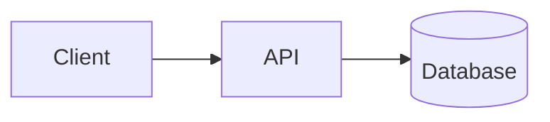
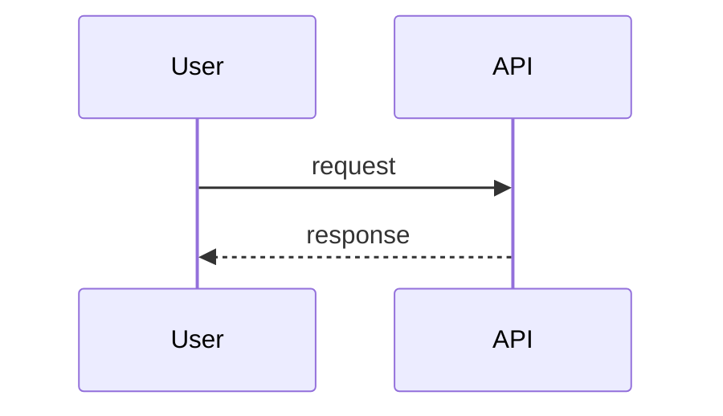
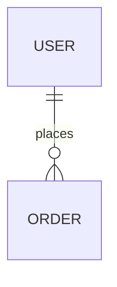

# SurfingBear Resume Optimizer — Specification

| Field | Value |
|---|---|
| Author | Madhurima Gorain |
| Version | v1.0 |
| Last updated | 2026-10-19 |
| Status | Draft |
| Backend stack | Go 1.23 |
| Frontend stack | Next.js 15 (App Router, TypeScript) |
| Data stores | PostgreSQL 16, Redis 7 |

**ID rules.** IDs are permanent and never renumbered or reused. A removed item is marked **Deprecated** and its row is kept.

| Prefix | Used for |
|---|---|
| `CR-` | Company-wide common requirement |
| `FR-` | Functional requirement |
| `NFR-` | Non-functional requirement |
| `CMP-` | Architecture component |
| `TBL-` | Database table |
| `API-` | API endpoint |
| `ERR-` | Error code |

### 0. Glossary and fixed values

These values are used throughout the spec. If a section and this table ever disagree, this table wins and the section is a bug.

| Name | Value | Used in |
|---|---|---|
| Max upload size | 5 MiB = 5,242,880 bytes | FR-003, API-004, ERR-005 |
| Allowed file types | PDF (`application/pdf`), DOCX (`application/vnd.openxmlformats-officedocument.wordprocessingml.document`) | FR-003, API-004, ERR-004 |
| Max PDF pages | 10 | FR-003, ERR-020 |
| Extracted text length | min 300, max 30,000 characters (Unicode code points, after whitespace normalisation) | FR-004, ERR-007, ERR-021 |
| Free plan quota | 3 analyses per calendar month | FR-013, ERR-009 |
| Pro plan quota | 30 analyses per calendar month | FR-013, ERR-009 |
| Quota month | Calendar month in `Asia/Kolkata` (IST, UTC+05:30), key `YYYY-MM` | FR-013, TBL-010 |
| Suggestions visible to free users | first 3 (by display order) | FR-012 |
| Max suggestions per analysis | 20 | FR-011 |
| Max missing skills per analysis | 15 | FR-010 |
| Resume file + extracted text retention | 30 days after upload | FR-018, NFR-007 |
| Analysis retention | 365 days after creation | FR-018, NFR-007 |
| Erasure request completion | within 24 hours | FR-017, NFR-008 |
| Database backup retention | 7 days | NFR-008 |
| Current consent version | `2026-10-v1` | FR-002, TBL-002 |
| AI prompt version | `analysis-v1` | FR-009, TBL-006 |
| Experience levels | `entry` (0–2 yrs), `mid` (3–5 yrs), `senior` (6–9 yrs), `lead` (10+ yrs) | FR-006, TBL-006, API-008 |
| Plans | `free`, `pro` | CR-002, FR-013 |

---

## 1. Company-wide common requirements

| ID | Area | Rule | How it is checked |
|---|---|---|---|
| CR-001 | Authentication | This module never shows a login or sign-up screen. Every API request (except API-016, API-017) must carry the SurfingBear platform access token: either the `sb_access` httpOnly cookie (browser) or `Authorization: Bearer <token>` (server-to-server, tests). The cookie wins if both are present. | Integration test: request without token → 401 `UNAUTHENTICATED` |
| CR-002 | Authentication | The token is a JWT signed with RS256 by the platform. The API verifies: signature against the platform JWKS, `iss` = `https://auth.surfingbear.com`, `aud` contains `resume-optimizer`, `exp` in the future (30 s clock skew allowed), `sub` non-empty (max 64 chars), `plan` ∈ {`free`,`pro`}. Any failure → 401 `UNAUTHENTICATED`. The token is never stored. | Unit tests per claim; code review |
| CR-003 | Authentication | JWKS is fetched from `https://auth.surfingbear.com/.well-known/jwks.json`, cached in memory for 10 minutes, and re-fetched at once when a token has an unknown `kid` (at most once per 30 s). If the JWKS cannot be fetched and no cached copy exists, requests get 503 `SERVICE_UNAVAILABLE`. | Unit test with fake JWKS server |
| CR-004 | Roles | Roles come only from the token: `plan` claim gives `free` or `pro`; the `roles` array claim containing `support_admin` gives the admin role. The module never stores or edits roles. Role × permission table in 1.2. | Unit test of the permission check per row in 1.2 |
| CR-005 | Logging | Logs are JSON, one object per line, written to stdout with Go `log/slog`. Required fields: `time` (RFC 3339, UTC), `level`, `msg`, `requestId`, `userId` (internal UUID, never `sub`), `component`. | Log sample review in CI smoke test |
| CR-006 | Logging | Personal data is never logged: no resume text, file names, email addresses, phone numbers, names, JWTs, cookies or AI prompts/responses. A slog `ReplaceAttr` hook drops attributes named `email`, `phone`, `name`, `filename`, `text`, `token`, `prompt`, `completion`. | Unit test of the hook; code review checklist item |
| CR-007 | Logging | Levels: `DEBUG` (local/dev only), `INFO` (request completed, job state change), `WARN` (retryable failure, quota denied), `ERROR` (unexpected failure, 5xx). Prod runs at `INFO`. | Config review per environment |
| CR-008 | Error handling | Every error response uses the one format in 1.4. No stack traces, SQL, or internal messages are sent to clients. Unknown errors become 500 `INTERNAL_ERROR`. | Contract test on every endpoint's error cases |
| CR-009 | Error handling | Every request gets a `requestId` (UUID v4). If the incoming `X-Request-Id` header is a valid UUID it is reused, otherwise a new one is generated. It is returned in the `X-Request-Id` response header and in every error body, and is attached to logs, traces and background jobs. | Integration test |
| CR-010 | Security | Secrets (DB password, Redis password, AI API key, KMS key ARN) come only from AWS Secrets Manager, injected as env vars at container start. Secrets are never committed, never in Docker images, never logged. | `gitleaks` in CI; image scan |
| CR-011 | Security | CORS allows only the origin `https://app.surfingbear.com` (staging: `https://app.staging.surfingbear.com`, local: `http://localhost:3000`), with credentials, methods `GET, POST, DELETE`, headers `Content-Type, X-Request-Id`. | Integration test of preflight |
| CR-012 | Security | All input is validated at the HTTP boundary (struct tags with `go-playground/validator`); unknown JSON fields are rejected (`DisallowUnknownFields`) → 400 `VALIDATION_FAILED`. JSON bodies are limited to 16 KiB; multipart uploads to 5 MiB + 64 KiB overhead. | Unit tests per handler |
| CR-013 | Security | Rate limits per user (Redis, fixed 1-minute or 1-hour windows): all endpoints 120 requests/min; API-004 upload 10/hour; API-008 create analysis 10/hour. Exceeding → 429 `RATE_LIMITED` with `Retry-After` (seconds). | Integration test |
| CR-014 | Security | Users can only see and change their own data. Every query on user data filters by `user_id` from the token. Another user's ID returns 404 `NOT_FOUND` (not 403), so IDs cannot be probed. | Integration test with two users |
| CR-015 | Data retention | Retention periods are the fixed values in section 0 and are enforced by scheduled jobs (FR-018), not by manual work. | Job tests; staging check |
| CR-016 | Security | Browser-state-changing requests (POST, DELETE) using the cookie must send `Content-Type: application/json` or `multipart/form-data` and pass the `Origin` header check against the CORS allow-list; otherwise 403 `FORBIDDEN`. The `sb_access` cookie is `SameSite=Lax`, set by the platform. | Integration test |
| CR-017 | i18n | UI text exists in English (`en`, default) and Hindi (`hi`). The locale comes from the `locale` JWT claim, falling back to `en`. API `message` fields are English only; the frontend shows a translated text keyed by the error `code`. | Frontend test: every error code has `en` and `hi` strings |
| CR-018 | i18n | The API sends and accepts times only as RFC 3339 UTC with milliseconds (`2026-10-19T08:30:00.000Z`). The UI shows dates in IST, format `19 Oct 2026, 2:00 PM`. Scores are integers. | Contract tests |
| CR-019 | Environments | Four environments: local, dev, staging, prod. Differences are in 1.7. Prod data is never copied to another environment. | Infra review |
| CR-020 | Deployment | Every change reaches prod only through the CI/CD pipeline in 1.8. No manual deploys or DB changes in prod. | GitHub branch protection + AWS IAM policy |
| CR-021 | Privacy (DPDP Act 2023) | Resume data is processed only after the user accepts the consent notice (FR-002). The notice states purpose (ATS analysis), data processed, retention, processors (AWS, Anthropic), and how to request erasure. Grievance contact: `privacy@surfingbear.com`. | Manual review of notice text; FR-002 tests |

### 1.1 Authentication

Covered by CR-001 to CR-003. Summary of the token claims the module reads:

| Claim | Type | Required | Use |
|---|---|---|---|
| `sub` | string, 1–64 chars | Yes | Platform user ID; mapped to internal `users.id` (TBL-001) |
| `plan` | `free` \| `pro` | Yes | Quota and suggestion visibility |
| `roles` | string[] | No (default `[]`) | `support_admin` enables API-015 |
| `locale` | `en` \| `hi` | No (default `en`) | UI language |
| `iss`, `aud`, `exp`, `kid` (header) | standard | Yes | Verification |

The plan is read **on every request**. If a user upgrades mid-month, the new limit applies at once to the same month's counter.

### 1.2 Roles and permissions

| Permission | Free user | Pro user | Support admin | Notes |
|---|---|---|---|---|
| Accept consent (API-003) | ✅ | ✅ | ✅ | |
| Upload / list / delete own resumes (API-004–007) | ✅ | ✅ | ✅ (own only) | |
| Create analysis (API-008) | ✅ up to 3/month | ✅ up to 30/month | ✅ with own plan's limit | |
| View own analyses (API-009, API-010) | ✅ first 3 suggestions | ✅ all suggestions | ✅ own only | |
| Download own PDF report (API-011) | ✅ same visibility as API-010 | ✅ | ✅ own only | |
| Delete own analysis / request erasure (API-012–014) | ✅ | ✅ | ✅ | |
| View aggregate usage stats (API-015) | ❌ | ❌ | ✅ | Aggregates only, no resume content |
| View another user's resume or analysis | ❌ | ❌ | ❌ | Not even admins (CR-014) |

### 1.3 Logging

CR-005 to CR-007. One access log line per request at `INFO` with: `requestId`, `userId`, `method`, `route` (pattern, e.g. `/analyses/{analysisId}`, never the raw path with IDs), `status`, `durationMs`, `bytesOut`. Worker logs one line per job state change with `analysisId`, `attempt`, `fromStatus`, `toStatus`, `failureCode`.

Security-relevant actions are also written to the `audit_events` table (TBL-012): consent accepted, resume uploaded, resume deleted, analysis deleted, erasure requested, erasure completed, admin stats viewed.

### 1.4 Error handling

The one standard error response, used by every endpoint:

```json
{
  "error": {
    "code": "FILE_TOO_LARGE",
    "message": "The file is larger than 5 MiB.",
    "requestId": "6f1c2a8e-3b7d-4c55-9e0a-1d2f3a4b5c6d",
    "details": [
      { "field": "file", "issue": "size 6291456 bytes exceeds 5242880" }
    ]
  }
}
```

| Field | Type | Required | Rule |
|---|---|---|---|
| `error.code` | string | Yes | One of the codes in 6.3, `UPPER_SNAKE_CASE` |
| `error.message` | string | Yes | English, human-readable, from 6.3; no personal data |
| `error.requestId` | string (UUID) | Yes | Same as `X-Request-Id` header |
| `error.details` | array | No | Only for `VALIDATION_FAILED` and file errors; each item `{field, issue}` |

Go implementation: handlers return `*apperr.Error{Code, HTTPStatus, Message, Details}`; one middleware writes the JSON. Any other `error` is logged at `ERROR` and returned as 500 `INTERNAL_ERROR`.

### 1.5 Security

- **Secrets:** CR-010.
- **CORS / CSRF:** CR-011, CR-016.
- **Input validation:** CR-012. File content type is decided by magic bytes, never by file extension or the client's `Content-Type` (FR-003).
- **Rate limiting:** CR-013. Implemented as Redis `INCR` + `EXPIRE` on key `rl:{userId}:{bucket}:{windowStart}`. If Redis is down, rate limiting **fails open** (request allowed, `WARN` logged) because quotas are enforced separately in PostgreSQL (FR-013).
- **Transport:** TLS 1.2+ only, HSTS `max-age=31536000`. TLS ends at the AWS ALB.
- **Encryption at rest:** RDS and ElastiCache encryption on; S3 objects with SSE-KMS (customer-managed key `surfingbear-resume-optimizer`).
- **Data retention:** section 0 and FR-018.
- **Security headers (frontend):** `Content-Security-Policy: default-src 'self'; frame-ancestors 'none'`, `X-Content-Type-Options: nosniff`, `Referrer-Policy: strict-origin-when-cross-origin`.
- **Dependency scanning:** `govulncheck` and `npm audit --audit-level=high` in CI; a high or critical finding fails the build.

### 1.6 Internationalization (i18n)

CR-017, CR-018. Frontend uses `next-intl` with message files `frontend/messages/en.json` and `frontend/messages/hi.json`. Every key must exist in both files (CI check). Analysis content (AI rationales, suggestions) is generated **in English** regardless of locale, because resumes for ATS are in English (assumption A-03).

### 1.7 Environments

| Item | local | dev | staging | prod |
|---|---|---|---|---|
| Where | Docker Compose on laptop | AWS ap-south-1, account `sb-dev` | AWS ap-south-1, account `sb-staging` | AWS ap-south-1 (Mumbai), account `sb-prod` |
| Auth | Fake JWKS server (`devtools/fakeauth`) issuing test tokens | Platform dev auth | Platform staging auth | Platform prod auth |
| Database | Postgres 16 container | RDS db.t4g.small | RDS db.t4g.medium | RDS db.r6g.large, Multi-AZ |
| Redis | Redis 7 container | ElastiCache cache.t4g.micro | cache.t4g.small | cache.r6g.large, 1 replica |
| File storage | MinIO container | S3 `sb-dev-resume-optimizer` | S3 `sb-staging-resume-optimizer` | S3 `sb-prod-resume-optimizer` |
| AI provider | Stub server returning fixed JSON (`devtools/fakeai`) | Anthropic, low-cost model | Anthropic, prod model | Anthropic, prod model |
| Log level | DEBUG | DEBUG | INFO | INFO |
| Test data | Seed script | Seed script | Synthetic resumes only | Real users |
| Deploy | `make up` | Auto on merge to `main` | Auto after dev deploy succeeds | Manual approval in GitHub Actions |

### 1.8 Deployment

- **CI (GitHub Actions, on every pull request):** lint (2.5), `go test -race ./...`, frontend `npm test`, `sqlc diff` (generated code up to date), migration check on a fresh Postgres, `gitleaks`, `govulncheck`, Docker build. All must pass to merge.
- **Build:** one Docker image per app: `resume-optimizer-api` (Go binary `api`), `resume-optimizer-worker` (Go binary `worker`, image includes `poppler-utils` for `pdftotext`), `resume-optimizer-web` (Next.js standalone). Tagged with the git SHA, pushed to ECR.
- **Run:** AWS ECS Fargate. API and web behind an ALB; worker has no public ingress.
- **Migrations:** `goose up` runs as a one-off ECS task before the new API version starts. Migrations must be backward compatible with the previous release (expand → migrate → contract), so a rollback never needs a down migration.
- **Release:** merge to `main` → dev → staging (automatic) → prod (manual approval by a tech lead). Rolling deployment, minimum healthy 100%.
- **Rollback:** redeploy the previous image tag via the same workflow (`workflow_dispatch` with `imageTag`). Target: rollback complete within 10 minutes. The ECS deployment circuit breaker rolls back automatically if new tasks fail health checks (API-017).

---

## 2. Coding conventions

### 2.1 Naming

| Item | Convention | Example |
|---|---|---|
| Go packages | lowercase, one word, no underscores | `analysis`, `apperr` |
| Go files | `snake_case.go`; tests `_test.go` | `quota_service.go` |
| Go exported types / functions | PascalCase | `AnalysisService`, `NewWorker` |
| Go unexported / local variables | camelCase; acronyms all caps | `resumeID`, `parseHTTPError` |
| Go interfaces | noun or `-er`, defined in the package that uses them | `type TextExtractor interface` |
| Constants | PascalCase (exported) / camelCase | `MaxUploadBytes` |
| TypeScript components | PascalCase file and name | `ScoreCard.tsx` |
| TypeScript functions / variables | camelCase | `fetchAnalysis` |
| DB tables | `snake_case`, plural | `analysis_suggestions` |
| DB columns | `snake_case`; FKs `<entity>_id`; times `<verb>_at` | `resume_id`, `completed_at` |
| DB indexes | `idx_<table>_<cols>`; unique `uq_<table>_<cols>` | `idx_analyses_user_id_created_at` |
| API paths | lowercase, kebab-case, plural nouns, IDs as `{camelCaseId}` | `/analyses/{analysisId}/report.pdf` |
| JSON fields | camelCase | `overallScore` |
| Query params | camelCase | `pageSize` |
| Error codes | UPPER_SNAKE_CASE | `QUOTA_EXCEEDED` |
| Env vars | UPPER_SNAKE_CASE, prefix `RO_` | `RO_DATABASE_URL` |
| Redis keys | `colon:separated`, prefix by purpose | `rl:{userId}:upload:{windowStart}` |

### 2.2 Folder / module structure

One repository `surfingbear-resume-optimizer`:

```text
surfingbear-resume-optimizer/
├── backend/
│   ├── cmd/
│   │   ├── api/main.go            # HTTP server (CMP-002)
│   │   └── worker/main.go         # asynq worker + scheduler (CMP-007, CMP-011)
│   ├── internal/
│   │   ├── config/                # env parsing (caarlos0/env), validation at start
│   │   ├── httpapi/               # chi router, middleware, handlers, DTOs
│   │   │   ├── middleware/        # requestid, logging, auth, cors, ratelimit, recover
│   │   │   └── handlers/          # one file per resource: resumes.go, analyses.go ...
│   │   ├── auth/                  # JWT + JWKS verification (CMP-003)
│   │   ├── privacy/               # consent, erasure (CMP-015)
│   │   ├── resume/                # upload, validation, storage (CMP-004)
│   │   ├── extract/               # pdf.go (pdftotext), docx.go (CMP-005)
│   │   ├── analysis/              # create, read, quota use, visibility (CMP-006)
│   │   ├── ai/                    # Anthropic client, redaction, schema validation (CMP-008)
│   │   ├── report/                # PDF report (CMP-009)
│   │   ├── quota/                 # quota + rate limit (CMP-010)
│   │   ├── retention/             # scheduled cleanup jobs (CMP-011)
│   │   ├── storage/               # S3 client wrapper
│   │   ├── jobs/                  # asynq task names + payload types
│   │   ├── apperr/                # error type + code catalogue (6.3)
│   │   └── db/                    # sqlc-generated code (do not edit)
│   ├── queries/                   # *.sql for sqlc
│   ├── migrations/                # goose: 00001_init.sql ...
│   ├── seed/                      # job_roles + job_role_skills seed (5.5)
│   ├── devtools/fakeauth, fakeai/ # local stubs
│   ├── sqlc.yaml
│   ├── .golangci.yml
│   ├── Makefile
│   └── Dockerfile.api, Dockerfile.worker
├── frontend/
│   ├── app/[locale]/resume-optimizer/
│   │   ├── page.tsx               # dashboard: quota, resumes, history
│   │   ├── new/page.tsx           # upload + choose role/level
│   │   └── analyses/[analysisId]/page.tsx   # result view
│   ├── components/                # ScoreCard, DimensionTable, SuggestionList ...
│   ├── lib/api/                   # typed API client (generated from openapi.yaml)
│   ├── messages/en.json, hi.json
│   └── ...
├── api/openapi.yaml               # source of truth for API types, matches section 6
└── docker-compose.yml
```

Rule: handlers only parse/validate input and call a service; services hold business rules; only `internal/db` talks SQL. No package imports `httpapi`.

### 2.3 Branching and commits

- `main` is protected: no direct pushes, pull request + 1 approval + green CI.
- Branch names: `feature/FR-007-create-analysis`, `fix/ERR-009-quota-refund`, `chore/upgrade-go-1.23`. Always include the requirement or error ID when one exists.
- Commits follow Conventional Commits: `<type>(<scope>): <message>`, types `feat`, `fix`, `refactor`, `test`, `docs`, `chore`, `ci`. Example: `feat(analysis): refund quota when AI fails (FR-019)`.
- Squash-merge pull requests; the PR title becomes the commit message and must follow the same format.

### 2.4 Code review rules

A PR is approved only if all of these are true (checklist in the PR template):

1. CI is green.
2. The PR links the FR/NFR IDs it implements; the traceability matrix (section 7) is updated if a component, table or API changed.
3. No personal data in logs (CR-006); no secrets in code (CR-010).
4. Every new endpoint has handler tests for success and each listed error case.
5. Every new SQL query filters by `user_id` where the table holds user data (CR-014).
6. DB migrations are backward compatible (1.8).
7. Max PR size 400 changed lines excluding generated code; larger PRs are split.

### 2.5 Lint and format

| Part | Tool | Config | When |
|---|---|---|---|
| Go format | `gofumpt` + `goimports` | — | Pre-commit hook (`lefthook`) and CI |
| Go lint | `golangci-lint` v1.61 | `backend/.golangci.yml` enabling: `errcheck`, `govet`, `staticcheck`, `gosec`, `revive`, `bodyclose`, `sqlclosecheck`, `contextcheck`, `errorlint`, `gocritic` | CI (fails build) |
| Go vulnerabilities | `govulncheck` | — | CI |
| SQL | `sqlc vet` | `sqlc.yaml` | CI |
| TS lint | ESLint 9 (`next/core-web-vitals`, `@typescript-eslint/strict`) | `frontend/eslint.config.mjs` | Pre-commit and CI |
| TS format | Prettier 3 (printWidth 100, singleQuote) | `frontend/.prettierrc` | Pre-commit and CI |
| Secrets | `gitleaks` | default rules | CI |
| Tests | `go test -race -cover`; min 70% line coverage in `internal/` (excluding `db/`) | — | CI |

---

## 3. Requirements definition

### 3.1 Functional requirements

| ID | Title | Description | Priority | Acceptance criteria |
|---|---|---|---|---|
| FR-001 | Access through platform session | A user who is logged in to SurfingBear opens the module and is recognised without any login step. On the first request for a new `sub`, the API creates a `users` row (just-in-time). | Must | 1. A valid token for an unknown `sub` creates exactly one TBL-001 row, also under 10 parallel first requests (unique `platform_user_id` + `INSERT … ON CONFLICT DO NOTHING`). 2. `last_seen_at` is updated at most once per hour per user. 3. Missing/invalid/expired token → 401 `UNAUTHENTICATED`, and the frontend redirects to `https://app.surfingbear.com/login?returnTo=<current URL>`. 4. API-001 returns plan, quota and consent status. |
| FR-002 | DPDP consent | Before the first upload, the user must read and accept the consent notice (version in section 0). | Must | 1. API-004 and API-008 return 403 `CONSENT_REQUIRED` if the user has no TBL-002 row with `consent_version` = current version and `withdrawn_at IS NULL`. 2. API-003 accepts only the current version; any other → 409 `CONSENT_VERSION_OUTDATED`. 3. Accepting twice is idempotent (returns the existing record, 200). 4. When the current version changes, every user must accept again before the next upload; old analyses stay viewable. 5. An audit event `consent.accepted` is written. |
| FR-003 | Upload resume | A user uploads one resume file (PDF or DOCX) using multipart field `file`. | Must | 1. Size > 5,242,880 bytes → 413 `FILE_TOO_LARGE`. 2. Empty file (0 bytes) → 400 `VALIDATION_FAILED`. 3. Type is decided by magic bytes: PDF starts with `%PDF-`; DOCX is a ZIP (`PK\x03\x04`) containing `word/document.xml`. Anything else (including `.doc`, images, renamed files) → 415 `UNSUPPORTED_FILE_TYPE`. 4. PDF with more than 10 pages → 422 `TOO_MANY_PAGES`. 5. Encrypted/password-protected or corrupt files → 422 `FILE_UNREADABLE`. 6. On success the file is stored in S3 under `resumes/{userId}/{resumeId}` with SSE-KMS, a TBL-005 row is created with `status = active` and `expires_at = uploaded_at + 30 days`, and 201 is returned. 7. The original file name is stored (max 255 chars, path parts stripped) only for display to its owner. 8. Uploading the same file again (same SHA-256 for the same user while the earlier one is `active`) returns 200 with the existing resume instead of storing a copy. |
| FR-004 | Extract resume text | During upload (synchronously), the text is extracted so it can be analysed. | Must | 1. PDF: `pdftotext -layout -enc UTF-8` with a 10 s timeout; timeout → 422 `FILE_UNREADABLE`. 2. DOCX: read `word/document.xml` (`<w:t>` runs, `<w:p>` → newline, `<w:tab>` → tab); max uncompressed size 20 MiB (zip-bomb guard), otherwise `FILE_UNREADABLE`. 3. Whitespace is normalised (runs of spaces → one space, more than 2 blank lines → 2). 4. Fewer than 300 characters → 422 `TEXT_TOO_SHORT` (covers scanned image PDFs; OCR is out of scope). 5. More than 30,000 characters → 422 `TEXT_TOO_LONG`. 6. If extraction fails, the S3 object is deleted and no TBL-005 row remains. 7. Extraction of a 5 MiB / 10-page file completes within NFR-001. |
| FR-005 | Manage own resumes | A user lists their resumes, views one, and deletes one. | Must | 1. API-005 lists only `active` resumes of the caller, newest first, paginated (6.1). 2. API-006 returns metadata only, never the extracted text. 3. API-007 deletes the S3 object and the row's `extracted_text` and `original_filename`, sets `status = deleted`, `deleted_at = now()`; returns 204. 4. Deleting does not delete analyses already created from it (they keep their results; `resume_id` stays for history but the resume shows as deleted). 5. Deleting an already deleted/expired resume → 404 `NOT_FOUND`. 6. A resume with a `queued` or `processing` analysis can still be deleted; that analysis then fails with `RESUME_EXPIRED` (FR-019). |
| FR-006 | Choose target role and experience level | When starting an analysis the user picks a job role from a fixed catalogue and one experience level. | Must | 1. API-002 returns all active job roles (seed in 5.5) sorted by `name`. 2. Experience level must be one of `entry`, `mid`, `senior`, `lead`; otherwise 400 `VALIDATION_FAILED`. 3. An unknown or inactive `jobRoleId` → 422 `UNKNOWN_JOB_ROLE`. 4. Free-text roles are not accepted (keeps scoring comparable; assumption A-05). |
| FR-007 | Create analysis | A user starts an analysis for one of their active resumes, a job role and a level. | Must | 1. Checks in this order: consent (FR-002) → resume exists, belongs to user, `active` (else 404 `NOT_FOUND`, or 410 `RESUME_EXPIRED` if expired/deleted) → role (FR-006) → quota (FR-013). 2. On success, in one DB transaction: quota counter +1, TBL-006 row with `status = queued`, `plan_at_creation` = token plan. Then an asynq task `analysis:run` is enqueued with the analysis ID; returns 202 with the analysis (`status = queued`). 3. If enqueue fails after commit, the row stays `queued` and the recovery job (FR-008 AC 4) enqueues it again. 4. Header `Idempotency-Key` (UUID, optional): repeating the same key within 24 h returns the same analysis and does not use quota again (Redis key `idem:{userId}:{key}`, TTL 24 h). |
| FR-008 | Asynchronous processing and status | The worker processes the analysis; the frontend polls for the result. | Must | 1. Status moves only `queued → processing → completed` or `queued/processing → failed`; any other transition is rejected by the service (and a DB CHECK on allowed values). 2. API-010 returns the current status; the frontend polls every 2 s and stops after 120 s, then shows "still working, check history later". 3. `started_at`, `completed_at` are set on the matching transitions. 4. Recovery job runs every 5 minutes: analyses `queued` for > 5 minutes are re-enqueued; analyses `processing` for > 10 minutes are set back to `queued` (attempts +1) or to `failed` with `INTERNAL_ERROR` if `attempts` ≥ 3. 5. The worker handles a task only if it can move the row from `queued` to `processing` with `UPDATE … WHERE status = 'queued'` (no double processing). |
| FR-009 | ATS score | The system scores the resume out of 100 on six fixed ATS dimensions. | Must | 1. Each dimension in the table in 3.4 gets an integer 0–100 and a rationale of 1–300 characters. 2. `overallScore = round(Σ(score × weight) / 100)`, computed by the backend, never taken from the AI. 3. Exactly six dimension rows are stored (TBL-007); a response missing a dimension or with a value out of range is invalid (FR-019). 4. The same resume, role and level with the same prompt version and model gives scores within ±5 points per dimension in ≥ 90% of reruns (temperature 0; checked by the evaluation set in NFR-012). 5. `prompt_version` and `ai_model` are stored on TBL-006. |
| FR-010 | Missing skills | The system lists skills important for the chosen role that the resume does not show. | Must | 1. The AI receives the role's skill list (TBL-004) and may return only skills from that list; any other skill is dropped by the backend. 2. Max 15 skills, each with importance `critical`, `important` or `nice_to_have` taken from TBL-004, not from the AI. 3. Ordered by importance (critical first), then by the skill's `display_order` in TBL-004. 4. An empty list is valid (resume already covers all skills). 5. Missing skills are shown to free and pro users alike. |
| FR-011 | Rewrite suggestions | The system suggests rewrites for weak resume lines. | Must | 1. Each suggestion has `originalText` (5–500 chars), `suggestedText` (5–600 chars), `reason` (1–300 chars), `dimension` (one of the six) and `severity` (`high`, `medium`, `low`). 2. `originalText` must appear in the extracted resume text (exact match after whitespace normalisation); suggestions that do not match are dropped. 3. Max 20 suggestions; ordered by severity (high → low), then by first position of `originalText` in the resume; this order is stored as `display_order` 1…n. 4. Suggestions must not invent facts: the prompt forbids adding numbers, employers, dates or skills that are not in the original line, and placeholders like `[X%]` are used when a metric is recommended. 5. Zero suggestions is valid. |
| FR-012 | Plan-based visibility | Free users see only part of the suggestions. | Must | 1. For an analysis with `plan_at_creation = free` **and** current token plan `free`, API-010 and API-011 return only suggestions with `display_order` ≤ 3, plus `lockedSuggestionCount` = total − returned. 2. If the user is `pro` now, all suggestions of all their analyses are returned (upgrade unlocks history). 3. Locked suggestion text never leaves the server (not in API, not in the PDF, not in logs). 4. Scores and missing skills are always fully visible. |
| FR-013 | Monthly quota | Each plan has a monthly analysis limit (section 0). | Must | 1. Limit is checked when creating an analysis using `usage_counters` for the current IST month, with `SELECT … FOR UPDATE`; `used ≥ limit` → 403 `QUOTA_EXCEEDED` with `details` containing `limit`, `used`, `resetsAt` (first day of next month 00:00 IST, as UTC). 2. A failed analysis gives the quota back (FR-019). 3. API-001 shows `quota.limit`, `quota.used`, `quota.remaining`, `quota.resetsAt`. 4. A downgrade from pro to free with `used` > 3 leaves `remaining = 0` (never negative). 5. Counters are never reset by a job; a new month simply uses a new row. |
| FR-014 | Analysis history | A user sees a list of their past analyses. | Must | 1. API-009 returns the caller's analyses, newest first, paginated, with `id`, `status`, `overallScore`, `jobRole`, `experienceLevel`, `resume.originalFilename` (or `null` if the resume was deleted/expired), `createdAt`. 2. Filter `status` (optional, one of the four statuses). 3. Analyses older than 365 days are not present (FR-018). |
| FR-015 | Download PDF report | A user downloads a completed analysis as a PDF. | Must | 1. API-011 returns `application/pdf`, A4, with `Content-Disposition: attachment; filename="surfingbear-ats-report-<YYYY-MM-DD>.pdf"` (date of analysis in IST; no personal data in the file name). 2. Content: title, analysis date (IST), job role, level, overall score, table of six dimensions with score and rationale, missing skills with importance, visible suggestions (FR-012), for free users a line "N more suggestions available with SurfingBear Pro", footer with analysis ID and "Generated by SurfingBear Resume Optimizer". 3. Not completed → 409 `ANALYSIS_NOT_READY`. 4. The PDF is generated on each request and not stored (no extra copy of personal data). 5. Uses embedded Noto Sans so all characters render. |
| FR-016 | Delete analysis | A user deletes one analysis. | Should | 1. API-012 hard-deletes the TBL-006 row and its children (TBL-007/008/009 via `ON DELETE CASCADE`); returns 204. 2. Quota is **not** given back. 3. A `queued`/`processing` analysis can be deleted; the worker then finds no row and ends the task without error. 4. Audit event `analysis.deleted`. |
| FR-017 | Erase all my data | Under the DPDP Act, a user can ask to erase all their data in this module. This also withdraws consent. | Must | 1. API-013 creates a TBL-011 request (`status = pending`) and enqueues `privacy:erase`; returns 202 with request ID. 2. A second request while one is `pending`/`processing` → 409 `ERASURE_IN_PROGRESS`. 3. The job deletes all S3 objects under `resumes/{userId}/`, then the user's TBL-001 row; FKs cascade to TBL-002, 005, 006, 007, 008, 009, 010. Audit events keep only the (now meaningless) UUID. 4. Completed within 24 h (job retries every 15 min up to 96 times; after that an alert fires). 5. API-014 shows `pending`, `processing`, `completed` or `failed`. 6. After completion the next API call with the same `sub` creates a fresh empty user (FR-001) and needs new consent. 7. Data in DB backups disappears when those backups expire (≤ 7 days, NFR-008); the consent notice says so. |
| FR-018 | Automatic retention | Data is deleted automatically after the periods in section 0. | Must | 1. Daily job at 02:00 IST: resumes with `expires_at < now()` and `status = active` → S3 object deleted, `extracted_text` and `original_filename` set to NULL, `status = expired`. 2. Same job: analyses with `created_at < now() − 365 days` are hard-deleted (cascade). 3. Resume rows with status `expired`/`deleted` whose last analysis is gone and `uploaded_at < now() − 365 days` are hard-deleted. 4. S3 lifecycle rule deletes any object under `resumes/` older than 31 days as a safety net. 5. Each run logs counts (no IDs) and emits metric `ro_retention_deleted_total{kind}`. |
| FR-019 | Failure handling | AI, storage or other failures during analysis are handled without losing quota. | Must | 1. AI call: timeout 60 s; on timeout, HTTP 429 or 5xx, retry up to 2 more times after 2 s and 8 s. 2. AI response not matching the schema in 4.6 (or fewer than 6 dimensions) → retry once with the same input; still invalid → `failed` with `failure_code = AI_INVALID_RESPONSE`. 3. All retries exhausted → `failed`, `failure_code = AI_UNAVAILABLE`. 4. Resume deleted/expired before processing → `failed`, `RESUME_EXPIRED`. 5. Any other error → `failed`, `INTERNAL_ERROR`. 6. Moving to `failed` and decrementing `usage_counters.used` for the analysis' quota month (`quota_period`) happen in one transaction, never below 0. 7. The UI shows a message per failure code and a "Try again" button that calls API-008 again. |
| FR-020 | Admin usage statistics | A support admin sees aggregate usage to monitor the service. | Could | 1. API-015 requires `support_admin`; others → 403 `FORBIDDEN`. 2. Returns for a date range (max 92 days): analyses created, completed, failed by `failure_code`, average overall score, count per job role, count per plan. 3. No user IDs, file names or resume content in the response. 4. Audit event `admin.stats_viewed`. |
| FR-021 | Web user interface | The Next.js frontend provides the screens for all user actions. | Must | 1. `/{locale}/resume-optimizer` — dashboard: quota card (API-001), resumes list (API-005), analysis history (API-009), "New analysis" button. 2. `/{locale}/resume-optimizer/new` — step 1 consent (if needed, API-003), step 2 upload or pick existing resume (API-004/005), step 3 role + level (API-002), "Analyse" → API-008 → redirect to result page. Client-side checks mirror FR-003 size/type before upload. 3. `/{locale}/resume-optimizer/analyses/{analysisId}` — progress state while polling (FR-008), then overall score, dimension bars, missing skills, suggestions (locked ones shown as blurred placeholders with an upgrade link to `https://app.surfingbear.com/pricing`), "Download PDF" (API-011), "Delete" (API-012). 4. Settings link "Delete all my data" → confirm dialog → API-013, then status (API-014). 5. Every API error code has a translated message (CR-017). |

### 3.2 Non-functional requirements

| ID | Category | Requirement | Measurable target | How it is verified |
|---|---|---|---|---|
| NFR-001 | Performance | Upload + validation + text extraction (API-004) | p95 < 4 s, p99 < 8 s for files ≤ 5 MiB, measured at the API | k6 load test in staging with 20 sample resumes; Prometheus histogram `ro_http_request_duration_seconds` |
| NFR-002 | Performance | Analysis end-to-end (API-008 accepted → status `completed`) | p95 < 45 s, p99 < 90 s at 10 analyses/s | k6 + worker metric `ro_analysis_duration_seconds` |
| NFR-003 | Performance | Read endpoints (API-001, 002, 005, 006, 009, 010) | p95 < 300 ms at 200 requests/s | k6 in staging |
| NFR-004 | Performance | PDF report generation (API-011) | p95 < 3 s | k6 in staging |
| NFR-005 | Availability | API and web availability (successful health checks and non-5xx responses) | ≥ 99.5% per calendar month (≈ 3 h 39 min downtime max), excluding announced maintenance ≤ 2 h/month | ALB + CloudWatch synthetic canary every 1 min |
| NFR-006 | Security | Data protection in transit and at rest | 100% of traffic TLS 1.2+; 100% of S3 objects SSE-KMS; RDS and ElastiCache encryption on | AWS Config rules; `testssl.sh` in staging |
| NFR-007 | Privacy | Retention limits are met | 0 resume files older than 31 days in S3; 0 analyses older than 366 days in DB | Daily check query + CloudWatch alarm on count > 0 |
| NFR-008 | Privacy | Erasure requests are completed and backups age out | 100% of erasure requests `completed` within 24 h; RDS automated backups retained 7 days, no manual snapshots with user data | Metric `ro_erasure_age_seconds` alert at 20 h; AWS Config |
| NFR-009 | Privacy | Data sent to the AI is minimised | Email addresses, phone numbers and URLs are replaced with `[EMAIL]`, `[PHONE]`, `[URL]` before the AI call in 100% of requests; AI provider used with zero data retention terms | Unit tests on redaction with 30 sample patterns; contract review |
| NFR-010 | Scalability | The system scales horizontally | API and worker are stateless; API autoscaling 2–10 tasks at 60% CPU; worker 2–8 tasks on queue depth > 50; handles 1,000 analyses/hour sustained | Load test in staging |
| NFR-011 | Observability | Metrics, traces, logs and alerts exist for every component | OpenTelemetry traces for 100% of requests (sampled 10% in prod, 100% of errors); RED metrics per route; alerts: 5xx rate > 2% for 5 min, analysis failure rate > 10% for 15 min, queue depth > 500, p95 breaches of NFR-001–004 for 15 min | Dashboard + alert rules reviewed before go-live |
| NFR-012 | Quality of AI output | Scores are stable and suggestions grounded | On a fixed evaluation set of 30 anonymised resumes: ≥ 90% of reruns within ±5 points per dimension; 0 suggestions whose `originalText` is not in the resume (enforced by FR-011 AC 2) | Evaluation script run on every prompt or model change |
| NFR-013 | Reliability | No analysis is lost | 0 analyses stuck in `queued`/`processing` for > 15 min | Recovery job (FR-008) + alert on query count > 0 |
| NFR-014 | Accessibility | Frontend meets WCAG 2.1 AA | 0 critical/serious axe-core violations on the three pages | `@axe-core/playwright` in CI |
| NFR-015 | Maintainability | Code quality gates | Coverage ≥ 70% in `backend/internal` (excl. `db`); 0 lint errors; 0 high/critical vulnerabilities | CI (2.5) |
| NFR-016 | Cost | AI cost per analysis is bounded | AI input ≤ 12,000 tokens and output ≤ 4,000 tokens per call (`max_tokens = 4000`); text over the input budget cannot occur because of the 30,000-char limit | Unit test on prompt size; monthly cost report |
| NFR-017 | Compatibility | Supported clients | Latest 2 versions of Chrome, Edge, Firefox, Safari; Android Chrome; screen width ≥ 360 px | Playwright on Chromium, Firefox, WebKit |

### 3.3 Assumptions and out of scope

**Assumptions** (decisions not given in the product description):

| ID | Assumption | Reason |
|---|---|---|
| A-01 | The platform issues an RS256 JWT with `sub`, `plan`, `roles`, `locale` and exposes a JWKS (CR-002). | The module must trust the existing login without its own user store. |
| A-02 | Plans are `free` and `pro`; payments and upgrades are handled by the platform. | Description mentions only "free users"; one paid tier is the simplest model. |
| A-03 | Resumes are in English; AI output is English. | ATS screening in the Indian market is almost always for English resumes. |
| A-04 | Quota limits (3 free / 30 pro) and 3 visible suggestions for free users. | Enough for free users to see value; pro limit protects AI cost. |
| A-05 | Job roles are a fixed, seeded catalogue (5.5), managed by migrations. | Fixed roles give each role a curated skill list, which makes missing-skills reliable and testable. |
| A-06 | The AI provider is Anthropic (Claude) via the Messages API, under a zero-data-retention agreement. Cross-border transfer is allowed by DPDP Act s.16 unless the Government restricts the destination country. | Strong structured output and long-context quality; contractually no training on customer data. |
| A-07 | File storage is AWS S3 in `ap-south-1` (Mumbai). | Data stays in India by default; same cloud as the platform. |
| A-08 | No OCR: scanned (image-only) PDFs are rejected with `TEXT_TOO_SHORT`. | OCR adds cost and errors; most ATS also fail on image resumes, so the message is helpful. |
| A-09 | The platform's user deletion does not automatically call this module; users erase data here via FR-017. | No platform event contract was given. |

**Out of scope:** sign-up, login, password reset, billing and plan changes; editing the resume inside the module or exporting an improved resume file; job-description upload or matching against a specific job posting; OCR; languages other than English for analysis; a mobile app; admin editing of job roles via UI; email notifications.

### 3.4 Scoring dimensions

| Key | Name | Weight | What the AI judges (given to the AI in the prompt) |
|---|---|---|---|
| `keyword_match` | Keyword match | 25 | Role keywords and job titles from the role's skill list appear in context, not just in a list |
| `skills_coverage` | Skills coverage | 20 | Share of `critical` and `important` role skills that the resume shows |
| `experience_relevance` | Experience relevance | 15 | Experience fits the chosen level's years and responsibilities |
| `impact_metrics` | Quantified impact | 15 | Bullet points state measurable results (numbers, %, scale) |
| `formatting_parseability` | ATS-friendly formatting | 15 | Simple structure an ATS can parse: standard headings, no tables/columns in text, consistent dates |
| `section_completeness` | Section completeness | 10 | Contact info, summary, experience, education and skills sections are present |

Weights sum to 100. Example: scores 80, 60, 70, 50, 90, 100 → (80×25 + 60×20 + 70×15 + 50×15 + 90×15 + 100×10) / 100 = 73.5 → `overallScore = 74` (round half up).

---

## 4. Architecture

### 4.1 Component diagram



### 4.2 Components

| ID | Component | Responsibility | Technology |
|---|---|---|---|
| CMP-001 | <name> | <what it does> | <tech> |

### 4.3 Main flows
One sequence diagram per main flow.



### 4.4 External integrations

| System | Purpose | Protocol / auth | Failure handling |
|---|---|---|---|

### 4.5 Tech stack and reasons

| Layer | Choice | Why this choice |
|---|---|---|

---

## 5. ERD and database design

### 5.1 ERD



### 5.2 Tables
One block per table.

#### TBL-001 `<table_name>`
Purpose: <one line>

| Column | Type | Null | Key | Default | Constraint / note |
|---|---|---|---|---|---|
| id | uuid | NO | PK | gen_random_uuid() | |

### 5.3 Indexes

| Table | Index | Columns | Why |
|---|---|---|---|

### 5.4 Relationships and delete rules

| From | To | Cardinality | On delete |
|---|---|---|---|

---

## 6. API design

### 6.1 Common rules
- Base path:
- Auth header / cookie:
- Pagination format:
- Date / time format and timezone:
- Standard error format (must match section 1.4):

### 6.2 Endpoints
One block per endpoint.

#### API-001 `<METHOD> <path>`
- **Purpose:**
- **Auth / role:**
- **Implements:** FR-xxx

**Request**

| Field | In (path/query/body) | Type | Required | Validation |
|---|---|---|---|---|

**Response 200**

```json
{}
```

**Errors**

| HTTP | Error code | When |
|---|---|---|

### 6.3 Error code list

| ID | Code | HTTP | Message | When it happens |
|---|---|---|---|---|

---

## 7. Traceability matrix

Every FR and NFR must appear here at least once. No empty cells — write `—` only when something genuinely does not apply, and say why.

| Requirement | Component(s) | Table(s) | API(s) | Verified by |
|---|---|---|---|---|
| FR-001 | CMP-00x | TBL-00x | API-00x | <test / acceptance criterion> |

---

## 8. Change log

| Version | Date | Author | What changed | Why | Affected IDs |
|---|---|---|---|---|---|
| v1.0 | YYYY-MM-DD | <name> | Initial version | — | — |
