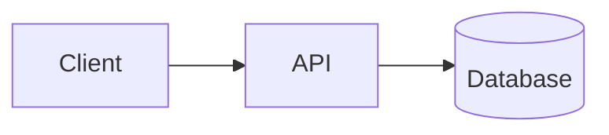
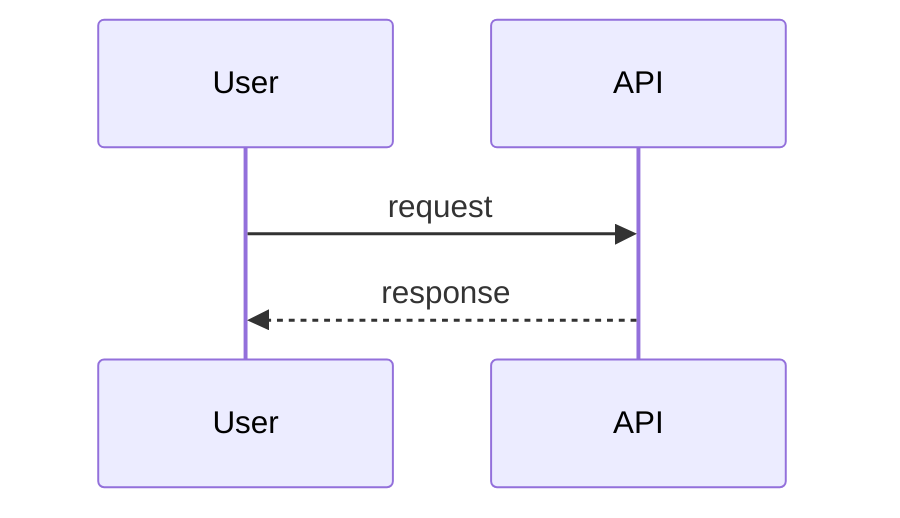
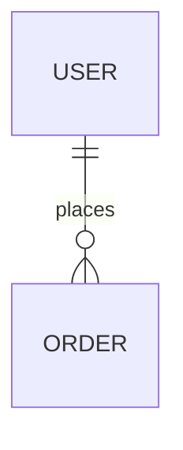

# SurfingBear Resume Optimizer — Specification

| Field | Value |
|---|---|
| Author | Madhurima Gorain |
| Version | v1.0 |
| Last updated | 2026-10-19 |
| Status | Draft |
| Backend stack | Go 1.23 |
| Frontend stack | Next.js 15 (App Router, TypeScript) |
| Data stores | PostgreSQL 16, Redis 7 |

**ID rules.** IDs are permanent and never renumbered or reused. A removed item is marked **Deprecated** and its row is kept.

| Prefix | Used for |
|---|---|
| `CR-` | Company-wide common requirement |
| `FR-` | Functional requirement |
| `NFR-` | Non-functional requirement |
| `CMP-` | Architecture component |
| `TBL-` | Database table |
| `API-` | API endpoint |
| `ERR-` | Error code |

### 0. Glossary and fixed values

These values are used throughout the spec. If a section and this table ever disagree, this table wins and the section is a bug.

| Name | Value | Used in |
|---|---|---|
| Max upload size | 5 MiB = 5,242,880 bytes | FR-003, API-004, ERR-005 |
| Allowed file types | PDF (`application/pdf`), DOCX (`application/vnd.openxmlformats-officedocument.wordprocessingml.document`) | FR-003, API-004, ERR-004 |
| Max PDF pages | 10 | FR-003, ERR-020 |
| Extracted text length | min 300, max 30,000 characters (Unicode code points, after whitespace normalisation) | FR-004, ERR-007, ERR-021 |
| Free plan quota | 3 analyses per calendar month | FR-013, ERR-009 |
| Pro plan quota | 30 analyses per calendar month | FR-013, ERR-009 |
| Quota month | Calendar month in `Asia/Kolkata` (IST, UTC+05:30), key `YYYY-MM` | FR-013, TBL-010 |
| Suggestions visible to free users | first 3 (by display order) | FR-012 |
| Max suggestions per analysis | 20 | FR-011 |
| Max missing skills per analysis | 15 | FR-010 |
| Resume file + extracted text retention | 30 days after upload | FR-018, NFR-007 |
| Analysis retention | 365 days after creation | FR-018, NFR-007 |
| Erasure request completion | within 24 hours | FR-017, NFR-008 |
| Database backup retention | 7 days | NFR-008 |
| Current consent version | `2026-10-v1` | FR-002, TBL-002 |
| AI prompt version | `analysis-v1` | FR-009, TBL-006 |
| Experience levels | `entry` (0–2 yrs), `mid` (3–5 yrs), `senior` (6–9 yrs), `lead` (10+ yrs) | FR-006, TBL-006, API-008 |
| Plans | `free`, `pro` | CR-002, FR-013 |

---

## 1. Company-wide common requirements

| ID | Area | Rule | How it is checked |
|---|---|---|---|
| CR-001 | Authentication | This module never shows a login or sign-up screen. Every API request (except API-016, API-017) must carry the SurfingBear platform access token: either the `sb_access` httpOnly cookie (browser) or `Authorization: Bearer <token>` (server-to-server, tests). The cookie wins if both are present. | Integration test: request without token → 401 `UNAUTHENTICATED` |
| CR-002 | Authentication | The token is a JWT signed with RS256 by the platform. The API verifies: signature against the platform JWKS, `iss` = `https://auth.surfingbear.com`, `aud` contains `resume-optimizer`, `exp` in the future (30 s clock skew allowed), `sub` non-empty (max 64 chars), `plan` ∈ {`free`,`pro`}. Any failure → 401 `UNAUTHENTICATED`. The token is never stored. | Unit tests per claim; code review |
| CR-003 | Authentication | JWKS is fetched from `https://auth.surfingbear.com/.well-known/jwks.json`, cached in memory for 10 minutes, and re-fetched at once when a token has an unknown `kid` (at most once per 30 s). If the JWKS cannot be fetched and no cached copy exists, requests get 503 `SERVICE_UNAVAILABLE`. | Unit test with fake JWKS server |
| CR-004 | Roles | Roles come only from the token: `plan` claim gives `free` or `pro`; the `roles` array claim containing `support_admin` gives the admin role. The module never stores or edits roles. Role × permission table in 1.2. | Unit test of the permission check per row in 1.2 |
| CR-005 | Logging | Logs are JSON, one object per line, written to stdout with Go `log/slog`. Required fields: `time` (RFC 3339, UTC), `level`, `msg`, `requestId`, `userId` (internal UUID, never `sub`), `component`. | Log sample review in CI smoke test |
| CR-006 | Logging | Personal data is never logged: no resume text, file names, email addresses, phone numbers, names, JWTs, cookies or AI prompts/responses. A slog `ReplaceAttr` hook drops attributes named `email`, `phone`, `name`, `filename`, `text`, `token`, `prompt`, `completion`. | Unit test of the hook; code review checklist item |
| CR-007 | Logging | Levels: `DEBUG` (local/dev only), `INFO` (request completed, job state change), `WARN` (retryable failure, quota denied), `ERROR` (unexpected failure, 5xx). Prod runs at `INFO`. | Config review per environment |
| CR-008 | Error handling | Every error response uses the one format in 1.4. No stack traces, SQL, or internal messages are sent to clients. Unknown errors become 500 `INTERNAL_ERROR`. | Contract test on every endpoint's error cases |
| CR-009 | Error handling | Every request gets a `requestId` (UUID v4). If the incoming `X-Request-Id` header is a valid UUID it is reused, otherwise a new one is generated. It is returned in the `X-Request-Id` response header and in every error body, and is attached to logs, traces and background jobs. | Integration test |
| CR-010 | Security | Secrets (DB password, Redis password, AI API key, KMS key ARN) come only from AWS Secrets Manager, injected as env vars at container start. Secrets are never committed, never in Docker images, never logged. | `gitleaks` in CI; image scan |
| CR-011 | Security | CORS allows only the origin `https://app.surfingbear.com` (staging: `https://app.staging.surfingbear.com`, local: `http://localhost:3000`), with credentials, methods `GET, POST, DELETE`, headers `Content-Type, X-Request-Id`. | Integration test of preflight |
| CR-012 | Security | All input is validated at the HTTP boundary (struct tags with `go-playground/validator`); unknown JSON fields are rejected (`DisallowUnknownFields`) → 400 `VALIDATION_FAILED`. JSON bodies are limited to 16 KiB; multipart uploads to 5 MiB + 64 KiB overhead. | Unit tests per handler |
| CR-013 | Security | Rate limits per user (Redis, fixed 1-minute or 1-hour windows): all endpoints 120 requests/min; API-004 upload 10/hour; API-008 create analysis 10/hour. Exceeding → 429 `RATE_LIMITED` with `Retry-After` (seconds). | Integration test |
| CR-014 | Security | Users can only see and change their own data. Every query on user data filters by `user_id` from the token. Another user's ID returns 404 `NOT_FOUND` (not 403), so IDs cannot be probed. | Integration test with two users |
| CR-015 | Data retention | Retention periods are the fixed values in section 0 and are enforced by scheduled jobs (FR-018), not by manual work. | Job tests; staging check |
| CR-016 | Security | Browser-state-changing requests (POST, DELETE) using the cookie must send `Content-Type: application/json` or `multipart/form-data` and pass the `Origin` header check against the CORS allow-list; otherwise 403 `FORBIDDEN`. The `sb_access` cookie is `SameSite=Lax`, set by the platform. | Integration test |
| CR-017 | i18n | UI text exists in English (`en`, default) and Hindi (`hi`). The locale comes from the `locale` JWT claim, falling back to `en`. API `message` fields are English only; the frontend shows a translated text keyed by the error `code`. | Frontend test: every error code has `en` and `hi` strings |
| CR-018 | i18n | The API sends and accepts times only as RFC 3339 UTC with milliseconds (`2026-10-19T08:30:00.000Z`). The UI shows dates in IST, format `19 Oct 2026, 2:00 PM`. Scores are integers. | Contract tests |
| CR-019 | Environments | Four environments: local, dev, staging, prod. Differences are in 1.7. Prod data is never copied to another environment. | Infra review |
| CR-020 | Deployment | Every change reaches prod only through the CI/CD pipeline in 1.8. No manual deploys or DB changes in prod. | GitHub branch protection + AWS IAM policy |
| CR-021 | Privacy (DPDP Act 2023) | Resume data is processed only after the user accepts the consent notice (FR-002). The notice states purpose (ATS analysis), data processed, retention, processors (AWS, Anthropic), and how to request erasure. Grievance contact: `privacy@surfingbear.com`. | Manual review of notice text; FR-002 tests |

### 1.1 Authentication

Covered by CR-001 to CR-003. Summary of the token claims the module reads:

| Claim | Type | Required | Use |
|---|---|---|---|
| `sub` | string, 1–64 chars | Yes | Platform user ID; mapped to internal `users.id` (TBL-001) |
| `plan` | `free` \| `pro` | Yes | Quota and suggestion visibility |
| `roles` | string[] | No (default `[]`) | `support_admin` enables API-015 |
| `locale` | `en` \| `hi` | No (default `en`) | UI language |
| `iss`, `aud`, `exp`, `kid` (header) | standard | Yes | Verification |

The plan is read **on every request**. If a user upgrades mid-month, the new limit applies at once to the same month's counter.

### 1.2 Roles and permissions

| Permission | Free user | Pro user | Support admin | Notes |
|---|---|---|---|---|
| Accept consent (API-003) | ✅ | ✅ | ✅ | |
| Upload / list / delete own resumes (API-004–007) | ✅ | ✅ | ✅ (own only) | |
| Create analysis (API-008) | ✅ up to 3/month | ✅ up to 30/month | ✅ with own plan's limit | |
| View own analyses (API-009, API-010) | ✅ first 3 suggestions | ✅ all suggestions | ✅ own only | |
| Download own PDF report (API-011) | ✅ same visibility as API-010 | ✅ | ✅ own only | |
| Delete own analysis / request erasure (API-012–014) | ✅ | ✅ | ✅ | |
| View aggregate usage stats (API-015) | ❌ | ❌ | ✅ | Aggregates only, no resume content |
| View another user's resume or analysis | ❌ | ❌ | ❌ | Not even admins (CR-014) |

### 1.3 Logging

CR-005 to CR-007. One access log line per request at `INFO` with: `requestId`, `userId`, `method`, `route` (pattern, e.g. `/analyses/{analysisId}`, never the raw path with IDs), `status`, `durationMs`, `bytesOut`. Worker logs one line per job state change with `analysisId`, `attempt`, `fromStatus`, `toStatus`, `failureCode`.

Security-relevant actions are also written to the `audit_events` table (TBL-012): consent accepted, resume uploaded, resume deleted, analysis deleted, erasure requested, erasure completed, admin stats viewed.

### 1.4 Error handling

The one standard error response, used by every endpoint:

```json
{
  "error": {
    "code": "FILE_TOO_LARGE",
    "message": "The file is larger than 5 MiB.",
    "requestId": "6f1c2a8e-3b7d-4c55-9e0a-1d2f3a4b5c6d",
    "details": [
      { "field": "file", "issue": "size 6291456 bytes exceeds 5242880" }
    ]
  }
}
```

| Field | Type | Required | Rule |
|---|---|---|---|
| `error.code` | string | Yes | One of the codes in 6.3, `UPPER_SNAKE_CASE` |
| `error.message` | string | Yes | English, human-readable, from 6.3; no personal data |
| `error.requestId` | string (UUID) | Yes | Same as `X-Request-Id` header |
| `error.details` | array | No | Only for `VALIDATION_FAILED` and file errors; each item `{field, issue}` |

Go implementation: handlers return `*apperr.Error{Code, HTTPStatus, Message, Details}`; one middleware writes the JSON. Any other `error` is logged at `ERROR` and returned as 500 `INTERNAL_ERROR`.

### 1.5 Security

- **Secrets:** CR-010.
- **CORS / CSRF:** CR-011, CR-016.
- **Input validation:** CR-012. File content type is decided by magic bytes, never by file extension or the client's `Content-Type` (FR-003).
- **Rate limiting:** CR-013. Implemented as Redis `INCR` + `EXPIRE` on key `rl:{userId}:{bucket}:{windowStart}`. If Redis is down, rate limiting **fails open** (request allowed, `WARN` logged) because quotas are enforced separately in PostgreSQL (FR-013).
- **Transport:** TLS 1.2+ only, HSTS `max-age=31536000`. TLS ends at the AWS ALB.
- **Encryption at rest:** RDS and ElastiCache encryption on; S3 objects with SSE-KMS (customer-managed key `surfingbear-resume-optimizer`).
- **Data retention:** section 0 and FR-018.
- **Security headers (frontend):** `Content-Security-Policy: default-src 'self'; frame-ancestors 'none'`, `X-Content-Type-Options: nosniff`, `Referrer-Policy: strict-origin-when-cross-origin`.
- **Dependency scanning:** `govulncheck` and `npm audit --audit-level=high` in CI; a high or critical finding fails the build.

### 1.6 Internationalization (i18n)

CR-017, CR-018. Frontend uses `next-intl` with message files `frontend/messages/en.json` and `frontend/messages/hi.json`. Every key must exist in both files (CI check). Analysis content (AI rationales, suggestions) is generated **in English** regardless of locale, because resumes for ATS are in English (assumption A-03).

### 1.7 Environments

| Item | local | dev | staging | prod |
|---|---|---|---|---|
| Where | Docker Compose on laptop | AWS ap-south-1, account `sb-dev` | AWS ap-south-1, account `sb-staging` | AWS ap-south-1 (Mumbai), account `sb-prod` |
| Auth | Fake JWKS server (`devtools/fakeauth`) issuing test tokens | Platform dev auth | Platform staging auth | Platform prod auth |
| Database | Postgres 16 container | RDS db.t4g.small | RDS db.t4g.medium | RDS db.r6g.large, Multi-AZ |
| Redis | Redis 7 container | ElastiCache cache.t4g.micro | cache.t4g.small | cache.r6g.large, 1 replica |
| File storage | MinIO container | S3 `sb-dev-resume-optimizer` | S3 `sb-staging-resume-optimizer` | S3 `sb-prod-resume-optimizer` |
| AI provider | Stub server returning fixed JSON (`devtools/fakeai`) | Anthropic, low-cost model | Anthropic, prod model | Anthropic, prod model |
| Log level | DEBUG | DEBUG | INFO | INFO |
| Test data | Seed script | Seed script | Synthetic resumes only | Real users |
| Deploy | `make up` | Auto on merge to `main` | Auto after dev deploy succeeds | Manual approval in GitHub Actions |

### 1.8 Deployment

- **CI (GitHub Actions, on every pull request):** lint (2.5), `go test -race ./...`, frontend `npm test`, `sqlc diff` (generated code up to date), migration check on a fresh Postgres, `gitleaks`, `govulncheck`, Docker build. All must pass to merge.
- **Build:** one Docker image per app: `resume-optimizer-api` (Go binary `api`), `resume-optimizer-worker` (Go binary `worker`, image includes `poppler-utils` for `pdftotext`), `resume-optimizer-web` (Next.js standalone). Tagged with the git SHA, pushed to ECR.
- **Run:** AWS ECS Fargate. API and web behind an ALB; worker has no public ingress.
- **Migrations:** `goose up` runs as a one-off ECS task before the new API version starts. Migrations must be backward compatible with the previous release (expand → migrate → contract), so a rollback never needs a down migration.
- **Release:** merge to `main` → dev → staging (automatic) → prod (manual approval by a tech lead). Rolling deployment, minimum healthy 100%.
- **Rollback:** redeploy the previous image tag via the same workflow (`workflow_dispatch` with `imageTag`). Target: rollback complete within 10 minutes. The ECS deployment circuit breaker rolls back automatically if new tasks fail health checks (API-017).

---

## 2. Coding conventions

### 2.1 Naming

| Item | Convention | Example |
|---|---|---|
| Go packages | lowercase, one word, no underscores | `analysis`, `apperr` |
| Go files | `snake_case.go`; tests `_test.go` | `quota_service.go` |
| Go exported types / functions | PascalCase | `AnalysisService`, `NewWorker` |
| Go unexported / local variables | camelCase; acronyms all caps | `resumeID`, `parseHTTPError` |
| Go interfaces | noun or `-er`, defined in the package that uses them | `type TextExtractor interface` |
| Constants | PascalCase (exported) / camelCase | `MaxUploadBytes` |
| TypeScript components | PascalCase file and name | `ScoreCard.tsx` |
| TypeScript functions / variables | camelCase | `fetchAnalysis` |
| DB tables | `snake_case`, plural | `analysis_suggestions` |
| DB columns | `snake_case`; FKs `<entity>_id`; times `<verb>_at` | `resume_id`, `completed_at` |
| DB indexes | `idx_<table>_<cols>`; unique `uq_<table>_<cols>` | `idx_analyses_user_id_created_at` |
| API paths | lowercase, kebab-case, plural nouns, IDs as `{camelCaseId}` | `/analyses/{analysisId}/report.pdf` |
| JSON fields | camelCase | `overallScore` |
| Query params | camelCase | `pageSize` |
| Error codes | UPPER_SNAKE_CASE | `QUOTA_EXCEEDED` |
| Env vars | UPPER_SNAKE_CASE, prefix `RO_` | `RO_DATABASE_URL` |
| Redis keys | `colon:separated`, prefix by purpose | `rl:{userId}:upload:{windowStart}` |

### 2.2 Folder / module structure

One repository `surfingbear-resume-optimizer`:

```text
surfingbear-resume-optimizer/
├── backend/
│   ├── cmd/
│   │   ├── api/main.go            # HTTP server (CMP-002)
│   │   └── worker/main.go         # asynq worker + scheduler (CMP-007, CMP-011)
│   ├── internal/
│   │   ├── config/                # env parsing (caarlos0/env), validation at start
│   │   ├── httpapi/               # chi router, middleware, handlers, DTOs
│   │   │   ├── middleware/        # requestid, logging, auth, cors, ratelimit, recover
│   │   │   └── handlers/          # one file per resource: resumes.go, analyses.go ...
│   │   ├── auth/                  # JWT + JWKS verification (CMP-003)
│   │   ├── privacy/               # consent, erasure (CMP-015)
│   │   ├── resume/                # upload, validation, storage (CMP-004)
│   │   ├── extract/               # pdf.go (pdftotext), docx.go (CMP-005)
│   │   ├── analysis/              # create, read, quota use, visibility (CMP-006)
│   │   ├── ai/                    # Anthropic client, redaction, schema validation (CMP-008)
│   │   ├── report/                # PDF report (CMP-009)
│   │   ├── quota/                 # quota + rate limit (CMP-010)
│   │   ├── retention/             # scheduled cleanup jobs (CMP-011)
│   │   ├── storage/               # S3 client wrapper
│   │   ├── jobs/                  # asynq task names + payload types
│   │   ├── apperr/                # error type + code catalogue (6.3)
│   │   └── db/                    # sqlc-generated code (do not edit)
│   ├── queries/                   # *.sql for sqlc
│   ├── migrations/                # goose: 00001_init.sql ...
│   ├── seed/                      # job_roles + job_role_skills seed (5.5)
│   ├── devtools/fakeauth, fakeai/ # local stubs
│   ├── sqlc.yaml
│   ├── .golangci.yml
│   ├── Makefile
│   └── Dockerfile.api, Dockerfile.worker
├── frontend/
│   ├── app/[locale]/resume-optimizer/
│   │   ├── page.tsx               # dashboard: quota, resumes, history
│   │   ├── new/page.tsx           # upload + choose role/level
│   │   └── analyses/[analysisId]/page.tsx   # result view
│   ├── components/                # ScoreCard, DimensionTable, SuggestionList ...
│   ├── lib/api/                   # typed API client (generated from openapi.yaml)
│   ├── messages/en.json, hi.json
│   └── ...
├── api/openapi.yaml               # source of truth for API types, matches section 6
└── docker-compose.yml
```

Rule: handlers only parse/validate input and call a service; services hold business rules; only `internal/db` talks SQL. No package imports `httpapi`.

### 2.3 Branching and commits

- `main` is protected: no direct pushes, pull request + 1 approval + green CI.
- Branch names: `feature/FR-007-create-analysis`, `fix/ERR-009-quota-refund`, `chore/upgrade-go-1.23`. Always include the requirement or error ID when one exists.
- Commits follow Conventional Commits: `<type>(<scope>): <message>`, types `feat`, `fix`, `refactor`, `test`, `docs`, `chore`, `ci`. Example: `feat(analysis): refund quota when AI fails (FR-019)`.
- Squash-merge pull requests; the PR title becomes the commit message and must follow the same format.

### 2.4 Code review rules

A PR is approved only if all of these are true (checklist in the PR template):

1. CI is green.
2. The PR links the FR/NFR IDs it implements; the traceability matrix (section 7) is updated if a component, table or API changed.
3. No personal data in logs (CR-006); no secrets in code (CR-010).
4. Every new endpoint has handler tests for success and each listed error case.
5. Every new SQL query filters by `user_id` where the table holds user data (CR-014).
6. DB migrations are backward compatible (1.8).
7. Max PR size 400 changed lines excluding generated code; larger PRs are split.

### 2.5 Lint and format

| Part | Tool | Config | When |
|---|---|---|---|
| Go format | `gofumpt` + `goimports` | — | Pre-commit hook (`lefthook`) and CI |
| Go lint | `golangci-lint` v1.61 | `backend/.golangci.yml` enabling: `errcheck`, `govet`, `staticcheck`, `gosec`, `revive`, `bodyclose`, `sqlclosecheck`, `contextcheck`, `errorlint`, `gocritic` | CI (fails build) |
| Go vulnerabilities | `govulncheck` | — | CI |
| SQL | `sqlc vet` | `sqlc.yaml` | CI |
| TS lint | ESLint 9 (`next/core-web-vitals`, `@typescript-eslint/strict`) | `frontend/eslint.config.mjs` | Pre-commit and CI |
| TS format | Prettier 3 (printWidth 100, singleQuote) | `frontend/.prettierrc` | Pre-commit and CI |
| Secrets | `gitleaks` | default rules | CI |
| Tests | `go test -race -cover`; min 70% line coverage in `internal/` (excluding `db/`) | — | CI |

---

## 3. Requirements definition

### 3.1 Functional requirements

| ID | Title | Description | Priority | Acceptance criteria |
|---|---|---|---|---|
| FR-001 | <title> | <what the system does, who does it> | Must / Should / Could | 1. … 2. … |

> Example: `FR-003 | Reset password | A registered user can request a password reset link by email. | Must | 1. The link expires after 30 minutes. 2. The link works only once. 3. Requesting a reset for an unknown email returns the same response as a known one (no account enumeration).`

### 3.2 Non-functional requirements

| ID | Category | Requirement | Measurable target | How it is verified |
|---|---|---|---|---|
| NFR-001 | Performance | <...> | <number + unit> | <test / tool> |

Cover at least: performance, security, availability, privacy, scalability, observability.

### 3.3 Assumptions and out of scope
List what you assumed and what this spec deliberately does **not** cover.

---

## 4. Architecture

### 4.1 Component diagram



### 4.2 Components

| ID | Component | Responsibility | Technology |
|---|---|---|---|
| CMP-001 | <name> | <what it does> | <tech> |

### 4.3 Main flows
One sequence diagram per main flow.



### 4.4 External integrations

| System | Purpose | Protocol / auth | Failure handling |
|---|---|---|---|

### 4.5 Tech stack and reasons

| Layer | Choice | Why this choice |
|---|---|---|

---

## 5. ERD and database design

### 5.1 ERD



### 5.2 Tables
One block per table.

#### TBL-001 `<table_name>`
Purpose: <one line>

| Column | Type | Null | Key | Default | Constraint / note |
|---|---|---|---|---|---|
| id | uuid | NO | PK | gen_random_uuid() | |

### 5.3 Indexes

| Table | Index | Columns | Why |
|---|---|---|---|

### 5.4 Relationships and delete rules

| From | To | Cardinality | On delete |
|---|---|---|---|

---

## 6. API design

### 6.1 Common rules
- Base path:
- Auth header / cookie:
- Pagination format:
- Date / time format and timezone:
- Standard error format (must match section 1.4):

### 6.2 Endpoints
One block per endpoint.

#### API-001 `<METHOD> <path>`
- **Purpose:**
- **Auth / role:**
- **Implements:** FR-xxx

**Request**

| Field | In (path/query/body) | Type | Required | Validation |
|---|---|---|---|---|

**Response 200**

```json
{}
```

**Errors**

| HTTP | Error code | When |
|---|---|---|

### 6.3 Error code list

| ID | Code | HTTP | Message | When it happens |
|---|---|---|---|---|

---

## 7. Traceability matrix

Every FR and NFR must appear here at least once. No empty cells — write `—` only when something genuinely does not apply, and say why.

| Requirement | Component(s) | Table(s) | API(s) | Verified by |
|---|---|---|---|---|
| FR-001 | CMP-00x | TBL-00x | API-00x | <test / acceptance criterion> |

---

## 8. Change log

| Version | Date | Author | What changed | Why | Affected IDs |
|---|---|---|---|---|---|
| v1.0 | YYYY-MM-DD | <name> | Initial version | — | — |
