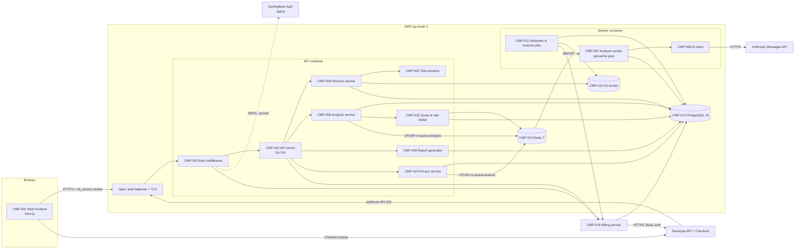
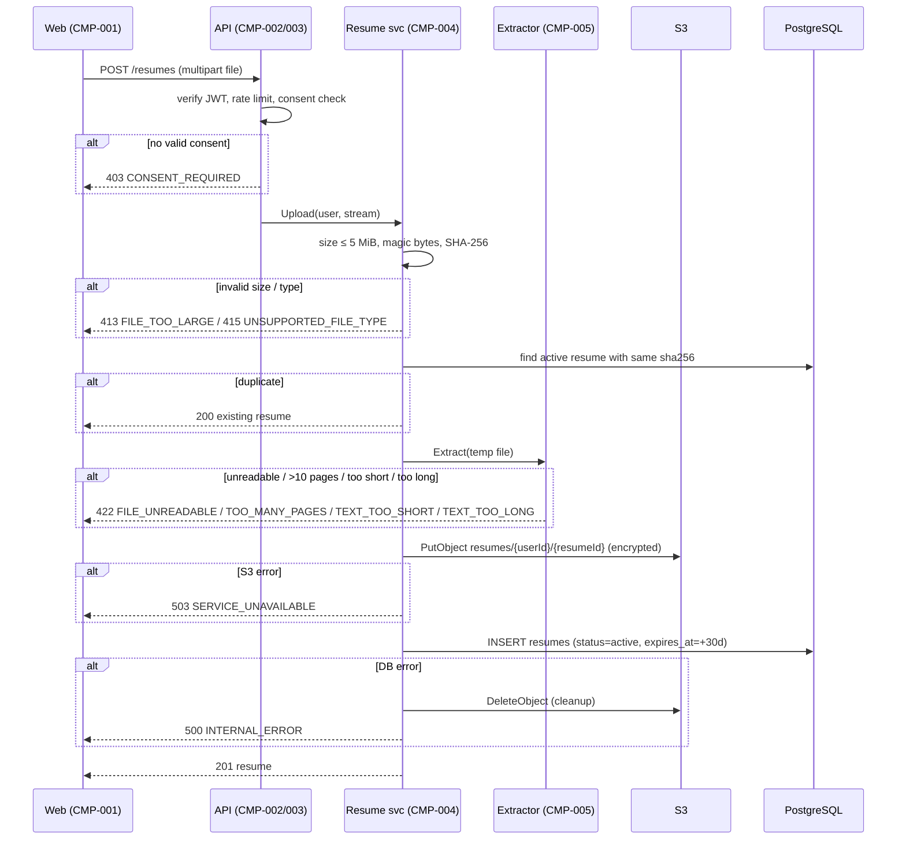
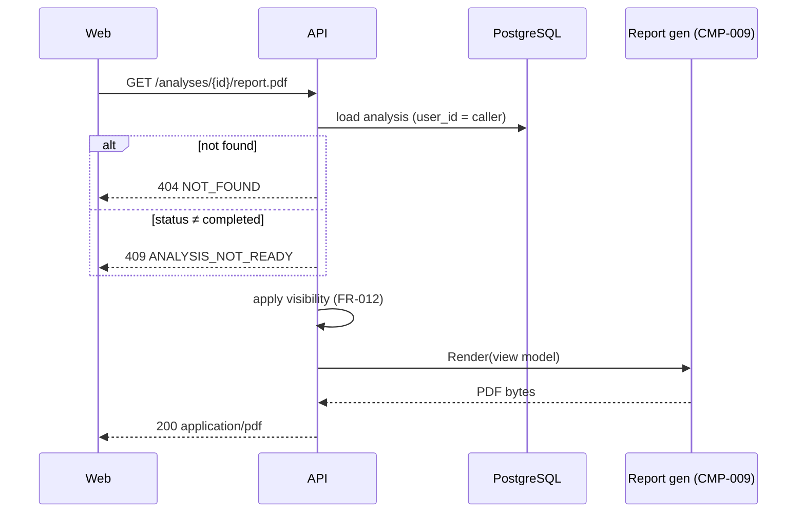
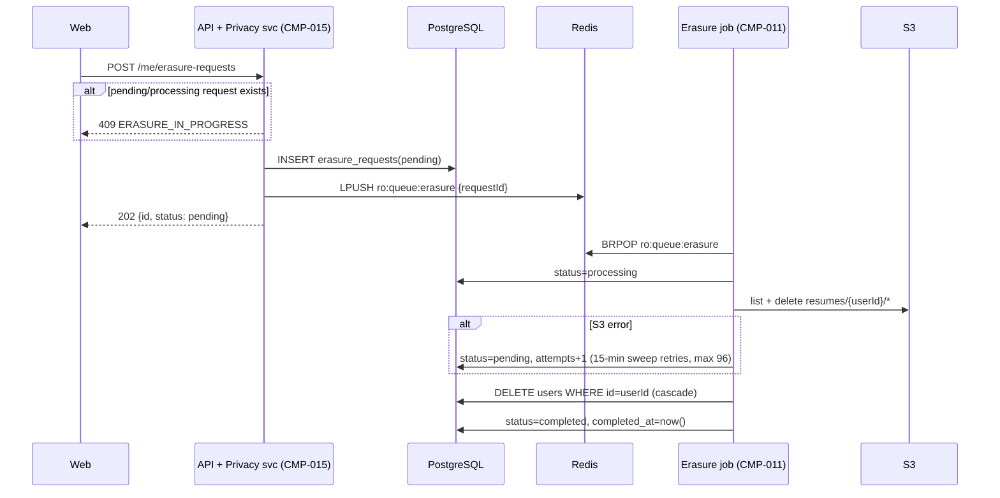
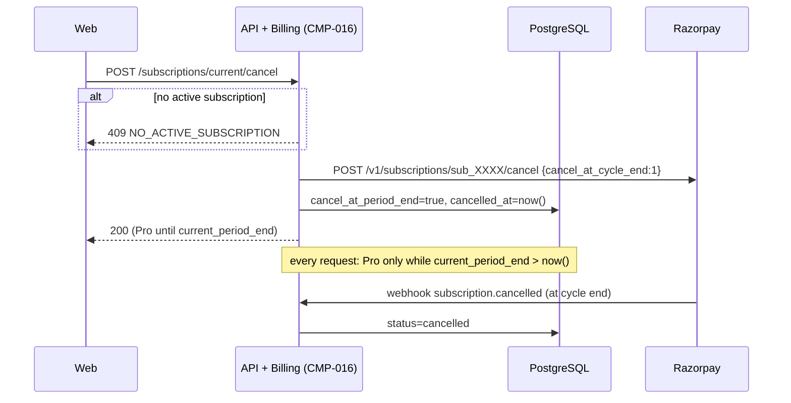
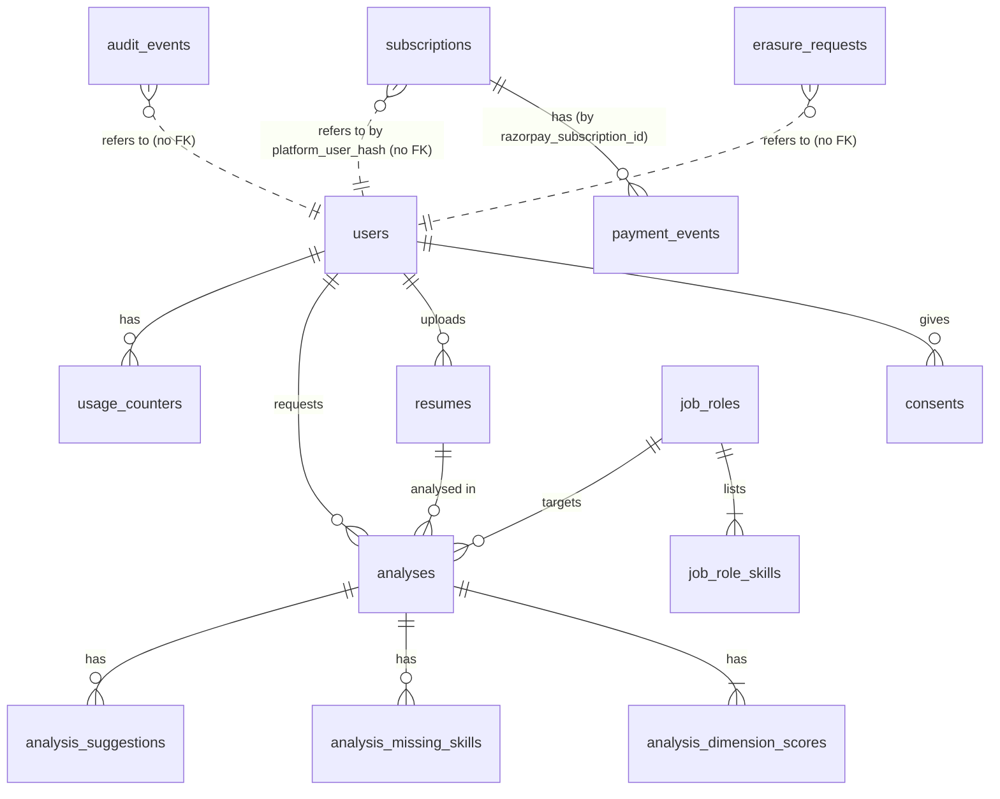

# SurfingBear Resume Optimizer — Specification

| Field | Value |
|---|---|
| Author | Madhurima Gorain |
| Version | v2.0 |
| Last updated | 2026-10-26 |
| Status | Draft |

**ID rules.** IDs are permanent and never renumbered or reused. A removed item is marked **Deprecated** and its row is kept.

| Prefix | Used for |
|---|---|
| `CR-` | Company-wide common requirement |
| `FR-` | Functional requirement |
| `NFR-` | Non-functional requirement |
| `CMP-` | Architecture component |
| `TBL-` | Database table |
| `API-` | API endpoint |
| `ERR-` | Error code |

---

## 1. Company-wide common requirements

| ID | Area | Rule | How it is checked |
|---|---|---|---|
| CR-001 | Authentication | This module never shows a login or sign-up screen. Every API request (except API-016, API-017, API-018, and API-022 which is authenticated by the Razorpay signature, CR-022) must carry the SurfingBear platform access token: either the `sb_access` httpOnly cookie (browser) or `Authorization: Bearer <token>` (server-to-server, tests). The cookie wins if both are present. | Integration test: request without token → 401 `UNAUTHENTICATED` |
| CR-002 | Authentication | The token is a JWT signed with RS256 by the platform. The API verifies: signature against the platform JWKS, `iss` = `https://auth.surfingbear.com`, `aud` contains `resume-optimizer`, `exp` in the future (30 s clock skew allowed), `sub` non-empty (max 64 chars). Any failure → 401 `UNAUTHENTICATED`. The token is never stored. | Unit tests per claim; code review |
| CR-003 | Authentication | JWKS is fetched from `https://auth.surfingbear.com/.well-known/jwks.json`, cached in memory for 10 minutes, and re-fetched at once when a token has an unknown `kid` (at most once per 30 s). If the JWKS cannot be fetched and no cached copy exists, requests get 503 `SERVICE_UNAVAILABLE`. | Unit test with fake JWKS server |
| CR-004 | Roles | The plan (`free` or `pro`) comes only from this module's subscription records (FR-025, TBL-013); the token's `plan` claim is ignored since v2.0. The admin role comes only from the token: the `roles` array claim containing `support_admin`. The module never stores or edits roles. Role × permission table in 1.2. | Unit test of the permission check per row in 1.2 |
| CR-005 | Logging | Logs are JSON, one object per line, written to stdout with Go `log/slog`. Required fields: `time` (RFC 3339, UTC), `level`, `msg`, `requestId`, `userId` (internal UUID, never `sub`), `component`. | Log sample review in CI smoke test |
| CR-006 | Logging | Personal data is never logged: no resume text, file names, email addresses, phone numbers, names, JWTs, cookies or AI prompts/responses. A slog `ReplaceAttr` hook drops attributes named `email`, `phone`, `name`, `filename`, `text`, `token`, `prompt`, `completion`, `signature`, `secret`. Razorpay request/response bodies are never logged; only Razorpay IDs (`sub_…`, `pay_…`, `evt_…`) may be logged. | Unit test of the hook; code review checklist item |
| CR-007 | Logging | Levels: `DEBUG` (local/dev only), `INFO` (request completed, job state change), `WARN` (retryable failure, quota denied), `ERROR` (unexpected failure, 5xx). Prod runs at `INFO`. | Config review per environment |
| CR-008 | Error handling | Every error response uses the one format in 1.4. No stack traces, SQL, or internal messages are sent to clients. Unknown errors become 500 `INTERNAL_ERROR`. | Contract test on every endpoint's error cases |
| CR-009 | Error handling | Every request gets a `requestId` (UUID v4). If the incoming `X-Request-Id` header is a valid UUID it is reused, otherwise a new one is generated. It is returned in the `X-Request-Id` response header and in every error body, and is attached to logs, traces and background jobs. | Integration test |
| CR-010 | Security | Secrets (DB password, Redis password, AI API key, S3 access key, Razorpay key secret, Razorpay webhook secret) come only from environment variables. For dev/staging/prod they are stored as GitHub Actions secrets and the deploy job writes them to `/opt/resume-optimizer/.env` on the server (file permission `600`, owner `deploy`). Secrets are never committed, never in Docker images, never logged. | Code review; GitHub secret scanning on the repo |
| CR-011 | Security | CORS allows only the origin `https://app.surfingbear.com` (staging: `https://app.staging.surfingbear.com`, local: `http://localhost:3000`), with credentials, methods `GET, POST, DELETE`, headers `Content-Type, X-Request-Id`. | Integration test of preflight |
| CR-012 | Security | All input is validated at the HTTP boundary (Gin `binding` struct tags, which use `go-playground/validator`); unknown JSON fields are rejected (`binding.EnableDecoderDisallowUnknownFields = true`) → 400 `VALIDATION_FAILED`. JSON bodies are limited to 16 KiB; multipart uploads to 5 MiB + 64 KiB overhead. | Unit tests per handler |
| CR-013 | Security | Rate limits per user (Redis, fixed 1-minute or 1-hour windows): all endpoints 120 requests/min; API-004 upload 10/hour; API-008 create analysis 10/hour. Exceeding → 429 `RATE_LIMITED` with `Retry-After` (seconds). | Integration test |
| CR-014 | Security | Users can only see and change their own data. Every query on user data filters by `user_id` from the token. Another user's ID returns 404 `NOT_FOUND` (not 403), so IDs cannot be probed. | Integration test with two users |
| CR-015 | Data retention | Retention periods are the fixed values in 3.3 and are enforced by scheduled jobs (FR-018), not by manual work. | Job tests; staging check |
| CR-016 | Security | Browser-state-changing requests (POST, DELETE) using the cookie must send `Content-Type: application/json` or `multipart/form-data` and pass the `Origin` header check against the CORS allow-list; otherwise 403 `FORBIDDEN`. API-022 (server-to-server webhook) is exempt and is protected by CR-022 instead. The `sb_access` cookie is `SameSite=Lax`, set by the platform. | Integration test |
| CR-022 | Payments | Card/UPI details are entered only in Razorpay Checkout and never reach this module. Every Razorpay webhook (API-022) is accepted only if `X-Razorpay-Signature` equals the hex HMAC-SHA256 of the raw request body with the webhook secret (constant-time compare); otherwise 401 `INVALID_WEBHOOK_SIGNATURE`. Every checkout result (API-020) is accepted only if `razorpay_signature` equals HMAC-SHA256 of `razorpay_payment_id + "|" + razorpay_subscription_id` with the key secret. | Unit tests with known signatures; code review |
| CR-017 | i18n | UI text exists in English (`en`, default) and Hindi (`hi`). The locale comes from the `locale` JWT claim, falling back to `en`. API `message` fields are English only; the frontend shows a translated text keyed by the error `code`. | Frontend test: every error code has `en` and `hi` strings |
| CR-018 | i18n | The API sends and accepts times only as RFC 3339 UTC with milliseconds (`2026-10-19T08:30:00.000Z`). The UI shows dates in IST, format `19 Oct 2026, 2:00 PM`. Scores are integers. | Contract tests |
| CR-019 | Environments | Four environments: local, dev, staging, prod. Differences are in 1.7. Prod data is never copied to another environment. | Infra review |
| CR-020 | Deployment | Every change reaches prod only through the CI/CD pipeline in 1.8. No manual deploys or DB changes in prod. | GitHub branch protection; servers accept SSH only with the CI deploy key |
| CR-021 | Privacy (DPDP Act 2023) | Resume data is processed only after the user accepts the consent notice (FR-002). The notice states purpose (ATS analysis), data processed, retention, processors (AWS, Anthropic), and how to request erasure. Grievance contact: `privacy@surfingbear.com`. | Manual review of notice text; FR-002 tests |

### 1.1 Authentication

Covered by CR-001 to CR-003. Summary of the token claims the module reads:

| Claim | Type | Required | Use |
|---|---|---|---|
| `sub` | string, 1–64 chars | Yes | Platform user ID; mapped to internal `users.id` (TBL-001) |
| `plan` | `free` \| `pro` | No | **Deprecated (v2.0):** ignored; the plan comes from TBL-013 (FR-025) |
| `roles` | string[] | No (default `[]`) | `support_admin` enables API-015 |
| `locale` | `en` \| `hi` | No (default `en`) | UI language |
| `iss`, `aud`, `exp`, `kid` (header) | standard | Yes | Verification |

The plan is worked out **on every request** from TBL-013 (FR-025), using `platform_user_hash` = SHA-256 hex of `sub`. A user who subscribes mid-month is Pro at once; a user whose paid month ends is free at once.

### 1.2 Roles and permissions

| Permission | Free user | Pro user | Support admin | Notes |
|---|---|---|---|---|
| Accept consent (API-003) | ✅ | ✅ | ✅ | |
| Upload / list / delete own resumes (API-004–007) | ✅ | ✅ | ✅ (own only) | |
| Create analysis (API-008) | ✅ up to 3/month | ✅ unlimited (rate limit CR-013 still applies) | ✅ with own plan's limit | |
| View own analyses (API-009, API-010) | ✅ first 3 suggestions | ✅ all suggestions | ✅ own only | |
| Download own PDF report (API-011) | ✅ same visibility as API-010 | ✅ | ✅ own only | |
| Delete own analysis / request erasure (API-012–014) | ✅ | ✅ | ✅ | |
| Subscribe to Resume Pro (API-019, API-020) | ✅ | ❌ (already Pro → 409) | ✅ | FR-022 |
| View own subscription (API-024) | ✅ | ✅ | ✅ | FR-027 |
| Cancel own subscription (API-021) | ❌ (nothing to cancel → 409) | ✅ | ✅ (own only) | FR-024 |
| Compare two own analyses (API-023) | ❌ 403 `PRO_REQUIRED` | ✅ | ✅ if Pro | FR-026 |
| View aggregate usage stats (API-015) | ❌ | ❌ | ✅ | Aggregates only, no resume content |
| View another user's resume or analysis | ❌ | ❌ | ❌ | Not even admins (CR-014) |

### 1.3 Logging

CR-005 to CR-007. One access log line per request at `INFO` with: `requestId`, `userId`, `method`, `route` (pattern, e.g. `/analyses/{analysisId}`, never the raw path with IDs), `status`, `durationMs`, `bytesOut`. Worker logs one line per job state change with `analysisId`, `attempt`, `fromStatus`, `toStatus`, `failureCode`.

Security-relevant actions are also written to the `audit_events` table (TBL-012): consent accepted, resume uploaded, resume deleted, analysis deleted, erasure requested, erasure completed, admin stats viewed.

### 1.4 Error handling

The one standard error response, used by every endpoint:

```json
{
  "error": {
    "code": "FILE_TOO_LARGE",
    "message": "The file is larger than 5 MiB.",
    "requestId": "6f1c2a8e-3b7d-4c55-9e0a-1d2f3a4b5c6d",
    "details": [
      { "field": "file", "issue": "size 6291456 bytes exceeds 5242880" }
    ]
  }
}
```

| Field | Type | Required | Rule |
|---|---|---|---|
| `error.code` | string | Yes | One of the codes in 6.3, `UPPER_SNAKE_CASE` |
| `error.message` | string | Yes | English, human-readable, from 6.3; no personal data |
| `error.requestId` | string (UUID) | Yes | Same as `X-Request-Id` header |
| `error.details` | array | No | Only for `VALIDATION_FAILED` and file errors; each item `{field, issue}` |

Go implementation: handlers return `*apperr.Error{Code, HTTPStatus, Message, Details}`; one middleware writes the JSON. Any other `error` is logged at `ERROR` and returned as 500 `INTERNAL_ERROR`.

### 1.5 Security

- **Secrets:** CR-010.
- **CORS / CSRF:** CR-011, CR-016.
- **Input validation:** CR-012. File content type is decided by magic bytes, never by file extension or the client's `Content-Type` (FR-003).
- **Rate limiting:** CR-013. Implemented as Redis `INCR` + `EXPIRE` on key `rl:{userId}:{bucket}:{windowStart}`. If Redis is down, rate limiting **fails open** (request allowed, `WARN` logged) because quotas are enforced separately in PostgreSQL (FR-013).
- **Transport:** TLS 1.2+ only, HSTS `max-age=31536000`. TLS ends at the Nginx load balancer (1.7).
- **Encryption at rest:** managed PostgreSQL and Redis with disk encryption turned on; S3 bucket default encryption SSE-S3 (AES-256) for every object.
- **Data retention:** 3.3 (Fixed values) and FR-018.
- **Security headers (frontend):** `Content-Security-Policy: default-src 'self'; script-src 'self' https://checkout.razorpay.com; frame-src https://api.razorpay.com https://checkout.razorpay.com; connect-src 'self' https://api.surfingbear.com https://lumberjack.razorpay.com; frame-ancestors 'none'` (Razorpay entries needed for Checkout, FR-022), `X-Content-Type-Options: nosniff`, `Referrer-Policy: strict-origin-when-cross-origin`.
- **Dependency scanning:** `govulncheck` and `npm audit --audit-level=high` in CI; a high or critical finding fails the build.

### 1.6 Internationalization (i18n)

CR-017, CR-018. Frontend uses `next-intl` with message files `frontend/messages/en.json` and `frontend/messages/hi.json`. Every key must exist in both files (CI check). Analysis content (AI rationales, suggestions) is generated **in English** regardless of locale, because resumes for ATS are in English (assumption A-03).

### 1.7 Environments

| Item | local | dev | staging | prod |
|---|---|---|---|---|
| Where | Docker Compose on laptop | 1 VM (AWS EC2, ap-south-1) running Docker Compose | 1 VM (AWS EC2, ap-south-1) running Docker Compose | 2 VMs (AWS EC2, ap-south-1 Mumbai) running Docker Compose, behind 1 Nginx load-balancer VM that terminates TLS |
| Auth | Fake JWKS server (`devtools/fakeauth`) issuing test tokens | Platform dev auth | Platform staging auth | Platform prod auth |
| Database | Postgres 16 container | Postgres 16 container on the VM | Managed PostgreSQL 16 (AWS RDS), 2 vCPU | Managed PostgreSQL 16 (AWS RDS), 2 vCPU / 16 GB, standby copy in a second zone, automated backups 7 days |
| Redis | Redis 7 container | Redis 7 container on the VM | Managed Redis 7 (AWS ElastiCache), small | Managed Redis 7 (AWS ElastiCache), 1 replica, AOF persistence on |
| File storage | MinIO container | S3 `sb-dev-resume-optimizer` | S3 `sb-staging-resume-optimizer` | S3 `sb-prod-resume-optimizer` |
| AI provider | Stub server returning fixed JSON (`devtools/fakeai`) | Anthropic, low-cost model | Anthropic, prod model | Anthropic, prod model |
| Payments | Razorpay **test mode** keys; webhooks forwarded with `ngrok` | Razorpay test mode | Razorpay test mode | Razorpay **live** mode |
| Log level | DEBUG | DEBUG | INFO | INFO |
| Test data | Seed script | Seed script | Synthetic resumes only | Real users |
| Deploy | `docker compose up` | Auto on merge to `main` | Auto after dev deploy succeeds | Manual approval in GitHub Actions |

### 1.8 Deployment

- **CI (GitHub Actions, on every pull request):** lint (2.5), `go test -race ./...`, frontend `npm test`, migration check (`migrate up` then `migrate down 1` on a fresh Postgres), `govulncheck`, Docker build. All must pass to merge.
- **Build:** one Docker image per app: `resume-optimizer-api` (Go binary `api`), `resume-optimizer-worker` (Go binary `worker`, image includes `poppler-utils` for `pdftotext`), `resume-optimizer-web` (Next.js standalone). Tagged with the git SHA, pushed to GitHub Container Registry (`ghcr.io`).
- **Run:** each app VM runs `docker compose` with services `api` (port 8080), `web` (port 3000), `worker` (2 containers, no public port). Nginx on the load-balancer VM forwards `/resume-optimizer/v1/*` to `api` and the rest to `web` on both app VMs, and checks API-017 every 10 s to take a VM out of rotation. Docker restart policy `unless-stopped`.
- **Migrations:** the deploy job runs `migrate -path migrations -database $RO_DATABASE_URL up` (golang-migrate) once, before the new containers start. Migrations must be backward compatible with the previous release (expand → migrate → contract), so a rollback never needs a down migration.
- **Release:** merge to `main` → dev → staging (automatic) → prod (manual approval by a tech lead). Deploy job (over SSH): `docker compose pull` → run migrations → restart VM 1, wait for API-017 to return 200 → restart VM 2. One VM always serves traffic.
- **Rollback:** run the same workflow with the previous image tag (`workflow_dispatch` input `imageTag`); it sets `IMAGE_TAG` in `.env` and restarts the containers the same way. Target: rollback complete within 10 minutes. If API-017 does not return 200 within 60 s after a restart, the deploy job stops and rolls that VM back automatically.

---

## 2. Coding conventions

### 2.1 Naming

| Item | Convention | Example |
|---|---|---|
| Go packages | lowercase, one word, no underscores | `analysis`, `apperr` |
| Go files | `snake_case.go`; tests `_test.go` | `quota_service.go` |
| Go exported types / functions | PascalCase | `AnalysisService`, `NewWorker` |
| Go unexported / local variables | camelCase; acronyms all caps | `resumeID`, `parseHTTPError` |
| Go interfaces | noun or `-er`, defined in the package that uses them | `type TextExtractor interface` |
| Constants | PascalCase (exported) / camelCase | `MaxUploadBytes` |
| TypeScript components | PascalCase file and name | `ScoreCard.tsx` |
| TypeScript functions / variables | camelCase | `fetchAnalysis` |
| DB tables | `snake_case`, plural | `analysis_suggestions` |
| DB columns | `snake_case`; FKs `<entity>_id`; times `<verb>_at` | `resume_id`, `completed_at` |
| DB indexes | `idx_<table>_<cols>`; unique `uq_<table>_<cols>` | `idx_analyses_user_id_created_at` |
| API paths | lowercase, kebab-case, plural nouns, IDs as `{camelCaseId}` | `/analyses/{analysisId}/report.pdf` |
| JSON fields | camelCase | `overallScore` |
| Query params | camelCase | `pageSize` |
| Error codes | UPPER_SNAKE_CASE | `QUOTA_EXCEEDED` |
| Env vars | UPPER_SNAKE_CASE, prefix `RO_` | `RO_DATABASE_URL` |
| Redis keys | `colon:separated`, prefix by purpose | `rl:{userId}:upload:{windowStart}` |

### 2.2 Folder / module structure

One repository `surfingbear-resume-optimizer`:

```text
surfingbear-resume-optimizer/
├── backend/
│   ├── cmd/
│   │   ├── api/main.go            # HTTP server (CMP-002)
│   │   └── worker/main.go         # worker pool + scheduled jobs (CMP-007, CMP-011)
│   ├── internal/
│   │   ├── config/                # env parsing (caarlos0/env), validation at start
│   │   ├── httpapi/               # Gin router, middleware, handlers, DTOs
│   │   │   ├── middleware/        # requestid, logging, auth, cors, ratelimit, recover
│   │   │   └── handlers/          # one file per resource: resumes.go, analyses.go ...
│   │   ├── auth/                  # JWT + JWKS verification (CMP-003)
│   │   ├── privacy/               # consent, erasure (CMP-015)
│   │   ├── resume/                # upload, validation, storage (CMP-004)
│   │   ├── extract/               # pdf.go (pdftotext), docx.go (CMP-005)
│   │   ├── analysis/              # create, read, quota use, visibility (CMP-006)
│   │   ├── ai/                    # Anthropic client, redaction, schema validation (CMP-008)
│   │   ├── report/                # PDF report (CMP-009)
│   │   ├── quota/                 # quota + rate limit (CMP-010)
│   │   ├── retention/             # scheduled cleanup jobs (CMP-011)
│   │   ├── storage/               # S3 client wrapper
│   │   ├── queue/                 # Redis list queue: push, pop, DLQ, message types (4.7)
│   │   ├── apperr/                # error type + code catalogue (6.3)
│   │   └── repository/            # all SQL, hand-written with pgx (one file per table group)
│   ├── migrations/                # golang-migrate: 000001_init.up.sql / 000001_init.down.sql ...
│   ├── seed/                      # job_roles + job_role_skills seed (5.5)
│   ├── devtools/fakeauth, fakeai/ # local stubs
│   ├── .golangci.yml
│   ├── Makefile
│   └── Dockerfile.api, Dockerfile.worker
├── frontend/
│   ├── app/[locale]/resume-optimizer/
│   │   ├── page.tsx               # dashboard: quota, resumes, history
│   │   ├── new/page.tsx           # upload + choose role/level
│   │   └── analyses/[analysisId]/page.tsx   # result view
│   ├── components/                # ScoreCard, DimensionTable, SuggestionList ...
│   ├── lib/api/                   # typed API client (generated from openapi.yaml)
│   ├── messages/en.json, hi.json
│   └── ...
├── api/openapi.yaml               # source of truth for API types, matches section 6
└── docker-compose.yml
```

Rule: handlers only parse/validate input and call a service; services hold business rules; only `internal/repository` talks SQL. No package imports `httpapi`.

### 2.3 Branching and commits

- `main` is protected: no direct pushes, pull request + 1 approval + green CI.
- Branch names: `feature/FR-007-create-analysis`, `fix/ERR-009-quota-refund`, `chore/upgrade-go-1.23`. Always include the requirement or error ID when one exists.
- Commits follow Conventional Commits: `<type>(<scope>): <message>`, types `feat`, `fix`, `refactor`, `test`, `docs`, `chore`, `ci`. Example: `feat(analysis): refund quota when AI fails (FR-019)`.
- Squash-merge pull requests; the PR title becomes the commit message and must follow the same format.

### 2.4 Code review rules

A PR is approved only if all of these are true (checklist in the PR template):

1. CI is green.
2. The PR links the FR/NFR IDs it implements; the traceability matrix (section 7) is updated if a component, table or API changed.
3. No personal data in logs (CR-006); no secrets in code (CR-010).
4. Every new endpoint has handler tests for success and each listed error case.
5. Every new SQL query filters by `user_id` where the table holds user data (CR-014).
6. DB migrations are backward compatible (1.8).
7. Max PR size 400 changed lines; larger PRs are split.

### 2.5 Lint and format

| Part | Tool | Config | When |
|---|---|---|---|
| Go format | `gofmt` + `goimports` | — | In the editor on save, and CI |
| Go lint | `go vet` + `golangci-lint` (default linters plus `gosec`) | `backend/.golangci.yml` | CI (fails build) |
| Go vulnerabilities | `govulncheck` | — | CI |
| TS lint | ESLint 9 (`next/core-web-vitals`, `@typescript-eslint/strict`) | `frontend/eslint.config.mjs` | CI |
| TS format | Prettier 3 (printWidth 100, singleQuote) | `frontend/.prettierrc` | In the editor on save, and CI |
| Tests | `go test -race -cover`; min 70% line coverage in `internal/` | — | CI |

---

## 3. Requirements definition

### 3.1 Functional requirements

| ID | Title | Description | Priority | Acceptance criteria |
|---|---|---|---|---|
| FR-001 | Access through platform session | A user who is logged in to SurfingBear opens the module and is recognised without any login step. On the first request for a new `sub`, the API creates a `users` row (just-in-time). | Must | 1. A valid token for an unknown `sub` creates exactly one TBL-001 row, also under 10 parallel first requests (unique `platform_user_id` + `INSERT … ON CONFLICT DO NOTHING`). 2. `last_seen_at` is updated at most once per hour per user. 3. Missing/invalid/expired token → 401 `UNAUTHENTICATED`, and the frontend redirects to `https://app.surfingbear.com/login?returnTo=<current URL>`. 4. API-001 returns plan, quota and consent status. |
| FR-002 | DPDP consent | Before the first upload, the user must read and accept the consent notice (version in 3.3, Fixed values). | Must | 1. API-004 and API-008 return 403 `CONSENT_REQUIRED` if the user has no TBL-002 row with `consent_version` = current version and `withdrawn_at IS NULL`. 2. API-003 accepts only the current version; any other → 409 `CONSENT_VERSION_OUTDATED`. 3. Accepting twice is idempotent (returns the existing record, 200). 4. When the current version changes, every user must accept again before the next upload; old analyses stay viewable. 5. An audit event `consent.accepted` is written. |
| FR-003 | Upload resume | A user uploads one resume file (PDF or DOCX) using multipart field `file`. | Must | 1. Size > 5,242,880 bytes → 413 `FILE_TOO_LARGE`. 2. Empty file (0 bytes) → 400 `VALIDATION_FAILED`. 3. Type is decided by magic bytes: PDF starts with `%PDF-`; DOCX is a ZIP (`PK\x03\x04`) containing `word/document.xml`. Anything else (including `.doc`, images, renamed files) → 415 `UNSUPPORTED_FILE_TYPE`. 4. PDF with more than 10 pages → 422 `TOO_MANY_PAGES`. 5. Encrypted/password-protected or corrupt files → 422 `FILE_UNREADABLE`. 6. On success the file is stored in S3 under `resumes/{userId}/{resumeId}` with server-side encryption, a TBL-005 row is created with `status = active` and `expires_at = uploaded_at + 30 days`, and 201 is returned. 7. The original file name is stored (max 255 chars, path parts stripped) only for display to its owner. 8. Uploading the same file again (same SHA-256 for the same user while the earlier one is `active`) returns 200 with the existing resume instead of storing a copy. |
| FR-004 | Extract resume text | During upload (synchronously), the text is extracted so it can be analysed. | Must | 1. PDF: `pdftotext -layout -enc UTF-8` with a 10 s timeout; timeout → 422 `FILE_UNREADABLE`. 2. DOCX: read `word/document.xml` (`<w:t>` runs, `<w:p>` → newline, `<w:tab>` → tab); max uncompressed size 20 MiB (zip-bomb guard), otherwise `FILE_UNREADABLE`. 3. Whitespace is normalised (runs of spaces → one space, more than 2 blank lines → 2). 4. Fewer than 300 characters → 422 `TEXT_TOO_SHORT` (covers scanned image PDFs; OCR is out of scope). 5. More than 30,000 characters → 422 `TEXT_TOO_LONG`. 6. If extraction fails, the S3 object is deleted and no TBL-005 row remains. 7. Extraction of a 5 MiB / 10-page file completes within NFR-001. |
| FR-005 | Manage own resumes | A user lists their resumes, views one, and deletes one. | Must | 1. API-005 lists only `active` resumes of the caller, newest first, paginated (6.1). 2. API-006 returns metadata only, never the extracted text. 3. API-007 deletes the S3 object and the row's `extracted_text` and `original_filename`, sets `status = deleted`, `deleted_at = now()`; returns 204. 4. Deleting does not delete analyses already created from it (they keep their results; `resume_id` stays for history but the resume shows as deleted). 5. Deleting an already deleted/expired resume → 404 `NOT_FOUND`. 6. A resume with a `queued` or `processing` analysis can still be deleted; that analysis then fails with `RESUME_EXPIRED` (FR-019). |
| FR-006 | Choose target role and experience level | When starting an analysis the user picks a job role from a fixed catalogue and one experience level. | Must | 1. API-002 returns all active job roles (seed in 5.5) sorted by `name`. 2. Experience level must be one of `entry`, `mid`, `senior`, `lead`; otherwise 400 `VALIDATION_FAILED`. 3. An unknown or inactive `jobRoleId` → 422 `UNKNOWN_JOB_ROLE`. 4. Free-text roles are not accepted (keeps scoring comparable; assumption A-05). |
| FR-007 | Create analysis | A user starts an analysis for one of their active resumes, a job role and a level. | Must | 1. Checks in this order: consent (FR-002) → resume exists, belongs to user, `active` (else 404 `NOT_FOUND`, or 410 `RESUME_EXPIRED` if expired/deleted) → role (FR-006) → quota (FR-013). 2. On success, in one DB transaction: quota counter +1, TBL-006 row with `status = queued`, `plan_at_creation` = current plan (FR-025). Then a message with the analysis ID is pushed to the Redis queue `ro:queue:analysis` (4.7); returns 202 with the analysis (`status = queued`). 3. If enqueue fails after commit, the row stays `queued` and the recovery job (FR-008 AC 4) enqueues it again. 4. Header `Idempotency-Key` (UUID, optional) is stored in `analyses.idempotency_key`; a unique index on (user_id, idempotency_key) makes a repeat with the same key return the existing analysis without using quota again. Two parallel requests with the same key: the second hits the unique violation, its transaction rolls back (quota untouched) and it returns the first analysis. |
| FR-008 | Asynchronous processing and status | The worker processes the analysis; the frontend polls for the result. | Must | 1. Status moves only `queued → processing → completed` or `queued/processing → failed`; any other transition is rejected by the service (and a DB CHECK on allowed values). 2. API-010 returns the current status; the frontend polls every 2 s and stops after 120 s, then shows "still working, check history later". 3. `started_at`, `completed_at` are set on the matching transitions. 4. Recovery job runs every 5 minutes: analyses `queued` for > 5 minutes are re-enqueued; analyses `processing` for > 10 minutes are set back to `queued` (attempts +1) or to `failed` with `INTERNAL_ERROR` (quota refunded, message to the DLQ, 4.7) if `attempts` ≥ 3. 5. The worker handles a task only if it can move the row from `queued` to `processing` with `UPDATE … WHERE status = 'queued'` (no double processing). |
| FR-009 | ATS score | The system scores the resume out of 100 on six fixed ATS dimensions. | Must | 1. Each dimension in the table in 3.4 gets an integer 0–100 and a rationale of 1–300 characters. 2. `overallScore = round(Σ(score × weight) / 100)`, computed by the backend, never taken from the AI. 3. Exactly six dimension rows are stored (TBL-007); a response missing a dimension or with a value out of range is invalid (FR-019). 4. The same resume, role and level with the same prompt version and model gives scores within ±5 points per dimension in ≥ 90% of reruns (temperature 0; checked by the evaluation set in NFR-012). 5. `prompt_version` and `ai_model` are stored on TBL-006. |
| FR-010 | Missing skills | The system lists skills important for the chosen role that the resume does not show. | Must | 1. The AI receives the role's skill list (TBL-004) and may return only skills from that list; any other skill is dropped by the backend. 2. Max 15 skills, each with importance `critical`, `important` or `nice_to_have` taken from TBL-004, not from the AI. 3. Ordered by importance (critical first), then by the skill's `display_order` in TBL-004. 4. An empty list is valid (resume already covers all skills). 5. Missing skills are shown to free and pro users alike. |
| FR-011 | Rewrite suggestions | The system suggests rewrites for weak resume lines. | Must | 1. Each suggestion has `originalText` (5–500 chars), `suggestedText` (5–600 chars), `reason` (1–300 chars), `dimension` (one of the six) and `severity` (`high`, `medium`, `low`). 2. `originalText` must appear in the redacted resume text that was sent to the AI (exact match after whitespace normalisation, see 4.6); suggestions that do not match are dropped. 3. Max 20 suggestions; ordered by severity (high → low), then by first position of `originalText` in the resume; this order is stored as `display_order` 1…n. 4. Suggestions must not invent facts: the prompt forbids adding numbers, employers, dates or skills that are not in the original line, and placeholders like `[X%]` are used when a metric is recommended. 5. Zero suggestions is valid. |
| FR-012 | Plan-based visibility | Free users see only part of the suggestions. | Must | 1. For an analysis with `plan_at_creation = free` **and** current plan `free` (FR-025), API-010 and API-011 return only suggestions with `display_order` ≤ 3, plus `lockedSuggestionCount` = total − returned. 2. If the user is `pro` now, all suggestions of all their analyses are returned (upgrade unlocks history). 3. Locked suggestion text never leaves the server (not in API, not in the PDF, not in logs). 4. Scores and missing skills are always fully visible. |
| FR-013 | Monthly quota | Free users have a monthly analysis limit (3.3, Fixed values). Pro users have no limit (changed in v2.0). | Must | 0. Pro users (FR-025) skip the limit check; the counter is still incremented so usage stays visible. 1. For free users the limit is checked when creating an analysis using `usage_counters` for the current IST month, with `SELECT … FOR UPDATE`; `used ≥ limit` → 403 `QUOTA_EXCEEDED` with `details` containing `limit`, `used`, `resetsAt` (first day of next month 00:00 IST, as UTC). 2. A failed analysis gives the quota back (FR-019). 3. API-001 shows `quota.limit`, `quota.used`, `quota.remaining`, `quota.resetsAt`; for Pro users `limit` and `remaining` are `null` (unlimited). 4. When a paid month ends mid-month and the user becomes free with `used` > 3, `remaining = 0` (never negative) until the next month. 5. Counters are never reset by a job; a new month simply uses a new row. |
| FR-014 | Analysis history | A user sees a list of their past analyses. | Must | 1. API-009 returns the caller's analyses, newest first, paginated, with `id`, `status`, `overallScore`, `jobRole`, `experienceLevel`, `resume.originalFilename` (or `null` if the resume was deleted/expired), `createdAt`. 2. Filter `status` (optional, one of the four statuses). 3. Analyses older than 365 days are not present (FR-018). |
| FR-015 | Download PDF report | A user downloads a completed analysis as a PDF. | Must | 1. API-011 returns `application/pdf`, A4, with `Content-Disposition: attachment; filename="surfingbear-ats-report-<YYYY-MM-DD>.pdf"` (date of analysis in IST; no personal data in the file name). 2. Content: title, analysis date (IST), job role, level, overall score, table of six dimensions with score and rationale, missing skills with importance, visible suggestions (FR-012), for free users a line "N more suggestions available with SurfingBear Pro", footer with analysis ID and "Generated by SurfingBear Resume Optimizer". 3. Not completed → 409 `ANALYSIS_NOT_READY`. 4. The PDF is generated on each request and not stored (no extra copy of personal data). 5. Uses embedded Noto Sans so all characters render. |
| FR-016 | Delete analysis | A user deletes one analysis. | Should | 1. API-012 hard-deletes the TBL-006 row and its children (TBL-007/008/009 via `ON DELETE CASCADE`); returns 204. 2. Quota is **not** given back. 3. A `queued`/`processing` analysis can be deleted; the worker then finds no row and ends the task without error. 4. Audit event `analysis.deleted`. |
| FR-017 | Erase all my data | Under the DPDP Act, a user can ask to erase all their data in this module. This also withdraws consent. | Must | 1. API-013 (body `confirm` = `DELETE MY DATA`) creates a TBL-011 request (`status = pending`) and pushes a message to `ro:queue:erasure`; returns 202 with request ID. 2. A second request while one is `pending`/`processing` → 409 `ERASURE_IN_PROGRESS`. 3. The job deletes all S3 objects under `resumes/{userId}/`, then the user's TBL-001 row; FKs cascade to TBL-002, 005, 006, 007, 008, 009, 010. Audit events keep only the (now meaningless) UUID. Subscription and payment records (TBL-013, TBL-014) are **not** deleted: they hold no resume data, are keyed by `platform_user_hash`, and must be kept for 8 years for tax/accounting law (DPDP s.8(7) allows retention required by law). A running Pro subscription therefore stays valid for the same platform user after erasure. 4. Completed within 24 h (on failure the request goes back to `pending`; a sweep every 15 min retries it, up to 96 attempts; after that status `failed` and a Slack alert fires). 5. API-014 shows `pending`, `processing`, `completed` or `failed`. 6. After completion the next API call with the same `sub` creates a fresh empty user (FR-001) and needs new consent. 7. Data in DB backups disappears when those backups expire (≤ 7 days, NFR-008); the consent notice says so. |
| FR-018 | Automatic retention | Data is deleted automatically after the periods in 3.3 (Fixed values). | Must | 1. Daily job at 02:00 IST: resumes with `expires_at < now()` and `status = active` → S3 object deleted, `extracted_text` and `original_filename` set to NULL, `status = expired`. 2. Same job: analyses with `created_at < now() − 365 days` are hard-deleted (cascade). 3. Resume rows with status `expired`/`deleted` whose last analysis is gone and `uploaded_at < now() − 365 days` are hard-deleted. 4. S3 lifecycle rule deletes any object under `resumes/` older than 31 days as a safety net. 5. Same job: `audit_events` older than 1 year and `erasure_requests` older than 3 years are deleted. 6. Each run logs counts (no IDs) and emits metric `ro_retention_deleted_total{kind}`. |
| FR-019 | Failure handling | AI, storage or other failures during analysis are handled without losing quota. | Must | 1. AI call: timeout 60 s; on timeout, HTTP 429 or 5xx, retry up to 2 more times after 2 s and 8 s. 2. AI response not matching the schema in 4.6 (or fewer than 6 dimensions) → retry once with the same input; still invalid → `failed` with `failure_code = AI_INVALID_RESPONSE`. 3. All retries exhausted → `failed`, `failure_code = AI_UNAVAILABLE`. 4. Resume deleted/expired before processing → `failed`, `RESUME_EXPIRED`. 5. Any other error → `failed`, `INTERNAL_ERROR`. 6. Moving to `failed` and decrementing `usage_counters.used` for the analysis' quota month (`quota_period`) happen in one transaction, never below 0. 7. The UI shows a message per failure code and a "Try again" button that calls API-008 again. |
| FR-020 | Admin usage statistics | A support admin sees aggregate usage to monitor the service. | Could | 1. API-015 requires `support_admin`; others → 403 `FORBIDDEN`. 2. Returns for a date range (max 92 days): analyses created, completed, failed by `failure_code`, average overall score, count per job role, count per plan. 3. No user IDs, file names or resume content in the response. 4. Audit event `admin.stats_viewed`. |
| FR-021 | Web user interface | The Next.js frontend provides the screens for all user actions. | Must | 1. `/{locale}/resume-optimizer` — dashboard: quota card (API-001), resumes list (API-005), analysis history (API-009), "New analysis" button. 2. `/{locale}/resume-optimizer/new` — step 1 consent (if needed, API-003), step 2 upload or pick existing resume (API-004/005), step 3 role + level (API-002), "Analyse" → API-008 → redirect to result page. Client-side checks mirror FR-003 size/type before upload. 3. `/{locale}/resume-optimizer/analyses/{analysisId}` — progress state while polling (FR-008), then overall score, dimension bars, missing skills, suggestions (locked ones shown as blurred placeholders with an upgrade link to `/{locale}/resume-optimizer/pro`), "Download PDF" (API-011), "Delete" (API-012). 4. Settings link "Delete all my data" → confirm dialog → API-013, then status (API-014). 5. Every API error code has a translated message (CR-017). 6. (v2.0) `/{locale}/resume-optimizer/pro` — Resume Pro page: price ₹299/month, benefits, "Subscribe" (FR-022) or current subscription with "Cancel" (FR-024, API-024). 7. (v2.0) Dashboard history: Pro users can tick exactly two completed analyses and click "Compare" → `/{locale}/resume-optimizer/compare?first={id}&second={id}` (FR-026); free users see the button disabled with an upgrade link. |
| FR-022 | Subscribe to Resume Pro | (v2.0) A free user buys Resume Pro: ₹299 per month, auto-renewing, paid through Razorpay. | Must | 1. API-019 creates a Razorpay subscription for the configured plan (`RO_RAZORPAY_PLAN_ID`, ₹299 = 29,900 paise, period monthly, `total_count` 120) and a TBL-013 row with `status = created`; it returns the IDs needed to open Razorpay Checkout. 2. If the user already has a `created` subscription younger than 30 minutes, API-019 returns that one (no duplicate at Razorpay). 3. A user who is Pro (FR-025) gets 409 `SUBSCRIPTION_EXISTS`. 4. After payment, the frontend sends the Checkout result to API-020; the signature is checked (CR-022); wrong signature → 400 `PAYMENT_VERIFICATION_FAILED` and nothing changes. 5. On a valid signature the API fetches the subscription from Razorpay and sets `status = active`, `current_period_start`, `current_period_end` from Razorpay's `current_start`/`current_end`; the user is Pro immediately. 6. Razorpay unreachable → 503 `PAYMENT_PROVIDER_UNAVAILABLE`; the webhook (FR-023) still activates it later. 7. `created` subscriptions not paid within 30 minutes are cancelled at Razorpay and set to `expired` by the billing job (4.7). 8. Audit event `subscription.created`. |
| FR-023 | Razorpay webhooks | (v2.0) Razorpay tells the module about payments and status changes; the webhook is the source of truth. | Must | 1. API-022 verifies the signature (CR-022); invalid → 401, nothing stored. 2. Each event is stored once in TBL-014 using `X-Razorpay-Event-Id`; a repeated event ID returns 200 and is not processed again. 3. Handled events: `subscription.activated` → `active` + period; `subscription.charged` → period updated to the new `current_start`/`current_end` (renewal); `subscription.pending` / `subscription.halted` → status `pending` / `halted` (no new period; access stays until the current `current_period_end`); `subscription.cancelled` → `cancelled`; `subscription.completed` → `completed`. Other event types are stored and ignored. 4. Events for an unknown `razorpay_subscription_id` are stored with `processed_at = NULL` and logged at `WARN`. 5. The endpoint answers 200 within 2 s (NFR-018); processing is a single DB transaction. 6. Status never moves backwards: an older event (by `created_at` in the payload) does not overwrite a newer period end. |
| FR-024 | Cancel subscription | (v2.0) A Pro user can cancel at any time; Pro access continues until the end of the paid month. | Must | 1. API-021 calls Razorpay cancel with `cancel_at_cycle_end = 1`, then sets `cancel_at_period_end = true`, `cancelled_at = now()`; status stays `active`. 2. No further charge happens; the user stays Pro until `current_period_end`, then becomes free automatically (FR-025) without any job. 3. No active or pending/halted subscription → 409 `NO_ACTIVE_SUBSCRIPTION`. 4. Cancelling twice is idempotent (200 with the same subscription). 5. Razorpay unreachable → 503 `PAYMENT_PROVIDER_UNAVAILABLE` and nothing changes locally. 6. After the paid month ends the user may subscribe again (FR-022). 7. No refunds for the remaining days (A-12). 8. Audit event `subscription.cancelled`. |
| FR-025 | Plan from subscription | (v2.0) The module decides if a user is Pro from its own subscription records. | Must | 1. A user is `pro` if TBL-013 has a row with their `platform_user_hash`, `status` in (`active`, `pending`, `halted`, `cancelled`, `completed`) and `current_period_end > now()`; otherwise `free`. 2. Checked on every request in the auth middleware (one indexed query, NFR-003 still met). 3. The paid month always counts in full: cancel, payment failure or halt never end access before `current_period_end`. 4. Analyses keep `plan_at_creation` as before (FR-012). |
| FR-026 | Compare two analyses | (v2.0) A Pro user compares the scores of two of their own completed analyses. | Must | 1. API-023 with query `first` and `second` (two different analysis IDs of the caller). 2. Not Pro → 403 `PRO_REQUIRED`. 3. Same ID twice or a missing param → 400 `VALIDATION_FAILED`; unknown/other user's ID → 404 `NOT_FOUND`; either not `completed` → 409 `ANALYSIS_NOT_READY`. 4. Response: for both analyses the job role, level, created date and overall score; for each of the six dimensions both scores and `delta = second − first`; `overallDelta`; missing skills `resolved` (in first, not in second) and `new` (in second, not in first). 5. The two analyses may have different roles or levels; the response then sets `sameTarget = false` and the UI shows a note. 6. Nothing is stored; the comparison is computed on each request. |
| FR-027 | View subscription | (v2.0) A user sees their plan and subscription state. | Should | 1. API-024 returns the latest subscription of the caller (or `null`) with status, price, `currentPeriodEnd`, `cancelAtPeriodEnd`. 2. API-001 includes the same object as `subscription`. 3. The Pro page shows "Pro until {date}" when `cancelAtPeriodEnd` is true and "Renews on {date}" otherwise. |

### 3.2 Non-functional requirements

| ID | Category | Requirement | Measurable target | How it is verified |
|---|---|---|---|---|
| NFR-001 | Performance | Upload + validation + text extraction (API-004) | p95 < 4 s, p99 < 8 s for files ≤ 5 MiB, measured at the API | k6 load test in staging with 20 sample resumes; p95 per route from API-018 |
| NFR-002 | Performance | Analysis end-to-end (API-008 accepted → status `completed`) | p95 < 45 s, p99 < 90 s at 10 analyses/s | k6 + `analysisDurationP95Ms` from API-018 |
| NFR-003 | Performance | Read endpoints (API-001, 002, 005, 006, 009, 010) | p95 < 300 ms at 200 requests/s | k6 in staging |
| NFR-004 | Performance | PDF report generation (API-011) | p95 < 3 s | k6 in staging |
| NFR-005 | Availability | API and web availability (successful health checks and non-5xx responses) | ≥ 99.5% per calendar month (≈ 3 h 39 min downtime max), excluding announced maintenance ≤ 2 h/month | External uptime monitor calls API-017 every 1 min; monthly uptime report |
| NFR-006 | Security | Data protection in transit and at rest | 100% of traffic TLS 1.2+; 100% of S3 objects encrypted (bucket default SSE-S3); managed DB and Redis disk encryption on | Bucket and DB settings checked before go-live; `testssl.sh` in staging |
| NFR-007 | Privacy | Retention limits are met | 0 resume files older than 31 days in S3; 0 analyses older than 366 days in DB | Daily check query in the alert job (CMP-011); Slack alert on count > 0 |
| NFR-008 | Privacy | Erasure requests are completed and backups age out | 100% of erasure requests `completed` within 24 h; managed PostgreSQL automated backups retained 7 days, no manual snapshots with user data | `oldestPendingErasureAgeSec` in API-018, Slack alert at 20 h; backup setting checked before go-live |
| NFR-009 | Privacy | Data sent to the AI is minimised | Email addresses, phone numbers and URLs are replaced with `[EMAIL]`, `[PHONE]`, `[URL]` before the AI call in 100% of requests; AI provider used with zero data retention terms | Unit tests on redaction with 30 sample patterns; contract review |
| NFR-010 | Scalability | The system scales horizontally | API and worker are stateless; more capacity = more worker containers (`docker compose up --scale worker=N`) or another app VM; prod starts with 2 VMs × 2 worker containers × 10 goroutines = 40 analyses in parallel; handles 1,000 analyses/hour sustained | Load test in staging |
| NFR-011 | Observability | Metrics, traces, logs and alerts exist for every component | JSON logs with `requestId` (CR-005); every API and worker process exposes API-018 (request count, error count and p95 latency per route, queue depth, jobs done/failed); the alert job (CMP-011) checks every 5 min and posts to the team Slack channel when: 5xx rate > 2%, analysis failure rate > 10%, queue depth > 500, or p95 above NFR-001–004 targets | Alert job tests with fake metrics; alert check before go-live |
| NFR-012 | Quality of AI output | Scores are stable and suggestions grounded | On a fixed evaluation set of 30 anonymised resumes: ≥ 90% of reruns within ±5 points per dimension; 0 suggestions whose `originalText` is not in the resume (enforced by FR-011 AC 2) | Evaluation script run on every prompt or model change |
| NFR-013 | Reliability | No analysis is lost | 0 analyses stuck in `queued`/`processing` for > 15 min | Recovery job (FR-008) + alert on query count > 0 |
| NFR-014 | Accessibility | Frontend meets WCAG 2.1 AA | 0 critical/serious axe-core violations on the three pages | `@axe-core/playwright` in CI |
| NFR-015 | Maintainability | Code quality gates | Coverage ≥ 70% in `backend/internal` (excl. `db`); 0 lint errors; 0 high/critical vulnerabilities | CI (2.5) |
| NFR-016 | Cost | AI cost per analysis and per Pro user is bounded | AI input ≤ 12,000 tokens and output ≤ 4,000 tokens per call (`max_tokens = 4000`); text over the input budget cannot occur because of the 30,000-char limit. (v2.0) Pro is unlimited per month, but the rate limit of 10 analyses/hour (CR-013) caps one user at 240/day | Unit test on prompt size; monthly cost report |
| NFR-017 | Compatibility | Supported clients | Latest 2 versions of Chrome, Edge, Firefox, Safari; Android Chrome; screen width ≥ 360 px | Playwright on Chromium, Firefox, WebKit |
| NFR-018 | Reliability | (v2.0) Razorpay webhooks are handled quickly and exactly once | API-022 p95 < 2 s; 0 duplicate state changes for a repeated event ID; 0 accepted events with a bad signature | Integration tests with replayed and tampered events; Razorpay dashboard webhook delivery report |
| NFR-019 | Security | (v2.0) No payment card or UPI data touches this module | 0 fields with card/UPI data in DB, logs or API; Razorpay Checkout used for all payment input | Code review; DB schema review; log sample review |

### 3.3 Assumptions and out of scope

**Fixed values** (limits and constants decided for this system). These values are decided here and used throughout the spec. If another section ever disagrees with this table, this table wins.

| Name | Value | Used in |
|---|---|---|
| Max upload size | 5 MiB = 5,242,880 bytes | FR-003, API-004, ERR-005 |
| Allowed file types | PDF (`application/pdf`), DOCX (`application/vnd.openxmlformats-officedocument.wordprocessingml.document`) | FR-003, API-004, ERR-004 |
| Max PDF pages | 10 | FR-003, ERR-020 |
| Extracted text length | min 300, max 30,000 characters (Unicode code points, after whitespace normalisation) | FR-004, ERR-007, ERR-021 |
| Free plan quota | 3 analyses per calendar month | FR-013, ERR-009 |
| Pro plan quota | unlimited (no monthly limit; rate limit CR-013 still applies) — changed in v2.0 | FR-013 |
| Quota month | Calendar month in `Asia/Kolkata` (IST, UTC+05:30), key `YYYY-MM` | FR-013, TBL-010 |
| Suggestions visible to free users | first 3 (by display order) | FR-012 |
| Max suggestions per analysis | 20 | FR-011 |
| Max missing skills per analysis | 15 | FR-010 |
| Resume file + extracted text retention | 30 days after upload | FR-018, NFR-007 |
| Analysis retention | 365 days after creation | FR-018, NFR-007 |
| Erasure request completion | within 24 hours | FR-017, NFR-008 |
| Database backup retention | 7 days | NFR-008 |
| Current consent version | `2026-10-v1` | FR-002, TBL-002 |
| AI prompt version | `analysis-v1` | FR-009, TBL-006 |
| Experience levels | `entry` (0–2 yrs), `mid` (3–5 yrs), `senior` (6–9 yrs), `lead` (10+ yrs) | FR-006, TBL-006, API-008 |
| Plans | `free`, `pro` | CR-004, FR-013, FR-025 |
| Resume Pro price | ₹299 per month = 29,900 paise, INR, auto-renew monthly, Razorpay plan ID from env `RO_RAZORPAY_PLAN_ID` | FR-022, TBL-013 |
| Unpaid checkout expiry | 30 minutes | FR-022 |
| Billing record retention | 8 years after the subscription ends | FR-017, TBL-013, TBL-014 |

**Assumptions** (decisions not given in the product description):

| ID | Assumption | Reason |
|---|---|---|
| A-01 | The platform issues an RS256 JWT with `sub`, `plan`, `roles`, `locale` and exposes a JWKS (CR-002). | The module must trust the existing login without its own user store. |
| A-02 | **Deprecated (v2.0)**, replaced by A-11. Was: plans are `free` and `pro`; payments and upgrades are handled by the platform. | Round 2 moved payments into this module. |
| A-03 | Resumes are in English; AI output is English. | ATS screening in the Indian market is almost always for English resumes. |
| A-04 | Free quota 3/month and 3 visible suggestions for free users (Pro limit removed in v2.0, see FR-013). | Enough for free users to see value. |
| A-05 | Job roles are a fixed, seeded catalogue (5.5), managed by migrations. | Fixed roles give each role a curated skill list, which makes missing-skills reliable and testable. |
| A-06 | The AI provider is Anthropic (Claude) via the Messages API, under a zero-data-retention agreement. Cross-border transfer is allowed by DPDP Act s.16 unless the Government restricts the destination country. | Strong structured output and long-context quality; contractually no training on customer data. |
| A-07 | File storage is AWS S3 in `ap-south-1` (Mumbai). | Data stays in India by default; same cloud as the platform. |
| A-08 | No OCR: scanned (image-only) PDFs are rejected with `TEXT_TOO_SHORT`. | OCR adds cost and errors; most ATS also fail on image resumes, so the message is helpful. |
| A-09 | The platform's user deletion does not automatically call this module; users erase data here via FR-017. | No platform event contract was given. |
| A-10 | (v2.0) Free users keep the analysis history list they have today (FR-014); only the comparison of two analyses (FR-026) is Pro-only. | Round 2 says Pro gets history **and** that free users stay exactly as today; today free users already have the list, so only the new comparison is limited to Pro. |
| A-11 | (v2.0) This module sells Resume Pro itself with Razorpay Subscriptions (one monthly plan created once in the Razorpay dashboard). | Round 2 requirement; Razorpay Subscriptions handles auto-renewal, retries of failed payments and cancel-at-cycle-end. |
| A-12 | (v2.0) ₹299 includes GST; Razorpay sends the payment receipt by email; no refunds for unused days after cancel. | Keeps billing simple; "access continues until the end of the paid month" already gives the user what they paid for. |
| A-13 | (v2.0) Billing records are kept 8 years and survive data erasure, keyed by a hash of `sub`, not by `users.id`. | Indian tax/accounting law requires keeping payment records; they contain no resume data. |

**Out of scope:** sign-up, login, password reset; (v2.0) refunds, coupons, yearly or other plans, changing the price of a running subscription, GST invoices generated by us; editing the resume inside the module or exporting an improved resume file; job-description upload or matching against a specific job posting; OCR; languages other than English for analysis; a mobile app; admin editing of job roles via UI; email notifications.

### 3.4 Scoring dimensions

| Key | Name | Weight | What the AI judges (given to the AI in the prompt) |
|---|---|---|---|
| `keyword_match` | Keyword match | 25 | Role keywords and job titles from the role's skill list appear in context, not just in a list |
| `skills_coverage` | Skills coverage | 20 | Share of `critical` and `important` role skills that the resume shows |
| `experience_relevance` | Experience relevance | 15 | Experience fits the chosen level's years and responsibilities |
| `impact_metrics` | Quantified impact | 15 | Bullet points state measurable results (numbers, %, scale) |
| `formatting_parseability` | ATS-friendly formatting | 15 | Simple structure an ATS can parse: standard headings, no tables/columns in text, consistent dates |
| `section_completeness` | Section completeness | 10 | Contact info, summary, experience, education and skills sections are present |

Weights sum to 100. Example: scores 80, 60, 70, 50, 90, 100 → (80×25 + 60×20 + 70×15 + 50×15 + 90×15 + 100×10) / 100 = 73.5 → `overallScore = 74` (round half up).

---

## 4. Architecture

### 4.1 Component diagram



API server and worker are **two binaries from one Go module** (`cmd/api`, `cmd/worker`) sharing `internal/` packages. The worker binary also runs the scheduled jobs (4.7); a Redis lock makes sure only one worker container runs each scheduled job.

### 4.2 Components

| ID | Component | Responsibility | Technology |
|---|---|---|---|
| CMP-001 | Web frontend | Screens in FR-021; calls the API with the platform cookie; polls analysis status | Next.js 15 App Router, TypeScript, Tailwind CSS, `next-intl`, TanStack Query (polling) |
| CMP-002 | API server | HTTP routing, request IDs, CORS, body limits, error formatting, access logs; calls services | Go 1.23, `gin-gonic/gin` v1.10 |
| CMP-003 | Auth middleware | Verifies the JWT (CR-002/003), upserts the user (FR-001), asks CMP-016 for the plan (FR-025), puts `{userID, sub, platformUserHash, plan, roles, locale}` in the request context | `golang-jwt/jwt/v5` + `MicahParks/keyfunc/v3` (JWKS fetch and cache) |
| CMP-004 | Resume service | Upload validation (FR-003), duplicate detection, S3 storage, resume list/get/delete (FR-005) | Go, `aws-sdk-go-v2/s3` |
| CMP-005 | Text extractor | Extract and normalise text from PDF/DOCX, page count, zip-bomb guard (FR-004) | `pdftotext` and `pdfinfo` (poppler-utils 24) via `os/exec` with timeout; `archive/zip` + `encoding/xml` for DOCX |
| CMP-006 | Analysis service | Create analysis (FR-007) incl. idempotency, read/list (FR-014), visibility rules (FR-012), delete (FR-016), status transitions (FR-008) | Go |
| CMP-007 | Analysis worker | Pops messages from `ro:queue:analysis`; loads resume text, calls CMP-008, validates, computes overall score, stores results, handles failures + quota refund (FR-009–011, FR-019) | Go, pool of 10 goroutines per worker container, `redis/go-redis/v9` (4.7) |
| CMP-008 | AI client | Builds the prompt (4.6), redacts PII (NFR-009), calls Anthropic with timeout/retries, validates the JSON output against the schema | `anthropic-sdk-go`, `santhosh-tekuri/jsonschema/v6` |
| CMP-009 | Report generator | Builds the A4 PDF report (FR-015) | `go-pdf/fpdf` with embedded Noto Sans TTF |
| CMP-010 | Quota & rate limiter | Monthly quota use/refund in PostgreSQL (FR-013), per-user rate limits in Redis (CR-013) | Go, `redis/go-redis/v9` |
| CMP-011 | Retention, erasure, billing and alert jobs | Scheduled jobs: retention (FR-018, daily 02:00 IST), stuck-analysis recovery (FR-008, every 5 min), erasure sweep (FR-017, every 15 min), alert check (NFR-011, every 5 min), billing job (FR-022 AC 7, FR-023, every 15 min); erasure consumer for `ro:queue:erasure` | Go `time.Ticker` + Redis lock (4.7); Slack incoming webhook for alerts |
| CMP-012 | PostgreSQL | System of record for all data in section 5 | PostgreSQL 16 (managed in staging/prod), `jackc/pgx/v5` pool, hand-written SQL, `golang-migrate/migrate` |
| CMP-013 | Redis | Job queues (lists), rate-limit counters, scheduler locks | Redis 7 (managed in staging/prod), AOF on so queued messages survive a restart |
| CMP-014 | Object storage | Original resume files | Amazon S3, default encryption SSE-S3, block public access, lifecycle rule 31 days |
| CMP-015 | Privacy service | Consent record (FR-002), erasure requests (FR-017), audit events | Go |
| CMP-016 | Billing service | (v2.0) Create/verify/cancel subscriptions with Razorpay (FR-022, FR-024), process webhooks (FR-023), decide the plan (FR-025), subscription view (FR-027) | Go, `net/http` client to Razorpay REST API (no SDK), `crypto/hmac` + `crypto/sha256` |

### 4.3 Main flows

**Flow 1 — Upload resume (FR-003, FR-004)**



Extraction runs **before** the S3 write, from a temp file in a private `os.MkdirTemp` dir that is removed with `defer`. So nothing is stored for invalid files (FR-004 AC 6).

**Flow 2 — Create and process analysis (FR-007–FR-011, FR-019)**

```mermaid
sequenceDiagram
  participant U as Web
  participant A as API + Analysis svc (CMP-006)
  participant Q as Quota (CMP-010)
  participant D as PostgreSQL
  participant R as Redis queue
  participant W as Worker (CMP-007)
  participant C as AI client (CMP-008)
  participant L as Anthropic API
  U->>A: POST /analyses {resumeId, jobRoleId, experienceLevel}
  A->>D: consent, resume, role checks
  A->>Q: BEGIN; lock usage_counters row FOR UPDATE
  alt used ≥ limit
    Q-->>U: 403 QUOTA_EXCEEDED
  end
  Q->>D: used+1; INSERT analyses(status=queued); COMMIT
  A->>R: LPUSH ro:queue:analysis {analysisId}
  A-->>U: 202 {id, status: queued}
  loop every 2 s (max 120 s)
    U->>A: GET /analyses/{id}
    A-->>U: status
  end
  W->>R: BRPOP ro:queue:analysis
  W->>D: UPDATE status=processing WHERE status=queued
  alt 0 rows (deleted or already taken)
    W->>W: skip message, stop
  end
  W->>D: load resume text + role skills
  alt resume expired / deleted
    W->>D: failed RESUME_EXPIRED + refund (1 tx)
  end
  W->>C: Analyse(text, role, level, skills)
  C->>C: redact PII, build prompt
  C->>L: POST /v1/messages (timeout 60 s)
  alt timeout / 429 / 5xx (after 2 retries)
    C-->>W: ErrAIUnavailable
    W->>D: failed AI_UNAVAILABLE + refund (1 tx)
  else invalid JSON (after 1 retry)
    C-->>W: ErrAIInvalidResponse
    W->>D: failed AI_INVALID_RESPONSE + refund (1 tx)
  end
  L-->>C: tool_use JSON
  C-->>W: validated result
  W->>W: drop unknown skills / unmatched suggestions, order, overall score
  W->>D: INSERT scores, skills, suggestions; status=completed (1 tx)
```

**Flow 3 — Download report (FR-015)**



**Flow 4 — Erase all data (FR-017)**



**Flow 5 — Subscribe to Resume Pro (FR-022, FR-023)** (v2.0)

```mermaid
sequenceDiagram
  participant U as Web
  participant A as API + Billing (CMP-016)
  participant D as PostgreSQL
  participant Z as Razorpay
  U->>A: POST /subscriptions
  alt already Pro
    A-->>U: 409 SUBSCRIPTION_EXISTS
  end
  A->>Z: POST /v1/subscriptions {plan_id, total_count:120}
  alt Razorpay error / timeout 10 s
    A-->>U: 503 PAYMENT_PROVIDER_UNAVAILABLE
  end
  Z-->>A: sub_XXXX (status created)
  A->>D: INSERT subscriptions(status=created)
  A-->>U: 201 {razorpaySubscriptionId, razorpayKeyId}
  U->>Z: open Checkout, user pays ₹299
  Z-->>U: payment_id, subscription_id, signature
  U->>A: POST /subscriptions/{id}/verify
  A->>A: check HMAC signature (CR-022)
  alt bad signature
    A-->>U: 400 PAYMENT_VERIFICATION_FAILED
  end
  A->>Z: GET /v1/subscriptions/sub_XXXX
  A->>D: status=active, current_period_end
  A-->>U: 200 subscription (user is Pro)
  Z->>A: webhook subscription.activated / charged
  A->>A: check X-Razorpay-Signature
  A->>D: INSERT payment_events (unique event id); update period
  A-->>Z: 200
```

**Flow 6 — Cancel and end of paid month (FR-024, FR-025)** (v2.0)



### 4.4 External integrations

| System | Purpose | Protocol / auth | Failure handling |
|---|---|---|---|
| SurfingBear Auth (JWKS) | Public keys to verify platform JWTs | HTTPS GET `https://auth.surfingbear.com/.well-known/jwks.json`, no auth; 5 s timeout | Cached keys used for up to 10 min, then until refetch succeeds (stale keys kept up to 24 h). No keys at all → 503 `SERVICE_UNAVAILABLE`. Alert on 3 failed refreshes in a row. |
| Anthropic Messages API | Scoring, missing skills, suggestions | HTTPS `POST https://api.anthropic.com/v1/messages`, header `x-api-key` from env var `RO_AI_API_KEY`, `anthropic-version: 2023-06-01`; model from `RO_AI_MODEL` (prod: `claude-sonnet-5-5`); `temperature 0`, `max_tokens 4000`; forced tool call `submit_analysis` | Timeout 60 s; retry ×2 on timeout/429/5xx (2 s, 8 s; honour `retry-after` if larger, max 20 s); invalid output retry ×1; then fail with `AI_UNAVAILABLE` / `AI_INVALID_RESPONSE` and refund quota (FR-019). Circuit breaker: 20 consecutive failures → open for 60 s, tasks fail fast with `AI_UNAVAILABLE`. |
| Amazon S3 | Store original files | AWS SDK v2 (`aws-sdk-go-v2/s3`), access key of a dedicated IAM user allowed only on this bucket (env vars `RO_S3_ACCESS_KEY_ID`, `RO_S3_SECRET_ACCESS_KEY`); bucket policy denies non-TLS requests | SDK retries 3× with backoff. Upload failure → 503 `SERVICE_UNAVAILABLE`, nothing stored. Delete failure in jobs → job retry; lifecycle rule is the final safety net. |
| Razorpay (v2.0) | Monthly subscription payments for Resume Pro | REST `https://api.razorpay.com/v1` with HTTP Basic auth `key_id:key_secret` (env `RO_RAZORPAY_KEY_ID`, `RO_RAZORPAY_KEY_SECRET`); calls: create subscription, fetch subscription, cancel subscription. Browser: Razorpay Checkout script (`checkout.razorpay.com/v1/checkout.js`) opened with `key` and `subscription_id`. Webhooks to API-022 signed with `RO_RAZORPAY_WEBHOOK_SECRET`. | Timeout 10 s, 2 retries with backoff (1 s, 3 s) only for GET; create/cancel are not retried automatically (avoid duplicates) → 503 `PAYMENT_PROVIDER_UNAVAILABLE`. Missed webhooks: billing job (4.7) re-fetches subscriptions whose `current_period_end` passed but are still `active`/`pending`/`halted`. |

### 4.5 Tech stack and reasons

| Layer | Choice | Why this choice |
|---|---|---|
| Backend language | Go 1.23 | Single static binary per app, low memory, good concurrency for the I/O-bound work here (S3, AI calls, DB). The team's main stack. |
| HTTP framework | Gin v1.10 | Most widely used Go web framework, which I have used in production; fast router, built-in request binding + validation (CR-012), middleware chain, and `c.FullPath()` gives the route pattern for logs (CR-005). |
| DB access | `pgx` v5 with hand-written SQL | Fast native PostgreSQL driver; plain SQL keeps every query visible in `internal/repository`. We need `FOR UPDATE`, `ON CONFLICT`, CTEs for the quota and status logic, which are clearer in SQL than in an ORM. |
| Migrations | `golang-migrate` | Plain `.up.sql` / `.down.sql` files, one CLI command in the deploy job (1.8). |
| Job queue | Own queue on Redis lists + goroutine worker pool, job state in PostgreSQL (4.7) | Analyses take 10–60 s, so they must run in the background. PostgreSQL holds the real job state, so a message lost in Redis is recovered by the recovery job; Redis is already required, so no extra service. Kafka or RabbitMQ would be more to run than needed for one job type at ~1,000 jobs/hour. |
| Database | PostgreSQL 16 | Relational data with strong consistency for quota counting; `ON DELETE CASCADE` makes erasure simple and complete; required by the brief. |
| Cache / queue | Redis 7 | Rate limiting needs atomic counters with TTL; also hosts the queue. Required by the brief. |
| File storage | Amazon S3 (ap-south-1) | Encrypted, in India, lifecycle rules enforce retention automatically. |
| PDF text | poppler `pdftotext` | Much more accurate on multi-column resumes than pure-Go PDF libraries; run with a timeout in the worker-style sandbox (non-root container, read-only FS except temp dir). |
| AI provider | Anthropic Claude via Messages API | Forced tool use gives reliable JSON matching our schema; good at careful rewriting without inventing facts; zero-data-retention terms available (A-06). |
| Payments (v2.0) | Razorpay Subscriptions + Checkout | Required by round 2; supports UPI, cards and netbanking in India, handles auto-renewal and failed-payment retries; Checkout keeps card data off our servers (NFR-019). |
| PDF report | `go-pdf/fpdf` | Pure Go, no headless browser, fast enough for NFR-004. |
| Frontend | Next.js 15 | Required by the brief; App Router + server components for fast first load; same stack as the SurfingBear platform UI. |
| Runtime | Docker Compose on AWS EC2 VMs | Same containers as on the laptop, simple deploy and rollback (1.8); scale by adding worker containers or VMs (NFR-010). |
| Observability | JSON logs + metrics endpoint (API-018) + uptime monitor + Slack alerts | Enough for a system of this size without running a separate monitoring stack (NFR-011). |

### 4.6 AI prompt contract (CMP-008)

**Redaction before sending** (NFR-009): regex replace in this order — URLs (`https?://\S+`, `www\.\S+`) → `[URL]`; emails (`[A-Za-z0-9._%+-]+@[A-Za-z0-9.-]+\.[A-Za-z]{2,}`) → `[EMAIL]`; phone numbers (`(\+?\d[\d\s\-()]{8,}\d)`) → `[PHONE]`. The redacted text is used only for the AI call. Because suggestions must match the **original** text (FR-011 AC 2), the backend matches `originalText` against the redacted text, and stores it with placeholders as returned; suggestions never contain the user's real email/phone.

**System prompt** (stored in `internal/ai/prompts/analysis-v1.txt`, versioned by file name): the model acts as an ATS resume reviewer; must score each of the six dimensions in 3.4 using the given descriptions and weights; must choose missing skills only from the provided list; must quote `originalText` exactly from the resume; must not invent facts and must use placeholders like `[X%]` for unknown numbers; must respond only by calling `submit_analysis`.

**User message:** JSON
```json
{
  "jobRole": "Backend Developer",
  "experienceLevel": "mid",
  "experienceLevelYears": "3-5",
  "roleSkills": [{"name": "Go", "importance": "critical"}, {"name": "PostgreSQL", "importance": "important"}],
  "resumeText": "<redacted text>"
}
```

**Tool `submit_analysis` input schema** (validated again by the backend):
```json
{
  "type": "object",
  "required": ["dimensions", "missingSkills", "suggestions"],
  "additionalProperties": false,
  "properties": {
    "dimensions": {
      "type": "array", "minItems": 6, "maxItems": 6,
      "items": {
        "type": "object", "required": ["key", "score", "rationale"], "additionalProperties": false,
        "properties": {
          "key": {"enum": ["keyword_match", "skills_coverage", "experience_relevance", "impact_metrics", "formatting_parseability", "section_completeness"]},
          "score": {"type": "integer", "minimum": 0, "maximum": 100},
          "rationale": {"type": "string", "minLength": 1, "maxLength": 300}
        }
      }
    },
    "missingSkills": {"type": "array", "maxItems": 15, "items": {"type": "string", "minLength": 1, "maxLength": 80}},
    "suggestions": {
      "type": "array", "maxItems": 20,
      "items": {
        "type": "object", "required": ["originalText", "suggestedText", "reason", "dimension", "severity"], "additionalProperties": false,
        "properties": {
          "originalText": {"type": "string", "minLength": 5, "maxLength": 500},
          "suggestedText": {"type": "string", "minLength": 5, "maxLength": 600},
          "reason": {"type": "string", "minLength": 1, "maxLength": 300},
          "dimension": {"enum": ["keyword_match", "skills_coverage", "experience_relevance", "impact_metrics", "formatting_parseability", "section_completeness"]},
          "severity": {"enum": ["high", "medium", "low"]}
        }
      }
    }
  }
}
```

Post-processing in CMP-007: duplicate dimension keys → invalid (retry); `missingSkills` matched case-insensitively against TBL-004 names, unknown dropped, duplicates removed, importance taken from TBL-004; suggestions whose `originalText` is not found are dropped; remaining ordered and numbered (FR-011 AC 3).


### 4.7 Job queue and scheduled jobs (CMP-007, CMP-011, CMP-013)

PostgreSQL is the **source of truth** for every job (`analyses.status`, `erasure_requests.status`). Redis only carries "please process this ID" messages. So if a Redis message is lost (crash, restart), nothing is lost: the recovery job finds the row and pushes it again.

**Queues (Redis lists)**

| Key | Message (JSON) | Producer | Consumer |
|---|---|---|---|
| `ro:queue:analysis` | `{"analysisId":"<uuid>","requestId":"<uuid>","enqueuedAt":"<RFC 3339>"}` | API-008, recovery job | Analysis worker (CMP-007) |
| `ro:queue:erasure` | `{"erasureRequestId":"<uuid>","requestId":"<uuid>","enqueuedAt":"<RFC 3339>"}` | API-013, erasure sweep | Erasure consumer (CMP-011) |
| `ro:queue:analysis:dlq` | same as the analysis message + `"reason"` | Recovery job | Nobody automatically; for manual checks |

- **Push:** `LPUSH <queue> <message>`.
- **Pop:** each worker container starts **10 goroutines**; each runs a loop `BRPOP ro:queue:analysis 5` (5 s timeout, so it can notice shutdown). The erasure consumer is 1 goroutine on `ro:queue:erasure`.
- **Taking a job:** after popping, the worker runs `UPDATE analyses SET status='processing', started_at=now(), attempts=attempts+1 WHERE id=$1 AND status='queued'`. 0 rows updated → the job was deleted or taken by another worker; the message is dropped.
- **Retries inside a job:** AI retries with backoff as in FR-019.
- **Retries of a whole job:** done by the recovery job (FR-008 AC 4). When an analysis reaches 3 attempts it is set to `failed` / `INTERNAL_ERROR` (quota refunded) and its message is pushed to `ro:queue:analysis:dlq` with `"reason":"max_attempts"`. A DLQ length > 0 shows in API-018 and triggers a Slack alert.
- **Malformed message** (bad JSON or not a UUID): logged at `ERROR` and pushed to the DLQ with `"reason":"malformed"`.

**Scheduled jobs (in the worker binary)**

| Job | When | Lock key (Redis) | Lock TTL | What it does |
|---|---|---|---|---|
| Recovery | every 5 min | `ro:lock:recovery` | 4 min | FR-008 AC 4 |
| Retention | daily 02:00 IST | `ro:lock:retention:{YYYY-MM-DD}` | 24 h | FR-018 |
| Erasure sweep | every 15 min | `ro:lock:erasure-sweep` | 14 min | Pushes every `pending` erasure request with `attempts < 96` to `ro:queue:erasure`; sets `failed` at 96 |
| Alert check | every 5 min | `ro:lock:alerts` | 4 min | Reads API-018 of all processes, posts to Slack (NFR-011) |
| Billing (v2.0) | every 15 min | `ro:lock:billing` | 14 min | (a) `created` subscriptions older than 30 min → cancel at Razorpay, `status = expired`; (b) `active`/`pending`/`halted` subscriptions with `current_period_end < now()` → fetch from Razorpay and update status/period (covers missed webhooks); (c) TBL-014 rows older than 8 years deleted |

Each job runs from a Go `time.Ticker`. Before running, the worker takes a **distributed lock** with `SET <lock key> <containerId> NX EX <ttl>`. Only the container that gets the lock runs the job, so with 4 worker containers each job still runs once. The lock is not released early; it simply expires.

**Graceful shutdown:** on `SIGTERM` the worker stops popping new messages, waits up to 60 s for running jobs, then exits. A job still running after 60 s stays `processing`, and the recovery job resets it to `queued`.

---

## 5. ERD and database design

### 5.1 ERD



All tables: PostgreSQL 16, schema `resume_optimizer`. All timestamps are `timestamptz` stored in UTC. UUIDs use `gen_random_uuid()` (pgcrypto, built in since PG 13). Status-like columns are `text` with a `CHECK` constraint (easier to extend with a migration than a PG enum).

### 5.2 Tables

#### TBL-001 `users`
Purpose: local reference to a platform user; owner of all personal data (erasure deletes this row).

| Column | Type | Null | Key | Default | Constraint / note |
|---|---|---|---|---|---|
| id | uuid | NO | PK | gen_random_uuid() | Internal user ID used everywhere else and in logs |
| platform_user_id | varchar(64) | NO | UQ | — | JWT `sub`; `uq_users_platform_user_id` |
| created_at | timestamptz | NO | | now() | |
| last_seen_at | timestamptz | NO | | now() | Updated at most hourly (FR-001) |

#### TBL-002 `consents`
Purpose: proof that the user accepted the DPDP consent notice (FR-002).

| Column | Type | Null | Key | Default | Constraint / note |
|---|---|---|---|---|---|
| id | uuid | NO | PK | gen_random_uuid() | |
| user_id | uuid | NO | FK → users.id | — | ON DELETE CASCADE |
| consent_version | varchar(20) | NO | | — | e.g. `2026-10-v1` |
| accepted_at | timestamptz | NO | | now() | |
| withdrawn_at | timestamptz | YES | | NULL | Set only if a future withdraw-without-erasure feature is added; erasure deletes the row |
| | | | UQ | | `uq_consents_user_id_consent_version` (idempotent accept) |

#### TBL-003 `job_roles`
Purpose: fixed catalogue of target roles (FR-006), seeded by migration (5.5).

| Column | Type | Null | Key | Default | Constraint / note |
|---|---|---|---|---|---|
| id | smallint | NO | PK | — | Fixed IDs from the seed so they are the same in every environment |
| slug | varchar(60) | NO | UQ | — | `^[a-z0-9-]+$`, e.g. `backend-developer` |
| name | varchar(100) | NO | | — | Display name |
| is_active | boolean | NO | | true | Inactive roles are hidden from API-002 and rejected by API-008 |
| created_at | timestamptz | NO | | now() | |

#### TBL-004 `job_role_skills`
Purpose: curated skill list per role used for missing skills (FR-010).

| Column | Type | Null | Key | Default | Constraint / note |
|---|---|---|---|---|---|
| id | integer | NO | PK | generated always as identity | |
| job_role_id | smallint | NO | FK → job_roles.id | — | ON DELETE RESTRICT |
| skill_name | varchar(80) | NO | | — | |
| importance | text | NO | | — | CHECK in (`critical`,`important`,`nice_to_have`) |
| display_order | smallint | NO | | — | CHECK > 0 |
| | | | UQ | | `uq_job_role_skills_role_lower_name` on (job_role_id, lower(skill_name)) |

#### TBL-005 `resumes`
Purpose: uploaded resume metadata and extracted text (FR-003–FR-005, FR-018).

| Column | Type | Null | Key | Default | Constraint / note |
|---|---|---|---|---|---|
| id | uuid | NO | PK | gen_random_uuid() | |
| user_id | uuid | NO | FK → users.id | — | ON DELETE CASCADE |
| original_filename | varchar(255) | YES | | — | NULL after delete/expiry |
| file_type | text | NO | | — | CHECK in (`pdf`,`docx`) |
| size_bytes | integer | NO | | — | CHECK between 1 and 5242880 |
| page_count | smallint | YES | | NULL | PDF only; CHECK between 1 and 10 |
| sha256 | char(64) | NO | | — | Hex, lowercase; duplicate detection |
| storage_key | varchar(200) | YES | | — | `resumes/{userId}/{resumeId}`; NULL after delete/expiry |
| extracted_text | text | YES | | — | NOT NULL while `status = active` (CHECK); NULL after delete/expiry |
| char_count | integer | NO | | — | CHECK between 300 and 30000 |
| status | text | NO | | 'active' | CHECK in (`active`,`expired`,`deleted`) |
| uploaded_at | timestamptz | NO | | now() | |
| expires_at | timestamptz | NO | | — | `uploaded_at + interval '30 days'` set by the service |
| deleted_at | timestamptz | YES | | NULL | Set on user delete or expiry |
| | | | | | CHECK `(status = 'active') = (extracted_text IS NOT NULL AND storage_key IS NOT NULL)` |

#### TBL-006 `analyses`
Purpose: one analysis request and its overall result (FR-007–FR-009, FR-012, FR-014, FR-019).

| Column | Type | Null | Key | Default | Constraint / note |
|---|---|---|---|---|---|
| id | uuid | NO | PK | gen_random_uuid() | |
| user_id | uuid | NO | FK → users.id | — | ON DELETE CASCADE |
| resume_id | uuid | NO | FK → resumes.id | — | ON DELETE CASCADE (resume rows are only hard-deleted by FR-018 AC 3 after their analyses are gone, or by user cascade) |
| job_role_id | smallint | NO | FK → job_roles.id | — | ON DELETE RESTRICT |
| experience_level | text | NO | | — | CHECK in (`entry`,`mid`,`senior`,`lead`) |
| status | text | NO | | 'queued' | CHECK in (`queued`,`processing`,`completed`,`failed`) |
| overall_score | smallint | YES | | NULL | CHECK between 0 and 100; NOT NULL iff status = completed (CHECK) |
| failure_code | text | YES | | NULL | CHECK in (`AI_UNAVAILABLE`,`AI_INVALID_RESPONSE`,`RESUME_EXPIRED`,`INTERNAL_ERROR`); NOT NULL iff status = failed (CHECK) |
| plan_at_creation | text | NO | | — | CHECK in (`free`,`pro`) |
| quota_period | char(7) | NO | | — | `YYYY-MM` (IST) of the counter used; needed for refund |
| ai_model | varchar(100) | YES | | NULL | Set when processing starts |
| prompt_version | varchar(30) | YES | | NULL | e.g. `analysis-v1` |
| attempts | smallint | NO | | 0 | Incremented each time processing starts |
| created_at | timestamptz | NO | | now() | Also "queued at" |
| started_at | timestamptz | YES | | NULL | |
| completed_at | timestamptz | YES | | NULL | Set on `completed` or `failed` |
| idempotency_key | uuid | YES | | NULL | From the `Idempotency-Key` header (FR-007 AC 4); unique per user, see 5.3 |

#### TBL-007 `analysis_dimension_scores`
Purpose: the six dimension scores (FR-009).

| Column | Type | Null | Key | Default | Constraint / note |
|---|---|---|---|---|---|
| analysis_id | uuid | NO | PK (1/2), FK → analyses.id | — | ON DELETE CASCADE |
| dimension | text | NO | PK (2/2) | — | CHECK in the six keys of 3.4 |
| score | smallint | NO | | — | CHECK between 0 and 100 |
| weight | smallint | NO | | — | Copied from 3.4 at write time (history stays correct if weights change) |
| rationale | varchar(300) | NO | | — | |

#### TBL-008 `analysis_missing_skills`
Purpose: missing skills (FR-010).

| Column | Type | Null | Key | Default | Constraint / note |
|---|---|---|---|---|---|
| id | bigint | NO | PK | generated always as identity | |
| analysis_id | uuid | NO | FK → analyses.id | — | ON DELETE CASCADE |
| skill_name | varchar(80) | NO | | — | Copied from TBL-004 (keeps history if the catalogue changes) |
| importance | text | NO | | — | CHECK in (`critical`,`important`,`nice_to_have`) |
| display_order | smallint | NO | | — | CHECK between 1 and 15 |
| | | | UQ | | `uq_analysis_missing_skills_analysis_order` (analysis_id, display_order) |

#### TBL-009 `analysis_suggestions`
Purpose: rewrite suggestions (FR-011, FR-012).

| Column | Type | Null | Key | Default | Constraint / note |
|---|---|---|---|---|---|
| id | bigint | NO | PK | generated always as identity | |
| analysis_id | uuid | NO | FK → analyses.id | — | ON DELETE CASCADE |
| display_order | smallint | NO | | — | CHECK between 1 and 20 |
| dimension | text | NO | | — | CHECK in the six keys of 3.4 |
| severity | text | NO | | — | CHECK in (`high`,`medium`,`low`) |
| original_text | varchar(500) | NO | | — | |
| suggested_text | varchar(600) | NO | | — | |
| reason | varchar(300) | NO | | — | |
| | | | UQ | | `uq_analysis_suggestions_analysis_order` (analysis_id, display_order) |

#### TBL-010 `usage_counters`
Purpose: analyses used per user per IST month (FR-013, FR-019).

| Column | Type | Null | Key | Default | Constraint / note |
|---|---|---|---|---|---|
| user_id | uuid | NO | PK (1/2), FK → users.id | — | ON DELETE CASCADE |
| period | char(7) | NO | PK (2/2) | — | `YYYY-MM`, CHECK `period ~ '^\d{4}-(0[1-9]|1[0-2])$'` |
| used | integer | NO | | 0 | CHECK used ≥ 0 |
| updated_at | timestamptz | NO | | now() | |

Quota use SQL (one transaction with the INSERT into `analyses`):
```sql
INSERT INTO usage_counters (user_id, period) VALUES ($1, $2) ON CONFLICT DO NOTHING;
SELECT used FROM usage_counters WHERE user_id = $1 AND period = $2 FOR UPDATE;
-- if used >= limit: ROLLBACK, return QUOTA_EXCEEDED
UPDATE usage_counters SET used = used + 1, updated_at = now() WHERE user_id = $1 AND period = $2;
```
Refund: `UPDATE usage_counters SET used = GREATEST(used - 1, 0), updated_at = now() WHERE user_id = $1 AND period = $2`, with `period = analyses.quota_period`.

#### TBL-011 `erasure_requests`
Purpose: track DPDP erasure requests (FR-017). Must survive deletion of the user, so it has **no FK** to `users`.

| Column | Type | Null | Key | Default | Constraint / note |
|---|---|---|---|---|---|
| id | uuid | NO | PK | gen_random_uuid() | |
| user_id | uuid | NO | | — | Internal ID at request time (no FK) |
| platform_user_hash | char(64) | NO | | — | SHA-256 hex of `sub`; lets the same platform user read the status after the user row is gone (API-014) |
| status | text | NO | | 'pending' | CHECK in (`pending`,`processing`,`completed`,`failed`) |
| attempts | smallint | NO | | 0 | Max 96 |
| requested_at | timestamptz | NO | | now() | |
| completed_at | timestamptz | YES | | NULL | |

Rows are kept 3 years as proof of erasure (they hold no personal data besides a hash).

#### TBL-012 `audit_events`
Purpose: security-relevant actions (1.3). No personal data.

| Column | Type | Null | Key | Default | Constraint / note |
|---|---|---|---|---|---|
| id | bigint | NO | PK | generated always as identity | |
| user_id | uuid | YES | | NULL | No FK (kept after erasure; the UUID then points to nothing) |
| action | varchar(50) | NO | | — | CHECK in (`consent.accepted`,`resume.uploaded`,`resume.deleted`,`analysis.deleted`,`erasure.requested`,`erasure.completed`,`admin.stats_viewed`,`subscription.created`,`subscription.activated`,`subscription.cancelled`) |
| entity_type | varchar(30) | YES | | NULL | `resume`, `analysis`, `erasure_request` |
| entity_id | uuid | YES | | NULL | |
| request_id | uuid | YES | | NULL | CR-009 |
| created_at | timestamptz | NO | | now() | |

Kept 1 year, deleted by the daily retention job.

#### TBL-013 `subscriptions`
Purpose: (v2.0) Resume Pro subscriptions (FR-022–FR-025, FR-027). Keyed by `platform_user_hash`, **no FK** to `users`, so billing records survive data erasure (A-13).

| Column | Type | Null | Key | Default | Constraint / note |
|---|---|---|---|---|---|
| id | uuid | NO | PK | gen_random_uuid() | Our ID, used in API-020 path |
| platform_user_hash | char(64) | NO | | — | SHA-256 hex of JWT `sub` |
| razorpay_subscription_id | varchar(40) | NO | UQ | — | `sub_…`; `uq_subscriptions_razorpay_subscription_id` |
| razorpay_plan_id | varchar(40) | NO | | — | `plan_…` from env at creation |
| status | text | NO | | 'created' | CHECK in (`created`,`active`,`pending`,`halted`,`cancelled`,`completed`,`expired`) |
| amount_paise | integer | NO | | 29900 | CHECK > 0 |
| currency | char(3) | NO | | 'INR' | CHECK = 'INR' |
| current_period_start | timestamptz | YES | | NULL | From Razorpay `current_start` |
| current_period_end | timestamptz | YES | | NULL | From Razorpay `current_end`; Pro while `> now()` (FR-025) |
| cancel_at_period_end | boolean | NO | | false | Set by API-021 |
| cancelled_at | timestamptz | YES | | NULL | |
| last_event_at | timestamptz | YES | | NULL | `created_at` of the newest applied webhook (FR-023 AC 6) |
| created_at | timestamptz | NO | | now() | |
| updated_at | timestamptz | NO | | now() | |
| | | | | | CHECK `status = 'created' OR status = 'expired' OR current_period_end IS NOT NULL` |

Kept 8 years after `current_period_end` (or after `created_at` for `expired`), then deleted by the billing job.

#### TBL-014 `payment_events`
Purpose: (v2.0) every Razorpay webhook received, for exactly-once processing and audit (FR-023, NFR-018).

| Column | Type | Null | Key | Default | Constraint / note |
|---|---|---|---|---|---|
| id | bigint | NO | PK | generated always as identity | |
| razorpay_event_id | varchar(60) | NO | UQ | — | `X-Razorpay-Event-Id`; `uq_payment_events_razorpay_event_id` |
| event_type | varchar(60) | NO | | — | e.g. `subscription.charged` |
| razorpay_subscription_id | varchar(40) | YES | | NULL | From payload; no FK (event may arrive before our row) |
| razorpay_payment_id | varchar(40) | YES | | NULL | `pay_…` when present |
| amount_paise | integer | YES | | NULL | When present |
| event_created_at | timestamptz | NO | | — | Payload `created_at` |
| received_at | timestamptz | NO | | now() | |
| processed_at | timestamptz | YES | | NULL | NULL = unknown subscription or ignored type |

Only the fields above are stored; the raw payload is not stored (it may contain the payer's email/phone). Kept 8 years.

### 5.3 Indexes

(Primary keys and unique constraints listed in 5.2 also create indexes.)

| Table | Index | Columns | Why |
|---|---|---|---|
| resumes | idx_resumes_user_id_status_uploaded_at | (user_id, status, uploaded_at DESC) | API-005 list of active resumes, newest first |
| resumes | idx_resumes_user_id_sha256_active | (user_id, sha256) WHERE status = 'active' | Duplicate check in FR-003 AC 8 |
| resumes | idx_resumes_expires_at_active | (expires_at) WHERE status = 'active' | Daily expiry job (FR-018 AC 1) |
| analyses | idx_analyses_user_id_created_at | (user_id, created_at DESC) | API-009 history list and its count |
| analyses | idx_analyses_status_created_at_open | (status, created_at) WHERE status IN ('queued','processing') | Recovery job (FR-008 AC 4), NFR-013 alert |
| analyses | idx_analyses_created_at | (created_at) | 365-day retention delete; admin stats date range (API-015) |
| analyses | idx_analyses_resume_id | (resume_id) | FK lookups; worker check on resume delete; FR-018 AC 3 |
| analyses | uq_analyses_user_id_idempotency_key | (user_id, idempotency_key) WHERE idempotency_key IS NOT NULL, UNIQUE | Repeat-request protection in FR-007 AC 4 |
| job_role_skills | idx_job_role_skills_job_role_id | (job_role_id, display_order) | Load skills for prompt and for API-002 |
| consents | (covered by uq_consents_user_id_consent_version) | | Consent check on upload/analysis |
| erasure_requests | idx_erasure_requests_platform_user_hash | (platform_user_hash, requested_at DESC) | API-013 "already in progress" check and API-014 |
| audit_events | idx_audit_events_created_at | (created_at) | 1-year retention delete |
| subscriptions | idx_subscriptions_platform_user_hash_period_end | (platform_user_hash, current_period_end DESC) | Plan check on every request (FR-025) and API-024 |
| subscriptions | uq_subscriptions_one_open_per_user | (platform_user_hash) WHERE status IN ('created','active','pending','halted') AND cancel_at_period_end = false, UNIQUE | Stops two parallel API-019 calls from creating two live subscriptions |
| subscriptions | idx_subscriptions_status_period_end | (status, current_period_end) | Billing job (4.7) |
| payment_events | idx_payment_events_razorpay_subscription_id | (razorpay_subscription_id) | Find events of one subscription (support, reconciliation) |

### 5.4 Relationships and delete rules

| From | To | Cardinality | On delete |
|---|---|---|---|
| consents.user_id | users.id | user 1 — 0..n consents | CASCADE |
| resumes.user_id | users.id | user 1 — 0..n resumes | CASCADE |
| analyses.user_id | users.id | user 1 — 0..n analyses | CASCADE |
| usage_counters.user_id | users.id | user 1 — 0..n counters (one per month) | CASCADE |
| analyses.resume_id | resumes.id | resume 1 — 0..n analyses | CASCADE (in practice only reached by user cascade, see TBL-006) |
| analyses.job_role_id | job_roles.id | role 1 — 0..n analyses | RESTRICT (roles are deactivated, never deleted) |
| job_role_skills.job_role_id | job_roles.id | role 1 — 1..n skills | RESTRICT |
| analysis_dimension_scores.analysis_id | analyses.id | analysis 1 — 6 scores (when completed) | CASCADE |
| analysis_missing_skills.analysis_id | analyses.id | analysis 1 — 0..15 | CASCADE |
| analysis_suggestions.analysis_id | analyses.id | analysis 1 — 0..20 | CASCADE |
| erasure_requests.user_id | users.id | — | No FK (survives erasure) |
| audit_events.user_id | users.id | — | No FK (survives erasure; holds no personal data) |
| subscriptions.platform_user_hash | users (via hash of `sub`) | platform user 1 — 0..n subscriptions | No FK; survives erasure (A-13) |
| payment_events.razorpay_subscription_id | subscriptions.razorpay_subscription_id | subscription 1 — 0..n events | No FK (events can arrive first); kept 8 years |

**User erasure (FR-017):** deleting one `users` row removes, through CASCADE, every row in TBL-002, 005, 006, 007, 008, 009, 010 for that user. S3 objects are deleted by the job **before** the row delete. Nothing personal remains except in backups, which expire within 7 days. (v2.0) TBL-013 and TBL-014 are kept (A-13).

### 5.5 Seed data (job roles and skills)

Loaded by migration `00002_seed_job_roles.sql`. IDs are fixed. Importance codes: **C** = critical, **I** = important, **N** = nice_to_have. `display_order` is the order listed.

| id | slug | name | Skills (importance) |
|---|---|---|---|
| 1 | backend-developer | Backend Developer | REST API design (C), SQL (C), Go or Java or Node.js (C), Git (C), PostgreSQL (I), Docker (I), Unit testing (I), Redis (I), Message queues (N), Kubernetes (N), AWS (N), CI/CD (N) |
| 2 | frontend-developer | Frontend Developer | JavaScript (C), TypeScript (C), React (C), HTML (C), CSS (C), Git (I), Next.js (I), Responsive design (I), Web accessibility (I), Testing Library (N), Performance optimisation (N), Figma (N) |
| 3 | full-stack-developer | Full Stack Developer | JavaScript (C), TypeScript (C), React (C), REST API design (C), SQL (C), Node.js (I), Git (I), Docker (I), PostgreSQL (I), CI/CD (N), AWS (N), Redis (N) |
| 4 | mobile-developer | Mobile App Developer | Kotlin or Swift (C), Android or iOS SDK (C), REST API integration (C), Git (C), Flutter or React Native (I), Mobile UI design (I), App store publishing (I), Unit testing (I), Firebase (N), CI/CD (N) |
| 5 | qa-engineer | QA Engineer | Test case design (C), Manual testing (C), Bug tracking (C), Test automation (I), Playwright or Selenium (I), API testing (I), SQL (I), Performance testing (N), CI/CD (N), Postman (N) |
| 6 | devops-engineer | DevOps Engineer | Linux (C), CI/CD (C), Docker (C), Kubernetes (C), AWS or Azure or GCP (C), Terraform (I), Monitoring (I), Bash scripting (I), Networking (I), Security hardening (N), Python (N) |
| 7 | data-analyst | Data Analyst | SQL (C), Excel (C), Data visualisation (C), Python or R (I), Power BI or Tableau (I), Statistics (I), Data cleaning (I), Dashboard design (N), A/B testing (N) |
| 8 | ui-ux-designer | UI/UX Designer | Figma (C), User research (C), Wireframing (C), Prototyping (C), Visual design (I), Design systems (I), Usability testing (I), Interaction design (I), HTML/CSS basics (N), Accessibility (N) |
| 9 | product-manager | Product Manager | Product roadmap (C), Requirements writing (C), Stakeholder management (C), Prioritisation (C), Data-driven decisions (I), Agile/Scrum (I), User research (I), Market analysis (N), SQL (N) |
| 10 | digital-marketer | Digital Marketing Specialist | SEO (C), Content marketing (C), Social media marketing (C), Google Analytics (C), Paid ads (I), Email marketing (I), Copywriting (I), Marketing automation (N), A/B testing (N) |

---

## 6. API design

### 6.1 Common rules

- **Base URL:** `https://api.surfingbear.com/resume-optimizer/v1` (staging `https://api.staging.surfingbear.com/resume-optimizer/v1`, local `http://localhost:8080/resume-optimizer/v1`). All paths below are relative to it, except API-016/017 (served at the root, `/healthz`, `/readyz`) and API-018 (port 9090, private network only).
- **Auth:** `sb_access` httpOnly cookie or `Authorization: Bearer <JWT>` (CR-001–CR-003). Every endpoint needs it except API-016, API-017, API-018 and API-022 (Razorpay signature, CR-022). Missing/invalid → 401 `UNAUTHENTICATED`.
- **Content types:** requests `application/json; charset=utf-8` (API-004: `multipart/form-data`). Responses `application/json; charset=utf-8` except API-011 (`application/pdf`) and 204s (no body).
- **Request ID:** `X-Request-Id` (CR-009) in every response.
- **Pagination** (list endpoints): query `page` (integer ≥ 1, default 1) and `pageSize` (integer 1–50, default 20). Invalid → 400 `VALIDATION_FAILED`. Response shape:
  ```json
  { "data": [ ], "pagination": { "page": 1, "pageSize": 20, "totalItems": 57, "totalPages": 3 } }
  ```
  A page past the end returns `"data": []` with correct totals (not 404).
- **Dates:** RFC 3339 UTC with milliseconds (CR-018). Date-only query params (API-015) are `YYYY-MM-DD` interpreted in IST.
- **IDs:** UUID strings, except `jobRoleId` (integer). A path ID that is not a valid UUID → 404 `NOT_FOUND` (same as unknown, CR-014).
- **Errors:** the format in 1.4, codes from 6.3. Every endpoint may also return 401 `UNAUTHENTICATED`, 429 `RATE_LIMITED`, 500 `INTERNAL_ERROR`, 503 `SERVICE_UNAVAILABLE`; these are not repeated in each endpoint table.
- **Null fields:** fields with no value are sent as `null`, never omitted.
- **Rate limits:** CR-013. Responses include `X-RateLimit-Limit`, `X-RateLimit-Remaining`.
- **Contract source:** `api/openapi.yaml` (OpenAPI 3.1) must match this section; the frontend client is generated from it.

**Shared objects** (used in several responses):

`JobRole`: `{ "id": 1, "slug": "backend-developer", "name": "Backend Developer" }`

`Quota`: `{ "plan": "free", "limit": 3, "used": 1, "remaining": 2, "period": "2026-10", "resetsAt": "2026-10-31T18:30:00.000Z" }`. For Pro (v2.0): `limit` and `remaining` are `null`.

`Subscription` (v2.0): `{ "id": "uuid", "status": "active", "amountPaise": 29900, "currency": "INR", "currentPeriodStart": "2026-10-26T06:00:00.000Z", "currentPeriodEnd": "2026-11-26T06:00:00.000Z", "cancelAtPeriodEnd": false, "isPro": true }`. `status` is one of the TBL-013 values; `isPro` follows FR-025.

`Resume`:
| Field | Type | Note |
|---|---|---|
| id | uuid | |
| originalFilename | string \| null | null if deleted/expired |
| fileType | `pdf` \| `docx` | |
| sizeBytes | integer | |
| pageCount | integer \| null | PDF only |
| charCount | integer | |
| status | `active` \| `expired` \| `deleted` | |
| uploadedAt | datetime | |
| expiresAt | datetime | |

`AnalysisSummary`: `id`, `status`, `overallScore` (integer \| null), `jobRole` (JobRole), `experienceLevel`, `resume` (`{id, originalFilename}`; `originalFilename` null if deleted/expired), `failureCode` (string \| null), `createdAt`, `completedAt` (datetime \| null).

### 6.2 Endpoints

#### API-001 `GET /me`
- **Purpose:** current user's plan, quota and consent status (dashboard).
- **Auth / role:** any authenticated user.
- **Implements:** FR-001, FR-002, FR-013

**Request:** none.

**Response 200**
```json
{
  "userId": "0b6f6c3e-2a1c-4b7e-9d64-7a1e0f6b9c11",
  "plan": "free",
  "roles": [],
  "locale": "en",
  "quota": { "plan": "free", "limit": 3, "used": 1, "remaining": 2, "period": "2026-10", "resetsAt": "2026-10-31T18:30:00.000Z" },
  "consent": { "currentVersion": "2026-10-v1", "accepted": true, "acceptedAt": "2026-10-19T08:30:00.000Z" },
  "subscription": null
}
```
`remaining = max(limit − used, 0)` (`null` for Pro). `plan` comes from FR-025. `subscription` is the latest `Subscription` or `null` (v2.0). `consent.acceptedAt` is null when `accepted` is false.

**Errors:** only the common ones.

#### API-002 `GET /job-roles`
- **Purpose:** catalogue for the role picker.
- **Auth / role:** any authenticated user.
- **Implements:** FR-006

**Request:** none (not paginated; ≤ 100 roles).

**Response 200**
```json
{
  "data": [
    {
      "id": 1, "slug": "backend-developer", "name": "Backend Developer",
      "skills": [ { "name": "REST API design", "importance": "critical" } ]
    }
  ],
  "experienceLevels": [
    { "key": "entry", "years": "0-2" }, { "key": "mid", "years": "3-5" },
    { "key": "senior", "years": "6-9" }, { "key": "lead", "years": "10+" }
  ]
}
```
Only `is_active = true` roles, sorted by `name`; skills sorted by `display_order`. Response header `Cache-Control: private, max-age=3600`.

**Errors:** only the common ones.

#### API-003 `POST /consents`
- **Purpose:** accept the DPDP consent notice.
- **Auth / role:** any authenticated user.
- **Implements:** FR-002

**Request**

| Field | In | Type | Required | Validation |
|---|---|---|---|---|
| consentVersion | body | string | Yes | Must equal current version `2026-10-v1` |
| accepted | body | boolean | Yes | Must be `true` |

**Response 201** (new) / **200** (already accepted)
```json
{ "consentVersion": "2026-10-v1", "acceptedAt": "2026-10-19T08:30:00.000Z" }
```

**Errors**

| HTTP | Error code | When |
|---|---|---|
| 400 | VALIDATION_FAILED | Missing field, `accepted` not `true`, unknown field |
| 409 | CONSENT_VERSION_OUTDATED | `consentVersion` ≠ current version |

#### API-004 `POST /resumes`
- **Purpose:** upload a resume and extract its text.
- **Auth / role:** any authenticated user with current consent. Rate limit 10/hour.
- **Implements:** FR-002, FR-003, FR-004

**Request** (`multipart/form-data`)

| Field | In | Type | Required | Validation |
|---|---|---|---|---|
| file | body (form part) | binary | Yes | Exactly one part named `file`; 1–5,242,880 bytes; PDF or DOCX by magic bytes; PDF ≤ 10 pages; text 300–30,000 chars |

**Response 201** (new) / **200** (identical active file already uploaded, FR-003 AC 8) — body is a `Resume`:
```json
{
  "id": "7d0c5c5e-1f0b-4a57-8f0e-2f4c1a9b3e21",
  "originalFilename": "Madhu_Resume_2026.pdf",
  "fileType": "pdf",
  "sizeBytes": 184233,
  "pageCount": 2,
  "charCount": 5120,
  "status": "active",
  "uploadedAt": "2026-10-19T08:31:00.000Z",
  "expiresAt": "2026-11-18T08:31:00.000Z"
}
```

**Errors**

| HTTP | Error code | When |
|---|---|---|
| 400 | VALIDATION_FAILED | No `file` part, more than one file, empty file |
| 403 | CONSENT_REQUIRED | No current consent |
| 413 | FILE_TOO_LARGE | > 5,242,880 bytes |
| 415 | UNSUPPORTED_FILE_TYPE | Not PDF/DOCX by magic bytes |
| 422 | TOO_MANY_PAGES | PDF > 10 pages |
| 422 | FILE_UNREADABLE | Encrypted, corrupt, extraction timeout, zip bomb |
| 422 | TEXT_TOO_SHORT | < 300 characters extracted |
| 422 | TEXT_TOO_LONG | > 30,000 characters extracted |

#### API-005 `GET /resumes`
- **Purpose:** list own active resumes.
- **Auth / role:** any authenticated user.
- **Implements:** FR-005

**Request**

| Field | In | Type | Required | Validation |
|---|---|---|---|---|
| page | query | integer | No | ≥ 1, default 1 |
| pageSize | query | integer | No | 1–50, default 20 |

**Response 200:** `{ "data": [Resume, …], "pagination": {…} }`, only `status = active`, sorted `uploadedAt` desc.

**Errors**

| HTTP | Error code | When |
|---|---|---|
| 400 | VALIDATION_FAILED | Bad `page` / `pageSize` |

#### API-006 `GET /resumes/{resumeId}`
- **Purpose:** one resume's metadata (never the text).
- **Auth / role:** owner only.
- **Implements:** FR-005

**Request**

| Field | In | Type | Required | Validation |
|---|---|---|---|---|
| resumeId | path | uuid | Yes | Must belong to caller |

**Response 200:** `Resume` (any status, so the UI can show "expired").

**Errors**

| HTTP | Error code | When |
|---|---|---|
| 404 | NOT_FOUND | Unknown, not owner, or hard-deleted |

#### API-007 `DELETE /resumes/{resumeId}`
- **Purpose:** delete a resume file and its text.
- **Auth / role:** owner only.
- **Implements:** FR-005

**Request:** `resumeId` path, uuid, required.

**Response 204:** no body.

**Errors**

| HTTP | Error code | When |
|---|---|---|
| 404 | NOT_FOUND | Unknown, not owner, or already `deleted`/`expired` |

#### API-008 `POST /analyses`
- **Purpose:** start an analysis.
- **Auth / role:** any authenticated user with consent and quota left. Rate limit 10/hour.
- **Implements:** FR-002, FR-006, FR-007, FR-013

**Request**

| Field | In | Type | Required | Validation |
|---|---|---|---|---|
| Idempotency-Key | header | uuid | No | Valid UUID, else 400 |
| resumeId | body | uuid | Yes | Caller's resume, status `active` |
| jobRoleId | body | integer | Yes | Active job role |
| experienceLevel | body | string | Yes | `entry` \| `mid` \| `senior` \| `lead` |

**Response 202** — `AnalysisSummary` plus the updated quota:
```json
{
  "analysis": {
    "id": "c2a1f6d4-5b3e-4f7a-8c9d-0e1f2a3b4c5d",
    "status": "queued",
    "overallScore": null,
    "jobRole": { "id": 1, "slug": "backend-developer", "name": "Backend Developer" },
    "experienceLevel": "mid",
    "resume": { "id": "7d0c5c5e-1f0b-4a57-8f0e-2f4c1a9b3e21", "originalFilename": "Madhu_Resume_2026.pdf" },
    "failureCode": null,
    "createdAt": "2026-10-19T08:32:00.000Z",
    "completedAt": null
  },
  "quota": { "plan": "free", "limit": 3, "used": 2, "remaining": 1, "period": "2026-10", "resetsAt": "2026-10-31T18:30:00.000Z" }
}
```
Header `Location: /resume-optimizer/v1/analyses/{id}`. A repeated `Idempotency-Key` returns 202 with the same analysis (current status) and unchanged quota.

**Errors**

| HTTP | Error code | When |
|---|---|---|
| 400 | VALIDATION_FAILED | Missing/invalid field, bad `experienceLevel`, bad `Idempotency-Key` |
| 403 | CONSENT_REQUIRED | No current consent |
| 404 | NOT_FOUND | Resume unknown or not owner |
| 410 | RESUME_EXPIRED | Resume `expired` or `deleted` |
| 422 | UNKNOWN_JOB_ROLE | Role unknown or inactive |
| 403 | QUOTA_EXCEEDED | Free user's monthly limit reached (never for Pro, v2.0); `details`: `[{"field":"quota","issue":"limit=3 used=3 resetsAt=2026-10-31T18:30:00.000Z"}]` |

#### API-009 `GET /analyses`
- **Purpose:** analysis history.
- **Auth / role:** any authenticated user (own data).
- **Implements:** FR-014

**Request**

| Field | In | Type | Required | Validation |
|---|---|---|---|---|
| page | query | integer | No | ≥ 1, default 1 |
| pageSize | query | integer | No | 1–50, default 20 |
| status | query | string | No | `queued` \| `processing` \| `completed` \| `failed` |

**Response 200:** `{ "data": [AnalysisSummary, …], "pagination": {…} }`, sorted `createdAt` desc.

**Errors**

| HTTP | Error code | When |
|---|---|---|
| 400 | VALIDATION_FAILED | Bad query param |

#### API-010 `GET /analyses/{analysisId}`
- **Purpose:** status and full result of one analysis.
- **Auth / role:** owner only.
- **Implements:** FR-008, FR-009, FR-010, FR-011, FR-012, FR-019

**Request:** `analysisId` path, uuid, required.

**Response 200** — `AnalysisSummary` fields plus `result` (null unless `completed`):
```json
{
  "id": "c2a1f6d4-5b3e-4f7a-8c9d-0e1f2a3b4c5d",
  "status": "completed",
  "overallScore": 74,
  "jobRole": { "id": 1, "slug": "backend-developer", "name": "Backend Developer" },
  "experienceLevel": "mid",
  "resume": { "id": "7d0c5c5e-1f0b-4a57-8f0e-2f4c1a9b3e21", "originalFilename": "Madhu_Resume_2026.pdf" },
  "failureCode": null,
  "createdAt": "2026-10-19T08:32:00.000Z",
  "completedAt": "2026-10-19T08:32:31.000Z",
  "result": {
    "dimensions": [
      { "key": "keyword_match", "name": "Keyword match", "weight": 25, "score": 80, "rationale": "Most backend keywords appear in project descriptions." }
    ],
    "missingSkills": [ { "name": "Docker", "importance": "important" } ],
    "suggestions": [
      {
        "order": 1, "dimension": "impact_metrics", "severity": "high",
        "originalText": "Worked on order service APIs.",
        "suggestedText": "Built 12 REST endpoints for the order service in Go, cutting p95 latency by [X%].",
        "reason": "States scope and a measurable result."
      }
    ],
    "totalSuggestionCount": 9,
    "lockedSuggestionCount": 6
  }
}
```
`dimensions` always has 6 items in the order of 3.4. `lockedSuggestionCount` is 0 for pro users (FR-012).

**Errors**

| HTTP | Error code | When |
|---|---|---|
| 404 | NOT_FOUND | Unknown, not owner, deleted or past retention |

#### API-011 `GET /analyses/{analysisId}/report.pdf`
- **Purpose:** download the PDF report.
- **Auth / role:** owner only.
- **Implements:** FR-015, FR-012

**Request:** `analysisId` path, uuid, required.

**Response 200:** `Content-Type: application/pdf`, `Content-Disposition: attachment; filename="surfingbear-ats-report-2026-10-19.pdf"`, `Cache-Control: no-store`. Body: PDF bytes as described in FR-015.

**Errors**

| HTTP | Error code | When |
|---|---|---|
| 404 | NOT_FOUND | Unknown or not owner |
| 409 | ANALYSIS_NOT_READY | Status is `queued`, `processing` or `failed` |

#### API-012 `DELETE /analyses/{analysisId}`
- **Purpose:** delete one analysis.
- **Auth / role:** owner only.
- **Implements:** FR-016

**Request:** `analysisId` path, uuid, required.

**Response 204:** no body.

**Errors**

| HTTP | Error code | When |
|---|---|---|
| 404 | NOT_FOUND | Unknown or not owner |

#### API-013 `POST /me/erasure-requests`
- **Purpose:** erase all of the caller's data (DPDP).
- **Auth / role:** any authenticated user.
- **Implements:** FR-017

**Request**

| Field | In | Type | Required | Validation |
|---|---|---|---|---|
| confirm | body | string | Yes | Must equal `DELETE MY DATA` (prevents accidental calls) |

**Response 202**
```json
{ "id": "e4b9a1c2-7d3f-4e5a-9b6c-1d2e3f4a5b6c", "status": "pending", "requestedAt": "2026-10-19T09:00:00.000Z", "completedAt": null }
```

**Errors**

| HTTP | Error code | When |
|---|---|---|
| 400 | VALIDATION_FAILED | `confirm` missing or wrong |
| 409 | ERASURE_IN_PROGRESS | A request for this `sub` is `pending` or `processing` |

#### API-014 `GET /me/erasure-requests/{requestId}`
- **Purpose:** status of an erasure request (works after the data is gone).
- **Auth / role:** the platform user who made it (matched by SHA-256 of `sub`).
- **Implements:** FR-017

**Request:** `requestId` path, uuid, required.

**Response 200:** same body as API-013 with the current `status` and `completedAt`.

**Errors**

| HTTP | Error code | When |
|---|---|---|
| 404 | NOT_FOUND | Unknown, or `platform_user_hash` does not match the caller |

#### API-015 `GET /admin/usage-stats`
- **Purpose:** aggregate usage numbers for support.
- **Auth / role:** `support_admin` only.
- **Implements:** FR-020

**Request**

| Field | In | Type | Required | Validation |
|---|---|---|---|---|
| from | query | date `YYYY-MM-DD` (IST) | Yes | ≤ `to` |
| to | query | date `YYYY-MM-DD` (IST) | Yes | `to − from` ≤ 92 days, not in the future |

**Response 200**
```json
{
  "from": "2026-10-01", "to": "2026-10-19",
  "analysesCreated": 1520, "analysesCompleted": 1468,
  "analysesFailed": { "AI_UNAVAILABLE": 31, "AI_INVALID_RESPONSE": 9, "RESUME_EXPIRED": 2, "INTERNAL_ERROR": 4 },
  "averageOverallScore": 63.4,
  "byJobRole": [ { "jobRoleId": 1, "name": "Backend Developer", "count": 412 } ],
  "byPlan": { "free": 1210, "pro": 310 }
}
```
Analyses still `queued`/`processing` count in `analysesCreated` only. Analyses deleted by users or retention are not counted (stats come from live rows).

**Errors**

| HTTP | Error code | When |
|---|---|---|
| 400 | VALIDATION_FAILED | Missing/invalid dates, range > 92 days |
| 403 | FORBIDDEN | Caller lacks `support_admin` |

#### API-016 `GET /healthz`
- **Purpose:** liveness check for the Docker `HEALTHCHECK`. **Auth:** none. **Implements:** NFR-005
- **Response 200:** `{ "status": "ok" }` if the process is running. No dependency checks.

#### API-017 `GET /readyz`
- **Purpose:** readiness check for Nginx, the deploy job (1.8) and the uptime monitor. **Auth:** none. **Implements:** NFR-005, NFR-011
- **Response 200:** `{ "status": "ready", "checks": { "postgres": "ok", "redis": "ok" } }` when PostgreSQL (`SELECT 1`, 1 s timeout) and Redis (`PING`, 1 s timeout) answer.
- **Response 503:** same shape with the failing check `"fail"` and `"status": "not_ready"` (this endpoint does not use the error format, because load balancers read it).

#### API-018 `GET /internal/metrics`
- **Purpose:** numbers for monitoring and the alert job. **Auth:** none, but served only on port `9090` on the private network; Nginx never forwards it. **Implements:** NFR-001–NFR-004, NFR-008, NFR-011, NFR-013
- Each API and worker process keeps its own counters in memory since start; the alert job (CMP-011) reads every process and adds them up.
- **Response 200**
```json
{
  "process": "api", "startedAt": "2026-10-19T02:00:00.000Z",
  "routes": [ { "route": "POST /resumes", "requests": 1200, "errors5xx": 3, "p95Ms": 2100 } ],
  "queueDepth": { "analysis": 4, "analysisDlq": 0, "erasure": 0 },
  "jobs": { "completed": 980, "failed": 21 },
  "analysisDurationP95Ms": 31000,
  "oldestPendingErasureAgeSec": 0,
  "stuckAnalyses": 0
}
```
`routes` is empty and `jobs` is filled for worker processes; the reverse for API processes. `queueDepth`, `oldestPendingErasureAgeSec` and `stuckAnalyses` are read live from Redis/PostgreSQL.

#### API-019 `POST /subscriptions`
- **Purpose:** (v2.0) start a Resume Pro subscription and get what Razorpay Checkout needs.
- **Auth / role:** any authenticated free user.
- **Implements:** FR-022

**Request:** no body.

**Response 201** (new) / **200** (an unpaid `created` one younger than 30 min is returned again)
```json
{
  "subscription": { "id": "5b1e2c3d-4f5a-6b7c-8d9e-0f1a2b3c4d5e", "status": "created", "amountPaise": 29900, "currency": "INR", "currentPeriodStart": null, "currentPeriodEnd": null, "cancelAtPeriodEnd": false, "isPro": false },
  "checkout": { "razorpayKeyId": "rzp_live_XXXXXXXXXXXX", "razorpaySubscriptionId": "sub_N8aB3cD4eF5gH6", "name": "SurfingBear Resume Pro", "description": "₹299 per month" }
}
```

**Errors**

| HTTP | Error code | When |
|---|---|---|
| 409 | SUBSCRIPTION_EXISTS | Caller is already Pro, or has a live subscription |
| 503 | PAYMENT_PROVIDER_UNAVAILABLE | Razorpay error or timeout |

#### API-020 `POST /subscriptions/{subscriptionId}/verify`
- **Purpose:** (v2.0) confirm the Checkout payment so the user is Pro at once.
- **Auth / role:** owner of the subscription (same `platform_user_hash`).
- **Implements:** FR-022, CR-022

**Request**

| Field | In | Type | Required | Validation |
|---|---|---|---|---|
| subscriptionId | path | uuid | Yes | Caller's TBL-013 row |
| razorpayPaymentId | body | string | Yes | `^pay_[A-Za-z0-9]{14}$` |
| razorpaySubscriptionId | body | string | Yes | Must equal the row's `razorpay_subscription_id` |
| razorpaySignature | body | string | Yes | 64 hex chars; HMAC check (CR-022) |

**Response 200:** `Subscription` with `status = active` and `isPro = true`. Calling again after it is active returns 200 with the same body.

**Errors**

| HTTP | Error code | When |
|---|---|---|
| 400 | VALIDATION_FAILED | Missing/badly formatted field, subscription ID mismatch |
| 400 | PAYMENT_VERIFICATION_FAILED | Signature does not match |
| 404 | NOT_FOUND | Unknown subscription or not the caller's |
| 503 | PAYMENT_PROVIDER_UNAVAILABLE | Razorpay fetch failed (webhook will activate later) |

#### API-021 `POST /subscriptions/current/cancel`
- **Purpose:** (v2.0) cancel Resume Pro at the end of the paid month.
- **Auth / role:** any authenticated user with a running subscription.
- **Implements:** FR-024

**Request:** no body.

**Response 200:** `Subscription` with `cancelAtPeriodEnd = true`, `isPro = true` until `currentPeriodEnd`.

**Errors**

| HTTP | Error code | When |
|---|---|---|
| 409 | NO_ACTIVE_SUBSCRIPTION | No `active`/`pending`/`halted` subscription |
| 503 | PAYMENT_PROVIDER_UNAVAILABLE | Razorpay cancel failed; nothing changed |

#### API-022 `POST /webhooks/razorpay`
- **Purpose:** (v2.0) receive Razorpay subscription events.
- **Auth / role:** no JWT; `X-Razorpay-Signature` HMAC (CR-022). Not rate-limited per user; Nginx allows 600 requests/min for this path.
- **Implements:** FR-023, NFR-018

**Request**

| Field | In | Type | Required | Validation |
|---|---|---|---|---|
| X-Razorpay-Signature | header | string | Yes | HMAC of raw body |
| X-Razorpay-Event-Id | header | string | Yes | 1–60 chars |
| body | body | Razorpay event JSON | Yes | Max 64 KiB; fields read: `event`, `created_at`, `payload.subscription.entity.{id,status,current_start,current_end}`, `payload.payment.entity.{id,amount}` |

**Response 200:** `{ "received": true }` (also for repeated or ignored events).

**Errors**

| HTTP | Error code | When |
|---|---|---|
| 401 | INVALID_WEBHOOK_SIGNATURE | Signature missing or wrong |
| 400 | VALIDATION_FAILED | Body is not valid JSON or event ID header missing |

#### API-023 `GET /analysis-comparisons`
- **Purpose:** (v2.0) compare two of the caller's completed analyses.
- **Auth / role:** Pro only (FR-025).
- **Implements:** FR-026

**Request**

| Field | In | Type | Required | Validation |
|---|---|---|---|---|
| first | query | uuid | Yes | Caller's analysis |
| second | query | uuid | Yes | Caller's analysis, ≠ `first` |

**Response 200**
```json
{
  "first":  { "id": "c2a1f6d4-5b3e-4f7a-8c9d-0e1f2a3b4c5d", "createdAt": "2026-10-19T08:32:00.000Z", "jobRole": { "id": 1, "slug": "backend-developer", "name": "Backend Developer" }, "experienceLevel": "mid", "overallScore": 74 },
  "second": { "id": "9f8e7d6c-5b4a-3c2d-1e0f-a1b2c3d4e5f6", "createdAt": "2026-10-25T10:05:00.000Z", "jobRole": { "id": 1, "slug": "backend-developer", "name": "Backend Developer" }, "experienceLevel": "mid", "overallScore": 81 },
  "sameTarget": true,
  "overallDelta": 7,
  "dimensions": [ { "key": "keyword_match", "name": "Keyword match", "firstScore": 80, "secondScore": 88, "delta": 8 } ],
  "missingSkills": { "resolved": [ "Docker" ], "new": [] }
}
```
`dimensions` always has 6 items in the order of 3.4.

**Errors**

| HTTP | Error code | When |
|---|---|---|
| 400 | VALIDATION_FAILED | Missing param, not a UUID, or `first` = `second` |
| 403 | PRO_REQUIRED | Caller is not Pro |
| 404 | NOT_FOUND | Either analysis unknown or not the caller's |
| 409 | ANALYSIS_NOT_READY | Either analysis not `completed` |

#### API-024 `GET /subscriptions/current`
- **Purpose:** (v2.0) the caller's latest subscription.
- **Auth / role:** any authenticated user.
- **Implements:** FR-027, FR-025

**Request:** none.

**Response 200:** `{ "subscription": Subscription | null }`.

**Errors:** only the common ones.

### 6.3 Error code list

| ID | Code | HTTP | Message | When it happens |
|---|---|---|---|---|
| ERR-001 | UNAUTHENTICATED | 401 | Please sign in to SurfingBear again. | Missing, invalid or expired token (CR-001–003) |
| ERR-002 | FORBIDDEN | 403 | You do not have permission for this action. | Missing role (API-015); failed Origin check (CR-016) |
| ERR-003 | VALIDATION_FAILED | 400 | Some fields are missing or invalid. | Any input validation failure; `details` lists fields |
| ERR-004 | UNSUPPORTED_FILE_TYPE | 415 | Only PDF and DOCX files are supported. | FR-003 AC 3 |
| ERR-005 | FILE_TOO_LARGE | 413 | The file is larger than 5 MiB. | FR-003 AC 1 |
| ERR-006 | FILE_UNREADABLE | 422 | We could not read this file. It may be password-protected or damaged. | FR-003 AC 5, FR-004 AC 1–2 |
| ERR-007 | TEXT_TOO_SHORT | 422 | We found too little text. Scanned or image-only resumes are not supported. | FR-004 AC 4 |
| ERR-008 | CONSENT_REQUIRED | 403 | Please accept the data processing notice first. | FR-002 AC 1 |
| ERR-009 | QUOTA_EXCEEDED | 403 | You have used all analyses for this month. | FR-013 AC 1 |
| ERR-010 | RATE_LIMITED | 429 | Too many requests. Please try again shortly. | CR-013 |
| ERR-011 | NOT_FOUND | 404 | The item was not found. | Unknown ID or not owner (CR-014) |
| ERR-012 | RESUME_EXPIRED | 410 (API) / failure code | This resume is no longer available. Please upload it again. | API-008 with expired/deleted resume; also `failure_code` in FR-019 AC 4 |
| ERR-013 | ANALYSIS_NOT_READY | 409 | The analysis is not finished yet. | API-011 before `completed` |
| ERR-014 | AI_UNAVAILABLE | failure code only | The analysis service is busy. Please try again. Your quota was not used. | FR-019 AC 3; shown via `failureCode` in API-009/010 |
| ERR-015 | AI_INVALID_RESPONSE | failure code only | We could not complete the analysis. Please try again. Your quota was not used. | FR-019 AC 2 |
| ERR-016 | INTERNAL_ERROR | 500 / failure code | Something went wrong. Please try again. | Unexpected errors (CR-008); `failure_code` in FR-019 AC 5 and FR-008 AC 4 |
| ERR-017 | SERVICE_UNAVAILABLE | 503 | The service is temporarily unavailable. | JWKS unavailable with no cache (CR-003), S3 or DB unreachable |
| ERR-018 | UNKNOWN_JOB_ROLE | 422 | Please choose a job role from the list. | FR-006 AC 3 |
| ERR-019 | ERASURE_IN_PROGRESS | 409 | A data deletion request is already in progress. | FR-017 AC 2 |
| ERR-020 | TOO_MANY_PAGES | 422 | The PDF has more than 10 pages. | FR-003 AC 4 |
| ERR-021 | TEXT_TOO_LONG | 422 | The resume has more than 30,000 characters. | FR-004 AC 5 |
| ERR-022 | CONSENT_VERSION_OUTDATED | 409 | The notice has changed. Please read and accept the new version. | FR-002 AC 2 |
| ERR-023 | REQUEST_TOO_LARGE | 413 | The request body is too large. | JSON body > 16 KiB (CR-012) |
| ERR-024 | PRO_REQUIRED | 403 | This feature is part of Resume Pro. | API-023 for free users (FR-026) |
| ERR-025 | SUBSCRIPTION_EXISTS | 409 | You already have Resume Pro. | API-019 (FR-022 AC 3) |
| ERR-026 | NO_ACTIVE_SUBSCRIPTION | 409 | You have no active subscription to cancel. | API-021 (FR-024 AC 3) |
| ERR-027 | PAYMENT_VERIFICATION_FAILED | 400 | We could not confirm the payment. If money was taken, Pro will be activated automatically. | API-020 bad signature (FR-022 AC 4) |
| ERR-028 | PAYMENT_PROVIDER_UNAVAILABLE | 503 | Payments are temporarily unavailable. Please try again. | Razorpay unreachable (FR-022, FR-024) |
| ERR-029 | INVALID_WEBHOOK_SIGNATURE | 401 | Invalid signature. | API-022 (CR-022) |

Failure codes stored in `analyses.failure_code` (TBL-006) are exactly: `AI_UNAVAILABLE`, `AI_INVALID_RESPONSE`, `RESUME_EXPIRED`, `INTERNAL_ERROR`.

---

## 7. Traceability matrix

| Requirement | Component(s) | Table(s) | API(s) | Verified by |
|---|---|---|---|---|
| FR-001 | CMP-001, CMP-003, CMP-016 | TBL-001, TBL-013 | API-001 (and all) | Integration test: first request creates one user under 10 parallel calls; 401 without token |
| FR-002 | CMP-015, CMP-001 | TBL-002, TBL-012 | API-001, API-003, API-004, API-008 | Tests: upload without consent → 403; old version → 409; repeat accept → 200 |
| FR-003 | CMP-004, CMP-014 | TBL-005, TBL-012 | API-004 | Handler tests with 6 MiB file, `.doc`, renamed `.png`, 11-page PDF, encrypted PDF, duplicate |
| FR-004 | CMP-005 | TBL-005 | API-004 | Extractor unit tests: scanned PDF, 31k-char file, zip bomb, timeout |
| FR-005 | CMP-004, CMP-001 | TBL-005, TBL-012 | API-005, API-006, API-007 | Integration tests: list, other user's ID → 404, delete removes S3 object |
| FR-006 | CMP-006, CMP-001 | TBL-003, TBL-004 | API-002, API-008 | Tests: inactive role → 422; bad level → 400 |
| FR-007 | CMP-006, CMP-010, CMP-013 | TBL-006, TBL-010 | API-008 | Integration test: 202 + message in queue; same idempotency key twice (also in parallel) → one analysis |
| FR-008 | CMP-007, CMP-011, CMP-001 | TBL-006 | API-010 | Worker tests on transitions; recovery job test with stuck rows |
| FR-009 | CMP-007, CMP-008 | TBL-006, TBL-007 | API-010, API-011 | Unit test of overall score formula (3.4 example = 74); schema tests; NFR-012 evaluation |
| FR-010 | CMP-007, CMP-008 | TBL-004, TBL-008 | API-010, API-011 | Unit test: unknown skill dropped; importance from TBL-004; order |
| FR-011 | CMP-007, CMP-008 | TBL-009 | API-010, API-011 | Unit test: unmatched `originalText` dropped; max 20; ordering |
| FR-012 | CMP-006, CMP-009, CMP-016 | TBL-006, TBL-009, TBL-013 | API-010, API-011 | Tests: free sees 3 + locked count; Pro (active subscription) sees all; locked text absent from JSON and PDF |
| FR-013 | CMP-010, CMP-016 | TBL-010, TBL-006, TBL-013 | API-001, API-008 | Concurrency test: 10 parallel creates with 1 left → exactly 1 succeeds; month boundary in IST; Pro user creates 40 in a month → all succeed (rate limit aside) |
| FR-014 | CMP-006, CMP-001 | TBL-006, TBL-005, TBL-003 | API-009 | Integration test: pagination, status filter, deleted resume shows null filename |
| FR-015 | CMP-009, CMP-001 | TBL-006, TBL-007, TBL-008, TBL-009 | API-011 | Test: PDF content assertions (text extraction), 409 when not ready |
| FR-016 | CMP-006 | TBL-006–TBL-009, TBL-012 | API-012 | Test: cascade deletes children; quota unchanged; worker ignores deleted row |
| FR-017 | CMP-015, CMP-011, CMP-014 | TBL-011, TBL-001 (cascade to TBL-002, 005–010), TBL-012 | API-013, API-014 | End-to-end test: all rows and S3 objects gone; status readable after erasure; 409 on second request; TBL-013/014 rows kept and Pro still active after erasure |
| FR-018 | CMP-011, CMP-014 | TBL-005, TBL-006, TBL-011, TBL-012 | — (scheduled job, no endpoint) | Job tests with time-shifted rows; S3 lifecycle rule checked in staging |
| FR-019 | CMP-007, CMP-008, CMP-010 | TBL-006, TBL-010 | API-010 | Tests with fake AI: timeout, 500, invalid JSON → failed + quota refunded |
| FR-020 | CMP-006, CMP-003 | TBL-006, TBL-003, TBL-012 | API-015 | Test: non-admin → 403; numbers match fixture |
| FR-021 | CMP-001 | — (frontend only, uses APIs) | API-001–API-014, API-019–API-021, API-023, API-024 | Playwright end-to-end tests for the 5 pages (incl. Pro and compare); i18n key check |
| FR-022 | CMP-016, CMP-001, CMP-011 | TBL-013, TBL-012 | API-019, API-020 | Tests with Razorpay test mode: subscribe → Pro at once; bad signature → 400; Pro user → 409; unpaid checkout expires after 30 min |
| FR-023 | CMP-016 | TBL-013, TBL-014 | API-022 | Replay same event ID → processed once; tampered body → 401; charged event extends period; older event does not overwrite newer |
| FR-024 | CMP-016, CMP-001 | TBL-013, TBL-012 | API-021 | Cancel → still Pro until period end, free one second after; second cancel → 200 same; no subscription → 409 |
| FR-025 | CMP-003, CMP-016 | TBL-013 | API-001 (and all) | Unit tests of the plan rule for every status × period end in past/future |
| FR-026 | CMP-006, CMP-016, CMP-001 | TBL-006, TBL-007, TBL-008, TBL-013 | API-023 | Tests: free → 403; same ID → 400; not completed → 409; deltas and resolved/new skills match fixtures |
| FR-027 | CMP-016, CMP-001 | TBL-013 | API-024, API-001 | Test: null for never-subscribed; cancelAtPeriodEnd shown after cancel |
| NFR-001 | CMP-002, CMP-004, CMP-005 | TBL-005 | API-004 | k6 load test |
| NFR-002 | CMP-007, CMP-008, CMP-013 | TBL-006 | API-008, API-010 | k6 + `ro_analysis_duration_seconds` |
| NFR-003 | CMP-002, CMP-012 | TBL-001–TBL-010 | API-001, 002, 005, 006, 009, 010 | k6 load test |
| NFR-004 | CMP-009 | TBL-006–TBL-009 | API-011 | k6 load test |
| NFR-005 | CMP-001, CMP-002, CMP-012, CMP-013 | — (infrastructure) | API-016, API-017 | Uptime monitor report |
| NFR-006 | CMP-012, CMP-013, CMP-014 | All | All | Encryption settings check; testssl.sh |
| NFR-007 | CMP-011, CMP-014 | TBL-005, TBL-006 | — (scheduled job) | Daily check query + alarm |
| NFR-008 | CMP-011, CMP-015, CMP-012 | TBL-011 | API-013, API-014, API-018 | Erasure age in API-018 + backup setting check |
| NFR-009 | CMP-008 | — (data in transit to AI, not stored) | API-008 (triggers the AI call) | Redaction unit tests |
| NFR-010 | CMP-002, CMP-007 | — (infrastructure) | All | Staging load test with autoscaling |
| NFR-011 | All components | — (telemetry) | API-017, API-018 | Alert job tests and alert check |
| NFR-012 | CMP-008, CMP-007 | TBL-006, TBL-007, TBL-009 | API-010 | Evaluation script on 30-resume set |
| NFR-013 | CMP-011, CMP-007 | TBL-006 | API-010 | Alert query on stuck analyses |
| NFR-014 | CMP-001 | — (frontend only) | — (UI) | axe-core in Playwright |
| NFR-015 | CMP-002–CMP-011, CMP-015 | — (code quality) | — (CI) | CI gates |
| NFR-016 | CMP-008, CMP-010 | TBL-006 (`ai_model`) | API-008 | Prompt size unit test; rate-limit test for Pro (11th analysis in an hour → 429) |
| NFR-017 | CMP-001 | — (frontend only) | — (UI) | Playwright on 3 browser engines |
| NFR-018 | CMP-016 | TBL-014 | API-022 | k6 on webhook endpoint; replay/tamper tests |
| NFR-019 | CMP-001, CMP-016 | TBL-013, TBL-014 (no card fields) | API-019–API-022 | Schema and log review |

---

## 8. Change log

| Version | Date | Author | What changed | Why | Affected IDs |
|---|---|---|---|---|---|
| v1.0 | 2026-10-19 | Madhurima Gorain | Initial version: sections 1–8 | Round 1 submission | All |
| v1.1 | 2026-10-19 | Madhurima Gorain | Changed tools to ones I use: Gin instead of chi; own Redis-list queue + goroutine worker pool with DLQ instead of asynq (new 4.7); pgx with hand-written SQL + golang-migrate instead of sqlc + goose; Docker Compose on VMs instead of ECS; metrics endpoint + Slack alerts instead of OpenTelemetry/Prometheus; idempotency via DB unique key instead of Redis key | Keep the design to tools I can explain and build | CR-010, CR-012, CR-020, FR-003, FR-007, FR-017, NFR-001, NFR-002, NFR-005–NFR-008, NFR-010, NFR-011, CMP-002, CMP-003, CMP-007, CMP-010–CMP-014, TBL-006, API-016, API-017, API-018 (new) |
| v1.2 | 2026-10-22 | Madhurima Gorain | Moved the fixed-values table from a separate section 0 into 3.3 | Follow the template's section order and numbering | — |
| v2.0 | 2026-10-26 | Madhurima Gorain | Round 2: Resume Pro paid plan (₹299/month via Razorpay). Pro = unlimited analyses + all suggestions + score comparison of two analyses; cancel any time with access until the end of the paid month; free users unchanged. Plan now comes from our own subscription records instead of the token `plan` claim. Added Razorpay integration, billing service, billing job, 2 tables, 6 endpoints, 6 error codes; A-02 deprecated. | Round 2 requirement change (SurfingBear adds a paid plan) | **New:** CR-022, FR-022–FR-027, NFR-018, NFR-019, CMP-016, TBL-013, TBL-014, API-019–API-024, ERR-024–ERR-029, A-10–A-13, Flows 5–6. **Changed:** CR-001, CR-002, CR-004, CR-006, CR-010, CR-016, 1.1, 1.2, 1.5, 1.7, FR-007, FR-012, FR-013, FR-017, FR-021, NFR-016, A-04, 3.3 fixed values, CMP-003, CMP-011, 4.1, 4.4, 4.5, 4.7, TBL-012, 5.1, 5.3, 5.4, API-001, API-008, 6.1, section 7. **Deprecated:** A-02, JWT `plan` claim. |
