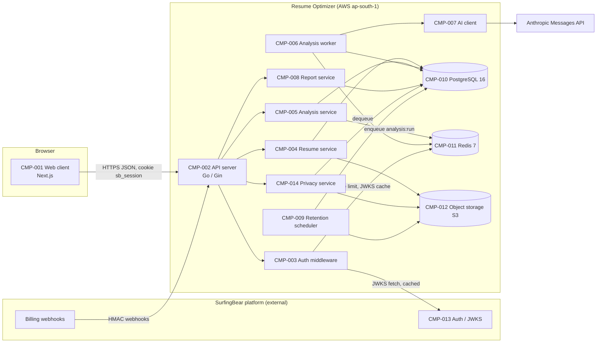
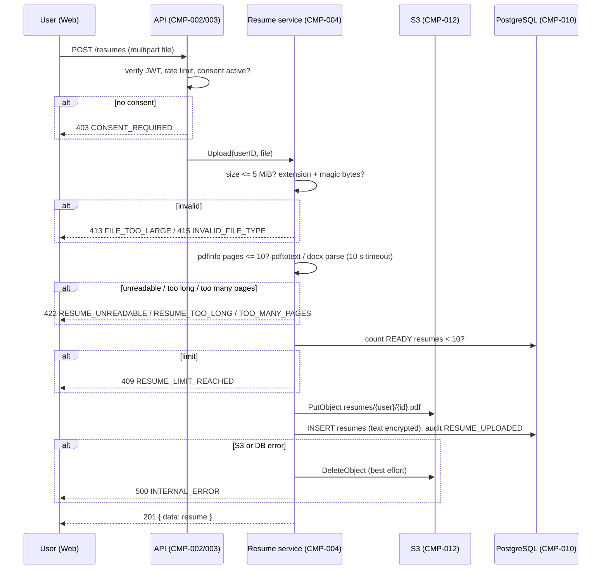
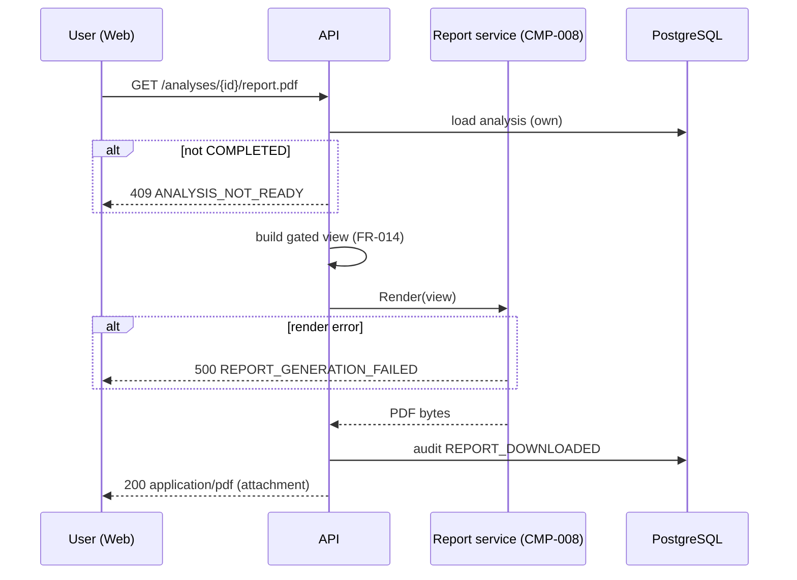
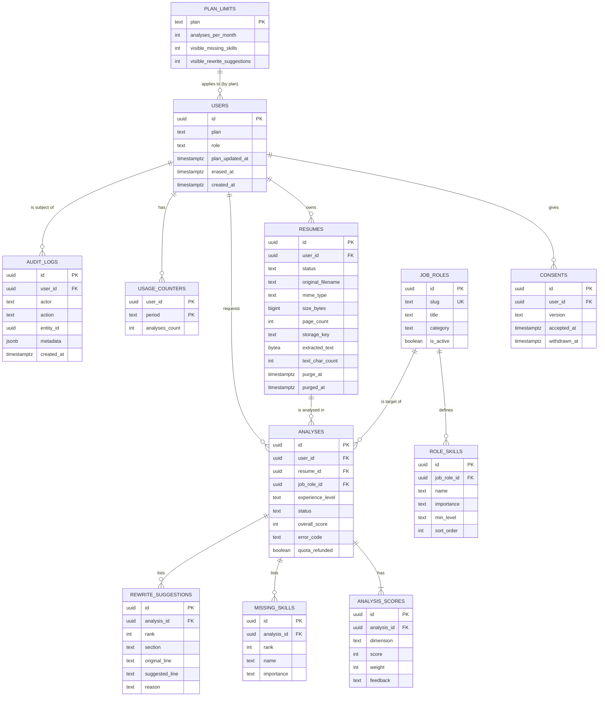

# SurfingBear Resume Optimizer — Specification

| Field | Value |
|---|---|
| Author | Nikky Navvya |
| Version | v1.0 |
| Last updated | 2026-10-19 |
| Status | Draft |

> **How to read this document**
> - This file is the single source of truth. A developer must be able to build the whole module from it without asking the author anything. Where the product brief was silent, the decision is written here with its reason (see section 3.3).
> - IDs are permanent. Nothing is renumbered or reused. Removed items are marked **Deprecated** and kept.
> - "Platform" always means the main SurfingBear web platform that already handles sign-up, login and billing. "Module" always means the Resume Optimizer described here.
> - Sizes use binary units: 1 MiB = 1,048,576 bytes. Times in the API are ISO 8601 in UTC. Calendar-month quotas use the `Asia/Kolkata` timezone (IST).
>
> **ID rules**
>
> | Prefix | Used for | Example |
> |---|---|---|
> | `CR-` | Company-wide common requirement | CR-001 |
> | `FR-` | Functional requirement | FR-001 |
> | `NFR-` | Non-functional requirement | NFR-001 |
> | `CMP-` | Architecture component | CMP-001 |
> | `TBL-` | Database table | TBL-001 |
> | `API-` | API endpoint | API-001 |
> | `ERR-` | Error code | ERR-001 |

---

## 0. Product summary (from the brief, with the decisions made here)

SurfingBear users, already logged in on the platform, open the Resume Optimizer module. They upload a resume (PDF or DOCX), pick a **target job role** from a fixed catalogue and an **experience level** (`entry`, `mid`, `senior`, `lead`), and start an **analysis**. A background worker sends the extracted resume text plus the role's skill list to the AI provider (Anthropic Claude). The result is:

- an **overall ATS score 0–100**, computed by the backend from **six dimension scores** (section 3.1, FR-009);
- the list of **missing skills** for that role and level, taken from the role's skill catalogue;
- **rewrite suggestions** for weak lines (original line, suggested line, reason).

Plans come from the platform: `free` or `pro`. Free users get **3 analyses per calendar month (IST)** and see only the **first 3 missing skills** and the **first 2 rewrite suggestions**; the rest are shown as locked with a count. Pro users get **50 analyses per month** and see everything. Any user can download the analysis as a **PDF**. Resume files and extracted text are **deleted 30 days** after upload; analysis results are kept **365 days** or until the user deletes them. Users can **export** or **erase** all their module data at any time (DPDP Act rights). The module stores all data in **AWS ap-south-1 (Mumbai)**.

---

## 1. Company-wide common requirements

Rules every Divii / Hanriver project must follow. Each rule has an ID and must be specific enough to be checked.

| ID | Area | Rule | How it is checked |
|---|---|---|---|
| CR-001 | Authentication | Every request to the module API, except `GET /health` and the `/internal/*` webhooks, must carry a platform session JWT (RS256) either in the httpOnly cookie `sb_session` or in `Authorization: Bearer <jwt>`. The JWT is verified against the platform JWKS (`PLATFORM_JWKS_URL`), issuer must equal `PLATFORM_JWT_ISSUER`, and `exp` must be in the future. Invalid or missing token → `401 UNAUTHENTICATED`. | Integration test: request without token, with expired token, with wrong issuer, with tampered signature → all 401 |
| CR-002 | Authentication | The module never stores passwords, emails, names or phone numbers. The only user identifier stored is the platform user UUID (`sub` claim). | DB schema review: no such columns exist (section 5) |
| CR-003 | Authentication | `/internal/*` webhooks from the platform are authenticated with HMAC-SHA256 over the raw body using `PLATFORM_WEBHOOK_SECRET`, sent in header `X-SurfingBear-Signature: sha256=<hex>`, plus header `X-SurfingBear-Timestamp` (unix seconds) that must be within ±300 s of server time. Failure → `401 INVALID_SIGNATURE`. | Integration test with valid, stale and wrong-secret signatures |
| CR-004 | Roles | Roles are `user` and `admin`, taken from the JWT claim `role`. Plan is `free` or `pro`, taken from the JWT claim `plan` and mirrored into `users.plan` (TBL-001) on every authenticated request. The role × permission table in 1.2 is enforced in the auth middleware (CMP-003), not in handlers. | Integration test: `user` calling an `/admin/*` endpoint → `403 FORBIDDEN` |
| CR-005 | Roles | A user can read, download or delete only rows whose `user_id` equals their own `sub`. Accessing another user's resource returns `404 NOT_FOUND` (not 403), so resource IDs cannot be enumerated. | Integration test: user B requests user A's analysis id → 404 |
| CR-006 | Logging | Logs are JSON, one object per line, written to stdout, with fields `ts` (RFC 3339 UTC), `level` (`debug`/`info`/`warn`/`error`), `request_id`, `user_id`, `method`, `path`, `status`, `duration_ms`, `msg`. Personal data (resume text, file contents, original file names, AI prompt or response bodies) is **never** logged. | Code review + grep of log sample for `extracted_text`, `original_filename`, `suggested_line` fields → none found |
| CR-007 | Logging | Every request gets a `request_id` (UUID v4) generated in middleware or taken from an incoming `X-Request-Id` header, returned in the response header `X-Request-Id`, included in every log line and in every error body. | Integration test checks the header on success and error responses |
| CR-008 | Error handling | Every non-2xx response uses exactly the format in 1.4. No other error shape is allowed, including framework defaults for 404 and 405 and panics (a recovery middleware converts panics into `500 INTERNAL_ERROR`). | Integration test for unknown route, wrong method and a forced panic |
| CR-009 | Error handling | Every error code is listed once in section 6.3 with a fixed HTTP status. Handlers may only return codes from that list. | Code review: `ErrCode` is a Go enum generated from section 6.3 |
| CR-010 | Security | Secrets (DB password, Redis password, AWS keys, `ANTHROPIC_API_KEY`, `PLATFORM_WEBHOOK_SECRET`) are read from environment variables only, never from files committed to git. `.env.example` lists every variable with a dummy value. | CI step runs `gitleaks detect` and fails on any finding |
| CR-011 | Security | CORS: only origins in `CORS_ALLOWED_ORIGINS` (comma-separated) are allowed; `Access-Control-Allow-Credentials: true`; allowed methods `GET, POST, PUT, DELETE, OPTIONS`; allowed headers `Content-Type, Authorization, X-Request-Id`. Production value is `https://www.surfingbear.com` only. | Integration test: preflight from an unlisted origin receives no CORS headers |
| CR-012 | Security | All input is validated before any DB or external call: JSON bodies against the field tables in section 6, path IDs must be UUID v4, file uploads against FR-002. Validation failure → `400 VALIDATION_ERROR` with a `details` array naming each field. Unknown JSON fields are rejected. | Unit tests per endpoint for each validation rule |
| CR-013 | Security | Rate limiting per user (by `sub`) in Redis: 60 requests per rolling 60 s on all authenticated endpoints, and additionally 10 uploads (`POST /resumes`) per rolling 60 minutes. Exceeding → `429 RATE_LIMITED` with `Retry-After` header in seconds. | Load test with 61 requests in 60 s → the 61st is 429 |
| CR-014 | Security | Data retention: resume files and extracted text are deleted 30 days after upload; analyses and their child rows 365 days after completion; audit logs 365 days; application logs 30 days. Deletion is done by the retention scheduler (CMP-009) daily at 02:00 IST and is logged in `audit_logs`. | Scheduler unit test with a fake clock; audit row exists after purge |
| CR-015 | Security | Transport is HTTPS only (TLS 1.2 or higher) at the load balancer; the API responds with `Strict-Transport-Security: max-age=31536000; includeSubDomains`. Data at rest: RDS storage encryption and S3 SSE-KMS are enabled. | Infra review; `curl -I` shows the HSTS header |
| CR-016 | Security | Dependencies are scanned in CI (`govulncheck` for Go, `npm audit --audit-level=high` for the frontend). A high or critical finding fails the build. | CI pipeline configuration |
| CR-017 | i18n | v1 UI and API messages are English only. All UI strings live in `web/messages/en.json`; no string literals in components. API `message` fields are for developers; the frontend maps `error.code` to a user-facing string from `en.json`. Dates are sent as ISO 8601 UTC and rendered in the browser's timezone. | Code review: `grep` for JSX text literals in `components/` returns none |
| CR-018 | Environments | Four environments: `local`, `dev`, `staging`, `prod` (env var `APP_ENV`). The differences are listed in 1.7. Code must not branch on environment name except for the items in that table. | Code review: `APP_ENV` referenced only in `config/` |
| CR-019 | Deployment | Every merge to `main` runs CI (lint, tests, build, image push). Deploy to `dev` is automatic; `staging` and `prod` are manual approvals in GitHub Actions. DB migrations run as a separate job before the new version starts and must be backward compatible with the previous version (expand/contract). | Pipeline definition `.github/workflows/ci.yml`, `deploy.yml` |
| CR-020 | Deployment | Rollback = redeploy the previous image tag (tags are the git SHA). Migrations are never rolled back automatically; a failed migration stops the deploy and alerts `#alerts-resume-optimizer`. | Runbook `docs/runbook.md` and a rehearsed rollback on staging |

### 1.1 Authentication

- The platform issues a JWT (RS256) at login and sets it as cookie `sb_session` (`HttpOnly; Secure; SameSite=Lax; Domain=.surfingbear.com`). The module reads that cookie or the `Authorization: Bearer` header (mobile clients). Cookie takes precedence if both are present.
- JWT claims used by the module:

| Claim | Type | Meaning |
|---|---|---|
| `sub` | string (UUID v4) | Platform user id. Used as `users.id`. |
| `iss` | string | Must equal `PLATFORM_JWT_ISSUER` (prod: `https://auth.surfingbear.com`). |
| `exp`, `iat` | number | Standard. Clock skew tolerance 60 s. |
| `role` | `"user"` \| `"admin"` | Authorization role (1.2). Missing → treated as `user`. |
| `plan` | `"free"` \| `"pro"` | Billing plan. Missing → treated as `free`. |

- JWKS is fetched from `PLATFORM_JWKS_URL`, cached in Redis key `jwks:platform` for 3600 s. On a `kid` not in cache, the module refetches once, then fails with 401.
- The module does not issue tokens, refresh tokens or sessions of its own.

### 1.2 Roles and permissions

| Permission | `user` (free) | `user` (pro) | `admin` |
|---|---|---|---|
| Record consent, view own profile and usage (API-001, API-002) | ✔ | ✔ | ✔ |
| Browse job roles and skills (API-003, API-004) | ✔ | ✔ | ✔ |
| Upload, list, view, delete own resumes (API-005–API-008) | ✔ | ✔ | ✔ |
| Create analyses (API-009) | ✔ up to 3 / month | ✔ up to 50 / month | ✔ up to 50 / month (admins are treated as `pro`) |
| View own analyses (API-010, API-011) | ✔ partial results (FR-014) | ✔ full | ✔ full |
| Download PDF of own analysis (API-012) | ✔ partial | ✔ full | ✔ full |
| Delete own analysis (API-013) | ✔ | ✔ | ✔ |
| Export / erase own data (API-014, API-015) | ✔ | ✔ | ✔ |
| Manage job roles and skills (API-017, API-018) | ✘ | ✘ | ✔ |
| Change plan limits (API-019) | ✘ | ✘ | ✔ |
| Internal webhooks (API-020, API-021) | platform only (HMAC) | platform only | platform only |

Admins never see other users' resumes or analyses through this module (there is no admin read endpoint for user data). Support cases are handled on the platform side.

### 1.3 Logging

- Library: `log/slog` with the JSON handler. Level from `LOG_LEVEL` (`debug` in local/dev, `info` elsewhere).
- Access log: one line per request at `info` with the fields in CR-006.
- Worker log: one line per job state change (`queued`, `started`, `completed`, `failed`) with `analysis_id`, `user_id`, `attempt`, `duration_ms`, `error_code`.
- AI calls log only `model`, `input_tokens`, `output_tokens`, `latency_ms`, `http_status`. Never the prompt or completion.
- Logs are shipped from stdout to CloudWatch Logs with 30-day retention.

### 1.4 Error handling

The **one** error format used by every endpoint:

```json
{
  "error": {
    "code": "QUOTA_EXCEEDED",
    "message": "Monthly analysis limit of 3 reached. Resets on 2026-11-01T00:00:00+05:30.",
    "details": [],
    "request_id": "7a0f0a1c-9d9c-4d0a-8b86-2b6d2b24a9c1"
  }
}
```

| Field | Type | Rule |
|---|---|---|
| `code` | string | One of the codes in 6.3. Upper snake case. Stable; the frontend switches on it. |
| `message` | string | English, developer-oriented, may include values (limit, reset date). Never includes resume content. |
| `details` | array of `{ "field": string, "issue": string }` | Non-empty only for `VALIDATION_ERROR` and `ANALYSIS_IN_PROGRESS`; otherwise `[]`. `field` uses the JSON path (`"file"`, `"experience_level"`). |
| `request_id` | string (UUID) | Same as the `X-Request-Id` header. |

Successful responses are always wrapped: `{ "data": <object or array> }`, plus `"page"` for lists (6.1). `204 No Content` is used for deletes.

### 1.5 Security

| Topic | Rule |
|---|---|
| Secrets | CR-010. In AWS they are injected from Secrets Manager into the ECS task definition. |
| CORS | CR-011. |
| Input validation | CR-012. File validation rules are in FR-002 and are applied in this order: size → extension → magic bytes → page count → text extraction → text length. |
| Rate limiting | CR-013, implemented as a Redis sliding window (`ZADD`/`ZREMRANGEBYSCORE` on key `rl:{sub}:{bucket}`). |
| Data retention | CR-014, FR-017. |
| Encryption | CR-015. `extracted_text` is additionally encrypted at the application layer with AES-256-GCM using `DATA_ENCRYPTION_KEY` (32 bytes, base64) before being stored in PostgreSQL, so a DB dump alone does not expose resume text. |
| Object storage access | S3 bucket is private; the API never returns S3 URLs. Files are read by the server and streamed. Bucket policy denies non-TLS access. |
| AI provider | Resume text is sent to Anthropic over TLS. The account is configured with zero data retention (ZDR). No user identifier is sent; only the text and the role catalogue. |
| Uploads | Files are stored under a server-generated key (`resumes/{user_id}/{resume_id}.{pdf\|docx}`), never under the original filename. The original filename is stored only for display, sanitised to 255 characters. |
| Headers | `X-Content-Type-Options: nosniff`, `X-Frame-Options: DENY`, `Referrer-Policy: no-referrer`, `Cache-Control: no-store` on all API responses. |

### 1.6 Internationalization (i18n)

CR-017. v1 is English only. The design keeps the door open: all UI strings in `web/messages/en.json` keyed by `errors.<CODE>` and `pages.<page>.<key>`; backend messages are not translated. The job role catalogue has a `title` column in English only; adding a language later means a `job_role_translations` table, which is out of scope.

### 1.7 Environments

| Item | local | dev | staging | prod |
|---|---|---|---|---|
| Runs on | Docker Compose on the developer machine | AWS ECS Fargate, ap-south-1 | AWS ECS Fargate, ap-south-1 | AWS ECS Fargate, ap-south-1 |
| PostgreSQL | container `postgres:16` | RDS PostgreSQL 16, single AZ | RDS PostgreSQL 16, Multi-AZ | RDS PostgreSQL 16, Multi-AZ |
| Redis | container `redis:7` | ElastiCache Redis 7, 1 node | ElastiCache Redis 7, 1 node | ElastiCache Redis 7, 2 nodes with failover |
| Object storage | MinIO container (`S3_ENDPOINT` set) | S3 bucket `sb-resume-dev` | S3 bucket `sb-resume-staging` | S3 bucket `sb-resume-prod` |
| AI provider | Real Anthropic API with a dev key, or `AI_PROVIDER=fake` which returns a fixed canned result | Real, dev key, `AI_MODEL=claude-haiku-5-5` | Real, staging key, `AI_MODEL=claude-sonnet-5-5` | Real, prod key, `AI_MODEL=claude-sonnet-5-5` |
| Platform auth | Local JWKS served from `web/dev/jwks.json` and a helper script `make dev-token` that mints a test JWT | Platform dev issuer | Platform staging issuer | Platform prod issuer |
| `LOG_LEVEL` | `debug` | `debug` | `info` | `info` |
| CORS origins | `http://localhost:3000` | `https://dev.surfingbear.com` | `https://staging.surfingbear.com` | `https://www.surfingbear.com` |
| Retention scheduler | runs, 30 / 365 days | runs | runs | runs |
| Seed data | `make seed` loads `seed/job_roles.json` and `seed/plan_limits.json` | same, run once by CI | same | same, run once at first deploy |

Configuration variables (all read in `config/config.go`, app refuses to start if a required one is missing):

| Variable | Required | Example | Used by |
|---|---|---|---|
| `APP_ENV` | yes | `local` | all |
| `HTTP_PORT` | no, default `8080` | `8080` | API |
| `DATABASE_URL` | yes | `postgres://app:pass@db:5432/resume_optimizer?sslmode=disable` | API, worker, scheduler |
| `REDIS_URL` | yes | `redis://redis:6379/0` | API, worker, scheduler |
| `S3_BUCKET` | yes | `sb-resume-dev` | API, scheduler |
| `S3_REGION` | yes | `ap-south-1` | API, scheduler |
| `S3_ENDPOINT` | no (MinIO only) | `http://minio:9000` | API, scheduler |
| `AWS_ACCESS_KEY_ID`, `AWS_SECRET_ACCESS_KEY` | local only (IAM role elsewhere) | | API, scheduler |
| `PLATFORM_JWKS_URL` | yes | `https://auth.surfingbear.com/.well-known/jwks.json` | API |
| `PLATFORM_JWT_ISSUER` | yes | `https://auth.surfingbear.com` | API |
| `PLATFORM_WEBHOOK_SECRET` | yes | 32+ random chars | API |
| `PLATFORM_UPGRADE_URL` | yes | `https://www.surfingbear.com/pricing` | API (returned in API-001), web |
| `AI_PROVIDER` | no, default `anthropic` | `anthropic` \| `fake` | worker |
| `ANTHROPIC_API_KEY` | yes unless `AI_PROVIDER=fake` | | worker |
| `AI_MODEL` | no, default `claude-sonnet-5-5` | | worker |
| `AI_TIMEOUT_SECONDS` | no, default `60` | | worker |
| `DATA_ENCRYPTION_KEY` | yes | base64 of 32 bytes | API, worker, scheduler |
| `CORS_ALLOWED_ORIGINS` | yes | `http://localhost:3000` | API |
| `LOG_LEVEL` | no, default `info` | | all |
| `RETENTION_RESUME_DAYS` | no, default `30` | | scheduler |
| `RETENTION_ANALYSIS_DAYS` | no, default `365` | | scheduler |
| `PDFTOTEXT_PATH` | no, default `pdftotext` | | API |
| `NEXT_PUBLIC_API_BASE_URL` (web) | yes | `http://localhost:8080/api/v1/resume-optimizer` | web |

### 1.8 Deployment

- **CI** (`.github/workflows/ci.yml`, on every push and PR): `go vet`, `golangci-lint run`, `go test ./... -race -cover` (coverage gate 70 % on `services/` and `repositories/`), `govulncheck`, `gitleaks`; frontend `npm ci`, `npm run lint`, `npm run typecheck`, `npm test`, `npm run build`. Docker images `resume-optimizer-api`, `resume-optimizer-worker` (same binary, different command), `resume-optimizer-web` are built and pushed to ECR tagged with the git SHA.
- **CD** (`.github/workflows/deploy.yml`): `dev` on every merge to `main`; `staging` and `prod` by manual approval. Steps: run migration job (`golang-migrate`, `migrations/` folder, `up` only) → update ECS services (API, worker, scheduler, web) with rolling deploy, minimum healthy 100 %, health check `GET /health` → smoke test (`GET /health`, `GET /job-roles` with a test token).
- **Release process:** semantic version tag `vX.Y.Z` is created on the commit deployed to prod; `CHANGELOG.md` in the repo lists user-facing changes.
- **Rollback:** CR-020.
- **Processes:** three runtime processes from the Go binary: `server` (HTTP API), `worker` (analysis jobs), `scheduler` (retention cron). Each is an ECS service; the worker scales on queue depth (metric `asynq_queue_size`, target 20 jobs per worker task, min 1, max 10).

---

## 2. Coding conventions

### 2.1 Naming

| Item | Convention | Example |
|---|---|---|
| Go packages | lowercase, single word, no underscores | `services`, `repositories` |
| Go types / structs | PascalCase; exported only when used by another package | `AnalysisService`, `resumeRepo` |
| Go functions / methods | PascalCase exported, camelCase private; verbs first | `CreateAnalysis`, `parseDocx` |
| Go variables | camelCase, short in small scopes, descriptive otherwise | `userID`, `ctx`, `resumeText` |
| Go constants / enums | PascalCase with type prefix | `AnalysisStatusQueued`, `ErrCodeQuotaExceeded` |
| Go errors | `ErrXxx` sentinel values in `utils/apperror` | `apperror.ErrQuotaExceeded` |
| Go interfaces | noun or `-er`, defined where used | `AIClient`, `ObjectStore` |
| Go files | snake_case; tests `_test.go` | `analysis_service.go`, `analysis_service_test.go` |
| DB tables | snake_case, plural | `rewrite_suggestions` |
| DB columns | snake_case; FKs `<table_singular>_id`; booleans `is_` / `has_`; timestamps `_at` | `resume_id`, `is_active`, `completed_at` |
| DB indexes | `idx_<table>_<cols>`; unique `uq_<table>_<cols>` | `idx_analyses_user_id_created_at` |
| DB enums | PostgreSQL `text` with a `CHECK` constraint, values UPPER_SNAKE for statuses, lower_snake for categories | `status IN ('QUEUED','PROCESSING','COMPLETED','FAILED')` |
| API paths | kebab-case, plural nouns, no verbs, no trailing slash | `/job-roles/{slug}/skills` |
| JSON fields | snake_case | `experience_level`, `created_at` |
| Query params | snake_case | `page_size` |
| Error codes | UPPER_SNAKE_CASE | `RESUME_UNREADABLE` |
| Env vars | UPPER_SNAKE_CASE | `AI_TIMEOUT_SECONDS` |
| TypeScript components | PascalCase file and export | `AnalysisResult.tsx` |
| TypeScript hooks / functions | camelCase, hooks prefixed `use` | `useAnalysis`, `formatScore` |
| TypeScript types | PascalCase, no `I` prefix | `Analysis`, `MissingSkill` |
| Next.js routes | kebab-case folders under `app/resume-optimizer` | `app/resume-optimizer/analyses/[id]/page.tsx` |
| Redis keys | colon-separated, prefix per purpose | `rl:{sub}:api`, `jwks:platform`, `export:{sub}` |
| Asynq queue / task names | task type `analysis:run` on queue `analysis`; task id `analysis:{analysis_id}` | |

### 2.2 Folder / module structure

Backend repository `resume-optimizer-api` (Go module `resumeoptimizer`). Flat layered layout, same as the GoTalk backend:

```
resume-optimizer-api/
├── cmd/
│   ├── server/main.go          # HTTP API process
│   ├── worker/main.go          # asynq worker process
│   └── scheduler/main.go       # retention cron process
├── config/
│   └── config.go               # loads env vars (1.7), fails fast on missing
├── controllers/                # Gin handlers: parse request, call service, write response
│   ├── me_controller.go
│   ├── consent_controller.go
│   ├── job_role_controller.go
│   ├── resume_controller.go
│   ├── analysis_controller.go
│   ├── report_controller.go
│   ├── privacy_controller.go
│   ├── health_controller.go
│   ├── internal/               # platform webhooks (API-020, API-021)
│   │   └── platform_webhook_controller.go
│   └── admin/
│       ├── job_role_admin_controller.go
│       └── plan_limit_admin_controller.go
├── middleware/
│   ├── auth.go                 # JWT verify, loads/updates users row, sets ctx user
│   ├── require_role.go
│   ├── require_consent.go
│   ├── hmac.go                 # webhook signature (CR-003)
│   ├── rate_limit.go
│   ├── request_id.go
│   ├── logger.go
│   ├── recover.go              # panic → 500 INTERNAL_ERROR
│   └── cors.go
├── models/                     # GORM models, one file per table (section 5)
│   ├── user.go
│   ├── consent.go
│   ├── job_role.go
│   ├── role_skill.go
│   ├── resume.go
│   ├── analysis.go
│   ├── analysis_score.go
│   ├── missing_skill.go
│   ├── rewrite_suggestion.go
│   ├── usage_counter.go
│   ├── plan_limit.go
│   └── audit_log.go
├── repositories/               # DB access only, no business rules
│   ├── user_repo.go
│   ├── consent_repo.go
│   ├── job_role_repo.go
│   ├── resume_repo.go
│   ├── analysis_repo.go
│   ├── usage_repo.go
│   ├── plan_limit_repo.go
│   └── audit_repo.go
├── services/                   # business rules
│   ├── consent_service.go
│   ├── job_role_service.go
│   ├── resume_service.go       # validation, extraction, storage
│   ├── analysis_service.go     # quota, create, read with gating
│   ├── analysis_worker.go      # job handler: AI call, validation, persist
│   ├── scoring.go              # weights, overall score, response validation
│   ├── report_service.go       # PDF
│   ├── privacy_service.go      # export, erase
│   ├── retention_service.go
│   └── admin/
│       ├── job_role_admin_service.go
│       └── plan_limit_admin_service.go
├── routes/
│   └── routes.go               # all routes registered here, grouped by auth level
├── utils/
│   ├── apperror/               # ErrCode enum + Error type (section 6.3)
│   ├── response/               # {"data":...}, {"error":...} writers
│   ├── crypto/                 # AES-256-GCM helpers
│   ├── extract/                # pdf.go (pdftotext), docx.go (zip + xml)
│   ├── ai/                     # AIClient interface, anthropic.go, fake.go, prompt.go
│   ├── storage/                # ObjectStore interface, s3.go
│   ├── pdfgen/                 # report layout with go-pdf/fpdf
│   └── clock/                  # Clock interface for tests
├── migrations/                 # golang-migrate SQL files 000001_init.up.sql ...
├── seed/
│   ├── job_roles.json
│   └── plan_limits.json
├── docs/
│   └── runbook.md
├── .env.example
├── .golangci.yml
├── Dockerfile                  # multi-stage; final image includes poppler-utils
├── docker-compose.yml          # postgres, redis, minio, api, worker, scheduler
├── Makefile                    # run, test, lint, migrate, seed, dev-token
└── go.mod
```

Rules: `controllers` may import `services` and `utils`; `services` may import `repositories`, `models`, `utils`; `repositories` may import `models` only. No package imports `controllers`. Enforced by `depguard` in `.golangci.yml`.

Frontend repository `resume-optimizer-web` (Next.js 15, App Router, TypeScript strict):

```
resume-optimizer-web/
├── app/
│   ├── layout.tsx
│   ├── providers.tsx                         # TanStack Query provider
│   └── resume-optimizer/
│       ├── page.tsx                          # dashboard: usage + analyses list
│       ├── new/page.tsx                      # upload + role + level
│       ├── resumes/page.tsx                  # my resumes
│       ├── analyses/[id]/page.tsx            # result (polls while running)
│       └── privacy/page.tsx                  # export / erase my data
├── components/resume-optimizer/
│   ├── ConsentDialog.tsx
│   ├── UsageBanner.tsx
│   ├── ResumeUploader.tsx
│   ├── RoleLevelPicker.tsx
│   ├── AnalysisStatus.tsx
│   ├── ScoreGauge.tsx
│   ├── DimensionScores.tsx
│   ├── MissingSkills.tsx
│   ├── RewriteSuggestions.tsx
│   ├── LockedItems.tsx                       # "N more, upgrade" block
│   ├── AnalysisList.tsx
│   └── ErrorMessage.tsx
├── lib/
│   ├── api/
│   │   ├── client.ts                         # fetch wrapper: credentials, X-Request-Id, error mapping
│   │   ├── types.ts                          # mirrors section 6 schemas
│   │   └── resumeOptimizer.ts                # one function per API-xxx
│   └── hooks/
│       ├── useMe.ts
│       ├── useJobRoles.ts
│       ├── useResumes.ts
│       ├── useAnalysis.ts                    # refetchInterval 2000 ms while QUEUED/PROCESSING
│       └── useAnalyses.ts
├── messages/en.json
├── dev/jwks.json
├── public/
├── __tests__/
├── .eslintrc.json
├── .prettierrc
├── next.config.ts
├── tsconfig.json
└── package.json
```

### 2.3 Branching and commits

- Default branch `main`, protected: PR required, CI green, 1 approval.
- Branch names: `feature/FR-007-create-analysis`, `fix/ERR-014-file-size-message`, `chore/ci-govulncheck`, `docs/runbook`. The ID in the name must exist in this spec.
- Commit format (Conventional Commits): `<type>(<scope>): <imperative message>`; types `feat`, `fix`, `docs`, `chore`, `refactor`, `test`, `perf`; scope is the package or page, for example `feat(analysis): enforce monthly quota (FR-013)`.
- One logical change per PR; PR title equals the squash commit title; PR description links the FR/NFR IDs.

### 2.4 Code review rules

- Every PR needs 1 approval from a maintainer who is not the author; the coordinator's own PRs are reviewed by another backend developer.
- Reviewer checklist (in the PR template): (1) every new endpoint has an `API-` block in the spec or a spec PR; (2) every new error has an `ERR-` row; (3) no personal data in logs; (4) tests cover the acceptance criteria of the FR referenced; (5) migrations are backward compatible; (6) no secret in diff.
- Max PR size 600 changed lines excluding generated files and tests; larger PRs are split.
- Review turnaround target: 1 working day.

### 2.5 Lint and format

| Tool | Config | When it runs |
|---|---|---|
| `gofmt` + `goimports` | default | pre-commit hook (`lefthook.yml`) and CI |
| `golangci-lint` v1.61+ | `.golangci.yml`: `errcheck`, `govet`, `staticcheck`, `gosec`, `revive`, `depguard`, `gocyclo` (max 15), `misspell` | pre-commit and CI; CI fails on any issue |
| `govulncheck` | default | CI |
| `gitleaks` | default | CI |
| ESLint | `.eslintrc.json`: `next/core-web-vitals`, `@typescript-eslint/recommended`, `jsx-a11y/recommended` | pre-commit (`lint-staged`) and CI |
| Prettier | `.prettierrc`: 2 spaces, single quotes, semicolons, width 100 | pre-commit and CI (`--check`) |
| `tsc --noEmit` | `tsconfig.json` strict | CI |
| Go tests | `go test ./... -race -cover` | CI, coverage gate 70 % on `services/` and `repositories/` |
| Vitest + Testing Library | `vitest.config.ts` | CI |

---

## 3. Requirements definition

### 3.1 Functional requirements

| ID | Title | Description | Priority | Acceptance criteria |
|---|---|---|---|---|
| FR-001 | Record DPDP consent | Before the module processes a resume for a user for the first time, the user must give explicit consent to the processing described in the consent text version `v1` (purpose: ATS analysis; data: resume file and text; retention: 30 / 365 days; third party: AI provider; rights: export, erase). The consent is stored with timestamp and version. | Must | 1. `POST /resumes` and `POST /analyses` without an active consent return `403 CONSENT_REQUIRED`. 2. `POST /consents` with `version: "v1"` creates a row in TBL-002 with `accepted_at = now()` and returns 201. 3. Calling `POST /consents` again with the same version returns 200 and the existing row (idempotent). 4. `GET /me` reports `consent.status` as `active` or `required`. 5. Erasure (FR-018) sets `withdrawn_at`; the next upload requires consent again. 6. If `CONSENT_CURRENT_VERSION` in code is bumped to `v2`, users with only `v1` are treated as `required`. |
| FR-002 | Upload a resume | A user uploads one resume file (PDF or DOCX) with `multipart/form-data`. The module validates it, stores the file in object storage and the extracted text in the database, and returns the resume record. | Must | 1. Accepted `Content-Type` of the part: `application/pdf` or `application/vnd.openxmlformats-officedocument.wordprocessingml.document`; anything else → `415 INVALID_FILE_TYPE`. 2. Type is confirmed by magic bytes: PDF starts with `%PDF-`; DOCX is a ZIP (`PK\x03\x04`) containing `word/document.xml`. Mismatch → `415 INVALID_FILE_TYPE`. 3. Max size 5 MiB (5,242,880 bytes); larger → `413 FILE_TOO_LARGE`. Empty file → `400 VALIDATION_ERROR`. 4. PDF with more than 10 pages → `422 TOO_MANY_PAGES`. (DOCX has no page count; it is limited by text length only.) 5. Text extraction (FR-003) must yield at least 200 characters after normalisation, otherwise `422 RESUME_UNREADABLE` (scanned PDFs fail here). 6. Extracted text longer than 30,000 characters → `422 RESUME_TOO_LONG`. 7. A user may hold at most 10 non-purged resumes; the 11th upload → `409 RESUME_LIMIT_REACHED`. 8. On success: file stored at `resumes/{user_id}/{resume_id}.{ext}`, text encrypted and stored, `201` with the resume object (API-005), `audit_logs` row `RESUME_UPLOADED`. 9. Nothing is stored if any validation fails. 10. Original filename is stored trimmed to 255 characters with path separators removed. |
| FR-003 | Extract resume text | The module converts the uploaded file to plain text synchronously during upload. | Must | 1. PDF: run `pdftotext -layout -enc UTF-8 <file> -` (poppler) with a 10 s timeout; page count from `pdfinfo`. Timeout or non-zero exit → `422 RESUME_UNREADABLE`. 2. DOCX: open as ZIP, read `word/document.xml`, concatenate text of `<w:t>` elements, insert `\n` at each `</w:p>` and `\t` at each `<w:tab/>`; missing or malformed XML → `422 RESUME_UNREADABLE`. 3. Normalisation: convert CRLF/CR to LF, replace runs of 3+ newlines with 2, trim trailing spaces per line, trim the whole text. 4. The normalised text is stored in `resumes.extracted_text` encrypted (1.5) with `resumes.text_char_count` set. 5. Extraction runs in the API process; the worker never touches the original file. |
| FR-004 | List and view own resumes | A user can list their non-purged resumes (newest first, paginated) and fetch one by id. | Must | 1. `GET /resumes` returns only rows where `user_id = sub` and `status <> 'PURGED'`, ordered by `created_at DESC`, paginated per 6.1. 2. `GET /resumes/{id}` returns the resume object; another user's id → `404 NOT_FOUND`; a purged own resume is returned with `status = "PURGED"`. 3. The response never includes `extracted_text` or a storage key; it includes `text_char_count`, `page_count`, `status`, `purge_at`. |
| FR-005 | Delete a resume | A user can delete their resume at any time. | Must | 1. `DELETE /resumes/{id}` deletes the object in storage, sets `status = 'PURGED'`, nulls `extracted_text` and `storage_key`, sets `purged_at = now()`, returns 204. 2. Analyses of that resume are kept (they do not contain the file), and `GET /analyses/{id}` shows `resume.status = "PURGED"`. 3. Deleting a resume that has an analysis in `QUEUED` or `PROCESSING` → `409 RESUME_IN_USE`. 4. Audit row `RESUME_DELETED`. 5. Deleting an already purged or unknown resume → `404 NOT_FOUND`. |
| FR-006 | Browse job roles and levels | A user can list active job roles and see the skills expected for a role at a given experience level. | Must | 1. `GET /job-roles` returns active roles (`is_active = true`) ordered by `title`, paginated; each has `slug`, `title`, `category`. 2. `GET /job-roles/{slug}/skills?level=mid` returns the skills whose `min_level` is at or below the requested level in the order `entry < mid < senior < lead`, grouped by `importance` (`required`, `preferred`). 3. Unknown slug or inactive role → `404 NOT_FOUND`; invalid level → `400 VALIDATION_ERROR`. 4. Experience levels are exactly `entry`, `mid`, `senior`, `lead`. 5. The seed (section 5.5) ships at least 10 roles with at least 10 skills each. |
| FR-007 | Request an analysis | A user starts an analysis of one of their resumes against a role and level. The request is validated, the quota is reserved, a job is queued and the analysis id is returned immediately. | Must | 1. Body: `resume_id` (UUID, must be the user's own, status `READY`), `job_role_slug` (active role), `experience_level` (enum). Wrong resume → `404 NOT_FOUND`; purged resume → `410 RESUME_PURGED`; unknown or inactive role → `404 NOT_FOUND`. 2. Consent check (FR-001) before quota. 3. Quota check and reservation (FR-013) in one transaction; exceeded → `429 QUOTA_EXCEEDED` with the reset time in `message` and in the `X-Quota-Reset` header. 4. If an analysis for the same (`resume_id`, `job_role_id`, `experience_level`) is already `QUEUED` or `PROCESSING`, return `409 ANALYSIS_IN_PROGRESS` with the existing id in `details[0].issue`; no new quota is consumed. 5. On success: row in TBL-006 with `status = 'QUEUED'`, task `analysis:run` enqueued with `analysis_id`, response `202` with the analysis object, audit row `ANALYSIS_CREATED`. 6. Re-running a completed combination is allowed and counts against quota. |
| FR-008 | Run the analysis asynchronously | A worker consumes the job, calls the AI provider with the resume text and the role skill list, validates the response, persists scores, missing skills and suggestions, and marks the analysis `COMPLETED` or `FAILED`. | Must | 1. Worker sets `status = 'PROCESSING'`, `started_at = now()` when it picks the job; if the row is not `QUEUED` the job is dropped (idempotency). 2. The AI request uses the prompt contract in 4.6 with the decrypted text, the role title, the level and the skill list for that level. 3. AI call timeout `AI_TIMEOUT_SECONDS` (60 s). HTTP 429, 5xx, network error or timeout are retried by asynq up to 2 more times with delays 5 s and 15 s (3 attempts total). 4. Invalid JSON or schema violation (4.6) is retried once immediately within the same attempt; a second failure is treated like a provider error. 5. After the last failed attempt: `status = 'FAILED'`, `error_code` set to `AI_UNAVAILABLE` (provider errors / timeouts) or `AI_INVALID_RESPONSE` (schema), `completed_at = now()`, quota refunded (FR-013 rule 5), nothing partial is stored. 6. Success: in one transaction write TBL-007 (6 rows), TBL-008, TBL-009, set `overall_score`, `ai_model`, `ai_input_tokens`, `ai_output_tokens`, `status = 'COMPLETED'`, `completed_at`. 7. A job whose total runtime exceeds 120 s is cancelled and treated as a timeout. 8. The worker logs only the fields in 1.3. |
| FR-009 | Score on ATS dimensions | Each completed analysis has six dimension scores (0–100, integer) and one overall score (0–100, integer) computed by the backend as a weighted average. | Must | 1. Dimensions and weights (sum 100): `keyword_match` 30, `impact_quantification` 20, `section_completeness` 15, `length_relevance` 15, `formatting` 10, `readability` 10. 2. `overall_score = round(Σ score_d × weight_d / 100)`, half up. Example: 80,60,70,90,50,70 → (2400+1200+1050+1350+500+700)/100 = 72. 3. Each dimension row stores `score`, `weight` (copied at analysis time) and `feedback` (AI text, 1–400 chars). 4. The AI's own overall number, if any, is ignored. 5. Scores outside 0–100 or a missing dimension make the response invalid (FR-008 rule 4). 6. The definitions in 4.6 are sent to the AI verbatim so results are comparable between runs. |
| FR-010 | List missing skills | The analysis lists the catalogue skills for the chosen role and level that the resume does not evidence. | Must | 1. Candidate set = skills from FR-006 rule 2 for the role and level. 2. The AI returns the subset it judges absent; any name not in the candidate set is dropped (case-insensitive match); duplicates are removed. 3. Stored in TBL-008 with `rank` 1..n ordered `required` before `preferred`, then catalogue `sort_order`. 4. Each row carries `importance` copied from the catalogue. 5. An empty list is valid (`missing_skills: []`, `missing_skills_total: 0`). 6. Maximum stored: 50. |
| FR-011 | Suggest rewrites for weak lines | The analysis provides up to 10 rewrite suggestions, each with the original line, the suggested line and a reason. | Must | 1. The AI returns 0–10 suggestions; more than 10 are truncated to the first 10. 2. `original_line` must appear in the normalised resume text (compared after collapsing whitespace and ignoring case); otherwise the suggestion is dropped. 3. `original_line` and `suggested_line` are 1–300 characters; `reason` 1–300 characters; `section` is one of `summary`, `experience`, `education`, `skills`, `projects`, `other`. 4. Stored in TBL-009 with `rank` 1..n in the order returned. 5. Suggestions are returned in `rank` order. |
| FR-012 | Track analysis status | A user can see whether an analysis is queued, processing, completed or failed, and the UI polls until it is final. | Must | 1. `GET /analyses/{id}` always returns `status`, `created_at`, `started_at`, `completed_at`, `error_code` (null unless `FAILED`). 2. While `QUEUED` or `PROCESSING` the result fields (`overall_score`, `dimension_scores`, `missing_skills`, `rewrite_suggestions`) are `null`. 3. The web client polls every 2 s while not final and stops after 150 s, then shows "still running, check back later". 4. A `FAILED` analysis shows the error code mapped to a message and a "Try again" button that calls `POST /analyses` again. 5. `GET /analyses/{id}/report.pdf` on a non-completed analysis → `409 ANALYSIS_NOT_READY`. |
| FR-013 | Monthly quota per plan | The number of analyses a user may start per calendar month depends on the plan: `free` 3, `pro` 50 (TBL-012). | Must | 1. Period key is `YYYY-MM` of the current time in `Asia/Kolkata`; the quota resets at 00:00 IST on the 1st. 2. Reservation: `INSERT ... ON CONFLICT (user_id, period) DO UPDATE SET analyses_count = usage_counters.analyses_count + 1 WHERE usage_counters.analyses_count < <limit> RETURNING analyses_count`; no row returned → `429 QUOTA_EXCEEDED`. 3. The limit is read from TBL-012 for `users.plan` at request time; a plan change (FR-019) applies immediately, including to the current period. 4. `GET /me` returns `usage.period`, `usage.used`, `usage.limit`, `usage.remaining`, `usage.resets_at`. 5. Refund: when an analysis ends `FAILED` because of `AI_UNAVAILABLE` or `AI_INVALID_RESPONSE`, the worker decrements `analyses_count` for `analyses.quota_period` (not below 0) and sets `analyses.quota_refunded = true`. 6. Deleting an analysis does not refund quota. 7. Admins use the `pro` limits. |
| FR-014 | Free plan visibility limits | Free users see partial results; pro users see everything. The same gating applies to the JSON API and the PDF. | Must | 1. Limits are read from TBL-012: `free` → `visible_missing_skills = 3`, `visible_rewrite_suggestions = 2`; `pro` → both `null` (unlimited). 2. For a free user `missing_skills` contains only rows with `rank <= 3`; `missing_skills_total` is the full count; `missing_skills_locked = total − shown`. 3. Same for `rewrite_suggestions`, `rewrite_suggestions_total`, `rewrite_suggestions_locked`; locked suggestions are not sent in any form (not even `section`). 4. `overall_score` and all six dimension scores are always fully visible. 5. The response field `plan_gated` is `true` when anything was hidden, and `upgrade_url` (from `PLATFORM_UPGRADE_URL`) is included. 6. Gating is evaluated at read time with the user's current plan, so upgrading unlocks past analyses without re-running them. |
| FR-015 | Download the analysis as PDF | A user downloads a PDF report of a completed analysis. | Must | 1. `GET /analyses/{id}/report.pdf` returns `200` with `Content-Type: application/pdf` and `Content-Disposition: attachment; filename="resume-analysis-<first 8 chars of id>.pdf"`. 2. Layout (A4, portrait, Helvetica): title "SurfingBear Resume Analysis"; role title and level; generated date (UTC); overall score; a table of the six dimensions with score and feedback; missing skills (required first); rewrite suggestions as "Original / Suggested / Why" blocks; footer "Resume data is processed under India's DPDP Act. Request export or deletion at surfingbear.com/resume-optimizer/privacy". 3. The PDF contains exactly what the JSON (FR-014) would show for the user's current plan; locked items appear as one line "N more suggestions available on Pro". 4. The PDF is generated on each request (no caching) with `github.com/go-pdf/fpdf`, must be under 2 MiB, and the resume file itself is never embedded. 5. Audit row `REPORT_DOWNLOADED`. 6. Non-completed analysis → `409 ANALYSIS_NOT_READY`; generation error → `500 REPORT_GENERATION_FAILED`. |
| FR-016 | List, view and delete own analyses | A user can see all their analyses, open one, and delete one. | Must | 1. `GET /analyses` lists the user's analyses newest first, paginated, optional filters `status`, `resume_id`; each item is the summary shape (no child lists). 2. `GET /analyses/{id}` returns the full shape with gating (FR-014). 3. `DELETE /analyses/{id}` hard-deletes the analysis and its child rows (ON DELETE CASCADE), returns 204, audit row `ANALYSIS_DELETED`; `QUEUED`/`PROCESSING` → `409 ANALYSIS_IN_PROGRESS`. 4. Another user's id → `404 NOT_FOUND`. |
| FR-017 | Retention purge | A scheduled job deletes resume files and text 30 days after upload and analyses 365 days after completion. | Must | 1. Scheduler runs daily at 02:00 IST (`0 2 * * *` with TZ `Asia/Kolkata`). 2. Step 1: for each resume with `status = 'READY'` and `purge_at <= now()`, or with `purge_error = true`: delete object, set `status='PURGED'`, `extracted_text = NULL`, `storage_key = NULL`, `purged_at = now()`, `purge_error = false`; if the S3 delete fails, set `purge_error = true` and leave the row for the next run. 3. Step 2: for each analysis with `status IN ('COMPLETED','FAILED')` and `completed_at < now() − RETENTION_ANALYSIS_DAYS`: delete row (cascade). 4. Step 3: delete `audit_logs` older than 365 days. 5. Each step is batched 500 rows at a time; failures of one row are logged and skipped, not fatal. 6. One audit row per run: `RETENTION_PURGE` with counts in `metadata`. 7. `resumes.purge_at` (= `created_at + RETENTION_RESUME_DAYS`) is shown to users so they know when the file disappears. |
| FR-018 | Export and erase my data (DPDP rights) | A user can download everything the module holds about them as JSON and can erase all of it. | Must | 1. `GET /me/data-export` returns `200 application/json` with `Content-Disposition: attachment; filename="resume-optimizer-export.json"` containing `user`, `consents`, `resumes` (metadata plus the decrypted `extracted_text`, not the binary file), `analyses` (full, ungated), `audit_logs`. 2. Export is limited to 1 request per user per 10 minutes (Redis key `export:{sub}`, TTL 600 s) → `429 RATE_LIMITED`. 3. `DELETE /me/data` deletes all S3 objects for the user, all resumes, analyses (cascade), usage counters, and sets `consents.withdrawn_at = now()` on the active consent; the `users` row stays with `erased_at = now()` so the audit trail is preserved; the audit row `DATA_ERASED` is written; returns 204. 4. Erasure is synchronous and completes within 30 s for up to 10 resumes and 500 analyses. 5. In-flight analyses are cancelled: their rows are deleted and the worker drops the job (FR-008 rule 1). 6. After erasure the user can start again by giving consent (FR-001); giving consent clears `users.erased_at`. |
| FR-019 | Plan sync from the platform | The platform notifies the module when a user's plan changes, so quotas and gating follow the billing state without waiting for a new JWT. | Should | 1. `POST /internal/users/{id}/plan` with HMAC (CR-003), body `{ "plan": "free" \| "pro", "changed_at": <ISO 8601> }`. 2. Upserts `users.plan` and `plan_updated_at = changed_at`; if the row does not exist it is created. 3. Returns `204`; invalid plan → `400 VALIDATION_ERROR`. 4. Audit row `PLAN_CHANGED` with old and new plan. 5. Independently, the auth middleware also updates `users.plan` from the JWT `plan` claim on every request when it differs and the JWT `iat` is newer than `users.plan_updated_at`. |
| FR-020 | Admin manages job roles and plan limits | An admin can create and update job roles, their skills, and the plan limits. | Should | 1. `POST /admin/job-roles` creates a role with its skills in one request; duplicate `slug` → `409 CONFLICT`. 2. `PUT /admin/job-roles/{slug}` replaces title, category, `is_active` and the full skill list; existing analyses keep their copied data. 3. `PUT /admin/plan-limits/{plan}` updates the three limit values; `analyses_per_month` 1–1000; visibility limits 0–100 or `null`. 4. All require role `admin` → otherwise `403 FORBIDDEN`. 5. Audit rows `JOB_ROLE_CHANGED`, `PLAN_LIMIT_CHANGED`. |
| FR-021 | Account deletion propagation | When a platform account is deleted, the platform calls the module so the user's data is erased. | Should | 1. `POST /internal/users/{id}/deleted` with HMAC. 2. Performs exactly FR-018 rules 3 and 5 for that user; unknown user → `204` (idempotent). 3. Audit row `DATA_ERASED` with `actor = "platform"`. |

### 3.2 Non-functional requirements

| ID | Category | Requirement | Measurable target | How it is verified |
|---|---|---|---|---|
| NFR-001 | Performance | Resume upload including extraction (API-005) | p95 ≤ 5 s, p99 ≤ 8 s for a 5 MiB, 10-page PDF | k6 load test with sample files, 20 concurrent users, staging |
| NFR-002 | Performance | Analysis end to end (from `202` of API-009 to `COMPLETED`) | p95 ≤ 45 s, p99 ≤ 90 s; hard cap 120 s then `FAILED` | k6 test polling API-011; worker metric `analysis_duration_seconds` |
| NFR-003 | Performance | Read endpoints (API-001, 003, 004, 006, 007, 010, 011) | p95 ≤ 300 ms at 100 req/s | k6, staging |
| NFR-004 | Performance | PDF generation (API-012) | p95 ≤ 3 s | k6, staging |
| NFR-005 | Availability | API availability per calendar month, excluding announced maintenance | ≥ 99.5 % (≤ 3 h 39 min downtime) | Uptime monitor on `GET /health` every 60 s |
| NFR-006 | Scalability | Concurrent analyses in progress without queue wait above 60 s | 200 | Worker autoscaling 1–10 tasks, each processing 20 jobs concurrently; k6 burst test |
| NFR-007 | Security | Transport and storage encryption | TLS ≥ 1.2 on every hop; RDS and S3 encryption on; `extracted_text` AES-256-GCM | Infra checklist; unit test that the DB column is not plaintext |
| NFR-008 | Privacy | Personal data never in logs; no user identifiers sent to the AI provider | 0 occurrences | Log scan in CI integration test; code review of `utils/ai/prompt.go` |
| NFR-009 | Privacy | Data residency and retention | All PostgreSQL, Redis and S3 resources in `ap-south-1`; purge job removes files ≤ 24 h after the 30-day mark | Terraform region check; scheduler test with fake clock |
| NFR-010 | Observability | Metrics, logs, traces | Prometheus metrics at `GET /metrics` (internal port 9090): `http_requests_total{path,status}`, `http_request_duration_seconds`, `analysis_duration_seconds`, `analysis_total{status}`, `ai_tokens_total{direction}`, `asynq_queue_size`; OpenTelemetry traces with `request_id` as attribute; alerts when error rate > 2 % for 5 min or queue size > 500 | Grafana dashboard exists; alert rules in repo `ops/alerts.yml` |
| NFR-011 | Cost control | AI spend per analysis is bounded | `max_tokens` 4096 output; input text ≤ 30,000 chars (FR-002); at most 3 attempts per analysis | Unit test of the AI client; CloudWatch metric `ai_tokens_total` |
| NFR-012 | Reliability | Backup and recovery | RDS automated backups daily, 7-day retention, RPO 24 h, RTO 4 h; S3 versioning off (files are short-lived) | Restore rehearsal on staging once per quarter |
| NFR-013 | Maintainability | Automated test coverage | ≥ 70 % line coverage on `services/` and `repositories/`; every FR acceptance criterion has at least one test referencing its ID in the test name | CI coverage gate; `grep -r "FR-0" ./...` in test files |
| NFR-014 | Compatibility | Supported browsers for the web client | Last 2 versions of Chrome, Edge, Firefox, Safari; mobile Safari and Chrome | Playwright smoke test on CI (Chromium, WebKit, Firefox) |

### 3.3 Assumptions and out of scope

**Decisions made because the brief was silent (each with the reason):**

| # | Decision | Reason |
|---|---|---|
| A1 | Backend in **Go** (Gin + GORM), frontend Next.js, PostgreSQL 16, Redis 7 | Go is the author's main stack and the GoTalk layout is reused; low memory per worker is useful for many parallel AI calls. |
| A2 | AI provider **Anthropic Claude**, model `claude-sonnet-5-5` in prod, `claude-haiku-5-5` in dev | Strong structured JSON output, 200k context, zero-data-retention option for DPDP. Accessed behind an `AIClient` interface so it can be swapped. |
| A3 | File storage **AWS S3 ap-south-1** (MinIO locally) | Same region as the DB keeps personal data inside India; S3 API is widely supported. |
| A4 | Free plan: **3 analyses / month**, sees **3 missing skills** and **2 suggestions**; Pro: **50 / month**, sees everything | Three runs is enough to try the product; two suggestions shows the value without giving the whole rewrite. Numbers live in TBL-012 so marketing can change them without a deploy. |
| A5 | Quota month is the **calendar month in IST** | Users are in India; a calendar month is easy to explain in the UI. |
| A6 | Six scoring dimensions with fixed weights (FR-009) | Covers the usual ATS checks (keywords, impact, sections, length, formatting, readability); weights make the overall score deterministic in the backend rather than trusting the AI. |
| A7 | Fixed **job role catalogue** with per-level skills, admin editable | Free-text roles would make "missing skills" non-comparable; a catalogue lets the AI work from a known list. |
| A8 | Experience levels `entry`, `mid`, `senior`, `lead` | Four levels map to common Indian job postings (0–2, 2–5, 5–10, 10+ years). |
| A9 | Analysis is **asynchronous** with polling every 2 s | AI calls take 10–60 s; a synchronous HTTP request would hit load balancer timeouts. Polling is simpler to build and debug than SSE or WebSocket. |
| A10 | Text extraction is **synchronous at upload** | The user gets an unreadable-file error immediately instead of after a queued job; the worker never needs the original file. |
| A11 | File limits: 5 MiB, 10 pages, 200–30,000 characters | Resumes are 1–3 pages; 10 pages is generous; 30,000 chars keeps AI cost bounded (NFR-011). |
| A12 | Retention: files and text **30 days**, analyses **365 days**, audit logs 365 days | DPDP requires deletion once the purpose is served; 30 days lets a user re-run against other roles; results are small and users compare over time. |
| A13 | PDF built with `go-pdf/fpdf`, generated per request | No headless browser in the container; reports are small and rarely downloaded twice. |
| A14 | Platform JWT contains `plan` and `role`; platform also sends plan-change and account-deleted webhooks | The brief says login is on the platform; the JWT is the only shared contract we control. Webhooks make billing changes immediate. If the platform cannot add claims, section 4.4 explains the fallback. |
| A15 | Consent is captured by the module (FR-001) even though login is on the platform | DPDP requires purpose-specific consent; the platform's general terms may not cover sending resumes to an AI provider. |
| A16 | Scanned (image-only) PDFs are rejected, no OCR | OCR adds cost and a large dependency; most resumes are text PDFs. The error message tells the user to upload a text version. |
| A17 | No virus scanning | Files are never executed or served back to other users; the only readers are `pdftotext` and the DOCX XML parser, which run with a timeout. |
| A18 | English only (CR-017) | Target market and the AI prompt are English; adding languages needs a product decision. |

**Out of scope for v1:**

- Sign-up, login, password reset, billing, plan upgrade flow (platform). The module only links to `PLATFORM_UPGRADE_URL`.
- Resume editing or building inside the module; applying a suggestion automatically.
- Comparing two analyses or tracking score history charts.
- OCR, images, scanned resumes; file types other than PDF and DOCX.
- Multi-language UI or non-English resumes (they are analysed but results are not guaranteed).
- Email or push notifications when an analysis completes.
- Admin UI (admin endpoints exist; they are called with an admin JWT via API tools).
- Sharing an analysis with another user or a public link.
- Mobile app client (the API supports Bearer tokens so one can be added).

---

## 4. Architecture

### 4.1 Component diagram



### 4.2 Components

| ID | Component | Responsibility | Technology |
|---|---|---|---|
| CMP-001 | Web client | Pages in 4.7: consent dialog, upload, role/level pick, polling result view, PDF download link, privacy page. Talks only to the module API. | Next.js 15 (App Router), TypeScript, TanStack Query 5, Tailwind CSS |
| CMP-002 | API server | HTTP routing, request validation, response envelope, error mapping, `/health`, `/metrics`. Process `cmd/server`. | Go 1.23, Gin 1.10 |
| CMP-003 | Auth middleware | JWT verification against platform JWKS, user row upsert and plan mirror, role/consent checks, rate limiting, request id, logging, CORS, recovery. | Go, `golang-jwt/jwt/v5`, `lestrrat-go/jwx` for JWKS |
| CMP-004 | Resume service | Upload validation (FR-002), extraction (FR-003), encryption, S3 put/delete, resume CRUD. | Go, poppler `pdftotext`/`pdfinfo` via `os/exec`, `archive/zip` + `encoding/xml`, AWS SDK v2 |
| CMP-005 | Analysis service | Consent and quota checks, analysis creation and enqueue (FR-007, FR-013), read with plan gating (FR-014), list and delete (FR-016). | Go, GORM, `hibiken/asynq` client |
| CMP-006 | Analysis worker | Consumes `analysis:run`, orchestrates CMP-007, validates and persists results, handles retries, refunds quota (FR-008). Process `cmd/worker`. | Go, `hibiken/asynq` server, concurrency 20 per task |
| CMP-007 | AI client | Builds the prompt (4.6), calls Anthropic Messages API, parses and validates JSON, counts tokens. `fake` implementation for local and tests. | Go, `anthropic-sdk-go` |
| CMP-008 | Report service | Renders the PDF report (FR-015) from the gated analysis view. | Go, `go-pdf/fpdf` |
| CMP-009 | Retention scheduler | Daily purge (FR-017). Process `cmd/scheduler`, single replica. | Go, `robfig/cron/v3` with TZ `Asia/Kolkata` |
| CMP-010 | PostgreSQL | System of record for all tables in section 5. | PostgreSQL 16 (RDS) |
| CMP-011 | Redis | Job queue (asynq), rate-limit windows, JWKS cache, export cool-down key. No data is only in Redis; losing Redis loses queued jobs, which stay `QUEUED` in PostgreSQL and are re-enqueued by the worker's startup sweep (4.3, flow F). | Redis 7 (ElastiCache) |
| CMP-012 | Object storage | Resume binaries under `resumes/{user_id}/{resume_id}.{ext}`; private bucket, SSE-KMS, region ap-south-1. | AWS S3 (MinIO locally) |
| CMP-013 | Platform integration | Inbound: JWKS endpoint for JWT verification; plan and deletion webhooks (FR-019, FR-021). Outbound: none except the upgrade link. | HTTPS, HMAC-SHA256 |
| CMP-014 | Privacy service | Data export and erasure (FR-018), audit log writes. | Go |

### 4.3 Main flows

**Flow A — Upload a resume (FR-001, FR-002, FR-003)**



**Flow B — Create and run an analysis, success and failure paths (FR-007, FR-008, FR-009–FR-013)**

```mermaid
sequenceDiagram
  participant U as User (Web)
  participant A as API + Analysis service (CMP-002/005)
  participant D as PostgreSQL
  participant Q as Redis / asynq (CMP-011)
  participant W as Worker (CMP-006)
  participant AI as AI client (CMP-007)
  participant P as Anthropic API
  U->>A: POST /analyses {resume_id, job_role_slug, experience_level}
  A->>D: load resume (own, READY), role (active), plan limit
  alt resume purged / not found / role unknown
    A-->>U: 410 RESUME_PURGED / 404 NOT_FOUND
  end
  A->>D: BEGIN; same combo QUEUED/PROCESSING?
  alt yes
    A-->>U: 409 ANALYSIS_IN_PROGRESS
  end
  A->>D: usage_counters upsert +1 WHERE count < limit
  alt no row returned
    A-->>U: 429 QUOTA_EXCEEDED (X-Quota-Reset)
  end
  A->>D: INSERT analyses (QUEUED); audit; COMMIT
  A->>Q: Enqueue analysis:run {analysis_id}
  A-->>U: 202 { data: analysis(QUEUED) }
  loop every 2 s (max 150 s)
    U->>A: GET /analyses/{id}
    A-->>U: 200 status
  end
  W->>Q: Dequeue
  W->>D: UPDATE status=PROCESSING WHERE status=QUEUED
  alt 0 rows (deleted or already handled)
    W-->>Q: ack, drop
  end
  W->>D: load decrypted text, role skills for level
  W->>AI: Analyse(text, role, level, skills)
  AI->>P: POST /v1/messages (timeout 60 s, max_tokens 4096)
  alt 429 / 5xx / timeout
    P-->>AI: error
    AI-->>W: ErrProvider
    W-->>Q: retry (attempt 2 after 5 s, attempt 3 after 15 s)
  end
  alt invalid JSON / schema
    AI->>P: retry once immediately
    P-->>AI: still invalid
    AI-->>W: ErrInvalidResponse
    W-->>Q: retry as above
  end
  alt all 3 attempts failed
    W->>D: UPDATE status=FAILED, error_code, completed_at; usage_counters -1; quota_refunded=true
  else success
    P-->>AI: JSON result
    AI->>AI: validate, drop unknown skills / unmatched lines, cap 10
    AI-->>W: result
    W->>W: overall = weighted average (FR-009)
    W->>D: INSERT scores(6), missing_skills, suggestions; UPDATE COMPLETED
  end
  U->>A: GET /analyses/{id}
  A->>D: load analysis + children; plan limits
  A->>A: gate lists for free plan (FR-014)
  A-->>U: 200 { data: analysis(COMPLETED, gated) }
```

**Flow C — Download the PDF (FR-015)**



**Flow D — Erase my data (FR-018, FR-021)**

```mermaid
sequenceDiagram
  participant U as User (Web) or Platform webhook
  participant A as API
  participant V as Privacy service (CMP-014)
  participant S as S3
  participant D as PostgreSQL
  participant Q as Redis
  U->>A: DELETE /me/data  (or POST /internal/users/{id}/deleted)
  A->>V: Erase(userID, actor)
  V->>D: SELECT storage keys of user's resumes
  V->>S: DeleteObjects(keys) (batch of 1000)
  V->>D: BEGIN; DELETE analyses (cascade); DELETE resumes; DELETE usage_counters;
  V->>D: UPDATE consents SET withdrawn_at=now(); UPDATE users SET erased_at=now(); INSERT audit DATA_ERASED; COMMIT
  Note over Q: queued jobs for deleted analyses are dropped by the worker (0 rows updated)
  V-->>U: 204
```

**Flow E — Platform plan change (FR-019)**

```mermaid
sequenceDiagram
  participant B as Platform billing
  participant A as API (HMAC middleware)
  participant D as PostgreSQL
  B->>A: POST /internal/users/{id}/plan {plan, changed_at} + signature headers
  A->>A: timestamp within 300 s? HMAC matches?
  alt no
    A-->>B: 401 INVALID_SIGNATURE
  end
  A->>D: UPSERT users.plan, plan_updated_at; audit PLAN_CHANGED
  A-->>B: 204
```

**Flow F — Worker startup sweep (resilience)**

On start, and every 5 minutes, the worker selects analyses with `status = 'QUEUED'` and `created_at < now() − 2 min` that have no pending asynq task (checked with the asynq inspector by task id `analysis:{id}`) and re-enqueues them. Analyses `PROCESSING` for more than 10 minutes are marked `FAILED` with `error_code = AI_UNAVAILABLE` and refunded. This covers Redis restarts and worker crashes.

### 4.4 External integrations

| System | Purpose | Protocol / auth | Failure handling |
|---|---|---|---|
| SurfingBear platform auth (JWKS) | Verify user JWTs | HTTPS GET `PLATFORM_JWKS_URL`; public, cached in Redis 1 h | If JWKS cannot be fetched and the cache is empty: `503 AUTH_UNAVAILABLE`, alert. If the cache exists, keep using it up to 24 h. **Fallback if the platform cannot add `plan`/`role` claims:** treat missing claims as `free`/`user` and rely solely on the webhooks (FR-019) for plan. |
| SurfingBear platform billing / accounts | Plan changes, account deletion | Inbound HTTPS webhooks with HMAC-SHA256 (CR-003) | The platform retries on non-2xx with exponential backoff (platform's responsibility). Handlers are idempotent. |
| Anthropic Messages API | Resume scoring, missing skills, rewrites | HTTPS POST `https://api.anthropic.com/v1/messages`, header `x-api-key`, `anthropic-version: 2023-06-01`; model `AI_MODEL`; timeout 60 s | 429/5xx/timeout → retried per FR-008; after 3 attempts the analysis is `FAILED (AI_UNAVAILABLE)` and quota refunded; the user sees "AI service busy, try again" with a retry button. Metric `analysis_total{status="FAILED"}` alerts at > 10 % over 10 min. |
| AWS S3 (MinIO locally) | Store resume binaries | AWS SDK v2, IAM task role (local: access keys), SSE-KMS | Put failure on upload → `500 INTERNAL_ERROR`, nothing persisted. Delete failure during purge → `purge_error = true`, retried next scheduler run (FR-017 rule 2). Delete failure during erasure → `500 INTERNAL_ERROR`, the user retries; rows are deleted only after S3 succeeds. |
| poppler-utils (`pdftotext`, `pdfinfo`) | PDF text and page count | Local binary in the API container, `os/exec` with 10 s timeout | Timeout or non-zero exit → `422 RESUME_UNREADABLE`. |
| CloudWatch Logs / Prometheus / Grafana | Logs, metrics, alerts | stdout → CloudWatch; `/metrics` scraped by Prometheus (AMP) | Observability outage does not affect user traffic. |

### 4.5 Tech stack and reasons

| Layer | Choice | Why this choice |
|---|---|---|
| Backend language | Go 1.23 | The author's main stack; a single static binary runs as API, worker and scheduler; goroutines make 20 parallel AI calls per task cheap; the GoTalk layout and conventions are reused. |
| HTTP framework | Gin 1.10 | Already used in GoTalk; fast router, middleware chain fits CR-006–CR-013; `multipart` handling for uploads. |
| ORM / DB access | GORM 1.25 + `pgx` driver | Used in GoTalk; migrations are still plain SQL via `golang-migrate` so the schema in section 5 is the source of truth. Raw SQL is used for the quota upsert (FR-013). |
| Job queue | `hibiken/asynq` on Redis | Gives retries with backoff, unique task ids, an inspector for the startup sweep, and a queue-size metric for autoscaling, without adding a broker. |
| Database | PostgreSQL 16 | Required by the brief; `uuid`, `jsonb` for audit metadata, `CHECK` constraints, transactional quota reservation. |
| Cache / queue | Redis 7 | Required by the brief; used for asynq, rate limiting and JWKS cache only, so a Redis loss is recoverable (4.3 flow F). |
| File storage | AWS S3, ap-south-1 | Keeps resumes in India (DPDP), SSE-KMS, lifecycle rules as a second safety net for the 30-day purge. MinIO locally uses the same API. |
| AI provider | Anthropic Claude (`claude-sonnet-5-5`) | Reliable JSON output for the fixed schema in 4.6, large context for long resumes, zero-data-retention configuration. Behind an interface for substitution. |
| PDF extraction | poppler `pdftotext` | Mature, handles most PDF generators; pure-Go PDF text extraction is unreliable on multi-column resumes. |
| DOCX extraction | `archive/zip` + `encoding/xml` (stdlib) | DOCX text lives in `word/document.xml`; no external dependency needed. |
| PDF generation | `go-pdf/fpdf` | Pure Go, no browser; the report is text and tables only. |
| Frontend | Next.js 15 + TypeScript + TanStack Query | Required by the brief; TanStack Query gives polling (`refetchInterval`) and cache invalidation for the analysis flow with little code. |
| Styling | Tailwind CSS | Matches the platform's existing frontend conventions. |
| Hosting | AWS ECS Fargate + RDS + ElastiCache, ap-south-1 | Managed services in the Mumbai region; separate services for API, worker and scheduler allow independent scaling. |
| CI/CD | GitHub Actions | Repo is on GitHub; manual approval gates for staging and prod. |

### 4.6 AI prompt contract

The worker sends one request per attempt:

- `model`: `AI_MODEL`; `max_tokens`: 4096; `temperature`: 0.2.
- `system` (fixed text in `utils/ai/prompt.go`): "You are an ATS (applicant tracking system) resume evaluator. Return only JSON matching the schema. Score each dimension 0–100 using these definitions: keyword_match = presence of the role's skills and terminology; impact_quantification = achievements stated with numbers and outcomes; section_completeness = presence of summary, experience, education, skills (and projects for entry level); length_relevance = length and content appropriate for the level (entry 1 page, mid 1–2, senior/lead 2–3); formatting = consistent structure, bullet usage, no tables or images implied by the text; readability = clear, active, concise sentences. Missing skills must be chosen only from the provided skill list. Rewrite suggestions must quote lines exactly as they appear in the resume."
- `messages[0].content`: a JSON object as text: `{ "job_role": "<title>", "experience_level": "<level>", "skills": [{"name": "...", "importance": "required|preferred"}, ...], "resume_text": "<normalised text>" }`.

Required response schema (validated by the worker; anything else is `AI_INVALID_RESPONSE`):

```json
{
  "dimension_scores": [
    { "dimension": "keyword_match", "score": 72, "feedback": "..." },
    { "dimension": "impact_quantification", "score": 55, "feedback": "..." },
    { "dimension": "section_completeness", "score": 80, "feedback": "..." },
    { "dimension": "length_relevance", "score": 90, "feedback": "..." },
    { "dimension": "formatting", "score": 65, "feedback": "..." },
    { "dimension": "readability", "score": 70, "feedback": "..." }
  ],
  "missing_skills": ["Kubernetes", "Terraform"],
  "rewrite_suggestions": [
    {
      "section": "experience",
      "original_line": "Worked on backend services.",
      "suggested_line": "Built 4 Go microservices handling 2M requests/day, cutting p95 latency by 35%.",
      "reason": "Adds scope, scale and a measurable outcome."
    }
  ]
}
```

Validation rules: exactly the six dimensions, each once; `score` integer 0–100; `feedback` 1–400 chars; `missing_skills` array of strings (filtered to the catalogue, FR-010); `rewrite_suggestions` 0–10 items (FR-011). The worker strips markdown code fences if the model wraps the JSON.

### 4.7 Web client pages

| Route | Purpose | APIs used | Notes |
|---|---|---|---|
| `/resume-optimizer` | Dashboard: usage banner, list of analyses, "New analysis" button | API-001, API-010 | If `consent.status = required`, the consent dialog opens before anything else. |
| `/resume-optimizer/new` | Upload or pick an existing resume, choose role and level, start | API-001, API-003, API-004, API-006, API-005, API-009 | On `202` redirect to the analysis page. On `429 QUOTA_EXCEEDED` show the reset date and the upgrade link. |
| `/resume-optimizer/analyses/[id]` | Poll until final; show gauge, dimensions, missing skills, suggestions, locked block, PDF button | API-011, API-012, API-013 | Polling: `refetchInterval` 2000 ms while `QUEUED`/`PROCESSING`, stop after 150 s. |
| `/resume-optimizer/resumes` | List resumes with purge date; delete | API-006, API-008 | |
| `/resume-optimizer/privacy` | Consent status, export button, erase button with confirmation | API-001, API-014, API-015 | Erase requires typing `DELETE`. |

---

## 5. ERD and database design

### 5.1 ERD



### 5.2 Tables

All tables: `id uuid PK DEFAULT gen_random_uuid()` unless stated; `created_at timestamptz NOT NULL DEFAULT now()`; `updated_at timestamptz NOT NULL DEFAULT now()` maintained by a trigger `set_updated_at()` where listed. Enum-like columns are `text` with `CHECK`.

#### TBL-001 `users`
Purpose: one row per platform user who has used the module; mirrors plan; never stores personal contact data.

| Column | Type | Null | Key | Default | Constraint / note |
|---|---|---|---|---|---|
| id | uuid | NO | PK | — | Equals the platform JWT `sub`. Not generated here. |
| plan | text | NO | FK → plan_limits.plan | `'free'` | `CHECK (plan IN ('free','pro'))` |
| role | text | NO | | `'user'` | `CHECK (role IN ('user','admin'))`; mirrored from JWT |
| plan_updated_at | timestamptz | NO | | `now()` | Set when `plan` changes (JWT or webhook) |
| erased_at | timestamptz | YES | | NULL | Set by FR-018 / FR-021; cleared when the user gives consent again |
| last_seen_at | timestamptz | NO | | `now()` | Updated at most once per hour by the auth middleware |
| created_at | timestamptz | NO | | `now()` | |
| updated_at | timestamptz | NO | | `now()` | trigger |

#### TBL-002 `consents`
Purpose: DPDP consent records per user and consent-text version.

| Column | Type | Null | Key | Default | Constraint / note |
|---|---|---|---|---|---|
| id | uuid | NO | PK | gen_random_uuid() | |
| user_id | uuid | NO | FK → users.id | — | ON DELETE RESTRICT (users rows are never deleted) |
| version | text | NO | | — | `CHECK (version ~ '^v[0-9]+$')`; current is `v1` |
| accepted_at | timestamptz | NO | | `now()` | |
| withdrawn_at | timestamptz | YES | | NULL | Set on erasure. Active consent = `withdrawn_at IS NULL AND version = current` |
| created_at | timestamptz | NO | | `now()` | |

Unique: `uq_consents_user_id_version_active` — partial unique index on `(user_id, version) WHERE withdrawn_at IS NULL` (one active row per version).

#### TBL-003 `job_roles`
Purpose: catalogue of target roles.

| Column | Type | Null | Key | Default | Constraint / note |
|---|---|---|---|---|---|
| id | uuid | NO | PK | gen_random_uuid() | |
| slug | text | NO | UK | — | `CHECK (slug ~ '^[a-z0-9-]{2,64}$')`; used in URLs |
| title | text | NO | | — | `CHECK (char_length(title) BETWEEN 2 AND 100)` |
| category | text | NO | | — | `CHECK (category IN ('engineering','data','product','design','qa','devops','management','other'))` |
| is_active | boolean | NO | | `true` | Inactive roles are hidden from users but kept for existing analyses |
| created_at | timestamptz | NO | | `now()` | |
| updated_at | timestamptz | NO | | `now()` | trigger |

#### TBL-004 `role_skills`
Purpose: skills expected for a role from a given level upward.

| Column | Type | Null | Key | Default | Constraint / note |
|---|---|---|---|---|---|
| id | uuid | NO | PK | gen_random_uuid() | |
| job_role_id | uuid | NO | FK → job_roles.id | — | ON DELETE CASCADE |
| name | text | NO | | — | `CHECK (char_length(name) BETWEEN 1 AND 80)`; unique per role (case-insensitive) via `uq_role_skills_role_lower_name` on `(job_role_id, lower(name))` |
| importance | text | NO | | `'required'` | `CHECK (importance IN ('required','preferred'))` |
| min_level | text | NO | | `'entry'` | `CHECK (min_level IN ('entry','mid','senior','lead'))`; the skill applies to this level and above |
| sort_order | int | NO | | 0 | Display order within the role |
| created_at | timestamptz | NO | | `now()` | |

#### TBL-005 `resumes`
Purpose: uploaded resume metadata and encrypted extracted text.

| Column | Type | Null | Key | Default | Constraint / note |
|---|---|---|---|---|---|
| id | uuid | NO | PK | gen_random_uuid() | Also used as the S3 key suffix |
| user_id | uuid | NO | FK → users.id | — | ON DELETE CASCADE |
| status | text | NO | | `'READY'` | `CHECK (status IN ('READY','PURGED'))` |
| original_filename | text | NO | | — | `CHECK (char_length(original_filename) BETWEEN 1 AND 255)`, sanitised (FR-002 rule 10) |
| mime_type | text | NO | | — | `CHECK (mime_type IN ('application/pdf','application/vnd.openxmlformats-officedocument.wordprocessingml.document'))` |
| size_bytes | bigint | NO | | — | `CHECK (size_bytes > 0 AND size_bytes <= 5242880)` |
| page_count | int | YES | | NULL | PDF only; `CHECK (page_count IS NULL OR (page_count BETWEEN 1 AND 10))` |
| sha256 | char(64) | NO | | — | Hex digest of the file; used to report `duplicate_of` in API-005 |
| storage_key | text | YES | | — | `resumes/{user_id}/{id}.pdf` or `.docx`; NULL after purge |
| extracted_text | bytea | YES | | — | AES-256-GCM ciphertext (12-byte nonce ‖ ciphertext ‖ 16-byte tag); NULL after purge |
| text_char_count | int | NO | | — | `CHECK (text_char_count BETWEEN 200 AND 30000)` |
| purge_at | timestamptz | NO | | — | `created_at + RETENTION_RESUME_DAYS`; shown to the user |
| purged_at | timestamptz | YES | | NULL | |
| purge_error | boolean | NO | | `false` | Set when S3 delete failed; retried next run |
| created_at | timestamptz | NO | | `now()` | |
| updated_at | timestamptz | NO | | `now()` | trigger |

#### TBL-006 `analyses`
Purpose: one analysis request and its outcome.

| Column | Type | Null | Key | Default | Constraint / note |
|---|---|---|---|---|---|
| id | uuid | NO | PK | gen_random_uuid() | |
| user_id | uuid | NO | FK → users.id | — | ON DELETE CASCADE |
| resume_id | uuid | NO | FK → resumes.id | — | ON DELETE CASCADE (a resume row is never deleted except by erasure, which deletes analyses too) |
| job_role_id | uuid | NO | FK → job_roles.id | — | ON DELETE RESTRICT |
| job_role_title | text | NO | | — | Copied at creation so renames do not change history |
| experience_level | text | NO | | — | `CHECK (experience_level IN ('entry','mid','senior','lead'))` |
| status | text | NO | | `'QUEUED'` | `CHECK (status IN ('QUEUED','PROCESSING','COMPLETED','FAILED'))` |
| overall_score | int | YES | | NULL | `CHECK (overall_score IS NULL OR overall_score BETWEEN 0 AND 100)`; NOT NULL when COMPLETED (enforced in service) |
| error_code | text | YES | | NULL | `CHECK (error_code IS NULL OR error_code IN ('AI_UNAVAILABLE','AI_INVALID_RESPONSE'))`; set when FAILED |
| ai_model | text | YES | | NULL | e.g. `claude-sonnet-5-5` |
| ai_input_tokens | int | YES | | NULL | |
| ai_output_tokens | int | YES | | NULL | |
| attempts | int | NO | | 0 | Incremented by the worker per attempt |
| quota_period | text | NO | | — | `YYYY-MM` (IST) in which quota was reserved; used for refunds |
| quota_refunded | boolean | NO | | `false` | |
| started_at | timestamptz | YES | | NULL | |
| completed_at | timestamptz | YES | | NULL | Set for COMPLETED and FAILED |
| created_at | timestamptz | NO | | `now()` | |
| updated_at | timestamptz | NO | | `now()` | trigger |

#### TBL-007 `analysis_scores`
Purpose: six dimension scores per completed analysis.

| Column | Type | Null | Key | Default | Constraint / note |
|---|---|---|---|---|---|
| id | uuid | NO | PK | gen_random_uuid() | |
| analysis_id | uuid | NO | FK → analyses.id | — | ON DELETE CASCADE |
| dimension | text | NO | | — | `CHECK (dimension IN ('keyword_match','impact_quantification','section_completeness','length_relevance','formatting','readability'))` |
| score | int | NO | | — | `CHECK (score BETWEEN 0 AND 100)` |
| weight | int | NO | | — | `CHECK (weight BETWEEN 0 AND 100)`; copied from FR-009 |
| feedback | text | NO | | — | `CHECK (char_length(feedback) BETWEEN 1 AND 400)` |

Unique: `uq_analysis_scores_analysis_id_dimension (analysis_id, dimension)`.

#### TBL-008 `missing_skills`
Purpose: skills from the catalogue not evidenced in the resume.

| Column | Type | Null | Key | Default | Constraint / note |
|---|---|---|---|---|---|
| id | uuid | NO | PK | gen_random_uuid() | |
| analysis_id | uuid | NO | FK → analyses.id | — | ON DELETE CASCADE |
| rank | int | NO | | — | `CHECK (rank BETWEEN 1 AND 50)`; 1 = most important |
| name | text | NO | | — | Copied from `role_skills.name` |
| importance | text | NO | | — | `CHECK (importance IN ('required','preferred'))` |

Unique: `uq_missing_skills_analysis_id_rank (analysis_id, rank)`.

#### TBL-009 `rewrite_suggestions`
Purpose: rewrite suggestions for weak lines.

| Column | Type | Null | Key | Default | Constraint / note |
|---|---|---|---|---|---|
| id | uuid | NO | PK | gen_random_uuid() | |
| analysis_id | uuid | NO | FK → analyses.id | — | ON DELETE CASCADE |
| rank | int | NO | | — | `CHECK (rank BETWEEN 1 AND 10)` |
| section | text | NO | | — | `CHECK (section IN ('summary','experience','education','skills','projects','other'))` |
| original_line | text | NO | | — | `CHECK (char_length(original_line) BETWEEN 1 AND 300)` (resume content, personal data) |
| suggested_line | text | NO | | — | `CHECK (char_length(suggested_line) BETWEEN 1 AND 300)` |
| reason | text | NO | | — | `CHECK (char_length(reason) BETWEEN 1 AND 300)` |

Unique: `uq_rewrite_suggestions_analysis_id_rank (analysis_id, rank)`.

#### TBL-010 `usage_counters`
Purpose: analyses started per user per month; the quota source of truth.

| Column | Type | Null | Key | Default | Constraint / note |
|---|---|---|---|---|---|
| user_id | uuid | NO | PK, FK → users.id | — | ON DELETE CASCADE |
| period | text | NO | PK | — | `CHECK (period ~ '^[0-9]{4}-[0-9]{2}$')`, IST calendar month |
| analyses_count | int | NO | | 0 | `CHECK (analyses_count >= 0)` |
| updated_at | timestamptz | NO | | `now()` | trigger |

Composite PK `(user_id, period)`.

#### TBL-011 `audit_logs`
Purpose: DPDP accountability trail of processing events; no resume content.

| Column | Type | Null | Key | Default | Constraint / note |
|---|---|---|---|---|---|
| id | uuid | NO | PK | gen_random_uuid() | |
| user_id | uuid | YES | FK → users.id | — | ON DELETE SET NULL; NULL for admin catalogue changes and retention runs |
| actor | text | NO | | — | `CHECK (actor IN ('user','admin','platform','system'))` |
| action | text | NO | | — | `CHECK (action IN ('CONSENT_GIVEN','RESUME_UPLOADED','RESUME_DELETED','ANALYSIS_CREATED','ANALYSIS_DELETED','REPORT_DOWNLOADED','DATA_EXPORTED','DATA_ERASED','PLAN_CHANGED','RETENTION_PURGE','JOB_ROLE_CHANGED','PLAN_LIMIT_CHANGED'))` |
| entity_id | uuid | YES | | NULL | Resume, analysis or role id |
| metadata | jsonb | NO | | `'{}'` | Small facts only (counts, old/new plan, size). Never text content or filenames. |
| request_id | uuid | YES | | NULL | |
| created_at | timestamptz | NO | | `now()` | |

#### TBL-012 `plan_limits`
Purpose: configurable limits per plan (seeded, admin editable).

| Column | Type | Null | Key | Default | Constraint / note |
|---|---|---|---|---|---|
| plan | text | NO | PK | — | `CHECK (plan IN ('free','pro'))` |
| analyses_per_month | int | NO | | — | `CHECK (analyses_per_month BETWEEN 1 AND 1000)` |
| visible_missing_skills | int | YES | | NULL | NULL = unlimited; `CHECK (visible_missing_skills IS NULL OR visible_missing_skills BETWEEN 0 AND 100)` |
| visible_rewrite_suggestions | int | YES | | NULL | NULL = unlimited; same range |
| updated_at | timestamptz | NO | | `now()` | trigger |

Seed rows: `('free', 3, 3, 2)`, `('pro', 50, NULL, NULL)`.

### 5.3 Indexes

| Table | Index | Columns | Why |
|---|---|---|---|
| consents | `idx_consents_user_id` | (user_id, withdrawn_at) | Consent check on every upload/analysis request (FR-001) |
| consents | `uq_consents_user_id_version_active` | (user_id, version) WHERE withdrawn_at IS NULL | Idempotent consent (FR-001 rule 3) |
| job_roles | `uq_job_roles_slug` | (slug) | Lookup by slug in API-004, API-009 |
| job_roles | `idx_job_roles_active_title` | (is_active, title) | Listing active roles ordered by title (API-003) |
| role_skills | `idx_role_skills_role_level` | (job_role_id, min_level, importance, sort_order) | Skills for a role and level (API-004, worker) |
| role_skills | `uq_role_skills_role_lower_name` | (job_role_id, lower(name)) | No duplicate skills per role |
| resumes | `idx_resumes_user_status_created` | (user_id, status, created_at DESC) | User's resume list (API-006) and the 10-resume cap (FR-002 rule 7) |
| resumes | `idx_resumes_user_sha256` | (user_id, sha256) WHERE status = 'READY' | `duplicate_of` lookup on upload (API-005) |
| resumes | `idx_resumes_purge` | (purge_at) WHERE status = 'READY' | Daily purge selection (FR-017) |
| analyses | `idx_analyses_user_created` | (user_id, created_at DESC) | User's analysis list (API-010) |
| analyses | `idx_analyses_in_progress` | (resume_id, job_role_id, experience_level) WHERE status IN ('QUEUED','PROCESSING') | Duplicate check (FR-007 rule 4) and resume-in-use check (FR-005 rule 3) |
| analyses | `idx_analyses_status_created` | (status, created_at) | Worker startup sweep (4.3 flow F) |
| analyses | `idx_analyses_completed` | (completed_at) WHERE status IN ('COMPLETED','FAILED') | 365-day purge (FR-017) |
| analysis_scores | `uq_analysis_scores_analysis_id_dimension` | (analysis_id, dimension) | One row per dimension; load by analysis |
| missing_skills | `uq_missing_skills_analysis_id_rank` | (analysis_id, rank) | Ordered load and gating by rank (FR-014) |
| rewrite_suggestions | `uq_rewrite_suggestions_analysis_id_rank` | (analysis_id, rank) | Same |
| usage_counters | PK | (user_id, period) | Atomic upsert in FR-013 |
| audit_logs | `idx_audit_logs_user_created` | (user_id, created_at DESC) | Export (FR-018) |
| audit_logs | `idx_audit_logs_created` | (created_at) | 365-day purge |

### 5.4 Relationships and delete rules

| From | To | Cardinality | On delete |
|---|---|---|---|
| consents.user_id | users.id | N:1 | RESTRICT. `users` rows are never deleted; erasure sets `erased_at` and `withdrawn_at`. |
| resumes.user_id | users.id | N:1 | CASCADE (only reachable via erasure, which first deletes S3 objects). |
| analyses.user_id | users.id | N:1 | CASCADE. |
| analyses.resume_id | resumes.id | N:1 | CASCADE. A resume row is never deleted outside erasure; user deletion of a resume (FR-005) only purges file and text, so analyses survive. |
| analyses.job_role_id | job_roles.id | N:1 | RESTRICT. Roles are deactivated, never deleted. |
| analysis_scores.analysis_id | analyses.id | 6:1 | CASCADE. |
| missing_skills.analysis_id | analyses.id | N:1 | CASCADE. |
| rewrite_suggestions.analysis_id | analyses.id | N:1 | CASCADE. |
| role_skills.job_role_id | job_roles.id | N:1 | CASCADE. |
| usage_counters.user_id | users.id | N:1 | CASCADE. |
| audit_logs.user_id | users.id | N:1 | SET NULL (never triggered in practice). |
| users.plan | plan_limits.plan | N:1 | RESTRICT. |

**What happens when a user asks to delete their data (FR-018):** S3 objects deleted → `analyses` (and children by cascade), `resumes`, `usage_counters` deleted → active consent withdrawn → `users.erased_at` set → audit row written. The `users` and `audit_logs` rows remain because DPDP requires an accountability record of the erasure itself; they contain no personal data beyond the platform UUID.

### 5.5 Seed data

`seed/plan_limits.json` contains the two rows in TBL-012. `seed/job_roles.json` contains the following 10 roles. `min_level` is the lowest level the skill applies to. Skills are `required` unless marked `(preferred)`; `sort_order` is the position in the list.

| Slug | Title | Category | Skills (min_level) |
|---|---|---|---|
| `backend-engineer-go` | Backend Engineer (Go) | engineering | Go (entry), REST API design (entry), PostgreSQL (entry), Git (entry), Unit testing (entry), Docker (entry), Redis (mid), gRPC (mid, preferred), Concurrency patterns (mid), Message queues (mid), Kubernetes (senior), System design (senior), Observability (senior), Mentoring (lead), Architecture ownership (lead) |
| `backend-engineer-nodejs` | Backend Engineer (Node.js) | engineering | Node.js (entry), TypeScript (entry), NestJS or Express (entry), REST API design (entry), PostgreSQL (entry), Git (entry), Jest (entry), Docker (entry), Redis (mid), Message queues (mid), GraphQL (mid, preferred), Kubernetes (senior), System design (senior), Performance tuning (senior), Mentoring (lead) |
| `backend-engineer-java` | Backend Engineer (Java) | engineering | Java 17+ (entry), Spring Boot (entry), JPA/Hibernate (entry), REST API design (entry), PostgreSQL (entry), Maven or Gradle (entry), JUnit (entry), Docker (entry), Kafka (mid), Redis (mid), Microservices (mid), Kubernetes (senior), System design (senior), Security (OAuth2) (senior), Mentoring (lead) |
| `frontend-engineer-react` | Frontend Engineer (React) | engineering | JavaScript (entry), TypeScript (entry), React (entry), HTML/CSS (entry), Git (entry), REST integration (entry), Testing Library (entry), Next.js (mid), State management (mid), Accessibility (mid), Performance optimisation (senior), Design systems (senior), CI/CD (senior, preferred), Mentoring (lead), Frontend architecture (lead) |
| `fullstack-engineer` | Full-stack Engineer | engineering | JavaScript/TypeScript (entry), React (entry), Node.js (entry), SQL (entry), REST API design (entry), Git (entry), Docker (entry), Next.js (mid), Authentication (mid), Caching (mid), Cloud (AWS) (senior), System design (senior), CI/CD (senior), Mentoring (lead) |
| `mobile-engineer-flutter` | Mobile Engineer (Flutter) | engineering | Dart (entry), Flutter (entry), State management (entry), REST integration (entry), Git (entry), Widget testing (entry), Firebase (mid), Offline storage (mid), App store release (mid), Native integration (senior), Performance profiling (senior), CI/CD for mobile (senior, preferred), Mentoring (lead) |
| `data-analyst` | Data Analyst | data | SQL (entry), Excel (entry), Data visualisation (entry), Statistics (entry), Python or R (entry), Dashboards (Power BI/Tableau) (mid), Data cleaning (mid), A/B testing (mid), Data modelling (senior), Stakeholder communication (senior), Team leadership (lead) |
| `data-engineer` | Data Engineer | data | SQL (entry), Python (entry), ETL concepts (entry), Git (entry), Airflow (mid), Spark (mid), Data warehousing (mid), Cloud (AWS/GCP) (mid), Kafka (senior), Data modelling (senior), Infrastructure as code (senior, preferred), Mentoring (lead) |
| `qa-engineer` | QA Engineer | qa | Test case design (entry), Manual testing (entry), Bug reporting (entry), SQL (entry), API testing (Postman) (entry), Selenium or Playwright (mid), Test automation frameworks (mid), CI integration (mid), Performance testing (senior), Test strategy (senior), Team leadership (lead) |
| `devops-engineer` | DevOps Engineer | devops | Linux (entry), Git (entry), Bash scripting (entry), Docker (entry), CI/CD (entry), AWS (mid), Terraform (mid), Kubernetes (mid), Monitoring (Prometheus/Grafana) (mid), Networking (senior), Security hardening (senior), Cost optimisation (senior, preferred), Platform leadership (lead) |

`make seed` is idempotent: it upserts by `slug` and by `(job_role_id, lower(name))`.

---

## 6. API design

### 6.1 Common rules

- **Base path:** `/api/v1/resume-optimizer`. All paths below are relative to it. `GET /health` and `GET /metrics` are served at the root (`/health`, `/metrics`), the latter only on the internal port 9090.
- **Auth:** cookie `sb_session` or `Authorization: Bearer <jwt>` (1.1). Internal endpoints use HMAC headers (CR-003). `GET /health` is public.
- **Content type:** `application/json; charset=utf-8` for bodies, except `POST /resumes` (`multipart/form-data`), `GET /analyses/{id}/report.pdf` (`application/pdf`) and `GET /me/data-export` (`application/json` attachment).
- **Success envelope:** `{ "data": ... }`. Lists: `{ "data": [...], "page": { "page": 1, "page_size": 20, "total": 57, "total_pages": 3 } }`.
- **Pagination:** query `page` (int ≥ 1, default 1) and `page_size` (int 1–100, default 20). Out-of-range → `400 VALIDATION_ERROR`. Sorting is fixed per endpoint (stated in each block).
- **IDs:** UUID v4 strings. Path IDs that are not valid UUIDs → `400 VALIDATION_ERROR`.
- **Date / time:** ISO 8601 with milliseconds in UTC, e.g. `2026-10-19T09:30:00.000Z`. Exception: `usage.resets_at` is given with the IST offset (`+05:30`) because it is a calendar boundary.
- **Standard error format:** section 1.4. Every error below is listed in 6.3.
- **Common errors on every authenticated endpoint** (not repeated in each block): `401 UNAUTHENTICATED`, `403 FORBIDDEN` (role), `429 RATE_LIMITED`, `500 INTERNAL_ERROR`, `503 AUTH_UNAVAILABLE`.
- **Headers on every response:** `X-Request-Id`, security headers from 1.5.
- **Idempotency:** `POST /consents` and the internal webhooks are idempotent by design. `POST /analyses` is not; the duplicate guard (FR-007 rule 4) prevents double runs.

Shared schemas used below:

```jsonc
// Resume
{
  "id": "uuid",
  "status": "READY" | "PURGED",
  "original_filename": "string",
  "mime_type": "application/pdf" | "application/vnd.openxmlformats-officedocument.wordprocessingml.document",
  "size_bytes": 123456,
  "page_count": 2 | null,
  "text_char_count": 3400,
  "purge_at": "2026-11-18T09:30:00.000Z",
  "purged_at": "..." | null,
  "created_at": "2026-10-19T09:30:00.000Z"
}

// AnalysisSummary
{
  "id": "uuid",
  "resume_id": "uuid",
  "job_role": { "slug": "backend-engineer-go", "title": "Backend Engineer (Go)" },
  "experience_level": "entry" | "mid" | "senior" | "lead",
  "status": "QUEUED" | "PROCESSING" | "COMPLETED" | "FAILED",
  "overall_score": 72 | null,
  "error_code": "AI_UNAVAILABLE" | "AI_INVALID_RESPONSE" | null,
  "created_at": "...", "started_at": "..." | null, "completed_at": "..." | null
}

// Analysis (full) = AnalysisSummary plus:
{
  "resume": { "id": "uuid", "status": "READY" | "PURGED", "original_filename": "string" },
  "dimension_scores": [ { "dimension": "keyword_match", "score": 72, "weight": 30, "feedback": "..." }, ... 6 ] | null,
  "missing_skills": [ { "rank": 1, "name": "Kubernetes", "importance": "required" } ] | null,
  "missing_skills_total": 7,
  "missing_skills_locked": 4,
  "rewrite_suggestions": [ { "rank": 1, "section": "experience", "original_line": "...", "suggested_line": "...", "reason": "..." } ] | null,
  "rewrite_suggestions_total": 6,
  "rewrite_suggestions_locked": 4,
  "plan_gated": true,
  "upgrade_url": "https://www.surfingbear.com/pricing" | null,
  "ai_model": "claude-sonnet-5-5" | null
}
```

### 6.2 Endpoints

#### API-001 `GET /me`
- **Purpose:** Current user's plan, quota usage, consent status and limits, for the dashboard.
- **Auth / role:** `user`, `admin`
- **Implements:** FR-001 (status), FR-013, FR-014

**Request** — no parameters.

**Response 200**

```json
{
  "data": {
    "user_id": "6f1c2a3e-1b2c-4d5e-8f90-123456789abc",
    "plan": "free",
    "role": "user",
    "consent": { "status": "active", "version": "v1", "required_version": "v1", "accepted_at": "2026-10-19T09:00:00.000Z" },
    "usage": { "period": "2026-10", "used": 1, "limit": 3, "remaining": 2, "resets_at": "2026-11-01T00:00:00.000+05:30" },
    "limits": { "analyses_per_month": 3, "visible_missing_skills": 3, "visible_rewrite_suggestions": 2, "max_resumes": 10, "max_file_bytes": 5242880 },
    "upgrade_url": "https://www.surfingbear.com/pricing"
  }
}
```

`consent.status` is `active` or `required`; `version` and `accepted_at` are null when required. `upgrade_url` is null for `pro`.

**Errors** — common only.

#### API-002 `POST /consents`
- **Purpose:** Record DPDP consent for the current consent text version.
- **Auth / role:** `user`, `admin`
- **Implements:** FR-001

**Request**

| Field | In | Type | Required | Validation |
|---|---|---|---|---|
| version | body | string | yes | Must equal the current version (`v1`); otherwise `400 VALIDATION_ERROR` with `details[0].field = "version"` |

**Response 201** (200 if the same active consent already exists)

```json
{ "data": { "id": "uuid", "version": "v1", "accepted_at": "2026-10-19T09:00:00.000Z" } }
```

**Errors**

| HTTP | Error code | When |
|---|---|---|
| 400 | VALIDATION_ERROR | missing or unsupported version |

#### API-003 `GET /job-roles`
- **Purpose:** List active job roles.
- **Auth / role:** `user`, `admin`
- **Implements:** FR-006

**Request**

| Field | In | Type | Required | Validation |
|---|---|---|---|---|
| page, page_size | query | int | no | 6.1 |
| category | query | string | no | one of TBL-003 categories |

Sorted by `title ASC`.

**Response 200**

```json
{ "data": [ { "slug": "backend-engineer-go", "title": "Backend Engineer (Go)", "category": "engineering" } ],
  "page": { "page": 1, "page_size": 20, "total": 10, "total_pages": 1 } }
```

**Errors**

| HTTP | Error code | When |
|---|---|---|
| 400 | VALIDATION_ERROR | bad pagination or category |

#### API-004 `GET /job-roles/{slug}/skills`
- **Purpose:** Skills expected for a role at a level.
- **Auth / role:** `user`, `admin`
- **Implements:** FR-006

**Request**

| Field | In | Type | Required | Validation |
|---|---|---|---|---|
| slug | path | string | yes | `^[a-z0-9-]{2,64}$` |
| level | query | string | yes | `entry` \| `mid` \| `senior` \| `lead` |

**Response 200**

```json
{ "data": { "job_role": { "slug": "backend-engineer-go", "title": "Backend Engineer (Go)" }, "experience_level": "mid",
  "skills": [ { "name": "Go", "importance": "required", "min_level": "entry" }, { "name": "gRPC", "importance": "preferred", "min_level": "mid" } ] } }
```

Order: `required` first, then `preferred`; within each by `sort_order`.

**Errors**

| HTTP | Error code | When |
|---|---|---|
| 400 | VALIDATION_ERROR | missing or invalid level |
| 404 | NOT_FOUND | unknown or inactive slug |

#### API-005 `POST /resumes`
- **Purpose:** Upload a resume.
- **Auth / role:** `user`, `admin`; active consent required
- **Implements:** FR-001, FR-002, FR-003

**Request** — `multipart/form-data`

| Field | In | Type | Required | Validation |
|---|---|---|---|---|
| file | body (part) | file | yes | Exactly one part named `file`; FR-002 rules 1–7 |

**Response 201**

```json
{ "data": { "id": "9b2f...", "status": "READY", "original_filename": "Nikky_Resume.pdf", "mime_type": "application/pdf",
  "size_bytes": 184320, "page_count": 2, "text_char_count": 3410, "purge_at": "2026-11-18T09:30:00.000Z", "purged_at": null,
  "created_at": "2026-10-19T09:30:00.000Z", "duplicate_of": null } }
```

`duplicate_of` is the id of an existing READY resume of the same user with the same `sha256`, else null (informational; the upload is still stored).

**Errors**

| HTTP | Error code | When |
|---|---|---|
| 400 | VALIDATION_ERROR | no `file` part, more than one part, empty file |
| 403 | CONSENT_REQUIRED | no active consent |
| 409 | RESUME_LIMIT_REACHED | user already has 10 READY resumes |
| 413 | FILE_TOO_LARGE | > 5,242,880 bytes |
| 415 | INVALID_FILE_TYPE | content type or magic bytes not PDF/DOCX |
| 422 | TOO_MANY_PAGES | PDF > 10 pages |
| 422 | RESUME_UNREADABLE | extraction failed or < 200 chars |
| 422 | RESUME_TOO_LONG | > 30,000 chars |
| 429 | RATE_LIMITED | > 10 uploads per 60 min |

#### API-006 `GET /resumes`
- **Purpose:** List own resumes.
- **Auth / role:** `user`, `admin`
- **Implements:** FR-004

**Request:** `page`, `page_size`. Sorted `created_at DESC`. Only `status = READY`.

**Response 200:** `{ "data": [ Resume, ... ], "page": {...} }`

**Errors:** `400 VALIDATION_ERROR` on pagination.

#### API-007 `GET /resumes/{id}`
- **Purpose:** Get one resume's metadata.
- **Auth / role:** `user`, `admin`
- **Implements:** FR-004

**Request:** `id` path UUID.

**Response 200:** `{ "data": Resume }` (own purged resumes are returned with `status: "PURGED"` and `purged_at`; this is the one place a purged resume is visible, so an analysis page can explain why re-running is impossible).

**Errors**

| HTTP | Error code | When |
|---|---|---|
| 400 | VALIDATION_ERROR | id not a UUID |
| 404 | NOT_FOUND | not found or not owned |

#### API-008 `DELETE /resumes/{id}`
- **Purpose:** Delete the file and text of a resume.
- **Auth / role:** `user`, `admin`
- **Implements:** FR-005

**Response 204** — empty body.

**Errors**

| HTTP | Error code | When |
|---|---|---|
| 400 | VALIDATION_ERROR | id not a UUID |
| 404 | NOT_FOUND | not found, not owned, or already PURGED |
| 409 | RESUME_IN_USE | an analysis of this resume is QUEUED or PROCESSING |

#### API-009 `POST /analyses`
- **Purpose:** Start an analysis.
- **Auth / role:** `user`, `admin`; active consent required
- **Implements:** FR-007, FR-013

**Request**

| Field | In | Type | Required | Validation |
|---|---|---|---|---|
| resume_id | body | string (UUID) | yes | own resume, status READY |
| job_role_slug | body | string | yes | active role |
| experience_level | body | string | yes | `entry` \| `mid` \| `senior` \| `lead` |

**Response 202**

```json
{ "data": { "id": "c3d4...", "resume_id": "9b2f...", "job_role": { "slug": "backend-engineer-go", "title": "Backend Engineer (Go)" },
  "experience_level": "mid", "status": "QUEUED", "overall_score": null, "error_code": null,
  "created_at": "2026-10-19T09:31:00.000Z", "started_at": null, "completed_at": null,
  "usage": { "period": "2026-10", "used": 2, "limit": 3, "remaining": 1, "resets_at": "2026-11-01T00:00:00.000+05:30" } } }
```

**Errors**

| HTTP | Error code | When |
|---|---|---|
| 400 | VALIDATION_ERROR | missing/invalid fields |
| 403 | CONSENT_REQUIRED | no active consent |
| 404 | NOT_FOUND | resume not owned/unknown, or role unknown/inactive |
| 409 | ANALYSIS_IN_PROGRESS | same resume+role+level already QUEUED/PROCESSING; `details[0] = { "field": "analysis_id", "issue": "<existing id>" }` |
| 410 | RESUME_PURGED | resume status PURGED |
| 429 | QUOTA_EXCEEDED | monthly limit reached; header `X-Quota-Reset: <ISO 8601 +05:30>` |

#### API-010 `GET /analyses`
- **Purpose:** List own analyses.
- **Auth / role:** `user`, `admin`
- **Implements:** FR-016, FR-012

**Request**

| Field | In | Type | Required | Validation |
|---|---|---|---|---|
| page, page_size | query | int | no | 6.1 |
| status | query | string | no | one of the four statuses |
| resume_id | query | UUID | no | |

Sorted `created_at DESC`.

**Response 200:** `{ "data": [ AnalysisSummary, ... ], "page": {...} }`

**Errors:** `400 VALIDATION_ERROR`.

#### API-011 `GET /analyses/{id}`
- **Purpose:** Get one analysis with results (gated by plan).
- **Auth / role:** `user`, `admin`
- **Implements:** FR-009, FR-010, FR-011, FR-012, FR-014, FR-016

**Request:** `id` path UUID.

**Response 200** (free user, completed)

```json
{ "data": {
  "id": "c3d4...", "resume_id": "9b2f...", "resume": { "id": "9b2f...", "status": "READY", "original_filename": "Nikky_Resume.pdf" },
  "job_role": { "slug": "backend-engineer-go", "title": "Backend Engineer (Go)" }, "experience_level": "mid",
  "status": "COMPLETED", "overall_score": 72, "error_code": null,
  "dimension_scores": [
    { "dimension": "keyword_match", "score": 80, "weight": 30, "feedback": "Most core Go and database terms are present." },
    { "dimension": "impact_quantification", "score": 60, "weight": 20, "feedback": "Only two bullets contain numbers." },
    { "dimension": "section_completeness", "score": 70, "weight": 15, "feedback": "No summary section." },
    { "dimension": "length_relevance", "score": 90, "weight": 15, "feedback": "Two pages suits a mid-level profile." },
    { "dimension": "formatting", "score": 50, "weight": 10, "feedback": "Mixed bullet styles and inconsistent dates." },
    { "dimension": "readability", "score": 70, "weight": 10, "feedback": "Some sentences exceed 30 words." }
  ],
  "missing_skills": [
    { "rank": 1, "name": "Redis", "importance": "required" },
    { "rank": 2, "name": "Message queues", "importance": "required" },
    { "rank": 3, "name": "Concurrency patterns", "importance": "required" }
  ],
  "missing_skills_total": 5, "missing_skills_locked": 2,
  "rewrite_suggestions": [
    { "rank": 1, "section": "experience", "original_line": "Worked on backend services.", "suggested_line": "Built 4 Go microservices handling 2M requests/day, cutting p95 latency by 35%.", "reason": "Adds scope, scale and a measurable outcome." },
    { "rank": 2, "section": "summary", "original_line": "Hardworking developer looking for opportunities.", "suggested_line": "Backend engineer with 3 years of Go and PostgreSQL experience building payment APIs.", "reason": "Replaces a generic statement with role-specific facts." }
  ],
  "rewrite_suggestions_total": 6, "rewrite_suggestions_locked": 4,
  "plan_gated": true, "upgrade_url": "https://www.surfingbear.com/pricing",
  "ai_model": "claude-sonnet-5-5",
  "created_at": "2026-10-19T09:31:00.000Z", "started_at": "2026-10-19T09:31:02.000Z", "completed_at": "2026-10-19T09:31:31.000Z" } }
```

While `QUEUED`/`PROCESSING`: `dimension_scores`, `missing_skills`, `rewrite_suggestions` are `null`, totals and locked counts are `0`, `plan_gated` is `false`. When `FAILED`: same, plus `error_code`.

**Errors**

| HTTP | Error code | When |
|---|---|---|
| 400 | VALIDATION_ERROR | id not a UUID |
| 404 | NOT_FOUND | not found or not owned |

#### API-012 `GET /analyses/{id}/report.pdf`
- **Purpose:** Download the PDF report.
- **Auth / role:** `user`, `admin`
- **Implements:** FR-015, FR-014

**Request:** `id` path UUID.

**Response 200:** `Content-Type: application/pdf`, `Content-Disposition: attachment; filename="resume-analysis-c3d4e5f6.pdf"`, binary body.

**Errors**

| HTTP | Error code | When |
|---|---|---|
| 400 | VALIDATION_ERROR | id not a UUID |
| 404 | NOT_FOUND | not found or not owned |
| 409 | ANALYSIS_NOT_READY | status is not COMPLETED |
| 500 | REPORT_GENERATION_FAILED | PDF rendering error |

#### API-013 `DELETE /analyses/{id}`
- **Purpose:** Delete an analysis and its results.
- **Auth / role:** `user`, `admin`
- **Implements:** FR-016

**Response 204**

**Errors**

| HTTP | Error code | When |
|---|---|---|
| 400 | VALIDATION_ERROR | id not a UUID |
| 404 | NOT_FOUND | not found or not owned |
| 409 | ANALYSIS_IN_PROGRESS | status QUEUED or PROCESSING |

#### API-014 `GET /me/data-export`
- **Purpose:** Export all module data of the current user (DPDP right of access).
- **Auth / role:** `user`, `admin`
- **Implements:** FR-018

**Response 200:** `Content-Disposition: attachment; filename="resume-optimizer-export.json"`

```json
{ "exported_at": "2026-10-19T10:00:00.000Z", "user": { "id": "...", "plan": "free", "created_at": "..." },
  "consents": [ { "version": "v1", "accepted_at": "...", "withdrawn_at": null } ],
  "resumes": [ { "id": "...", "status": "READY", "original_filename": "...", "mime_type": "...", "size_bytes": 1, "page_count": 2, "created_at": "...", "purge_at": "...", "extracted_text": "full text" } ],
  "analyses": [ "Analysis (full, ungated, without plan_gated/upgrade_url)" ],
  "audit_logs": [ { "action": "RESUME_UPLOADED", "entity_id": "...", "metadata": {}, "created_at": "..." } ] }
```

Audit row `DATA_EXPORTED` is written. The body is not wrapped in `data` because it is a file download.

**Errors**

| HTTP | Error code | When |
|---|---|---|
| 429 | RATE_LIMITED | more than 1 export per 10 minutes (`Retry-After` set) |

#### API-015 `DELETE /me/data`
- **Purpose:** Erase all module data of the current user (DPDP right of erasure) and withdraw consent.
- **Auth / role:** `user`, `admin`
- **Implements:** FR-018

**Request**

| Field | In | Type | Required | Validation |
|---|---|---|---|---|
| confirm | body | string | yes | must equal `"DELETE"` |

**Response 204**

**Errors**

| HTTP | Error code | When |
|---|---|---|
| 400 | VALIDATION_ERROR | `confirm` missing or wrong |

#### API-016 `GET /health`
- **Purpose:** Liveness and readiness for the load balancer and uptime monitor.
- **Auth / role:** none
- **Implements:** NFR-005

**Response 200:** `{ "data": { "status": "ok", "version": "<git sha>", "checks": { "postgres": "ok", "redis": "ok" } } }`
**Response 503:** same body with `"status": "degraded"` and the failing check `"error"`; body still uses the `data` envelope (it is not an application error).

#### API-017 `POST /admin/job-roles`
- **Purpose:** Create a job role with skills.
- **Auth / role:** `admin`
- **Implements:** FR-020

**Request**

| Field | In | Type | Required | Validation |
|---|---|---|---|---|
| slug | body | string | yes | `^[a-z0-9-]{2,64}$`, unique |
| title | body | string | yes | 2–100 chars |
| category | body | string | yes | TBL-003 categories |
| is_active | body | boolean | no (default true) | |
| skills | body | array | yes | 1–100 items of `{ name (1–80), importance (required/preferred), min_level (enum), sort_order (int ≥ 0) }`; names unique case-insensitively |

**Response 201:** `{ "data": { "slug": "...", "title": "...", "category": "...", "is_active": true, "skills": [...] } }`

**Errors**

| HTTP | Error code | When |
|---|---|---|
| 400 | VALIDATION_ERROR | any field rule |
| 403 | FORBIDDEN | role is not admin |
| 409 | CONFLICT | slug exists |

#### API-018 `PUT /admin/job-roles/{slug}`
- **Purpose:** Replace a role's title, category, active flag and full skill list.
- **Auth / role:** `admin`
- **Implements:** FR-020

**Request:** same body as API-017 without `slug`.

**Response 200:** same shape as API-017.

**Errors:** `400 VALIDATION_ERROR`, `403 FORBIDDEN`, `404 NOT_FOUND`.

#### API-019 `PUT /admin/plan-limits/{plan}`
- **Purpose:** Change limits of a plan.
- **Auth / role:** `admin`
- **Implements:** FR-020, FR-013, FR-014

**Request**

| Field | In | Type | Required | Validation |
|---|---|---|---|---|
| plan | path | string | yes | `free` \| `pro` |
| analyses_per_month | body | int | yes | 1–1000 |
| visible_missing_skills | body | int \| null | yes | 0–100 or null |
| visible_rewrite_suggestions | body | int \| null | yes | 0–100 or null |

**Response 200:** `{ "data": { "plan": "free", "analyses_per_month": 3, "visible_missing_skills": 3, "visible_rewrite_suggestions": 2, "updated_at": "..." } }`

**Errors:** `400 VALIDATION_ERROR`, `403 FORBIDDEN`, `404 NOT_FOUND` (unknown plan).

#### API-020 `POST /internal/users/{id}/plan`
- **Purpose:** Platform notifies a plan change.
- **Auth / role:** HMAC (CR-003)
- **Implements:** FR-019

**Request**

| Field | In | Type | Required | Validation |
|---|---|---|---|---|
| id | path | UUID | yes | |
| plan | body | string | yes | `free` \| `pro` |
| changed_at | body | string (ISO 8601) | yes | ignored if older than `users.plan_updated_at` (out-of-order delivery) |

**Response 204**

**Errors**

| HTTP | Error code | When |
|---|---|---|
| 400 | VALIDATION_ERROR | body rules |
| 401 | INVALID_SIGNATURE | bad or stale signature |

#### API-021 `POST /internal/users/{id}/deleted`
- **Purpose:** Platform notifies account deletion; the module erases the user's data.
- **Auth / role:** HMAC (CR-003)
- **Implements:** FR-021

**Request:** `id` path UUID; empty body `{}`.

**Response 204** (also for unknown users).

**Errors:** `400 VALIDATION_ERROR` (bad UUID), `401 INVALID_SIGNATURE`.

### 6.3 Error code list

| ID | Code | HTTP | Message (template) | When it happens |
|---|---|---|---|---|
| ERR-001 | VALIDATION_ERROR | 400 | "Request validation failed." + `details` | Any field, path or query rule in section 6 or CR-012 |
| ERR-002 | UNAUTHENTICATED | 401 | "Missing or invalid session token." | CR-001 |
| ERR-003 | INVALID_SIGNATURE | 401 | "Webhook signature invalid or expired." | CR-003 |
| ERR-004 | FORBIDDEN | 403 | "You do not have permission for this action." | Role check (1.2) |
| ERR-005 | CONSENT_REQUIRED | 403 | "Consent to resume processing (version v1) is required." | FR-001 |
| ERR-006 | NOT_FOUND | 404 | "Resource not found." | Unknown or not-owned id, unknown route, inactive role |
| ERR-007 | METHOD_NOT_ALLOWED | 405 | "Method not allowed." | Known path, wrong method (CR-008) |
| ERR-008 | CONFLICT | 409 | "Resource already exists." | Duplicate role slug (API-017) |
| ERR-009 | ANALYSIS_IN_PROGRESS | 409 | "An analysis for this resume, role and level is already running." | FR-007 rule 4, FR-016 rule 3 |
| ERR-010 | RESUME_IN_USE | 409 | "This resume is being analysed; try again when it finishes." | FR-005 rule 3 |
| ERR-011 | RESUME_LIMIT_REACHED | 409 | "You can keep at most 10 resumes. Delete one to upload another." | FR-002 rule 7 |
| ERR-012 | ANALYSIS_NOT_READY | 409 | "The analysis has not completed yet." | FR-012 rule 5 |
| ERR-013 | RESUME_PURGED | 410 | "This resume file was deleted (30-day retention or user deletion). Upload it again." | FR-007 rule 1 |
| ERR-014 | FILE_TOO_LARGE | 413 | "File exceeds the 5 MiB limit." | FR-002 rule 3 |
| ERR-015 | INVALID_FILE_TYPE | 415 | "Only PDF and DOCX files are accepted." | FR-002 rules 1–2 |
| ERR-016 | TOO_MANY_PAGES | 422 | "PDF has more than 10 pages." | FR-002 rule 4 |
| ERR-017 | RESUME_UNREADABLE | 422 | "No readable text found. Scanned images are not supported; upload a text-based PDF or DOCX." | FR-002 rule 5, FR-003 |
| ERR-018 | RESUME_TOO_LONG | 422 | "Resume text exceeds 30,000 characters." | FR-002 rule 6 |
| ERR-019 | QUOTA_EXCEEDED | 429 | "Monthly analysis limit of {limit} reached. Resets on {resets_at}." | FR-013 |
| ERR-020 | RATE_LIMITED | 429 | "Too many requests. Retry after {seconds} seconds." | CR-013, API-014 cool-down |
| ERR-021 | INTERNAL_ERROR | 500 | "Unexpected error. Reference: {request_id}." | Panic, DB or S3 failure not covered elsewhere |
| ERR-022 | REPORT_GENERATION_FAILED | 500 | "The PDF could not be generated. Try again." | FR-015 rule 6 |
| ERR-023 | AUTH_UNAVAILABLE | 503 | "Authentication service unavailable." | JWKS unreachable with empty cache (4.4) |
| ERR-024 | AI_UNAVAILABLE | — (stored in `analyses.error_code`, never an HTTP status) | "The AI service was unavailable. Your quota was not used." | FR-008 rule 5 |
| ERR-025 | AI_INVALID_RESPONSE | — (stored in `analyses.error_code`) | "The AI returned an unusable result. Your quota was not used." | FR-008 rule 5 |

Frontend mapping: `messages/en.json` has a key `errors.<CODE>` for every row; `AI_UNAVAILABLE` and `AI_INVALID_RESPONSE` are shown on the analysis page with a retry button.

---

## 7. Traceability matrix

| Requirement | Component(s) | Table(s) | API(s) | Verified by |
|---|---|---|---|---|
| FR-001 Consent | CMP-001, CMP-002, CMP-003 | TBL-001, TBL-002, TBL-011 | API-001, API-002, API-005, API-009 | Integration tests `TestFR001_*`: upload without consent → 403; consent idempotent; status in `/me` |
| FR-002 Upload | CMP-002, CMP-004, CMP-012 | TBL-005, TBL-011 | API-005 | Unit tests per rule 1–10 with fixture files (5 MiB+1 byte, 11-page PDF, image-only PDF, renamed PNG) |
| FR-003 Extraction | CMP-004 | TBL-005 | API-005 | Unit tests `TestFR003_*` on sample PDF/DOCX; ciphertext stored |
| FR-004 List/view resumes | CMP-002, CMP-004 | TBL-005 | API-006, API-007 | Integration: ownership, ordering, no text in response |
| FR-005 Delete resume | CMP-004, CMP-012 | TBL-005, TBL-006, TBL-011 | API-008 | Integration: S3 object gone, status PURGED, 409 while in progress |
| FR-006 Job roles | CMP-002 | TBL-003, TBL-004 | API-003, API-004 | Integration: level filter, inactive hidden, seed has ≥ 10 roles |
| FR-007 Request analysis | CMP-005, CMP-011 | TBL-001, TBL-002, TBL-005, TBL-006, TBL-010, TBL-012, TBL-011 | API-009 | Integration: each error path; row QUEUED; task enqueued (asynq inspector) |
| FR-008 Run analysis | CMP-006, CMP-007, CMP-011 | TBL-006, TBL-007, TBL-008, TBL-009, TBL-010 | API-011 (observes result) | Worker tests with fake AI: success, 3× provider error → FAILED + refund, invalid JSON → retry, idempotent pickup |
| FR-009 Scoring | CMP-006 (`services/scoring.go`) | TBL-007, TBL-006 | API-011, API-012 | Unit test of the weighted average example (72) and rounding |
| FR-010 Missing skills | CMP-006, CMP-007 | TBL-004, TBL-008 | API-011, API-012 | Unit: unknown names dropped, ordering required→preferred, cap 50 |
| FR-011 Rewrites | CMP-006, CMP-007 | TBL-009 | API-011, API-012 | Unit: unmatched `original_line` dropped, cap 10, length limits |
| FR-012 Status tracking | CMP-001, CMP-005 | TBL-006 | API-010, API-011, API-012 | Integration: null result fields while QUEUED; 409 on PDF; web test for polling stop at 150 s |
| FR-013 Quota | CMP-005, CMP-006 | TBL-010, TBL-012, TBL-006 | API-001, API-009 | Integration: 4th free analysis → 429 with `X-Quota-Reset`; refund on FAILED; IST month boundary with fake clock |
| FR-014 Plan gating | CMP-005, CMP-008 | TBL-012, TBL-008, TBL-009 | API-011, API-012 | Integration: free sees 3/2 with correct totals and locked counts; pro sees all; upgrade unlocks old analysis |
| FR-015 PDF | CMP-008 | TBL-006, TBL-007, TBL-008, TBL-009, TBL-011 | API-012 | Integration: headers, size < 2 MiB, text contains role title and "N more"; 409 when not completed |
| FR-016 List/view/delete analyses | CMP-005 | TBL-006 (+cascade) | API-010, API-011, API-013 | Integration: filters, ownership 404, cascade delete, 409 in progress |
| FR-017 Retention | CMP-009, CMP-012 | TBL-005, TBL-006, TBL-011 | — (no API; scheduled job) | Scheduler test with fake clock: 31-day-old resume purged, 366-day-old analysis deleted, audit row with counts |
| FR-018 Export / erase | CMP-014, CMP-012 | TBL-001, TBL-002, TBL-005, TBL-006, TBL-010, TBL-011 | API-014, API-015 | Integration: export contains decrypted text; erase removes S3 and rows, keeps users/audit; cool-down 429 |
| FR-019 Plan sync | CMP-003, CMP-013 | TBL-001, TBL-011 | API-020 (and JWT path in API-001) | Integration: webhook with valid/invalid HMAC; stale `changed_at` ignored; JWT newer `iat` updates plan |
| FR-020 Admin catalogue | CMP-002 | TBL-003, TBL-004, TBL-012, TBL-011 | API-017, API-018, API-019 | Integration: user → 403; duplicate slug 409; limits change applies to next `/me` |
| FR-021 Account deletion | CMP-013, CMP-014 | same as FR-018 | API-021 | Integration: unknown user 204; known user erased with actor `platform` |
| NFR-001 Upload p95 | CMP-004 | TBL-005 | API-005 | k6 script `perf/upload.js` on staging |
| NFR-002 Analysis p95 | CMP-006, CMP-007 | TBL-006 | API-009, API-011 | k6 `perf/analysis.js`; metric `analysis_duration_seconds` |
| NFR-003 Read p95 | CMP-002 | all read tables | API-001, 003, 004, 006, 007, 010, 011 | k6 `perf/reads.js` |
| NFR-004 PDF p95 | CMP-008 | TBL-006–009 | API-012 | k6 `perf/report.js` |
| NFR-005 Availability | CMP-002, CMP-010, CMP-011 | — (infrastructure) | API-016 | Uptime monitor report |
| NFR-006 Scalability | CMP-006, CMP-011 | TBL-006 | API-009 | Burst test 200 analyses; queue wait metric |
| NFR-007 Encryption | CMP-004, CMP-010, CMP-012 | TBL-005 | — (applies to all) | Infra checklist; unit test on ciphertext |
| NFR-008 No PII in logs / AI | CMP-003, CMP-006, CMP-007 | — (applies to all) | all | Log scan test; prompt builder test asserts no `user_id` in payload |
| NFR-009 Residency / retention | CMP-009, CMP-010, CMP-011, CMP-012 | TBL-005, TBL-006 | — (scheduled job) | Terraform region assertion; scheduler test |
| NFR-010 Observability | CMP-002, CMP-006 | — (metrics, not tables) | API-016, `/metrics` | Dashboard and alert rules exist in repo |
| NFR-011 AI cost | CMP-007 | TBL-006 (`ai_*_tokens`) | API-009 | Unit test `max_tokens`, attempts ≤ 3 |
| NFR-012 Backup | CMP-010 | all | — (infrastructure) | Quarterly restore rehearsal record |
| NFR-013 Coverage | all Go packages | — (code quality) | — | CI coverage gate |
| NFR-014 Browsers | CMP-001 | — (frontend only) | — | Playwright CI job |
| CR-001–CR-020 | CMP-003 (auth, logging, errors, rate limit), CMP-002, CI pipeline | TBL-001, TBL-011 | all | Tests named `TestCR0xx_*` plus pipeline configuration |

Consistency checks performed by the author (same fact, same value everywhere): file size 5 MiB / 5,242,880 bytes in FR-002, TBL-005, API-001 `limits`, API-005 errors, ERR-014; page limit 10 in FR-002, TBL-005, ERR-016; text 200–30,000 chars in FR-002, FR-003, TBL-005, ERR-017, ERR-018; free limits 3 / 3 / 2 and pro 50 / unlimited / unlimited in section 0, 1.2, FR-013, FR-014, TBL-012 seed, API-001 example; retention 30 / 365 days in CR-014, FR-017, TBL-005, 1.7, A12; dimensions and weights in FR-009, 4.6, TBL-007, API-011 example (80·30+60·20+70·15+90·15+50·10+70·10 = 7200 → 72).

---

## 8. Change log

| Version | Date | Author | What changed | Why | Affected IDs |
|---|---|---|---|---|---|
| v1.0 | 2026-10-19 | Nikky Navvya | Initial version: all 8 sections for the SurfingBear Resume Optimizer on Go + Next.js + PostgreSQL + Redis | Round 1 submission | CR-001–CR-020, FR-001–FR-021, NFR-001–NFR-014, CMP-001–CMP-014, TBL-001–TBL-012, API-001–API-021, ERR-001–ERR-025 |
