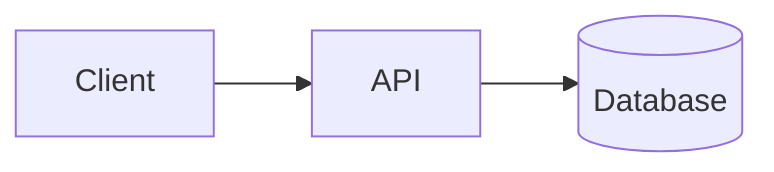
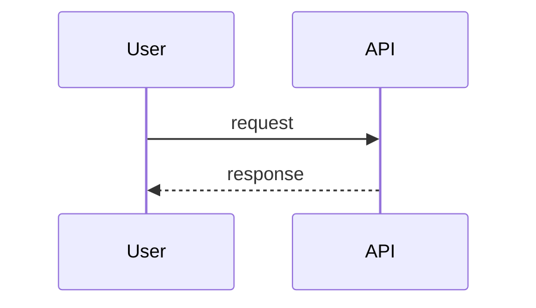
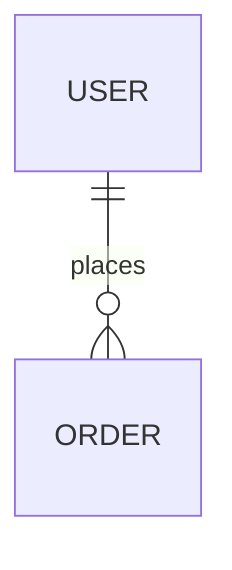

# SurfingBear Resume Optimizer — Specification

| Field | Value |
|---|---|
| Author | Pratiksha Patil |
| Version | v0.1 |
| Last updated | 2026-10-19 |
| Status | Draft |
| Stack | Backend NestJS (TypeScript) · Frontend Next.js · PostgreSQL · Redis |

> **How to use this template**
> - Keep the section order and numbering. Do not delete a section; if it does not apply, write `N/A` and the reason.
> - Replace every `<...>` placeholder. Lines starting with `> Example:` show the expected level of detail; delete them when you are done.
> - IDs are permanent. Never renumber or reuse an ID. If something is removed, mark it **Deprecated** and keep the row.
>
> **ID rules**
>
> | Prefix | Used for | Example |
> |---|---|---|
> | `CR-` | Company-wide common requirement | CR-001 |
> | `FR-` | Functional requirement | FR-001 |
> | `NFR-` | Non-functional requirement | NFR-001 |
> | `CMP-` | Architecture component | CMP-001 |
> | `TBL-` | Database table | TBL-001 |
> | `API-` | API endpoint | API-001 |
> | `ERR-` | Error code | ERR-001 |

---

## 1. Company-wide common requirements

Rules every Divii / Hanriver project must follow. Each rule has an ID and must be specific enough to be checked.

| ID | Area | Rule | How it is checked |
|---|---|---|---|
| CR-001 | Authentication | <rule> | <check> |

> Example: `CR-004 | Logging | Logs are JSON, one object per line, with fields timestamp, level, requestId, userId, message. Personal data (email, phone, file contents) is never logged. | Code review + log sample review`

Cover at least these areas:

### 1.1 Authentication
### 1.2 Roles and permissions
Include a role × permission table.
### 1.3 Logging
### 1.4 Error handling
Define the **one** standard error response format used by every API.
### 1.5 Security
Secrets, CORS, input validation, rate limiting, data retention.
### 1.6 Internationalization (i18n)
### 1.7 Environments
local / dev / staging / prod — what differs between them.
### 1.8 Deployment
CI/CD, release process, rollback.

---

## 2. Coding conventions

### 2.1 Naming
| Item | Convention | Example |
|---|---|---|
| Classes | <...> | <...> |
| Variables / functions | <...> | <...> |
| DB tables / columns | <...> | <...> |
| API paths | <...> | <...> |

### 2.2 Folder / module structure
Show the folder tree for backend and frontend.

### 2.3 Branching and commits
> Example: branches `feature/FR-001-short-name`, `fix/ERR-003-timeout`; commit format `<type>(<scope>): <message>`.

### 2.4 Code review rules
### 2.5 Lint and format
Tools, config files, and when they run.

---

## 3. Requirements definition

All limits and numbers used below are defined once in **§3.3.2 Limits and constants**. If a number appears anywhere else in this spec, it must match that table.

### 3.1 Functional requirements

**Summary**

| ID | Title | Priority |
|---|---|---|
| FR-001 | Access through the SurfingBear platform login | Must |
| FR-002 | DPDP consent before first upload | Must |
| FR-003 | List target job roles and experience levels | Must |
| FR-004 | Upload resume and start an analysis | Must |
| FR-005 | Validate the file and extract text | Must |
| FR-006 | Monthly analysis quota per plan | Must |
| FR-007 | ATS score out of 100 across 6 dimensions | Must |
| FR-008 | Missing skills for the target role | Must |
| FR-009 | Rewrite suggestions for weak lines | Must |
| FR-010 | Plan-based visibility of results (Free vs Pro) | Must |
| FR-011 | Analysis status tracking | Must |
| FR-012 | Analysis failure handling | Must |
| FR-013 | View analysis history | Must |
| FR-014 | View one analysis | Must |
| FR-015 | Download the analysis as a PDF | Must |
| FR-016 | Delete one analysis | Must |
| FR-017 | Delete all my data (withdraw consent) | Must |
| FR-018 | Automatic deletion after the retention period | Must |
| FR-019 | Show quota usage | Should |
| FR-020 | Delete data when the platform account is deleted | Should |

---

#### FR-001 Access through the SurfingBear platform login
The module has no sign-up or login of its own. Every request is identified by the session token that the main SurfingBear platform already issued.

Acceptance criteria:
1. Every API except `GET /api/v1/health` requires a valid platform access token (JWT, RS256). The token is read from the `sb_session` httpOnly cookie, or from the `Authorization: Bearer <token>` header if the cookie is absent.
2. The token is valid only if: its signature verifies against the platform JWKS, `iss` = `https://auth.surfingbear.com`, `aud` contains `resume-optimizer`, and `exp` is in the future (60 s clock-skew allowance). Otherwise the API returns `401 UNAUTHORIZED`.
3. The user is identified by the token claim `sub` (platform user ID). The plan is read from the claim `plan` (`FREE` or `PRO`). A missing or unknown `plan` value is treated as `FREE`.
4. On the first valid request from a new `sub`, a user record is created automatically (no sign-up step).
5. A user can only see and change their own data. Requesting another user's analysis returns `404 ANALYSIS_NOT_FOUND` (not 403), so analysis IDs cannot be probed.
6. When the frontend receives `401`, it redirects the browser to `https://surfingbear.com/login?returnTo=<current URL>`.

#### FR-002 DPDP consent before first upload
Before the first upload, the user must read a consent notice and accept it. This is the legal basis for processing resume data under India's DPDP Act 2023.

Acceptance criteria:
1. The notice states: what is collected (resume file and its text), the purpose (ATS analysis only), that the text is sent to the AI processor (Anthropic Claude via Amazon Bedrock, Mumbai region), the retention periods from §3.3.2, how to delete data (FR-016, FR-017) and the grievance contact `privacy@surfingbear.com`.
2. The notice has a version string. The current version is `CONSENT_VERSION` (§3.3.2).
3. Uploading without having accepted the current version returns `403 CONSENT_REQUIRED`, and the frontend shows the notice.
4. Accepting stores the user, the version, the time and the IP address. Accepting the same version twice is idempotent and returns `200`.
5. When `CONSENT_VERSION` changes, users must accept again before their next upload. Their existing analyses stay viewable.
6. The checkbox "I agree" is unticked by default. The "Continue" button is disabled until it is ticked.

#### FR-003 List target job roles and experience levels
The user picks one target job role and one experience level for each analysis.

Acceptance criteria:
1. Job roles come from a fixed catalogue stored in the database and seeded by migration (initial list in §3.3.3). Only roles with `is_active = true` are returned, sorted by `name` ascending.
2. Experience levels are a fixed enum: `ENTRY` (0–2 years), `MID` (2–5 years), `SENIOR` (5–10 years), `LEAD` (10+ years).
3. Each role has a list of expected skills, split into `CORE` and `NICE_TO_HAVE`. These are used by FR-008.
4. Starting an analysis with an unknown or inactive `jobRoleId` returns `404 JOB_ROLE_NOT_FOUND`. An invalid `experienceLevel` returns `400 VALIDATION_ERROR`.

#### FR-004 Upload resume and start an analysis
The user uploads one resume file together with the chosen role and level in a single request. The system checks the file straight away and then runs the AI analysis in the background.

Acceptance criteria:
1. The request is `multipart/form-data` with the fields `file`, `jobRoleId` and `experienceLevel`.
2. Checks run in this order, and the first failure is returned: (a) token (FR-001), (b) consent (FR-002), (c) rate limit (NFR-015), (d) request fields (FR-003), (e) no active analysis (criterion 4), (f) quota (FR-006), (g) file checks and text extraction (FR-005).
3. If every check passes: the original file is stored in private object storage, an analysis record is created with status `QUEUED`, one quota unit is used (FR-006), a background job is queued, and the API returns `202 Accepted` with the `analysisId` and status `QUEUED`.
4. A user may have at most `MAX_ACTIVE_ANALYSES_PER_USER` analyses in status `QUEUED` or `PROCESSING`. Another upload returns `409 ANALYSIS_IN_PROGRESS`.
5. If a check fails, nothing is stored and no quota is used.
6. The frontend upload screen accepts drag-and-drop or a file picker, limits the picker to `.pdf` and `.docx`, rejects files over `MAX_FILE_SIZE_BYTES` before uploading, and shows an upload progress bar.

#### FR-005 Validate the file and extract text
The file is checked and its text extracted synchronously during the upload request (FR-004), so the user gets file errors immediately.

Acceptance criteria:
1. Size > `MAX_FILE_SIZE_BYTES` → `413 FILE_TOO_LARGE`. An empty file (0 bytes) → `400 VALIDATION_ERROR`.
2. The type is decided by file content (magic bytes), not by name or the browser's MIME type. PDF must start with `%PDF-`. DOCX must be a ZIP archive containing `word/document.xml`. The file name extension (`.pdf` or `.docx`, case-insensitive) must match the detected type. Anything else, including `.doc`, `.rtf`, images, or a file named `.pdf` whose content is DOCX, → `415 UNSUPPORTED_FILE_TYPE`.
3. A PDF with more than `MAX_PDF_PAGES` pages → `422 TOO_MANY_PAGES`. (DOCX has no reliable page count, so only the text-length limit applies to DOCX.)
4. A corrupt or password-protected file → `422 FILE_UNREADABLE`.
5. Text is extracted (PDF: `pdf-parse`; DOCX: `mammoth`). Whitespace runs are collapsed to one space and line breaks are kept.
6. Extracted text shorter than `MIN_TEXT_CHARS` characters → `422 NO_TEXT_FOUND`. This covers scanned PDFs, which are images (OCR is out of scope).
7. Extracted text longer than `MAX_TEXT_CHARS` characters → `422 TEXT_TOO_LONG`.
8. The original file name is stored with the analysis for display only. It is never used as the storage key: the key is `resumes/<userId>/<analysisId>.<pdf|docx>`.

#### FR-006 Monthly analysis quota per plan
Free users get a limited number of analyses per month.

Acceptance criteria:
1. Monthly limit: `FREE` = `FREE_MONTHLY_ANALYSES`, `PRO` = `PRO_MONTHLY_ANALYSES` (§3.3.2).
2. A month is a calendar month in the `Asia/Kolkata` time zone. The counter resets at 00:00 IST on the 1st of each month.
3. One unit is used when an analysis is created (status `QUEUED`). If the analysis later ends in `FAILED`, the unit is given back (FR-012).
4. Deleting an analysis (FR-016) does **not** give the unit back. Otherwise deleting and re-uploading would bypass the limit.
5. If used ≥ limit, an upload returns `429 QUOTA_EXCEEDED`. The error `details` contain `limit`, `used` and `resetsAt` (ISO 8601 with offset `+05:30`).
6. The plan in the current token decides the limit. If a user upgrades from FREE to PRO mid-month, their remaining quota is `PRO_MONTHLY_ANALYSES` minus the units already used that month.
7. Two uploads sent at the same moment can never both pass when only one unit is left. The check and the increment happen in one atomic database operation.

#### FR-007 ATS score out of 100 across 6 dimensions
The AI scores the resume for the chosen role and level on 6 fixed dimensions. The overall score is the sum of the dimension scores.

| Dimension code | Name | Max points | What is judged |
|---|---|---|---|
| `KEYWORDS` | Keyword match | 25 | Role-specific keywords and job titles that ATS filters look for |
| `SKILLS` | Skills relevance | 20 | Coverage of the role's `CORE` and `NICE_TO_HAVE` skills |
| `IMPACT` | Impact and achievements | 20 | Measurable results (numbers, %, ₹), action verbs, outcomes instead of duties |
| `EXPERIENCE_FIT` | Experience-level fit | 10 | Whether seniority, scope and years match the chosen level |
| `FORMAT` | ATS-friendly format | 15 | Standard section headings, no tables/columns/images that break parsing, consistent dates, contact info present |
| `CLARITY` | Language and clarity | 10 | Grammar, spelling, concise bullet points, no first-person pronouns |
| | **Total** | **100** | |

Acceptance criteria:
1. Every completed analysis has exactly 6 dimension scores, one per code above. Each score is an integer from 0 to that dimension's max.
2. `overallScore` = sum of the 6 dimension scores (integer 0–100). It is calculated by the backend, not taken from the AI.
3. Each dimension has a `feedback` text of 1–3 sentences (max 500 characters) explaining the score.
4. `overallScore` is mapped to a band: 0–49 `POOR`, 50–69 `FAIR`, 70–84 `GOOD`, 85–100 `EXCELLENT`.
5. If the AI returns a score outside the allowed range or misses a dimension, the response is invalid and FR-012 applies.

#### FR-008 Missing skills for the target role
The system lists skills the role expects that the resume does not show.

Acceptance criteria:
1. Each missing skill has: `name` (max 100 characters), `importance` (`CRITICAL` or `RECOMMENDED`) and `reason` (one sentence, max 300 characters).
2. A skill from the role's `CORE` list that is not in the resume is `CRITICAL`. A `NICE_TO_HAVE` skill, or one the AI adds from its own knowledge of the role and level, is `RECOMMENDED`.
3. At most `MAX_MISSING_SKILLS` are stored, ordered `CRITICAL` first, then by AI-given rank. The list may be empty when nothing is missing.
4. The same skill name never appears twice in one analysis (case-insensitive comparison).

#### FR-009 Rewrite suggestions for weak lines
The system picks weak lines from the resume and suggests better versions.

Acceptance criteria:
1. Each suggestion has: `section` (one of `SUMMARY`, `EXPERIENCE`, `PROJECTS`, `EDUCATION`, `SKILLS`, `OTHER`), `originalText` (the line as written in the resume, max 500 characters), `suggestedText` (max 500 characters), `reason` (max 300 characters), `dimension` (the FR-007 dimension code it improves) and `priority` (1 = most impactful, unique, consecutive from 1).
2. At most `MAX_SUGGESTIONS` suggestions are stored. Zero is allowed if no line is weak.
3. `originalText` must appear in the extracted resume text (compared after collapsing whitespace, case-insensitive). Suggestions that fail this check are dropped by the backend. Dropping them is not a failure.
4. `suggestedText` must not invent facts: the AI prompt forbids adding numbers, employers, dates or skills that are not in the original. Where a number would help, it uses a placeholder such as `[X%]`.

#### FR-010 Plan-based visibility of results (Free vs Pro)
Free users see only part of the suggestions. The full result is always generated and stored. What the API returns depends on the plan in the token at the time of the request.

Acceptance criteria:
1. Both plans see: the overall score, band, all 6 dimension scores with feedback, and the total counts of missing skills and suggestions.
2. `FREE`: only the first `FREE_VISIBLE_SUGGESTIONS` suggestions (by `priority`) and the first `FREE_VISIBLE_MISSING_SKILLS` missing skills (in FR-008 order) are returned. The rest are **not sent** by the API at all. Only `lockedSuggestionsCount` and `lockedMissingSkillsCount` are sent.
3. `PRO`: everything is returned and both locked counts are `0`.
4. If a FREE user later upgrades to PRO, locked items of their past analyses become visible without re-analysis.
5. The frontend shows locked items as greyed placeholder cards with the text "Upgrade to Pro to see N more suggestions" and a button linking to `https://surfingbear.com/pricing`.
6. The same rules apply to the PDF (FR-015).

#### FR-011 Analysis status tracking
The analysis runs in the background, so the frontend checks its progress.

Acceptance criteria:
1. Status values: `QUEUED` → `PROCESSING` → `COMPLETED` or `FAILED`. No other changes are allowed, and `COMPLETED` and `FAILED` are final.
2. The status endpoint returns `status`, and when `FAILED`, also `failureCode` and `failureMessage`.
3. The frontend polls every `POLL_INTERVAL_SECONDS` seconds while status is `QUEUED` or `PROCESSING`. After `POLL_TIMEOUT_SECONDS` it stops and shows "This is taking longer than usual. We'll keep working — check your history later." with a link to history.
4. While waiting, the frontend shows a progress screen with the steps "Reading resume", "Scoring", "Finding gaps", "Writing suggestions". The steps are shown on a timer and are not real progress.

#### FR-012 Analysis failure handling
AI problems must not leave an analysis stuck, and the user must not lose quota because of them.

Acceptance criteria:
1. AI call timeout is `AI_TIMEOUT_SECONDS`. On timeout, HTTP 429/5xx from the provider, or a response that is not valid JSON or fails schema validation (FR-007 to FR-009), the call is retried until `AI_MAX_ATTEMPTS` total attempts, waiting 5 s before each retry.
2. If all attempts fail, the analysis becomes `FAILED` with `failureCode` = `AI_UNAVAILABLE` (timeout/5xx/429) or `AI_INVALID_RESPONSE` (bad output).
3. If the AI reports that the text is not a resume, the analysis becomes `FAILED` with `NOT_A_RESUME`. If the resume is not mainly in English, it becomes `FAILED` with `UNSUPPORTED_LANGUAGE`. These are not retried.
4. Any analysis still `QUEUED` or `PROCESSING` `STUCK_JOB_MINUTES` minutes after creation is marked `FAILED` with `INTERNAL_ERROR` by a sweeper job that runs every minute.
5. Every move to `FAILED` gives the quota unit back (FR-006, criterion 3) in the same database transaction.
6. Each `failureCode` has a fixed user-facing message (listed in §6.3). The frontend shows that message with a "Try again" button that goes back to the upload screen.

#### FR-013 View analysis history
The user sees their past analyses.

Acceptance criteria:
1. The list shows the user's own analyses, newest first (`createdAt` descending), with page size 20 by default and 50 at most (cursor pagination, §6.1).
2. Each item shows: `analysisId`, `fileName`, job role name, `experienceLevel`, `status`, `overallScore` (null unless `COMPLETED`), `band` and `createdAt`.
3. Analyses that were deleted (FR-016) or removed by retention (FR-018) do not appear.
4. When the list is empty, the frontend shows "No analyses yet" with a button to the upload screen.

#### FR-014 View one analysis
The user opens one analysis to see the full result.

Acceptance criteria:
1. Returns everything in FR-011 criterion 2 plus, when `COMPLETED`: the overall score, band, 6 dimensions, missing skills and suggestions, filtered by FR-010.
2. An analysis of another user, or a deleted one → `404 ANALYSIS_NOT_FOUND`.
3. The results screen shows the overall score as a circular gauge coloured by band, the 6 dimensions as bars with their feedback, missing skills grouped by importance, and suggestions as "before / after" cards ordered by priority.

#### FR-015 Download the analysis as a PDF
The user downloads the result as a PDF report.

Acceptance criteria:
1. Allowed only when status is `COMPLETED`, otherwise `409 ANALYSIS_NOT_COMPLETED`.
2. The PDF is generated on request and streamed back (`Content-Type: application/pdf`). It is not stored, so it never needs separate deletion.
3. File name: `SurfingBear-Resume-Report-<YYYY-MM-DD>.pdf`, where the date is the analysis `completedAt` in IST.
4. Content: SurfingBear logo and title, job role, experience level, analysis date (IST), overall score and band, 6 dimensions with score/max and feedback, missing skills and suggestions filtered by FR-010. For FREE users, a line "N more suggestions available with SurfingBear Pro" is added. The original resume file is not embedded.
5. Page size A4. Fonts embedded so the PDF looks the same on every device. Supports the `₹` symbol.

#### FR-016 Delete one analysis
The user deletes one analysis.

Acceptance criteria:
1. Deleting removes the analysis and its dimension scores, missing skills, suggestions and extracted text from the database at once, and queues deletion of the stored file.
2. The stored file is deleted within `ERASURE_STORAGE_SLA_MINUTES` minutes.
3. An analysis in `QUEUED` or `PROCESSING` cannot be deleted → `409 ANALYSIS_IN_PROGRESS`.
4. Deleting again, or deleting an unknown ID → `404 ANALYSIS_NOT_FOUND`.
5. The frontend asks for confirmation: "Delete this analysis? This can't be undone."
6. Quota is not given back (FR-006, criterion 4).

#### FR-017 Delete all my data (withdraw consent)
The user erases everything this module holds about them. This is the DPDP right to erasure and also counts as withdrawing consent.

Acceptance criteria:
1. Deletes all the user's analyses (with their child records), extracted texts and consent records, and queues deletion of all their stored files.
2. Not allowed while any analysis is `QUEUED` or `PROCESSING` → `409 ANALYSIS_IN_PROGRESS`.
3. The user row and the quota usage rows of the **current month only** are kept, so deleting data cannot reset the monthly quota (FR-006). These rows contain only the platform user ID and counters, with no resume data. Older quota rows are deleted.
4. After deletion, the next upload requires consent again (FR-002).
5. Stored files are deleted within `ERASURE_STORAGE_SLA_MINUTES` minutes. Database backups containing the data expire within `BACKUP_RETENTION_DAYS` days.
6. An audit record is written with the user ID, the time and the number of analyses deleted, and no personal data.
7. The frontend asks the user to type `DELETE` to confirm.

#### FR-018 Automatic deletion after the retention period
Data is kept only as long as needed.

Acceptance criteria:
1. The original file and the extracted text are deleted `FILE_RETENTION_DAYS` days after the analysis is created. The analysis result (scores, skills, suggestions) stays.
2. The whole analysis is deleted `RESULT_RETENTION_DAYS` days after it is created.
3. `FAILED` analyses are deleted completely `FILE_RETENTION_DAYS` days after creation.
4. A purge job runs every day at 02:00 IST. It deletes in batches of 500 and is safe to re-run if it stops halfway.
5. When the file has been purged but the result remains, the analysis is still viewable and downloadable as a PDF, because the PDF does not use the original file.

#### FR-019 Show quota usage
The user sees how many analyses they have left this month.

Acceptance criteria:
1. Returns `plan`, `limit`, `used`, `remaining` (never negative) and `resetsAt` (next 1st of the month 00:00 IST, ISO 8601 with `+05:30`).
2. The upload screen shows "X of Y analyses left this month". When `remaining` = 0, the upload button is disabled and FREE users see the upgrade link.

#### FR-020 Delete data when the platform account is deleted
When a user deletes their SurfingBear platform account, the platform tells this module to erase that user's data.

Acceptance criteria:
1. The platform calls an internal endpoint authenticated with a shared service token (header `X-Service-Token`), not a user JWT. A wrong or missing token → `401 UNAUTHORIZED`.
2. It erases everything in FR-017 **including** the user row and all quota rows. Analyses still `QUEUED` or `PROCESSING` are cancelled first and their files deleted.
3. It is idempotent: an unknown user ID returns `204` as well.
4. This endpoint is not exposed through the public load balancer path. It is reachable only from the platform's private network (§4).

---

### 3.2 Non-functional requirements

| ID | Category | Requirement | Measurable target | How it is verified |
|---|---|---|---|---|
| NFR-001 | Performance | Response time of all read and small write APIs (everything except upload and PDF) | p95 ≤ 300 ms, p99 ≤ 800 ms at 50 requests/s | k6 load test in staging before each release |
| NFR-002 | Performance | Upload API response time, including file checks and text extraction | p95 ≤ 3 s for a 5 MB, 10-page PDF | k6 test with sample files |
| NFR-003 | Performance | Time from `QUEUED` to `COMPLETED` | p95 ≤ 45 s, p99 ≤ 90 s | `analysis_duration_seconds` metric in production; k6 in staging |
| NFR-004 | Performance | PDF report generation | p95 ≤ 5 s | k6 test |
| NFR-005 | Scalability | Throughput without breaching NFR-001 to NFR-004 | 10,000 analyses/day; 100 analyses running at once. API and worker scale horizontally with no in-memory state | Load test at 2× target |
| NFR-006 | Availability | API uptime | ≥ 99.5% per calendar month, excluding maintenance announced 48 h ahead. An AI provider outage must not affect read APIs (history, results, PDF) | Uptime monitor on `/api/v1/health` every 1 min |
| NFR-007 | Reliability | No lost work and recoverable data | No queued analysis lost when a worker restarts (job stays in Redis until finished). Database RPO ≤ 15 min, RTO ≤ 4 h | Kill-worker test in staging; quarterly restore drill |
| NFR-008 | Security | Data encrypted in transit and at rest; files never public | TLS 1.2+ with HSTS; PostgreSQL and S3 encrypted with AWS KMS keys; S3 "Block Public Access" on; files reachable only through the API | AWS Config rules; SSL Labs grade ≥ A |
| NFR-009 | Security | No known vulnerabilities at release | 0 critical and 0 high findings from `npm audit` and OWASP ZAP baseline scan | CI pipeline gate |
| NFR-010 | Privacy | Personal data never appears in logs, metrics or error trackers | 0 occurrences of resume text, file names, emails or tokens in a 24 h log sample | Automated log-scan test in staging with seeded test resumes |
| NFR-011 | Privacy | Data residency and AI processor terms | All stored data in AWS `ap-south-1` (Mumbai). AI processing via Amazon Bedrock in `ap-south-1`; Bedrock does not store prompts or use them for training | Infra review; AWS data-processing terms on file |
| NFR-012 | Privacy | Retention is enforced on time | Data past its retention date (FR-018) is deleted within 24 h of that date | Daily purge-job metric `purge_overdue_rows` = 0 |
| NFR-013 | Privacy | Erasure is completed on time | Database rows: immediately in the request. Stored files: ≤ 60 min. Backups: ≤ 7 days | E2E test checks S3 after 60 min; backup retention setting |
| NFR-014 | Observability | Problems are visible and alerted | Structured JSON logs with `requestId`; metrics for request latency, queue depth and analysis outcome; alerts when failure rate > 5% over 15 min, queue depth > 200 for 10 min, or p95 of NFR-003 > 60 s for 15 min | Alert rules reviewed in staging with a fault-injection test |
| NFR-015 | Security | Rate limiting per user | 60 requests/min across all APIs; 10 uploads/hour. Over the limit → `429 RATE_LIMITED` with `Retry-After` header | Integration test |
| NFR-016 | Accessibility | Web frontend usable by everyone | WCAG 2.1 AA; Lighthouse accessibility score ≥ 90 on every page | Lighthouse CI + axe in Playwright tests |
| NFR-017 | Compatibility | Supported browsers and screens | Latest 2 versions of Chrome, Edge, Firefox and Safari (desktop and mobile); widths 360 px to 1920 px | Playwright tests on Chromium, Firefox and WebKit |
| NFR-018 | Maintainability | Test coverage | Backend line coverage ≥ 80%; E2E tests cover FR-004, FR-014, FR-015 and FR-017 | Jest coverage report as CI gate |
| NFR-019 | Cost | AI usage per analysis is bounded | Input ≤ 12,000 tokens, output ≤ 4,000 tokens per AI call; ≤ `AI_MAX_ATTEMPTS` calls per analysis | Token-count metric per analysis |
| NFR-020 | AI consistency | Same input gives a stable score | Analysing the same file, role and level twice gives `overallScore` values that differ by ≤ 5 points (temperature 0) | Run on a fixed set of 20 sample resumes before each prompt or model change |

---

### 3.3 Assumptions and out of scope

#### 3.3.1 Assumptions (design decisions not given in the brief)

| # | Decision | Reason |
|---|---|---|
| A-01 | Two plans, `FREE` and `PRO`, provided by the platform in the JWT claim `plan`. This module does not handle payments or plan changes. | The brief says users are already logged in through the platform; billing belongs to the platform too. |
| A-02 | The platform login sets an httpOnly cookie `sb_session` (RS256 JWT) on `.surfingbear.com`. The platform publishes its public keys at `https://auth.surfingbear.com/.well-known/jwks.json`. | Lets the module verify users without calling the platform on every request. |
| A-03 | Frontend runs at `https://resume.surfingbear.com`, API at `https://resume.surfingbear.com/api/v1` (same origin). | Same origin means the cookie is sent automatically and CORS is not needed for the browser. |
| A-04 | The file check and text extraction run synchronously in the upload request. Only the AI step runs in the background. | Users see file errors at once, and bad files never use quota or queue capacity. |
| A-05 | AI provider: Anthropic Claude through Amazon Bedrock in `ap-south-1`. | Keeps resume data inside India and inside our AWS account (IAM auth, no API keys to leak). Bedrock does not keep or train on prompts, which helps meet DPDP. |
| A-06 | File storage: Amazon S3, private bucket in `ap-south-1`. | Same region and account as the database. Encryption and lifecycle rules are built in. |
| A-07 | Only English resumes are supported in v1. | Scoring dimensions and keywords are tuned for English-language ATS systems used by Indian employers. |
| A-08 | Analysis is a one-shot result. Changing the role or level means a new analysis, which uses one more quota unit. | Keeps results reproducible and quota rules simple. |
| A-09 | Quota months follow the Indian calendar month (IST). | The product is for Indian users, and "resets on the 1st" is easy to explain. |
| A-10 | The full result is stored even for FREE users. Visibility is decided when the result is read. | An upgrade unlocks old results at once with no extra AI cost. |
| A-11 | The job-role catalogue is managed through database migrations. There is no admin screen in v1. | Roles change rarely; an admin UI would add security work for little value. |

#### 3.3.2 Limits and constants

This is the single source of truth for every number in this spec. The backend reads these from configuration with these defaults (§1.7).

| Constant | Value | Used in |
|---|---|---|
| `MAX_FILE_SIZE_BYTES` | 5,242,880 (5 MB) | FR-004, FR-005 |
| `ALLOWED_FILE_TYPES` | PDF, DOCX | FR-005 |
| `MAX_PDF_PAGES` | 10 | FR-005 |
| `MIN_TEXT_CHARS` | 200 | FR-005 |
| `MAX_TEXT_CHARS` | 30,000 | FR-005 |
| `FREE_MONTHLY_ANALYSES` | 3 | FR-006 |
| `PRO_MONTHLY_ANALYSES` | 30 | FR-006 |
| `MAX_ACTIVE_ANALYSES_PER_USER` | 1 | FR-004 |
| `FREE_VISIBLE_SUGGESTIONS` | 3 | FR-010 |
| `FREE_VISIBLE_MISSING_SKILLS` | 5 | FR-010 |
| `MAX_SUGGESTIONS` | 10 | FR-009 |
| `MAX_MISSING_SKILLS` | 15 | FR-008 |
| `AI_TIMEOUT_SECONDS` | 60 | FR-012 |
| `AI_MAX_ATTEMPTS` | 2 (1 first try + 1 retry) | FR-012, NFR-019 |
| `STUCK_JOB_MINUTES` | 5 | FR-012 |
| `POLL_INTERVAL_SECONDS` | 3 | FR-011 |
| `POLL_TIMEOUT_SECONDS` | 180 | FR-011 |
| `FILE_RETENTION_DAYS` | 30 | FR-018 |
| `RESULT_RETENTION_DAYS` | 365 | FR-018 |
| `ERASURE_STORAGE_SLA_MINUTES` | 60 | FR-016, FR-017, NFR-013 |
| `BACKUP_RETENTION_DAYS` | 7 | FR-017, NFR-013 |
| `RATE_LIMIT_PER_MINUTE` | 60 | NFR-015 |
| `UPLOADS_PER_HOUR` | 10 | NFR-015 |
| `CONSENT_VERSION` | `2026-10-v1` | FR-002 |

#### 3.3.3 Initial job-role catalogue

Seeded by migration. Each role's `CORE` and `NICE_TO_HAVE` skills are defined in the seed file described in §5.

Software Engineer (Backend), Software Engineer (Frontend), Full Stack Developer, Mobile App Developer, Data Analyst, Data Scientist, DevOps Engineer, QA Engineer, UI/UX Designer, Product Manager, Business Analyst, Digital Marketing Executive, Sales Executive, HR Executive, Accountant, Customer Support Executive.

#### 3.3.4 Out of scope

| Item | Why |
|---|---|
| Sign-up, login, password reset | Handled by the SurfingBear platform (brief) |
| Payments, plan upgrades, invoices | Handled by the platform (A-01); this module only links to the pricing page |
| OCR for scanned or image-only PDFs | Adds cost and lowers accuracy; such files are rejected with `NO_TEXT_FOUND` |
| Resumes not in English; `.doc`, `.rtf`, `.txt` and image files | See A-07 and FR-005 |
| Editing the resume in the app or creating a new resume file | The product description asks for analysis and suggestions only |
| Matching against a specific job posting pasted by the user | Not in the product description; a possible future feature |
| Admin screens (role catalogue, user lookup) | See A-11 |
| Email or push notifications when an analysis finishes | Analyses finish in under a minute (NFR-003), so polling is enough |
| Sharing reports by public link | Would expose personal data; the PDF download covers sharing |
| Native mobile app | Frontend is Next.js (responsive web) |

---

## 4. Architecture

### 4.1 Component diagram



### 4.2 Components

| ID | Component | Responsibility | Technology |
|---|---|---|---|
| CMP-001 | <name> | <what it does> | <tech> |

### 4.3 Main flows
One sequence diagram per main flow.



### 4.4 External integrations

| System | Purpose | Protocol / auth | Failure handling |
|---|---|---|---|

### 4.5 Tech stack and reasons

| Layer | Choice | Why this choice |
|---|---|---|

---

## 5. ERD and database design

### 5.1 ERD



### 5.2 Tables
One block per table.

#### TBL-001 `<table_name>`
Purpose: <one line>

| Column | Type | Null | Key | Default | Constraint / note |
|---|---|---|---|---|---|
| id | uuid | NO | PK | gen_random_uuid() | |

### 5.3 Indexes

| Table | Index | Columns | Why |
|---|---|---|---|

### 5.4 Relationships and delete rules

| From | To | Cardinality | On delete |
|---|---|---|---|

---

## 6. API design

### 6.1 Common rules
- Base path:
- Auth header / cookie:
- Pagination format:
- Date / time format and timezone:
- Standard error format (must match section 1.4):

### 6.2 Endpoints
One block per endpoint.

#### API-001 `<METHOD> <path>`
- **Purpose:**
- **Auth / role:**
- **Implements:** FR-xxx

**Request**

| Field | In (path/query/body) | Type | Required | Validation |
|---|---|---|---|---|

**Response 200**

```json
{}
```

**Errors**

| HTTP | Error code | When |
|---|---|---|

### 6.3 Error code list

| ID | Code | HTTP | Message | When it happens |
|---|---|---|---|---|

---

## 7. Traceability matrix

Every FR and NFR must appear here at least once. No empty cells — write `—` only when something genuinely does not apply, and say why.

| Requirement | Component(s) | Table(s) | API(s) | Verified by |
|---|---|---|---|---|
| FR-001 | CMP-00x | TBL-00x | API-00x | <test / acceptance criterion> |

---

## 8. Change log

| Version | Date | Author | What changed | Why | Affected IDs |
|---|---|---|---|---|---|
| v0.1 | 2026-10-19 | Pratiksha Patil | Draft: header, §3 requirements (FR-001–FR-020, NFR-001–NFR-020), assumptions, limits and out-of-scope list | Round 1 writing | FR-001–FR-020, NFR-001–NFR-020 |
