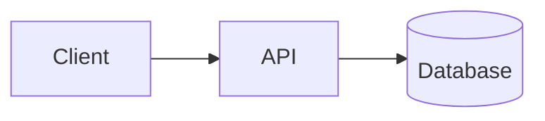
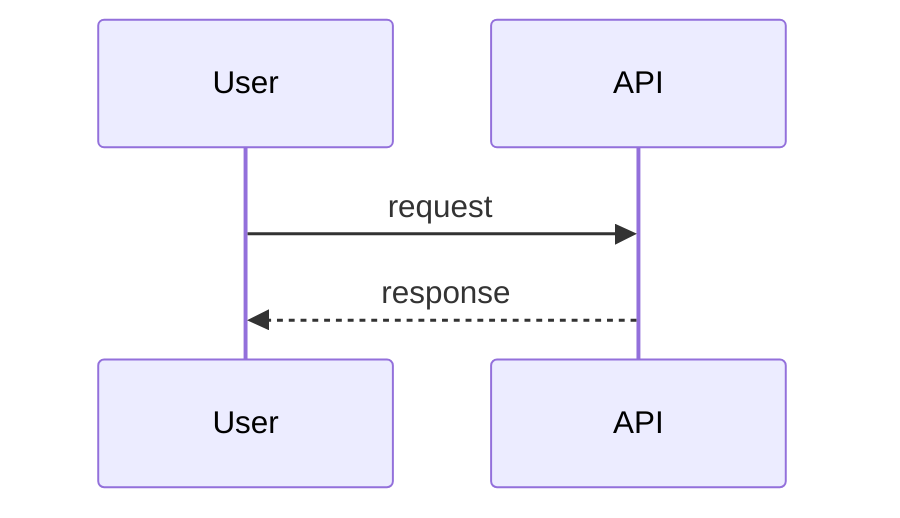
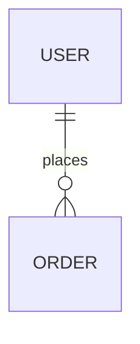

# SurfingBear Resume Optimizer — Specification

| Field | Value |
|---|---|
| Author | Sachin S M |
| Version | v0.1 |
| Last updated | 2026-10-19 |
| Status | Draft |
| Backend stack | Spring Boot 3.4 (Java 21) |
| Frontend stack | Next.js 15 (App Router, TypeScript) |
| Data | PostgreSQL 16, Redis 7 |

> **ID rules**
>
> | Prefix | Used for | Example |
> |---|---|---|
> | `CR-` | Company-wide common requirement | CR-001 |
> | `FR-` | Functional requirement | FR-001 |
> | `NFR-` | Non-functional requirement | NFR-001 |
> | `CMP-` | Architecture component | CMP-001 |
> | `TBL-` | Database table | TBL-001 |
> | `API-` | API endpoint | API-001 |
> | `ERR-` | Error code | ERR-001 |
>
> IDs are permanent. An ID is never renumbered or reused. A removed item stays in its table marked **Deprecated**.

### Glossary

| Term | Meaning in this spec |
|---|---|
| Platform | The main SurfingBear platform. It owns sign-up, login, user profiles and subscription plans. |
| Module | This system, the Resume Optimizer. |
| User | A person logged in to the platform, identified by the platform user id (`sub` claim). |
| Plan | `FREE` or `PREMIUM`, read from the platform access token (`plan` claim). |
| Resume | One uploaded file (PDF or DOCX) plus the text extracted from it. |
| Analysis | One AI evaluation of one resume against one target job role and one experience level. |
| Quota period | One calendar month in the `Asia/Kolkata` time zone (IST), from the 1st 00:00 to the last day 23:59:59.999. |
| IST | India Standard Time, UTC+05:30. |
| Data Principal | DPDP Act term for the person the personal data is about; here, the user. |

---

## 1. Company-wide common requirements

Rules every Divii / Hanriver project follows, written for this module. Each rule can be checked.

### 1.1 Authentication

| ID | Area | Rule | How it is checked |
|---|---|---|---|
| CR-001 | Authentication | The module never issues, stores or refreshes credentials. Every request is authenticated with the platform's access token: a JWT signed with RS256, read from the `sb_access` cookie (httpOnly, Secure, SameSite=Lax, Domain=`.surfingbear.com`) or, for service-to-service calls only, from `Authorization: Bearer <token>`. | Integration test: request with no token, expired token, wrong signature, wrong `iss` → each returns 401 `UNAUTHENTICATED`. |
| CR-002 | Authentication | Token validation checks: signature against the platform JWKS (`PLATFORM_JWKS_URL`), `iss` = `PLATFORM_ISSUER`, `aud` contains `resume-optimizer`, `exp` in the future with at most 30 s clock skew. JWKS keys are cached in memory for 10 minutes and refetched once immediately when a token carries an unknown `kid`. | Unit tests on the token validator; test with a rotated key id. |
| CR-003 | Authentication | The claims the module uses are `sub` (user id, string, max 64 chars), `plan` (`FREE` / `PREMIUM`) and `roles` (array, contains `USER` and optionally `ADMIN`). A missing or unknown `plan` is treated as `FREE` and logged at WARN with the request id (never the token). | Unit test per case. |
| CR-004 | Authentication | Service-to-service calls (platform → module, see FR-021) use a separate token whose `roles` contains `PLATFORM_SERVICE`. A user token can never reach `/internal/**`. | Integration test: user token on `/internal/**` → 403 `FORBIDDEN`. |

### 1.2 Roles and permissions

| ID | Area | Rule | How it is checked |
|---|---|---|---|
| CR-005 | Authorization | Authorization is checked in the service layer, not only by URL rules, so that every entry point (API, job, internal call) applies the same check. | Code review checklist item; unit tests call services directly. |
| CR-006 | Authorization | A user can read, download or delete only rows whose `user_id` equals their own `sub`. Asking for another user's resume or analysis returns **404** with the normal not-found code, never 403, so that ids cannot be probed. | Integration test with two users. |
| CR-007 | Authorization | `ADMIN` sees only aggregated, non-personal numbers (FR-022). No role, including `ADMIN`, can read another person's resume text, file, scores or suggestions through any API. | Integration test: admin token on another user's analysis → 404. |

Role × permission table (✔ = allowed, — = not allowed):

| Permission | USER | ADMIN | PLATFORM_SERVICE |
|---|---|---|---|
| Give / withdraw own consent | ✔ | ✔ (as a user) | — |
| Upload, list, delete own resumes | ✔ | ✔ (as a user) | — |
| Start, view, list, delete own analyses | ✔ | ✔ (as a user) | — |
| Download own analysis PDF | ✔ | ✔ (as a user) | — |
| Erase all own data | ✔ | ✔ (as a user) | — |
| View aggregated usage statistics | — | ✔ | — |
| Erase all data of any user id | — | — | ✔ |
| Read any other user's resume or analysis | — | — | — |

An `ADMIN` is also a normal user of the module; the extra role only adds the statistics permission.

### 1.3 Logging

| ID | Area | Rule | How it is checked |
|---|---|---|---|
| CR-008 | Logging | Logs are JSON, one object per line, with the fields `timestamp` (ISO-8601 UTC), `level`, `logger`, `requestId`, `userId` (platform `sub`, or `-`), `event`, `message`, and `durationMs` where relevant. | Log sample review in staging. |
| CR-009 | Logging | Never logged, at any level: resume file contents, extracted text, AI prompts and AI responses, rewrite suggestions, file names, email addresses, phone numbers, tokens, cookies. File size, page count, MIME type, analysis id and resume id may be logged. | Unit test on the log redaction filter + code review checklist. |
| CR-010 | Logging | Every request gets a `requestId` (UUID v4). If the caller sends `X-Request-Id` in UUID format it is reused; otherwise a new one is generated. It is returned in the `X-Request-Id` response header, written in every log line and in every error response, and passed to background jobs. | Integration test on the header. |
| CR-011 | Logging | Log levels: ERROR = needs action (unexpected exception, AI provider down); WARN = handled but unusual (unknown plan claim, retry happened); INFO = one line per request and per job state change; DEBUG is off in staging and prod. Logs are kept 30 days. | Config review per environment. |

### 1.4 Error handling

| ID | Area | Rule | How it is checked |
|---|---|---|---|
| CR-012 | Errors | Every non-2xx response uses exactly the error body below, produced by one `@RestControllerAdvice`. No stack trace, SQL, class name or provider message ever reaches the client. | Integration test per error code; test that a forced exception returns `INTERNAL_ERROR` without stack trace. |
| CR-013 | Errors | `code` values are fixed strings from the error code list (section 6.3). Clients act on `code`; `message` is English, for developers, and may change. The frontend shows its own translated text per code. | Contract test: every code in 6.3 exists as an enum constant; no other code is returned. |
| CR-014 | Errors | 404 is about the resource in the URL path. A wrong value in the request body or query (for example an unknown job role code) is **400 `VALIDATION_FAILED`** with the field named in `details`. | Integration test: unknown `jobRoleCode` → 400, not 404. |

Standard error body:

```json
{
  "error": {
    "code": "VALIDATION_FAILED",
    "message": "One or more fields are invalid.",
    "requestId": "6f1c2c1e-7d1a-4c0e-9a51-2b8e8f7c9d10",
    "details": [
      { "field": "experienceLevel", "issue": "must be one of FRESHER, JUNIOR, MID, SENIOR, LEAD" }
    ]
  }
}
```

| Field | Type | Always present | Note |
|---|---|---|---|
| `error.code` | string | yes | Value from section 6.3 |
| `error.message` | string | yes | English, max 300 chars |
| `error.requestId` | string (UUID) | yes | Same as `X-Request-Id` header |
| `error.details` | array of `{field, issue}` | no | Present for `VALIDATION_FAILED`; may carry extra keys for other codes, e.g. `{ "resetAt": "2026-11-01T00:00:00+05:30" }` for `QUOTA_EXCEEDED` |

### 1.5 Security

| ID | Area | Rule | How it is checked |
|---|---|---|---|
| CR-015 | Secrets | Secrets (DB password, Redis password, AI API key, S3 credentials) come only from AWS Secrets Manager in dev/staging/prod and from a git-ignored `.env` locally. No secret is in git, Docker images or logs. | CI secret scan (gitleaks) blocks the merge; image scan. |
| CR-016 | Transport | HTTPS only (TLS 1.2+), HSTS `max-age=31536000; includeSubDomains`. HTTP requests are redirected at the load balancer. | Staging check with `curl -I`. |
| CR-017 | CORS | Allowed origins are an explicit list per environment (prod: `https://www.surfingbear.com`). `Access-Control-Allow-Credentials: true`. No wildcard. | Integration test with a foreign Origin → no CORS headers. |
| CR-018 | CSRF | State-changing requests (POST, PUT, DELETE) that authenticate with the cookie must carry the header `X-Requested-With: SurfingBear`; without it they return 403 `FORBIDDEN`. Combined with SameSite=Lax this blocks cross-site form posts. | Integration test. |
| CR-019 | Input validation | Every request field is validated with Bean Validation (`jakarta.validation`) before any service code runs. Uploaded files are checked by magic bytes, not by extension or the client's `Content-Type`. | Unit tests per DTO; file tests in FR-003. |
| CR-020 | Rate limiting | Per user, enforced in Redis with a fixed one-minute window: 60 API requests/minute overall, and 10 resume uploads/hour. Excess returns 429 `RATE_LIMITED` with a `Retry-After` header (seconds). | Integration test with Testcontainers Redis. |
| CR-021 | Data retention | Personal data is kept only as long as section 3.1 (FR-020) allows: resume file and extracted text 30 days after upload, analysis results 180 days after creation. | Retention job test (FR-020). |
| CR-022 | Dependencies | CI fails on any dependency with a known Critical or High CVE (OWASP Dependency-Check for Maven, `npm audit --audit-level=high` for the frontend), unless an exception with an expiry date is recorded in `security-exceptions.md`. | CI job. |

### 1.6 Internationalization (i18n)

| ID | Area | Rule | How it is checked |
|---|---|---|---|
| CR-023 | i18n | All user-visible frontend text is in message files (`next-intl`, `messages/en.json`). No hard-coded UI strings in components. Launch language is English only; adding Hindi means adding `messages/hi.json` without code changes. | ESLint rule `no-literal-string` in JSX (eslint-plugin-i18next). |
| CR-024 | i18n | The API returns machine values (codes, enums, ISO dates, numbers), never display text, except `error.message` (English, developer-facing) and AI-generated content (always English, because resumes are analysed in English, see section 3.3). | API review. |
| CR-025 | Time | The API stores and returns timestamps in UTC, ISO-8601 with offset (`2026-10-19T08:30:00Z`). The only IST-based logic is the quota period (glossary) and the retention job schedule; both use `ZoneId.of("Asia/Kolkata")` explicitly. The frontend displays times in the browser's time zone. | Unit tests at the month boundary (31 Oct 23:59 IST vs 1 Nov 00:00 IST). |

### 1.7 Environments

| ID | Area | Rule | How it is checked |
|---|---|---|---|
| CR-026 | Environments | Four environments: `local`, `dev`, `staging`, `prod`. Configuration is only by environment variables and `application-<env>.yml`; nothing environment-specific is compiled in. The same Docker image is promoted from dev to staging to prod. | Release checklist; image digest compared across environments. |
| CR-027 | Environments | Real user data exists only in prod. dev and staging use synthetic resumes only. | Data policy review. |

| | local | dev | staging | prod |
|---|---|---|---|---|
| Purpose | One developer's machine | Integration of merged work | Release candidate, production-like | Real users |
| Deployed from | `docker compose up` | every merge to `main` | manual promotion of a dev image | manual promotion of a staging image |
| PostgreSQL / Redis | Docker containers | AWS RDS / ElastiCache (small) | same sizes as prod | RDS Multi-AZ / ElastiCache with replica |
| File storage | LocalStack S3 | S3 bucket `sb-ro-dev` | S3 `sb-ro-staging` | S3 `sb-ro-prod` |
| AI provider | `FakeAiClient` returning a fixed valid response (`AI_PROVIDER=fake`) | Real Anthropic API, separate key, spend limit | Real Anthropic API | Real Anthropic API |
| Platform auth | Local JWKS file + a dev token script | platform dev | platform staging | platform prod |
| Log level | DEBUG | INFO | INFO | INFO |
| Data | Synthetic | Synthetic | Synthetic | Real |

### 1.8 Deployment

| ID | Area | Rule | How it is checked |
|---|---|---|---|
| CR-028 | CI | GitHub Actions runs on every pull request: format check, lint, unit + integration tests (Testcontainers), coverage gate (NFR-017), dependency scan, secret scan, Docker build. A red check blocks the merge. | Branch protection settings on `main`. |
| CR-029 | Release | Images are tagged with the git commit SHA. Deploy target is AWS ECS Fargate in `ap-south-1` (Mumbai) with a rolling update (minimum healthy 100%, maximum 200%). A task counts as healthy only after `/actuator/health/readiness` returns 200. | ECS service config review. |
| CR-030 | Database changes | Schema changes are Flyway migrations (`V<n>__<description>.sql`) and are backward compatible with the previous release (expand → migrate → contract over two releases), so a rollback never needs a down-migration. | Code review checklist item. |
| CR-031 | Rollback | Rollback = redeploy the previous image SHA through the same pipeline; target under 10 minutes. Practised once on staging before the first prod release. | Staging rollback drill record. |

---

## 2. Coding conventions

### 2.1 Naming

| Item | Convention | Example |
|---|---|---|
| Java packages | lower case, by feature under the root package | `com.surfingbear.resumeoptimizer.analysis` |
| Java classes | PascalCase; suffix by role: `Controller`, `Service`, `Repository`, `Entity` (JPA), `Request` / `Response` (API DTOs), `Job` (scheduled), `Client` (outbound integration), `Exception` | `AnalysisController`, `ResumeEntity`, `StartAnalysisRequest`, `AnthropicAiClient`, `RetentionJob` |
| Java methods / variables | camelCase, verbs for methods | `startAnalysis()`, `remainingQuota` |
| Constants | UPPER_SNAKE_CASE | `MAX_FILE_SIZE_BYTES` |
| Enums | PascalCase type, UPPER_SNAKE_CASE values | `AnalysisStatus.QUEUED` |
| DB tables | snake_case, singular | `analysis`, `rewrite_suggestion` |
| DB columns | snake_case; timestamps end in `_at` (`timestamptz`); booleans start with `is_` | `created_at`, `is_visible_to_free` |
| DB constraints / indexes | `pk_<table>`, `fk_<table>_<ref>`, `uq_<table>_<cols>`, `ck_<table>_<rule>`, `ix_<table>_<cols>` | `ix_analysis_user_id_created_at` |
| API paths | `/api/v1/` + kebab-case plural nouns; ids in the path; actions as sub-resources only when not CRUD | `/api/v1/analyses/{analysisId}/report` |
| JSON fields | camelCase | `overallScore`, `hiddenSuggestionCount` |
| Error codes | UPPER_SNAKE_CASE | `QUOTA_EXCEEDED` |
| Redis keys | `ro:<env>:<purpose>:<id>` | `ro:prod:ratelimit:upload:<userId>:<yyyyMMddHH>` |
| Frontend components | PascalCase file and component | `ScoreGauge.tsx` |
| Frontend hooks / utils | camelCase, hooks start with `use` | `useAnalysisPolling.ts` |
| Env variables | UPPER_SNAKE_CASE | `ANTHROPIC_API_KEY` |

### 2.2 Folder / module structure

Backend (one Spring Boot application, two run modes: `api` and `worker`, selected by `APP_MODE`):

```text
resume-optimizer-api/
├── pom.xml
├── Dockerfile
├── docker-compose.yml                 # local: postgres, redis, localstack
├── src/main/java/com/surfingbear/resumeoptimizer/
│   ├── ResumeOptimizerApplication.java
│   ├── common/
│   │   ├── error/                     # ErrorCode enum, ApiException, GlobalExceptionHandler
│   │   ├── security/                  # JWT filter, JWKS cache, CurrentUser
│   │   ├── logging/                   # request id filter, log redaction
│   │   ├── ratelimit/                 # Redis rate limiter
│   │   └── config/                    # typed @ConfigurationProperties
│   ├── consent/                       # FR-001, FR-002
│   ├── catalog/                       # FR-005: job roles, skills
│   ├── resume/                        # FR-003, FR-004, FR-015, FR-018
│   │   └── parsing/                   # PdfTextExtractor, DocxTextExtractor
│   ├── analysis/                      # FR-006, FR-008 to FR-014, FR-017
│   ├── ai/                            # AiClient interface, AnthropicAiClient, FakeAiClient, prompt builder, response validator
│   ├── quota/                         # FR-007, FR-023
│   ├── report/                        # FR-016: PDF rendering
│   ├── privacy/                       # FR-019, FR-020, FR-021: erasure + retention jobs
│   └── admin/                         # FR-022
│       # inside each feature: <Feature>Controller, <Feature>Service,
│       # <Feature>Repository, <Feature>Entity, api/ (Request/Response DTOs)
├── src/main/resources/
│   ├── application.yml
│   ├── application-{local,dev,staging,prod}.yml
│   ├── db/migration/                  # Flyway V1__init.sql ...
│   ├── prompts/analysis-v1.txt        # AI prompt template, versioned by file name
│   └── templates/report.html          # PDF report template
└── src/test/java/...                  # mirrors main; *Test = unit, *IT = integration
```

Dependency rule inside a feature: `Controller → Service → Repository / Client`. Controllers hold no business logic; a feature calls another feature only through its `Service`.

Frontend:

```text
resume-optimizer-web/
├── src/app/resume-optimizer/
│   ├── page.tsx                       # upload + choose role and level
│   ├── analyses/page.tsx              # history
│   ├── analyses/[analysisId]/page.tsx # status + result
│   └── privacy/page.tsx               # consent notice, delete my data
├── src/components/                    # ScoreGauge, DimensionBars, SuggestionCard, UpgradeBanner ...
├── src/lib/api/                       # typed fetch client, one file per resource, error-code mapping
├── src/lib/hooks/                     # useAnalysisPolling, useUsage
├── messages/en.json
└── tests/                             # Vitest unit, Playwright e2e
```

### 2.3 Branching and commits

- Trunk-based: one long-lived branch, `main`, always deployable to dev.
- Branch names: `feature/FR-006-start-analysis`, `fix/ERR-012-quota-boundary`, `chore/upgrade-spring-boot-3.4.2`. The ID in the name links the work to the spec.
- Commit format (Conventional Commits): `<type>(<scope>): <message>`, types `feat`, `fix`, `docs`, `test`, `refactor`, `chore`, `perf`; scope = feature package. Example: `feat(analysis): release quota when an analysis fails`.
- Pull requests are squash-merged; the PR title follows the commit format and the description lists the FR/NFR IDs it implements.

### 2.4 Code review rules

- Every PR needs one approval from someone other than the author, and green CI (CR-028).
- PRs over 400 changed lines (excluding generated files and migrations) are split, unless the reviewer agrees in writing on the PR.
- Reviewer checklist, each item ticked in the PR: (1) the listed FR/NFR acceptance criteria have tests; (2) no personal data in logs (CR-009); (3) ownership check in the service (CR-006); (4) new error codes are added to section 6.3 and the `ErrorCode` enum; (5) migration is backward compatible (CR-030); (6) the spec is updated in the same PR if behaviour changed.
- Review turnaround: within one working day.

### 2.5 Lint and format

| Where | Tool | Config file | When it runs |
|---|---|---|---|
| Backend format | Spotless with palantir-java-format | `pom.xml` (spotless-maven-plugin) | `mvn spotless:apply` before commit (git pre-commit hook via lefthook); `spotless:check` in CI |
| Backend static checks | Checkstyle (Google checks, line length 120) + Error Prone | `config/checkstyle.xml`, `pom.xml` | `mvn verify` locally and in CI |
| Backend coverage | JaCoCo | `pom.xml` | CI gate (NFR-017) |
| Frontend lint | ESLint (`next/core-web-vitals`, `@typescript-eslint/strict`, `i18next/no-literal-string`) | `eslint.config.mjs` | pre-commit and CI |
| Frontend format | Prettier (2 spaces, single quotes, width 100) | `.prettierrc` | pre-commit and CI |
| Frontend types | `tsc --noEmit`, `strict: true` | `tsconfig.json` | CI |
| SQL | sqlfluff (PostgreSQL dialect) | `.sqlfluff` | CI on `db/migration/**` |

---

## 3. Requirements definition

### 3.1 Functional requirements

Fixed values used below (also defined once as configuration, see section 4):

| Name | Value |
|---|---|
| Allowed file types | PDF (`%PDF-` magic bytes), DOCX (ZIP magic bytes `PK\x03\x04` containing `word/document.xml`) |
| Max file size | 5 MB (5,242,880 bytes) |
| Max PDF pages | 5 |
| Extracted text length | at least 300 and at most 30,000 characters after whitespace normalisation |
| Monthly analyses | FREE 3, PREMIUM 50 per quota period |
| Suggestions visible on FREE | the 3 highest-ranked |
| Concurrent analyses per user | at most 2 in `QUEUED` or `RUNNING` |
| Resume file + extracted text kept | 30 days after upload |
| Analysis results kept | 180 days after creation |
| Experience levels | `FRESHER` (0–1 years), `JUNIOR` (1–3), `MID` (3–6), `SENIOR` (6–10), `LEAD` (10+) |

ATS scoring dimensions (FR-009):

| Dimension code | What it measures | Weight |
|---|---|---|
| `KEYWORD_MATCH` | Role keywords and job titles present in the resume text | 25 |
| `SKILLS_COVERAGE` | Share of the role's catalogue skills shown in the resume | 20 |
| `IMPACT` | Achievements stated with numbers, results and action verbs | 15 |
| `PARSEABILITY` | How reliably an ATS can read the file: text layer, no tables or images holding key content, standard fonts, no headers/footers holding contact data | 15 |
| `SECTION_COMPLETENESS` | Presence of summary, experience, education, skills; dates on each role | 15 |
| `LANGUAGE` | Grammar, spelling, tense consistency, concise lines | 10 |
| | **Total** | **100** |

| ID | Title | Description | Priority | Acceptance criteria |
|---|---|---|---|---|
| FR-001 | Give consent | Before the first upload, the user reads the privacy notice (purpose: resume analysis; data: resume contents; AI processing by Anthropic outside India on text with contact details removed; retention periods; rights; grievance contact) and accepts it. | Must | 1. Uploading (FR-003) or starting an analysis (FR-006) without consent to the **current** notice version returns 403 `CONSENT_REQUIRED`. 2. Accepting stores user id, notice version (e.g. `2026-10-v1`), accepted time and nothing else. 3. When the notice version changes, users must accept again before the next upload; existing results stay readable. 4. Accepting the same version twice is idempotent (200, one stored record). |
| FR-002 | Withdraw consent | The user can withdraw consent at any time from the privacy page. | Must | 1. Withdrawal triggers full erasure exactly as FR-019. 2. After withdrawal, upload and start-analysis return 403 `CONSENT_REQUIRED` until consent is given again. 3. The withdrawal itself is recorded (user id, time, notice version) for proof, see FR-019 criterion 5. |
| FR-003 | Upload resume | The user uploads one resume file. | Must | 1. Accepts only PDF and DOCX by magic bytes; anything else (including a `.pdf` file that is really a PNG) → 415 `UNSUPPORTED_FILE_TYPE`. 2. Over 5 MB → 413 `FILE_TOO_LARGE` (checked before the full body is read; the server limit is 5 MB + 64 KB for multipart overhead). 3. Empty or missing file part → 400 `VALIDATION_FAILED` with `field: file`. 4. Password-protected PDF or DOCX → 422 `FILE_PROTECTED`. 5. Corrupt file that the parser cannot open → 422 `FILE_UNREADABLE`. 6. PDF with more than 5 pages → 422 `RESUME_TOO_LONG`. 7. On success: 201 with resume id, original file size, page count (PDF only, `null` for DOCX), text length, `expiresAt` = upload time + 30 days. 8. The original file name is not stored (it often contains the person's name); the stored object key is random. 9. More than 10 uploads in one clock hour → 429 `RATE_LIMITED`. |
| FR-004 | Extract and check text | During upload the system extracts plain text from the file and checks it is analysable. | Must | 1. PDF text is extracted with Apache PDFBox, DOCX with Apache POI, synchronously within the upload request. 2. Whitespace is normalised (runs of spaces and tabs → one space, 3+ newlines → 2). 3. Fewer than 300 characters (typically a scanned image PDF) → 422 `NO_TEXT_FOUND`; no OCR is attempted. 4. More than 30,000 characters → 422 `RESUME_TOO_LONG`. 5. A file rejected under FR-003 or FR-004 leaves nothing stored (no DB row, no S3 object). |
| FR-005 | Choose target role and level | The user picks a target job role from a fixed catalogue and one experience level. | Must | 1. The catalogue lists active roles with code, display name and category, sorted by category then name. 2. Each role has 10–30 catalogue skills, each marked `CORE` or `NICE_TO_HAVE`. 3. Starting an analysis with an unknown or inactive role code → 400 `VALIDATION_FAILED` with `field: jobRoleCode`; an invalid level → 400 `VALIDATION_FAILED` with `field: experienceLevel`. 4. The initial catalogue (seed data, section 5) has at least 20 roles. Roles are added by migration, not through an API. |
| FR-006 | Start analysis | The user starts an analysis for a resume they own, a role and a level. | Must | 1. Returns 202 within 500 ms with the analysis id and status `QUEUED`; processing is asynchronous (FR-008). 2. Resume not found or not owned → 404 `RESUME_NOT_FOUND`. 3. Resume past its 30-day `expiresAt` → 410 `RESUME_EXPIRED`. 4. Already 2 analyses in `QUEUED`/`RUNNING` for this user → 409 `ANALYSIS_IN_PROGRESS`. 5. Quota used up → 403 `QUOTA_EXCEEDED` with `details.resetAt` (FR-007). 6. The analysis stores the role code, level, the user's plan at start time, and the prompt version used. 7. The same resume + role + level may be analysed again; each run is a new analysis and uses quota. |
| FR-007 | Monthly quota | Each user has a limit of analyses per quota period by plan: FREE 3, PREMIUM 50. | Must | 1. One unit is reserved atomically when an analysis is created (FR-006); two parallel requests with one unit left produce exactly one 202 and one 403. 2. The unit is given back if the analysis ends `FAILED` (FR-008). 3. Deleting a completed analysis does not give the unit back. 4. The limit is read from the plan in the current token; the used count belongs to the user, so a user upgrading from FREE (3 used) to PREMIUM mid-month has 47 left. A downgrade from PREMIUM (10 used) to FREE has 0 left, never a negative number. 5. A new period starts at 00:00 IST on the 1st of each month; `resetAt` is that instant. 6. An analysis created at 23:59:59 IST on the last day counts in that month even if it completes in the next. |
| FR-008 | Process analysis | A background worker takes queued analyses, calls the AI provider and stores the result. | Must | 1. Status moves only `QUEUED → RUNNING → COMPLETED` or `QUEUED → RUNNING → FAILED`; any other transition is rejected in code. 2. Before the call, emails, phone numbers and URLs in the text are replaced with `[EMAIL]`, `[PHONE]`, `[URL]` (NFR-009). 3. The AI call has a 45 s timeout; on timeout, HTTP 429/5xx or an invalid response it is retried once after 2 s. 4. If the retry also fails, status = `FAILED` with `failureReason` one of `AI_TIMEOUT`, `AI_PROVIDER_ERROR`, `AI_INVALID_RESPONSE`, and the quota unit is released. 5. A response is valid only if it matches the JSON schema in section 4 (all 6 dimension scores present as integers 0–100, arrays within their limits); otherwise it is `AI_INVALID_RESPONSE`. 6. An analysis still `RUNNING` 120 s after it started (worker crash) is marked `FAILED` / `AI_TIMEOUT` by a sweeper that runs every minute, and the unit is released. 7. An analysis in `QUEUED` for more than 5 minutes is re-queued once by the same sweeper (lost queue message). |
| FR-009 | ATS score | The result contains a score out of 100 overall and per dimension. | Must | 1. Each of the 6 dimensions in the table above gets an integer 0–100 from the AI with a one-sentence explanation (max 300 chars). 2. The overall score is computed by the backend, not by the AI: `round(Σ(dimensionScore × weight) / 100)`, rounding half up. 3. The overall score has a band: 0–49 `POOR`, 50–69 `FAIR`, 70–84 `GOOD`, 85–100 `EXCELLENT`. 4. Scores are shown in full to FREE and PREMIUM users. |
| FR-010 | Missing skills | The result lists the catalogue skills for the chosen role that the resume does not show. | Must | 1. The prompt gives the AI the role's catalogue skills; the AI returns which are missing. 2. The backend keeps only skills that exist in that role's catalogue (names compared case-insensitively) and drops the rest. 3. Each missing skill carries its importance (`CORE` / `NICE_TO_HAVE`); `CORE` are listed first, then by catalogue order. 4. An empty list is a valid result. 5. Shown in full to FREE and PREMIUM users. |
| FR-011 | Rewrite suggestions | The result contains suggested rewrites for weak lines of the resume. | Must | 1. Between 0 and 15 suggestions. 2. Each has: the original line, the suggested rewrite (max 400 chars), the reason (max 300 chars), the dimension it improves, and a severity `HIGH` / `MEDIUM` / `LOW`. 3. The original line must appear in the extracted text (exact match after whitespace normalisation); suggestions that fail this check are dropped, and if more than half are dropped the response counts as `AI_INVALID_RESPONSE`. 4. Rank = order by severity (`HIGH` first), then by the line's position in the resume; rank starts at 1. 5. A suggested rewrite never introduces a placeholder token (`[EMAIL]`, `[PHONE]`, `[URL]`); such suggestions are dropped. |
| FR-012 | Plan-based visibility | FREE users see only some suggestions. | Must | 1. For an analysis started on FREE, the API returns only suggestions with rank 1–3 plus `hiddenSuggestionCount`; hidden suggestions are never sent to the browser. 2. For an analysis started on PREMIUM, all suggestions are returned and `hiddenSuggestionCount` = 0. 3. Visibility follows the plan **at the time of reading**: a user who upgrades sees all suggestions of their earlier analyses; a user who downgrades sees only ranks 1–3 again. 4. The same rule applies to the PDF report (FR-016). |
| FR-013 | View analysis | The user opens one analysis to see its status and, when complete, the result. | Must | 1. Returns status, role, level, created time and, if `COMPLETED`, scores, band, missing skills and suggestions (per FR-012). 2. If `FAILED`, returns `failureReason` and no result. 3. Not found or not owned → 404 `ANALYSIS_NOT_FOUND`. 4. The frontend polls every 3 s while status is `QUEUED` or `RUNNING`, and stops after 150 s with a "taking longer than expected" message. |
| FR-014 | Analysis history | The user lists their own analyses, newest first. | Must | 1. Paginated, page size default 20, max 50. 2. Each item: id, status, role name, level, overall score and band (`null` if not completed), created time. 3. Filter by status is optional. 4. Shows only analyses still within the 180-day retention. |
| FR-015 | Reuse a resume | The user can start a new analysis (another role or level) on a resume uploaded earlier, without uploading again. | Should | 1. The user lists their resumes that have not expired: id, size, page count, uploaded time, `expiresAt`, number of analyses. 2. Starting an analysis follows FR-006 (including `RESUME_EXPIRED`). |
| FR-016 | Download PDF report | The user downloads a completed analysis as a PDF. | Must | 1. Only for `COMPLETED` analyses; otherwise 409 `ANALYSIS_NOT_READY`. 2. The PDF contains: product name, target role, level, analysis date (IST), overall score and band, the 6 dimension scores with explanations, missing skills, visible suggestions per FR-012, and the line "AI-generated guidance; review before use." 3. It contains no contact details and no name. 4. FREE reports end with one line saying how many suggestions are hidden and that PREMIUM shows them. 5. Generated on request, not stored; `Content-Disposition: attachment; filename="resume-analysis-<yyyy-MM-dd>.pdf"`. 6. Still downloadable after the resume file has expired (it uses only stored results). |
| FR-017 | Delete an analysis | The user deletes one of their analyses. | Must | 1. Deletes the analysis, its dimension scores, missing skills and suggestions; returns 204. 2. Not found or not owned → 404 `ANALYSIS_NOT_FOUND`. 3. Deleting an analysis in `QUEUED`/`RUNNING` → 409 `ANALYSIS_IN_PROGRESS`. 4. The quota unit is not returned (FR-007 criterion 3). |
| FR-018 | Delete a resume | The user deletes one of their resumes. | Must | 1. Deletes the S3 object, the extracted text, the resume row and **all analyses of that resume**; returns 204. 2. If any analysis of the resume is `QUEUED`/`RUNNING` → 409 `ANALYSIS_IN_PROGRESS`. 3. Not found or not owned → 404 `RESUME_NOT_FOUND`. 4. If the S3 delete fails, the DB rows are still deleted and the object key is put on the deletion retry list (FR-019 criterion 3). |
| FR-019 | Erase all my data | The user deletes everything the module holds about them (DPDP right to erasure). | Must | 1. Requires the confirmation field `"confirm": "DELETE"` in the body; anything else → 400 `VALIDATION_FAILED`. 2. Deletes immediately in one DB transaction: all resumes, analyses and their child rows, consent records and the usage counters for the user. 3. S3 objects are deleted right after the transaction; failures go to a retry list processed every 10 minutes until they succeed; all objects are gone within 24 h (NFR-012). 4. Analyses in `QUEUED`/`RUNNING` are cancelled: the worker checks the row still exists before saving and discards its result. 5. One erasure record is kept: user id, requested time, completed time, source (`USER`, `CONSENT_WITHDRAWN`, `PLATFORM`). It holds no other personal data and is kept 1 year as proof that the request was met. 6. Returns 202; a second request returns 202 again and does nothing extra. |
| FR-020 | Automatic deletion | Data is removed automatically when its retention period ends. | Must | 1. A job runs daily at 02:00 IST. 2. Resumes uploaded more than 30 days ago: the S3 object and extracted text are deleted; the resume row stays with `status = EXPIRED`, size and page count, so the history can still show it. 3. Analyses created more than 180 days ago are deleted with their child rows; a resume row with no analyses left and `EXPIRED` status is then deleted too. 4. A resume with an analysis in `QUEUED`/`RUNNING` is skipped and picked up the next day. 5. The job processes in batches of 500 and logs counts only. 6. Nothing is older than its limit + 24 h at any time (NFR-011). |
| FR-021 | Platform account deletion | When a user deletes their SurfingBear account, the platform tells the module to erase that user. | Must | 1. The platform calls the internal erase endpoint with a `PLATFORM_SERVICE` token (CR-004) and the user id. 2. The erasure is the same as FR-019 with source `PLATFORM`. 3. Unknown user id → 202 (nothing to erase, no error, no enumeration). |
| FR-022 | Usage statistics | An admin sees aggregated usage to monitor the module. | Could | 1. Per day (IST) for a date range of at most 90 days: analyses created, completed, failed by reason, by plan; uploads rejected by error code; average and p95 processing time. 2. No user ids, file data or results in the response. 3. Non-admin → 403 `FORBIDDEN`. |
| FR-023 | Show my usage | The user sees how many analyses they have left this month. | Must | 1. Returns plan, limit, used, remaining (never below 0), `resetAt`. 2. The upload page shows remaining analyses before the user uploads, and disables "Analyse" with an upgrade message when remaining = 0. |

### 3.2 Non-functional requirements

| ID | Category | Requirement | Measurable target | How it is verified |
|---|---|---|---|---|
| NFR-001 | Performance | Read API latency (status, history, usage, catalogue) | p95 ≤ 300 ms, p99 ≤ 800 ms at 20 requests/s sustained | k6 load test on staging before each release |
| NFR-002 | Performance | Upload latency including text extraction | p95 ≤ 3 s for a 5 MB, 5-page PDF | k6 test with a fixed test-file set |
| NFR-003 | Performance | Analysis time from `QUEUED` to `COMPLETED` | p95 ≤ 45 s; hard limit 120 s, then `FAILED` (FR-008) | `analysis_duration_seconds` histogram in production |
| NFR-004 | Performance | PDF report generation | p95 ≤ 5 s | k6 test; `report_render_seconds` metric |
| NFR-005 | Availability | API availability (worker excluded; failed analyses are already handled by FR-008) | 99.5 % per calendar month (≈ 3 h 39 min downtime); RPO ≤ 5 min (RDS point-in-time recovery); RTO ≤ 4 h | Uptime check on `/actuator/health/liveness` every minute; yearly restore drill |
| NFR-006 | Scalability | Capacity | 5,000 analyses/day and 50 analyses processed in parallel, by adding worker tasks only (no code change) | Load test on staging with the fake AI client and 2 s simulated latency |
| NFR-007 | Security | Encryption | TLS 1.2+ in transit; S3 SSE-KMS and RDS storage encryption with a KMS key per environment; Redis in-transit encryption | AWS Config rules; staging review |
| NFR-008 | Security | Vulnerabilities | OWASP ZAP baseline scan on staging: 0 High findings; dependency scan: 0 unwaived Critical/High (CR-022) | CI + pre-release scan report |
| NFR-009 | Privacy | Data sent to the AI provider is minimised | 100 % of AI requests contain redacted text only (no email, phone or URL per the regexes in section 4); no file bytes are sent | Unit tests on the redactor with a fixed set of 50 sample contact formats; prompt-builder test asserting no match in the output |
| NFR-010 | Privacy | Data location | Files, DB, Redis and backups in AWS `ap-south-1` only; the only cross-border flow is the redacted text to the AI provider, stated in the notice (FR-001) | Infrastructure-as-code review |
| NFR-011 | Privacy | Retention is enforced | No resume file or text older than 30 days + 24 h, no analysis older than 180 days + 24 h | Daily query in a monitoring job; alert if any row is found |
| NFR-012 | Privacy | Erasure completes | DB rows deleted within 5 s of the request; S3 objects within 24 h | Integration test; alert on retry-list entries older than 24 h |
| NFR-013 | Observability | Metrics and alerts | Metrics exported via Micrometer/Prometheus: request rate, latency, error rate by code, queue depth, analysis duration, AI failures by reason, AI tokens used. Alerts: AI failure rate > 10 % over 15 min; queue depth > 100 for 5 min; read p95 > 300 ms for 10 min; any 5xx rate > 1 % for 5 min | Alert rules in code, tested by firing a synthetic failure on staging |
| NFR-014 | Observability | Tracing | Every request and job carries `requestId` (CR-010); OpenTelemetry traces cover API → DB, API → Redis, worker → AI provider, worker → S3 | Trace sample review on staging |
| NFR-015 | Cost | AI usage per analysis | Input ≤ 12,000 tokens, output ≤ 4,000 tokens (`max_tokens = 4000`); monthly AI spend alarm at the budget set by finance | `ai_tokens_total` metric; provider usage dashboard |
| NFR-016 | Accessibility | Frontend pages of the module | WCAG 2.1 AA; 0 serious or critical axe violations; score gauge has a text alternative | axe in Playwright e2e tests |
| NFR-017 | Maintainability | Test coverage | ≥ 80 % line coverage on `*Service` classes and `ai/`, `quota/`, `privacy/` packages | JaCoCo gate in CI |
| NFR-018 | Compatibility | Browsers and screens | Latest 2 versions of Chrome, Edge, Firefox, Safari; usable from 360 px width | Playwright run on Chromium, Firefox, WebKit; mobile viewport |

### 3.3 Assumptions and out of scope

**Assumptions (decisions not given in the product description, with reasons):**

| # | Assumption | Reason |
|---|---|---|
| A-1 | The platform provides an RS256 JWT with `sub`, `plan`, `roles`, `aud`, in a cookie shared on `.surfingbear.com`, and publishes a JWKS. | The description says users are already logged in through the platform; reading its token avoids a second login and a user table copy. |
| A-2 | The plan in the token is the truth for limits. A plan change takes effect when the platform issues the next token (platform access tokens live 15 min). | Avoids a synchronous call to the platform's billing service on every request. A 15-minute delay on upgrade is acceptable. |
| A-3 | Limits: FREE 3 analyses/month and 3 suggestions visible; PREMIUM 50/month and all suggestions. | 3 lets a free user try two or three target roles, enough to see value; 50 covers heavy job seekers while capping AI cost. |
| A-4 | Resumes are analysed in English only. A non-English resume is still processed but scores will be low; the notice says so. | The role catalogue, prompt and scoring dimensions are written for English resumes. |
| A-5 | AI provider is Anthropic (Claude) through its HTTPS API, model id set by configuration. | Strong at structured JSON output and long documents; one provider keeps prompt testing simple. The `AiClient` interface allows a change later. |
| A-6 | Files are stored in AWS S3 `ap-south-1`. | Keeps personal data in India, encrypts with KMS, and the platform already runs on AWS. |
| A-7 | Platform users are 18 or older; the platform enforces this at sign-up. | DPDP requires verifiable parental consent for children; that belongs to the platform's sign-up, not to this module. |
| A-8 | Uploads go through the backend (multipart), not as direct browser-to-S3 uploads. | Files are at most 5 MB, and the file must be parsed and validated before anything is stored (FR-004 criterion 5). |
| A-9 | Scores are not guaranteed to be identical between two runs of the same resume and role (AI output varies even at temperature 0). | Stating it prevents a support ticket from becoming a bug; each run is stored separately. |

**Out of scope:**

- Sign-up, login, profiles, payments and plan purchase (platform).
- OCR of scanned resumes (rejected with `NO_TEXT_FOUND`).
- Writing or exporting an edited resume file; the module only suggests rewrites.
- Matching against a pasted job description; analysis is against the role catalogue only.
- Languages other than English for analysis (A-4) and for the UI at launch (CR-023).
- A mobile app; the web UI is responsive (NFR-018).
- An admin UI for editing the role catalogue (catalogue changes are migrations, FR-005).
- Email or push notifications when an analysis completes; the page polls (FR-013).

---

## 4. Architecture

### 4.1 Component diagram



### 4.2 Components

| ID | Component | Responsibility | Technology |
|---|---|---|---|
| CMP-001 | <name> | <what it does> | <tech> |

### 4.3 Main flows



### 4.4 External integrations

| System | Purpose | Protocol / auth | Failure handling |
|---|---|---|---|

### 4.5 Tech stack and reasons

| Layer | Choice | Why this choice |
|---|---|---|

---

## 5. ERD and database design

### 5.1 ERD



### 5.2 Tables

#### TBL-001 `<table_name>`
Purpose: <one line>

| Column | Type | Null | Key | Default | Constraint / note |
|---|---|---|---|---|---|
| id | uuid | NO | PK | gen_random_uuid() | |

### 5.3 Indexes

| Table | Index | Columns | Why |
|---|---|---|---|

### 5.4 Relationships and delete rules

| From | To | Cardinality | On delete |
|---|---|---|---|

---

## 6. API design

### 6.1 Common rules
- Base path:
- Auth header / cookie:
- Pagination format:
- Date / time format and timezone:
- Standard error format (must match section 1.4):

### 6.2 Endpoints

#### API-001 `<METHOD> <path>`
- **Purpose:**
- **Auth / role:**
- **Implements:** FR-xxx

**Request**

| Field | In (path/query/body) | Type | Required | Validation |
|---|---|---|---|---|

**Response 200**

```json
{}
```

**Errors**

| HTTP | Error code | When |
|---|---|---|

### 6.3 Error code list

| ID | Code | HTTP | Message | When it happens |
|---|---|---|---|---|

---

## 7. Traceability matrix

| Requirement | Component(s) | Table(s) | API(s) | Verified by |
|---|---|---|---|---|
| FR-001 | CMP-00x | TBL-00x | API-00x | <test / acceptance criterion> |

---

## 8. Change log

| Version | Date | Author | What changed | Why | Affected IDs |
|---|---|---|---|---|---|
| v0.1 | 2026-10-19 | Sachin S M | Sections 1–3: common requirements, coding conventions, functional and non-functional requirements, assumptions and scope | First draft, round 1 | CR-001–CR-031, FR-001–FR-023, NFR-001–NFR-018 |
