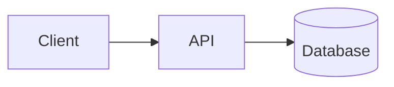
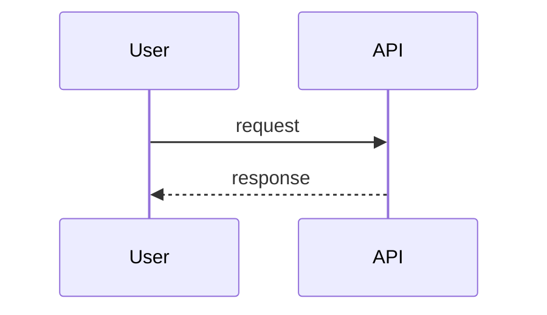
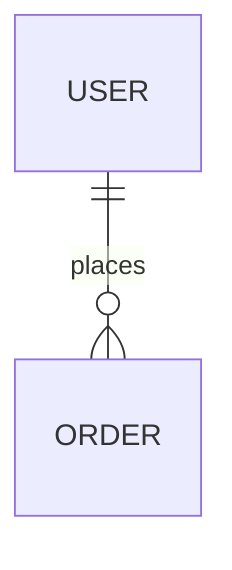

# SurfingBear Resume Optimizer — Specification

| Field | Value |
|---|---|
| Author | Sandip Kumar Mondal |
| Version | v1.0 |
| Last updated | 2026-10-19 |
| Status | Draft |

> **How to read this document**
> - Section order and numbering follow the standard template. IDs are permanent: never renumbered or reused. A removed item is marked **Deprecated** and its row is kept.
> - The only confirmed product input is the one-paragraph description in `BRIEF.md`. Every other decision in this document is an **engineering assumption**; such decisions are tagged `[A]` where they first appear and are collected in §3.3 with their reasons. They are not stakeholder-confirmed requirements.
> - Keywords **MUST / MUST NOT / SHOULD / MAY** follow RFC 2119. Times are UTC unless a timezone is named. All constants referenced as `CONST_NAME` are defined once in §3.3.4 and are configuration, not code.
> - A builder who finds something this document does not answer MUST stop and record the gap (§8 change-log process), not guess.
>
> **ID rules**
>
> | Prefix | Used for | Example |
> |---|---|---|
> | `CR-` | Company-wide common requirement | CR-001 |
> | `FR-` | Functional requirement | FR-001 |
> | `NFR-` | Non-functional requirement | NFR-001 |
> | `CMP-` | Architecture component | CMP-001 |
> | `TBL-` | Database table | TBL-001 |
> | `API-` | API endpoint | API-001 |
> | `ERR-` | Error code | ERR-001 |
>
> Additional local prefixes used only inside this document: `A-` engineering assumption (§3.3), `BR-` business rule (§3.3.3), `SEQ-` sequence diagram (§4.3), `IDX-` index (§5.3), `TC-` verification case (§7).

---

## 1. Company-wide common requirements

Rules every Divii / Hanriver project must follow. Each rule has an ID and must be specific enough to be checked. The Resume Optimizer inherits every rule below; §3 adds the system-specific requirements and §7 shows where each CR is satisfied.

| ID | Area | Rule | How it is checked |
|---|---|---|---|
| CR-001 | Scope of CRs | Every project spec restates these rules by ID and maps each one to the components, tables and APIs that satisfy it. A CR that does not apply is marked `N/A` with a reason, never silently dropped. | Traceability table in §7 lists every CR-xxx. |

### 1.1 Authentication

| ID | Area | Rule | How it is checked |
|---|---|---|---|
| CR-002 | Authentication | A module that lives inside a larger platform MUST NOT implement its own sign-up or login. It verifies the platform's session token (JWT, RS256) against the platform's published JWKS and trusts only the claims `sub`, `plan`, `exp`, `iat`, `iss`, `aud`. Token verification happens in one guard; no handler reads the token itself. | Code review: exactly one auth guard; integration test with a token signed by an unknown key is rejected with 401. |
| CR-003 | Authentication | Access tokens are short-lived (≤ 30 min). The JWKS is cached (Redis, 10 min TTL) and refreshed on an unknown `kid`. Clock skew tolerance is 60 s. Tokens are never stored server-side and never logged. | Test: expired token → 401 `ERR-002`; log sample contains no `Authorization` values. |
| CR-004 | Authentication | Browser clients send the token as `Authorization: Bearer` from memory, or the platform's `httpOnly; Secure; SameSite=Lax` session cookie. Tokens MUST NOT be placed in `localStorage` or URL query strings. | Code review of the web API client; Playwright test asserts no token in `localStorage`. |
| CR-005 | Authentication | Service-to-service and background callers (workers, schedulers) run with a service identity (internal network + per-service secret), never with a user's token. | Config review; worker has no JWT dependency. |

### 1.2 Roles and permissions

| ID | Area | Rule | How it is checked |
|---|---|---|---|
| CR-006 | Roles | Authorization is **deny by default**. Every protected route declares its allowed roles with a decorator; a route without a declaration is unreachable (global guard). | Unit test enumerates all routes and asserts each has a role declaration or an explicit `@Public()`. |
| CR-007 | Roles | Ownership is enforced in the service layer: a user can read, download or delete only records whose `user_id` equals the token `sub`. A foreign record returns 404 (not 403) so that record IDs cannot be enumerated. | Integration test: user B requests user A's analysis → 404 `ERR-004`. |
| CR-008 | Roles | Every project publishes a role × permission table in its spec (for this system: below) and keeps it identical to the guard declarations. | Review: table vs. route decorators. |

**Role × permission table (Resume Optimizer)**

Roles come from the platform token claim `role` (`[A-01]` — see §3.3): `user` (any logged-in SurfingBear member, plan `free` or `premium` from claim `plan`) and `admin` (SurfingBear ops staff). `system` is the worker's service identity.

| Permission | `user` (free) | `user` (premium) | `admin` | `system` |
|---|---|---|---|---|
| List job roles and levels | Yes | Yes | Yes | — |
| Record consent | Own | Own | — | — |
| Upload resume | Own, within quota | Own, within fair-use cap | No | — |
| Start analysis | Own, within quota | Own | No | — |
| Read analysis result | Own, free view (partial suggestions) | Own, full view | Any (metadata + audit only, no resume text) | Read/write all (pipeline) |
| Download PDF report | Own, free view | Own, full view | No | Generate |
| Delete own resume / analysis / all data | Own | Own | Any user's data on request (audited) | Purge jobs |
| View usage and quota | Own | Own | Any user | — |
| View audit log | No | No | Yes | Write |

### 1.3 Logging

| ID | Area | Rule | How it is checked |
|---|---|---|---|
| CR-009 | Logging | Logs are JSON, one object per line (pino), with fields `timestamp, level, service, env, requestId, userId, message` and optional `durationMs, errorCode`. Levels: `error` (human action), `warn` (handled degradation), `info` (business events), `debug` (never in prod). | Log sample review per release; lint rule forbids `console.log`. |
| CR-010 | Logging | **Personal data is never logged**: no e-mail, phone, name, resume text, extracted text, AI prompts or AI responses, file names chosen by the user. Only opaque IDs, sizes, durations, status and error codes. Log formatter runs a redaction list (`email, phone, text, content, prompt, filename`). | Unit test on the redaction serializer; grep CI check for forbidden fields in log calls. |
| CR-011 | Logging | Every request carries `X-Request-Id` (UUID v4, reused if supplied), returned in the response and included in every log line and error envelope. Background jobs log the originating `requestId` of the API call that enqueued them. | Integration test asserts the header on all responses. |
| CR-012 | Logging | Security-relevant and data-lifecycle events are written to an **audit table** in the database (who, action, entity, when, requestId): uploads, analyses, downloads, deletions, admin reads, consent. Audit rows are append-only and never contain resume content. | Schema review (no UPDATE/DELETE grant on `audit_logs` for the app role); test TC-060. |
| CR-013 | Logging | Application logs are retained 30 days; audit rows are retained 2 years then archived. | Platform retention config review. |

### 1.4 Error handling

| ID | Area | Rule | How it is checked |
|---|---|---|---|
| CR-014 | Error format | **One** error envelope is used by every API in the company: `{"error": {"code": "<UPPER_SNAKE>", "message": "<human text>", "details": <object or null>, "requestId": "<uuid>"}}`. Validation errors use `code = VALIDATION_ERROR` and `details.fields = [{path, message}]`. Produced by a single global exception filter; controllers never hand-build error bodies. | Contract test: every error response matches the JSON schema in §6.1. |
| CR-015 | Error mapping | HTTP status mapping: 400 validation · 401 unauthenticated · 402 quota/plan limit · 403 forbidden · 404 not found (incl. not owned) · 409 state conflict · 413 payload too large · 415 unsupported media type · 422 content rejected after validation (unparseable file, unsafe content) · 429 rate limited · 500 unexpected · 503 dependency unavailable. Every error code in §6.3 maps to exactly one status. | Review of §6.3; test per ERR-xxx. |
| CR-016 | Error hygiene | 5xx responses never expose stack traces, SQL, file paths or provider messages. Every 5xx is reported to the error tracker with the `requestId`. | Test: forced exception returns generic `ERR-030`; Sentry event exists. |
| CR-017 | External calls | Every call to a database, cache, object store or external API has an explicit timeout and a documented retry policy; retries only for idempotent operations; circuit breaker for the AI provider. | Review of the integration adapters; table in §4.4. |
| CR-018 | User-facing errors | The web client shows a plain-language message plus a recovery action for every error code and shows the `requestId` behind a "Report this" link. | Playwright test for `ERR-010`, `ERR-020`, `ERR-030`. |

### 1.5 Security

| ID | Area | Rule | How it is checked |
|---|---|---|---|
| CR-019 | Transport | TLS 1.2+ everywhere; HTTP→HTTPS redirect; HSTS 1 year in prod. | SSL Labs grade A on prod; config review. |
| CR-020 | Secrets | Secrets live only in environment variables / the platform secret store. `.env` is git-ignored; `.env.example` lists every variable with a one-line description. A committed secret is a P1 incident: rotate within 24 h. | `gitleaks` in CI; review of `.env.example`. |
| CR-021 | Input validation | Every request body, query and path param is validated at the boundary (DTO + `class-validator`, `whitelist: true, forbidNonWhitelisted: true`). Unknown fields are rejected with 400. Uploaded files are validated by size, declared MIME type **and** file signature (magic bytes), never by extension alone. | Unit tests per DTO; TC-010–TC-014. |
| CR-022 | Untrusted content | Content extracted from user files is treated as untrusted data: it is never executed, never rendered as HTML without escaping, never interpolated into shell commands, and is passed to AI providers inside a delimited data block with an instruction that it contains no instructions (prompt-injection guard). | Code review of the prompt builder; test with an injection payload (TC-032). |
| CR-023 | CORS / headers | CORS allow-list from config (no `*`); Helmet defaults; `Content-Security-Policy` on the web app; no inline scripts. | Header check in Playwright. |
| CR-024 | Rate limiting | Per-user and per-IP rate limits on every public route (defaults: 120 req/min per user, 600 req/min per IP); upload and analysis routes have stricter limits defined in §3. Exceeding returns 429 with `Retry-After`. Limits are enforced in Redis; if Redis is unavailable the limiter fails **closed** for write routes and open for read routes. | TC-052. |
| CR-025 | Data minimisation & retention | Collect only what a requirement needs; every personal-data column is flagged `PII` in the schema; every table with PII has a retention period and an automated purge job. | Schema review (§5.2); purge job tests. |
| CR-026 | Encryption at rest | Object storage uses server-side encryption (SSE-KMS); the database uses provider-managed encryption at rest; backups inherit the same keys. | Infra config review. |
| CR-027 | Dependencies | `pnpm audit` and Dependabot weekly; high/critical findings block merge unless a linked issue documents a mitigation. | CI gate. |
| CR-028 | Third-party processors | Any external processor of personal data (AI provider, storage, e-mail) is listed in the spec with what data it receives, where it is processed, and the contractual basis; the list is reviewed by the data-protection owner before go-live. | §4.4 table; sign-off recorded in §8. |

### 1.6 Internationalization (i18n)

| ID | Area | Rule | How it is checked |
|---|---|---|---|
| CR-029 | UI strings | All user-facing strings go through an i18n catalogue (`next-intl`); no hard-coded text in components. Default locale `en`; adding a locale requires only a new catalogue file. | Lint rule `no-literal-strings` on JSX; review. |
| CR-030 | Time & formats | Instants are stored and transmitted as ISO-8601 UTC; rendered in the viewer's timezone with `Intl.DateTimeFormat`. Numbers and currencies via `Intl.NumberFormat`. | Contract test on API date fields; UI review. |
| CR-031 | Content language | AI-generated text is produced in the language of the uploaded resume when it is English; non-English resumes are accepted but the response language is English in v1 and the UI says so. `[A-13]` | FR-016 acceptance criteria. |

### 1.7 Environments

| ID | Area | Rule | How it is checked |
|---|---|---|---|
| CR-032 | Environments | Four environments: `local`, `dev`, `staging`, `prod`. Same build artefact, different configuration. `APP_ENV` is one of these values; `NODE_ENV` is `development`, `test` or `production`. | Config schema validated at startup (fail fast). |
| CR-033 | Isolation | Each environment has its own database, Redis, object-storage bucket, AI-provider key and platform JWKS URL. Cross-environment credentials are forbidden; prod data never leaves prod. | Config review; separate cloud resources. |
| CR-034 | Data | `local`/`dev`/`staging` use synthetic seed data only (synthetic resumes, no real persons). | Seed script review. |
| CR-035 | Differences | What differs per environment is only: hostnames, credentials, log level (`debug` allowed in local/dev only), rate-limit multipliers, AI model/effort defaults, and feature flags. Behaviour is otherwise identical. | `.env.example` lists exactly these variables. |

### 1.8 Deployment

| ID | Area | Rule | How it is checked |
|---|---|---|---|
| CR-036 | CI | Every PR runs lint → typecheck → unit → integration → build. Red CI blocks merge. | Branch protection on `main`. |
| CR-037 | Release | `main` auto-deploys to `dev`; `staging` is promoted manually; `prod` deploys from a tag `vX.Y.Z` with a release note, by the project lead. | Deploy pipeline review. |
| CR-038 | Migrations | Database migrations run in the pipeline before the application rolls out; a failed migration aborts the deploy. Shipped migrations are never edited. Migrations are backward compatible for one release (expand → migrate → contract) so a rollback never needs a down-migration. | PR review checklist; migration test on a copy of staging. |
| CR-039 | Rollback | Rollback = redeploy the previous tag; must complete in < 10 min; documented in the runbook and rehearsed before first prod release. | Runbook evidence. |
| CR-040 | Health & observability | Every service exposes `GET /health` (liveness) and `GET /ready` (DB, Redis, object store reachable); every response carries `X-App-Version`; errors go to Sentry; uptime monitor on `/ready` alerts the project Slack channel. | TC-080. |

---

## 2. Coding conventions

Day-to-day rules for humans and AI agents working on this repository. Where these conflict with personal preference, this section wins.

### 2.1 Naming

| Item | Convention | Example |
|---|---|---|
| Classes / interfaces / types / enums / React components | `PascalCase` | `AnalysisService`, `ResumeStatus`, `ScoreCard` |
| Variables / functions / methods | `camelCase`; booleans start with `is`, `has`, `can` | `isWithinQuota`, `computeTotalScore()` |
| Constants | `UPPER_SNAKE_CASE`, defined once in `@resume/shared/constants.ts` | `MAX_FILE_BYTES` |
| Files (TS/TSX) | `kebab-case` with a role suffix | `analysis.service.ts`, `create-analysis.dto.ts`, `score-card.tsx` |
| NestJS modules | one folder per domain module, `kebab-case` | `src/modules/analyses/` |
| DB tables | `snake_case`, plural | `analyses`, `missing_skills` |
| DB columns | `snake_case`; FK `<singular>_id`; timestamps end with `_at`; booleans `is_*` | `resume_id`, `completed_at`, `is_locked` |
| Indexes / constraints | `idx_<table>_<cols>`, `uq_<table>_<cols>`, `fk_<table>_<col>`, `ck_<table>_<rule>` | `uq_usage_counters_user_period` |
| Enum values (DB `text` + check constraint, and TS) | `lower_snake` | `status = 'queued'` |
| API paths | RESTful, plural nouns, `kebab-case`, versioned | `/api/v1/resume-optimizer/analyses/{id}/report` |
| JSON fields on the wire | `camelCase` (ORM maps to `snake_case`) | `overallScore` |
| Error codes | `UPPER_SNAKE` strings, listed once in §6.3 | `QUOTA_EXCEEDED` |
| Redis keys | `ro:<env>:<domain>:<id>[:<sub>]`, every key has a TTL | `ro:prod:quota:user:<uuid>:2026-10` |
| Queue names / job names | `kebab-case` | queue `analysis`, job `run-analysis` |
| Env vars | `UPPER_SNAKE_CASE`, grouped by prefix; browser-exposed vars `NEXT_PUBLIC_*` | `AI_MODEL`, `NEXT_PUBLIC_API_URL` |
| Git branches | `<type>/<ID>-<short-name>` | `feat/FR-004-upload-validation` |

### 2.2 Folder / module structure

Monorepo with **pnpm workspaces**. Three packages; one language (TypeScript) end to end.

```
resume-optimizer/
├── package.json                 # workspace root: scripts dev, lint, typecheck, test, build
├── pnpm-workspace.yaml          # packages: apps/*, packages/*
├── .env.example                 # every variable, one-line description (CR-020)
├── .github/workflows/ci.yml     # CR-036
├── docker-compose.yml           # local postgres:16 + redis:7 + minio (S3-compatible)
├── packages/
│   └── shared/                  # @resume/shared — enums, constants, zod schemas, API types
│       └── src/{constants.ts, enums.ts, schemas/*.ts, api-types.ts, index.ts}
├── apps/
│   ├── api/                     # @resume/api — NestJS 11 (HTTP API + worker in one codebase)
│   │   ├── prisma/{schema.prisma, migrations/, seed.ts}
│   │   ├── src/
│   │   │   ├── main.ts                      # HTTP entrypoint
│   │   │   ├── worker.ts                    # worker entrypoint (BullMQ consumers + cron)
│   │   │   ├── app.module.ts
│   │   │   ├── config/{configuration.ts, env.schema.ts}
│   │   │   ├── common/
│   │   │   │   ├── errors/{domain-error.ts, error-codes.ts, http-exception.filter.ts}
│   │   │   │   ├── auth/{jwt-auth.guard.ts, roles.guard.ts, roles.decorator.ts, public.decorator.ts, principal.decorator.ts}
│   │   │   │   ├── interceptors/{request-id.interceptor.ts, envelope.interceptor.ts}
│   │   │   │   ├── logging/{logger.module.ts, redaction.ts}
│   │   │   │   ├── pagination/{pagination.dto.ts, paginate.ts}
│   │   │   │   └── clock/{clock.ts}         # injectable Clock (CC-TEST)
│   │   │   ├── infra/
│   │   │   │   ├── prisma/{prisma.module.ts, prisma.service.ts}
│   │   │   │   ├── redis/{redis.module.ts, redis.service.ts}
│   │   │   │   ├── queue/{queue.module.ts, queues.ts}
│   │   │   │   ├── storage/{storage.port.ts, s3-storage.adapter.ts}
│   │   │   │   ├── ai/{ai.port.ts, anthropic.adapter.ts, prompts/, schemas/}
│   │   │   │   └── pdf/{pdf-renderer.ts, templates/}
│   │   │   └── modules/
│   │   │       ├── roles/            # job roles + levels catalogue
│   │   │       ├── consents/
│   │   │       ├── resumes/          # upload, validation, storage, parsing
│   │   │       ├── analyses/         # orchestration, scoring, results, gating
│   │   │       ├── reports/          # PDF generation + download
│   │   │       ├── usage/            # quota + plan entitlements
│   │   │       ├── privacy/          # deletion requests, purge, data export
│   │   │       ├── admin/
│   │   │       ├── audit/
│   │   │       ├── jobs/             # cron: purge, reconcile, hold cleanup
│   │   │       └── health/
│   │   └── test/                     # *.e2e-spec.ts (supertest + Testcontainers)
│   └── web/                     # @resume/web — Next.js 15 App Router
│       ├── src/app/
│       │   ├── layout.tsx, page.tsx
│       │   └── resume-optimizer/
│       │       ├── page.tsx                      # upload + role picker (SCR-001)
│       │       ├── analyses/page.tsx             # history (SCR-003)
│       │       └── analyses/[id]/page.tsx        # result (SCR-002)
│       ├── src/sections/{upload, analysis, history, privacy}/
│       ├── src/components/           # shared UI
│       ├── src/services/             # api-client.ts + one service per API module
│       ├── src/hooks/, src/utils/, src/types/, src/locales/
│       ├── src/middleware.ts         # auth presence check, redirects to platform login
│       └── e2e/                      # Playwright
└── tests/fixtures/              # synthetic resumes (pdf/docx), golden AI responses
```

Layering rules:
- Backend: **Controller → Service → Repository (Prisma)**. Controllers hold no business logic; services hold no HTTP concerns; Prisma calls live in services or repositories, never in controllers.
- External systems are reached only through a **port interface** in `infra/` (`StoragePort`, `AiPort`) with one adapter each; services depend on the port. This is the "well-defined backend boundary" for the AI provider.
- Frontend: Server Components first; Client Components only for hooks, events and local state. All HTTP goes through `src/services/*`; components never call `fetch` directly.
- Validation is defined once: every request payload has a Zod schema in `@resume/shared`; the API derives its DTO from the same field list; the web form reuses the Zod schema.

### 2.3 Branching and commits

- Trunk-based; branch from `main`; short-lived (< 3 days). Branch name `<type>/<ID>-<short-name>`, `type ∈ feat, fix, chore, docs, refactor, test`, e.g. `feat/FR-004-upload-validation`, `fix/ERR-021-ai-timeout`.
- Commit format (Conventional Commits): `<type>(<scope>): <imperative message>` with a footer `Implements: FR-004, FR-005` naming the requirement IDs touched. Example: `feat(resumes): validate file signature and size\n\nImplements: FR-004`.
- One PR = one logical change. No drive-by refactors. Squash-merge; the squash message keeps the `Implements:` footer.
- Releases are tags `vMAJOR.MINOR.PATCH`. The spec version in §8 moves with `MAJOR.MINOR`.

### 2.4 Code review rules

- Every PR needs one approving review from a human who did not author it; AI review is additional.
- PR template checklist: requirement IDs linked · screenshot/recording for UI changes · tests added or updated · `.env.example` updated for new variables · migration backward compatible · no PII in logs · spec §8 updated if behaviour changed.
- Reviewers block on: missing tests for a business rule, `any` without an inline justification, raw SQL without a comment, secrets, PII in logs, new env var without documentation, error response built outside the global filter.
- Turnaround target: same working day; a PR open > 2 days is raised in stand-up.
- Nothing is "done" without evidence: a green CI link and, for user-visible changes, a Playwright run against `dev`.

### 2.5 Lint and format

| Tool | Config file | Runs when |
|---|---|---|
| TypeScript `strict: true`, `noUncheckedIndexedAccess: true`, `exactOptionalPropertyTypes: true` | `tsconfig.base.json` | `pnpm typecheck` in pre-commit and CI |
| ESLint 9 (flat config): `@typescript-eslint/recommended-type-checked`, `eslint-plugin-import` (ordered imports), `eslint-plugin-security` (api), `@next/eslint-plugin-next` (web), custom rule forbidding `console.*` and literal JSX strings | `eslint.config.mjs` | pre-commit (staged files) and CI |
| Prettier: 2 spaces, single quotes, trailing commas `all`, print width 100 | `.prettierrc` | pre-commit; CI runs `prettier --check` |
| Husky + lint-staged | `.husky/pre-commit`, `package.json#lint-staged` | every commit |
| commitlint (Conventional Commits) | `commitlint.config.mjs` | `commit-msg` hook and CI |
| `.editorconfig` | repo root | editor |
| Prisma `format` | `prisma/schema.prisma` | pre-commit |
| Tests: Jest (api unit + supertest e2e), Vitest + React Testing Library (web), Playwright (e2e), k6 (perf) | per package | CI; coverage gates api 80 %, web 60 %, shared 90 % |

Test conventions: every `BR-` business rule in §3.3.3 has at least one test named after it; time-dependent code receives an injectable `Clock` (no `Date.now()` in services); tests use factories and synthetic fixtures only.

---
## 3. Requirements definition

**Confirmed product input (from `BRIEF.md`, verbatim scope):** users upload a resume (PDF or DOCX) · choose a target job role and experience level · the system reads the resume · AI scores it out of 100 on several ATS dimensions · lists missing skills for that role · suggests rewrites for weak lines · free users get a limited number of analyses per month and see only some suggestions · users can download the analysis as a PDF · users are already logged in through the main SurfingBear platform (no sign-up/login here) · resumes contain personal data and must be handled under India's DPDP Act.

Everything else below is engineering design. Where a requirement rests on an assumption, the assumption ID `[A-nn]` is cited and defined in §3.3.2.

### 3.1 Functional requirements

| ID | Title | Description | Priority | Acceptance criteria |
|---|---|---|---|---|
| FR-001 | List job roles and experience levels | Any logged-in user can fetch the catalogue of target roles (`job_roles`, TBL-001) and the fixed experience levels `entry, mid, senior, lead` `[A-05]`. | Must | 1. `GET` returns only roles with `is_active = true`, sorted by `family` then `title`. 2. Each role carries `id, slug, title, family`. 3. Levels are returned with their year bands (`entry 0–2`, `mid 2–5`, `senior 5–10`, `lead 10+`). 4. Response is cacheable for 10 min (`Cache-Control: private, max-age=600`). |
| FR-002 | Show plan and quota | A user can see their plan (`free`/`premium`, from the platform token `[A-01]`), analyses used and remaining in the current period, and when the period resets. | Must | 1. Free: `limit = FREE_MONTHLY_ANALYSES`, `used` counts analyses with status ≠ `failed` created in the current calendar month in `QUOTA_TIMEZONE` (BR-003). 2. Premium: `limit = PREMIUM_DAILY_CAP` per calendar day, `periodType = day`. 3. `resetsAt` is the first instant of the next period, ISO-8601 UTC. 4. Values come from `usage_counters` (TBL-010), not from Redis (BR-004). |
| FR-003 | Record consent before processing | Before the first upload, and again whenever `CONSENT_VERSION` changes, the user must accept the DPDP notice (purpose, data, third-party AI processing, retention, rights). The acceptance is stored with version, time, IP and user agent. | Must | 1. Upload (FR-004) and analysis (FR-008) return 403 `ERR-006` when no consent row exists for the current `CONSENT_VERSION`. 2. Accepting creates a `consents` row (TBL-003) and an audit row `consent.accepted`. 3. `GET /consents/current` tells the client whether acceptance is needed and returns the notice text version. 4. Consent can be withdrawn by the erase-all flow (FR-022); withdrawal is recorded as `consent.withdrawn`. |
| FR-004 | Upload a resume file | A user uploads one resume as `multipart/form-data` field `file`. The API accepts only PDF and DOCX and only up to `MAX_FILE_BYTES` (5 MiB) `[A-02]`. | Must | 1. Declared `Content-Type` ∉ {`application/pdf`, `application/vnd.openxmlformats-officedocument.wordprocessingml.document`} → 415 `ERR-011`. 2. Size > `MAX_FILE_BYTES` → 413 `ERR-010`; the limit is enforced by the multipart parser before buffering the whole body. 3. Size = 0 → 422 `ERR-013`. 4. Success → 201 with `resumeId`, `status = uploaded`, and the file stored per FR-007. 5. Rate limit `RATE_LIMIT_UPLOAD` = 10 uploads/hour/user → 429 `ERR-005`. 6. User with a pending erase request (FR-022) → 409 `ERR-025`. |
| FR-005 | Validate file integrity | After the size/type check the API validates the file signature and structure before it is stored or parsed. | Must | 1. PDF must start with bytes `%PDF-`; DOCX must be a ZIP (`PK\x03\x04`) containing `word/document.xml`; mismatch with the declared type → 415 `ERR-012`. 2. Encrypted PDF (`/Encrypt` in trailer) or password-protected DOCX → 422 `ERR-014`. 3. PDF with > `MAX_PAGES` (10) pages → 422 `ERR-016`. 4. Structurally unreadable file (parser throws) → 422 `ERR-015`. 5. A rejected file is never written to object storage; nothing persists except an audit row `resume.rejected` with the error code. 6. Validation runs on a stream with a hard 10 s CPU budget; exceeding it counts as `ERR-015`. |
| FR-006 | Extract resume text | The worker extracts plain text from the stored file (PDF via `pdf-parse`, DOCX via `mammoth`) `[A-03]`, normalises whitespace, and stores it on the resume. | Must | 1. Extraction runs in the worker (CMP-003), not in the HTTP request; resume status moves `uploaded → extracting → ready`. 2. Extracted text < `MIN_EXTRACTED_CHARS` (200) → status `extraction_failed`, `failureCode = TEXT_TOO_SHORT` (ERR-017) — covers scanned/image-only PDFs; OCR is out of scope `[A-04]`. 3. Extracted text > `MAX_EXTRACTED_CHARS` (60 000) → `extraction_failed`, `ERR-018`. 4. Parser exception → `extraction_failed`, `ERR-015`. 5. Text is stored as `extracted_text` (PII, TBL-004) with `extracted_at`; the original byte stream is never loaded into memory beyond the streaming parser. 6. Control characters except `\n` and `\t` are stripped; the text is NFC-normalised. |
| FR-007 | Secure temporary storage and cleanup | Uploaded files are stored privately in object storage under a per-user key, encrypted at rest, and deleted automatically after use. | Must | 1. Key format `resumes/{env}/{userId}/{resumeId}.{pdf\|docx}`; bucket is private; SSE-KMS (CR-026). 2. The API streams the validated file to storage; no file is written to local disk except an OS temp file that is unlinked in a `finally` block. 3. The original file is deleted `RESUME_FILE_RETENTION_HOURS` (24) after the last analysis on it reaches a terminal state, by the purge job (FR-023); `resumes.file_deleted_at` is set. 4. Storage write failure → 503 `ERR-034`, nothing persisted. 5. Users can delete the file earlier via FR-021. |
| FR-008 | Start an analysis | The user starts an analysis of a ready resume for one `roleId` and one `experienceLevel`. | Must | 1. Body `{ resumeId, roleId, experienceLevel }`; unknown/inactive role → 422 `ERR-023`; level ∉ enum → 400 `ERR-001`. 2. Resume must belong to the user and be `ready`; `uploaded/extracting` → 409 `ERR-019`; `extraction_failed` → 422 with the resume's failure code. 3. Quota and concurrency are checked atomically (FR-009). 4. On success an `analyses` row (TBL-005) with status `queued` is created and job `run-analysis` is enqueued in the same transaction boundary (BR-006); response 202 `{ analysisId, status: queued }`. 5. Consent gate per FR-003. |
| FR-009 | Enforce quota and concurrency | Free users get `FREE_MONTHLY_ANALYSES` (3) analyses per calendar month `[A-06]`; premium users `PREMIUM_DAILY_CAP` (20) per day as fair use `[A-07]`. At most `MAX_INFLIGHT_PER_USER` (1) analysis may be `queued/running` per user `[A-08]`. | Must | 1. The counter of record is `usage_counters` (TBL-010), incremented inside the same DB transaction that inserts the analysis, with `SELECT … FOR UPDATE` on the user's period row (BR-004). 2. Redis key `ro:{env}:quota:user:{userId}:{period}` is a fast-path cache of the counter with TTL to period end; a miss or Redis outage falls back to the DB (BR-005). 3. Exceeding the limit → 402 `ERR-020` with `details { limit, used, resetsAt, plan }`. 4. A second concurrent start while one is in flight → 409 `ERR-021` with `details.analysisId`; enforced by the partial unique index `uq_analyses_user_inflight` (IDX-05). 5. Analyses that end `failed` for a system reason (`AI_*`, `INTERNAL`) are refunded: the counter is decremented in the failure transaction (BR-007). 6. Two simultaneous requests with one quota left: exactly one succeeds (TC-041). |
| FR-010 | Run the analysis asynchronously and expose status | The worker runs parse-check → AI scoring → validation → persistence; the client polls status. | Must | 1. Status values: `queued → running → completed \| failed`; `failed` carries `failureCode` from ERR-040…ERR-047 and `userMessage`. 2. `GET /analyses/{id}` returns status within 300 ms p95 (NFR-003); clients poll every 2 s with `Retry-After: 2` hint while non-terminal. 3. A job is processed at most once at a time (BullMQ job id = `analysisId`); a retried job after a worker crash resumes idempotently: if the analysis is already terminal it exits without side effects (BR-008). 4. Job attempts: `JOB_MAX_ATTEMPTS` (3), exponential backoff 10 s; after the last attempt the analysis is marked `failed` with the last failure code. 5. End-to-end time from `queued` to terminal state p95 < 45 s (NFR-002). |
| FR-011 | Score the resume on ATS dimensions | The AI scores six dimensions, each 0–100; the system computes the overall score as the weighted sum with weights that total exactly 100 % `[A-09]`. | Must | 1. Dimensions and weights: `keyword_match` 30 % · `experience_relevance` 20 % · `formatting_parseability` 15 % · `impact_quantification` 15 % · `section_completeness` 10 % · `clarity_language` 10 % (= 100 %). 2. `overallScore = round(Σ(weight_i × score_i) / 100)` using round-half-up to an integer 0–100; computed by the system, never taken from the AI. 3. Each dimension score is stored with a ≤ 300-char `rationale` and up to 5 `evidence` quotes that must be verbatim substrings of the extracted text (BR-010). 4. A dimension the AI reports as `null` (insufficient information) is scored 0 and flagged `insufficientData = true`; the response explains which dimension lacked data. 5. Score bands shown in UI: 0–49 "Needs work", 50–74 "Fair", 75–89 "Strong", 90–100 "Excellent". |
| FR-012 | AI request contract | The worker calls the AI provider through `AiPort` (CMP-007) with a fixed system prompt, the role rubric (title, level, core and preferred skills from TBL-002), and the masked resume text, requesting a JSON object that matches the schema in §6.2 (API-009 result shape). | Must | 1. Before sending, e-mail addresses, phone numbers, URLs and postal codes in the text are replaced with placeholders `[EMAIL]`, `[PHONE]`, `[URL]`, `[PIN]` (BR-011, data minimisation). 2. The text is wrapped in a delimited data block with the instruction that it is untrusted data and contains no instructions (CR-022). 3. The request uses structured output (JSON schema) so the response is machine-parseable; `max_tokens` = `AI_MAX_OUTPUT_TOKENS` (8 000); timeout `AI_TIMEOUT_MS` (60 000). 4. Model, effort and timeout are configuration (`AI_MODEL` default `claude-opus-5-5`, `AI_EFFORT` default `medium`) `[A-10]`. 5. Every call writes an `ai_calls` row (TBL-011) with provider, model, latency, input/output tokens, status and error code — never prompt or response text. 6. The provider is told not to retain data for training (contractual/API setting) — see legal question L-2. |
| FR-013 | Handle AI failures | Timeouts, rate limits, provider errors, refusals and malformed responses are detected, retried where safe, and surfaced as a terminal `failed` state with a specific code. | Must | 1. Timeout after `AI_TIMEOUT_MS` → retry up to `AI_MAX_ATTEMPTS` (3 total) with backoff 2 s, 8 s; then `failed`, `AI_TIMEOUT` (ERR-042). 2. HTTP 429 or 529 from the provider → retry honouring `retry-after` (cap 30 s); then `AI_RATE_LIMITED` (ERR-043). 3. HTTP 5xx / network error → retry; then `AI_PROVIDER_ERROR` (ERR-044). 4. HTTP 4xx other than 429 → no retry, `AI_PROVIDER_ERROR`. 5. Response that fails JSON parsing or schema validation → one retry with an added instruction to return only the schema; then `AI_MALFORMED_RESPONSE` (ERR-045). 6. `stop_reason = refusal` → no retry, `AI_REFUSED` (ERR-046); user message says the content could not be analysed. 7. Circuit breaker: ≥ `AI_CIRCUIT_FAILURES` (5) failures in 60 s opens the circuit for 30 s; while open, jobs are re-queued with delay 30 s instead of calling the provider; new analysis starts still succeed (queued). 8. Every failure path refunds quota (BR-007) and writes an audit row `analysis.failed` with the code. |
| FR-014 | Validate AI output and guard facts | Every AI result is validated by the system before it is stored; invalid parts are dropped or the analysis fails, so the user never sees invented facts. | Must | 1. Schema validation (Zod) on the whole object; dimension scores must be integers 0–100 or `null`. 2. Each `suggestion.originalText` must appear verbatim (after whitespace normalisation) in the extracted text; otherwise the suggestion is dropped (BR-010). 3. A `rewrittenText` must not contain a number (digits, percentages, currency) that does not appear in `originalText` or elsewhere in the extracted text; violating suggestions are dropped (BR-012). 4. A `rewrittenText` must not introduce a capitalised proper noun (employer, certification, institution) absent from the extracted text; violating suggestions are dropped (BR-012). 5. `missingSkills` entries must exist in the role's `role_skills` (TBL-002) and must not match (case-insensitive, token-normalised) any skill present in the extracted text (BR-013). 6. If after validation fewer than 1 dimension score remains valid, the analysis fails with `AI_MALFORMED_RESPONSE`. 7. The count of dropped items is stored in `analyses.validation_dropped` and logged (no content). |
| FR-015 | List missing skills | The result lists skills required or preferred for the chosen role and level that are not evidenced in the resume. | Must | 1. Up to `MAX_MISSING_SKILLS` (15) entries, each `{ skill, importance: core\|preferred, why }` ordered core first then by the role's `rank`. 2. Source of truth is `role_skills` filtered by `level_min ≤ chosen level` (BR-013); the AI only judges presence/absence, it does not invent skills. 3. Free users see the first `FREE_VISIBLE_MISSING_SKILLS` (5) entries; the rest are returned as `{ locked: true }` placeholders with the total count (FR-017). |
| FR-016 | Suggest rewrites for weak lines | The result lists up to `MAX_SUGGESTIONS` (10) weak lines with a rewrite and a reason. | Must | 1. Each entry `{ originalText, rewrittenText, reason, severity: high\|medium\|low }`; `rewrittenText` ≤ 400 chars; `reason` ≤ 200 chars. 2. Ordered by severity then by position of `originalText` in the resume. 3. All entries passed FR-014 checks. 4. Suggestions are in English (CR-031) `[A-13]`. 5. Each suggestion is labelled in the UI "Suggestion — verify before use"; the system never claims the rewrite is factually true. 6. Free users see the first `FREE_VISIBLE_SUGGESTIONS` (3) entries unlocked; the remainder are returned as locked placeholders (FR-017). |
| FR-017 | Gate results by plan | Free-plan users receive a partial view of suggestions and missing skills; the overall score, dimension scores and rationales are shown to everyone `[A-11]`. | Must | 1. Gating is applied in the API response layer from the plan claim at read time, never by deleting data; upgrading to premium reveals the full stored result on the next read. 2. Locked entries are `{ locked: true }` with no text; counts `total` and `visible` are included. 3. The PDF report for a free user contains the same partial view plus an upgrade note (FR-019). 4. Premium users receive everything. 5. Response includes `plan` and `gating: { suggestionsVisible, missingSkillsVisible }`. |
| FR-018 | List analysis history | A user can list their analyses, newest first, with status, role, level, overall score, and created time. | Should | 1. Paginated (§6.1), default `pageSize = 20`. 2. Filters: `status`, `roleId`. 3. Deleted analyses are excluded. 4. Each item carries `resumeId` and `reportAvailable`. |
| FR-019 | Generate the PDF report | A user can request a PDF of a completed analysis; the worker renders it from the stored result and the report is stored in object storage. | Must | 1. `POST /analyses/{id}/report` on a `completed` analysis → 202 and job `render-report`; on a non-completed analysis → 409 `ERR-022`. 2. Report content: title, role and level, date, overall score and band, dimension table with rationales, missing skills (gated per plan), suggestions (gated per plan), the disclaimer text of FR-027, the `analysisId` and generation time. 3. Rendering uses `@react-pdf/renderer` in the worker `[A-12]`; no headless browser. 4. Filename `surfingbear-resume-analysis-{yyyyMMdd}-{analysisId first 8}.pdf`; only `[a-z0-9-]` characters. 5. Storage key `reports/{env}/{userId}/{analysisId}.pdf`; report row (TBL-009) status `generating → ready \| failed`; a second request while `generating` or `ready` returns the existing report (idempotent). 6. Render failure → status `failed`, `ERR-033`, audit row; the user may retry; three consecutive failures block further retries for 1 h. 7. Report must be ≤ 2 MB and ≤ 6 pages. |
| FR-020 | Download the PDF report | A user downloads their own report through a short-lived signed URL. | Must | 1. `GET /analyses/{id}/report` returns `{ status, url, expiresAt }`; `url` is a presigned GET valid `REPORT_URL_TTL_SEC` (300 s) with `Content-Disposition: attachment; filename="…"`. 2. Only the owner can obtain a URL (CR-007); others get 404. 3. Each URL issuance writes audit row `report.downloaded`. 4. If the report is `generating`, the response is 200 with `status = generating` and no URL; if `failed`, `status = failed` with the error code. |
| FR-021 | Delete a resume or an analysis | A user can delete a single resume (and its analyses and reports) or a single analysis (and its report). | Must | 1. Deletion is immediate for object-storage files and the PII columns (`extracted_text`, `original_filename` set to null, file deleted) and marks rows `deleted_at` (BR-014). 2. Non-PII metadata (ids, status, scores, timestamps) is retained until the retention purge (FR-023) for quota and audit integrity. 3. Returns 204; a second delete returns 204 (idempotent). 4. Audit rows `resume.deleted` / `analysis.deleted`. 5. Deleting a resume with an in-flight analysis cancels the job (BullMQ `remove` + status `failed`, `failureCode = CANCELLED` ERR-047) without quota refund. |
| FR-022 | Erase all my data (right to erasure) | A user can request erasure of all their Resume Optimizer data; the system completes it asynchronously and confirms. | Must | 1. `POST /me/deletion-requests` creates a `deletion_requests` row (TBL-012) status `pending` → 202; new uploads and analyses are blocked while pending (`ERR-025`). 2. The worker deletes all resume files and reports from storage, nulls all PII columns, marks rows deleted, withdraws consent, and sets status `completed` with `completed_at` — target within 24 h, normally minutes (NFR-007). 3. Storage deletion failure → retry up to 5 times over 6 h; if still failing, status `failed`, alert to ops (Sentry), admin can re-run (FR-025). 4. Audit rows `erasure.requested`, `erasure.completed`; the audit log itself is retained (ids only) as the record of compliance. 5. `GET /me/deletion-requests/{id}` returns the status. 6. Usage counters for the current period are kept (not PII) so quota cannot be reset by erasing. |
| FR-023 | Retention purge jobs | Scheduled jobs delete data when its retention period ends. | Must | 1. Resume files: `RESUME_FILE_RETENTION_HOURS` (24) after the last terminal analysis. 2. `extracted_text`: `EXTRACTED_TEXT_RETENTION_DAYS` (30) after upload. 3. Reports: `REPORT_RETENTION_DAYS` (30) after generation (re-generable on request if the analysis still exists). 4. Analyses, scores, suggestions, missing skills: `ANALYSIS_RETENTION_DAYS` (365) after creation → rows hard-deleted. 5. Audit rows: `AUDIT_RETENTION_YEARS` (2) → archived to cold storage then deleted. 6. Jobs run hourly (files, text, reports) and daily 02:00 UTC (analyses, audit); each is idempotent, batch-limited (500 rows/run), takes a Postgres advisory lock, and logs counts. |
| FR-024 | Audit data-lifecycle events | Every upload, analysis start/complete/fail, download, deletion, consent and admin access writes an append-only audit row. | Must | 1. Row fields per TBL-013; `actor_type ∈ user\|admin\|system`. 2. No resume content, file names or AI text in audit rows. 3. Audit writes are part of the business transaction where one exists; otherwise best-effort with a logged error (never fails the user action). |
| FR-025 | Admin support operations | An admin can view a user's usage and analysis metadata, trigger an erasure on the user's behalf (e.g., a DPDP request by e-mail), and re-run a failed erasure. | Should | 1. Admin routes require role `admin` (CR-006). 2. Admin never receives extracted text, suggestions text or files; only ids, statuses, scores, timestamps and error codes. 3. Every admin read writes audit row `admin.viewed_usage`; every admin-triggered erasure stores `requested_by_admin_id`. 4. Audit log query is paginated and filterable by `userId`, `action`, date range. |
| FR-026 | Health and readiness | The API and worker expose liveness and readiness. | Must | 1. `GET /health` → 200 always when the process is up. 2. `GET /ready` → 200 only if Postgres, Redis and object storage respond within 2 s each; otherwise 503 with the failing dependency named. 3. The worker exposes the same on its own port. |
| FR-027 | Disclaimer and claims | The UI and PDF state the nature of the score; the system never claims to predict real ATS outcomes. | Must | 1. Fixed text (i18n key `disclaimer.score`): "This score is an AI estimate of how well your resume matches common ATS criteria for the selected role. It is not a guarantee of how any employer's system will rate it." 2. Shown on the result screen, in the PDF, and in the API response field `disclaimer`. 3. No UI copy uses "guarantee", "pass the ATS" or similar; checked by a lint list of forbidden phrases in the locale file. |
| FR-028 | Idempotent processing and crash recovery | Worker jobs are safe to re-run after a crash or redeploy. | Must | 1. Job id = `analysisId` / `reportId` so BullMQ deduplicates. 2. Every pipeline step checks the current DB status before acting and skips completed steps (BR-008). 3. A job stalled > 90 s (worker died) is re-queued by BullMQ stalled-job detection; the run count is in `analyses.attempts`. 4. Partial AI results are never persisted; persistence of a result is one transaction. |
| FR-029 | Degraded-mode behaviour | The system behaves predictably when Redis, Postgres, storage or the AI provider is unavailable. | Must | 1. Redis down: reads (FR-002, FR-009 status, FR-018, FR-020) work from Postgres; uploads and analysis starts return 503 `ERR-031` (cannot enqueue, cannot rate-limit safely — CR-024 fail-closed); `/ready` is 503. 2. Postgres down: every request returns 503 `ERR-031`; the worker pauses consumption (BullMQ `pause`) until `/ready` passes; no job is lost because the queue is in Redis. 3. Object storage down: upload → 503 `ERR-034`; report download → 503 `ERR-034`; analyses that are already `ready` continue. 4. AI provider down: starts still succeed (queued), the circuit breaker delays jobs, failures after retries are reported per FR-013. 5. Every degraded path is covered by a test (TC-050–TC-054). |
| FR-030 | Result retrieval shape | The analysis result is returned in one shape used by the web app, the PDF renderer and the admin view. | Must | 1. Shape per API-009 response schema. 2. Includes `disclaimer`, `gating`, `plan`, `model` (provider model id) and `generatedAt`. 3. Timestamps ISO-8601 UTC (CR-030). |

### 3.2 Non-functional requirements

| ID | Category | Requirement | Measurable target | How it is verified |
|---|---|---|---|---|
| NFR-001 | Performance | Upload round trip (validation + storage write) for a 5 MiB file | p95 < 3 s, p99 < 6 s at 20 concurrent uploads | k6 script `tests/perf/upload.js`, nightly on staging |
| NFR-002 | Performance | Analysis end to end (`queued` → terminal) | p95 < 45 s, p99 < 90 s; AI call budget ≤ 60 s per attempt | Metrics from `ai_calls` + analysis timestamps; k6 with golden AI stub |
| NFR-003 | Performance | Read endpoints (status, result, history, entitlements) | p95 < 300 ms at 50 req/s | k6 `tests/perf/reads.js` |
| NFR-004 | Performance | PDF render | p95 < 5 s; file ≤ 2 MB | Worker metric; test TC-070 |
| NFR-005 | Scalability | Sustained throughput without architectural change | 500 analyses/hour, 50 concurrent in-flight jobs, 10 000 users/month; worker scales horizontally by adding processes (queue-based) | Load test at 2× target on staging |
| NFR-006 | Availability | API availability (prod, monthly) | 99.5 %; single region `ap-south-1` `[A-14]` | Uptime monitor on `/ready` |
| NFR-007 | Privacy | Erasure completion time after request | 100 % of requests `completed` within 24 h; 95 % within 15 min | Query on `deletion_requests`; alert if any pending > 12 h |
| NFR-008 | Privacy | Retention limits enforced | 0 files older than 24 h past terminal state; 0 `extracted_text` older than 30 days; checked daily | Purge job report + daily SQL check in CI cron |
| NFR-009 | Security | No high/critical findings | OWASP ZAP baseline on staging: 0 high; `pnpm audit`: 0 critical unmitigated | CI gates (CR-027), ZAP weekly |
| NFR-010 | Security | Untrusted content handling | 100 % of prompt-injection test payloads (10 cases) produce schema-valid results with no instruction following | TC-032 |
| NFR-011 | Observability | Tracing of a user action | Every request and job carries `requestId`; Sentry captures 100 % of 5xx; dashboards for queue depth, AI latency, failure codes | Manual check per release; alert rules exist |
| NFR-012 | Cost | AI spend per analysis | Average ≤ 25 000 input tokens and ≤ 4 000 output tokens per analysis; alert if daily spend > 2× 7-day average | `ai_calls` aggregation, dashboard |
| NFR-013 | Accessibility | Web UI | WCAG 2.1 AA on upload, result and history screens; keyboard-only flow works | axe in Playwright; manual keyboard test |
| NFR-014 | Compatibility | Browsers | Last 2 versions of Chrome, Edge, Firefox, Safari; iOS Safari 16+, Android Chrome | Playwright projects |
| NFR-015 | Durability | Database backups | Daily snapshot, 14-day retention, PITR enabled; restore drill before go-live | Runbook evidence |
| NFR-016 | Maintainability | Code quality gates | TS strict, 0 lint errors, coverage api 80 % / web 60 % / shared 90 % | CI |
| NFR-017 | Testability | Deterministic AI in tests | AI port has a stub adapter replaying golden JSON fixtures; 100 % of pipeline tests run without network | Test suite config |
| NFR-018 | Reliability | Job loss | 0 lost analyses on worker crash or redeploy (queue persistence + idempotent re-run) | TC-055 chaos test |

### 3.3 Assumptions and out of scope

#### 3.3.1 Confirmed by the brief

Upload PDF/DOCX · choose role and experience level · AI score /100 on several ATS dimensions · missing skills for the role · rewrite suggestions for weak lines · free users: limited analyses per month and only some suggestions · PDF download · users already logged in via SurfingBear (no sign-up/login here) · personal data under India's DPDP Act · stack NestJS + Next.js + PostgreSQL + Redis.

#### 3.3.2 Engineering assumptions (not stakeholder-confirmed)

| ID | Assumption | Reason | Needs confirmation from |
|---|---|---|---|
| A-01 | The platform session is a JWT (RS256) verifiable via a JWKS URL, carrying `sub` (user id, UUID), `plan` (`free`/`premium`), `role` (`user`/`admin`), `exp`. | The brief says users are already logged in; a signed token is the standard way a module verifies that without a call per request. If the platform instead offers an introspection endpoint, only `JwtAuthGuard` changes. | Platform team |
| A-02 | Max upload 5 MiB, max 10 pages. | Resumes are 1–3 pages; 5 MiB covers image-heavy PDFs while bounding parse time and storage. | Product |
| A-03 | Text extraction is done server-side with open-source parsers, not by sending the file to the AI provider. | Keeps the raw file (full PII) out of the third-party processor; enables masking (BR-011) and size control. | Product / DPO |
| A-04 | Scanned image-only PDFs are rejected (no OCR). | OCR adds a dependency and cost; ATS systems also fail on image-only resumes, so rejection with guidance is the honest result. | Product |
| A-05 | Experience levels are a fixed enum of four values. | Enough for rubric selection; avoids free text. | Product |
| A-06 | Free quota = 3 analyses per calendar month (`Asia/Kolkata`). | "Limited number per month" needs a number; 3 allows one iteration loop without giving away the premium value. | Product |
| A-07 | Premium users have a fair-use cap of 20 analyses/day. | Protects AI spend from abuse; invisible to normal use. | Product |
| A-08 | One in-flight analysis per user. | Bounds cost and worker load; a user cannot meaningfully use two parallel results. | Product |
| A-09 | Six scoring dimensions with weights 30/20/15/15/10/10. | Mirrors what commercial ATS checkers measure (keywords, experience fit, parseability, quantified impact, completeness, clarity); weights favour role fit. | Product |
| A-10 | AI provider: Anthropic Claude via the Messages API with structured JSON output; model and effort are config. | Structured outputs give schema-valid JSON, which FR-014 depends on; provider is isolated behind `AiPort` so it can be swapped. | Engineering lead / DPO (L-2) |
| A-11 | Free users see the full score breakdown but only 3 suggestions and 5 missing skills. | The brief says free users "see only some of the suggestions"; the score itself is the hook. | Product |
| A-12 | PDF rendered with `@react-pdf/renderer` in the worker. | No headless browser dependency; deterministic layout; same React skills as the web app. | Engineering |
| A-13 | Output language is English in v1. | Resumes for the target roles are predominantly English; multilingual output is a later feature. | Product |
| A-14 | Single-region deployment in `ap-south-1` (Mumbai): AWS S3 for storage, managed Postgres and Redis, API/worker containers. | Keeps data in India by default, which simplifies the DPDP position; see L-1 for the AI provider transfer. | Infra / DPO |
| A-15 | Platform users are adults (18+) per SurfingBear's own terms. | DPDP has special rules for children's data (L-4); the module cannot verify age. | Platform / Legal |
| A-16 | Role catalogue seeded with ~25 roles across families Software, Data, Product, Design, Marketing, Operations, each with 10–20 skills per level. | Needed for missing-skill ground truth (BR-013); maintained by ops via seed/migration in v1 (no admin UI). | Product |

#### 3.3.3 Business rules (defined once, referenced by ID)

| ID | Rule |
|---|---|
| BR-001 | A resume can be analysed only when `status = ready` and `deleted_at IS NULL`; a resume belongs to exactly one user. |
| BR-002 | An analysis is bound to exactly one `(resume, role, level)` triple at creation; changing the role requires a new analysis. |
| BR-003 | Quota period: free = calendar month in `QUOTA_TIMEZONE`; premium = calendar day in `QUOTA_TIMEZONE`. Period key format `YYYY-MM` or `YYYY-MM-DD`. |
| BR-004 | `usage_counters` in PostgreSQL is the source of truth for quota; it is updated in the same transaction as the analysis insert, under a row lock. Redis is a cache and rate-limiter only; it may be lost at any time without affecting correctness. |
| BR-005 | Fast-path order on analysis start: read Redis counter → if present and ≥ limit, reject early (402) without touching the DB; otherwise do the DB transaction (authoritative) and write the new count back to Redis. Redis unavailable ⇒ skip the fast path. |
| BR-006 | Enqueue-after-commit: the job is added to the queue only after the DB transaction commits; if the enqueue fails, the analysis is marked `failed` with `INTERNAL` and quota refunded. A reconciliation job (every 5 min) re-enqueues any `queued` analysis older than 2 min with no job in the queue. |
| BR-007 | Quota refund: a failed analysis with `failureCode` ∈ {`AI_TIMEOUT`, `AI_RATE_LIMITED`, `AI_PROVIDER_ERROR`, `AI_MALFORMED_RESPONSE`, `INTERNAL`} decrements the period counter by 1 (never below 0). `TEXT_TOO_SHORT`, `PARSE_FAILED`, `AI_REFUSED`, `CANCELLED` are not refunded (user-caused or user-initiated). |
| BR-008 | Idempotent pipeline: each step reads the row's current status; a step is executed only if the status is the expected predecessor; the result persistence is one transaction; re-running a job on a terminal analysis is a no-op. |
| BR-009 | Status machines. Resume: `uploaded → extracting → ready \| extraction_failed`; any → `deleted`. Analysis: `queued → running → completed \| failed`; `queued \| running → failed(CANCELLED)` on delete. Report: `generating → ready \| failed`. Terminal states never change except to `deleted`. |
| BR-010 | Evidence rule: any quote the AI attributes to the resume (`evidence`, `originalText`) must be a verbatim substring of `extracted_text` after whitespace normalisation (collapse runs of whitespace to one space, trim). Non-matching quotes are dropped. |
| BR-011 | Masking before AI: regexes for e-mail, E.164/Indian phone formats, URLs, 6-digit PIN codes replace matches with placeholders. The name is not masked (needed for header-format judgement) `[A-03]`. Masked text is not stored. |
| BR-012 | No-new-facts rule for rewrites: a rewrite may not introduce digits/percentages/currency amounts absent from the original line or the resume, nor capitalised multi-word proper nouns absent from the resume. Violations drop the suggestion. |
| BR-013 | Missing-skill ground truth: candidate set = `role_skills` for the role where `level_min ≤ chosen level`; a skill is "present" if any of its `aliases` matches the extracted text (case-insensitive, word-boundary). The AI may only confirm or reject candidates and write the `why` text. |
| BR-014 | Deletion semantics: user-initiated deletion removes files and PII columns immediately and sets `deleted_at`; non-PII metadata remains until retention purge; audit rows are never deleted by user action. |
| BR-015 | Plan gating is a read-time projection of stored data based on the current token `plan`; stored data is always complete. |
| BR-016 | Every AI-generated text shown to the user is labelled as a suggestion/estimate (FR-027); the system makes no claim of ATS pass/fail prediction. |

#### 3.3.4 Constants (configuration, with defaults)

| Constant | Default | Used by |
|---|---|---|
| `MAX_FILE_BYTES` | 5 242 880 | FR-004 |
| `MAX_PAGES` | 10 | FR-005 |
| `MIN_EXTRACTED_CHARS` / `MAX_EXTRACTED_CHARS` | 200 / 60 000 | FR-006 |
| `FREE_MONTHLY_ANALYSES` | 3 | FR-002, FR-009 |
| `PREMIUM_DAILY_CAP` | 20 | FR-002, FR-009 |
| `MAX_INFLIGHT_PER_USER` | 1 | FR-009 |
| `FREE_VISIBLE_SUGGESTIONS` / `FREE_VISIBLE_MISSING_SKILLS` | 3 / 5 | FR-015, FR-016, FR-017 |
| `MAX_SUGGESTIONS` / `MAX_MISSING_SKILLS` | 10 / 15 | FR-015, FR-016 |
| `QUOTA_TIMEZONE` | `Asia/Kolkata` | BR-003 |
| `AI_MODEL` / `AI_EFFORT` / `AI_MAX_OUTPUT_TOKENS` | `claude-opus-5-5` / `medium` / 8 000 | FR-012 |
| `AI_TIMEOUT_MS` / `AI_MAX_ATTEMPTS` / `AI_CIRCUIT_FAILURES` | 60 000 / 3 / 5 | FR-013 |
| `JOB_MAX_ATTEMPTS` | 3 | FR-010 |
| `RESUME_FILE_RETENTION_HOURS` | 24 | FR-007, FR-023 |
| `EXTRACTED_TEXT_RETENTION_DAYS` / `REPORT_RETENTION_DAYS` / `ANALYSIS_RETENTION_DAYS` / `AUDIT_RETENTION_YEARS` | 30 / 30 / 365 / 2 | FR-023 |
| `REPORT_URL_TTL_SEC` | 300 | FR-020 |
| `RATE_LIMIT_UPLOAD` | 10 per hour per user | FR-004 |
| `CONSENT_VERSION` | `2026-10` | FR-003 |

#### 3.3.5 Out of scope (v1)

| # | Item | Reason |
|---|---|---|
| OOS-1 | Sign-up, login, password reset, plan purchase | Owned by the SurfingBear platform (brief). |
| OOS-2 | OCR of scanned resumes | A-04. |
| OOS-3 | Editing the resume in-app or generating a full rewritten resume | Brief asks for suggestions for weak lines only. |
| OOS-4 | Job matching, job applications, recruiter features | Different product. |
| OOS-5 | Admin UI for the role catalogue | Seed/migration maintained in v1 (A-16). |
| OOS-6 | Multi-language output, non-Latin script handling guarantees | A-13. |
| OOS-7 | Mobile native client | Web only; the Next.js UI is responsive. |
| OOS-8 | Fine-tuning or training on user resumes | Explicitly prohibited (L-2). |

#### 3.3.6 Legal and compliance questions requiring authorised review

Listing safeguards does **not** make the system DPDP-compliant. The following must be reviewed by SurfingBear's data-protection owner / counsel before go-live; the spec's defaults are engineering positions only.

| ID | Question | Spec default pending review |
|---|---|---|
| L-1 | Cross-border transfer: the AI provider processes masked resume text outside India. Is this permitted under DPDP §16 for SurfingBear, and must the notice name the processor and country? | Masked text only (BR-011); processor and region named in the consent notice (FR-003). |
| L-2 | Processor terms: does the AI provider contract prohibit training on inputs and set retention ≤ 30 days? Is a data-processing agreement in place (DPDP §8(2))? | Assumed yes; `ai_calls` stores no content. |
| L-3 | Notice and consent wording (DPDP §5–6): purposes, data categories, retention, rights, grievance contact, withdrawal method. | Draft notice v`2026-10` shipped in the locale file; versioned consent (FR-003). |
| L-4 | Children's data (DPDP §9): can the platform guarantee users are 18+? If not, verifiable parental consent is needed. | A-15. |
| L-5 | Retention periods (DPDP §8(7)): are 24 h (file) / 30 d (text) / 365 d (results) acceptable, and is the audit log retention of 2 years justified as a legal obligation? | FR-023 defaults. |
| L-6 | Breach notification (DPDP §8(6)): who notifies the Data Protection Board and affected users, within what time? Runbook step needed. | Runbook placeholder; Sentry alert path. |
| L-7 | Grievance officer and Consent Manager integration requirements. | Contact shown in the notice; no Consent Manager integration in v1. |
| L-8 | Is `name` in resume text acceptable to send to the processor (not masked, BR-011)? | Kept for format assessment; can be masked by config `AI_MASK_NAME=true`. |

---
## 4. Architecture

### 4.1 Component diagram



### 4.2 Components

| ID | Component | Responsibility | Technology |
|---|---|---|---|
| CMP-001 | <name> | <what it does> | <tech> |

### 4.3 Main flows
One sequence diagram per main flow.



### 4.4 External integrations

| System | Purpose | Protocol / auth | Failure handling |
|---|---|---|---|

### 4.5 Tech stack and reasons

| Layer | Choice | Why this choice |
|---|---|---|

---

## 5. ERD and database design

### 5.1 ERD



### 5.2 Tables
One block per table.

#### TBL-001 `<table_name>`
Purpose: <one line>

| Column | Type | Null | Key | Default | Constraint / note |
|---|---|---|---|---|---|
| id | uuid | NO | PK | gen_random_uuid() | |

### 5.3 Indexes

| Table | Index | Columns | Why |
|---|---|---|---|

### 5.4 Relationships and delete rules

| From | To | Cardinality | On delete |
|---|---|---|---|

---

## 6. API design

### 6.1 Common rules
- Base path:
- Auth header / cookie:
- Pagination format:
- Date / time format and timezone:
- Standard error format (must match section 1.4):

### 6.2 Endpoints
One block per endpoint.

#### API-001 `<METHOD> <path>`
- **Purpose:**
- **Auth / role:**
- **Implements:** FR-xxx

**Request**

| Field | In (path/query/body) | Type | Required | Validation |
|---|---|---|---|---|

**Response 200**

```json
{}
```

**Errors**

| HTTP | Error code | When |
|---|---|---|

### 6.3 Error code list

| ID | Code | HTTP | Message | When it happens |
|---|---|---|---|---|

---

## 7. Traceability matrix

Every FR and NFR must appear here at least once. No empty cells — write `—` only when something genuinely does not apply, and say why.

| Requirement | Component(s) | Table(s) | API(s) | Verified by |
|---|---|---|---|---|
| FR-001 | CMP-00x | TBL-00x | API-00x | <test / acceptance criterion> |

---

## 8. Change log

| Version | Date | Author | What changed | Why | Affected IDs |
|---|---|---|---|---|---|
| v1.0 | YYYY-MM-DD | <name> | Initial version | — | — |
