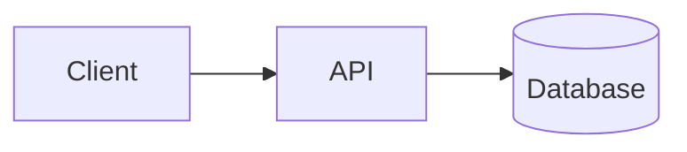
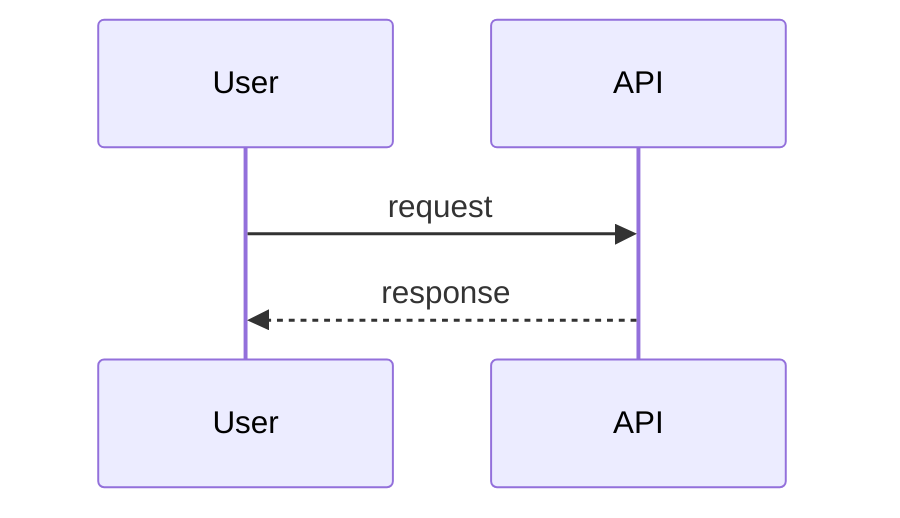
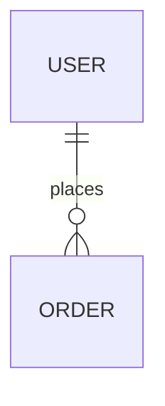

# SurfingBear Resume Optimizer — Specification

| Field | Value |
|---|---|
| Author | Sandip Kumar Mondal |
| Version | v1.0 |
| Last updated | 2026-10-19 |
| Status | Draft |

> **How to read this document**
> - Section order and numbering follow the standard template. IDs are permanent: never renumbered or reused. A removed item is marked **Deprecated** and its row is kept.
> - The only confirmed product input is the one-paragraph description in `BRIEF.md`. Every other decision in this document is an **engineering assumption**; such decisions are tagged `[A]` where they first appear and are collected in §3.3 with their reasons. They are not stakeholder-confirmed requirements.
> - Keywords **MUST / MUST NOT / SHOULD / MAY** follow RFC 2119. Times are UTC unless a timezone is named. All constants referenced as `CONST_NAME` are defined once in §3.3.4 and are configuration, not code.
> - A builder who finds something this document does not answer MUST stop and record the gap (§8 change-log process), not guess.
>
> **ID rules**
>
> | Prefix | Used for | Example |
> |---|---|---|
> | `CR-` | Company-wide common requirement | CR-001 |
> | `FR-` | Functional requirement | FR-001 |
> | `NFR-` | Non-functional requirement | NFR-001 |
> | `CMP-` | Architecture component | CMP-001 |
> | `TBL-` | Database table | TBL-001 |
> | `API-` | API endpoint | API-001 |
> | `ERR-` | Error code | ERR-001 |
>
> Additional local prefixes used only inside this document: `A-` engineering assumption (§3.3), `BR-` business rule (§3.3.3), `SEQ-` sequence diagram (§4.3), `IDX-` index (§5.3), `TC-` verification case (§7).

---

## 1. Company-wide common requirements

Rules every Divii / Hanriver project must follow. Each rule has an ID and must be specific enough to be checked. The Resume Optimizer inherits every rule below; §3 adds the system-specific requirements and §7 shows where each CR is satisfied.

| ID | Area | Rule | How it is checked |
|---|---|---|---|
| CR-001 | Scope of CRs | Every project spec restates these rules by ID and maps each one to the components, tables and APIs that satisfy it. A CR that does not apply is marked `N/A` with a reason, never silently dropped. | Traceability table in §7 lists every CR-xxx. |

### 1.1 Authentication

| ID | Area | Rule | How it is checked |
|---|---|---|---|
| CR-002 | Authentication | A module that lives inside a larger platform MUST NOT implement its own sign-up or login. It verifies the platform's session token (JWT, RS256) against the platform's published JWKS and trusts only the claims `sub`, `plan`, `exp`, `iat`, `iss`, `aud`. Token verification happens in one guard; no handler reads the token itself. | Code review: exactly one auth guard; integration test with a token signed by an unknown key is rejected with 401. |
| CR-003 | Authentication | Access tokens are short-lived (≤ 30 min). The JWKS is cached (Redis, 10 min TTL) and refreshed on an unknown `kid`. Clock skew tolerance is 60 s. Tokens are never stored server-side and never logged. | Test: expired token → 401 `ERR-002`; log sample contains no `Authorization` values. |
| CR-004 | Authentication | Browser clients send the token as `Authorization: Bearer` from memory, or the platform's `httpOnly; Secure; SameSite=Lax` session cookie. Tokens MUST NOT be placed in `localStorage` or URL query strings. | Code review of the web API client; Playwright test asserts no token in `localStorage`. |
| CR-005 | Authentication | Service-to-service and background callers (workers, schedulers) run with a service identity (internal network + per-service secret), never with a user's token. | Config review; worker has no JWT dependency. |

### 1.2 Roles and permissions

| ID | Area | Rule | How it is checked |
|---|---|---|---|
| CR-006 | Roles | Authorization is **deny by default**. Every protected route declares its allowed roles with a decorator; a route without a declaration is unreachable (global guard). | Unit test enumerates all routes and asserts each has a role declaration or an explicit `@Public()`. |
| CR-007 | Roles | Ownership is enforced in the service layer: a user can read, download or delete only records whose `user_id` equals the token `sub`. A foreign record returns 404 (not 403) so that record IDs cannot be enumerated. | Integration test: user B requests user A's analysis → 404 `ERR-004`. |
| CR-008 | Roles | Every project publishes a role × permission table in its spec (for this system: below) and keeps it identical to the guard declarations. | Review: table vs. route decorators. |

**Role × permission table (Resume Optimizer)**

Roles come from the platform token claim `role` (`[A-01]` — see §3.3): `user` (any logged-in SurfingBear member, plan `free` or `premium` from claim `plan`) and `admin` (SurfingBear ops staff). `system` is the worker's service identity.

| Permission | `user` (free) | `user` (premium) | `admin` | `system` |
|---|---|---|---|---|
| List job roles and levels | Yes | Yes | Yes | — |
| Record consent | Own | Own | — | — |
| Upload resume | Own, within quota | Own, within fair-use cap | No | — |
| Start analysis | Own, within quota | Own | No | — |
| Read analysis result | Own, free view (partial suggestions) | Own, full view | Any (metadata + audit only, no resume text) | Read/write all (pipeline) |
| Download PDF report | Own, free view | Own, full view | No | Generate |
| Delete own resume / analysis / all data | Own | Own | Any user's data on request (audited) | Purge jobs |
| View usage and quota | Own | Own | Any user | — |
| View audit log | No | No | Yes | Write |

### 1.3 Logging

| ID | Area | Rule | How it is checked |
|---|---|---|---|
| CR-009 | Logging | Logs are JSON, one object per line (pino), with fields `timestamp, level, service, env, requestId, userId, message` and optional `durationMs, errorCode`. Levels: `error` (human action), `warn` (handled degradation), `info` (business events), `debug` (never in prod). | Log sample review per release; lint rule forbids `console.log`. |
| CR-010 | Logging | **Personal data is never logged**: no e-mail, phone, name, resume text, extracted text, AI prompts or AI responses, file names chosen by the user. Only opaque IDs, sizes, durations, status and error codes. Log formatter runs a redaction list (`email, phone, text, content, prompt, filename`). | Unit test on the redaction serializer; grep CI check for forbidden fields in log calls. |
| CR-011 | Logging | Every request carries `X-Request-Id` (UUID v4, reused if supplied), returned in the response and included in every log line and error envelope. Background jobs log the originating `requestId` of the API call that enqueued them. | Integration test asserts the header on all responses. |
| CR-012 | Logging | Security-relevant and data-lifecycle events are written to an **audit table** in the database (who, action, entity, when, requestId): uploads, analyses, downloads, deletions, admin reads, consent. Audit rows are append-only and never contain resume content. | Schema review (no UPDATE/DELETE grant on `audit_logs` for the app role); test TC-060. |
| CR-013 | Logging | Application logs are retained 30 days; audit rows are retained 2 years then archived. | Platform retention config review. |

### 1.4 Error handling

| ID | Area | Rule | How it is checked |
|---|---|---|---|
| CR-014 | Error format | **One** error envelope is used by every API in the company: `{"error": {"code": "<UPPER_SNAKE>", "message": "<human text>", "details": <object or null>, "requestId": "<uuid>"}}`. Validation errors use `code = VALIDATION_ERROR` and `details.fields = [{path, message}]`. Produced by a single global exception filter; controllers never hand-build error bodies. | Contract test: every error response matches the JSON schema in §6.1. |
| CR-015 | Error mapping | HTTP status mapping: 400 validation · 401 unauthenticated · 402 quota/plan limit · 403 forbidden · 404 not found (incl. not owned) · 409 state conflict · 413 payload too large · 415 unsupported media type · 422 content rejected after validation (unparseable file, unsafe content) · 429 rate limited · 500 unexpected · 503 dependency unavailable. Every error code in §6.3 maps to exactly one status. | Review of §6.3; test per ERR-xxx. |
| CR-016 | Error hygiene | 5xx responses never expose stack traces, SQL, file paths or provider messages. Every 5xx is reported to the error tracker with the `requestId`. | Test: forced exception returns generic `ERR-030`; Sentry event exists. |
| CR-017 | External calls | Every call to a database, cache, object store or external API has an explicit timeout and a documented retry policy; retries only for idempotent operations; circuit breaker for the AI provider. | Review of the integration adapters; table in §4.4. |
| CR-018 | User-facing errors | The web client shows a plain-language message plus a recovery action for every error code and shows the `requestId` behind a "Report this" link. | Playwright test for `ERR-010`, `ERR-020`, `ERR-030`. |

### 1.5 Security

| ID | Area | Rule | How it is checked |
|---|---|---|---|
| CR-019 | Transport | TLS 1.2+ everywhere; HTTP→HTTPS redirect; HSTS 1 year in prod. | SSL Labs grade A on prod; config review. |
| CR-020 | Secrets | Secrets live only in environment variables / the platform secret store. `.env` is git-ignored; `.env.example` lists every variable with a one-line description. A committed secret is a P1 incident: rotate within 24 h. | `gitleaks` in CI; review of `.env.example`. |
| CR-021 | Input validation | Every request body, query and path param is validated at the boundary (DTO + `class-validator`, `whitelist: true, forbidNonWhitelisted: true`). Unknown fields are rejected with 400. Uploaded files are validated by size, declared MIME type **and** file signature (magic bytes), never by extension alone. | Unit tests per DTO; TC-010–TC-014. |
| CR-022 | Untrusted content | Content extracted from user files is treated as untrusted data: it is never executed, never rendered as HTML without escaping, never interpolated into shell commands, and is passed to AI providers inside a delimited data block with an instruction that it contains no instructions (prompt-injection guard). | Code review of the prompt builder; test with an injection payload (TC-032). |
| CR-023 | CORS / headers | CORS allow-list from config (no `*`); Helmet defaults; `Content-Security-Policy` on the web app; no inline scripts. | Header check in Playwright. |
| CR-024 | Rate limiting | Per-user and per-IP rate limits on every public route (defaults: 120 req/min per user, 600 req/min per IP); upload and analysis routes have stricter limits defined in §3. Exceeding returns 429 with `Retry-After`. Limits are enforced in Redis; if Redis is unavailable the limiter fails **closed** for write routes and open for read routes. | TC-052. |
| CR-025 | Data minimisation & retention | Collect only what a requirement needs; every personal-data column is flagged `PII` in the schema; every table with PII has a retention period and an automated purge job. | Schema review (§5.2); purge job tests. |
| CR-026 | Encryption at rest | Object storage uses server-side encryption (SSE-KMS); the database uses provider-managed encryption at rest; backups inherit the same keys. | Infra config review. |
| CR-027 | Dependencies | `pnpm audit` and Dependabot weekly; high/critical findings block merge unless a linked issue documents a mitigation. | CI gate. |
| CR-028 | Third-party processors | Any external processor of personal data (AI provider, storage, e-mail) is listed in the spec with what data it receives, where it is processed, and the contractual basis; the list is reviewed by the data-protection owner before go-live. | §4.4 table; sign-off recorded in §8. |

### 1.6 Internationalization (i18n)

| ID | Area | Rule | How it is checked |
|---|---|---|---|
| CR-029 | UI strings | All user-facing strings go through an i18n catalogue (`next-intl`); no hard-coded text in components. Default locale `en`; adding a locale requires only a new catalogue file. | Lint rule `no-literal-strings` on JSX; review. |
| CR-030 | Time & formats | Instants are stored and transmitted as ISO-8601 UTC; rendered in the viewer's timezone with `Intl.DateTimeFormat`. Numbers and currencies via `Intl.NumberFormat`. | Contract test on API date fields; UI review. |
| CR-031 | Content language | AI-generated text is produced in the language of the uploaded resume when it is English; non-English resumes are accepted but the response language is English in v1 and the UI says so. `[A-13]` | FR-016 acceptance criteria. |

### 1.7 Environments

| ID | Area | Rule | How it is checked |
|---|---|---|---|
| CR-032 | Environments | Four environments: `local`, `dev`, `staging`, `prod`. Same build artefact, different configuration. `APP_ENV` is one of these values; `NODE_ENV` is `development`, `test` or `production`. | Config schema validated at startup (fail fast). |
| CR-033 | Isolation | Each environment has its own database, Redis, object-storage bucket, AI-provider key and platform JWKS URL. Cross-environment credentials are forbidden; prod data never leaves prod. | Config review; separate cloud resources. |
| CR-034 | Data | `local`/`dev`/`staging` use synthetic seed data only (synthetic resumes, no real persons). | Seed script review. |
| CR-035 | Differences | What differs per environment is only: hostnames, credentials, log level (`debug` allowed in local/dev only), rate-limit multipliers, AI model/effort defaults, and feature flags. Behaviour is otherwise identical. | `.env.example` lists exactly these variables. |

### 1.8 Deployment

| ID | Area | Rule | How it is checked |
|---|---|---|---|
| CR-036 | CI | Every PR runs lint → typecheck → unit → integration → build. Red CI blocks merge. | Branch protection on `main`. |
| CR-037 | Release | `main` auto-deploys to `dev`; `staging` is promoted manually; `prod` deploys from a tag `vX.Y.Z` with a release note, by the project lead. | Deploy pipeline review. |
| CR-038 | Migrations | Database migrations run in the pipeline before the application rolls out; a failed migration aborts the deploy. Shipped migrations are never edited. Migrations are backward compatible for one release (expand → migrate → contract) so a rollback never needs a down-migration. | PR review checklist; migration test on a copy of staging. |
| CR-039 | Rollback | Rollback = redeploy the previous tag; must complete in < 10 min; documented in the runbook and rehearsed before first prod release. | Runbook evidence. |
| CR-040 | Health & observability | Every service exposes `GET /health` (liveness) and `GET /ready` (DB, Redis, object store reachable); every response carries `X-App-Version`; errors go to Sentry; uptime monitor on `/ready` alerts the project Slack channel. | TC-080. |

---

## 2. Coding conventions

Day-to-day rules for humans and AI agents working on this repository. Where these conflict with personal preference, this section wins.

### 2.1 Naming

| Item | Convention | Example |
|---|---|---|
| Classes / interfaces / types / enums / React components | `PascalCase` | `AnalysisService`, `ResumeStatus`, `ScoreCard` |
| Variables / functions / methods | `camelCase`; booleans start with `is`, `has`, `can` | `isWithinQuota`, `computeTotalScore()` |
| Constants | `UPPER_SNAKE_CASE`, defined once in `@resume/shared/constants.ts` | `MAX_FILE_BYTES` |
| Files (TS/TSX) | `kebab-case` with a role suffix | `analysis.service.ts`, `create-analysis.dto.ts`, `score-card.tsx` |
| NestJS modules | one folder per domain module, `kebab-case` | `src/modules/analyses/` |
| DB tables | `snake_case`, plural | `analyses`, `missing_skills` |
| DB columns | `snake_case`; FK `<singular>_id`; timestamps end with `_at`; booleans `is_*` | `resume_id`, `completed_at`, `is_locked` |
| Indexes / constraints | `idx_<table>_<cols>`, `uq_<table>_<cols>`, `fk_<table>_<col>`, `ck_<table>_<rule>` | `uq_usage_counters_user_period` |
| Enum values (DB `text` + check constraint, and TS) | `lower_snake` | `status = 'queued'` |
| API paths | RESTful, plural nouns, `kebab-case`, versioned | `/api/v1/resume-optimizer/analyses/{id}/report` |
| JSON fields on the wire | `camelCase` (ORM maps to `snake_case`) | `overallScore` |
| Error codes | `UPPER_SNAKE` strings, listed once in §6.3 | `QUOTA_EXCEEDED` |
| Redis keys | `ro:<env>:<domain>:<id>[:<sub>]`, every key has a TTL | `ro:prod:quota:user:<uuid>:2026-10` |
| Queue names / job names | `kebab-case` | queue `analysis`, job `run-analysis` |
| Env vars | `UPPER_SNAKE_CASE`, grouped by prefix; browser-exposed vars `NEXT_PUBLIC_*` | `AI_MODEL`, `NEXT_PUBLIC_API_URL` |
| Git branches | `<type>/<ID>-<short-name>` | `feat/FR-004-upload-validation` |

### 2.2 Folder / module structure

Monorepo with **pnpm workspaces**. Three packages; one language (TypeScript) end to end.

```
resume-optimizer/
├── package.json                 # workspace root: scripts dev, lint, typecheck, test, build
├── pnpm-workspace.yaml          # packages: apps/*, packages/*
├── .env.example                 # every variable, one-line description (CR-020)
├── .github/workflows/ci.yml     # CR-036
├── docker-compose.yml           # local postgres:16 + redis:7 + minio (S3-compatible)
├── packages/
│   └── shared/                  # @resume/shared — enums, constants, zod schemas, API types
│       └── src/{constants.ts, enums.ts, schemas/*.ts, api-types.ts, index.ts}
├── apps/
│   ├── api/                     # @resume/api — NestJS 11 (HTTP API + worker in one codebase)
│   │   ├── prisma/{schema.prisma, migrations/, seed.ts}
│   │   ├── src/
│   │   │   ├── main.ts                      # HTTP entrypoint
│   │   │   ├── worker.ts                    # worker entrypoint (BullMQ consumers + cron)
│   │   │   ├── app.module.ts
│   │   │   ├── config/{configuration.ts, env.schema.ts}
│   │   │   ├── common/
│   │   │   │   ├── errors/{domain-error.ts, error-codes.ts, http-exception.filter.ts}
│   │   │   │   ├── auth/{jwt-auth.guard.ts, roles.guard.ts, roles.decorator.ts, public.decorator.ts, principal.decorator.ts}
│   │   │   │   ├── interceptors/{request-id.interceptor.ts, envelope.interceptor.ts}
│   │   │   │   ├── logging/{logger.module.ts, redaction.ts}
│   │   │   │   ├── pagination/{pagination.dto.ts, paginate.ts}
│   │   │   │   └── clock/{clock.ts}         # injectable Clock (CC-TEST)
│   │   │   ├── infra/
│   │   │   │   ├── prisma/{prisma.module.ts, prisma.service.ts}
│   │   │   │   ├── redis/{redis.module.ts, redis.service.ts}
│   │   │   │   ├── queue/{queue.module.ts, queues.ts}
│   │   │   │   ├── storage/{storage.port.ts, s3-storage.adapter.ts}
│   │   │   │   ├── ai/{ai.port.ts, anthropic.adapter.ts, prompts/, schemas/}
│   │   │   │   └── pdf/{pdf-renderer.ts, templates/}
│   │   │   └── modules/
│   │   │       ├── roles/            # job roles + levels catalogue
│   │   │       ├── consents/
│   │   │       ├── resumes/          # upload, validation, storage, parsing
│   │   │       ├── analyses/         # orchestration, scoring, results, gating
│   │   │       ├── reports/          # PDF generation + download
│   │   │       ├── usage/            # quota + plan entitlements
│   │   │       ├── privacy/          # deletion requests, purge, data export
│   │   │       ├── admin/
│   │   │       ├── audit/
│   │   │       ├── jobs/             # cron: purge, reconcile, hold cleanup
│   │   │       └── health/
│   │   └── test/                     # *.e2e-spec.ts (supertest + Testcontainers)
│   └── web/                     # @resume/web — Next.js 15 App Router
│       ├── src/app/
│       │   ├── layout.tsx, page.tsx
│       │   └── resume-optimizer/
│       │       ├── page.tsx                      # upload + role picker (SCR-001)
│       │       ├── analyses/page.tsx             # history (SCR-003)
│       │       └── analyses/[id]/page.tsx        # result (SCR-002)
│       ├── src/sections/{upload, analysis, history, privacy}/
│       ├── src/components/           # shared UI
│       ├── src/services/             # api-client.ts + one service per API module
│       ├── src/hooks/, src/utils/, src/types/, src/locales/
│       ├── src/middleware.ts         # auth presence check, redirects to platform login
│       └── e2e/                      # Playwright
└── tests/fixtures/              # synthetic resumes (pdf/docx), golden AI responses
```

Layering rules:
- Backend: **Controller → Service → Repository (Prisma)**. Controllers hold no business logic; services hold no HTTP concerns; Prisma calls live in services or repositories, never in controllers.
- External systems are reached only through a **port interface** in `infra/` (`StoragePort`, `AiPort`) with one adapter each; services depend on the port. This is the "well-defined backend boundary" for the AI provider.
- Frontend: Server Components first; Client Components only for hooks, events and local state. All HTTP goes through `src/services/*`; components never call `fetch` directly.
- Validation is defined once: every request payload has a Zod schema in `@resume/shared`; the API derives its DTO from the same field list; the web form reuses the Zod schema.

### 2.3 Branching and commits

- Trunk-based; branch from `main`; short-lived (< 3 days). Branch name `<type>/<ID>-<short-name>`, `type ∈ feat, fix, chore, docs, refactor, test`, e.g. `feat/FR-004-upload-validation`, `fix/ERR-021-ai-timeout`.
- Commit format (Conventional Commits): `<type>(<scope>): <imperative message>` with a footer `Implements: FR-004, FR-005` naming the requirement IDs touched. Example: `feat(resumes): validate file signature and size\n\nImplements: FR-004`.
- One PR = one logical change. No drive-by refactors. Squash-merge; the squash message keeps the `Implements:` footer.
- Releases are tags `vMAJOR.MINOR.PATCH`. The spec version in §8 moves with `MAJOR.MINOR`.

### 2.4 Code review rules

- Every PR needs one approving review from a human who did not author it; AI review is additional.
- PR template checklist: requirement IDs linked · screenshot/recording for UI changes · tests added or updated · `.env.example` updated for new variables · migration backward compatible · no PII in logs · spec §8 updated if behaviour changed.
- Reviewers block on: missing tests for a business rule, `any` without an inline justification, raw SQL without a comment, secrets, PII in logs, new env var without documentation, error response built outside the global filter.
- Turnaround target: same working day; a PR open > 2 days is raised in stand-up.
- Nothing is "done" without evidence: a green CI link and, for user-visible changes, a Playwright run against `dev`.

### 2.5 Lint and format

| Tool | Config file | Runs when |
|---|---|---|
| TypeScript `strict: true`, `noUncheckedIndexedAccess: true`, `exactOptionalPropertyTypes: true` | `tsconfig.base.json` | `pnpm typecheck` in pre-commit and CI |
| ESLint 9 (flat config): `@typescript-eslint/recommended-type-checked`, `eslint-plugin-import` (ordered imports), `eslint-plugin-security` (api), `@next/eslint-plugin-next` (web), custom rule forbidding `console.*` and literal JSX strings | `eslint.config.mjs` | pre-commit (staged files) and CI |
| Prettier: 2 spaces, single quotes, trailing commas `all`, print width 100 | `.prettierrc` | pre-commit; CI runs `prettier --check` |
| Husky + lint-staged | `.husky/pre-commit`, `package.json#lint-staged` | every commit |
| commitlint (Conventional Commits) | `commitlint.config.mjs` | `commit-msg` hook and CI |
| `.editorconfig` | repo root | editor |
| Prisma `format` | `prisma/schema.prisma` | pre-commit |
| Tests: Jest (api unit + supertest e2e), Vitest + React Testing Library (web), Playwright (e2e), k6 (perf) | per package | CI; coverage gates api 80 %, web 60 %, shared 90 % |

Test conventions: every `BR-` business rule in §3.3.3 has at least one test named after it; time-dependent code receives an injectable `Clock` (no `Date.now()` in services); tests use factories and synthetic fixtures only.

---
## 3. Requirements definition

### 3.1 Functional requirements

| ID | Title | Description | Priority | Acceptance criteria |
|---|---|---|---|---|
| FR-001 | <title> | <what the system does, who does it> | Must / Should / Could | 1. … 2. … |

> Example: `FR-003 | Reset password | A registered user can request a password reset link by email. | Must | 1. The link expires after 30 minutes. 2. The link works only once. 3. Requesting a reset for an unknown email returns the same response as a known one (no account enumeration).`

### 3.2 Non-functional requirements

| ID | Category | Requirement | Measurable target | How it is verified |
|---|---|---|---|---|
| NFR-001 | Performance | <...> | <number + unit> | <test / tool> |

Cover at least: performance, security, availability, privacy, scalability, observability.

### 3.3 Assumptions and out of scope
List what you assumed and what this spec deliberately does **not** cover.

---

## 4. Architecture

### 4.1 Component diagram



### 4.2 Components

| ID | Component | Responsibility | Technology |
|---|---|---|---|
| CMP-001 | <name> | <what it does> | <tech> |

### 4.3 Main flows
One sequence diagram per main flow.



### 4.4 External integrations

| System | Purpose | Protocol / auth | Failure handling |
|---|---|---|---|

### 4.5 Tech stack and reasons

| Layer | Choice | Why this choice |
|---|---|---|

---

## 5. ERD and database design

### 5.1 ERD



### 5.2 Tables
One block per table.

#### TBL-001 `<table_name>`
Purpose: <one line>

| Column | Type | Null | Key | Default | Constraint / note |
|---|---|---|---|---|---|
| id | uuid | NO | PK | gen_random_uuid() | |

### 5.3 Indexes

| Table | Index | Columns | Why |
|---|---|---|---|

### 5.4 Relationships and delete rules

| From | To | Cardinality | On delete |
|---|---|---|---|

---

## 6. API design

### 6.1 Common rules
- Base path:
- Auth header / cookie:
- Pagination format:
- Date / time format and timezone:
- Standard error format (must match section 1.4):

### 6.2 Endpoints
One block per endpoint.

#### API-001 `<METHOD> <path>`
- **Purpose:**
- **Auth / role:**
- **Implements:** FR-xxx

**Request**

| Field | In (path/query/body) | Type | Required | Validation |
|---|---|---|---|---|

**Response 200**

```json
{}
```

**Errors**

| HTTP | Error code | When |
|---|---|---|

### 6.3 Error code list

| ID | Code | HTTP | Message | When it happens |
|---|---|---|---|---|

---

## 7. Traceability matrix

Every FR and NFR must appear here at least once. No empty cells — write `—` only when something genuinely does not apply, and say why.

| Requirement | Component(s) | Table(s) | API(s) | Verified by |
|---|---|---|---|---|
| FR-001 | CMP-00x | TBL-00x | API-00x | <test / acceptance criterion> |

---

## 8. Change log

| Version | Date | Author | What changed | Why | Affected IDs |
|---|---|---|---|---|---|
| v1.0 | YYYY-MM-DD | <name> | Initial version | — | — |
