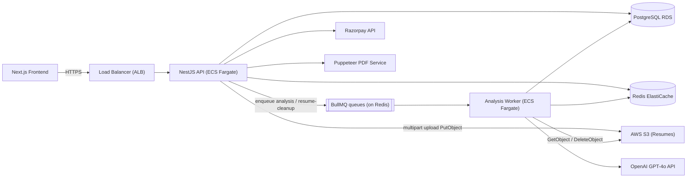
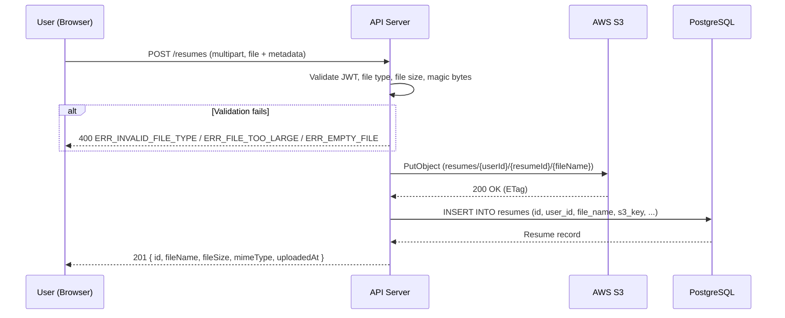
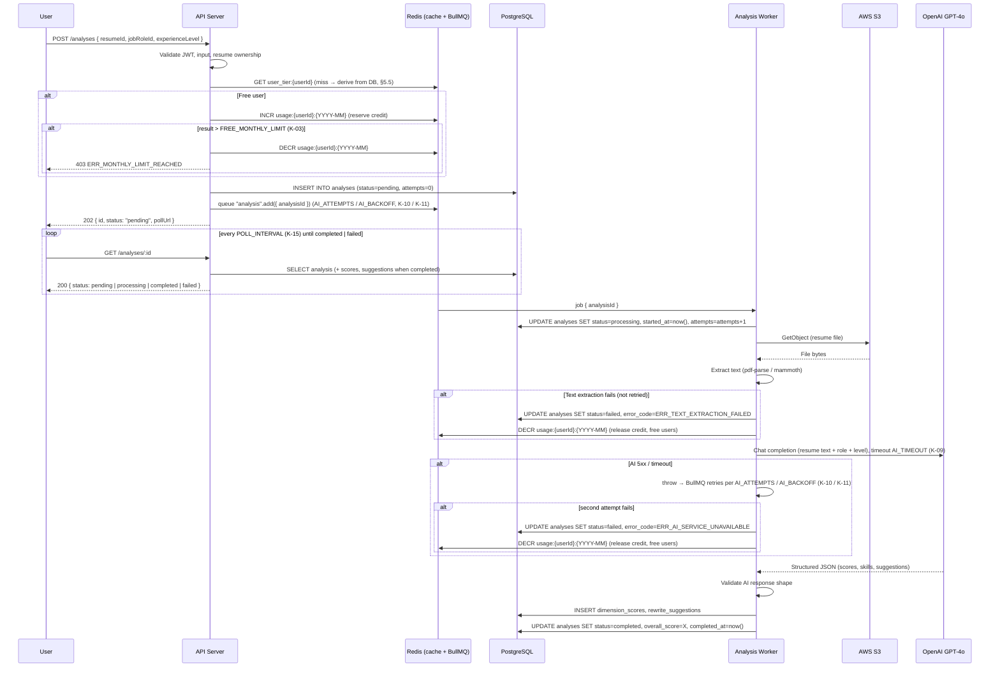
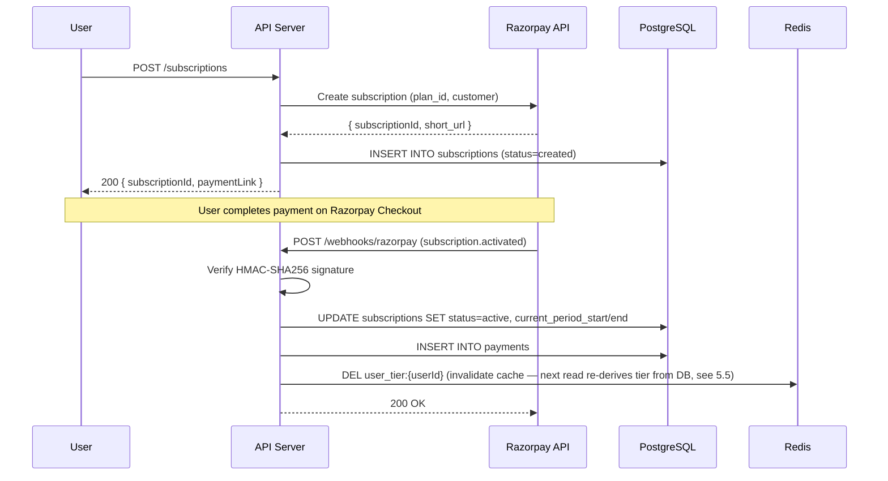
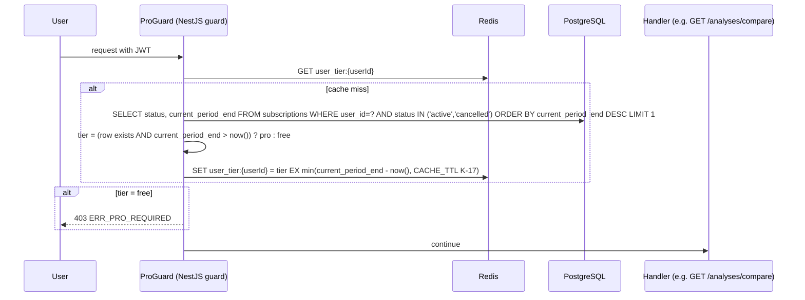
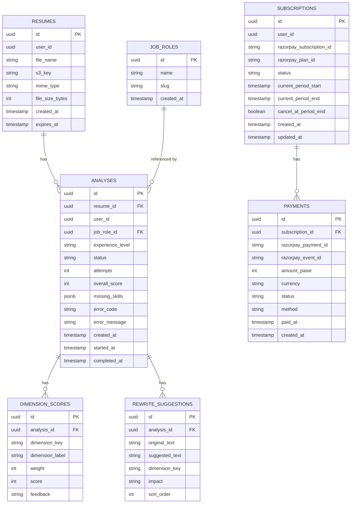

# SurfingBear Resume Optimizer — Specification

| Field | Value |
|---|---|
| Author | Sovan Kumar Bera |
| Version | v1.2 |
| Last updated | 2026-10-28 |
| Status | Final |

---

## 1. Company-wide common requirements

Rules every Divii / Hanriver project must follow. Each rule has an ID and must be specific enough to be checked.

| ID | Area | Rule | How it is checked |
|---|---|---|---|
| CR-001 | Authentication | This module does not manage sign-up or login. It receives a signed JWT issued by the main SurfingBear platform. The JWT is passed as a Bearer token in the `Authorization` header. The module validates the token signature using the platform's RS256 public key (fetched from `PLATFORM_JWKS_URL` at startup and cached for `JWKS_CACHE_TTL`, K-32). A valid token contains `sub` (user UUID), `email`, `name`, and `roles[]`. An invalid or expired token returns `401`. | Automated test: send request with expired / tampered / missing token → 401. Code review: no login or registration endpoint exists. |
| CR-002 | Token handling | Access tokens have a 15-minute TTL. The module does not refresh tokens; the platform handles refresh. Every authenticated endpoint reads the user from the token; no endpoint accepts a user ID in the request body as a substitute for the token. | Code review + integration test. |
| CR-003 | Roles and permissions | Two roles exist: `user` (default) and `admin`. The role is read from `roles[]` in the JWT. See permission matrix below. | Role-based guard on every endpoint; automated tests for each forbidden combination. |
| CR-004 | Logging | Logs are structured JSON, one object per line. Required fields: `timestamp` (ISO-8601 UTC), `level` (debug / info / warn / error), `requestId` (UUID, set via `X-Request-Id` header or auto-generated), `userId` (from JWT, or `anonymous`), `method`, `path`, `statusCode`, `durationMs`, `message`. Personal data (email, phone, resume content, file bytes) is **never** logged. File names are logged only as a hash (`SHA-256(filename)`). | Code review + log sample review + grep for PII patterns in CI. |
| CR-005 | Error handling | Every API error response uses exactly this shape: `{ "statusCode": <number>, "error": "<ERR_CODE>", "message": "<human-readable>", "requestId": "<uuid>" }`. Internal errors (5xx) never leak stack traces or internal paths; they return `"message": "Internal server error"`. 4xx errors return a specific message. | Automated test: trigger each error code and assert shape. |
| CR-006 | Security — secrets | All secrets (`DATABASE_URL`, `REDIS_URL`, `OPENAI_API_KEY`, `AWS_ACCESS_KEY_ID`, `AWS_SECRET_ACCESS_KEY`, `RAZORPAY_KEY_ID`, `RAZORPAY_KEY_SECRET`, `PLATFORM_JWKS_URL`, `WEBHOOK_SECRET`) are stored in environment variables, never in code or config files committed to git. `.env` is in `.gitignore`. | CI check: no secrets in code. |
| CR-007 | Security — CORS | CORS allows only origins listed in `ALLOWED_ORIGINS` env var (comma-separated). Credentials: `true`. Allowed methods: `GET, POST, PUT, PATCH, DELETE, OPTIONS`. Allowed headers: `Authorization, Content-Type, X-Request-Id`. Max-age: `86400`. | Automated test: request from unlisted origin → no CORS headers. |
| CR-008 | Security — input validation | Every request body, query parameter and path parameter is validated with `class-validator` decorators before the handler runs. Validation pipe is global with `whitelist: true` (strips unknown fields) and `forbidNonWhitelisted: true` (rejects unknown fields with 400). File uploads are validated for MIME type and size before being read. | Code review: every DTO has decorators. CI: test with extra / missing fields. |
| CR-009 | Security — rate limiting | Global rate limit: `RATE_LIMIT_USER` (K-23) per user (keyed by `userId` from JWT). Unauthenticated requests: `RATE_LIMIT_ANON` (K-24) per IP. Analysis endpoints (`POST /analyses`, `POST /analyses/:id/retry`): `RATE_LIMIT_ANALYSIS` (K-25) per user, because each job costs money. Limits enforced via `@nestjs/throttler` backed by Redis. Exceeded → `429 Too Many Requests`. | Load test in staging. |
| CR-010 | Security — data at rest | All resume files in S3 are encrypted with AES-256 (SSE-S3). The PostgreSQL database uses volume-level encryption (AWS RDS encryption). Redis is configured with `requirepass` and TLS in staging/prod. | Infrastructure review + AWS config audit. |
| CR-011 | Security — data in transit | All traffic uses HTTPS (TLS 1.2+). Internal service-to-service calls (API ↔ S3, API ↔ OpenAI, API ↔ Redis) use TLS. HTTP requests are redirected to HTTPS via the load balancer. | SSL Labs scan ≥ A rating. |
| CR-012 | Privacy — DPDP Act | Resumes contain personal data (name, email, phone, address, work history). Under India's DPDP Act 2023: (a) resumes are processed only for the stated purpose (analysis); (b) users can request deletion of their data at any time via `DELETE /resumes/:id`; (c) deleted data is hard-deleted from S3 and the database within `ERASURE_SLA` (K-08); (d) data retention: free users' resumes are auto-deleted `RETENTION_DAYS` (K-07) after upload; Pro users' resumes are retained while the subscription is active and deleted `RETENTION_DAYS` after the subscription ends (owner of the rule: NFR-006 / CMP-008); (e) no resume data is shared with third parties except the AI provider (OpenAI) for analysis; (f) the AI analysis prompt instructs the model not to store or learn from the data. | Annual DPDP compliance audit + automated retention job test. |
| CR-013 | i18n | All API responses are in English. All dates are stored as ISO-8601 UTC in the database and returned as ISO-8601 UTC in API responses. The frontend converts to the user's local timezone. Currency amounts are stored as integers in paise (1 ₹ = 100 paise) to avoid floating-point errors. Currency display format: `₹X.XX` (INR, 2 decimal places). | Code review: no hardcoded timezone offsets in backend. |
| CR-014 | Environments | Four environments: `local` (developer laptop, Docker Compose, mock OpenAI), `dev` (shared, real AWS, OpenAI sandbox key, seeded test data), `staging` (mirrors prod infra, production OpenAI key with low limits, used for QA and build test), `prod` (production). Env-specific config: `DATABASE_URL`, `REDIS_URL`, `OPENAI_API_KEY`, `S3_BUCKET`, `ALLOWED_ORIGINS`, `RAZORPAY_KEY_ID`, `RAZORPAY_KEY_SECRET`. | Deploy pipeline enforces env-specific secrets via AWS Parameter Store. |
| CR-015 | Deployment | CI/CD via GitHub Actions. Pipeline: lint → test → build → deploy. Deployment to dev: auto on push to `develop`. Deployment to staging: auto on push to `release/*`. Deployment to prod: manual approval after staging QA passes. Rollback: re-deploy the previous Docker image tag. Zero-downtime deploys via rolling update (ECS Fargate, minimum healthy 50%). Database migrations run before deploy via `typeorm migration:run` in a one-off task. | Deployment runbook + pipeline config. |

### 1.2 Roles and permissions

| Action | `user` | `admin` |
|---|---|---|
| Upload resume | ✅ | ✅ |
| Start analysis | ✅ (within tier limits) | ✅ (unlimited) |
| View own analyses | ✅ | ✅ |
| View all users' analyses | ❌ | ✅ |
| Download own analysis PDF | ✅ | ✅ |
| Delete own resume | ✅ | ✅ |
| Delete any resume | ❌ | ✅ |
| Manage subscriptions (own) | ✅ | ✅ |
| View subscription metrics | ❌ | ✅ |
| View system health | ❌ | ✅ |

---

## 2. Coding conventions

### 2.1 Naming

| Item | Convention | Example |
|---|---|---|
| Classes | PascalCase | `AnalysisService`, `ResumeController` |
| Interfaces | PascalCase, prefixed with `I` only for service interfaces | `IAnalysisResult`, `ResumeDto` |
| Variables / functions | camelCase | `uploadResume`, `analysisScore` |
| Constants | UPPER_SNAKE_CASE, names exactly as in the §3.4 constants table | `MAX_FILE_SIZE`, `FREE_MONTHLY_LIMIT` |
| DB tables | snake_case, plural | `resumes`, `analyses`, `rewrite_suggestions` |
| DB columns | snake_case | `created_at`, `user_id`, `overall_score` |
| API paths | kebab-case, plural nouns | `/resumes`, `/analyses`, `/subscriptions` |
| Enum values (DB) | snake_case | `pending`, `completed`, `failed` |
| Enum values (TS) | PascalCase | `AnalysisStatus.Completed` |
| DTOs | PascalCase + suffix | `CreateAnalysisDto`, `ResumeResponseDto` |
| Entity | PascalCase + `Entity` suffix | `ResumeEntity`, `AnalysisEntity` |
| Migration | timestamp + description | `1729555200000-CreateResumesTable` |

### 2.2 Folder / module structure

```
src/
├── main.ts                          # Bootstrap, global pipes, guards
├── app.module.ts                    # Root module
├── common/
│   ├── decorators/                  # @CurrentUser, @Roles
│   ├── filters/                     # GlobalExceptionFilter
│   ├── guards/                      # JwtAuthGuard, RolesGuard, ThrottlerGuard
│   ├── interceptors/                # LoggingInterceptor, TransformInterceptor
│   ├── pipes/                       # ParseUuidPipe
│   ├── dto/                         # PaginationQueryDto, PaginatedResponseDto
│   └── constants.ts                 # every K-xx constant from §3.4, exported under its table name
├── config/
│   └── configuration.ts             # ConfigModule factory
├── auth/
│   ├── auth.module.ts
│   ├── jwt.strategy.ts              # Validates platform JWT
│   └── jwt-auth.guard.ts
├── resumes/
│   ├── resumes.module.ts
│   ├── resumes.controller.ts
│   ├── resumes.service.ts
│   ├── dto/
│   │   ├── upload-resume.dto.ts
│   │   └── resume-response.dto.ts
│   ├── entities/
│   │   └── resume.entity.ts
│   └── resumes.repository.ts
├── analyses/
│   ├── analyses.module.ts
│   ├── analyses.controller.ts
│   ├── analyses.service.ts
│   ├── dto/
│   │   ├── create-analysis.dto.ts
│   │   ├── analysis-response.dto.ts
│   │   └── analysis-list-query.dto.ts
│   ├── entities/
│   │   ├── analysis.entity.ts
│   │   ├── dimension-score.entity.ts
│   │   └── rewrite-suggestion.entity.ts
│   └── analyses.repository.ts
├── ai/
│   ├── ai.module.ts
│   ├── ai.service.ts                # OpenAI GPT-4o integration
│   └── prompts/
│       └── resume-analysis.prompt.ts
├── storage/
│   ├── storage.module.ts
│   └── storage.service.ts           # S3 upload/download/delete
├── pdf/
│   ├── pdf.module.ts
│   ├── pdf.service.ts               # Puppeteer HTML→PDF
│   └── templates/
│       └── analysis-report.hbs      # Handlebars template
├── subscriptions/                   # Round 2
│   ├── subscriptions.module.ts
│   ├── subscriptions.controller.ts
│   ├── subscriptions.service.ts
│   ├── dto/
│   │   ├── create-subscription.dto.ts
│   │   └── subscription-response.dto.ts
│   ├── entities/
│   │   ├── subscription.entity.ts
│   │   └── payment.entity.ts
│   └── razorpay/
│       ├── razorpay.service.ts
│       └── razorpay-webhook.controller.ts
├── scheduler/
│   ├── scheduler.module.ts
│   └── retention.service.ts         # Cron: delete expired resumes
└── health/
    ├── health.module.ts
    └── health.controller.ts
```

Frontend (Next.js) is a separate repository and out of scope for this backend spec. The backend exposes a REST API; the frontend consumes it.

### 2.3 Branching and commits

- Main branches: `main` (production), `develop` (integration), `release/vX.Y.Z` (release candidate).
- Feature branches: `feature/FR-001-upload-resume` (one feature per branch).
- Fix branches: `fix/ERR-003-timeout-handling`.
- Commit format: `<type>(<scope>): <message>` where type is `feat`, `fix`, `refactor`, `test`, `docs`, `chore`, `ci`. Scope is the module name (e.g. `resumes`, `analyses`, `ai`). Message is imperative mood, lowercase, max 72 characters.
- Examples: `feat(resumes): add upload endpoint with S3 integration`, `fix(ai): handle OpenAI timeout with retry`.

### 2.4 Code review rules

- Every PR requires at least 1 approval before merge.
- PR must pass CI (lint + test + build).
- PR description must reference the FR/NFR IDs it implements.
- Squash merge to `develop`; merge commit to `main`.

### 2.5 Lint and format

| Tool | Config file | When it runs |
|---|---|---|
| ESLint | `.eslintrc.js` — extends `@typescript-eslint/recommended`, `prettier` | Pre-commit hook (Husky) + CI |
| Prettier | `.prettierrc` — `printWidth: 100`, `singleQuote: true`, `trailingComma: 'all'`, `semi: true`, `tabWidth: 2` | Pre-commit hook (Husky) + CI |
| Husky | `.husky/pre-commit` — runs `lint-staged` | Every commit |
| lint-staged | `package.json` — `"*.ts": ["eslint --fix", "prettier --write"]` | Pre-commit |
| TypeScript | `tsconfig.json` — `strict: true`, `noImplicitAny: true`, `strictNullChecks: true` | Build + CI |

---

## 3. Requirements definition

### 3.1 Functional requirements

| ID | Title | Description | Priority | Acceptance criteria |
|---|---|---|---|---|
| FR-001 | Upload resume | A logged-in user uploads a resume file. The system accepts PDF and DOCX formats only, with a maximum size of `MAX_FILE_SIZE` (K-01). The file is stored in S3 and a record is created in the database. | Must | 1. Only `.pdf` and `.docx` MIME types are accepted; any other type returns `ERR_INVALID_FILE_TYPE` (400). 2. Files larger than `MAX_FILE_SIZE` (K-01) return `ERR_FILE_TOO_LARGE` (400). 3. Files with 0 bytes return `ERR_EMPTY_FILE` (400). 4. After upload, the response contains `resumeId` (UUID), `fileName`, `fileSize`, `mimeType`, `uploadedAt`. 5. The file is stored in S3 at key `resumes/{userId}/{resumeId}/{originalFileName}`. 6. A malicious file (e.g. `.exe` renamed to `.pdf`) is rejected by checking the file's magic bytes, not just the extension. |
| FR-002 | Select target job role | When starting an analysis, the user selects a target job role from a predefined list (e.g. "Software Engineer", "Data Analyst", "Product Manager", "DevOps Engineer", "UI/UX Designer", "Project Manager", "Business Analyst", "QA Engineer", "System Administrator", "Marketing Manager"). Admins can add roles via `POST /job-roles`. | Must | 1. The list is returned by `GET /job-roles`. 2. Selecting a role not in the list returns `ERR_INVALID_JOB_ROLE` (400). 3. The selected role is stored with the analysis. |
| FR-003 | Select experience level | When starting an analysis, the user selects an experience level: `entry` (0–2 years), `mid` (3–5 years), `senior` (6–10 years), `lead` (10+ years). | Must | 1. Only the four values are accepted; anything else returns `ERR_INVALID_EXPERIENCE_LEVEL` (400). 2. The level is stored with the analysis. |
| FR-004 | AI resume analysis | **Analysis is asynchronous (decision D-01, §4.6).** `POST /analyses` validates the request, reserves the user's credit, creates the analysis row with status `pending`, enqueues a job on the `analysis` queue (CMP-010) and returns `202 Accepted` immediately. The Analysis Worker picks up the job, sets status `processing`, extracts the resume text, sends text + job role + experience level to OpenAI GPT-4o and stores the structured result (overall score 0–100, per-dimension scores, missing skills, rewrite suggestions). The client polls `GET /analyses/:id` until status is `completed` or `failed`. | Must | 1. `POST /analyses` responds `202` with `status: "pending"` within `ENQUEUE_P95` (K-13); the job reaches `completed` or `failed` within `ANALYSIS_P95` (K-12) of enqueue. The client polls `GET /analyses/:id` every `POLL_INTERVAL` (K-15) and stops on a terminal status. 2. The overall score is an integer 0–100. 3. The seven dimensions of the dimension catalogue (§3.4, K-40) are scored; each dimension score is an integer from 0 to that dimension's weight. 4. `overall_score` is computed by the Worker as the plain sum of the seven dimension scores (weights total 100, so the sum is already 0–100); the AI's own overall figure, if any, is ignored. 5. If the AI call fails (timeout, rate limit, server error) after the job's retry policy (`AI_ATTEMPTS` / `AI_BACKOFF`, K-10 / K-11, see CMP-010), the analysis status is set to `failed`, `error_code` is set (`ERR_AI_SERVICE_UNAVAILABLE` or `ERR_TEXT_EXTRACTION_FAILED`) and the reserved credit is released; the user can retry without consuming another credit. 6. The resume text is extracted inside the worker using `pdf-parse` (PDF) or `mammoth` (DOCX) before sending to the AI. 7. Exactly one worker processes a given job at a time (BullMQ lock); a job is never processed twice concurrently. |
| FR-005 | Missing skills list | The analysis result includes a list of skills that are expected for the target role and experience level but are missing from the resume. Each skill has a name and a brief explanation of why it matters for the role. | Must | 1. At least 0 and at most `MAX_MISSING_SKILLS` (K-06) missing skills are returned. 2. Each skill has `name` (string, 1–100 chars) and `reason` (string, 1–300 chars). 3. Skills are ordered by relevance (most important first, as ranked by the AI). |
| FR-006 | Rewrite suggestions | The analysis result includes rewrite suggestions for weak lines in the resume. Each suggestion has the original line, the suggested rewrite, the dimension it improves, and the expected score impact. | Must | 1. Each suggestion has `originalText`, `suggestedText`, `dimension` (one of the 7 dimension keys), `impact` (`low` / `medium` / `high`). 2. Free users see only the first `FREE_VISIBLE_SUGGESTIONS` (K-04) suggestions by `sort_order` (TBL-004). Pro users see all, at most `MAX_SUGGESTIONS` (K-05). 3. The response includes `totalSuggestions` count even for free users, so they know how many they are missing. |
| FR-007 | Free tier usage limits | Free users can run at most `FREE_MONTHLY_LIMIT` (K-03) analyses per calendar month (UTC). The count resets on the 1st of each month at 00:00 UTC. If the limit is reached, `POST /analyses` returns `ERR_MONTHLY_LIMIT_REACHED` (403). | Must | 1. After `FREE_MONTHLY_LIMIT` analyses in a month, the next attempt returns 403 with `ERR_MONTHLY_LIMIT_REACHED`. 2. Because analysis is asynchronous, the credit is **reserved at enqueue** (`INCR usage:{userId}:{YYYY-MM}` in Redis, atomic) so two concurrent requests cannot both pass the check; it is **released** (`DECR`) by the worker when the job ends in `failed`. Pending and processing analyses therefore count; failed ones do not. 3. `GET /analyses/usage` returns `{ "used": <n>, "limit": 3, "resetsAt": "<ISO-8601>" }`. 4. Pro users (tier derived per §5.5) skip the check entirely. 5. The Redis key expires `USAGE_KEY_TTL` (K-19) after the month starts; if Redis is unavailable the API falls back to `SELECT count(*) FROM analyses WHERE user_id = ? AND status <> 'failed' AND created_at >= <month start>`. |
| FR-008 | Download analysis as PDF | A user can download any of their own completed analyses as a PDF. The PDF contains: overall score, dimension scores as a radar chart, missing skills, rewrite suggestions (all for Pro, the first `FREE_VISIBLE_SUGGESTIONS` for free, K-04), and a timestamp. | Must | 1. `GET /analyses/:id/pdf` returns `Content-Type: application/pdf`. 2. The PDF file size is below `PDF_MAX_SIZE` (K-26). 3. If the analysis status is not `completed`, the endpoint returns `ERR_ANALYSIS_NOT_READY` (400). 4. The PDF includes the SurfingBear logo, the user's name, and the analysis date. |
| FR-009 | View analysis history | A user can view a list of their past analyses, paginated, sorted by creation date descending. Each list item shows: overall score, job role, experience level, status, and created date. | Should | 1. `GET /analyses` returns a paginated list. 2. Page size: default `PAGE_DEFAULT` (K-21), max `PAGE_MAX` (K-22). 3. Filterable by `status` (pending, processing, completed, failed) and `jobRoleId`. 4. Each item includes `id`, `resumeId`, `jobRole`, `experienceLevel`, `overallScore`, `status`, `createdAt`. |
| FR-010 | Delete resume and associated data | A user can delete their own resume. Deleting a resume also deletes the S3 file and all associated analyses, dimension scores, and rewrite suggestions. This supports the DPDP Act right to erasure. | Must | 1. `DELETE /resumes/:id` returns 204. 2. The S3 file is deleted within `ERASURE_SLA` (K-08): `DELETE` enqueues a `resume-cleanup` job on CMP-010 (same BullMQ instance, `CLEANUP_ATTEMPTS` / `CLEANUP_BACKOFF`, K-33) that calls S3 `DeleteObject`. 3. All rows referencing the resume in `analyses`, `dimension_scores`, `rewrite_suggestions` are cascade-deleted. 4. Attempting to access a deleted resume returns 404. |
| FR-011 | Resume Pro subscription | A user can subscribe to Resume Pro for `PRO_PRICE` (K-20) via Razorpay. Pro benefits: unlimited analyses, all rewrite suggestions visible, analysis history with score comparison. The subscription auto-renews monthly. Users can cancel anytime; Pro access continues until the end of the paid period. Free users are unchanged. | Must | 1. `POST /subscriptions` creates a Razorpay subscription and returns the `subscriptionId` and `paymentLink`. 2. After successful payment (webhook), the user's derived `tier` (§5.5: computed from TBL-006, cached in Redis `user_tier:{userId}`) becomes `pro`. 3. Pro users bypass the `FREE_MONTHLY_LIMIT` check (K-03). 4. Pro users see all rewrite suggestions (not just the first `FREE_VISIBLE_SUGGESTIONS`, K-04). 5. Cancellation via `POST /subscriptions/:id/cancel` sets `cancelAtPeriodEnd: true`; Pro access remains until `currentPeriodEnd`. 6. After `currentPeriodEnd` the tier reverts to `free` automatically (the derivation rule compares `current_period_end` to `now()`; the daily sweep in CMP-008 marks the row `expired`). 7. Pro-only endpoints (`GET /analyses/compare`) are protected by `ProGuard` and return `ERR_PRO_REQUIRED` (403) for free users. |
| FR-012 | Razorpay payment integration | The system integrates with Razorpay Subscriptions API. Payment lifecycle: create subscription → user pays on Razorpay checkout → webhook confirms payment → activate Pro. Razorpay webhooks are verified using the `WEBHOOK_SECRET`. | Must | 1. Webhook signature is verified using HMAC-SHA256 with `WEBHOOK_SECRET`; invalid signatures return 400. 2. Webhook events handled: `subscription.activated`, `subscription.charged`, `subscription.cancelled`, `subscription.halted`, `payment.failed`. 3. Each webhook is idempotent (duplicate delivery does not create duplicate records). 4. Payment records are stored with Razorpay `paymentId`, `amount` (in paise), `status`, `method`. |
| FR-013 | Subscription management | A user can view their subscription status, payment history, and cancel their subscription. | Should | 1. `GET /subscriptions/me` returns current subscription or `null`. 2. `GET /subscriptions/me/payments` returns payment history, paginated. 3. `POST /subscriptions/:id/cancel` cancels at period end. 4. Re-subscribing after cancellation creates a new subscription. |
| FR-014 | Score comparison | Pro users can compare scores across their analysis history. The comparison shows dimension scores between any two selected analyses side by side. | Should | 1. `GET /analyses/compare?ids=<id1>,<id2>` returns both analyses' dimension scores side by side. 2. Only completed analyses can be compared. 3. Maximum 2 analyses per comparison request. 4. Only the owner of both analyses can compare them. 5. The endpoint is Pro-gated: a free user (tier per §5.5) receives `ERR_PRO_REQUIRED` (403) before any analysis lookup happens. |
| FR-015 | List job roles | Any authenticated user can fetch the list of available job roles. | Must | 1. `GET /job-roles` returns `[{ "id": "<uuid>", "name": "<string>", "slug": "<string>" }]`. 2. Results are cached in Redis for `CACHE_TTL` (K-17). |
| FR-016 | Admin: add job role | An admin can add a new job role. | Could | 1. `POST /job-roles` with `{ "name": "..." }` creates a new role. Slug is auto-generated from name. 2. Duplicate names return `ERR_DUPLICATE_JOB_ROLE` (409). |
| FR-017 | Retry failed analysis | A user can retry a failed analysis without uploading the resume again and without consuming an additional analysis credit. | Should | 1. `POST /analyses/:id/retry` re-enqueues the same analysis row on the `analysis` queue (CMP-010), resets status to `pending`, clears `error_code`/`error_message`, increments `attempts` and returns `202`. No new credit is reserved. 2. Only analyses with status `failed` can be retried. 3. Retrying a non-failed analysis returns `ERR_ANALYSIS_NOT_FAILED` (400). |

### 3.2 Non-functional requirements

| ID | Category | Requirement | Measurable target | How it is verified |
|---|---|---|---|---|
| NFR-001 | Performance — analysis latency | AI resume analysis completes within acceptable time. | End-to-end p95 < `ANALYSIS_P95` (K-12), p99 < 2 × K-12, measured from job enqueue (`analyses.created_at`) to terminal status (`analyses.completed_at`). Queue wait alone (`started_at - created_at`): p95 < `QUEUE_WAIT_P95` (K-14) at `MAX_CONCURRENT_ANALYSES` (K-35) in flight. `POST /analyses` itself: p95 < `ENQUEUE_P95` (K-13). | Load test with K-35 concurrent analyses in staging; measure via APM (Datadog) + BullMQ job timings. |
| NFR-002 | Performance — API latency | Non-analysis endpoints respond quickly. | p95 < 200 ms for CRUD endpoints. p95 < 500 ms for PDF generation. | Load test + APM. |
| NFR-003 | Availability | The service is available for users. | 99.5% uptime per month (allows ~3.6 h downtime/month). Measured by health check endpoint `/health`. | Uptime monitoring (UptimeRobot or Datadog Synthetics), 1-minute interval. |
| NFR-004 | Scalability | The service handles concurrent users. | `MAX_CONCURRENT_USERS` (K-36) and `MAX_CONCURRENT_ANALYSES` (K-35). Achieved via horizontal scaling (ECS auto-scaling: min 2, max 8 tasks, target CPU 60%). | Load test with k6 in staging. |
| NFR-005 | Security — data protection | Personal data in resumes is protected. | Encryption at rest (AES-256) and in transit (TLS 1.2+). No PII in logs. Resume text is not stored in the database; only the S3 key is stored. | Security audit + pen test annually. |
| NFR-006 | Privacy — data retention | User data is not retained longer than necessary. | Free users: resumes auto-deleted `RETENTION_DAYS` (K-07) after upload. Pro users: resumes auto-deleted `RETENTION_DAYS` after the subscription ends. Deletion job runs at `SWEEP_TIME` (K-27). | Automated test: create resume with past date, run job, verify deletion. |
| NFR-007 | Observability | The team can monitor and debug the system. | Structured JSON logs (see CR-004). Health endpoint at `/health` returns `{ "status": "ok", "db": "ok", "redis": "ok", "s3": "ok" }`. Request traces via `X-Request-Id` header propagated to all internal calls and logs. | Dashboard in Datadog/CloudWatch. |
| NFR-008 | Reliability — AI failure | The system degrades gracefully when OpenAI is down. | If OpenAI returns 5xx or times out (`AI_TIMEOUT`, K-09), the worker job retries per `AI_ATTEMPTS` / `AI_BACKOFF` (K-10 / K-11). If the retry fails, the analysis status is set to `failed` with `error_code = ERR_AI_SERVICE_UNAVAILABLE`, the reserved credit is released, and the client sees the failure on its next poll of `GET /analyses/:id`. Jobs that exhaust attempts stay in the BullMQ `failed` set for `FAILED_JOB_RETENTION` (K-18) for inspection. No data is lost. The rest of the system (uploads, history, PDF download of past analyses) continues to work. | Chaos test: block OpenAI endpoint, verify graceful degradation. |
| NFR-009 | Testability | The codebase is testable. | Unit test coverage ≥ 80% (lines). Integration tests for all API endpoints. E2E tests for critical flows (upload → analyze → download PDF). Mocked OpenAI in tests. | CI pipeline: `jest --coverage` fails if < 80%. |

### 3.3 Assumptions and out of scope

**Assumptions:**
1. The main SurfingBear platform provides user authentication; this module trusts the platform's JWT.
2. Users have already accepted the platform's Terms of Service and Privacy Policy, which cover resume data processing.
3. The OpenAI API is available with an SLA sufficient for our 99.5% uptime target.
4. The frontend (Next.js) is built and maintained by the frontend team; this spec covers the backend API only.
5. Razorpay test mode is available for dev/staging; live mode for prod.

**Out of scope:**
1. User registration and login (handled by the platform).
2. Social login (Google, Kakao).
3. Mobile app (web only; the API is mobile-friendly but no native app).
4. Multi-language UI (English only for v1).
5. Real-time notifications (polling or page refresh is acceptable).
6. Resume editing within the platform (users edit externally and re-upload).
7. Bulk upload of multiple resumes at once.
8. Admin dashboard UI (admin uses API directly or a separate admin tool).

### 3.4 Constants (single source of every number)

Every limit, size, duration and price in this spec is defined **once** here and referenced by name and ID everywhere else (requirements, flows, tables, APIs, error messages). The values live in `src/common/constants.ts` under the same names; DB `CHECK` constraints and queue options are generated from them in migrations and module config, never typed by hand. Changing a value means changing one row.

| ID | Name | Value | Used by |
|---|---|---|---|
| K-01 | `MAX_FILE_SIZE` | 5 MB (5,242,880 bytes) | FR-001, TBL-001 CHECK, API-001, ERR-004, D-02, Flow 1, CMP-004 |
| K-02 | `MAX_REQUEST_BODY` | 6 MB (ALB body limit; headroom over K-01 for multipart framing) | API-001, §6.1 |
| K-03 | `FREE_MONTHLY_LIMIT` | 3 analyses per calendar month (UTC) | FR-007, FR-011, Flow 2, §5.5, API-005, API-009, ERR-010 |
| K-04 | `FREE_VISIBLE_SUGGESTIONS` | 3 (lowest `sort_order` first) | FR-006, FR-008, FR-011, TBL-004, API-005, §5.5 |
| K-05 | `MAX_SUGGESTIONS` | 15 per analysis | FR-006, API-005, CMP-005 |
| K-06 | `MAX_MISSING_SKILLS` | 20 per analysis | FR-005, CMP-005 |
| K-07 | `RETENTION_DAYS` | 90 days | CR-012, NFR-006, TBL-001, CMP-008, §5.5 |
| K-08 | `ERASURE_SLA` | 48 h | CR-012, FR-010, CMP-008 |
| K-09 | `AI_TIMEOUT` | 60 s per OpenAI call | NFR-008, §4.4, Flow 2, CMP-010 |
| K-10 | `AI_ATTEMPTS` | 2 (one retry) | FR-004, NFR-008, CMP-010, §4.4, Flow 2 |
| K-11 | `AI_BACKOFF` | 5 s, fixed | FR-004, NFR-008, CMP-010, §4.4, Flow 2 |
| K-12 | `ANALYSIS_P95` | 30 s from enqueue to terminal status (p95); p99 = 2 × K-12 | FR-004, NFR-001, traceability |
| K-13 | `ENQUEUE_P95` | 500 ms for `POST /analyses` (p95) | FR-004, NFR-001, D-01, Flow 2 |
| K-14 | `QUEUE_WAIT_P95` | 5 s (p95) at K-35 concurrent analyses | NFR-001, CMP-010 |
| K-15 | `POLL_INTERVAL` | 3 s | FR-004, Flow 2, §6.1, API-005, API-007 |
| K-16 | `PRESIGNED_URL_TTL` | 15 min | CMP-004, API-003 |
| K-17 | `CACHE_TTL` | 3,600 s (job-role list, `user_tier` cache) | FR-015, API-012, §5.5, Flow 4 |
| K-18 | `FAILED_JOB_RETENTION` | 7 days in the BullMQ `failed` set | NFR-008, CMP-010 |
| K-19 | `USAGE_KEY_TTL` | 35 days after the month starts | FR-007 |
| K-20 | `PRO_PRICE` | ₹299 per month = 29,900 paise, INR | FR-011, TBL-006, TBL-007, API-014, API-015, API-017 |
| K-21 | `PAGE_DEFAULT` | 10 items | §6.1, FR-009, API-002, API-006, API-017 |
| K-22 | `PAGE_MAX` | 50 items | §6.1, FR-009, API-002, API-006, API-017 |
| K-23 | `RATE_LIMIT_USER` | 100 requests / min per user | CR-009 |
| K-24 | `RATE_LIMIT_ANON` | 20 requests / min per IP | CR-009 |
| K-25 | `RATE_LIMIT_ANALYSIS` | 10 requests / min per user on `POST /analyses` and `POST /analyses/:id/retry` | CR-009, API-005, API-010 |
| K-26 | `PDF_MAX_SIZE` | 2 MB | FR-008 |
| K-27 | `SWEEP_TIME` | daily 02:00 UTC | NFR-006, CMP-008, §5.5 |
| K-28 | `RENEWAL_GRACE` | 120 h after `current_period_end` while Razorpay retries a failed renewal (eNACH debits can take 2 working days; a weekend plus a holiday exceeds 72 h) | §5.5, CMP-008, FR-012, API-018 |
| K-29 | `CHECKOUT_TTL` | 24 h for an unpaid `created` subscription | TBL-006, API-014, CMP-008 |
| K-30 | `JOB_STALL_TIMEOUT` | 5 min in `processing` without a heartbeat | TBL-002, CMP-008, CMP-010 |
| K-31 | `MAX_MANUAL_RETRIES` | 3 per analysis via API-010 | FR-017, API-010 |
| K-32 | `JWKS_CACHE_TTL` | 24 h | CR-001 |
| K-33 | `CLEANUP_ATTEMPTS` / `CLEANUP_BACKOFF` | 5 attempts, exponential from 30 s | FR-010, CMP-010 |
| K-34 | `ERROR_DETAILS_MAX` | 20 field errors per `ERR_VALIDATION` response | ERR-016 |
| K-35 | `MAX_CONCURRENT_ANALYSES` | 50 in flight | NFR-001, NFR-004, CMP-010 |
| K-36 | `MAX_CONCURRENT_USERS` | 500 | NFR-004 |
| K-37 | `WORKER_CONCURRENCY` | 10 jobs per worker task | CMP-010 |
| K-38 | `ALB_IDLE_TIMEOUT` | 60 s | Flow 2, D-01 |
| K-39 | `EXTERNAL_TIMEOUT` | 30 s per S3 / Razorpay call | §4.4 |
| K-40 | Dimension catalogue | the 7 rows below; weights total 100 | FR-004, TBL-003, TBL-004, API-005, API-011, CMP-005 |

**Dimension catalogue (K-40)** — the only place dimension keys, labels and weights are written. The AI prompt, TBL-003 `CHECK`, TBL-004 `CHECK`, API responses and the PDF all read from this list.

| Key | Label | Weight |
|---|---|---|
| `contact_info` | Contact Information | 10 |
| `summary` | Professional Summary | 15 |
| `experience` | Work Experience | 20 |
| `skills_match` | Skills Match | 20 |
| `education` | Education | 10 |
| `formatting` | Formatting & ATS Readability | 15 |
| `keywords` | Keywords & Industry Terms | 10 |

---

## 4. Architecture

### 4.1 Component diagram



The API never calls OpenAI directly: every analysis runs in the Worker. The Worker is the same Docker image started with `PROCESS_ROLE=worker`, so it shares entities, config and the AI service code with the API.

### 4.2 Components

| ID | Component | Responsibility | Technology |
|---|---|---|---|
| CMP-001 | API Server | Handles HTTP requests, authentication, validation, routing, and orchestration of all business logic. | NestJS 10.x (TypeScript 5.x) on Node.js 20 LTS. Chosen because: (a) NestJS is the team's primary backend framework, (b) decorators + DI map cleanly to the module structure, (c) built-in support for guards, pipes, interceptors matches our cross-cutting concerns. |
| CMP-002 | PostgreSQL Database | Persistent storage for all structured data: resumes (metadata), analyses, dimension scores, rewrite suggestions, subscriptions, payments, job roles. | PostgreSQL 16 on AWS RDS. Chosen because: (a) required by the brief, (b) JSONB support for flexible AI response storage, (c) strong transaction support for payment recording. |
| CMP-003 | Redis Cache | Caches the job role list, monthly usage counters (credit reservation, FR-007), rate-limit counters and the derived user tier (`user_tier:{userId}`, §5.5). Also hosts the BullMQ queues used by CMP-010. | Redis 7.x on AWS ElastiCache. Chosen because: (a) required by the brief, (b) atomic counters for rate limiting and usage tracking, (c) sub-millisecond reads for frequently accessed data, (d) one Redis serves both cache and queue, so no extra broker to run. |
| CMP-004 | S3 File Storage | Stores uploaded resume files. Files are encrypted at rest. **Upload goes through the API** (multipart, decision D-02) so the API can check size and magic bytes before `PutObject`; **download** uses a presigned GET URL (`PRESIGNED_URL_TTL`, K-16) so file bytes do not stream through the API. | AWS S3 with SSE-S3 encryption. Chosen because: (a) durable (99.999999999%), (b) presigned download URLs keep file bytes off the API server, (c) lifecycle policies automate retention-based deletion. |
| CMP-005 | AI Analysis Service | Extracts text from resumes, constructs prompts, calls OpenAI GPT-4o, and parses the structured response. Runs inside the Analysis Worker (CMP-010), never in the API request path. | OpenAI GPT-4o API via `openai` npm package (v4.x). Chosen because: (a) GPT-4o balances quality and cost for text analysis, (b) structured JSON output mode reduces parsing errors, (c) extensive documentation and npm SDK. |
| CMP-006 | PDF Generator | Renders analysis results into a styled HTML template and converts to PDF. | Puppeteer 22.x with Handlebars 4.x templates. Chosen because: (a) pixel-perfect PDF output matching the web design, (b) supports charts via inline SVG, (c) headless Chrome is well-maintained. |
| CMP-007 | Razorpay Integration | Manages subscription creation, webhook processing, and payment recording. | Razorpay Node.js SDK (`razorpay` npm). Chosen because: (a) specified in the requirement, (b) native subscription support, (c) INR support with no forex. |
| CMP-008 | Scheduler | Runs in the Worker process only (never in the API). Daily at `SWEEP_TIME` (K-27): (a) deletes expired resumes and enqueues `resume-cleanup` jobs for their S3 files per retention policy; (b) **subscription expiry sweep** — `UPDATE subscriptions SET status = 'expired' WHERE status IN ('cancelled', 'halted') AND current_period_end < now()`, and `active` rows whose `current_period_end < now() - RENEWAL_GRACE` (K-28), then `DEL user_tier:{userId}` for each affected user. | `@nestjs/schedule` (cron) with a Redis `SET NX` leader lock (TTL 10 min) so only one worker instance runs the job. Chosen because: (a) built into NestJS, (b) the lock makes it safe with 2+ worker tasks. |
| CMP-009 | Load Balancer | Terminates TLS, routes to healthy API instances, handles CORS preflight at the infra level. | AWS ALB. Chosen because: (a) native ECS integration, (b) built-in health checks, (c) TLS termination. |
| CMP-010 | Analysis Queue + Worker | Decouples the expensive OpenAI call from the HTTP request (decision D-01). Two queues on Redis: `analysis` (jobs: `{ analysisId }`, `AI_ATTEMPTS` / `AI_BACKOFF` (K-10 / K-11), concurrency `WORKER_CONCURRENCY` (K-37) per worker task, `removeOnComplete: 1000`, `removeOnFail: FAILED_JOB_RETENTION` (K-18)) and `resume-cleanup` (jobs: `{ s3Key }`, `CLEANUP_ATTEMPTS` / `CLEANUP_BACKOFF`, K-33). The Worker is a separate ECS service (same image, `PROCESS_ROLE=worker`, min 1 / max 4 tasks, scaled on `analysis` queue depth > 20) that runs CMP-005 and updates `analyses` status `pending → processing → completed | failed`. | BullMQ 5.x (`@nestjs/bullmq`). Chosen because: (a) runs on the Redis we already have, no SQS/RabbitMQ to operate, (b) per-job retries, backoff, timeouts and locks are built in, (c) NestJS integration via decorators (`@Processor`, `@InjectQueue`), (d) Bull Board gives a free admin UI in dev/staging. |

### 4.3 Main flows

#### Flow 1: Upload resume

Upload design (decision D-02): the file is sent as `multipart/form-data` **to the API**, which validates it and writes it to S3. There is no presigned PUT upload. Rationale: files are small (at most `MAX_FILE_SIZE`, K-01), and the API must read the first bytes to verify magic bytes (FR-001 AC 6) and reject disguised executables before anything reaches S3. Presigned URLs are used only for **download** (API-003).



#### Flow 2: Start analysis (asynchronous, decision D-01)



Why async: the OpenAI call can take up to `AI_TIMEOUT` (K-09). Holding an HTTP connection that long collides with `ALB_IDLE_TIMEOUT` (K-38), blocks ECS task scaling on request count, and makes retries double-charge the user. With the queue, the API stays fast (NFR-001: `POST /analyses` p95 < `ENQUEUE_P95`, K-13), retries are a worker concern, and the credit reservation makes the limit race-free.

#### Flow 3: Razorpay subscription (Round 2)



#### Flow 4: Pro-gated request (ProGuard)



### 4.4 External integrations

| System | Purpose | Protocol / auth | Failure handling |
|---|---|---|---|
| OpenAI GPT-4o | Resume analysis (scoring, skills, suggestions) | HTTPS REST. Auth: `Authorization: Bearer <OPENAI_API_KEY>`. Model: `gpt-4o`. Response format: `json_object`. Max tokens: 4096. Temperature: 0.2 (low variance for consistent scoring). | Called only from the Worker (CMP-010). Timeout: `AI_TIMEOUT` (K-09). Retry: per `AI_ATTEMPTS` / `AI_BACKOFF` (K-10 / K-11) on 5xx or timeout. On final failure: set analysis status to `failed`, `error_code = ERR_AI_SERVICE_UNAVAILABLE`, release the credit. Rate limit (429): no retry, same failure handling. The client learns of the failure via `GET /analyses/:id`. |
| AWS S3 | Resume file storage | HTTPS. Auth: IAM role (ECS task role). Bucket: `surfingbear-resumes-{env}`. | Timeout: `EXTERNAL_TIMEOUT` (K-39). On failure: return 502. Files are immutable (never overwritten). Lifecycle policy deletes objects tagged `retention-expiry` after 90 days. |
| Razorpay | Subscription and payment processing | HTTPS REST. Auth: Basic auth (`RAZORPAY_KEY_ID:RAZORPAY_KEY_SECRET`). Webhook: HMAC-SHA256 signature verification using `WEBHOOK_SECRET`. | Timeout: `EXTERNAL_TIMEOUT` (K-39). Webhook delivery: Razorpay retries for 24 h. Idempotent processing: store `razorpay_event_id`, skip duplicates. On Razorpay downtime: subscription creation fails with `ERR_PAYMENT_SERVICE_UNAVAILABLE` (502). Existing active subscriptions continue (status cached in Redis). |

### 4.5 Tech stack and reasons

| Layer | Choice | Why this choice |
|---|---|---|
| Runtime | Node.js 20 LTS | Long-term support until 2026-10; non-blocking I/O suits our I/O-heavy workload (S3, OpenAI, DB). |
| Framework | NestJS 10.x | Team's standard framework; decorator-based DI, built-in guards/pipes/interceptors handle our cross-cutting concerns (auth, validation, logging, rate limiting) cleanly. |
| Language | TypeScript 5.x (strict mode) | Type safety catches mismatches between DTOs, entities, and AI response parsing at compile time rather than runtime. |
| Database | PostgreSQL 16 | Required by brief. JSONB for flexible AI response storage. Supports `uuid_generate_v4()` for primary keys. Strong ACID for payment records. |
| Cache | Redis 7.x | Required by brief. Atomic `INCR` for usage counting, `SET EX` for rate limiting, fast reads for job role cache. |
| File storage | AWS S3 | Durable (11 nines), lifecycle policies for automated retention, cost-effective. Uploads go through the API (multipart, D-02) so magic bytes are checked; presigned URLs are used for download only. |
| Job queue | BullMQ 5.x (`@nestjs/bullmq`) on Redis | Async analysis (D-01) without a new broker. Retries, backoff, timeouts, locks and a dashboard (Bull Board) out of the box. |
| AI provider | OpenAI GPT-4o | Best balance of quality and cost for structured text analysis. JSON output mode reduces parsing errors. Well-documented Node.js SDK. |
| PDF generation | Puppeteer 22.x + Handlebars | Renders styled HTML (with charts) to pixel-perfect PDF. Handlebars templates keep presentation logic separate from business logic. |
| Payment | Razorpay | Required by Round 2. Native INR subscription support. Indian payment methods (UPI, cards, netbanking). Webhook-based lifecycle. |
| ORM | TypeORM 0.3.x | NestJS-native integration via `@nestjs/typeorm`. Decorator-based entity definition. Migration support. |
| Validation | class-validator + class-transformer | NestJS-native. Decorators on DTO classes auto-validate request bodies, query params, and path params via global `ValidationPipe`. |
| Testing | Jest 29.x + Supertest | NestJS default. `jest` for unit tests, `supertest` for integration/E2E tests. |
| Containerization | Docker | Consistent environment across local/dev/staging/prod. Multi-stage build: build stage (compile TS) → prod stage (Node.js + dist). |
| Orchestration | AWS ECS Fargate | Serverless containers. Auto-scaling based on CPU. No server management. |
| CI/CD | GitHub Actions | Team standard. Workflow: lint → test → build → push Docker image → deploy to ECS (two services from one image: `api`, `worker`). |

### 4.6 Key design decisions

Decisions a builder would otherwise have to guess. Each is referenced from the sections it affects.

| ID | Decision | Chosen | Rejected | Why |
|---|---|---|---|---|
| D-01 | Sync or async analysis | **Async.** `POST /analyses` → 202 + poll `GET /analyses/:id`. Jobs on BullMQ `analysis` queue, processed by a separate Worker service (CMP-010). | Synchronous inline call returning 200 after 10–60 s. | Keeps the API under `ENQUEUE_P95` (K-13), survives `ALB_IDLE_TIMEOUT` (K-38), retries live in one place, horizontal scaling of workers independent of API, credit reservation is race-free. Polling is acceptable because real-time notifications are out of scope (§3.3). |
| D-02 | Upload path | **Multipart through the API**, API writes to S3 with `PutObject`. Presigned URLs for download only. | Presigned S3 PUT from the browser. | Files are at most `MAX_FILE_SIZE` (K-01); the API must read magic bytes (FR-001 AC 6) and enforce MIME/size before the object exists. One code path, one error catalogue. |
| D-03 | Where Pro status lives | **Derived from `subscriptions` (TBL-006)** at read time, cached in Redis `user_tier:{userId}`; no `tier` column, no user table in this module. Gated via `ProGuard` → `ERR_PRO_REQUIRED` (403). Expiry by comparing `current_period_end` to `now()`, plus a daily sweep (CMP-008). See §5.5. | A `users.tier` column updated by webhooks and cron. | The platform owns the user table (CR-001), so we cannot add a column there. A derived value cannot drift from the subscription record, and a cache miss is one indexed query. |

---

## 5. ERD and database design

### 5.1 ERD



### 5.2 Tables

#### TBL-001 `resumes`
Purpose: Stores metadata about uploaded resume files. The actual file is in S3.

| Column | Type | Null | Key | Default | Constraint / note |
|---|---|---|---|---|---|
| id | uuid | NO | PK | `gen_random_uuid()` | |
| user_id | uuid | NO | IDX | — | User from JWT. Not an FK (user table is in the platform DB). Indexed for "my resumes" queries. |
| file_name | varchar(255) | NO | — | — | Original file name as uploaded. Max 255 chars. |
| s3_key | varchar(512) | NO | UQ | — | Full S3 object key. Unique to prevent duplicates. Format: `resumes/{userId}/{resumeId}/{fileName}`. |
| mime_type | varchar(100) | NO | — | — | `application/pdf` or `application/vnd.openxmlformats-officedocument.wordprocessingml.document`. CHECK constraint limits to these two values. |
| file_size_bytes | integer | NO | — | — | CHECK: `file_size_bytes > 0 AND file_size_bytes <= MAX_FILE_SIZE` (K-01 in bytes; the migration interpolates the constant). |
| created_at | timestamptz | NO | IDX | `now()` | |
| expires_at | timestamptz | YES | IDX | — | `created_at + RETENTION_DAYS` (K-07) for free users; `NULL` while the owner is Pro; `current_period_end + RETENTION_DAYS` once Pro ends. Written only by the rules in NFR-006 / CMP-008. Indexed for the retention sweep. |

#### TBL-002 `analyses`
Purpose: One row per resume analysis run. Links a resume to its analysis results.

| Column | Type | Null | Key | Default | Constraint / note |
|---|---|---|---|---|---|
| id | uuid | NO | PK | `gen_random_uuid()` | |
| resume_id | uuid | NO | FK → resumes.id | — | ON DELETE CASCADE. |
| user_id | uuid | NO | IDX | — | Denormalized from resume for faster queries. Indexed for "my analyses" list. |
| job_role_id | uuid | NO | FK → job_roles.id | — | ON DELETE RESTRICT (cannot delete a role that has analyses). |
| experience_level | varchar(10) | NO | — | — | CHECK: `experience_level IN ('entry', 'mid', 'senior', 'lead')`. |
| status | varchar(20) | NO | IDX | `'pending'` | CHECK: `status IN ('pending', 'processing', 'completed', 'failed')`. Lifecycle (D-01): `pending` (enqueued) → `processing` (worker picked it up) → `completed` \| `failed`. Retry: `failed` → `pending`. Indexed for filtering. |
| attempts | smallint | NO | — | `0` | Number of worker attempts so far (incremented when the worker starts a job). Max 2 per enqueue; retries via API-010 increase it further. |
| started_at | timestamptz | YES | — | NULL | Set when the worker transitions the row to `processing`. `started_at - created_at` = queue wait time (NFR-001). |
| error_code | varchar(50) | YES | — | NULL | One of the codes in §6.3 (`ERR_TEXT_EXTRACTION_FAILED`, `ERR_AI_SERVICE_UNAVAILABLE`). Populated only when status = `failed`; returned to the client by API-007. |
| overall_score | smallint | YES | — | NULL | Range 0–100. NULL until analysis completes. CHECK: `overall_score >= 0 AND overall_score <= 100`. |
| missing_skills | jsonb | YES | — | NULL | Array of `{ "name": "...", "reason": "..." }`. NULL until analysis completes. Stored as JSONB for flexible querying. |
| error_message | text | YES | — | NULL | Populated only when status = `failed`. Contains a safe error description (no internal details). |
| created_at | timestamptz | NO | IDX | `now()` | Indexed for sorting by date. |
| completed_at | timestamptz | YES | — | NULL | Set when status transitions to `completed` or `failed`. |

#### TBL-003 `dimension_scores`
Purpose: Per-dimension breakdown of an analysis score. Always 7 rows per completed analysis.

| Column | Type | Null | Key | Default | Constraint / note |
|---|---|---|---|---|---|
| id | uuid | NO | PK | `gen_random_uuid()` | |
| analysis_id | uuid | NO | FK → analyses.id | — | ON DELETE CASCADE. Indexed together with `dimension_key` as unique. |
| dimension_key | varchar(30) | NO | — | — | CHECK: `dimension_key IN (<the 7 keys of the dimension catalogue, §3.4 K-40>)`. |
| dimension_label | varchar(50) | NO | — | — | Label copied from the dimension catalogue (K-40) at insert time. |
| weight | smallint | NO | — | — | Weight copied from the dimension catalogue (K-40) at insert time. CHECK: `weight > 0 AND weight <= 100`. |
| score | smallint | NO | — | — | Score for this dimension, 0 to `weight`. CHECK: `score >= 0 AND score <= weight`. |
| feedback | text | NO | — | — | 1–3 sentence explanation from the AI about this dimension's score. |

Unique constraint: `(analysis_id, dimension_key)`.

#### TBL-004 `rewrite_suggestions`
Purpose: AI-generated rewrite suggestions for weak resume lines.

| Column | Type | Null | Key | Default | Constraint / note |
|---|---|---|---|---|---|
| id | uuid | NO | PK | `gen_random_uuid()` | |
| analysis_id | uuid | NO | FK → analyses.id | — | ON DELETE CASCADE. |
| original_text | text | NO | — | — | The original line from the resume. Max 1000 chars enforced in application. |
| suggested_text | text | NO | — | — | The suggested rewrite. Max 1000 chars enforced in application. |
| dimension_key | varchar(30) | NO | — | — | Which dimension this suggestion improves. Same CHECK as `dimension_scores.dimension_key`. |
| impact | varchar(10) | NO | — | — | CHECK: `impact IN ('low', 'medium', 'high')`. |
| sort_order | smallint | NO | — | 0 | 1-based position assigned by the Worker: suggestions ordered by `impact` (`high` → `medium` → `low`), ties broken by the AI's output order. Free users see positions 1..`FREE_VISIBLE_SUGGESTIONS` (K-04). Unique per analysis: `(analysis_id, sort_order)`. |

#### TBL-005 `job_roles`
Purpose: Predefined list of target job roles for analysis.

| Column | Type | Null | Key | Default | Constraint / note |
|---|---|---|---|---|---|
| id | uuid | NO | PK | `gen_random_uuid()` | |
| name | varchar(100) | NO | UQ | — | Human-readable name. Unique. |
| slug | varchar(100) | NO | UQ | — | URL-safe slug, auto-generated from name (lowercase, hyphens). Unique. |
| created_at | timestamptz | NO | — | `now()` | |

Seed data (10 roles):

| name | slug |
|---|---|
| Software Engineer | software-engineer |
| Data Analyst | data-analyst |
| Product Manager | product-manager |
| DevOps Engineer | devops-engineer |
| UI/UX Designer | ui-ux-designer |
| Project Manager | project-manager |
| Business Analyst | business-analyst |
| QA Engineer | qa-engineer |
| System Administrator | system-administrator |
| Marketing Manager | marketing-manager |

#### TBL-006 `subscriptions`
Purpose: Tracks Resume Pro subscriptions linked to Razorpay. One active subscription per user at a time.

| Column | Type | Null | Key | Default | Constraint / note |
|---|---|---|---|---|---|
| id | uuid | NO | PK | `gen_random_uuid()` | |
| user_id | uuid | NO | IDX | — | Indexed. Partial unique index: `CREATE UNIQUE INDEX uq_subscriptions_user_active ON subscriptions(user_id) WHERE status IN ('created', 'active')` — ensures at most one active/created subscription per user. |
| razorpay_subscription_id | varchar(50) | NO | UQ | — | Razorpay's subscription ID (e.g., `sub_xxxxx`). Unique. |
| razorpay_plan_id | varchar(50) | NO | — | — | Razorpay plan ID (e.g., `plan_xxxxx`), taken from `RAZORPAY_PLAN_ID` (CR-014). The Pro plan: `PRO_PRICE` (K-20). |
| status | varchar(20) | NO | IDX | `'created'` | CHECK: `status IN ('created', 'active', 'cancelled', 'halted', 'expired')`. `created` = awaiting first payment. `active` = paid and active. `cancelled` = user cancelled, access until period end. `halted` = payment failed. `expired` = past period end after cancel/halt. |
| current_period_start | timestamptz | YES | — | NULL | Start of the current billing period. Set on activation. |
| current_period_end | timestamptz | YES | IDX | NULL | End of the current billing period. Indexed for expiry checks. |
| cancel_at_period_end | boolean | NO | — | `false` | `true` if user has cancelled but period hasn't ended yet. |
| created_at | timestamptz | NO | — | `now()` | |
| updated_at | timestamptz | NO | — | `now()` | Updated on every status change. |

#### TBL-007 `payments`
Purpose: Records every payment event from Razorpay. Immutable audit log.

| Column | Type | Null | Key | Default | Constraint / note |
|---|---|---|---|---|---|
| id | uuid | NO | PK | `gen_random_uuid()` | |
| subscription_id | uuid | NO | FK → subscriptions.id | — | ON DELETE RESTRICT (never delete subscriptions that have payments). |
| razorpay_payment_id | varchar(50) | NO | UQ | — | Razorpay's payment ID (e.g., `pay_xxxxx`). Unique. |
| razorpay_event_id | varchar(100) | YES | UQ | — | Razorpay webhook event ID. Unique (nullable for manual entries). Used for idempotency. |
| amount_paise | integer | NO | — | — | Amount in paise (29900 = ₹299.00). CHECK: `amount_paise > 0`. |
| currency | varchar(3) | NO | — | `'INR'` | ISO 4217. Always `INR` for now. |
| status | varchar(20) | NO | — | — | CHECK: `status IN ('captured', 'failed', 'refunded')`. |
| method | varchar(30) | YES | — | NULL | Payment method: `card`, `upi`, `netbanking`, `wallet`, etc. From Razorpay. |
| paid_at | timestamptz | YES | — | NULL | Timestamp of successful capture. NULL if failed. |
| created_at | timestamptz | NO | — | `now()` | |

### 5.3 Indexes

| Table | Index | Columns | Why |
|---|---|---|---|
| resumes | `idx_resumes_user_id` | `user_id` | Filter resumes by user for "my resumes" list. |
| resumes | `idx_resumes_expires_at` | `expires_at` | Retention cron job queries `WHERE expires_at < now()`. |
| resumes | `idx_resumes_created_at` | `created_at` | Sort by upload date. |
| analyses | `idx_analyses_user_id_created_at` | `user_id, created_at DESC` | "My analyses" list sorted by date. Compound index covers both filter and sort. |
| analyses | `idx_analyses_resume_id` | `resume_id` | FK lookup and cascade delete. |
| analyses | `idx_analyses_status` | `status` | Filter by status. |
| dimension_scores | `idx_dimension_scores_analysis_id` | `analysis_id` | Join to fetch scores for an analysis. |
| rewrite_suggestions | `idx_rewrite_suggestions_analysis_id` | `analysis_id` | Join to fetch suggestions for an analysis. |
| subscriptions | `idx_subscriptions_user_id` | `user_id` | Look up user's subscription. |
| subscriptions | `idx_subscriptions_current_period_end` | `current_period_end` | Expiry check cron. |
| subscriptions | `idx_subscriptions_razorpay_sub_id` | `razorpay_subscription_id` | Webhook lookup by Razorpay ID. |
| payments | `idx_payments_subscription_id` | `subscription_id` | Payment history for a subscription. |

### 5.4 Relationships and delete rules

| From | To | Cardinality | On delete |
|---|---|---|---|
| analyses.resume_id | resumes.id | Many-to-one | CASCADE — deleting a resume deletes all its analyses. |
| analyses.job_role_id | job_roles.id | Many-to-one | RESTRICT — cannot delete a job role that has analyses. |
| dimension_scores.analysis_id | analyses.id | Many-to-one | CASCADE — deleting an analysis deletes its scores. |
| rewrite_suggestions.analysis_id | analyses.id | Many-to-one | CASCADE — deleting an analysis deletes its suggestions. |
| payments.subscription_id | subscriptions.id | Many-to-one | RESTRICT — cannot delete a subscription that has payments. |

### 5.5 Entitlement (Pro status) rules — decision D-03

**Source of truth:** TBL-006 `subscriptions`. There is no `tier` column anywhere; the user table belongs to the platform (CR-001) and is not in this database.

**Derivation** (`EntitlementService.getTier(userId)`):

```sql
SELECT status, current_period_end
FROM subscriptions
WHERE user_id = $1 AND status IN ('active', 'cancelled')
ORDER BY current_period_end DESC
LIMIT 1;
```

| Row found | Condition | Tier |
|---|---|---|
| no | — | `free` |
| yes | `current_period_end > now()` | `pro` |
| yes | `current_period_end <= now()` | `free` (row will be marked `expired` by the daily sweep; the tier is already correct before that) |

`created` (unpaid) and `halted` (payment failed) rows never grant Pro. `cancelled` grants Pro until `current_period_end` (requirement: access continues to the end of the paid month).

**Cache:** Redis key `user_tier:{userId}` with value `pro` or `free`, TTL = `min(current_period_end - now(), CACHE_TTL)` for `pro`, `CACHE_TTL` (K-17) for `free`. Invalidated (`DEL`) by: every Razorpay webhook event for that user (API-018), `POST /subscriptions/:id/cancel` (API-016) and the daily sweep (CMP-008). Redis unavailable → derive from DB on every call (slower, still correct).

**Expiry:** two mechanisms, both needed. (1) The derivation compares `current_period_end` to `now()`, so access ends on time even if no job runs. (2) CMP-008 runs daily at 02:00 UTC and sets `status = 'expired'` on `cancelled`/`halted` rows past `current_period_end`, and on `active` rows more than 3 days past it (Razorpay retries a failed renewal for up to 3 days before sending `subscription.halted`). `subscription.charged` extends `current_period_end` by one month.

**Where it is enforced:**

| Feature | Enforcement point | Free user result |
|---|---|---|
| Unlimited analyses (FR-007) | `AnalysesService.create` — skip credit reservation when tier = `pro` | `FREE_MONTHLY_LIMIT` (K-03) per month, then `ERR_MONTHLY_LIMIT_REACHED` (403) |
| All rewrite suggestions (FR-006) | `AnalysesService.toResponse` — keep `sort_order` 1..`FREE_VISIBLE_SUGGESTIONS` (K-04) when tier = `free` (applies to API-005/007 and the PDF, API-008) | first K-04 + `totalSuggestions` |
| Score comparison (FR-014) | `@UseGuards(JwtGuard, ProGuard)` on API-011 | `ERR_PRO_REQUIRED` (403) |
| Retention (NFR-006) | CMP-008 reads tier to compute `expires_at` | `RETENTION_DAYS` (K-07) from upload |

`ProGuard` runs after `JwtGuard` and before pipes; it reads the tier via `EntitlementService` (Flow 4). Analysis history (FR-009) stays available to free users because the brief says free users keep what they have today.

---

## 6. API design

### 6.1 Common rules

- **Base path:** `/api/v1`
- **Auth header:** `Authorization: Bearer <JWT>` on every endpoint except `/health` and `/webhooks/razorpay`.
- **Pagination format:** Query params `page` (1-based, default 1) and `limit` (default `PAGE_DEFAULT` K-21, max `PAGE_MAX` K-22). Response wrapper: `{ "data": [...], "meta": { "page": 1, "limit": 10, "total": 42, "totalPages": 5 } }`.
- **Date/time format:** ISO-8601 UTC (`2026-10-22T14:30:00.000Z`). All timestamps are UTC.
- **Standard error format** (matches CR-005): `{ "statusCode": <number>, "error": "<ERR_CODE>", "message": "<human-readable>", "requestId": "<uuid>" }`.
- **Content-Type:** `application/json` for all responses except file downloads (PDF, resume). File uploads use `multipart/form-data`.
- **Request IDs:** Every request gets a UUID in the `X-Request-Id` response header (echoed from request header if provided, otherwise auto-generated).
- **Async operations (D-01):** `POST /analyses` and `POST /analyses/:id/retry` return `202 Accepted` with `{ "id", "status": "pending", "pollUrl" }`. The client polls `pollUrl` (= `GET /analyses/:id`) every `POLL_INTERVAL` (K-15) until `status` is `completed` or `failed`. Failures of the background job are reported in that resource (`status: "failed"`, `errorCode`, `errorMessage`), never as an HTTP error of the original POST.
- **Pro gating (D-03):** Pro-only endpoints carry `ProGuard` and return `ERR_PRO_REQUIRED` (403) for free users before any other validation. Currently: API-011 only.

### 6.2 Endpoints

#### API-001 `POST /api/v1/resumes`
- **Purpose:** Upload a resume file. The file body is sent to the API (D-02); the API validates it (size, MIME, magic bytes) and writes it to S3 with `PutObject`. There is no presigned-PUT flow.
- **Auth / role:** `user`, `admin`
- **Implements:** FR-001

**Request** (`multipart/form-data`, single field `file`, max request size `MAX_REQUEST_BODY` (K-02) at the ALB and `MAX_FILE_SIZE` (K-01) for the file itself)

| Field | In | Type | Required | Validation |
|---|---|---|---|---|
| file | body (multipart) | File | Yes | MIME: `application/pdf` or `application/vnd.openxmlformats-officedocument.wordprocessingml.document`. Max `MAX_FILE_SIZE` (K-01). Min 1 byte. Magic bytes checked. |

**Response 201**

```json
{
  "id": "a1b2c3d4-e5f6-7890-abcd-ef1234567890",
  "fileName": "sovan_resume_2026.pdf",
  "fileSize": 245760,
  "mimeType": "application/pdf",
  "uploadedAt": "2026-10-22T10:30:00.000Z"
}
```

**Errors**

| HTTP | Error code | When |
|---|---|---|
| 400 | ERR_INVALID_FILE_TYPE | MIME type is not PDF or DOCX, or magic bytes mismatch. |
| 400 | ERR_FILE_TOO_LARGE | File exceeds `MAX_FILE_SIZE` (K-01). |
| 400 | ERR_EMPTY_FILE | File is 0 bytes. |
| 401 | ERR_UNAUTHORIZED | Missing or invalid JWT. |
| 429 | ERR_RATE_LIMITED | Too many requests. |

---

#### API-002 `GET /api/v1/resumes`
- **Purpose:** List the current user's resumes.
- **Auth / role:** `user`, `admin`
- **Implements:** FR-009 (partial — supports analysis history flow)

**Request**

| Field | In | Type | Required | Validation |
|---|---|---|---|---|
| page | query | integer | No | Min 1. Default 1. |
| limit | query | integer | No | Min 1, max `PAGE_MAX` (K-22). Default `PAGE_DEFAULT` (K-21). |

**Response 200**

```json
{
  "data": [
    {
      "id": "a1b2c3d4-e5f6-7890-abcd-ef1234567890",
      "fileName": "sovan_resume_2026.pdf",
      "fileSize": 245760,
      "mimeType": "application/pdf",
      "uploadedAt": "2026-10-22T10:30:00.000Z",
      "analysisCount": 2
    }
  ],
  "meta": { "page": 1, "limit": 10, "total": 3, "totalPages": 1 }
}
```

**Errors**

| HTTP | Error code | When |
|---|---|---|
| 401 | ERR_UNAUTHORIZED | Missing or invalid JWT. |

---

#### API-003 `GET /api/v1/resumes/:id`
- **Purpose:** Get a single resume's metadata with download URL.
- **Auth / role:** `user` (own only), `admin` (any)
- **Implements:** FR-001

**Request**

| Field | In | Type | Required | Validation |
|---|---|---|---|---|
| id | path | uuid | Yes | Valid UUID. |

**Response 200**

```json
{
  "id": "a1b2c3d4-e5f6-7890-abcd-ef1234567890",
  "fileName": "sovan_resume_2026.pdf",
  "fileSize": 245760,
  "mimeType": "application/pdf",
  "uploadedAt": "2026-10-22T10:30:00.000Z",
  "downloadUrl": "https://surfingbear-resumes-prod.s3.ap-south-1.amazonaws.com/resumes/...?X-Amz-Signature=..."
}
```

The `downloadUrl` is a presigned S3 URL valid for `PRESIGNED_URL_TTL` (K-16).

**Errors**

| HTTP | Error code | When |
|---|---|---|
| 401 | ERR_UNAUTHORIZED | Missing or invalid JWT. |
| 403 | ERR_FORBIDDEN | User does not own this resume and is not admin. |
| 404 | ERR_RESUME_NOT_FOUND | Resume ID does not exist or has been deleted. |

---

#### API-004 `DELETE /api/v1/resumes/:id`
- **Purpose:** Delete a resume and all associated analyses, scores, and suggestions. S3 file deleted async.
- **Auth / role:** `user` (own only), `admin` (any)
- **Implements:** FR-010

**Request**

| Field | In | Type | Required | Validation |
|---|---|---|---|---|
| id | path | uuid | Yes | Valid UUID. |

**Response 204** (No content)

**Errors**

| HTTP | Error code | When |
|---|---|---|
| 401 | ERR_UNAUTHORIZED | Missing or invalid JWT. |
| 403 | ERR_FORBIDDEN | User does not own this resume and is not admin. |
| 404 | ERR_RESUME_NOT_FOUND | Resume ID does not exist. |

---

#### API-005 `POST /api/v1/analyses`
- **Purpose:** Start an AI analysis on an uploaded resume.
- **Auth / role:** `user`, `admin`
- **Implements:** FR-002, FR-003, FR-004, FR-005, FR-006, FR-007

**Request**

| Field | In | Type | Required | Validation |
|---|---|---|---|---|
| resumeId | body | uuid | Yes | Must reference an existing resume owned by the user. |
| jobRoleId | body | uuid | Yes | Must reference an existing job role. |
| experienceLevel | body | string | Yes | One of: `entry`, `mid`, `senior`, `lead`. |

```json
{
  "resumeId": "a1b2c3d4-e5f6-7890-abcd-ef1234567890",
  "jobRoleId": "b2c3d4e5-f6a7-8901-bcde-f12345678901",
  "experienceLevel": "mid"
}
```

**Response 202 Accepted** (asynchronous, D-01 — the analysis has been queued, not run)

```json
{
  "id": "c3d4e5f6-a7b8-9012-cdef-123456789012",
  "status": "pending",
  "pollUrl": "/api/v1/analyses/c3d4e5f6-a7b8-9012-cdef-123456789012",
  "createdAt": "2026-10-22T10:35:00.000Z"
}
```

The client polls `pollUrl` every `POLL_INTERVAL` (K-15). Possible `status` values on the resource: `pending` (queued), `processing` (worker running), `completed`, `failed`.

**Analysis resource** — the full shape returned by `GET /analyses/:id` (API-007) once `status` is `completed`. Shown once here; API-007 and API-010 refer to it:

```json
{
  "id": "c3d4e5f6-a7b8-9012-cdef-123456789012",
  "resumeId": "a1b2c3d4-e5f6-7890-abcd-ef1234567890",
  "jobRole": { "id": "b2c3d4e5-f6a7-8901-bcde-f12345678901", "name": "Software Engineer" },
  "experienceLevel": "mid",
  "status": "completed",
  "attempts": 1,
  "errorCode": null,
  "errorMessage": null,
  "overallScore": 72,
  "dimensions": [
    { "key": "contact_info", "label": "Contact Information", "weight": 10, "score": 8, "feedback": "All contact details present. Consider adding a LinkedIn URL." },
    { "key": "summary", "label": "Professional Summary", "weight": 15, "score": 10, "feedback": "Summary is clear and mentions years of experience. Could be more targeted to the specific role." },
    { "key": "experience", "label": "Work Experience", "weight": 20, "score": 14, "feedback": "Good use of action verbs. Missing quantifiable achievements in 2 of 4 positions." },
    { "key": "skills_match", "label": "Skills Match", "weight": 20, "score": 15, "feedback": "Covers 75% of expected skills. Missing: system design, cloud architecture." },
    { "key": "education", "label": "Education", "weight": 10, "score": 9, "feedback": "Degree and institution clearly listed. GPA included." },
    { "key": "formatting", "label": "Formatting & ATS Readability", "weight": 15, "score": 10, "feedback": "Clean layout. ATS-friendly format. Section headers are clear. Some inconsistent date formats." },
    { "key": "keywords", "label": "Keywords & Industry Terms", "weight": 10, "score": 6, "feedback": "Missing key terms: microservices, CI/CD, agile methodology." }
  ],
  "missingSkills": [
    { "name": "System Design", "reason": "Senior SE roles expect system design experience for architecture discussions." },
    { "name": "Cloud Architecture (AWS/GCP)", "reason": "Most mid-level SE positions require cloud platform experience." },
    { "name": "CI/CD Pipelines", "reason": "DevOps integration is expected for mid-level developers." }
  ],
  "suggestions": [
    { "originalText": "Worked on backend services", "suggestedText": "Designed and implemented 5 RESTful microservices handling 10K RPM, reducing API latency by 40%", "dimension": "experience", "impact": "high" },
    { "originalText": "Used Python and JavaScript", "suggestedText": "Built data pipelines in Python (pandas, NumPy) and interactive dashboards in React/TypeScript", "dimension": "skills_match", "impact": "high" },
    { "originalText": "Team player with good communication", "suggestedText": "Led cross-functional team of 6 engineers, conducting weekly design reviews and mentoring 2 junior developers", "dimension": "summary", "impact": "medium" }
  ],
  "totalSuggestions": 8,
  "createdAt": "2026-10-22T10:35:00.000Z",
  "startedAt": "2026-10-22T10:35:02.000Z",
  "completedAt": "2026-10-22T10:35:18.000Z"
}
```

While `status` is `pending` or `processing`, the same resource is returned with `overallScore: null`, `dimensions: []`, `missingSkills: []`, `suggestions: []`, `totalSuggestions: 0`, `completedAt: null` (and `startedAt: null` while pending). When `status` is `failed`, `errorCode` is `ERR_TEXT_EXTRACTION_FAILED` or `ERR_AI_SERVICE_UNAVAILABLE` and `errorMessage` carries the matching message from §6.3.

Note: Free users see only the first `FREE_VISIBLE_SUGGESTIONS` (K-04) suggestions by `sort_order`. `totalSuggestions` shows the total available. Pro users see all (up to `MAX_SUGGESTIONS`, K-05). The tier is derived per §5.5 at response time.

**Errors** (of the enqueue request only — job failures surface on the resource, see above)

| HTTP | Error code | When |
|---|---|---|
| 400 | ERR_INVALID_EXPERIENCE_LEVEL | `experienceLevel` is not one of the four valid values. |
| 400 | ERR_INVALID_JOB_ROLE | `jobRoleId` does not match any existing job role. |
| 401 | ERR_UNAUTHORIZED | Missing or invalid JWT. |
| 403 | ERR_MONTHLY_LIMIT_REACHED | Free user already has `FREE_MONTHLY_LIMIT` (K-03) analyses reserved or used this month. |
| 404 | ERR_RESUME_NOT_FOUND | `resumeId` does not exist or is not owned by the user. |
| 429 | ERR_RATE_LIMITED | `RATE_LIMIT_ANALYSIS` (K-25) exceeded. |
| 503 | ERR_INTERNAL | Redis/BullMQ unavailable so the job could not be enqueued (credit is rolled back). |

---

#### API-006 `GET /api/v1/analyses`
- **Purpose:** List the current user's analyses, paginated, sorted by date descending.
- **Auth / role:** `user` (own), `admin` (all)
- **Implements:** FR-009

**Request**

| Field | In | Type | Required | Validation |
|---|---|---|---|---|
| page | query | integer | No | Min 1. Default 1. |
| limit | query | integer | No | Min 1, max `PAGE_MAX` (K-22). Default `PAGE_DEFAULT` (K-21). |
| status | query | string | No | One of: `pending`, `processing`, `completed`, `failed`. |
| jobRoleId | query | uuid | No | Valid UUID. |

**Response 200**

```json
{
  "data": [
    {
      "id": "c3d4e5f6-a7b8-9012-cdef-123456789012",
      "resumeId": "a1b2c3d4-e5f6-7890-abcd-ef1234567890",
      "jobRole": { "id": "b2c3d4e5-f6a7-8901-bcde-f12345678901", "name": "Software Engineer" },
      "experienceLevel": "mid",
      "overallScore": 72,
      "status": "completed",
      "createdAt": "2026-10-22T10:35:00.000Z"
    }
  ],
  "meta": { "page": 1, "limit": 10, "total": 5, "totalPages": 1 }
}
```

**Errors**

| HTTP | Error code | When |
|---|---|---|
| 401 | ERR_UNAUTHORIZED | Missing or invalid JWT. |

---

#### API-007 `GET /api/v1/analyses/:id`
- **Purpose:** Get full analysis details including dimension scores and suggestions.
- **Auth / role:** `user` (own), `admin` (any)
- **Implements:** FR-004, FR-005, FR-006

**Request**

| Field | In | Type | Required | Validation |
|---|---|---|---|---|
| id | path | uuid | Yes | Valid UUID. |

**Response 200**

The **Analysis resource** shown under API-005, in whichever state the row is in. This is the polling endpoint for D-01: clients call it every `POLL_INTERVAL` (K-15) after a `202` from API-005 or API-010 and stop when `status` is `completed` or `failed`. The response carries `Cache-Control: no-store`.

**Errors**

| HTTP | Error code | When |
|---|---|---|
| 401 | ERR_UNAUTHORIZED | Missing or invalid JWT. |
| 403 | ERR_FORBIDDEN | User does not own this analysis and is not admin. |
| 404 | ERR_ANALYSIS_NOT_FOUND | Analysis ID does not exist. |

---

#### API-008 `GET /api/v1/analyses/:id/pdf`
- **Purpose:** Download the analysis result as a PDF.
- **Auth / role:** `user` (own), `admin` (any)
- **Implements:** FR-008

**Request**

| Field | In | Type | Required | Validation |
|---|---|---|---|---|
| id | path | uuid | Yes | Valid UUID. |

**Response 200**

- `Content-Type: application/pdf`
- `Content-Disposition: attachment; filename="analysis-{id}.pdf"`
- Body: PDF binary data.

**Errors**

| HTTP | Error code | When |
|---|---|---|
| 400 | ERR_ANALYSIS_NOT_READY | Analysis status is not `completed`. |
| 401 | ERR_UNAUTHORIZED | Missing or invalid JWT. |
| 403 | ERR_FORBIDDEN | User does not own this analysis and is not admin. |
| 404 | ERR_ANALYSIS_NOT_FOUND | Analysis ID does not exist. |

---

#### API-009 `GET /api/v1/analyses/usage`
- **Purpose:** Get the current user's analysis usage for the current month.
- **Auth / role:** `user`, `admin`
- **Implements:** FR-007

**Request:** No parameters.

**Response 200**

```json
{
  "used": 2,
  "limit": 3,
  "tier": "free",
  "proUntil": null,
  "resetsAt": "2026-11-01T00:00:00.000Z"
}
```

`used` counts analyses reserved this month (pending + processing + completed; failed ones are released). `tier` and `proUntil` come from §5.5. For Pro users: `"limit": null` (unlimited), `"tier": "pro"`, `"proUntil": "<current_period_end>"`.

**Errors**

| HTTP | Error code | When |
|---|---|---|
| 401 | ERR_UNAUTHORIZED | Missing or invalid JWT. |

---

#### API-010 `POST /api/v1/analyses/:id/retry`
- **Purpose:** Retry a failed analysis by re-enqueueing it (D-01). No new credit is reserved.
- **Auth / role:** `user` (own), `admin` (any)
- **Implements:** FR-017

**Request**

| Field | In | Type | Required | Validation |
|---|---|---|---|---|
| id | path | uuid | Yes | Valid UUID. |

**Response 202 Accepted**

```json
{
  "id": "c3d4e5f6-a7b8-9012-cdef-123456789012",
  "status": "pending",
  "attempts": 2,
  "pollUrl": "/api/v1/analyses/c3d4e5f6-a7b8-9012-cdef-123456789012"
}
```

The row's `status` is reset to `pending`, `error_code`/`error_message` are cleared, and a new job is added to the `analysis` queue. The client polls `pollUrl` as in API-005.

**Errors**

| HTTP | Error code | When |
|---|---|---|
| 400 | ERR_ANALYSIS_NOT_FAILED | Analysis status is not `failed` (including `pending`/`processing`). |
| 401 | ERR_UNAUTHORIZED | Missing or invalid JWT. |
| 403 | ERR_FORBIDDEN | User does not own this analysis and is not admin. |
| 404 | ERR_ANALYSIS_NOT_FOUND | Analysis ID does not exist. |
| 503 | ERR_INTERNAL | Redis/BullMQ unavailable so the job could not be enqueued; status stays `failed`. |

---

#### API-011 `GET /api/v1/analyses/compare`
- **Purpose:** Compare dimension scores of two completed analyses side by side.
- **Auth / role:** `user` **with tier `pro`** (own analyses), `admin` (any). Guards: `JwtGuard` → `ProGuard` (§5.5, Flow 4). Free users get 403 `ERR_PRO_REQUIRED` before any lookup.
- **Implements:** FR-014, FR-011 (AC 7)

**Request**

| Field | In | Type | Required | Validation |
|---|---|---|---|---|
| ids | query | string | Yes | Comma-separated, exactly 2 UUIDs. Both must be completed analyses owned by the user. |

**Response 200**

```json
{
  "analyses": [
    {
      "id": "c3d4e5f6-a7b8-9012-cdef-123456789012",
      "overallScore": 72,
      "jobRole": "Software Engineer",
      "experienceLevel": "mid",
      "createdAt": "2026-10-22T10:35:00.000Z",
      "dimensions": [
        { "key": "contact_info", "label": "Contact Information", "weight": 10, "score": 8 },
        { "key": "summary", "label": "Professional Summary", "weight": 15, "score": 10 },
        { "key": "experience", "label": "Work Experience", "weight": 20, "score": 14 },
        { "key": "skills_match", "label": "Skills Match", "weight": 20, "score": 15 },
        { "key": "education", "label": "Education", "weight": 10, "score": 9 },
        { "key": "formatting", "label": "Formatting & ATS Readability", "weight": 15, "score": 10 },
        { "key": "keywords", "label": "Keywords & Industry Terms", "weight": 10, "score": 6 }
      ]
    },
    {
      "id": "d4e5f6a7-b890-1234-defa-234567890123",
      "overallScore": 85,
      "jobRole": "Software Engineer",
      "experienceLevel": "mid",
      "createdAt": "2026-10-25T09:15:00.000Z",
      "dimensions": [
        { "key": "contact_info", "label": "Contact Information", "weight": 10, "score": 10 },
        { "key": "summary", "label": "Professional Summary", "weight": 15, "score": 13 },
        { "key": "experience", "label": "Work Experience", "weight": 20, "score": 18 },
        { "key": "skills_match", "label": "Skills Match", "weight": 20, "score": 17 },
        { "key": "education", "label": "Education", "weight": 10, "score": 9 },
        { "key": "formatting", "label": "Formatting & ATS Readability", "weight": 15, "score": 12 },
        { "key": "keywords", "label": "Keywords & Industry Terms", "weight": 10, "score": 6 }
      ]
    }
  ]
}
```

**Errors**

| HTTP | Error code | When |
|---|---|---|
| 400 | ERR_INVALID_COMPARISON | Not exactly 2 IDs, or an analysis is not `completed`. |
| 401 | ERR_UNAUTHORIZED | Missing or invalid JWT. |
| 403 | ERR_PRO_REQUIRED | Caller's tier is `free` (checked first, by `ProGuard`). |
| 403 | ERR_FORBIDDEN | User does not own one or both analyses. |
| 404 | ERR_ANALYSIS_NOT_FOUND | One or both analysis IDs do not exist. |

---

#### API-012 `GET /api/v1/job-roles`
- **Purpose:** List all available job roles.
- **Auth / role:** `user`, `admin`
- **Implements:** FR-015

**Request:** No parameters.

**Response 200**

```json
[
  { "id": "b2c3d4e5-f6a7-8901-bcde-f12345678901", "name": "Software Engineer", "slug": "software-engineer" },
  { "id": "e5f6a7b8-9012-3456-efab-cdef12345678", "name": "Data Analyst", "slug": "data-analyst" }
]
```

Cached in Redis for `CACHE_TTL` (K-17) (key: `job_roles:list`).

**Errors**

| HTTP | Error code | When |
|---|---|---|
| 401 | ERR_UNAUTHORIZED | Missing or invalid JWT. |

---

#### API-013 `POST /api/v1/job-roles`
- **Purpose:** Add a new job role.
- **Auth / role:** `admin` only
- **Implements:** FR-016

**Request**

| Field | In | Type | Required | Validation |
|---|---|---|---|---|
| name | body | string | Yes | 1–100 characters. Trimmed. |

```json
{ "name": "Machine Learning Engineer" }
```

**Response 201**

```json
{ "id": "f6a7b890-1234-5678-abcd-ef1234567890", "name": "Machine Learning Engineer", "slug": "machine-learning-engineer" }
```

Invalidates Redis cache key `job_roles:list`.

**Errors**

| HTTP | Error code | When |
|---|---|---|
| 400 | ERR_VALIDATION | Name is empty or > 100 chars. |
| 401 | ERR_UNAUTHORIZED | Missing or invalid JWT. |
| 403 | ERR_FORBIDDEN | User is not admin. |
| 409 | ERR_DUPLICATE_JOB_ROLE | A role with this name already exists. |

---

#### API-014 `POST /api/v1/subscriptions`
- **Purpose:** Create a Resume Pro subscription via Razorpay.
- **Auth / role:** `user`, `admin`
- **Implements:** FR-011, FR-012

**Request:** No body. The plan is fixed (`PRO_PRICE`, K-20; Razorpay plan from `RAZORPAY_PLAN_ID`, CR-014).

**Response 200**

```json
{
  "subscriptionId": "a7b89012-3456-7890-abcd-ef1234567890",
  "razorpaySubscriptionId": "sub_LgJMHBz0YPwGcq",
  "paymentLink": "https://rzp.io/i/xyz123",
  "status": "created"
}
```

**Errors**

| HTTP | Error code | When |
|---|---|---|
| 401 | ERR_UNAUTHORIZED | Missing or invalid JWT. |
| 409 | ERR_SUBSCRIPTION_ALREADY_ACTIVE | User already has an active subscription. |
| 502 | ERR_PAYMENT_SERVICE_UNAVAILABLE | Razorpay API failed. |

---

#### API-015 `GET /api/v1/subscriptions/me`
- **Purpose:** Get the current user's active subscription, or null.
- **Auth / role:** `user`, `admin`
- **Implements:** FR-013

**Request:** No parameters.

**Response 200**

```json
{
  "id": "a7b89012-3456-7890-abcd-ef1234567890",
  "status": "active",
  "plan": { "name": "Resume Pro", "amountPaise": 29900, "interval": "monthly" },
  "currentPeriodStart": "2026-10-22T00:00:00.000Z",
  "currentPeriodEnd": "2026-11-22T00:00:00.000Z",
  "cancelAtPeriodEnd": false,
  "createdAt": "2026-10-22T10:40:00.000Z"
}
```

Returns `null` (with 200 status) if no active subscription.

**Errors**

| HTTP | Error code | When |
|---|---|---|
| 401 | ERR_UNAUTHORIZED | Missing or invalid JWT. |

---

#### API-016 `POST /api/v1/subscriptions/:id/cancel`
- **Purpose:** Cancel subscription at the end of the current billing period.
- **Auth / role:** `user` (own only)
- **Implements:** FR-013

**Request**

| Field | In | Type | Required | Validation |
|---|---|---|---|---|
| id | path | uuid | Yes | Valid UUID. Must be an active subscription owned by the user. |

**Response 200**

```json
{
  "id": "a7b89012-3456-7890-abcd-ef1234567890",
  "status": "active",
  "cancelAtPeriodEnd": true,
  "currentPeriodEnd": "2026-11-22T00:00:00.000Z",
  "message": "Your Pro access will continue until 2026-11-22. After that, your account will revert to the free tier."
}
```

**Errors**

| HTTP | Error code | When |
|---|---|---|
| 400 | ERR_SUBSCRIPTION_NOT_ACTIVE | Subscription is not in `active` status. |
| 401 | ERR_UNAUTHORIZED | Missing or invalid JWT. |
| 403 | ERR_FORBIDDEN | User does not own this subscription. |
| 404 | ERR_SUBSCRIPTION_NOT_FOUND | Subscription ID does not exist. |

---

#### API-017 `GET /api/v1/subscriptions/me/payments`
- **Purpose:** List payment history for the current user's subscription.
- **Auth / role:** `user`, `admin`
- **Implements:** FR-013

**Request**

| Field | In | Type | Required | Validation |
|---|---|---|---|---|
| page | query | integer | No | Min 1. Default 1. |
| limit | query | integer | No | Min 1, max `PAGE_MAX` (K-22). Default `PAGE_DEFAULT` (K-21). |

**Response 200**

```json
{
  "data": [
    {
      "id": "b890abcd-1234-5678-ef01-234567890abc",
      "amount": "₹299.00",
      "amountPaise": 29900,
      "currency": "INR",
      "status": "captured",
      "method": "upi",
      "paidAt": "2026-10-22T10:42:00.000Z"
    }
  ],
  "meta": { "page": 1, "limit": 10, "total": 1, "totalPages": 1 }
}
```

**Errors**

| HTTP | Error code | When |
|---|---|---|
| 401 | ERR_UNAUTHORIZED | Missing or invalid JWT. |

---

#### API-018 `POST /api/v1/webhooks/razorpay`
- **Purpose:** Receive Razorpay webhook events. No JWT auth; uses HMAC signature verification.
- **Auth / role:** None (webhook). Verified via `X-Razorpay-Signature` header.
- **Implements:** FR-012

**Request**

| Field | In | Type | Required | Validation |
|---|---|---|---|---|
| X-Razorpay-Signature | header | string | Yes | HMAC-SHA256 of the request body using `WEBHOOK_SECRET`. |
| (body) | body | JSON | Yes | Razorpay webhook event payload. |

**Response 200**

```json
{ "status": "ok" }
```

Handled events (every one ends with `DEL user_tier:{userId}` so the derived tier is re-read, §5.5):
- `subscription.activated` → Set subscription status to `active`, set `current_period_start`/`current_period_end` from the payload, create payment record.
- `subscription.charged` → Create payment record, extend `current_period_end` to the payload's `current_end`.
- `subscription.cancelled` → Set subscription status to `cancelled` (Pro continues until `current_period_end`).
- `subscription.halted` → Set subscription status to `halted` (payment failure; Pro ends immediately).
- `payment.failed` → Create payment record with status `failed`.

**Errors**

| HTTP | Error code | When |
|---|---|---|
| 400 | ERR_INVALID_WEBHOOK_SIGNATURE | HMAC verification failed. |

---

#### API-019 `GET /api/v1/health`
- **Purpose:** Health check. No auth required.
- **Auth / role:** None
- **Implements:** NFR-003, NFR-007

**Request:** No parameters.

**Response 200**

```json
{
  "status": "ok",
  "timestamp": "2026-10-22T10:45:00.000Z",
  "services": {
    "database": "ok",
    "redis": "ok",
    "s3": "ok"
  }
}
```

If any service is down: `"status": "degraded"`, the failed service shows `"error"`.

---

### 6.3 Error code list

| ID | Code | HTTP | Message | When it happens |
|---|---|---|---|---|
| ERR-001 | ERR_UNAUTHORIZED | 401 | Authentication required. | Missing, expired, or invalid JWT. |
| ERR-002 | ERR_FORBIDDEN | 403 | You do not have permission to perform this action. | User lacks the required role or does not own the resource. |
| ERR-003 | ERR_INVALID_FILE_TYPE | 400 | Only PDF and DOCX files are accepted. | Upload: wrong MIME type or magic bytes. |
| ERR-004 | ERR_FILE_TOO_LARGE | 400 | File exceeds the {MAX_FILE_SIZE} limit. | Upload: file larger than `MAX_FILE_SIZE` (K-01). Message interpolates the constant. |
| ERR-005 | ERR_EMPTY_FILE | 400 | File is empty. | Upload: 0-byte file. |
| ERR-006 | ERR_RESUME_NOT_FOUND | 404 | Resume not found. | Resume ID does not exist or was deleted. |
| ERR-007 | ERR_ANALYSIS_NOT_FOUND | 404 | Analysis not found. | Analysis ID does not exist. |
| ERR-008 | ERR_INVALID_JOB_ROLE | 400 | Invalid job role. | `jobRoleId` does not match any existing role. |
| ERR-009 | ERR_INVALID_EXPERIENCE_LEVEL | 400 | Experience level must be one of: entry, mid, senior, lead. | Invalid `experienceLevel` value. |
| ERR-010 | ERR_MONTHLY_LIMIT_REACHED | 403 | You have reached your monthly analysis limit ({FREE_MONTHLY_LIMIT}). Upgrade to Pro for unlimited analyses. | Free user used all `FREE_MONTHLY_LIMIT` (K-03) analyses this calendar month. |
| ERR-011 | ERR_TEXT_EXTRACTION_FAILED | 422 | Could not extract text from the resume. The file may be corrupted or image-only. | `pdf-parse` or `mammoth` could not read the file. |
| ERR-012 | ERR_AI_SERVICE_UNAVAILABLE | 502 | The analysis service is temporarily unavailable. Please try again later. | OpenAI API returned 5xx or timed out after retry. |
| ERR-013 | ERR_ANALYSIS_NOT_READY | 400 | Analysis is not yet completed. | PDF download requested for non-completed analysis. |
| ERR-014 | ERR_ANALYSIS_NOT_FAILED | 400 | Only failed analyses can be retried. | Retry requested for non-failed analysis. |
| ERR-015 | ERR_RATE_LIMITED | 429 | Too many requests. Please try again later. | Rate limit exceeded. |
| ERR-016 | ERR_VALIDATION | 400 | Validation failed: {details}. | Request body/query/path validation failed. |
| ERR-017 | ERR_DUPLICATE_JOB_ROLE | 409 | A job role with this name already exists. | Admin tried to create a duplicate job role. |
| ERR-018 | ERR_SUBSCRIPTION_ALREADY_ACTIVE | 409 | You already have an active subscription. | User tried to subscribe while already subscribed. |
| ERR-019 | ERR_SUBSCRIPTION_NOT_FOUND | 404 | Subscription not found. | Subscription ID does not exist. |
| ERR-020 | ERR_SUBSCRIPTION_NOT_ACTIVE | 400 | Subscription is not active. | Cancel requested for non-active subscription. |
| ERR-021 | ERR_PAYMENT_SERVICE_UNAVAILABLE | 502 | Payment service is temporarily unavailable. | Razorpay API failed. |
| ERR-022 | ERR_INVALID_WEBHOOK_SIGNATURE | 400 | Invalid webhook signature. | Razorpay webhook HMAC verification failed. |
| ERR-023 | ERR_INVALID_COMPARISON | 400 | Provide exactly 2 completed analysis IDs to compare. | Compare endpoint: wrong number of IDs or non-completed analysis. |
| ERR-024 | ERR_INTERNAL | 500 | Internal server error. | Unexpected error. No internal details leaked. Returned as 503 when the cause is a dependency (Redis/BullMQ) refusing an enqueue. |
| ERR-025 | ERR_PRO_REQUIRED | 403 | This feature requires Resume Pro. Upgrade to compare analyses. | Free user called a Pro-gated endpoint (API-011). Raised by `ProGuard` (§5.5). |

Note (D-01): `ERR_TEXT_EXTRACTION_FAILED` (ERR-011) and `ERR_AI_SERVICE_UNAVAILABLE` (ERR-012) are no longer HTTP responses of `POST /analyses`. They appear as `errorCode` on the analysis resource (`status: "failed"`) returned by API-006/007. The codes and IDs are kept; their HTTP column describes the status they would map to if surfaced directly.

---

## 7. Traceability matrix

Every FR and NFR must appear here at least once. No empty cells — write `—` only when something genuinely does not apply, and say why.

| Requirement | Component(s) | Table(s) | API(s) | Verified by |
|---|---|---|---|---|
| FR-001 Upload resume | CMP-001, CMP-004 | TBL-001 resumes | API-001, API-002, API-003 | AC: file type check, size check, magic bytes, S3 upload, DB record. Integration test. |
| FR-002 Select target job role | CMP-001 | TBL-005 job_roles, TBL-002 analyses | API-005, API-012 | AC: invalid role → 400. Valid role stored in analysis. |
| FR-003 Select experience level | CMP-001 | TBL-002 analyses | API-005 | AC: invalid level → 400. Valid level stored. |
| FR-004 AI resume analysis | CMP-001, CMP-005, CMP-010 (D-01) | TBL-002 analyses (status, attempts, started_at, error_code), TBL-003 dimension_scores | API-005 (202), API-007 (poll) | AC: POST returns 202 < `ENQUEUE_P95` (K-13); job completes p95 < `ANALYSIS_P95` (K-12); 7 dimensions (K-40), sum = overall; failure visible via poll. Integration test with mocked OpenAI + BullMQ in-memory; load test. |
| FR-005 Missing skills list | CMP-005 | TBL-002 analyses (missing_skills JSONB) | API-005, API-007 | AC: 0–20 skills, each with name + reason. |
| FR-006 Rewrite suggestions | CMP-005 | TBL-004 rewrite_suggestions | API-005, API-007 | AC: free = first `FREE_VISIBLE_SUGGESTIONS` (K-04), pro = all (K-05). totalSuggestions shown. |
| FR-007 Free tier usage limits | CMP-001, CMP-003 (INCR/DECR reservation), CMP-010 (release on fail) | TBL-002 analyses (fallback count) | API-005, API-009 | AC: analysis `FREE_MONTHLY_LIMIT`+1 (K-03) in a month → 403; two concurrent requests at the limit → exactly one 202 (race test). Failed released. Reset on 1st. Pro skips check (§5.5). |
| FR-008 Download analysis PDF | CMP-001, CMP-006 | TBL-002, TBL-003, TBL-004 (read) | API-008 | AC: PDF returned, below `PDF_MAX_SIZE` (K-26), includes score + chart + suggestions. Non-completed → 400. |
| FR-009 View analysis history | CMP-001 | TBL-002 analyses | API-006 | AC: paginated, sorted by date desc, filterable by status and role. |
| FR-010 Delete resume | CMP-001, CMP-004, CMP-010 (`resume-cleanup` queue) | TBL-001 resumes (cascade to TBL-002, TBL-003, TBL-004) | API-004 | AC: 204 returned. S3 deleted within `ERASURE_SLA` (K-08) (job retries per K-33). Associated analyses cascade-deleted. 404 after. |
| FR-011 Resume Pro subscription | CMP-001, CMP-003 (`user_tier` cache), CMP-007, CMP-008 (expiry sweep) | TBL-006 subscriptions (source of truth, §5.5 D-03), TBL-007 payments | API-014, API-015, API-016, API-018, API-011 (gated), API-009 (`tier`, `proUntil`) | AC: tier derived from subscriptions; Pro bypasses limit; all suggestions visible; compare gated (ERR-025); cancel keeps Pro until period end; tier reverts automatically after `current_period_end` (test with clock skew). |
| FR-012 Razorpay integration | CMP-007 | TBL-006 subscriptions, TBL-007 payments | API-014, API-018 | AC: webhook signature verified, events idempotent, payment records created. |
| FR-013 Subscription management | CMP-001, CMP-007 | TBL-006, TBL-007 | API-015, API-016, API-017 | AC: view status, cancel, payment history. Re-subscribe after cancel. |
| FR-014 Score comparison | CMP-001 (`ProGuard`), CMP-003 | TBL-002, TBL-003, TBL-006 (entitlement) | API-011 | AC: free user → 403 ERR_PRO_REQUIRED; Pro user: 2 completed analyses compared side by side; only owner can compare. |
| FR-015 List job roles | CMP-001, CMP-003 | TBL-005 job_roles | API-012 | AC: list returned, cached `CACHE_TTL` (K-17) in Redis. |
| FR-016 Admin add job role | CMP-001 | TBL-005 job_roles | API-013 | AC: admin creates role, slug auto-generated, duplicate → 409, cache invalidated. |
| FR-017 Retry failed analysis | CMP-001, CMP-005, CMP-010 | TBL-002 (status → pending, attempts), TBL-003, TBL-004 | API-010 (202) | AC: only failed can retry, no extra credit reserved, returns 202 and re-enqueues. Non-failed → 400. |
| NFR-001 Analysis latency | CMP-005, CMP-010 | TBL-002 (`created_at`, `started_at`, `completed_at`) | API-005, API-007 | APM + BullMQ timings: enqueue→terminal p95 < K-12; queue wait p95 < K-14; POST p95 < K-13 in staging load test. |
| NFR-002 API latency | CMP-001 | — (runtime metric) | All CRUD APIs | APM: p95 < 200ms for CRUD, < 500ms for PDF. |
| NFR-003 Availability | CMP-009, CMP-001 | — (infra) | API-019 | Uptime monitor: 99.5% monthly on /health. |
| NFR-004 Scalability | CMP-001, CMP-009 | — (infra) | — (ECS auto-scaling) | k6 load test: K-36 concurrent users, K-35 concurrent analyses. |
| NFR-005 Data protection | CMP-004, CMP-001 | All tables | — (encryption, no PII in logs) | Security audit: S3 SSE-S3, RDS encryption, TLS, no PII in logs. |
| NFR-006 Data retention | CMP-008, CMP-004 | TBL-001 resumes (expires_at) | — (cron job) | Test: create expired resume → run job → verify deleted. |
| NFR-007 Observability | CMP-001 | — (runtime) | API-019 | Dashboard: structured logs, health endpoint, X-Request-Id tracing. |
| NFR-008 AI failure handling | CMP-005, CMP-010 (BullMQ attempts 2) | TBL-002 analyses (status=failed, error_code) | API-007 (poll shows failure), API-010 | Chaos test: block OpenAI → job retries once → status failed with error_code, credit released → retry works. |
| NFR-009 Testability | CMP-001 | — (CI) | — (jest) | CI: coverage ≥ 80%. All endpoints have integration tests. |

---

## 8. Change log

| Version | Date | Author | What changed | Why | Affected IDs |
|---|---|---|---|---|---|
| v1.0 | 2026-10-22 | Sovan Kumar Bera | Initial specification — all 8 sections covering the SurfingBear Resume Optimizer (free tier). | First submission for Architecture Spec Homework. | All IDs (FR-001–FR-010, FR-015–FR-017, NFR-001–NFR-009, CR-001–CR-015, CMP-001–CMP-006, CMP-008–CMP-009, TBL-001–TBL-005, API-001–API-013, API-019, ERR-001–ERR-017, ERR-024) |
| v1.1 | 2026-10-22 | Sovan Kumar Bera | **Round 2: Added Resume Pro paid plan (₹299/month via Razorpay).** Changes: (1) Added FR-011 (subscription), FR-012 (Razorpay integration), FR-013 (subscription management), FR-014 (score comparison). (2) Updated FR-006 acceptance criteria to distinguish free (top 3) vs. Pro (all) suggestions; added `totalSuggestions` field. (3) Updated FR-007 to note Pro users are exempt from the 3/month limit. (4) Added TBL-006 `subscriptions` and TBL-007 `payments`. (5) Added CMP-007 (Razorpay Integration). (6) Added API-014 through API-018 (subscription, cancel, payments, webhook). (7) Added ERR-018 through ERR-023. (8) Updated CR-006 to include `RAZORPAY_KEY_ID`, `RAZORPAY_KEY_SECRET`, `WEBHOOK_SECRET`. (9) Updated CR-012 to extend retention policy for Pro users. (10) Updated CR-014 to include Razorpay env config. (11) Updated architecture diagram and tech stack table. (12) Added Flow 3 sequence diagram (Razorpay subscription). (13) Updated traceability matrix with new FRs. | Requirement change: SurfingBear adding a paid tier to monetize the resume analysis feature. | FR-006, FR-007, FR-011, FR-012, FR-013, FR-014, CR-006, CR-012, CR-014, CMP-007, TBL-006, TBL-007, API-014, API-015, API-016, API-017, API-018, ERR-018, ERR-019, ERR-020, ERR-021, ERR-022, ERR-023 |
| v1.2 | 2026-10-28 | Sovan Kumar Bera | **Review feedback (build test, Oct 28): removed the three ambiguities that caused most builder guesses.** (1) **D-01 Async analysis** — `POST /analyses` and `POST /analyses/:id/retry` now return 202 + poll; new CMP-010 Analysis Queue + Worker (BullMQ on Redis) with named queues, retry/backoff/timeout/concurrency values and a separate ECS service; Flow 2 rewritten; TBL-002 gains `attempts`, `started_at`, `error_code`; credit reservation/release defined (INCR at enqueue, DECR on fail); ERR-011/012 become `errorCode` on the resource instead of POST responses; NFR-001/NFR-008 restated for async. (2) **D-02 Upload path** — single design: multipart through the API, `PutObject` by the API, presigned URLs for download only; CMP-004, Flow 1, tech stack and API-001 aligned. (3) **D-03 Pro status** — new §5.5 Entitlement rules: tier derived from TBL-006 (no tier column), Redis cache `user_tier:{userId}` with TTL and invalidation points, expiry by `current_period_end` comparison + daily sweep (CMP-008), `ProGuard` on API-011, new ERR-025 `ERR_PRO_REQUIRED`, API-009 adds `proUntil`, API-018 events invalidate the cache; Flow 3 cache write changed to invalidation; new Flow 4. Added §4.6 Key design decisions. Traceability rows updated. No IDs renumbered. | Build-test feedback from the reviewer: the builder had to guess sync vs async, which upload design, and where Pro status lives / how it expires / where it is enforced. | FR-004, FR-007, FR-010, FR-011, FR-014, FR-017, NFR-001, NFR-008, CMP-003, CMP-004, CMP-005, CMP-008, CMP-010 (new), D-01–D-03 (new), TBL-002, §5.5 (new), API-001, API-005, API-007, API-009, API-010, API-011, API-018, ERR-024, ERR-025 (new), Flow 1–4 |
