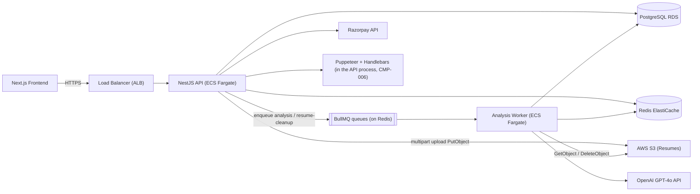
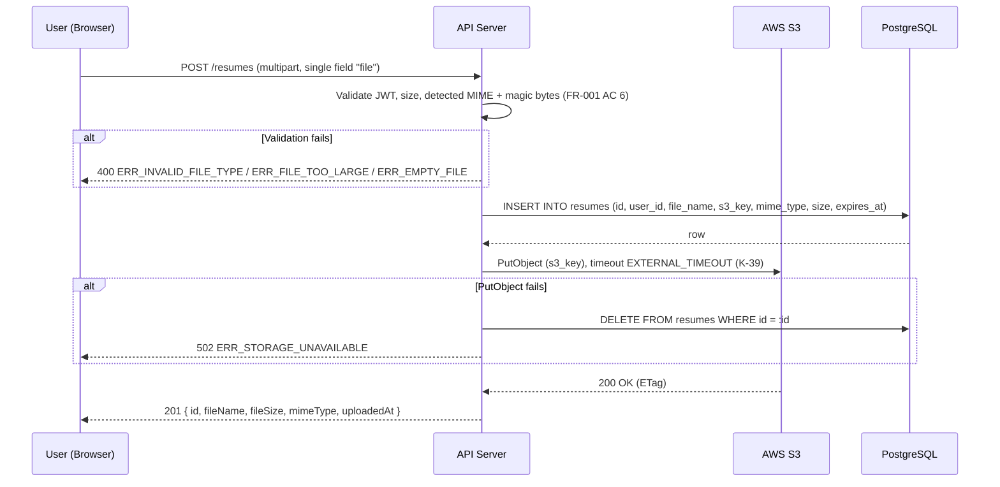
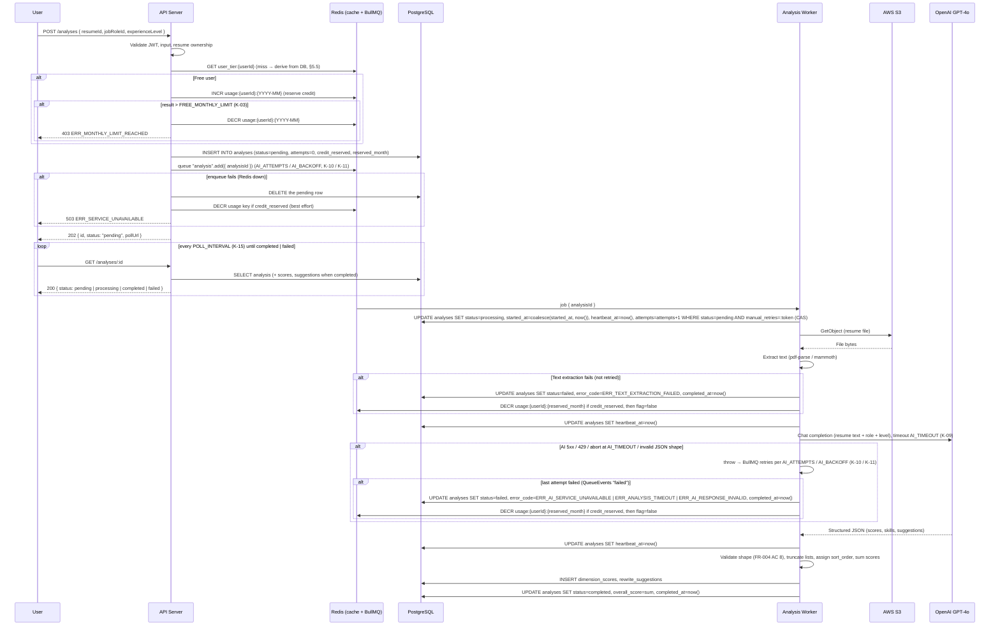
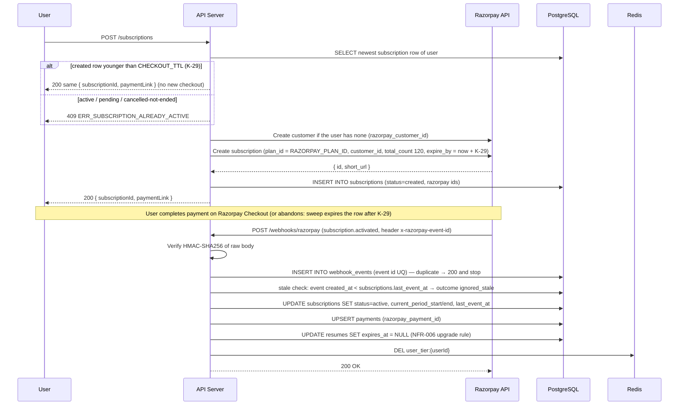
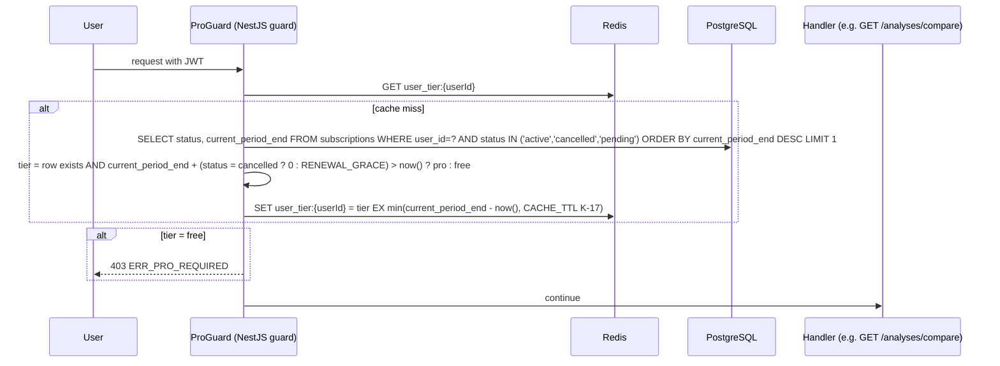
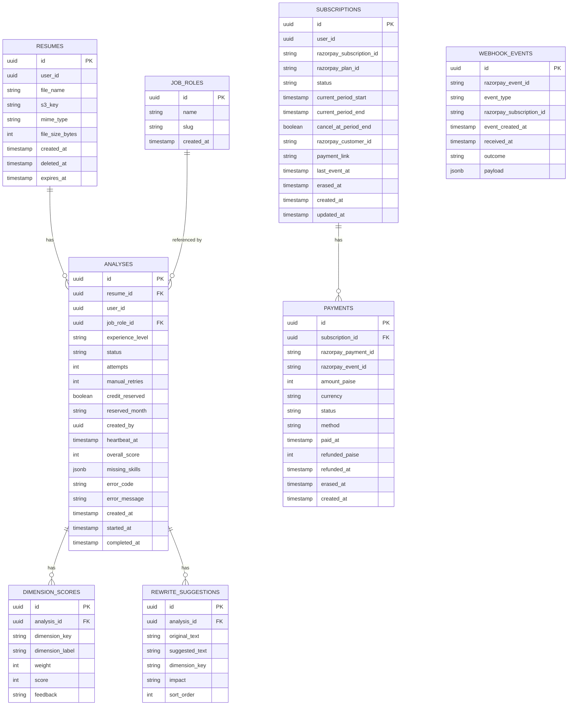

# SurfingBear Resume Optimizer — Specification

| Field | Value |
|---|---|
| Author | Sovan Kumar Bera |
| Version | v1.3 |
| Last updated | 2026-10-30 |
| Status | Improvement round (re-score Thu Nov 5) |

---

## 1. Company-wide common requirements

Rules every Divii / Hanriver project must follow. Each rule has an ID and must be specific enough to be checked.

| ID | Area | Rule | How it is checked |
|---|---|---|---|
| CR-001 | Authentication | This module does not manage sign-up or login. It receives a signed JWT issued by the main SurfingBear platform. The JWT is passed as a Bearer token in the `Authorization` header. The module validates the token signature using the platform's RS256 public key (fetched from `PLATFORM_JWKS_URL` at startup and cached for `JWKS_CACHE_TTL`, K-32). A valid token has `iss = PLATFORM_ISSUER`, `aud = "resume-optimizer"`, `exp` / `nbf` checked with `JWT_CLOCK_SKEW` (K-48), and contains `sub` (user UUID), `email`, `name`, and `roles[]`. On an unknown `kid` the JWKS is refetched once (at most once per minute); if the `kid` is still unknown the request gets `401`. An invalid or expired token returns `401`. | Automated test: send request with expired / tampered / missing token → 401. Code review: no login or registration endpoint exists. |
| CR-002 | Token handling | Access tokens carry a `JWT_TTL` (K-47) expiry set by the platform. The module does not refresh tokens; the platform handles refresh. Every authenticated endpoint reads the user from the token; no endpoint accepts a user ID in the request body as a substitute for the token. | Code review + integration test. |
| CR-003 | Roles and permissions | Two roles exist: `user` (default) and `admin`. The role is read from `roles[]` in the JWT. See permission matrix below. | Role-based guard on every endpoint; automated tests for each forbidden combination. |
| CR-004 | Logging | Logs are structured JSON, one object per line. Required fields: `timestamp` (ISO-8601 UTC), `level` (debug / info / warn / error), `requestId` (UUID, set via `X-Request-Id` header or auto-generated), `userId` (from JWT, or `anonymous`), `method`, `path`, `statusCode`, `durationMs`, `message`. Personal data (email, phone, resume content, file bytes) is **never** logged. File names are logged only as a hash (`SHA-256(filename)`). | Code review + log sample review + grep for PII patterns in CI. |
| CR-005 | Error handling | Every API error response uses exactly this shape: `{ "statusCode": <number>, "error": "<ERR_CODE>", "message": "<human-readable>", "requestId": "<uuid>" }`. Internal errors (5xx) never leak stack traces or internal paths; they return `"message": "Internal server error"`. 4xx errors return a specific message. | Automated test: trigger each error code and assert shape. |
| CR-006 | Security — secrets | All secrets (`DATABASE_URL`, `REDIS_URL`, `OPENAI_API_KEY`, `AWS_ACCESS_KEY_ID`, `AWS_SECRET_ACCESS_KEY`, `RAZORPAY_KEY_ID`, `RAZORPAY_KEY_SECRET`, `RAZORPAY_PLAN_ID`, `PLATFORM_JWKS_URL`, `WEBHOOK_SECRET`) are stored in environment variables, never in code or config files committed to git. `.env` is in `.gitignore`. | CI check: no secrets in code. |
| CR-007 | Security — CORS | CORS is enforced **in the API** (NestJS `enableCors`), not at the ALB (CMP-009 forwards `OPTIONS` untouched). Allowed origins: only those listed in `ALLOWED_ORIGINS` env var (comma-separated). Credentials: `true`. Allowed methods: `GET, POST, PUT, PATCH, DELETE, OPTIONS`. Allowed headers: `Authorization, Content-Type, X-Request-Id`. Exposed headers (readable by the browser): `X-Request-Id, Retry-After, Content-Disposition`. Max-age: `CORS_MAX_AGE` (K-49). | Automated test: request from unlisted origin → no CORS headers. |
| CR-008 | Security — input validation | Every request body, query parameter and path parameter is validated with `class-validator` decorators before the handler runs. Validation pipe is global with `whitelist: true` (strips unknown fields) and `forbidNonWhitelisted: true` (rejects unknown fields with 400). File uploads are validated for MIME type and size before being read. **Exception:** API-018 (Razorpay webhook) is excluded from the global pipe and reads the raw body (`rawBody: true` at bootstrap) so the signature can be verified; its payload is validated per event type inside the handler (§5.6). Pipe failures map to error codes per §6.1. | Code review: every DTO has decorators. CI: test with extra / missing fields. |
| CR-009 | Security — rate limiting | Global rate limit: `RATE_LIMIT_USER` (K-23) per user (keyed by `userId` from JWT). Unauthenticated requests: `RATE_LIMIT_ANON` (K-24) per IP. Analysis endpoints (`POST /analyses`, `POST /analyses/:id/retry`): `RATE_LIMIT_ANALYSIS` (K-25) per user, because each job costs money. `RATE_LIMIT_ANON` applies to every request that reaches the API **without a valid JWT** (missing, expired, bad signature) on any route except API-018/019 — it is checked before the 401 is produced, so credential-stuffing bursts are throttled per IP. Limits enforced via `@nestjs/throttler` backed by Redis. Exceeded → `429 Too Many Requests` with a `Retry-After` header (seconds until the window resets), which §1.3 ¶4 relies on. | Load test in staging. |
| CR-010 | Security — data at rest | All resume files in S3 are encrypted with AES-256 (SSE-S3). The PostgreSQL database uses volume-level encryption (AWS RDS encryption). Redis is configured with `requirepass` and TLS in staging/prod. | Infrastructure review + AWS config audit. |
| CR-011 | Security — data in transit | All traffic uses HTTPS (TLS 1.2+). Internal service-to-service calls (API ↔ S3, API ↔ OpenAI, API ↔ Redis) use TLS. HTTP requests are redirected to HTTPS via the load balancer. | SSL Labs scan ≥ A rating. |
| CR-012 | Privacy — DPDP Act | Resumes contain personal data (name, email, phone, address, work history). Under India's DPDP Act 2023: (a) resumes are processed only for the stated purpose (analysis); (b) users can request deletion of their data at any time via `DELETE /resumes/:id`; (c) deleted data is hard-deleted from S3 and the database within `ERASURE_SLA` (K-08) (FR-010 AC 4 guarantees it without depending on Redis); (d) data retention: free users' resumes are auto-deleted `RETENTION_DAYS` (K-07) after upload; Pro users' resumes are retained while the subscription is active and deleted `RETENTION_DAYS` after the subscription ends (owner of the rule: NFR-006 / CMP-008); (e) no resume data is shared with third parties except the AI provider (OpenAI) for analysis; the only other processor is Razorpay, which receives the user's `name` and `email` from the JWT to create the payment customer (never resume content); (f) the AI analysis prompt instructs the model not to store or learn from the data; (g) **full erasure** (FR-018, API-020): resumes and analyses are removed as in FR-010; `subscriptions`, `payments` and `webhook_events` are **financial records kept 7 years** (Indian tax retention) with `user_id` set to NULL, `user_hash = sha256(user_id)` and PII keys in stored payloads redacted, so they no longer identify the person; an `active`/`pending` subscription is cancelled at Razorpay immediately, without refund of the running period. | Annual DPDP compliance audit + automated retention job test. |
| CR-013 | i18n | All API responses are in English. All dates are stored as ISO-8601 UTC in the database and returned as ISO-8601 UTC in API responses. The frontend converts to the user's local timezone. Currency amounts are stored as integers in paise (1 ₹ = 100 paise) to avoid floating-point errors. Currency display format: `₹X.XX` (INR, 2 decimal places). | Code review: no hardcoded timezone offsets in backend. |
| CR-014 | Environments | Four environments: `local` (developer laptop, Docker Compose, mock OpenAI), `dev` (shared, real AWS, OpenAI sandbox key, seeded test data), `staging` (mirrors prod infra, production OpenAI key with low limits, used for QA and build test), `prod` (production). Env-specific config: `DATABASE_URL`, `REDIS_URL`, `OPENAI_API_KEY`, `S3_BUCKET`, `ALLOWED_ORIGINS`, `RAZORPAY_KEY_ID`, `RAZORPAY_KEY_SECRET`, `RAZORPAY_PLAN_ID` (the Resume Pro plan created once per environment in the Razorpay dashboard, `PRO_PRICE` K-20), `WEBHOOK_SECRET`, `PLATFORM_JWKS_URL`, `PLATFORM_ISSUER`, `PLATFORM_LOGIN_URL`, `API_PUBLIC_URL`, `AWS_REGION`, `PORT`, `PROCESS_ROLE`, `AI_PROVIDER`, `LOG_LEVEL`, `BULL_BOARD` (values per environment in §1.3). | Deploy pipeline enforces env-specific secrets via AWS Parameter Store. |
| CR-015 | Deployment | CI/CD via GitHub Actions. Pipeline: lint → test → build → deploy. Deployment to dev: auto on push to `develop`. Deployment to staging: auto on push to `release/*`. Deployment to prod: manual approval after staging QA passes. Rollback: re-deploy the previous Docker image tag. Zero-downtime deploys via rolling update (ECS Fargate, minimum healthy `ECS_MIN_HEALTHY`, K-58). Database migrations run before deploy via `typeorm migration:run` in a one-off task; the **job-role seed** (TBL-005) is migration `…-SeedJobRoles` with `INSERT … ON CONFLICT DO NOTHING`, so it is idempotent in every environment; dev's "seeded test data" is the same migration plus a `seed:dev` script that creates 5 sample resumes/analyses for the test accounts. **Worker health:** the Worker container exposes no HTTP port; its ECS health check is the command `node dist/health-worker.js`, which exits 0 only if the process can `PING` Redis and its BullMQ worker reports `isRunning()`, every 30 s. **Queue metric:** the API publishes the `analysis` queue's waiting count to CloudWatch (`ResumeOptimizer/QueueWaiting`) every 60 s from one instance (Redis `SET NX` lock); the Worker service scales out on `WORKER_SCALE_OUT_DEPTH` (K-52). | Deployment runbook + pipeline config. |

### 1.2 Roles and permissions

| Action | `user` | `admin` |
|---|---|---|
| Upload resume | ✅ | ✅ |
| Start analysis | ✅ (within tier limits) | ✅ (unlimited — `admin` bypasses the credit reservation, §5.5) |
| View own analyses | ✅ | ✅ |
| View all users' analyses | ❌ | ✅ (API-006 `userId` filter, API-007/008/011 any id) |
| Download own analysis PDF | ✅ | ✅ |
| Delete own resume | ✅ | ✅ |
| Delete any resume | ❌ | ✅ |
| Manage subscriptions (own) | ✅ | ✅ (own only — admins have no access to other users' subscriptions) |
| View subscription metrics — **Deprecated (v1.3)**: no endpoint in this module; admins use the Razorpay dashboard. Row kept for traceability, not renumbered. | — | — |
| View system health (`/api/v1/health`, API-019) | ✅ (unauthenticated; used by the ALB and uptime monitors) | ✅ |

### 1.3 Frontend contract and environments

The Next.js frontend is a separate repository (assumption A-04) but the backend cannot be built without knowing how it is reached, so the contract is fixed here.

**Auth hand-off and the 401 rule**
1. The user is signed in on the main SurfingBear platform. The frontend obtains the platform's RS256 JWT (CR-001) from the platform's own token endpoint and keeps it **in memory only** (never `localStorage`); the platform's session cookie does the remembering.
2. Every API call carries `Authorization: Bearer <JWT>`. The API never sets cookies and never redirects.
3. On any **401** from this API the frontend first asks the platform for a fresh token once; if that fails it redirects the browser to `PLATFORM_LOGIN_URL?return=<encoded current URL>` (the value is per environment, table below). A **403** is shown in place (`ERR_PRO_REQUIRED` → upgrade prompt, `ERR_FORBIDDEN` → "not allowed"), never a redirect.
4. `ERR_RATE_LIMITED` (429) is retried by the frontend after the `Retry-After` header the API always sends with a 429 (CR-009); `ERR_SERVICE_UNAVAILABLE` (503) shows a "try again in a moment" banner.
5. Polling (D-01): the frontend polls `pollUrl` every `POLL_INTERVAL` (K-15) and stops on a terminal status or when the tab is hidden (`visibilitychange`), resuming on focus.

**Hosting**: the frontend is deployed on AWS Amplify Hosting in the same AWS account (assumption A-10): one cloud, one IAM boundary, branch-based environments that mirror the API's (`develop` → dev, `release/*` → staging, `main` → prod).

**Per-environment configuration** (CR-014). Constants K-xx are identical in every environment; only the values below differ.

| Setting | local | dev | staging | prod |
|---|---|---|---|---|
| API base URL | `http://localhost:3000/api/v1` | `https://api-dev.surfingbear.com/api/v1` | `https://api-staging.surfingbear.com/api/v1` | `https://api.surfingbear.com/api/v1` |
| Frontend URL (= `ALLOWED_ORIGINS`) | `http://localhost:3001` | `https://app-dev.surfingbear.com` | `https://app-staging.surfingbear.com` | `https://app.surfingbear.com` |
| `PLATFORM_LOGIN_URL` | `http://localhost:4000/login` (platform mock) | `https://dev.surfingbear.com/login` | `https://staging.surfingbear.com/login` | `https://www.surfingbear.com/login` |
| `PLATFORM_JWKS_URL` | mock JWKS served by `docker-compose` | platform dev JWKS | platform staging JWKS | platform prod JWKS |
| `DATABASE_URL` | PostgreSQL 16 in Docker Compose | RDS `sb-resume-dev` (db.t4g.small) | RDS `sb-resume-staging` (db.t4g.medium) | RDS `sb-resume-prod` (db.r6g.large, Multi-AZ) |
| `REDIS_URL` | Redis 7 in Docker Compose | ElastiCache `sb-resume-dev` (cache.t4g.small) | ElastiCache `sb-resume-staging` (cache.t4g.medium, TLS + auth) | ElastiCache `sb-resume-prod` (cache.r6g.large, TLS + auth) |
| `S3_BUCKET` | `surfingbear-resumes-local` on MinIO (Compose) | `surfingbear-resumes-dev` | `surfingbear-resumes-staging` | `surfingbear-resumes-prod` |
| `OPENAI_API_KEY` | none — `AI_PROVIDER=mock` returns a fixed valid response | sandbox key, 50 req/day budget | production key, low budget | production key |
| Razorpay | test mode, `RAZORPAY_PLAN_ID` of the test plan | test mode | test mode | **live mode** |
| ECS tasks API (min / max) | n/a (`npm run start:dev`) | 1 / 2 | 2 / 4 | 2 / 8 (NFR-004) |
| ECS tasks Worker (min / max) | n/a (`npm run start:worker`) | 1 / 2 | 2 / 5 | 2 / 5 (CMP-010) |
| `LOG_LEVEL` | `debug` | `debug` | `info` | `info` |
| `AWS_REGION` | `ap-south-1` (MinIO ignores it) | `ap-south-1` | `ap-south-1` | `ap-south-1` |
| `PORT` (API container) | 3000 | 3000 | 3000 | 3000 |
| `API_PUBLIC_URL` (for absolute `pollUrl`, §6.1) | = API base URL above | = API base URL | = API base URL | = API base URL |
| `PROCESS_ROLE` | `api` or `worker` per process | `api` / `worker` per ECS service | same | same |
| `AI_PROVIDER` | `mock` | `openai` | `openai` | `openai` |
| `BULL_BOARD` | `on` | `on` | `on` | `off` |
| Bull Board UI | served by the **API** process at `/admin/queues` (outside `/api/v1`), guarded by `JwtAuthGuard` + `RolesGuard(admin)` on the HTML and its XHR; the browser gets the JWT from the platform's token endpoint like any page (§1.3 ¶1) | same | same | disabled |

Secrets come from AWS Parameter Store per environment (CR-015); `.env.example` in the repo lists every variable with a local default and no real value. **Local JWTs:** `npm run token -- --sub <uuid> --roles user,admin` signs an RS256 token with the key pair in `docker/jwks/` (generated once by `npm run jwks:init`), and the Compose `jwks` service serves the matching JWKS at `PLATFORM_JWKS_URL`; `PLATFORM_ISSUER` is `http://localhost:4000` locally.

---

## 2. Coding conventions

### 2.1 Naming

| Item | Convention | Example |
|---|---|---|
| Classes | PascalCase | `AnalysisService`, `ResumeController` |
| Interfaces | PascalCase, prefixed with `I` only for service interfaces | `IAnalysisResult`, `ResumeDto` |
| Variables / functions | camelCase | `uploadResume`, `analysisScore` |
| Constants | UPPER_SNAKE_CASE, names exactly as in the §3.4 constants table | `MAX_FILE_SIZE`, `FREE_MONTHLY_LIMIT` |
| DB tables | snake_case, plural | `resumes`, `analyses`, `rewrite_suggestions` |
| DB columns | snake_case | `created_at`, `user_id`, `overall_score` |
| API paths | kebab-case, plural nouns | `/resumes`, `/analyses`, `/subscriptions` |
| Enum values (DB) | snake_case | `pending`, `completed`, `failed` |
| Enum values (TS) | PascalCase | `AnalysisStatus.Completed` |
| DTOs | PascalCase + suffix | `CreateAnalysisDto`, `ResumeResponseDto` |
| Entity | PascalCase + `Entity` suffix | `ResumeEntity`, `AnalysisEntity` |
| Migration | timestamp + description | `1729555200000-CreateResumesTable` |

### 2.2 Folder / module structure

```
src/
├── main.ts                          # Bootstrap, global pipes, guards
├── app.module.ts                    # Root module
├── common/
│   ├── decorators/                  # @CurrentUser, @Roles
│   ├── filters/                     # GlobalExceptionFilter
│   ├── guards/                      # JwtAuthGuard, RolesGuard, ThrottlerGuard, ProGuard (§5.5)
│   ├── interceptors/                # LoggingInterceptor, RequestIdInterceptor (sets X-Request-Id; responses are never wrapped, §6.1)
│   ├── pipes/                       # ParseUuidPipe
│   ├── dto/                         # PaginationQueryDto, PaginatedResponseDto
│   └── constants.ts                 # every K-xx constant from §3.4, exported under its table name
├── config/
│   └── configuration.ts             # ConfigModule factory
├── auth/
│   ├── auth.module.ts
│   ├── jwt.strategy.ts              # Validates platform JWT
│   └── jwt-auth.guard.ts
├── resumes/
│   ├── resumes.module.ts
│   ├── resumes.controller.ts
│   ├── resumes.service.ts
│   ├── dto/
│   │   ├── upload-resume.dto.ts
│   │   └── resume-response.dto.ts
│   ├── entities/
│   │   └── resume.entity.ts
│   └── resumes.repository.ts
├── analyses/
│   ├── analyses.module.ts
│   ├── analyses.controller.ts
│   ├── analyses.service.ts
│   ├── dto/
│   │   ├── create-analysis.dto.ts
│   │   ├── analysis-response.dto.ts
│   │   └── analysis-list-query.dto.ts
│   ├── entities/
│   │   ├── analysis.entity.ts
│   │   ├── dimension-score.entity.ts
│   │   └── rewrite-suggestion.entity.ts
│   ├── analysis.processor.ts           # BullMQ @Processor('analysis') — Worker only (CMP-010)
│   └── analyses.repository.ts
├── job-roles/
│   ├── job-roles.module.ts
│   ├── job-roles.controller.ts         # API-012, API-013
│   └── job-roles.service.ts
├── ai/
│   ├── ai.module.ts
│   ├── ai.service.ts                # OpenAI GPT-4o integration
│   └── prompts/
│       └── resume-analysis.prompt.ts
├── storage/
│   ├── storage.module.ts
│   └── storage.service.ts           # S3 upload/download/delete
├── pdf/
│   ├── pdf.module.ts
│   ├── pdf.service.ts               # Puppeteer HTML→PDF
│   └── templates/
│       └── analysis-report.hbs      # Handlebars template
├── subscriptions/                   # Round 2
│   ├── subscriptions.module.ts
│   ├── subscriptions.controller.ts
│   ├── subscriptions.service.ts
│   ├── dto/
│   │   ├── create-subscription.dto.ts
│   │   └── subscription-response.dto.ts
│   ├── entities/
│   │   ├── subscription.entity.ts
│   │   └── payment.entity.ts
│   ├── entitlement.service.ts          # getTier(userId) — §5.5
│   └── razorpay/
│       ├── razorpay.service.ts
│       ├── razorpay-webhook.controller.ts  # API-018
│       └── webhook-event.entity.ts         # TBL-008
├── scheduler/                       # Worker only (CMP-008)
│   ├── scheduler.module.ts
│   ├── retention.service.ts         # daily: expires_at + resume deletion (NFR-006)
│   ├── subscription-sweep.service.ts # daily: expired checkouts, grace, period end (§5.6)
│   └── stalled-jobs.service.ts      # every minute: processing rows past JOB_STALL_TIMEOUT (CMP-010)
└── health/
    ├── health.module.ts
    └── health.controller.ts
```

Frontend (Next.js) is a separate repository; this spec covers the backend and fixes the frontend contract in §1.3 (auth hand-off, 401 rule, polling, hosting).

### 2.3 Branching and commits

- Main branches: `main` (production), `develop` (integration), `release/vX.Y.Z` (release candidate).
- Feature branches: `feature/FR-001-upload-resume` (one feature per branch).
- Fix branches: `fix/ERR-012-ai-timeout-handling` (branch name carries the error or requirement ID it addresses).
- Commit format: `<type>(<scope>): <message>` where type is `feat`, `fix`, `refactor`, `test`, `docs`, `chore`, `ci`. Scope is the module name (e.g. `resumes`, `analyses`, `ai`). Message is imperative mood, lowercase, max 72 characters.
- Examples: `feat(resumes): add upload endpoint with S3 integration`, `fix(ai): handle OpenAI timeout with retry`.

### 2.4 Code review rules

- Every PR requires at least 1 approval before merge.
- PR must pass CI (lint + test + build).
- PR description must reference the FR/NFR IDs it implements.
- Squash merge to `develop`; merge commit to `main`.

### 2.5 Lint and format

| Tool | Config file | When it runs |
|---|---|---|
| ESLint | `.eslintrc.js` — extends `@typescript-eslint/recommended`, `prettier` | Pre-commit hook (Husky) + CI |
| Prettier | `.prettierrc` — `printWidth: 100`, `singleQuote: true`, `trailingComma: 'all'`, `semi: true`, `tabWidth: 2` | Pre-commit hook (Husky) + CI |
| Husky | `.husky/pre-commit` — runs `lint-staged` | Every commit |
| lint-staged | `package.json` — `"*.ts": ["eslint --fix", "prettier --write"]` | Pre-commit |
| TypeScript | `tsconfig.json` — `strict: true`, `noImplicitAny: true`, `strictNullChecks: true` | Build + CI |

---

## 3. Requirements definition

### 3.1 Functional requirements

| ID | Title | Description | Priority | Acceptance criteria |
|---|---|---|---|---|
| FR-001 | Upload resume | A logged-in user uploads a resume file. The system accepts PDF and DOCX formats only, with a maximum size of `MAX_FILE_SIZE` (K-01). The file is stored in S3 and a record is created in the database. | Must | 1. Only `.pdf` and `.docx` MIME types are accepted; any other type returns `ERR_INVALID_FILE_TYPE` (400). 2. Files larger than `MAX_FILE_SIZE` (K-01) return `ERR_FILE_TOO_LARGE` (400). 3. Files with 0 bytes return `ERR_EMPTY_FILE` (400). 4. After upload, the response contains `id` (UUID), `fileName`, `fileSize`, `mimeType`, `uploadedAt` (API-001). 5. The file is stored in S3 at key `resumes/{userId}/{resumeId}/{safeName}` where `safeName` = original name NFC-normalised, path separators and control characters removed, whitespace collapsed to `-`, truncated to 100 characters keeping the extension; the original name is kept untouched in `resumes.file_name` (an original name longer than 255 characters is rejected with `ERR_VALIDATION`, field `file.originalname`). **Check order** (first failure wins): (1) whole request above `MAX_REQUEST_BODY` → 413 before the handler; (2) no `file` field or more than one → `ERR_VALIDATION`; (3) 0 bytes → `ERR_EMPTY_FILE`; (4) above `MAX_FILE_SIZE` → `ERR_FILE_TOO_LARGE` (multer `limits.fileSize`, stream aborted); (5) declared MIME not PDF/DOCX → `ERR_INVALID_FILE_TYPE`; (6) magic bytes / DOCX deep check → `ERR_INVALID_FILE_TYPE`; (7) name length → `ERR_VALIDATION`. 6. The stored `mime_type` is the **detected** type, never the declared one: PDF = bytes `%PDF-`; DOCX = ZIP signature `PK\x03\x04` **and** a `[Content_Types].xml` entry plus a `word/document.xml` entry in the central directory (plain ZIPs fail). A declared/detected mismatch or an undetectable file returns `ERR_INVALID_FILE_TYPE`. 7. No malware scan is performed in v1 (assumption A-07): files are never executed or served to other users, and only extracted text reaches the AI. |
| FR-002 | Select target job role | When starting an analysis, the user selects a target job role from a predefined list (e.g. "Software Engineer", "Data Analyst", "Product Manager", "DevOps Engineer", "UI/UX Designer", "Project Manager", "Business Analyst", "QA Engineer", "System Administrator", "Marketing Manager"). Admins can add roles via `POST /job-roles`. | Must | 1. The list is returned by `GET /job-roles`. 2. Selecting a role not in the list returns `ERR_INVALID_JOB_ROLE` (400). 3. The selected role is stored with the analysis. |
| FR-003 | Select experience level | When starting an analysis, the user selects an experience level: `entry` (0–2 years), `mid` (3–5 years), `senior` (6–10 years), `lead` (10+ years). | Must | 1. Only the four values are accepted; anything else returns `ERR_INVALID_EXPERIENCE_LEVEL` (400). 2. The level is stored with the analysis. |
| FR-004 | AI resume analysis | **Analysis is asynchronous (decision D-01, §4.6).** `POST /analyses` validates the request, reserves the user's credit, creates the analysis row with status `pending`, enqueues a job on the `analysis` queue (CMP-010) and returns `202 Accepted` immediately. The Analysis Worker picks up the job, sets status `processing`, extracts the resume text, sends text + job role + experience level to OpenAI GPT-4o and stores the structured result (overall score 0–100, per-dimension scores, missing skills, rewrite suggestions). The client polls `GET /analyses/:id` until status is `completed` or `failed`. | Must | 1. `POST /analyses` responds `202` with `status: "pending"` within `ENQUEUE_P95` (K-13); the job reaches `completed` or `failed` within `ANALYSIS_P95` (K-12) of enqueue. The client polls `GET /analyses/:id` every `POLL_INTERVAL` (K-15) and stops on a terminal status. 2. The overall score is an integer 0–100. 3. The seven dimensions of the dimension catalogue (§3.4, K-40) are scored; each dimension score is an integer from 0 to that dimension's weight. 4. `overall_score` is computed by the Worker as the plain sum of the seven dimension scores (weights total 100, so the sum is already 0–100); the AI's own overall figure, if any, is ignored. 5. If the AI call fails (timeout at `AI_TIMEOUT`, HTTP 429, 5xx, network error) the Worker throws and BullMQ retries per `AI_ATTEMPTS` / `AI_BACKOFF` (K-10 / K-11); after the last attempt the row becomes `failed` with `error_code` = `ERR_AI_SERVICE_UNAVAILABLE` (5xx / 429 / network) or `ERR_ANALYSIS_TIMEOUT` (abort at K-09), and the reserved credit is released (FR-007 AC 2). Text extraction failure is **not** retried: the Worker throws BullMQ's `UnrecoverableError` so no attempt is left, and the row becomes `failed` with `ERR_TEXT_EXTRACTION_FAILED`. 6. The resume text is extracted inside the worker using `pdf-parse` (PDF) or `mammoth` (DOCX) before sending to the AI; fewer than `MIN_RESUME_TEXT_CHARS` (K-42) characters (image-only or empty document) counts as an extraction failure; more than `MAX_RESUME_TEXT_CHARS` (K-43) is cut at a line break with the marker `[… truncated]` and logged at `info`. A `GetObject` failure is retried like an AI failure and ends as `ERR_STORAGE_UNAVAILABLE` on the resource; `NoSuchKey` means the resume was deleted meanwhile → the job ends as `skipped` (FR-010 AC 5). 7. Exactly one worker processes a given job at a time (BullMQ lock); a job is never processed twice concurrently. 8. **AI response validation** (CMP-005): the JSON must contain exactly the 7 dimension keys of K-40, each with an integer `score` in `0..weight` and a non-empty `feedback`; `missingSkills` and `suggestions` arrays with the field shapes of FR-005 / FR-006. Missing keys, wrong types or out-of-range scores → the attempt is treated like an AI failure (retry per K-10; on the last attempt `failed` with `ERR_AI_RESPONSE_INVALID`). Over-long lists are **truncated**, not rejected: skills to `MAX_MISSING_SKILLS` (K-06), suggestions to `MAX_SUGGESTIONS` (K-05) after ordering by impact; text fields are cut to their max length: feedback K-44, suggestion texts K-45, skill name / reason K-46. |
| FR-005 | Missing skills list | The analysis result includes a list of skills that are expected for the target role and experience level but are missing from the resume. Each skill has a name and a brief explanation of why it matters for the role. | Must | 1. At least 0 and at most `MAX_MISSING_SKILLS` (K-06) missing skills are returned. 2. Each skill has `name` and `reason`, 1 to `SKILL_NAME_MAX_CHARS` / `SKILL_REASON_MAX_CHARS` characters (K-46). 3. Skills are ordered by relevance (most important first, as ranked by the AI). |
| FR-006 | Rewrite suggestions | The analysis result includes rewrite suggestions for weak lines in the resume. Each suggestion has the original line, the suggested rewrite, the dimension it improves, and the expected score impact. | Must | 1. Each suggestion has `originalText` and `suggestedText` (1 to `SUGGESTION_TEXT_MAX_CHARS` each, K-45, cut by the Worker if longer), `dimension` (one of the 7 keys of K-40), `impact` (`low` / `medium` / `high`). 2. Free users see only the first `FREE_VISIBLE_SUGGESTIONS` (K-04) suggestions by `sort_order` (TBL-004). Pro users see all, at most `MAX_SUGGESTIONS` (K-05). 3. The response includes `totalSuggestions` count even for free users, so they know how many they are missing. |
| FR-007 | Free tier usage limits | Free users can run at most `FREE_MONTHLY_LIMIT` (K-03) analyses per calendar month (UTC). The count resets on the 1st of each month at 00:00 UTC. If the limit is reached, `POST /analyses` returns `ERR_MONTHLY_LIMIT_REACHED` (403). | Must | 1. After `FREE_MONTHLY_LIMIT` analyses in a month, the next attempt returns 403 with `ERR_MONTHLY_LIMIT_REACHED`. 2. Because analysis is asynchronous, the credit is **reserved at enqueue** (`INCR usage:{userId}:{YYYY-MM}` in Redis, atomic) so two concurrent requests cannot both pass the check, and the row records it (`analyses.credit_reserved = true`, TBL-002). It is **released exactly once** (`DECR` on the key of the month in which it was reserved, flag set to `false`) by whichever component moves the row to `failed` (Worker, stalled-job sweep) or deletes it while unfinished (API-004). A manual retry (API-010) reserves a credit again, so one successful analysis always costs exactly one credit, counted in the month of the (re)enqueue. Pending, processing and completed analyses therefore count; failed ones do not. 3. `GET /analyses/usage` returns `{ "used": <n>, "limit": 3, "resetsAt": "<ISO-8601>" }`. 4. The check uses the tier of the **analysis owner** (the resume's `user_id`): Pro owners skip it. An `admin` caller never reserves a credit — for their own resumes or anyone else's (`credit_reserved = false`, `created_by` = the admin); admin-initiated analyses therefore never count against the owner's limit. 5. The Redis key expires `USAGE_KEY_TTL` (K-19) after the month starts; if Redis is unavailable the API falls back to `SELECT count(*) FROM analyses WHERE user_id = ? AND credit_reserved = true AND reserved_month = <YYYY-MM>`, which by construction equals the counter. If the two drift (Redis was down during a release, FR-007 AC 2 "best effort"), the daily sweep (CMP-008 c) rebuilds the current month's key from that query for every user with an analysis in the last 48 h — the DB flag is the source of truth, Redis is its cache. |
| FR-008 | Download analysis as PDF | A user can download any of their own completed analyses as a PDF. The PDF contains: overall score, dimension scores as a radar chart, missing skills, rewrite suggestions (all for Pro, the first `FREE_VISIBLE_SUGGESTIONS` for free, K-04), and a timestamp. | Must | 1. `GET /analyses/:id/pdf` returns `Content-Type: application/pdf`. 2. The PDF file size is below `PDF_MAX_SIZE` (K-26); K-26 is a target, not a gate — a larger file is still served and logged at `warn` with its size. 3. If the analysis status is not `completed`, the endpoint returns `ERR_ANALYSIS_NOT_READY` (400). 4. The PDF includes the SurfingBear logo (`assets/logo.svg` committed in this repo from the brand kit; if the file is missing at build time the template renders the text wordmark "SurfingBear" and CI fails the build with a warning), embedded inline, the analysis date, and the **requester's** `name` from the JWT when the requester is the owner; when an admin downloads another user's PDF the header shows `User <first 8 chars of user_id>` because names are not stored in this module (A-01). 5. The radar chart is inline SVG produced by the Handlebars template from the 7 dimension scores — no chart library, no network calls during rendering. |
| FR-009 | View analysis history | A user can view a list of their past analyses, paginated, sorted by creation date descending. Each list item shows: overall score, job role, experience level, status, and created date. | Should | 1. `GET /analyses` returns a paginated list. 2. Page size: default `PAGE_DEFAULT` (K-21), max `PAGE_MAX` (K-22). 3. Filterable by `status` (pending, processing, completed, failed) and `jobRoleId`. 4. Each item includes `id`, `resumeId`, `jobRole`, `experienceLevel`, `overallScore`, `status`, `createdAt`. |
| FR-010 | Delete resume and associated data | A user can delete their own resume. Deleting a resume also deletes the S3 file and all associated analyses, dimension scores, and rewrite suggestions. This supports the DPDP Act right to erasure. | Must | 1. `DELETE /resumes/:id` returns 204. 2. In one DB transaction the API releases the credit of every `pending`/`processing` analysis of the resume (FR-007 AC 2), hard-deletes those analyses (cascade to scores and suggestions) and sets `resumes.deleted_at = now()` (soft delete, TBL-001); every read filters `deleted_at IS NULL`, so the resume and its analyses are gone from the API immediately. 3. After commit the API enqueues a `resume-cleanup` job (CMP-010, `CLEANUP_ATTEMPTS` / `CLEANUP_BACKOFF`, K-33) that calls S3 `DeleteObject` and then hard-deletes the `resumes` row. 4. **Guarantee within `ERASURE_SLA` (K-08):** if the enqueue fails or every job attempt fails, the retention sweep (CMP-008, daily) picks up any row with `deleted_at < now()`, deletes the object and the row itself; no path depends on Redis being up. 5. A Worker that loads an `analysis` job whose row no longer exists ends the job as completed with result `skipped`; nothing is written. 6. Attempting to access a deleted resume or its analyses returns 404. |
| FR-011 | Resume Pro subscription | A user can subscribe to Resume Pro for `PRO_PRICE` (K-20) via Razorpay. Pro benefits: unlimited analyses, all rewrite suggestions visible, analysis history with score comparison. The subscription auto-renews monthly. Users can cancel anytime; Pro access continues until the end of the paid period. Free users are unchanged. | Must | 1. `POST /subscriptions` creates a Razorpay subscription and returns the `subscriptionId` and `paymentLink`. 2. After successful payment (webhook), the user's derived `tier` (§5.5: computed from TBL-006, cached in Redis `user_tier:{userId}`) becomes `pro`. 3. Pro users bypass the `FREE_MONTHLY_LIMIT` check (K-03). 4. Pro users see all rewrite suggestions (not just the first `FREE_VISIBLE_SUGGESTIONS`, K-04). 5. Cancellation via `POST /subscriptions/:id/cancel` calls Razorpay (`cancel_at_cycle_end = 1`) and sets the local row to `status = 'cancelled'`, `cancel_at_period_end = true` in the same request; Pro access remains until `currentPeriodEnd` (§5.6). 6. After `currentPeriodEnd` the tier reverts to `free` automatically (the derivation rule compares `current_period_end` to `now()`; the daily sweep in CMP-008 marks the row `expired`). A failed renewal keeps Pro for `RENEWAL_GRACE` (K-28) while Razorpay retries (status `pending`); `halted` ends it at once. 7. Pro-only endpoints (`GET /analyses/compare`) are protected by `ProGuard` and return `ERR_PRO_REQUIRED` (403) for free users. |
| FR-012 | Razorpay payment integration | The system integrates with Razorpay Subscriptions API. Payment lifecycle: create subscription → user pays on Razorpay checkout → webhook confirms payment → activate Pro. Razorpay webhooks are verified using the `WEBHOOK_SECRET`. | Must | 1. Webhook signature is verified with HMAC-SHA256 of the **raw body** and `WEBHOOK_SECRET` against the `X-Razorpay-Signature` header; invalid → 400 `ERR_INVALID_WEBHOOK_SIGNATURE`, nothing stored. 2. Every delivery is recorded in TBL-008 `webhook_events` keyed by the `x-razorpay-event-id` header (unique per event per Razorpay docs); a duplicate id is answered 200 without re-applying (idempotency covers **all** event types, not only payments). 3. Events are applied per the table in §5.6: `subscription.authenticated`, `.activated`, `.charged`, `.pending`, `.halted`, `.cancelled`, `.completed`, `refund.processed`; every other type (`subscription.updated/paused/resumed`, `payment.*`, `refund.created`, …) is stored with outcome `ignored_unhandled` and answered 200. 4. **Ordering:** Razorpay does not guarantee order. Each event carries `created_at`; an event older than the subscription's `last_event_at` is stored as `ignored_stale` and not applied, except that its payment entity is still upserted (payments are facts, not state). `current_period_end` only ever moves forward (`GREATEST(current, payload.current_end)`). 5. Payment records are upserted by `razorpay_payment_id` with `amount_paise`, `status`, `method`, `paid_at`; the first payment arrives in both `activated` and `charged`, which is why it is an upsert, never two inserts. 6. A webhook for an unknown `razorpay_subscription_id` is stored with outcome `unknown_subscription`, logged at `warn`, answered 200. 7. The handler finishes in < 5 s and does no outbound calls; Razorpay re-delivers on non-2xx, so a DB failure is answered 500 on purpose to get the retry. |
| FR-013 | Subscription management | A user can view their subscription status, payment history, and cancel their subscription. | Should | 1. `GET /subscriptions/me` returns current subscription or `null`. 2. `GET /subscriptions/me/payments` returns payment history, paginated. 3. `POST /subscriptions/:id/cancel` cancels at period end (§5.6). 4. Re-subscribing is possible only once no row is in `created` (fresh, < K-29), `active`, `pending` or `cancelled`-before-period-end state; until then API-014 returns the existing checkout (fresh `created`) or 409. Un-cancelling a cancelled subscription is **not supported** in v1 (assumption A-08): the user re-subscribes after the period ends and a new row is created. |
| FR-014 | Score comparison | Pro users can compare scores across their analysis history. The comparison shows dimension scores between any two selected analyses side by side. | Should | 1. `GET /analyses/compare?ids=<id1>,<id2>` returns both analyses' dimension scores side by side. 2. Only completed analyses can be compared. 3. Maximum 2 analyses per comparison request. 4. Only the owner of both analyses, or an admin, can compare them; an analysis owned by someone else is answered 404 (§6.1 ownership rule). 5. The endpoint is Pro-gated: a free user (tier per §5.5) receives `ERR_PRO_REQUIRED` (403) before any analysis lookup happens. |
| FR-015 | List job roles | Any authenticated user can fetch the list of available job roles. | Must | 1. `GET /job-roles` returns `[{ "id": "<uuid>", "name": "<string>", "slug": "<string>" }]`. 2. Results are cached in Redis for `CACHE_TTL` (K-17). |
| FR-016 | Admin: add job role | An admin can add a new job role. | Could | 1. `POST /job-roles` with `{ "name": "..." }` creates a new role. Slug is auto-generated from name. 2. A name that already exists case-insensitively after trimming, or whose generated slug collides with an existing slug, returns `ERR_DUPLICATE_JOB_ROLE` (409). 3. Slug = lowercase, non-alphanumerics collapsed to single `-`, trimmed of `-`, max 100 chars; a name that yields an empty slug (symbols only) is rejected with `ERR_VALIDATION` (field `name`). |
| FR-018 | Erase a user's data (DPDP request) | The platform (or an admin on a user's written request) erases everything this module holds about a user: resumes, analyses, cached tier and usage counters; financial records are pseudonymised, not deleted (CR-012 g). | Must | 1. `DELETE /users/:userId/data` (API-020, admin only) returns 202 and is idempotent. 2. Every live resume of the user is processed exactly like FR-010 (soft delete, cleanup job, sweep guarantee within `ERASURE_SLA` K-08). 3. Every live subscription row (`LIVE_STATUSES`, §5.6) is cancelled at Razorpay immediately (`cancel_at_cycle_end = 0`, which also kills an open `created` checkout) and set to `expired` with `current_period_end = LEAST(current_period_end, now())`. 4. Financial rows are pseudonymised, not deleted (CR-012 g): `subscriptions` of the user get `user_id = NULL`, `user_hash = sha256(user_id)`, `erased_at = now()`; their `payments` (via `subscription_id`) get `erased_at`; their `webhook_events` (via `razorpay_subscription_id` of those subscriptions) get `erased_at` and the PII keys inside `payload` (`payment.entity.email`, `payment.entity.contact`, `customer_*`, `subscription.entity.notes`) replaced by `"[erased]"`. None of these rows is returned by any API again. 5. Redis keys `user_tier:{userId}` and `usage:{userId}:*` are deleted. 6. The platform owns the account itself; this endpoint does not touch it. |
| FR-017 | Retry failed analysis | A user can retry a failed analysis without uploading the resume again and without paying twice (the failed attempt's credit was released; the retry reserves one). | Should | 1. `POST /analyses/:id/retry` re-enqueues the same analysis row on the `analysis` queue (CMP-010) with job id `{analysisId}:{manual_retries + 1}`: when the **owner** is free-tier and the caller is not admin it first reserves a credit exactly like API-005 (FR-007 AC 2 and AC 4; may answer `ERR_MONTHLY_LIMIT_REACHED`), then sets status `pending`, clears `error_code` / `error_message` / `started_at` / `completed_at` / `heartbeat_at`, increments `manual_retries` and returns `202`. `attempts` is owned by the Worker and not touched here. Because the failed attempt's credit was released, the user never pays twice for one successful analysis. 2. Only analyses with status `failed` can be retried; anything else returns `ERR_ANALYSIS_NOT_FAILED` (400). 3. At most `MAX_MANUAL_RETRIES` (K-31) per analysis, and never when `error_code` is `ERR_TEXT_EXTRACTION_FAILED` (the same file would fail again; the user re-uploads instead): both return `ERR_RETRY_LIMIT_REACHED` (400). |

### 3.2 Non-functional requirements

| ID | Category | Requirement | Measurable target | How it is verified |
|---|---|---|---|---|
| NFR-001 | Performance — analysis latency | AI resume analysis completes within acceptable time. | End-to-end p95 < `ANALYSIS_P95` (K-12), p99 < 2 × K-12, measured from job enqueue (`analyses.created_at`) to terminal status (`analyses.completed_at`). Queue wait alone (`started_at - created_at`): p95 < `QUEUE_WAIT_P95` (K-14) at `MAX_CONCURRENT_ANALYSES` (K-35) in flight. `POST /analyses` itself: p95 < `ENQUEUE_P95` (K-13). | Load test with K-35 concurrent analyses in staging; measure via APM (Datadog) + BullMQ job timings. |
| NFR-002 | Performance — API latency | Non-analysis endpoints respond quickly. | p95 < `API_P95` (K-57) server time for every JSON endpoint (API-001 excluded: its time is dominated by the upload itself; its server-side processing after the last byte is p95 < `UPLOAD_PROCESSING_P95`, K-57). PDF generation (API-008): p95 < `PDF_P95` (K-57) with Puppeteer warm (one browser instance per API task, pages pooled). | Load test + APM, server-side timing from `durationMs` in the logs (CR-004). |
| NFR-003 | Availability | The service is available for users. | 99.5% uptime per month (allows ~3.6 h downtime/month). Measured on `GET /api/v1/health` (API-019): any response other than 200 counts as downtime. | Uptime monitoring (UptimeRobot or Datadog Synthetics), 1-minute interval. |
| NFR-004 | Scalability | The service handles concurrent users. | `MAX_CONCURRENT_USERS` (K-36) and `MAX_CONCURRENT_ANALYSES` (K-35). Achieved via horizontal scaling (ECS auto-scaling: min 2, max 8 API tasks, target CPU `ECS_TARGET_CPU`, K-58; Worker scaling per CMP-010). | Load test with k6 in staging. |
| NFR-005 | Security — data protection | Personal data in resumes is protected. | Encryption at rest (AES-256) and in transit (TLS 1.2+). No PII in logs (CR-004). The resume file and its full extracted text are **never** stored in the database — only the S3 key plus, per rewrite suggestion, the single line being rewritten (TBL-004 `original_text`, ≤ 1,000 chars). That line is personal data: it is deleted with the resume (FR-010 / NFR-006), never logged, and never returned to anyone but the owner or an admin. | Security audit + pen test annually. |
| NFR-006 | Privacy — data retention | User data is not retained longer than necessary. | **Single owner of `resumes.expires_at`: three writers, one rule.** (1) Upload (Flow 1): `expires_at = created_at + RETENTION_DAYS` (K-07) when the uploader's tier is `free`; `NULL` when `pro` or admin. (2) Upgrade (API-018 `subscription.activated`): `UPDATE resumes SET expires_at = NULL WHERE user_id = ? AND deleted_at IS NULL`. (3) Downgrade (CMP-008 sweep, the run in which the user's last Pro row stops granting Pro): `UPDATE resumes SET expires_at = current_period_end + RETENTION_DAYS WHERE user_id = ? AND expires_at IS NULL AND deleted_at IS NULL`. The daily sweep at `SWEEP_TIME` (K-27) then soft-deletes every row with `expires_at < now()` and finishes it exactly like FR-010 (in-flight credits released, analyses hard-deleted, S3 object deleted, row hard-deleted). **Analysis history is not kept beyond the file**: an expired resume takes its analyses with it (same as a manual delete). No S3 lifecycle rule exists; S3 objects are deleted only by this module. | Automated tests: (a) free upload has `expires_at` = created + K-07; (b) activation webhook nulls it; (c) downgrade sweep sets period_end + K-07; (d) a resume with past `expires_at` is gone (DB + S3) after one sweep. |
| NFR-007 | Observability | The team can monitor and debug the system. | Structured JSON logs (see CR-004). Health endpoint `GET /api/v1/health` (API-019) returns 200 `{ "status": "ok", "services": { "database": "ok", "redis": "ok", "s3": "ok" } }` or 503 with `status: degraded`. Request traces via `X-Request-Id` header propagated to all internal calls and logs. | Dashboard in Datadog/CloudWatch. |
| NFR-008 | Reliability — AI failure | The system degrades gracefully when OpenAI is down. | If OpenAI returns 5xx or times out (`AI_TIMEOUT`, K-09), the worker job retries per `AI_ATTEMPTS` / `AI_BACKOFF` (K-10 / K-11). If the retry fails, the analysis status is set to `failed` with `error_code = ERR_AI_SERVICE_UNAVAILABLE` (or `ERR_ANALYSIS_TIMEOUT` / `ERR_AI_RESPONSE_INVALID`, FR-004 AC 5/8), the reserved credit is released, and the client sees the failure on its next poll of `GET /analyses/:id`. A Worker crash leaves no row stuck: the stalled-job sweep (CMP-010) fails any `processing` row whose `heartbeat_at` is older than `JOB_STALL_TIMEOUT` (K-30). Jobs that exhaust attempts stay in the BullMQ `failed` set for `FAILED_JOB_RETENTION` (K-18) for inspection. No data is lost. The rest of the system (uploads, history, PDF download of past analyses) continues to work. | Chaos test: block OpenAI endpoint, verify graceful degradation. |
| NFR-009 | Testability | The codebase is testable. | Unit test coverage ≥ 80% (lines). Integration tests for all API endpoints. E2E tests for critical flows (upload → analyze → download PDF). Mocked OpenAI in tests. | CI pipeline: `jest --coverage` fails if < 80%. |

### 3.3 Assumptions and out of scope

**Assumptions** (decisions the brief leaves open; each has an ID so other sections can point at the reason):

| ID | Assumption | Why |
|---|---|---|
| A-01 | The main SurfingBear platform provides authentication; this module trusts the platform's RS256 JWT and has no user table (CR-001). | Stated in the brief; avoids a second identity store. |
| A-02 | Users have accepted the platform's Terms of Service and Privacy Policy, which cover resume processing by an AI provider. | Consent is a platform concern; the module only needs it to be true. |
| A-03 | OpenAI is available with an SLA that fits the 99.5 % uptime target (NFR-003); AI failures are retried then surfaced, never hidden. | A single AI provider keeps prompts and scoring consistent. |
| A-04 | The Next.js frontend lives in its own repository and is built by the frontend team; §1.3 fixes the contract between the two. | Team structure. |
| A-05 | Razorpay test mode for local / dev / staging, live mode for prod; one plan (`RAZORPAY_PLAN_ID`) per environment. | Keeps real money out of every non-prod environment. |
| A-06 | One paid plan only (`PRO_PRICE`, K-20), INR only, monthly only. No annual plan, coupons or proration in v1. | Smallest billing surface that meets the Round 2 requirement. |
| A-07 | No malware scanning of uploads in v1: files are never executed, never served to other users, and only extracted text leaves the system (FR-001 AC 7). | Revisit if files are ever shared or previewed. |
| A-08 | A cancelled subscription cannot be un-cancelled; the user re-subscribes after the period ends (FR-013 AC 4). | Razorpay's `cancel_at_cycle_end` is final; re-subscribe is one call. |
| A-09 | A refund never changes the tier automatically (§5.6); an admin cancels in Razorpay if access should end. | Refunds are rare and manual; automatic revocation risks locking out a user mid-dispute. |
| A-10 | The frontend is hosted on AWS Amplify Hosting in the same AWS account, with branch-based environments mirroring the API's (§1.3). | One cloud, one IAM boundary, no cross-provider CORS surprises. |
| A-11 | The `admin` role is granted by the platform in the JWT `roles[]`; this module has no role management. | Follows from A-01. |

**Out of scope:**
1. User registration and login (handled by the platform).
2. Social login (Google, Kakao).
3. Mobile app (web only; the API is mobile-friendly but no native app).
4. Multi-language UI (English only for v1).
5. Real-time notifications (polling or page refresh is acceptable).
6. Resume editing within the platform (users edit externally and re-upload).
7. Bulk upload of multiple resumes at once.
8. Admin dashboard UI (admin uses API directly or a separate admin tool).

### 3.4 Constants (single source of every number)

Every limit, size, duration and price in this spec is defined **once** here and referenced by name and ID everywhere else (requirements, flows, tables, APIs, error messages). The values live in `src/common/constants.ts` under the same names; DB `CHECK` constraints and queue options are generated from them in migrations and module config, never typed by hand. Changing a value means changing one row.

| ID | Name | Value | Used by |
|---|---|---|---|
| K-01 | `MAX_FILE_SIZE` | 5 MB (5,242,880 bytes) | FR-001, TBL-001 CHECK, API-001, ERR-004, D-02, Flow 1, CMP-004 |
| K-02 | `MAX_REQUEST_BODY` | 6 MB (multer / body-parser limit in the API; headroom over K-01 for multipart framing) | API-001, §6.1, ERR-031 |
| K-03 | `FREE_MONTHLY_LIMIT` | 3 analyses per calendar month (UTC) | FR-007, FR-011, Flow 2, §5.5, API-005, API-009, ERR-010 |
| K-04 | `FREE_VISIBLE_SUGGESTIONS` | 3 (lowest `sort_order` first) | FR-006, FR-008, FR-011, TBL-004, API-005, §5.5 |
| K-05 | `MAX_SUGGESTIONS` | 15 per analysis | FR-006, API-005, CMP-005 |
| K-06 | `MAX_MISSING_SKILLS` | 20 per analysis | FR-005, CMP-005 |
| K-07 | `RETENTION_DAYS` | 90 days | CR-012, NFR-006, TBL-001, CMP-008, §5.5 |
| K-08 | `ERASURE_SLA` | 48 h | CR-012, FR-010, CMP-008 |
| K-09 | `AI_TIMEOUT` | 60 s per OpenAI call | NFR-008, §4.4, Flow 2, CMP-010 |
| K-10 | `AI_ATTEMPTS` | 2 (one retry) | FR-004, NFR-008, CMP-010, §4.4, Flow 2 |
| K-11 | `AI_BACKOFF` | 5 s, fixed | FR-004, NFR-008, CMP-010, §4.4, Flow 2 |
| K-12 | `ANALYSIS_P95` | 30 s from enqueue to terminal status (p95); p99 = 2 × K-12 | FR-004, NFR-001, traceability |
| K-13 | `ENQUEUE_P95` | 500 ms for `POST /analyses` (p95) | FR-004, NFR-001, D-01, Flow 2 |
| K-14 | `QUEUE_WAIT_P95` | 5 s (p95) at K-35 concurrent analyses | NFR-001, CMP-010 |
| K-15 | `POLL_INTERVAL` | 3 s | FR-004, Flow 2, §6.1, API-005, API-007 |
| K-16 | `PRESIGNED_URL_TTL` | 15 min | CMP-004, API-003 |
| K-17 | `CACHE_TTL` | 3,600 s (job-role list, `user_tier` cache) | FR-015, API-012, §5.5, Flow 4 |
| K-18 | `FAILED_JOB_RETENTION` | 7 days in the BullMQ `failed` set | NFR-008, CMP-010 |
| K-19 | `USAGE_KEY_TTL` | 35 days after the month starts | FR-007 |
| K-20 | `PRO_PRICE` | ₹299 per month = 29,900 paise, INR | FR-011, TBL-006, TBL-007, API-014, API-015, API-017 |
| K-21 | `PAGE_DEFAULT` | 10 items | §6.1, FR-009, API-002, API-006, API-017 |
| K-22 | `PAGE_MAX` | 50 items | §6.1, FR-009, API-002, API-006, API-017 |
| K-23 | `RATE_LIMIT_USER` | 100 requests / min per user | CR-009 |
| K-24 | `RATE_LIMIT_ANON` | 20 requests / min per IP | CR-009 |
| K-25 | `RATE_LIMIT_ANALYSIS` | 10 requests / min per user on `POST /analyses` and `POST /analyses/:id/retry` | CR-009, API-005, API-010 |
| K-26 | `PDF_MAX_SIZE` | 2 MB | FR-008 |
| K-27 | `SWEEP_TIME` | daily 02:00 UTC | NFR-006, CMP-008, §5.5 |
| K-28 | `RENEWAL_GRACE` | 120 h after `current_period_end` while Razorpay retries a failed renewal (eNACH debits can take 2 working days; a weekend plus a holiday exceeds 72 h) | §5.5, CMP-008, FR-012, API-018 |
| K-29 | `CHECKOUT_TTL` | 24 h for an unpaid `created` subscription | TBL-006, API-014, CMP-008 |
| K-30 | `JOB_STALL_TIMEOUT` | 5 min in `processing` without a heartbeat | TBL-002, CMP-008, CMP-010 |
| K-31 | `MAX_MANUAL_RETRIES` | 3 per analysis via API-010 | FR-017, API-010 |
| K-32 | `JWKS_CACHE_TTL` | 24 h | CR-001 |
| K-33 | `CLEANUP_ATTEMPTS` / `CLEANUP_BACKOFF` | 5 attempts, exponential from 30 s | FR-010, CMP-010 |
| K-34 | `ERROR_DETAILS_MAX` | 20 field errors per `ERR_VALIDATION` response | ERR-016 |
| K-35 | `MAX_CONCURRENT_ANALYSES` | 50 in flight | NFR-001, NFR-004, CMP-010 |
| K-36 | `MAX_CONCURRENT_USERS` | 500 | NFR-004 |
| K-37 | `WORKER_CONCURRENCY` | 10 jobs per worker task | CMP-010 |
| K-38 | `ALB_IDLE_TIMEOUT` | 60 s | Flow 2, D-01 |
| K-39 | `EXTERNAL_TIMEOUT` | 30 s per S3 / Razorpay call | §4.4 |
| K-40 | Dimension catalogue | the 7 rows below; weights total 100 | FR-004, TBL-003, TBL-004, API-005, API-011, CMP-005 |
| K-41 | `PENDING_TIMEOUT` | 10 min in `pending` without a worker pickup (lost job) | TBL-002, CMP-010 |
| K-42 | `MIN_RESUME_TEXT_CHARS` | 200 characters of extracted text, else `ERR_TEXT_EXTRACTION_FAILED` | FR-004, CMP-005 |
| K-43 | `MAX_RESUME_TEXT_CHARS` | 30,000 characters sent to the AI (≈ 7,500 tokens); longer text is cut with a marker | FR-004, CMP-005 |
| K-44 | `FEEDBACK_MAX_CHARS` | 500 per dimension feedback | FR-004, TBL-003 |
| K-45 | `SUGGESTION_TEXT_MAX_CHARS` | 1,000 per `originalText` / `suggestedText` | FR-006, TBL-004 |
| K-46 | `SKILL_NAME_MAX_CHARS` / `SKILL_REASON_MAX_CHARS` | 100 / 300 | FR-005, TBL-002 `missing_skills` |
| K-47 | `JWT_TTL` | 15 min (issued by the platform; the module only validates `exp`) | CR-002 |
| K-48 | `JWT_CLOCK_SKEW` | 60 s tolerance on `exp` / `nbf` | CR-001 |
| K-49 | `CORS_MAX_AGE` | 86,400 s | CR-007 |
| K-50 | `QUEUE_STALLED_INTERVAL` / `QUEUE_MAX_STALLED` | 30 s / 1 | CMP-010 |
| K-51 | `QUEUE_KEEP_COMPLETED` | 1,000 most recent completed jobs | CMP-010 |
| K-52 | `WORKER_SCALE_OUT_DEPTH` | 10 waiting jobs | CMP-010, CR-015 |
| K-53 | `LEADER_LOCK_TTL` | 10 min | CMP-008 |
| K-54 | `RAZORPAY_TOTAL_COUNT` | 120 cycles (10 years monthly) | §5.6 |
| K-55 | `HEALTH_CHECK_TIMEOUT` | 2 s per dependency probe | API-019 |
| K-56 | `AI_MAX_TOKENS` / `AI_TEMPERATURE` | 4,096 / 0.2 | §4.4, CMP-005 |
| K-57 | `API_P95` / `UPLOAD_PROCESSING_P95` / `PDF_P95` | 200 ms / 500 ms / 2 s | NFR-002 |
| K-58 | `ECS_MIN_HEALTHY` / `ECS_TARGET_CPU` | 50 % / 60 % | CR-015, NFR-004 |

**Dimension catalogue (K-40)** — the only place dimension keys, labels and weights are written. The AI prompt, TBL-003 `CHECK`, TBL-004 `CHECK`, API responses and the PDF all read from this list.

| Key | Label | Weight |
|---|---|---|
| `contact_info` | Contact Information | 10 |
| `summary` | Professional Summary | 15 |
| `experience` | Work Experience | 20 |
| `skills_match` | Skills Match | 20 |
| `education` | Education | 10 |
| `formatting` | Formatting & ATS Readability | 15 |
| `keywords` | Keywords & Industry Terms | 10 |

---

## 4. Architecture

### 4.1 Component diagram



The API never calls OpenAI directly: every analysis runs in the Worker. The Worker is the same Docker image started with `PROCESS_ROLE=worker`, so it shares entities, config and the AI service code with the API.

### 4.2 Components

| ID | Component | Responsibility | Technology |
|---|---|---|---|
| CMP-001 | API Server | Handles HTTP requests, authentication, validation, routing, and orchestration of all business logic. | NestJS 10.x (TypeScript 5.x) on Node.js 20 LTS. Chosen because: (a) NestJS is the team's primary backend framework, (b) decorators + DI map cleanly to the module structure, (c) built-in support for guards, pipes, interceptors matches our cross-cutting concerns. |
| CMP-002 | PostgreSQL Database | Persistent storage for all structured data: resumes (metadata), analyses, dimension scores, rewrite suggestions, subscriptions, payments, job roles. | PostgreSQL 16 on AWS RDS. Chosen because: (a) required by the brief, (b) JSONB support for flexible AI response storage, (c) strong transaction support for payment recording. |
| CMP-003 | Redis Cache | Caches the job role list, monthly usage counters (credit reservation, FR-007), rate-limit counters and the derived user tier (`user_tier:{userId}`, §5.5). Also hosts the BullMQ queues used by CMP-010. `maxmemory-policy noeviction` in every environment: queue jobs and usage counters must never be evicted; cache keys expire by TTL instead. | Redis 7.x on AWS ElastiCache. Chosen because: (a) required by the brief, (b) atomic counters for rate limiting and usage tracking, (c) sub-millisecond reads for frequently accessed data, (d) one Redis serves both cache and queue, so no extra broker to run. |
| CMP-004 | S3 File Storage | Stores uploaded resume files. Files are encrypted at rest. **Upload goes through the API** (multipart, decision D-02) so the API can check size and magic bytes before `PutObject`; **download** uses a presigned GET URL (`PRESIGNED_URL_TTL`, K-16) so file bytes do not stream through the API. | AWS S3 with SSE-S3 encryption. Chosen because: (a) durable (99.999999999%), (b) presigned download URLs keep file bytes off the API server, (c) `DeleteObject` is cheap and idempotent, so the module can own retention itself (NFR-006) instead of relying on bucket lifecycle rules that cannot see the user's tier. |
| CMP-005 | AI Analysis Service | Extracts text from resumes, applies the text bounds K-42 / K-43, constructs prompts from the dimension catalogue (K-40), calls OpenAI GPT-4o with an `AbortController` signal that fires at `AI_TIMEOUT` (K-09), validates the JSON against the schema in FR-004 AC 8 (truncating over-long lists, rejecting bad shapes), assigns `sort_order` (TBL-004) and computes `overall_score` as the sum of dimension scores. Runs inside the Analysis Worker (CMP-010), never in the API request path. | OpenAI GPT-4o API via `openai` npm package (v4.x). Chosen because: (a) GPT-4o balances quality and cost for text analysis, (b) structured JSON output mode reduces parsing errors, (c) extensive documentation and npm SDK. |
| CMP-006 | PDF Generator | Renders analysis results into a styled HTML template and converts to PDF. | Puppeteer 22.x with Handlebars 4.x templates. Chosen because: (a) pixel-perfect PDF output matching the web design, (b) supports charts via inline SVG, (c) headless Chrome is well-maintained. |
| CMP-007 | Razorpay Integration | Creates the Razorpay customer (once per user) and subscription, cancels subscriptions, verifies and records every webhook in TBL-008, applies the state machine of §5.6, upserts payments and refunds, invalidates the tier cache, nulls `expires_at` on activation (NFR-006). | Razorpay Node.js SDK (`razorpay` npm). Chosen because: (a) specified in the requirement, (b) native subscription support, (c) INR support with no forex. |
| CMP-008 | Scheduler | Runs in the Worker process only (never in the API). Daily at `SWEEP_TIME` (K-27), **(b) before (a)** because retention needs the downgrade result: (a) **retention** (NFR-006): applies the downgrade rule to users whose Pro ended since the previous run, soft-deletes resumes with `expires_at < now()`, then finishes every soft-deleted row (this run's and any left over from FR-010) — release in-flight credits, hard-delete analyses, S3 `DeleteObject`, hard-delete the row; a row whose `DeleteObject` fails stays soft-deleted and is retried next run; (b) **subscription sweep** (§5.6, in this order): (1) `created` rows older than `CHECKOUT_TTL` (K-29) → `expired`, and Razorpay `cancel` is called best-effort so the stale checkout link dies too; (2) `cancelled` or `completed` rows with `current_period_end < now()` → `expired`; (3) `pending` rows with `current_period_end + RENEWAL_GRACE (K-28) < now()` → `halted` (safety net if the `subscription.halted` webhook never arrived); (4) `halted` rows → `expired` once `current_period_end < now()`; (5) `active` rows with `current_period_end + RENEWAL_GRACE < now()` and `last_event_at < current_period_end` (no renewal event seen for the current period) → `halted` (missed webhooks); then for every user whose rows changed: `DEL user_tier:{userId}` and, if the user no longer derives `pro`, the NFR-006 downgrade rule; (c) **usage counter rebuild** (FR-007 AC 5): for every user with an analysis created in the last 48 h, `SET usage:{userId}:{month}` to the DB count of `credit_reserved` rows for the current month. | `@nestjs/schedule` (cron) with a Redis `SET NX` leader lock (`LEADER_LOCK_TTL`, K-53) so only one worker instance runs the job. Chosen because: (a) built into NestJS, (b) the lock makes it safe with 2+ worker tasks. |
| CMP-009 | Load Balancer | Terminates TLS, routes to healthy API instances (target-group health check = API-019, 503 = unhealthy). Forwards `OPTIONS` untouched; CORS lives in the API (CR-007). | AWS ALB. Chosen because: (a) native ECS integration, (b) built-in health checks, (c) TLS termination. |
| CMP-010 | Analysis Queue + Worker | Decouples the expensive OpenAI call from the HTTP request (decision D-01). Two queues on Redis: `analysis` (jobs: `{ analysisId }`, `AI_ATTEMPTS` / `AI_BACKOFF` (K-10 / K-11), concurrency `WORKER_CONCURRENCY` (K-37) per worker task, `removeOnComplete: QUEUE_KEEP_COMPLETED` (K-51), `removeOnFail: FAILED_JOB_RETENTION` (K-18)) and `resume-cleanup` (jobs: `{ s3Key }`, `CLEANUP_ATTEMPTS` / `CLEANUP_BACKOFF`, K-33). The Worker is a separate ECS service (same image, `PROCESS_ROLE=worker`, min 2 / max 5 tasks × `WORKER_CONCURRENCY` (K-37) = 20–50 parallel jobs, scaled out when the `analysis` waiting count exceeds `WORKER_SCALE_OUT_DEPTH` (K-52, metric published per CR-015), so `MAX_CONCURRENT_ANALYSES` (K-35) is reachable, NFR-001) that runs CMP-005 and owns the `analyses` state machine: `pending → processing → completed \| failed`, plus `failed → pending` via API-010. **Timeouts and stalls (BullMQ 5 has no per-job timeout):** (a) the processor aborts the OpenAI call itself at K-09 (CMP-005) and throws, so BullMQ retries or fails the job; (b) the processor writes `heartbeat_at` on attempt start, after text extraction and after the AI reply; (c) BullMQ `stalledInterval` / `maxStalledCount` = `QUEUE_STALLED_INTERVAL` / `QUEUE_MAX_STALLED` (K-50) re-queues a job whose worker died once, then fails it; (d) a `QueueEvents` listener in the Worker handles the final `failed` event for any reason (handler exception, stall, abort) by setting the row `failed` with the matching `error_code` and releasing the credit if `credit_reserved`; (e) the **stalled-job sweep** (every minute, Redis `SET NX` lock) runs `UPDATE analyses SET status='failed', error_code='ERR_ANALYSIS_TIMEOUT', completed_at=now() WHERE status='processing' AND heartbeat_at < now() - JOB_STALL_TIMEOUT` (K-30) and releases those credits — this covers a Redis loss where no event can arrive. **Job identity:** `jobId = {analysisId}:{manual_retries}` (0 for the first enqueue), so a retry is never a silent no-op against the old job still sitting in the `failed` set (K-18) and two live jobs for one row cannot exist (API-010 only runs on `failed` rows, API-005 creates the row). The job data carries that `manual_retries` value as the **attempt token**. **Write discipline (compare-and-set):** every status write from the Worker, the QueueEvents handler or a sweep is one `UPDATE … WHERE id = :id AND manual_retries = :token AND status = :expected` — `pending → processing` expects `pending`; `→ completed` / `→ failed` expect `processing`; the stalled sweep expects `processing` and the pending sweep expects `pending`. If the statement updates 0 rows the writer logs `info` and stops: a late write after the sweep or after API-010 can never flip a row backwards, and the credit release happens inside the same statement's success path, so it runs at most once per enqueue. **Stall vs attempts:** a stalled re-run does not consume an `AI_ATTEMPT` (BullMQ counts stalls separately) but does increment `attempts`, because the Worker increments on every attempt start. **Failure reason → `error_code`** (QueueEvents `failed` handler reads the thrown error's `message`, which the Worker sets to the code): `ERR_TEXT_EXTRACTION_FAILED` (`UnrecoverableError`, no retry); `ERR_AI_RESPONSE_INVALID`; `ERR_STORAGE_UNAVAILABLE` (S3 `GetObject`); abort at K-09 and BullMQ `maxStalledCount` exceeded → `ERR_ANALYSIS_TIMEOUT`; OpenAI 5xx / 429 / network and any unrecognised message → `ERR_AI_SERVICE_UNAVAILABLE`. **Pending sweep** (same minute job as the stalled sweep): `status = 'pending' AND heartbeat_at < now() - PENDING_TIMEOUT` (K-41) → `failed` with `ERR_ANALYSIS_TIMEOUT` and credit released — covers a job lost to a Redis flush; API-010 can then retry it. **Enqueue failure** (API-005/010): the `queue.add` error is caught; the API deletes the `pending` row it just inserted (API-005) or leaves the row `failed` (API-010), releases the credit and answers 503 `ERR_SERVICE_UNAVAILABLE`. | BullMQ 5.x (`@nestjs/bullmq`). Chosen because: (a) runs on the Redis we already have, no SQS/RabbitMQ to operate, (b) per-job retries, backoff, timeouts and locks are built in, (c) NestJS integration via decorators (`@Processor`, `@InjectQueue`), (d) Bull Board gives a free admin UI in dev/staging. |

### 4.3 Main flows

#### Flow 1: Upload resume

Upload design (decision D-02): the file is sent as `multipart/form-data` **to the API**, which validates it and writes it to S3. There is no presigned PUT upload. Rationale: files are small (at most `MAX_FILE_SIZE`, K-01), and the API must read the first bytes to verify magic bytes (FR-001 AC 6) and reject disguised executables before anything reaches S3. Presigned URLs are used only for **download** (API-003). Order: the DB row is written **before** `PutObject`, so a storage failure is undone with one reliable `DELETE`; an S3 object can never exist without a row, and the nightly sweep (CMP-008) needs no orphan scan.



#### Flow 2: Start analysis (asynchronous, decision D-01)



Why async: the OpenAI call can take up to `AI_TIMEOUT` (K-09). Holding an HTTP connection that long collides with `ALB_IDLE_TIMEOUT` (K-38), blocks ECS task scaling on request count, and makes retries double-charge the user. With the queue, the API stays fast (NFR-001: `POST /analyses` p95 < `ENQUEUE_P95`, K-13), retries are a worker concern, and the credit reservation makes the limit race-free.

#### Flow 3: Razorpay subscription (Round 2)



#### Flow 4: Pro-gated request (ProGuard)



### 4.4 External integrations

| System | Purpose | Protocol / auth | Failure handling |
|---|---|---|---|
| OpenAI GPT-4o | Resume analysis (scoring, skills, suggestions) | HTTPS REST. Auth: `Authorization: Bearer <OPENAI_API_KEY>`. Model: `gpt-4o`. Response format: `json_object`. Max tokens / temperature: `AI_MAX_TOKENS` / `AI_TEMPERATURE` (K-56; low temperature for consistent scoring). | Called only from the Worker (CMP-010). Timeout: `AI_TIMEOUT` (K-09). Retry: per `AI_ATTEMPTS` / `AI_BACKOFF` (K-10 / K-11) on 5xx or timeout. HTTP 429 is retried exactly like 5xx (same K-10 / K-11 policy, honouring `Retry-After` when it is ≤ K-11, otherwise K-11). On final failure: set analysis status to `failed`, `error_code = ERR_AI_SERVICE_UNAVAILABLE` (or `ERR_ANALYSIS_TIMEOUT` / `ERR_AI_RESPONSE_INVALID`), release the credit. The client learns of the failure via `GET /analyses/:id`. |
| AWS S3 | Resume file storage | HTTPS. Auth: IAM role (ECS task role). Bucket name from `S3_BUCKET` (§1.3; convention `surfingbear-resumes-{env}`). | Timeout: `EXTERNAL_TIMEOUT` (K-39). On failure: 502 `ERR_STORAGE_UNAVAILABLE` (API-001 undoes its DB row, Flow 1). Files are immutable (never overwritten). **No bucket lifecycle rule**: deletion happens only through FR-010 / NFR-006 (the `resume-cleanup` job and the daily sweep), because a lifecycle rule cannot know whether the owner is Pro. Bucket versioning off. |
| Razorpay | Subscription and payment processing | HTTPS REST. Auth: Basic auth (`RAZORPAY_KEY_ID:RAZORPAY_KEY_SECRET`). Webhook: HMAC-SHA256 signature verification using `WEBHOOK_SECRET`. | Timeout: `EXTERNAL_TIMEOUT` (K-39). Webhook delivery: Razorpay re-delivers until it gets a 2xx (the retry window is not published — checked 2026-10-30 — so the design assumes duplicates and late arrivals, §5.6). Idempotency: `x-razorpay-event-id` → TBL-008. On Razorpay downtime: API-014 / API-016 fail with `ERR_PAYMENT_SERVICE_UNAVAILABLE` (502) and change nothing locally. Existing subscriptions keep working (tier derived from TBL-006). |

### 4.5 Tech stack and reasons

| Layer | Choice | Why this choice |
|---|---|---|
| Runtime | Node.js 20 LTS | Long-term support until 2026-10; non-blocking I/O suits our I/O-heavy workload (S3, OpenAI, DB). |
| Framework | NestJS 10.x | Team's standard framework; decorator-based DI, built-in guards/pipes/interceptors handle our cross-cutting concerns (auth, validation, logging, rate limiting) cleanly. |
| Language | TypeScript 5.x (strict mode) | Type safety catches mismatches between DTOs, entities, and AI response parsing at compile time rather than runtime. |
| Database | PostgreSQL 16 | Required by brief. JSONB for flexible AI response storage. `gen_random_uuid()` (built in since PostgreSQL 13) for every primary key — no `uuid-ossp` extension. Strong ACID for payment records. |
| Cache | Redis 7.x | Required by brief. Atomic `INCR` for usage counting, `SET EX` for rate limiting, fast reads for job role cache. |
| File storage | AWS S3 | Durable (11 nines), cost-effective, SSE-S3 at rest. Retention is enforced by the module (NFR-006), not by lifecycle rules. Uploads go through the API (multipart, D-02) so magic bytes are checked; presigned URLs are used for download only. |
| Job queue | BullMQ 5.x (`@nestjs/bullmq`) on Redis | Async analysis (D-01) without a new broker. Retries, backoff, timeouts, locks and a dashboard (Bull Board) out of the box. |
| AI provider | OpenAI GPT-4o | Best balance of quality and cost for structured text analysis. JSON output mode reduces parsing errors. Well-documented Node.js SDK. |
| PDF generation | Puppeteer 22.x + Handlebars | Renders styled HTML (with charts) to pixel-perfect PDF. Handlebars templates keep presentation logic separate from business logic. |
| Payment | Razorpay | Required by Round 2. Native INR subscription support. Indian payment methods (UPI, cards, netbanking). Webhook-based lifecycle. |
| ORM | TypeORM 0.3.x | NestJS-native integration via `@nestjs/typeorm`. Decorator-based entity definition. Migration support. |
| Validation | class-validator + class-transformer | NestJS-native. Decorators on DTO classes auto-validate request bodies, query params, and path params via global `ValidationPipe`. |
| Testing | Jest 29.x + Supertest | NestJS default. `jest` for unit tests, `supertest` for integration/E2E tests. |
| Containerization | Docker | Consistent environment across local/dev/staging/prod. Multi-stage build: build stage (compile TS) → prod stage (Node.js + dist). |
| Orchestration | AWS ECS Fargate | Serverless containers. Auto-scaling based on CPU. No server management. |
| CI/CD | GitHub Actions | Team standard. Workflow: lint → test → build → push Docker image → deploy to ECS (two services from one image: `api`, `worker`). |

### 4.6 Key design decisions

Decisions a builder would otherwise have to guess. Each is referenced from the sections it affects.

| ID | Decision | Chosen | Rejected | Why |
|---|---|---|---|---|
| D-01 | Sync or async analysis | **Async.** `POST /analyses` → 202 + poll `GET /analyses/:id`. Jobs on BullMQ `analysis` queue, processed by a separate Worker service (CMP-010). | Synchronous inline call returning 200 after 10–60 s. | Keeps the API under `ENQUEUE_P95` (K-13), survives `ALB_IDLE_TIMEOUT` (K-38), retries live in one place, horizontal scaling of workers independent of API, credit reservation is race-free. Polling is acceptable because real-time notifications are out of scope (§3.3). |
| D-02 | Upload path | **Multipart through the API**, API writes to S3 with `PutObject`. Presigned URLs for download only. | Presigned S3 PUT from the browser. | Files are at most `MAX_FILE_SIZE` (K-01); the API must read magic bytes (FR-001 AC 6) and enforce MIME/size before the object exists. One code path, one error catalogue. |
| D-04 | Subscription state source | **Local state machine fed by webhooks, cross-checked by a daily sweep** (§5.6): every delivery stored in TBL-008, stale events ignored by `created_at`, period end only moves forward, grace K-28 for `pending`, checkout TTL K-29. | Treat Razorpay as the only source and call its API on every request; or apply webhooks blindly in arrival order. | API calls per request are slow and fail when Razorpay is down; blind application lets a late `pending` overwrite a newer `activated`. A recorded, ordered, idempotent log is cheap and auditable. |
| D-03 | Where Pro status lives | **Derived from `subscriptions` (TBL-006)** at read time, cached in Redis `user_tier:{userId}`; no `tier` column, no user table in this module. Gated via `ProGuard` → `ERR_PRO_REQUIRED` (403). Expiry by comparing `current_period_end` to `now()`, plus a daily sweep (CMP-008). See §5.5. | A `users.tier` column updated by webhooks and cron. | The platform owns the user table (CR-001), so we cannot add a column there. A derived value cannot drift from the subscription record, and a cache miss is one indexed query. |

---

## 5. ERD and database design

### 5.1 ERD



### 5.2 Tables

#### TBL-001 `resumes`
Purpose: Stores metadata about uploaded resume files. The actual file is in S3.

| Column | Type | Null | Key | Default | Constraint / note |
|---|---|---|---|---|---|
| id | uuid | NO | PK | `gen_random_uuid()` | |
| user_id | uuid | NO | IDX | — | User from JWT. Not an FK (user table is in the platform DB). Indexed for "my resumes" queries. |
| file_name | varchar(255) | NO | — | — | Original file name as uploaded. Max 255 chars. |
| s3_key | varchar(512) | NO | UQ | — | Full S3 object key. Unique to prevent duplicates. Format: `resumes/{userId}/{resumeId}/{safeName}` — `safeName` as defined in FR-001 AC 5 (sanitised, ≤ 100 chars); the original name lives in `file_name`. |
| mime_type | varchar(100) | NO | — | — | `application/pdf` or `application/vnd.openxmlformats-officedocument.wordprocessingml.document`. CHECK constraint limits to these two values. |
| file_size_bytes | integer | NO | — | — | CHECK: `file_size_bytes > 0 AND file_size_bytes <= MAX_FILE_SIZE` (K-01 in bytes; the migration interpolates the constant). |
| created_at | timestamptz | NO | IDX | `now()` | |
| deleted_at | timestamptz | YES | IDX | NULL | Soft-delete marker set by API-004 (FR-010). Every query filters `deleted_at IS NULL`. Rows with a value are finished by the `resume-cleanup` job or the daily sweep (object deleted, then row hard-deleted). |
| expires_at | timestamptz | YES | IDX | — | `created_at + RETENTION_DAYS` (K-07) for free users; `NULL` while the owner is Pro; `current_period_end + RETENTION_DAYS` once Pro ends. Written only by the rules in NFR-006 / CMP-008. Indexed for the retention sweep. |

#### TBL-002 `analyses`
Purpose: One row per resume analysis run. Links a resume to its analysis results.

| Column | Type | Null | Key | Default | Constraint / note |
|---|---|---|---|---|---|
| id | uuid | NO | PK | `gen_random_uuid()` | |
| resume_id | uuid | NO | FK → resumes.id | — | ON DELETE CASCADE. |
| user_id | uuid | NO | IDX | — | **Always the resume owner** (`resumes.user_id`), never the caller: drives ownership (§6.1), lists (API-006), credit tier (FR-007 AC 4) and retention. Indexed for "my analyses" list. |
| created_by | uuid | NO | — | — | The caller who started (or last retried) the analysis — equals `user_id` except for admin-initiated runs (FR-007 AC 4). Audit only. |
| job_role_id | uuid | NO | FK → job_roles.id | — | ON DELETE RESTRICT (cannot delete a role that has analyses). |
| experience_level | varchar(10) | NO | — | — | CHECK: `experience_level IN ('entry', 'mid', 'senior', 'lead')`. |
| status | varchar(20) | NO | IDX | `'pending'` | CHECK: `status IN ('pending', 'processing', 'completed', 'failed')`. State machine (D-01, owned by CMP-010): `pending` (enqueued) → `processing` (worker attempt started) → `completed` \| `failed`; `processing` → `failed` also by the stalled-job sweep (K-30); `failed` → `pending` only via API-010. No other transition exists. Indexed for filtering. |
| attempts | smallint | NO | — | `0` | Worker attempts started so far, across all enqueues. **Incremented by the Worker only** (attempt start); API-010 never writes it. |
| manual_retries | smallint | NO | — | `0` | Number of API-010 calls. CHECK: `manual_retries <= MAX_MANUAL_RETRIES` (K-31). |
| credit_reserved | boolean | NO | — | `false` | `true` while a free-tier credit is held for this row (FR-007 AC 2). Set at enqueue (API-005/010) for free users; set `false` by the single component that releases it. Admins / Pro users: always `false`. |
| reserved_month | char(7) | YES | — | NULL | `YYYY-MM` (UTC) of the Redis usage key the credit was taken from, so a release after a month boundary decrements the right key and the DB fallback count matches. |
| heartbeat_at | timestamptz | NO | — | `now()` | Written at enqueue (API-005/010) and by the Worker at attempt start, after text extraction and after the AI reply. Pending sweep: `pending` rows with `heartbeat_at < now() - PENDING_TIMEOUT` (K-41); stalled sweep: `processing` rows with `heartbeat_at < now() - JOB_STALL_TIMEOUT` (K-30). |
| started_at | timestamptz | YES | — | NULL | Set on the first attempt of the current enqueue (`coalesce(started_at, now())`); reset to NULL by API-010. `started_at - created_at` = queue wait time (NFR-001). |
| error_code | varchar(50) | YES | — | NULL | One of the resource-level codes in §6.3 (`ERR_TEXT_EXTRACTION_FAILED`, `ERR_AI_SERVICE_UNAVAILABLE`, `ERR_AI_RESPONSE_INVALID`, `ERR_ANALYSIS_TIMEOUT`). Populated only when status = `failed`; cleared by API-010; returned by API-007. |
| overall_score | smallint | YES | — | NULL | Range 0–100. NULL until analysis completes. CHECK: `overall_score >= 0 AND overall_score <= 100`. |
| missing_skills | jsonb | YES | — | NULL | Array of `{ "name": "...", "reason": "..." }`. NULL until analysis completes. Stored as JSONB for flexible querying. |
| error_message | text | YES | — | NULL | Populated only when status = `failed`. Contains a safe error description (no internal details). |
| created_at | timestamptz | NO | IDX | `now()` | Indexed for sorting by date. |
| completed_at | timestamptz | YES | — | NULL | Set when status transitions to `completed` or `failed`; reset to NULL by API-010. |

#### TBL-003 `dimension_scores`
Purpose: Per-dimension breakdown of an analysis score. Always 7 rows per completed analysis.

| Column | Type | Null | Key | Default | Constraint / note |
|---|---|---|---|---|---|
| id | uuid | NO | PK | `gen_random_uuid()` | |
| analysis_id | uuid | NO | FK → analyses.id | — | ON DELETE CASCADE. Indexed together with `dimension_key` as unique. |
| dimension_key | varchar(30) | NO | — | — | CHECK: `dimension_key IN (<the 7 keys of the dimension catalogue, §3.4 K-40>)`. |
| dimension_label | varchar(50) | NO | — | — | Label copied from the dimension catalogue (K-40) at insert time. |
| weight | smallint | NO | — | — | Weight copied from the dimension catalogue (K-40) at insert time. CHECK: `weight > 0 AND weight <= 100`. |
| score | smallint | NO | — | — | Score for this dimension, 0 to `weight`. CHECK: `score >= 0 AND score <= weight`. |
| feedback | varchar(500) | NO | — | — | 1–3 sentence explanation from the AI about this dimension's score; cut to `FEEDBACK_MAX_CHARS` (K-44) by the Worker. |

Unique constraint: `(analysis_id, dimension_key)`.

#### TBL-004 `rewrite_suggestions`
Purpose: AI-generated rewrite suggestions for weak resume lines.

| Column | Type | Null | Key | Default | Constraint / note |
|---|---|---|---|---|---|
| id | uuid | NO | PK | `gen_random_uuid()` | |
| analysis_id | uuid | NO | FK → analyses.id | — | ON DELETE CASCADE. |
| original_text | text | NO | — | — | The original line from the resume. Cut to `SUGGESTION_TEXT_MAX_CHARS` (K-45) by the Worker. |
| suggested_text | text | NO | — | — | The suggested rewrite. Cut to `SUGGESTION_TEXT_MAX_CHARS` (K-45) by the Worker. |
| dimension_key | varchar(30) | NO | — | — | Which dimension this suggestion improves. Same CHECK as `dimension_scores.dimension_key`. |
| impact | varchar(10) | NO | — | — | CHECK: `impact IN ('low', 'medium', 'high')`. |
| sort_order | smallint | NO | — | 0 | 1-based position assigned by the Worker: suggestions ordered by `impact` (`high` → `medium` → `low`), ties broken by the AI's output order. Free users see positions 1..`FREE_VISIBLE_SUGGESTIONS` (K-04). Unique per analysis: `(analysis_id, sort_order)`. |

#### TBL-005 `job_roles`
Purpose: Predefined list of target job roles for analysis.

| Column | Type | Null | Key | Default | Constraint / note |
|---|---|---|---|---|---|
| id | uuid | NO | PK | `gen_random_uuid()` | |
| name | varchar(100) | NO | UQ | — | Human-readable name, trimmed. Unique **case-insensitively**: `CREATE UNIQUE INDEX uq_job_roles_name_ci ON job_roles (lower(name))`. |
| slug | varchar(100) | NO | UQ | — | URL-safe slug, auto-generated from name (lowercase, hyphens). Unique. |
| created_at | timestamptz | NO | — | `now()` | |

Seed data (10 roles):

| name | slug |
|---|---|
| Software Engineer | software-engineer |
| Data Analyst | data-analyst |
| Product Manager | product-manager |
| DevOps Engineer | devops-engineer |
| UI/UX Designer | ui-ux-designer |
| Project Manager | project-manager |
| Business Analyst | business-analyst |
| QA Engineer | qa-engineer |
| System Administrator | system-administrator |
| Marketing Manager | marketing-manager |

#### TBL-006 `subscriptions`
Purpose: Tracks Resume Pro subscriptions linked to Razorpay. One active subscription per user at a time.

| Column | Type | Null | Key | Default | Constraint / note |
|---|---|---|---|---|---|
| id | uuid | NO | PK | `gen_random_uuid()` | |
| user_id | uuid | YES | IDX | — | Platform user id. **NULL only after FR-018 erasure** (then `user_hash` identifies the person's rows without identifying the person). Partial unique index: `CREATE UNIQUE INDEX uq_subscriptions_user_live ON subscriptions(user_id) WHERE status IN (<LIVE_STATUSES>) AND erased_at IS NULL` — at most one live subscription per user (`LIVE_STATUSES` defined once in §5.6: `created, active, pending, cancelled, halted`); `created` rows stop blocking after K-29 and `halted` rows after the next sweep (§5.6). |
| user_hash | char(64) | YES | IDX | NULL | `sha256(user_id)` written by FR-018 together with `user_id = NULL`; lets an auditor group one erased person's financial rows. |
| razorpay_subscription_id | varchar(50) | NO | UQ | — | Razorpay's subscription ID (e.g., `sub_xxxxx`). Unique. |
| razorpay_plan_id | varchar(50) | NO | — | — | Razorpay plan ID (e.g., `plan_xxxxx`), taken from `RAZORPAY_PLAN_ID` (CR-014). The Pro plan: `PRO_PRICE` (K-20). |
| status | varchar(20) | NO | IDX | `'created'` | CHECK: `status IN ('created', 'active', 'pending', 'cancelled', 'halted', 'expired')`. `created` = awaiting first payment (dies after K-29). `active` = paid. `pending` = renewal charge failed, Razorpay retrying, Pro continues for K-28. `cancelled` = cancelled by user / Razorpay / plan completed, access until period end. `halted` = retries exhausted, Pro ended. `expired` = terminal. Transitions only per §5.6. |
| current_period_start | timestamptz | YES | — | NULL | Start of the current billing period. Set on activation. |
| current_period_end | timestamptz | YES | IDX | NULL | End of the current billing period. Indexed for expiry checks. |
| cancel_at_period_end | boolean | NO | — | `false` | `true` if user has cancelled but period hasn't ended yet. |
| payment_link | varchar(255) | YES | — | NULL | Razorpay `short_url` of the checkout, stored at creation so API-014 can return the open checkout again without calling Razorpay; set to NULL on activation. |
| razorpay_customer_id | varchar(50) | NO | — | — | Razorpay customer (`cust_xxxxx`), created once per user and reused on re-subscribe. |
| last_event_at | timestamptz | YES | — | NULL | `created_at` of the newest **applied** webhook event (§5.6 stale check). |
| erased_at | timestamptz | YES | — | NULL | Set by FR-018 together with `user_id = NULL`, `user_hash`; the row is invisible to every API (all queries add `erased_at IS NULL`). |
| created_at | timestamptz | NO | — | `now()` | |
| updated_at | timestamptz | NO | — | `now()` | Updated on every status change. |

#### TBL-007 `payments`
Purpose: Records every Razorpay payment. Append-only, keyed by `razorpay_payment_id` (upsert, never two rows for one payment); the only in-place change allowed is `status → refunded` with `refunded_at` (§5.6).

| Column | Type | Null | Key | Default | Constraint / note |
|---|---|---|---|---|---|
| id | uuid | NO | PK | `gen_random_uuid()` | |
| subscription_id | uuid | NO | FK → subscriptions.id | — | ON DELETE RESTRICT (never delete subscriptions that have payments). |
| razorpay_payment_id | varchar(50) | NO | UQ | — | Razorpay's payment ID (e.g., `pay_xxxxx`). Unique. |
| razorpay_event_id | varchar(100) | YES | — | — | Event that first created this row (for audit). Idempotency moved to TBL-008 in v1.3; the old unique constraint is dropped because `activated` and `charged` can both carry the same payment. |
| amount_paise | integer | NO | — | — | Amount in paise (29900 = ₹299.00). CHECK: `amount_paise > 0`. |
| currency | varchar(3) | NO | — | `'INR'` | ISO 4217. Always `INR` for now. |
| status | varchar(20) | NO | — | — | CHECK: `status IN ('captured', 'failed', 'refunded', 'partially_refunded')`. `captured` from `subscription.activated/charged`; `failed` from `subscription.pending`; `refunded` / `partially_refunded` from `refund.processed` (§5.6). |
| refunded_paise | integer | NO | — | `0` | Sum of refunds received for this payment. CHECK: `refunded_paise >= 0 AND refunded_paise <= amount_paise`. |
| method | varchar(30) | YES | — | NULL | Payment method: `card`, `upi`, `netbanking`, `wallet`, etc. From Razorpay. |
| paid_at | timestamptz | YES | — | NULL | Timestamp of successful capture. NULL if failed. |
| refunded_at | timestamptz | YES | — | NULL | Set with `status = refunded` (§5.6). |
| erased_at | timestamptz | YES | — | NULL | Set by FR-018 together with the parent subscription. |
| created_at | timestamptz | NO | — | `now()` | |

#### TBL-008 `webhook_events`
Purpose: One row per Razorpay webhook delivery — the idempotency key for **every** event type and the audit trail for ordering decisions (§5.6). Kept 7 years with the other financial records (CR-012 g).

| Column | Type | Null | Key | Default | Constraint / note |
|---|---|---|---|---|---|
| id | uuid | NO | PK | `gen_random_uuid()` | |
| razorpay_event_id | varchar(100) | NO | UQ | — | Value of the `x-razorpay-event-id` header. A unique violation means a duplicate delivery → 200, stop. |
| event_type | varchar(60) | NO | IDX | — | e.g. `subscription.charged`. |
| razorpay_subscription_id | varchar(50) | YES | IDX | NULL | `payload.subscription.entity.id` when present. Not an FK (unknown ids are stored too). |
| event_created_at | timestamptz | NO | — | — | `payload.created_at` (Unix seconds → timestamptz). Compared with `subscriptions.last_event_at`. |
| erased_at | timestamptz | YES | — | NULL | Set by FR-018 when the owning subscription is erased; `payload` PII keys are redacted at the same time. |
| received_at | timestamptz | NO | — | `now()` | |
| outcome | varchar(30) | NO | — | — | CHECK: `outcome IN ('applied', 'ignored_stale', 'ignored_unhandled', 'unknown_subscription', 'unknown_payment')`. |
| payload | jsonb | NO | — | — | Full event body for audit / replay. |

### 5.3 Indexes

| Table | Index | Columns | Why |
|---|---|---|---|
| resumes | `idx_resumes_user_id` | `user_id` | Filter resumes by user for "my resumes" list. |
| resumes | `idx_resumes_expires_at` | `expires_at` | Retention cron job queries `WHERE expires_at < now()`. |
| resumes | `idx_resumes_created_at` | `created_at` | Sort by upload date. |
| resumes | `idx_resumes_deleted_at` | `deleted_at` (partial: `WHERE deleted_at IS NOT NULL`) | Daily sweep finds soft-deleted rows whose object is still in S3 (FR-010 AC 4). |
| analyses | `idx_analyses_user_id_created_at` | `user_id, created_at DESC` | "My analyses" list sorted by date. Compound index covers both filter and sort. |
| analyses | `idx_analyses_resume_id` | `resume_id` | FK lookup and cascade delete. |
| analyses | `idx_analyses_status` | `status` | Filter by status. |
| analyses | `idx_analyses_inflight` | `status, heartbeat_at` (partial: `WHERE status IN ('pending', 'processing')`) | Pending and stalled sweeps every minute (CMP-010). |
| analyses | `idx_analyses_credit_month` | `user_id, reserved_month` (partial: `WHERE credit_reserved`) | Redis-down fallback count for FR-007. |
| dimension_scores | `idx_dimension_scores_analysis_id` | `analysis_id` | Join to fetch scores for an analysis. |
| rewrite_suggestions | `idx_rewrite_suggestions_analysis_id` | `analysis_id` | Join to fetch suggestions for an analysis. |
| rewrite_suggestions | `uq_rewrite_suggestions_order` | `analysis_id, sort_order` (unique) | One position per suggestion; free-tier slice is deterministic (TBL-004). |
| subscriptions | `idx_subscriptions_user_id` | `user_id` | Look up user's subscription. |
| subscriptions | `idx_subscriptions_current_period_end` | `current_period_end` | Expiry check cron. |
| subscriptions | `idx_subscriptions_razorpay_sub_id` | `razorpay_subscription_id` | Webhook lookup by Razorpay ID. |
| payments | `idx_payments_subscription_id` | `subscription_id` | Payment history for a subscription. |
| subscriptions | `idx_subscriptions_status_period` | `status, current_period_end` | Daily sweep steps (§5.6). |
| webhook_events | `idx_webhook_events_sub` | `razorpay_subscription_id, event_created_at` | Audit view per subscription; stale-check support. |

### 5.4 Relationships and delete rules

| From | To | Cardinality | On delete |
|---|---|---|---|
| analyses.resume_id | resumes.id | Many-to-one | CASCADE — deleting a resume deletes all its analyses. |
| analyses.job_role_id | job_roles.id | Many-to-one | RESTRICT — cannot delete a job role that has analyses. |
| dimension_scores.analysis_id | analyses.id | Many-to-one | CASCADE — deleting an analysis deletes its scores. |
| rewrite_suggestions.analysis_id | analyses.id | Many-to-one | CASCADE — deleting an analysis deletes its suggestions. |
| payments.subscription_id | subscriptions.id | Many-to-one | RESTRICT — cannot delete a subscription that has payments. |
| webhook_events | (none) | — | Stand-alone audit table; links to subscriptions by Razorpay id only, so unknown ids can be stored. Never deleted by the application (7-year retention, CR-012 g). |

### 5.5 Entitlement (Pro status) rules — decision D-03

**Source of truth:** TBL-006 `subscriptions`. There is no `tier` column anywhere; the user table belongs to the platform (CR-001) and is not in this database.

**Derivation** (`EntitlementService.getTier(userId)`):

```sql
SELECT status, current_period_end
FROM subscriptions
WHERE user_id = $1 AND status IN ('active', 'cancelled', 'pending')
ORDER BY current_period_end DESC
LIMIT 1;
```

| Row found | Status | Condition | Tier |
|---|---|---|---|
| no | — | — | `free` |
| yes | `cancelled` | `current_period_end > now()` | `pro` |
| yes | `active`, `pending` | `current_period_end + RENEWAL_GRACE (K-28) > now()` | `pro` — `active` gets the same grace so a late `subscription.charged` webhook never locks a paying user out; the sweep halts `active` rows that are still unpaid after the grace (§5.6 step 5) |
| yes | any of the three | condition false | `free` (the sweep will mark the row `expired` / `halted`; the tier is already correct before that) |

**Admin rule:** a JWT whose `roles[]` contains `admin` (CR-003) is treated as tier `pro` at every enforcement point below and passes `ProGuard`; admins' own subscription rows are not consulted. **Mid-request rule:** the tier is read once per request (API-007/008 at response time), so a Pro user whose period ends between two polls sees the free view from the next poll on; this is intended.

`created` (unpaid), `halted` (retries exhausted) and `expired` rows never grant Pro. `cancelled` grants Pro until `current_period_end` (requirement: access continues to the end of the paid month). `active` and `pending` grant Pro for `RENEWAL_GRACE` (K-28) past the period end so a slow eNACH debit or a late webhook does not lock a paying user out; `cancelled` gets no grace because nothing more is expected.

**Cache:** Redis key `user_tier:{userId}` with value `pro` or `free`, TTL = `min(current_period_end - now(), CACHE_TTL)` for `pro`, `CACHE_TTL` (K-17) for `free`. Invalidated (`DEL`) by: every Razorpay webhook event for that user (API-018), `POST /subscriptions/:id/cancel` (API-016) and the daily sweep (CMP-008). Redis unavailable → derive from DB on every call (slower, still correct).

**Expiry:** two mechanisms, both needed. (1) The derivation above compares `current_period_end` (plus K-28 for `pending`) to `now()`, so access ends on time even if no job runs and no webhook arrives. (2) The daily sweep (CMP-008 b, §5.6) moves rows to their terminal status (`expired`, `halted`), invalidates the cache and applies the NFR-006 downgrade rule. Webhooks (API-018) are the third, fastest signal but never the only one.

**Where it is enforced:**

| Feature | Enforcement point | Free user result |
|---|---|---|
| Unlimited analyses (FR-007) | `AnalysesService.create` — skip credit reservation when tier = `pro` | `FREE_MONTHLY_LIMIT` (K-03) per month, then `ERR_MONTHLY_LIMIT_REACHED` (403) |
| All rewrite suggestions (FR-006) | `AnalysesService.toResponse` — keep `sort_order` 1..`FREE_VISIBLE_SUGGESTIONS` (K-04) when tier = `free` (applies to API-005/007 and the PDF, API-008) | first K-04 + `totalSuggestions` |
| Score comparison (FR-014) | `@UseGuards(JwtGuard, ProGuard)` on API-011 | `ERR_PRO_REQUIRED` (403) |
| Retention (NFR-006) | Flow 1 at upload (free → `created_at + K-07`, pro → NULL); API-018 on activation (→ NULL); CMP-008 at Pro end (→ `current_period_end + K-07`) | `RETENTION_DAYS` (K-07) from upload |

`ProGuard` runs after `JwtAuthGuard` and before pipes; it reads the tier via `EntitlementService` (Flow 4). Analysis history (FR-009) stays available to free users because the brief says free users keep what they have today.

### 5.6 Subscription lifecycle and webhook rules (FR-011 – FR-013, decision D-04)

**Status sets** (the only definitions): `LIVE_STATUSES = ('created', 'active', 'pending', 'cancelled', 'halted')` — rows that still matter and block a new checkout; `TERMINAL = ('expired')`. API-015 returns the newest `LIVE_STATUSES` row; the TBL-006 partial unique index uses the same set.

**Status machine of TBL-006** — every allowed transition and who makes it. Anything not listed is rejected and logged at `warn`.

| From | To | Trigger | Side effects |
|---|---|---|---|
| — | `created` | API-014 | Razorpay customer + subscription created, `expire_by = now + CHECKOUT_TTL` (K-29) |
| `created` | `active` | `subscription.activated` (or `subscription.charged` arriving first) | period dates from payload, payment upsert, `expires_at = NULL` on resumes (NFR-006), `DEL user_tier` |
| `created` | `expired` | sweep, row older than K-29 | Razorpay `cancel` best-effort; user may subscribe again |
| `active` | `pending` | `subscription.pending` | failed payment upserted with `status = failed`; Pro continues for K-28 (§5.5) |
| `pending` | `active` | `subscription.activated` / `subscription.charged` | period end = `GREATEST(current, payload.current_end)`, payment upsert, `DEL user_tier` |
| `pending` | `halted` | `subscription.halted`, or sweep after `current_period_end + K-28` | Pro ends; `DEL user_tier`; the NFR-006 downgrade is applied by the **next sweep** (the webhook handler never writes `expires_at`) |
| `halted` | `active` | `subscription.activated` (user paid manually in Razorpay's hosted page) | as `created → active` |
| `active` | `active` | `subscription.charged` / `subscription.activated` (renewal) | `current_period_start = payload.current_start`, `current_period_end = GREATEST(current, payload.current_end)`, payment upsert, `DEL user_tier` |
| `active` / `pending` | `cancelled` | API-016 (sets it locally **in the request**) or `subscription.cancelled` (idempotent) | `cancel_at_period_end = true`; `current_period_end` unchanged; Pro continues until then |
| `active` | `cancelled` | `subscription.completed` (plan's `total_count` reached) | same as cancelled; Pro until period end |
| `cancelled` / `halted` | `expired` | sweep (`cancelled`: `current_period_end < now()`; `halted`: on the next sweep run regardless of period end — the grace already passed) | NFR-006 downgrade rule, `DEL user_tier` |
| any `LIVE_STATUSES` row | `expired` immediately | FR-018 erasure | Razorpay `cancel` with `cancel_at_cycle_end = 0` (kills an open checkout too); `current_period_end = LEAST(current_period_end, now())`; rows pseudonymised |

**Webhook handling (API-018), in this order for every delivery:**
1. Verify `X-Razorpay-Signature` on the raw body → else 400, nothing stored.
2. `INSERT INTO webhook_events (razorpay_event_id, …)` — on unique violation answer 200 immediately (duplicate delivery).
3. Resolve the subscription: for `subscription.*` events by `payload.subscription.entity.id`; for `refund.*` events by `payload.refund.entity.payment_id` → `payments.razorpay_payment_id` → its subscription. None found → `outcome = unknown_subscription` (or `unknown_payment` for refunds), 200.
4. Stale check: `payload.created_at < subscriptions.last_event_at` → `outcome = ignored_stale`; still upsert the payment entity if present; 200.
5. Apply the transition from the table above; if the (from, event) pair is not listed → `outcome = ignored_unhandled`; 200.
6. Set `last_event_at = payload.created_at`, write `outcome = applied`, `DEL user_tier:{userId}`, 200.
7. Any DB error → 500 so Razorpay re-delivers; the event row is in the same transaction and rolls back with it.

| Event | Applied as |
|---|---|
| `subscription.authenticated` | no state change (first charge follows); `last_event_at` updated |
| `subscription.activated` | `created`/`pending`/`halted` → `active`; period from `current_start` / `current_end` |
| `subscription.charged` | upsert payment (`captured`); `current_period_start = payload.current_start`, `current_period_end = GREATEST(current, payload.current_end)`; `created`/`pending`/`halted` → `active`, `active` stays `active` |
| `subscription.pending` | `active` → `pending`; upsert the failed payment if the payload carries one |
| `subscription.halted` | `pending` → `halted` |
| `subscription.cancelled` | → `cancelled` (no-op if already cancelled by API-016) |
| `subscription.completed` | → `cancelled` at period end |
| `refund.processed` | payment by `payload.refund.entity.payment_id`: `refunded_paise += payload.refund.entity.amount`; `status = refunded` when `refunded_paise >= amount_paise`, else `partially_refunded`; `refunded_at = payload.created_at`. **No tier change** (an admin decides manually; assumption A-09). Unknown payment id → `outcome = unknown_payment`, 200 |
| `payment.failed`, `payment.captured`, `payment.authorized`, `refund.created`, `subscription.updated/paused/resumed`, anything else | `ignored_unhandled`, 200 (subscription state comes from the `subscription.*` events, which carry the payment entity) |

**Checkout rules (API-014):** at most one `LIVE_STATUSES` row per user (partial unique index on TBL-006). The request first takes a per-user lock `SET NX lock:subscribe:{userId} EX 30`; a concurrent second request gets 409 `ERR_SUBSCRIPTION_ALREADY_ACTIVE` at once, so Razorpay is never called twice for one user. A fresh `created` row (< K-29) is returned again (`payment_link` from the row) instead of creating a second checkout; `active`, `pending`, `cancelled` before period end, or `halted` (until the next sweep expires it) → 409 `ERR_SUBSCRIPTION_ALREADY_ACTIVE`. Razorpay subscription parameters: `plan_id = RAZORPAY_PLAN_ID`, `customer_id` (created once per user from the JWT `name` + `email`, stored in `razorpay_customer_id`; CR-012 e names Razorpay as a permitted processor), `total_count = RAZORPAY_TOTAL_COUNT` (K-54; Razorpay requires a count — 10 years of monthly cycles, renewed by a new subscription when reached, `subscription.completed`), `expire_by = now + K-29`, `customer_notify = 1`, `notes.callback_url = <frontend URL>/account/subscription?checkout=done` (§1.3; the hosted page returns there and the frontend polls API-015 until `status` is `active`). **Why `expired → active` cannot happen:** `expire_by` makes the Razorpay checkout unpayable after K-29, the same moment the sweep expires the local row, so money can never arrive for an expired checkout; the sweep's Razorpay `cancel` is belt-and-braces, and a failure there is only logged.

**Cancel rules (API-016):** Razorpay `POST /subscriptions/:id/cancel` with `cancel_at_cycle_end = 1`; on success the local row becomes `cancelled` + `cancel_at_period_end = true` in the same request (the later `subscription.cancelled` webhook is a no-op); on Razorpay failure → 502 `ERR_PAYMENT_SERVICE_UNAVAILABLE` and no local change. Un-cancel is not supported (A-08).

**Grace (K-28):** chosen as 120 h because eNACH / UPI-autopay debits can take up to 2 working days and a weekend plus a public holiday exceeds 72 h; the sweep's `pending → halted` step is only a safety net behind Razorpay's own `subscription.halted`.

---

## 6. API design

### 6.1 Common rules

- **Base path:** `/api/v1`
- **Auth header:** `Authorization: Bearer <JWT>` on every endpoint except `/health` and `/webhooks/razorpay`.
- **Pagination format:** Query params `page` (1-based, default 1) and `limit` (default `PAGE_DEFAULT` K-21, max `PAGE_MAX` K-22). Response wrapper: `{ "data": [...], "meta": { "page": 1, "limit": 10, "total": 42, "totalPages": 5 } }`.
- **Date/time format:** ISO-8601 UTC (`2026-10-22T14:30:00.000Z`). All timestamps are UTC.
- **Standard error format** (matches CR-005): `{ "statusCode": <number>, "error": "<ERR_CODE>", "message": "<human-readable>", "requestId": "<uuid>" }`.
- **Content-Type:** `application/json` for all responses except file downloads (PDF, resume). File uploads use `multipart/form-data`.
- **Request IDs:** Every request gets a UUID in the `X-Request-Id` response header (echoed from request header if provided, otherwise auto-generated).
- **Async operations (D-01):** `POST /analyses` and `POST /analyses/:id/retry` return `202 Accepted` with `{ "id", "status": "pending", "pollUrl" }`. `pollUrl` is **absolute** (`API_PUBLIC_URL` + `/analyses/{id}`, e.g. `https://api.surfingbear.com/api/v1/analyses/…`), so the frontend never joins paths; the examples below show the path only for brevity. The client polls `pollUrl` (= `GET /analyses/:id`) every `POLL_INTERVAL` (K-15) until `status` is `completed` or `failed`. Failures of the background job are reported in that resource (`status: "failed"`, `errorCode`, `errorMessage`), never as an HTTP error of the original POST.
- **Pro gating (D-03):** Pro-only endpoints carry `ProGuard` and return `ERR_PRO_REQUIRED` (403) for free users before any other validation. Currently: API-011 only. Admins pass the guard (§5.5).
- **Ownership rule (no ID probing):** a resource that exists but belongs to another user is answered **404 with that resource's not-found code** (`ERR_RESUME_NOT_FOUND`, `ERR_ANALYSIS_NOT_FOUND`, `ERR_SUBSCRIPTION_NOT_FOUND`), exactly as if it did not exist. `ERR_FORBIDDEN` (403) is used **only** for role failures (a non-admin calling an admin endpoint). Admins read any resume or analysis by id; subscriptions are always own-only.
- **Errors every endpoint may return (not repeated in the per-endpoint tables):** 404 `ERR_NOT_FOUND` (unknown path) and 405 `ERR_METHOD_NOT_ALLOWED` (known path, wrong verb) from the global filter, 400 `ERR_VALIDATION` (pipe failure, see mapping), 401 `ERR_UNAUTHORIZED` (every endpoint except API-018 and API-019), 413 `ERR_PAYLOAD_TOO_LARGE` (body above K-02), 429 `ERR_RATE_LIMITED`, 500 `ERR_INTERNAL`, 502 `ERR_STORAGE_UNAVAILABLE` (endpoints that touch S3 synchronously: API-001, API-003), 503 `ERR_SERVICE_UNAVAILABLE` (Redis, BullMQ or PostgreSQL unreachable). Per-endpoint tables list only the codes specific to that endpoint.
- **Validation → error code mapping:** a specific code wins over the generic one. `experienceLevel` outside the enum → `ERR_INVALID_EXPERIENCE_LEVEL`; `ids` on API-011 not exactly 2 UUIDs → `ERR_INVALID_COMPARISON`; file MIME / size / empty → ERR-003 / ERR-004 / ERR-005. Everything else the pipe rejects (missing field, wrong type, malformed UUID in body, query or path, unknown field) → `ERR_VALIDATION` with `details: [{ "field": "<name>", "constraint": "<rule>" }]` (max `ERROR_DETAILS_MAX`, K-34). A well-formed `jobRoleId` that matches no role → `ERR_INVALID_JOB_ROLE` (service lookup); a well-formed `resumeId` that is unknown or not owned → `ERR_RESUME_NOT_FOUND`.
- **Rate-limit scope:** `RATE_LIMIT_USER` (K-23) on every JWT endpoint; `RATE_LIMIT_ANALYSIS` (K-25) additionally on API-005 and API-010; `RATE_LIMIT_ANON` (K-24) on unauthenticated requests. API-018 and API-019 are **exempt** from throttling (Razorpay re-delivers in bursts; monitors poll every minute); API-018 is protected by its signature instead.
- **Route order:** the static routes `/analyses/usage` (API-009) and `/analyses/compare` (API-011) are declared before `/analyses/:id` in `AnalysesController`; otherwise `ParseUuidPipe` on `:id` would answer them with `ERR_VALIDATION`.
- **Responses are never wrapped** (no `{ data: ... }` envelope) except the pagination wrapper above. `RequestIdInterceptor` only sets the `X-Request-Id` header.

### 6.2 Endpoints

#### API-001 `POST /api/v1/resumes`
- **Purpose:** Upload a resume file. The file body is sent to the API (D-02); the API validates it (size, MIME, magic bytes) and writes it to S3 with `PutObject`. There is no presigned-PUT flow.
- **Auth / role:** `user`, `admin`
- **Implements:** FR-001

**Request** (`multipart/form-data`, single field `file`; multer `limits`: request body `MAX_REQUEST_BODY` (K-02), file `MAX_FILE_SIZE` (K-01); check order in FR-001 AC 5)

| Field | In | Type | Required | Validation |
|---|---|---|---|---|
| file | body (multipart) | File | Yes | MIME: `application/pdf` or `application/vnd.openxmlformats-officedocument.wordprocessingml.document`. Max `MAX_FILE_SIZE` (K-01). Min 1 byte. Magic bytes checked. |

**Response 201**

```json
{
  "id": "a1b2c3d4-e5f6-7890-abcd-ef1234567890",
  "fileName": "sovan_resume_2026.pdf",
  "fileSize": 245760,
  "mimeType": "application/pdf",
  "uploadedAt": "2026-10-22T10:30:00.000Z"
}
```

**Errors**

| HTTP | Error code | When |
|---|---|---|
| 400 | ERR_INVALID_FILE_TYPE | MIME type is not PDF or DOCX, or magic bytes mismatch. |
| 400 | ERR_FILE_TOO_LARGE | File exceeds `MAX_FILE_SIZE` (K-01). |
| 400 | ERR_EMPTY_FILE | File is 0 bytes. |
| 401 | ERR_UNAUTHORIZED | Missing or invalid JWT. |
| 413 | ERR_PAYLOAD_TOO_LARGE | Whole request above `MAX_REQUEST_BODY` (K-02), rejected by multer before the handler runs. A file between K-01 and K-02 gets ERR-004 instead. |
| 502 | ERR_STORAGE_UNAVAILABLE | `PutObject` failed; the row inserted for it is deleted again (Flow 1). |

---

#### API-002 `GET /api/v1/resumes`
- **Purpose:** List the current user's resumes.
- **Auth / role:** `user`, `admin`
- **Implements:** FR-009 (partial — supports analysis history flow)

**Request**

| Field | In | Type | Required | Validation |
|---|---|---|---|---|
| page | query | integer | No | Min 1. Default 1. |
| limit | query | integer | No | Min 1, max `PAGE_MAX` (K-22). Default `PAGE_DEFAULT` (K-21). |

**Response 200**

```json
{
  "data": [
    {
      "id": "a1b2c3d4-e5f6-7890-abcd-ef1234567890",
      "fileName": "sovan_resume_2026.pdf",
      "fileSize": 245760,
      "mimeType": "application/pdf",
      "uploadedAt": "2026-10-22T10:30:00.000Z",
      "analysisCount": 2,
      "expiresAt": "2027-01-20T10:30:00.000Z"
    }
  ],
  "meta": { "page": 1, "limit": 10, "total": 3, "totalPages": 1 }
}
```

`analysisCount` = analyses of this resume in status `completed`. `expiresAt` = `resumes.expires_at` (NULL for Pro users, NFR-006). Soft-deleted resumes are never listed.

**Errors**

| HTTP | Error code | When |
|---|---|---|
| 401 | ERR_UNAUTHORIZED | Missing or invalid JWT. |

---

#### API-003 `GET /api/v1/resumes/:id`
- **Purpose:** Get a single resume's metadata with download URL.
- **Auth / role:** `user` (own only), `admin` (any)
- **Implements:** FR-001

**Request**

| Field | In | Type | Required | Validation |
|---|---|---|---|---|
| id | path | uuid | Yes | Valid UUID. |

**Response 200**

```json
{
  "id": "a1b2c3d4-e5f6-7890-abcd-ef1234567890",
  "fileName": "sovan_resume_2026.pdf",
  "fileSize": 245760,
  "mimeType": "application/pdf",
  "uploadedAt": "2026-10-22T10:30:00.000Z",
  "downloadUrl": "https://surfingbear-resumes-prod.s3.ap-south-1.amazonaws.com/resumes/...?X-Amz-Signature=..."
}
```

The `downloadUrl` is a presigned S3 URL valid for `PRESIGNED_URL_TTL` (K-16). Presigning is local (no S3 round trip); only a mis-configured credential makes it fail (502 `ERR_STORAGE_UNAVAILABLE`).

**Errors**

| HTTP | Error code | When |
|---|---|---|
| 401 | ERR_UNAUTHORIZED | Missing or invalid JWT. |
| 404 | ERR_RESUME_NOT_FOUND | Resume ID does not exist, was deleted, or is not owned by the caller (§6.1 ownership rule; admins see any). |

---

#### API-004 `DELETE /api/v1/resumes/:id`
- **Purpose:** Delete a resume and all associated analyses, scores, and suggestions (FR-010): one transaction releases in-flight credits, hard-deletes the analyses and soft-deletes the resume; the S3 object is removed by the `resume-cleanup` job or, failing that, by the daily sweep within `ERASURE_SLA` (K-08). Pending or processing analyses do not block deletion.
- **Auth / role:** `user` (own only), `admin` (any)
- **Implements:** FR-010

**Request**

| Field | In | Type | Required | Validation |
|---|---|---|---|---|
| id | path | uuid | Yes | Valid UUID. |

**Response 204** (No content)

**Errors**

| HTTP | Error code | When |
|---|---|---|
| 401 | ERR_UNAUTHORIZED | Missing or invalid JWT. |
| 404 | ERR_RESUME_NOT_FOUND | Resume ID does not exist or is not owned by the caller (§6.1; admins may delete any). |

---

#### API-005 `POST /api/v1/analyses`
- **Purpose:** Start an AI analysis on an uploaded resume.
- **Auth / role:** `user`, `admin`
- **Implements:** FR-002, FR-003, FR-004, FR-005, FR-006, FR-007

**Request**

| Field | In | Type | Required | Validation |
|---|---|---|---|---|
| resumeId | body | uuid | Yes | Must reference an existing, non-deleted resume owned by the caller; an **admin** may pass any user's resume — the analysis then belongs to the resume owner (`analyses.user_id`), appears in the owner's lists, and reserves no credit (FR-007 AC 4). |
| jobRoleId | body | uuid | Yes | Must reference an existing job role. |
| experienceLevel | body | string | Yes | One of: `entry`, `mid`, `senior`, `lead`. |

```json
{
  "resumeId": "a1b2c3d4-e5f6-7890-abcd-ef1234567890",
  "jobRoleId": "b2c3d4e5-f6a7-8901-bcde-f12345678901",
  "experienceLevel": "mid"
}
```

**Response 202 Accepted** (asynchronous, D-01 — the analysis has been queued, not run)

```json
{
  "id": "c3d4e5f6-a7b8-9012-cdef-123456789012",
  "status": "pending",
  "pollUrl": "/api/v1/analyses/c3d4e5f6-a7b8-9012-cdef-123456789012",
  "createdAt": "2026-10-22T10:35:00.000Z"
}
```

The client polls `pollUrl` every `POLL_INTERVAL` (K-15). Possible `status` values on the resource: `pending` (queued), `processing` (worker running), `completed`, `failed`.

**Analysis resource** — the full shape returned by `GET /analyses/:id` (API-007) once `status` is `completed`. Shown once here; API-007 and API-010 refer to it:

```json
{
  "id": "c3d4e5f6-a7b8-9012-cdef-123456789012",
  "resumeId": "a1b2c3d4-e5f6-7890-abcd-ef1234567890",
  "jobRole": { "id": "b2c3d4e5-f6a7-8901-bcde-f12345678901", "name": "Software Engineer" },
  "experienceLevel": "mid",
  "status": "completed",
  "attempts": 1,
  "errorCode": null,
  "errorMessage": null,
  "overallScore": 72,
  "dimensions": [
    { "key": "contact_info", "label": "Contact Information", "weight": 10, "score": 8, "feedback": "All contact details present. Consider adding a LinkedIn URL." },
    { "key": "summary", "label": "Professional Summary", "weight": 15, "score": 10, "feedback": "Summary is clear and mentions years of experience. Could be more targeted to the specific role." },
    { "key": "experience", "label": "Work Experience", "weight": 20, "score": 14, "feedback": "Good use of action verbs. Missing quantifiable achievements in 2 of 4 positions." },
    { "key": "skills_match", "label": "Skills Match", "weight": 20, "score": 15, "feedback": "Covers 75% of expected skills. Missing: system design, cloud architecture." },
    { "key": "education", "label": "Education", "weight": 10, "score": 9, "feedback": "Degree and institution clearly listed. GPA included." },
    { "key": "formatting", "label": "Formatting & ATS Readability", "weight": 15, "score": 10, "feedback": "Clean layout. ATS-friendly format. Section headers are clear. Some inconsistent date formats." },
    { "key": "keywords", "label": "Keywords & Industry Terms", "weight": 10, "score": 6, "feedback": "Missing key terms: microservices, CI/CD, agile methodology." }
  ],
  "missingSkills": [
    { "name": "System Design", "reason": "Senior SE roles expect system design experience for architecture discussions." },
    { "name": "Cloud Architecture (AWS/GCP)", "reason": "Most mid-level SE positions require cloud platform experience." },
    { "name": "CI/CD Pipelines", "reason": "DevOps integration is expected for mid-level developers." }
  ],
  "suggestions": [
    { "originalText": "Worked on backend services", "suggestedText": "Designed and implemented 5 RESTful microservices handling 10K RPM, reducing API latency by 40%", "dimension": "experience", "impact": "high" },
    { "originalText": "Used Python and JavaScript", "suggestedText": "Built data pipelines in Python (pandas, NumPy) and interactive dashboards in React/TypeScript", "dimension": "skills_match", "impact": "high" },
    { "originalText": "Team player with good communication", "suggestedText": "Led cross-functional team of 6 engineers, conducting weekly design reviews and mentoring 2 junior developers", "dimension": "summary", "impact": "medium" }
  ],
  "totalSuggestions": 8,
  "createdAt": "2026-10-22T10:35:00.000Z",
  "startedAt": "2026-10-22T10:35:02.000Z",
  "completedAt": "2026-10-22T10:35:18.000Z"
}
```

While `status` is `pending` or `processing`, the same resource is returned with `overallScore: null`, `dimensions: []`, `missingSkills: []`, `suggestions: []`, `totalSuggestions: 0`, `completedAt: null` (and `startedAt: null` while pending). When `status` is `failed`, `errorCode` is one of the resource-level codes in §6.3 (`ERR_TEXT_EXTRACTION_FAILED`, `ERR_AI_SERVICE_UNAVAILABLE`, `ERR_AI_RESPONSE_INVALID`, `ERR_ANALYSIS_TIMEOUT`) and `errorMessage` carries the matching message.

Note: Free users see only the first `FREE_VISIBLE_SUGGESTIONS` (K-04) suggestions by `sort_order`. `totalSuggestions` shows the total available. Pro users see all (up to `MAX_SUGGESTIONS`, K-05). The tier is derived per §5.5 at response time.

**Errors** (of the enqueue request only — job failures surface on the resource, see above)

| HTTP | Error code | When |
|---|---|---|
| 400 | ERR_INVALID_EXPERIENCE_LEVEL | `experienceLevel` is not one of the four valid values. |
| 400 | ERR_INVALID_JOB_ROLE | `jobRoleId` does not match any existing job role. |
| 401 | ERR_UNAUTHORIZED | Missing or invalid JWT. |
| 403 | ERR_MONTHLY_LIMIT_REACHED | Free user already has `FREE_MONTHLY_LIMIT` (K-03) analyses reserved or used this month. |
| 404 | ERR_RESUME_NOT_FOUND | `resumeId` does not exist or is not owned by the user (§6.1). |
| 429 | ERR_RATE_LIMITED | `RATE_LIMIT_ANALYSIS` (K-25) exceeded (endpoint-specific limit on top of the global one). |
| 503 | ERR_SERVICE_UNAVAILABLE | Redis/BullMQ unavailable so the job could not be enqueued; the reserved credit is released and no `analyses` row remains (CMP-010 enqueue rollback). |

---

#### API-006 `GET /api/v1/analyses`
- **Purpose:** List the current user's analyses, paginated, sorted by date descending.
- **Auth / role:** `user` (own), `admin` (all)
- **Implements:** FR-009

**Request**

| Field | In | Type | Required | Validation |
|---|---|---|---|---|
| page | query | integer | No | Min 1. Default 1. |
| limit | query | integer | No | Min 1, max `PAGE_MAX` (K-22). Default `PAGE_DEFAULT` (K-21). |
| status | query | string | No | One of: `pending`, `processing`, `completed`, `failed`. |
| jobRoleId | query | uuid | No | Valid UUID. |
| userId | query | uuid | No | **Admin only.** Restricts the list to one user. Ignored (always the caller's own analyses) when the caller is not admin. Without it an admin receives all users' analyses. |

**Response 200**

```json
{
  "data": [
    {
      "id": "c3d4e5f6-a7b8-9012-cdef-123456789012",
      "resumeId": "a1b2c3d4-e5f6-7890-abcd-ef1234567890",
      "jobRole": { "id": "b2c3d4e5-f6a7-8901-bcde-f12345678901", "name": "Software Engineer" },
      "experienceLevel": "mid",
      "overallScore": 72,
      "status": "completed",
      "createdAt": "2026-10-22T10:35:00.000Z"
    }
  ],
  "meta": { "page": 1, "limit": 10, "total": 5, "totalPages": 1 }
}
```

**Errors**

| HTTP | Error code | When |
|---|---|---|
| 401 | ERR_UNAUTHORIZED | Missing or invalid JWT. |

---

#### API-007 `GET /api/v1/analyses/:id`
- **Purpose:** Get full analysis details including dimension scores and suggestions.
- **Auth / role:** `user` (own), `admin` (any)
- **Implements:** FR-004, FR-005, FR-006

**Request**

| Field | In | Type | Required | Validation |
|---|---|---|---|---|
| id | path | uuid | Yes | Valid UUID. |

**Response 200**

The **Analysis resource** shown under API-005, in whichever state the row is in. This is the polling endpoint for D-01: clients call it every `POLL_INTERVAL` (K-15) after a `202` from API-005 or API-010 and stop when `status` is `completed` or `failed`. The response carries `Cache-Control: no-store`.

**Errors**

| HTTP | Error code | When |
|---|---|---|
| 401 | ERR_UNAUTHORIZED | Missing or invalid JWT. |
| 404 | ERR_ANALYSIS_NOT_FOUND | Analysis ID does not exist or is not owned by the caller (§6.1; admins see any). |

---

#### API-008 `GET /api/v1/analyses/:id/pdf`
- **Purpose:** Download the analysis result as a PDF.
- **Auth / role:** `user` (own), `admin` (any)
- **Implements:** FR-008

**Request**

| Field | In | Type | Required | Validation |
|---|---|---|---|---|
| id | path | uuid | Yes | Valid UUID. |

**Response 200**

- `Content-Type: application/pdf`
- `Content-Disposition: attachment; filename="analysis-{id}.pdf"`
- Body: PDF binary data.

**Errors**

| HTTP | Error code | When |
|---|---|---|
| 400 | ERR_ANALYSIS_NOT_READY | Analysis status is not `completed`. |
| 401 | ERR_UNAUTHORIZED | Missing or invalid JWT. |
| 404 | ERR_ANALYSIS_NOT_FOUND | Analysis ID does not exist or is not owned by the caller (§6.1). |

---

#### API-009 `GET /api/v1/analyses/usage`
- **Purpose:** Get the current user's analysis usage for the current month.
- **Auth / role:** `user`, `admin`
- **Implements:** FR-007

**Request:** No parameters.

**Response 200**

```json
{
  "used": 2,
  "limit": 3,
  "tier": "free",
  "proUntil": null,
  "resetsAt": "2026-11-01T00:00:00.000Z"
}
```

`used` counts analyses reserved this month (pending + processing + completed; failed ones are released) — i.e. the Redis counter, or its DB fallback (FR-007 AC 5); `limit` echoes `FREE_MONTHLY_LIMIT` (K-03; the sample shows its current value). `tier` and `proUntil` come from §5.5. For Pro users and admins: `"limit": null` (unlimited), `"tier": "pro"`, `"proUntil": "<current_period_end>"` (`null` for admins), and `used` = number of the caller's analyses with `created_at` in the current UTC month, any status, from the DB (informational only; includes ones started while the user was still free).

**Errors**

| HTTP | Error code | When |
|---|---|---|
| 401 | ERR_UNAUTHORIZED | Missing or invalid JWT. |

---

#### API-010 `POST /api/v1/analyses/:id/retry`
- **Purpose:** Retry a failed analysis by re-enqueueing it (D-01). For a free-tier **owner** a credit is reserved again (FR-007 AC 2) — the failed attempt's credit was released, so a successful analysis still costs exactly one credit.
- **Auth / role:** `user` (own), `admin` (any)
- **Implements:** FR-017

**Request**

| Field | In | Type | Required | Validation |
|---|---|---|---|---|
| id | path | uuid | Yes | Valid UUID. |

**Response 202 Accepted**

```json
{
  "id": "c3d4e5f6-a7b8-9012-cdef-123456789012",
  "status": "pending",
  "attempts": 2,
  "pollUrl": "/api/v1/analyses/c3d4e5f6-a7b8-9012-cdef-123456789012"
}
```

For a free user a credit is reserved first exactly as in API-005 (FR-007 AC 2). Then the row's `status` is reset to `pending`, `error_code` / `error_message` / `started_at` / `completed_at` / `heartbeat_at` are cleared, `manual_retries` is incremented, `heartbeat_at = now()`, and a new job with id `{analysisId}:{manual_retries}` is added to the `analysis` queue (CMP-010 job identity). `attempts` is left to the Worker. The client polls `pollUrl` as in API-005. The sample above shows `attempts: 2` because the first enqueue used both BullMQ attempts.

**Errors**

| HTTP | Error code | When |
|---|---|---|
| 400 | ERR_ANALYSIS_NOT_FAILED | Analysis status is not `failed` (including `pending`/`processing`). |
| 400 | ERR_RETRY_LIMIT_REACHED | `MAX_MANUAL_RETRIES` (K-31) already used, or the failure is `ERR_TEXT_EXTRACTION_FAILED` (deterministic; re-upload instead). |
| 401 | ERR_UNAUTHORIZED | Missing or invalid JWT. |
| 403 | ERR_MONTHLY_LIMIT_REACHED | Free user and the monthly limit (K-03) is reached at retry time. |
| 404 | ERR_ANALYSIS_NOT_FOUND | Analysis ID does not exist or is not owned by the caller (§6.1). |
| 429 | ERR_RATE_LIMITED | `RATE_LIMIT_ANALYSIS` (K-25) exceeded. |
| 503 | ERR_SERVICE_UNAVAILABLE | Redis/BullMQ unavailable so the job could not be enqueued; status stays `failed`. |

---

#### API-011 `GET /api/v1/analyses/compare`
- **Purpose:** Compare dimension scores of two completed analyses side by side.
- **Auth / role:** `user` **with tier `pro`** (own analyses), `admin` (any). Guards: `JwtAuthGuard` → `ProGuard` (§5.5, Flow 4). Free users get 403 `ERR_PRO_REQUIRED` before any lookup; admins pass `ProGuard` (§5.5 admin rule).
- **Implements:** FR-014, FR-011 (AC 7)

**Request**

| Field | In | Type | Required | Validation |
|---|---|---|---|---|
| ids | query | string | Yes | Comma-separated, exactly 2 **distinct** UUIDs (same id twice → `ERR_INVALID_COMPARISON`). Both must be completed analyses owned by the caller (admins: any). The response lists them in the order given. |

**Response 200**

```json
{
  "analyses": [
    {
      "id": "c3d4e5f6-a7b8-9012-cdef-123456789012",
      "overallScore": 72,
      "jobRole": { "id": "b2c3d4e5-f6a7-8901-bcde-f12345678901", "name": "Software Engineer" },
      "experienceLevel": "mid",
      "createdAt": "2026-10-22T10:35:00.000Z",
      "dimensions": [
        { "key": "contact_info", "label": "Contact Information", "weight": 10, "score": 8 },
        { "key": "summary", "label": "Professional Summary", "weight": 15, "score": 10 },
        { "key": "experience", "label": "Work Experience", "weight": 20, "score": 14 },
        { "key": "skills_match", "label": "Skills Match", "weight": 20, "score": 15 },
        { "key": "education", "label": "Education", "weight": 10, "score": 9 },
        { "key": "formatting", "label": "Formatting & ATS Readability", "weight": 15, "score": 10 },
        { "key": "keywords", "label": "Keywords & Industry Terms", "weight": 10, "score": 6 }
      ]
    },
    {
      "id": "d4e5f6a7-b890-1234-defa-234567890123",
      "overallScore": 85,
      "jobRole": { "id": "b2c3d4e5-f6a7-8901-bcde-f12345678901", "name": "Software Engineer" },
      "experienceLevel": "mid",
      "createdAt": "2026-10-25T09:15:00.000Z",
      "dimensions": [
        { "key": "contact_info", "label": "Contact Information", "weight": 10, "score": 10 },
        { "key": "summary", "label": "Professional Summary", "weight": 15, "score": 13 },
        { "key": "experience", "label": "Work Experience", "weight": 20, "score": 18 },
        { "key": "skills_match", "label": "Skills Match", "weight": 20, "score": 17 },
        { "key": "education", "label": "Education", "weight": 10, "score": 9 },
        { "key": "formatting", "label": "Formatting & ATS Readability", "weight": 15, "score": 12 },
        { "key": "keywords", "label": "Keywords & Industry Terms", "weight": 10, "score": 6 }
      ]
    }
  ]
}
```

**Errors**

| HTTP | Error code | When |
|---|---|---|
| 400 | ERR_INVALID_COMPARISON | Not exactly 2 IDs, or an analysis is not `completed`. |
| 401 | ERR_UNAUTHORIZED | Missing or invalid JWT. |
| 403 | ERR_PRO_REQUIRED | Caller's tier is `free` (checked first, by `ProGuard`). |
| 404 | ERR_ANALYSIS_NOT_FOUND | One or both analysis IDs do not exist or are not owned by the caller (§6.1; admins may compare any). |

---

#### API-012 `GET /api/v1/job-roles`
- **Purpose:** List all available job roles.
- **Auth / role:** `user`, `admin`
- **Implements:** FR-015

**Request:** No parameters.

**Response 200**

```json
[
  { "id": "b2c3d4e5-f6a7-8901-bcde-f12345678901", "name": "Software Engineer", "slug": "software-engineer" },
  { "id": "e5f6a7b8-9012-3456-efab-cdef12345678", "name": "Data Analyst", "slug": "data-analyst" }
]
```

Cached in Redis for `CACHE_TTL` (K-17) (key: `job_roles:list`).

**Errors**

| HTTP | Error code | When |
|---|---|---|
| 401 | ERR_UNAUTHORIZED | Missing or invalid JWT. |

---

#### API-013 `POST /api/v1/job-roles`
- **Purpose:** Add a new job role.
- **Auth / role:** `admin` only
- **Implements:** FR-016

**Request**

| Field | In | Type | Required | Validation |
|---|---|---|---|---|
| name | body | string | Yes | 1–100 characters. Trimmed. |

```json
{ "name": "Machine Learning Engineer" }
```

**Response 201**

```json
{ "id": "f6a7b890-1234-5678-abcd-ef1234567890", "name": "Machine Learning Engineer", "slug": "machine-learning-engineer" }
```

Invalidates Redis cache key `job_roles:list`.

**Errors**

| HTTP | Error code | When |
|---|---|---|
| 400 | ERR_VALIDATION | Name is empty or > 100 chars. |
| 401 | ERR_UNAUTHORIZED | Missing or invalid JWT. |
| 403 | ERR_FORBIDDEN | User is not admin. |
| 409 | ERR_DUPLICATE_JOB_ROLE | A role with this name already exists. |

---

#### API-014 `POST /api/v1/subscriptions`
- **Purpose:** Create a Resume Pro subscription via Razorpay (Flow 3, §5.6 checkout rules). Returns the existing checkout again if a fresh `created` row (< K-29) exists.
- **Auth / role:** `user`, `admin`
- **Implements:** FR-011, FR-012

**Request:** No body. The plan is fixed (`PRO_PRICE`, K-20; Razorpay plan from `RAZORPAY_PLAN_ID`, CR-014).

**Response 200**

```json
{
  "subscriptionId": "a7b89012-3456-7890-abcd-ef1234567890",
  "razorpaySubscriptionId": "sub_LgJMHBz0YPwGcq",
  "paymentLink": "https://rzp.io/i/xyz123",
  "status": "created"
}
```

**Errors**

| HTTP | Error code | When |
|---|---|---|
| 401 | ERR_UNAUTHORIZED | Missing or invalid JWT. |
| 409 | ERR_SUBSCRIPTION_ALREADY_ACTIVE | User has a subscription in `active`, `pending`, or `cancelled` before its period end (§5.6). A fresh `created` row is **not** a 409: the same 200 body is returned. |
| 502 | ERR_PAYMENT_SERVICE_UNAVAILABLE | Razorpay customer or subscription call failed or exceeded K-39; nothing stored. |

---

#### API-015 `GET /api/v1/subscriptions/me`
- **Purpose:** Get the current user's newest `LIVE_STATUSES` row (§5.6: `created`, `active`, `pending`, `cancelled`, `halted`), or `null` when every row is `expired` or none exists.
- **Auth / role:** `user`, `admin`
- **Implements:** FR-013

**Request:** No parameters.

**Response 200**

```json
{
  "id": "a7b89012-3456-7890-abcd-ef1234567890",
  "status": "active",
  "plan": { "name": "Resume Pro", "amountPaise": 29900, "interval": "monthly" },
  "currentPeriodStart": "2026-10-22T00:00:00.000Z",
  "currentPeriodEnd": "2026-11-22T00:00:00.000Z",
  "cancelAtPeriodEnd": false,
  "graceUntil": null,
  "paymentLink": null,
  "createdAt": "2026-10-22T10:40:00.000Z"
}
```

`graceUntil` = `currentPeriodEnd + RENEWAL_GRACE` (K-28) while `status` is `pending`, else `null`. `paymentLink` = `subscriptions.payment_link`, set only while `status` is `created` (the open checkout). Returns `null` (with 200 status) when there is no non-terminal subscription.

**Errors**

| HTTP | Error code | When |
|---|---|---|
| 401 | ERR_UNAUTHORIZED | Missing or invalid JWT. |

---

#### API-016 `POST /api/v1/subscriptions/:id/cancel`
- **Purpose:** Cancel the subscription at the end of the current billing period: Razorpay is called first (`cancel_at_cycle_end = 1`), then the local row becomes `cancelled` in the same request (§5.6 cancel rules).
- **Auth / role:** `user`, `admin` (own subscription only)
- **Implements:** FR-013

**Request**

| Field | In | Type | Required | Validation |
|---|---|---|---|---|
| id | path | uuid | Yes | Valid UUID. Must be an `active` or `pending` subscription owned by the caller (§5.6). |

**Response 200**

```json
{
  "id": "a7b89012-3456-7890-abcd-ef1234567890",
  "status": "cancelled",
  "cancelAtPeriodEnd": true,
  "currentPeriodEnd": "2026-11-22T00:00:00.000Z",
  "message": "Your Pro access will continue until 2026-11-22. After that, your account will revert to the free tier."
}
```

**Errors**

| HTTP | Error code | When |
|---|---|---|
| 400 | ERR_SUBSCRIPTION_NOT_ACTIVE | Subscription is not `active` or `pending` (already `cancelled`, `halted`, `expired`, or an unpaid `created` checkout). |
| 401 | ERR_UNAUTHORIZED | Missing or invalid JWT. |
| 404 | ERR_SUBSCRIPTION_NOT_FOUND | Subscription ID does not exist or is not owned by the caller (§6.1). |
| 502 | ERR_PAYMENT_SERVICE_UNAVAILABLE | Razorpay cancel call failed; local status unchanged, the user may retry. |

---

#### API-017 `GET /api/v1/subscriptions/me/payments`
- **Purpose:** List payment history across **all** of the current user's subscriptions (past and present), newest first; refunded payments included with `status = refunded` and `refundedAt`.
- **Auth / role:** `user`, `admin`
- **Implements:** FR-013

**Request**

| Field | In | Type | Required | Validation |
|---|---|---|---|---|
| page | query | integer | No | Min 1. Default 1. |
| limit | query | integer | No | Min 1, max `PAGE_MAX` (K-22). Default `PAGE_DEFAULT` (K-21). |

**Response 200**

```json
{
  "data": [
    {
      "id": "b890abcd-1234-5678-ef01-234567890abc",
      "amount": "₹299.00",
      "amountPaise": 29900,
      "currency": "INR",
      "status": "captured",
      "method": "upi",
      "paidAt": "2026-10-22T10:42:00.000Z",
      "refundedAt": null,
      "subscriptionId": "a7b89012-3456-7890-abcd-ef1234567890"
    }
  ],
  "meta": { "page": 1, "limit": 10, "total": 1, "totalPages": 1 }
}
```

**Errors**

| HTTP | Error code | When |
|---|---|---|
| 401 | ERR_UNAUTHORIZED | Missing or invalid JWT. |

---

#### API-018 `POST /api/v1/webhooks/razorpay`
- **Purpose:** Receive Razorpay webhook events. No JWT auth; uses HMAC signature verification.
- **Auth / role:** None (webhook). Verified via `X-Razorpay-Signature` header.
- **Implements:** FR-012

**Request**

| Field | In | Type | Required | Validation |
|---|---|---|---|---|
| X-Razorpay-Signature | header | string | Yes | HMAC-SHA256 of the request body using `WEBHOOK_SECRET`. |
| (body) | body | JSON | Yes | Razorpay webhook event payload. |

**Response 200**

```json
{ "status": "ok" }
```

Processing order, event table, stale and duplicate rules: **§5.6** (single source). Summary: verify signature → insert TBL-008 row (duplicate id → 200) → unknown subscription → 200 → stale → 200 → apply transition → `last_event_at`, `DEL user_tier:{userId}` → 200. Headers read: `X-Razorpay-Signature`, `x-razorpay-event-id` (missing event id → 400 `ERR_INVALID_WEBHOOK_SIGNATURE`, treated as a malformed delivery). The endpoint is exempt from rate limiting and from the global `ValidationPipe` (CR-008, §6.1). Always 200 for a verified, stored event, even when ignored; 500 only on a DB failure so Razorpay re-delivers.

**Errors**

| HTTP | Error code | When |
|---|---|---|
| 400 | ERR_INVALID_WEBHOOK_SIGNATURE | HMAC verification failed, or `x-razorpay-event-id` header missing. Nothing stored. |
| 400 | ERR_VALIDATION | Signature valid but the body is not JSON or lacks `event`, `created_at` or the entity the event type requires. Nothing stored (Razorpay will retry; a persistent 400 shows up in its dashboard). |
| 500 | ERR_INTERNAL | Database failure while storing / applying the event; Razorpay will re-deliver. |

---

#### API-020 `DELETE /api/v1/users/:userId/data`
- **Purpose:** Erase everything this module holds about a user (FR-018, CR-012 g). Admin only; called by the platform's account-deletion flow or by an admin on a written DPDP request.
- **Auth / role:** `admin` only
- **Implements:** FR-018

**Request**

| Field | In | Type | Required | Validation |
|---|---|---|---|---|
| userId | path | uuid | Yes | Valid UUID (the platform's user id; it need not exist in this DB — the call is idempotent). |

**Response 202 Accepted**

```json
{ "userId": "7f3c…", "resumesQueued": 3, "subscriptionCancelled": true, "financialRowsPseudonymised": 14 }
```

In one transaction: FR-010 steps for every live resume, Razorpay cancel (`cancel_at_cycle_end = 0`) for an `active`/`pending` row (failure → the row is still pseudonymised and a `warn` log asks an admin to cancel manually; the response then has `"subscriptionCancelled": false`), `user_id = sha256(user_id)` + `erased_at` on `subscriptions`, `payments`, `webhook_events`, then `DEL user_tier:{userId}`, `usage:{userId}:*`. S3 objects follow within `ERASURE_SLA` (K-08) via the cleanup job / sweep.

**Errors**

| HTTP | Error code | When |
|---|---|---|
| 401 | ERR_UNAUTHORIZED | Missing or invalid JWT. |
| 403 | ERR_FORBIDDEN | Caller is not admin. |

---

#### API-019 `GET /api/v1/health`
- **Purpose:** Health check for the ALB target group and uptime monitors. No auth, exempt from rate limiting (§6.1). NFR-003 / NFR-007 refer to it as `/health` for short.
- **Auth / role:** None
- **Implements:** NFR-003, NFR-007

**Request:** No parameters.

**Response 200**

```json
{
  "status": "ok",
  "timestamp": "2026-10-22T10:45:00.000Z",
  "services": {
    "database": "ok",
    "redis": "ok",
    "s3": "ok"
  }
}
```

**Response 503** when any dependency check fails: same body with `"status": "degraded"` and the failed service showing `"error"`. A non-200 answer is what makes the ALB mark the task unhealthy and what NFR-003 counts as downtime. Checks: `SELECT 1` (PostgreSQL), `PING` (Redis), `HeadBucket` (S3); each with `HEALTH_CHECK_TIMEOUT` (K-55).

---

### 6.3 Error code list

| ID | Code | HTTP | Message | When it happens |
|---|---|---|---|---|
| ERR-001 | ERR_UNAUTHORIZED | 401 | Authentication required. | Missing, expired, or invalid JWT. |
| ERR-002 | ERR_FORBIDDEN | 403 | You do not have permission to perform this action. | Caller lacks the required role (`admin` endpoint called by a `user`). Ownership mismatches are **404**, never 403 (§6.1). |
| ERR-003 | ERR_INVALID_FILE_TYPE | 400 | Only PDF and DOCX files are accepted. | Upload: detected type is neither PDF nor DOCX, declared and detected types differ, or the DOCX ZIP lacks `word/document.xml` (FR-001 AC 6). |
| ERR-004 | ERR_FILE_TOO_LARGE | 400 | File exceeds the {MAX_FILE_SIZE} limit. | Upload: file larger than `MAX_FILE_SIZE` (K-01). Message interpolates the constant. |
| ERR-005 | ERR_EMPTY_FILE | 400 | File is empty. | Upload: 0-byte file. |
| ERR-006 | ERR_RESUME_NOT_FOUND | 404 | Resume not found. | Resume ID does not exist or was deleted. |
| ERR-007 | ERR_ANALYSIS_NOT_FOUND | 404 | Analysis not found. | Analysis ID does not exist. |
| ERR-008 | ERR_INVALID_JOB_ROLE | 400 | Invalid job role. | `jobRoleId` does not match any existing role. |
| ERR-009 | ERR_INVALID_EXPERIENCE_LEVEL | 400 | Experience level must be one of: entry, mid, senior, lead. | Invalid `experienceLevel` value. |
| ERR-010 | ERR_MONTHLY_LIMIT_REACHED | 403 | You have reached your monthly analysis limit ({FREE_MONTHLY_LIMIT}). Upgrade to Pro for unlimited analyses. | Free user used all `FREE_MONTHLY_LIMIT` (K-03) analyses this calendar month. |
| ERR-011 | ERR_TEXT_EXTRACTION_FAILED | — (resource-level, D-01) | Could not extract text from the resume. The file may be corrupted or image-only. | Worker: `pdf-parse` or `mammoth` could not read the file. Surfaces as `errorCode` on the analysis resource, never as an HTTP status. Not retryable via API-010. |
| ERR-012 | ERR_AI_SERVICE_UNAVAILABLE | — (resource-level, D-01) | The analysis service is temporarily unavailable. Please try again later. | Worker: OpenAI 5xx, timeout (K-09) or 429 after `AI_ATTEMPTS` (K-10). Surfaces as `errorCode` on the resource. |
| ERR-013 | ERR_ANALYSIS_NOT_READY | 400 | Analysis is not yet completed. | PDF download requested for non-completed analysis. |
| ERR-014 | ERR_ANALYSIS_NOT_FAILED | 400 | Only failed analyses can be retried. | Retry requested for non-failed analysis. |
| ERR-015 | ERR_RATE_LIMITED | 429 | Too many requests. Please try again later. | Rate limit exceeded. |
| ERR-016 | ERR_VALIDATION | 400 | Validation failed. | Request body/query/path validation failed (mapping in §6.1). The standard error shape gains `"details": [{ "field": "<name>", "constraint": "<rule>" }]`, at most `ERROR_DETAILS_MAX` (K-34) entries. |
| ERR-017 | ERR_DUPLICATE_JOB_ROLE | 409 | A job role with this name already exists. | Admin tried to create a duplicate job role. |
| ERR-018 | ERR_SUBSCRIPTION_ALREADY_ACTIVE | 409 | You already have an active subscription. | User tried to subscribe while already subscribed. |
| ERR-019 | ERR_SUBSCRIPTION_NOT_FOUND | 404 | Subscription not found. | Subscription ID does not exist. |
| ERR-020 | ERR_SUBSCRIPTION_NOT_ACTIVE | 400 | Subscription cannot be cancelled in its current state. | API-016 on a row that is not `active` or `pending` (already `cancelled`, `halted`, `expired`, or unpaid `created`). |
| ERR-021 | ERR_PAYMENT_SERVICE_UNAVAILABLE | 502 | Payment service is temporarily unavailable. | Razorpay API failed. |
| ERR-022 | ERR_INVALID_WEBHOOK_SIGNATURE | 400 | Invalid webhook signature. | Razorpay webhook HMAC verification failed. |
| ERR-023 | ERR_INVALID_COMPARISON | 400 | Provide exactly 2 completed analysis IDs to compare. | Compare endpoint: wrong number of IDs or non-completed analysis. |
| ERR-024 | ERR_INTERNAL | 500 | Internal server error. | Unexpected error. No internal details leaked. (v1.3: the 503 dependency case moved to ERR-026.) |
| ERR-025 | ERR_PRO_REQUIRED | 403 | This feature requires Resume Pro. Upgrade to compare analyses. | Free user called a Pro-gated endpoint (API-011). Raised by `ProGuard` (§5.5). |
| ERR-026 | ERR_SERVICE_UNAVAILABLE | 503 | Service temporarily unavailable. Please retry in a moment. | Redis, BullMQ or PostgreSQL unreachable (enqueue refused, counter or query failed). Any endpoint (§6.1). |
| ERR-027 | ERR_STORAGE_UNAVAILABLE | 502 | File storage is temporarily unavailable. | S3 `PutObject` or presign failed or exceeded `EXTERNAL_TIMEOUT` (K-39). API-001, API-003 only; deletes are asynchronous (FR-010). Also used as a resource-level `errorCode` when the Worker's `GetObject` fails on every attempt (FR-004 AC 6). |
| ERR-028 | ERR_AI_RESPONSE_INVALID | — (resource-level, D-01) | The analysis service returned an unusable result. Please retry. | Worker: AI JSON failed schema validation on every attempt (CMP-005 validation rules). `errorCode` on the resource; retryable via API-010. |
| ERR-029 | ERR_ANALYSIS_TIMEOUT | — (resource-level, D-01) | The analysis took too long and was stopped. Please retry. | Worker abort at `AI_TIMEOUT` (K-09) on the last attempt, or the stalled-job sweep found the row in `processing` for more than `JOB_STALL_TIMEOUT` (K-30). Retryable via API-010. |
| ERR-030 | ERR_RETRY_LIMIT_REACHED | 400 | This analysis cannot be retried again. | API-010: `MAX_MANUAL_RETRIES` (K-31) used, or the failure is `ERR_TEXT_EXTRACTION_FAILED`. |
| ERR-031 | ERR_PAYLOAD_TOO_LARGE | 413 | Request body exceeds the allowed size. | Body above `MAX_REQUEST_BODY` (K-02), rejected by multer / body-parser limits in the API before the handler (the ALB does not limit body size). A file between K-01 and K-02 is ERR-004 (400) instead. |
| ERR-032 | ERR_NOT_FOUND | 404 | Route not found. | Unknown path under `/api/v1` (global exception filter). Not used for resources — those have their own codes. |
| ERR-033 | ERR_METHOD_NOT_ALLOWED | 405 | Method not allowed. | Known path, unsupported HTTP method. |

Note (D-01): resource-level codes (ERR-011, ERR-012, ERR-028, ERR-029) are never HTTP responses of `POST /analyses`. They appear as `errorCode` on the analysis resource (`status: "failed"`) returned by API-006/007, with `errorMessage` = the Message column. Their HTTP column is `—` on purpose.

---

## 7. Traceability matrix

Every FR and NFR must appear here at least once. No empty cells — write `—` only when something genuinely does not apply, and say why.

| Requirement | Component(s) | Table(s) | API(s) | Verified by |
|---|---|---|---|---|
| FR-001 Upload resume | CMP-001, CMP-004 | TBL-001 resumes | API-001, API-002, API-003 | AC: file type check, size check, magic bytes, S3 upload, DB record. Integration test. |
| FR-002 Select target job role | CMP-001 | TBL-005 job_roles, TBL-002 analyses | API-005, API-012 | AC: invalid role → 400. Valid role stored in analysis. |
| FR-003 Select experience level | CMP-001 | TBL-002 analyses | API-005 | AC: invalid level → 400. Valid level stored. |
| FR-004 AI resume analysis | CMP-001, CMP-005, CMP-010 (D-01) | TBL-002 analyses (status, attempts, started_at, error_code), TBL-003 dimension_scores | API-005 (202), API-007 (poll) | AC: POST returns 202 < `ENQUEUE_P95` (K-13); job completes p95 < `ANALYSIS_P95` (K-12); 7 dimensions (K-40), sum = overall; failure visible via poll. Integration test with mocked OpenAI + BullMQ in-memory; load test. |
| FR-005 Missing skills list | CMP-005 | TBL-002 analyses (missing_skills JSONB) | API-005, API-007 | AC: 0–20 skills, each with name + reason. |
| FR-006 Rewrite suggestions | CMP-005 | TBL-004 rewrite_suggestions | API-005, API-007 | AC: free = first `FREE_VISIBLE_SUGGESTIONS` (K-04), pro = all (K-05). totalSuggestions shown. |
| FR-007 Free tier usage limits | CMP-001, CMP-003 (INCR/DECR reservation), CMP-010 (release on fail) | TBL-002 analyses (fallback count) | API-005, API-009 | AC: analysis `FREE_MONTHLY_LIMIT`+1 (K-03) in a month → 403; two concurrent requests at the limit → exactly one 202 (race test). Failed released. Reset on 1st. Pro skips check (§5.5). |
| FR-008 Download analysis PDF | CMP-001, CMP-006 | TBL-002, TBL-003, TBL-004 (read) | API-008 | AC: PDF returned, below `PDF_MAX_SIZE` (K-26), includes score + chart + suggestions. Non-completed → 400. |
| FR-009 View analysis history | CMP-001 | TBL-002 analyses | API-006 | AC: paginated, sorted by date desc, filterable by status and role. |
| FR-010 Delete resume | CMP-001, CMP-004, CMP-010 (`resume-cleanup` queue) | TBL-001 resumes (cascade to TBL-002, TBL-003, TBL-004) | API-004 | AC: 204 returned. S3 deleted within `ERASURE_SLA` (K-08) (job retries per K-33). Associated analyses cascade-deleted. 404 after. |
| FR-011 Resume Pro subscription | CMP-001, CMP-003 (`user_tier` cache), CMP-007, CMP-008 (sweep, §5.6) | TBL-006 subscriptions (source of truth, §5.5 D-03, state machine §5.6 D-04), TBL-007 payments, TBL-008 webhook_events | API-014, API-015, API-016, API-018, API-011 (gated), API-009 (`tier`, `proUntil`) | AC: tier derived from subscriptions; Pro bypasses limit; all suggestions visible; compare gated (ERR-025); cancel keeps Pro until period end; tier reverts automatically after `current_period_end` (test with clock skew). |
| FR-012 Razorpay integration | CMP-007, CMP-008 (sweep safety nets) | TBL-006 subscriptions, TBL-007 payments, TBL-008 webhook_events | API-014, API-016, API-018 | AC: signature on raw body; duplicate event id → 200 no re-apply (all types); stale event ignored, payment still upserted; `activated` + `charged` for one payment → one row; `pending` → grace K-28; `created` older than K-29 → expired + Razorpay cancel; unknown subscription → 200 logged; refund → `refunded`, no tier change. Integration tests with recorded Razorpay payloads delivered out of order and twice. |
| FR-013 Subscription management | CMP-001, CMP-007 | TBL-006, TBL-007 | API-015, API-016, API-017 | AC: `/me` returns newest non-terminal row with `graceUntil` / `paymentLink`; cancel calls Razorpay then sets `cancelled` locally, 502 leaves state unchanged; payments across all subscriptions; re-subscribe only after terminal state, fresh checkout returned again, 409 otherwise. |
| FR-014 Score comparison | CMP-001 (`ProGuard`), CMP-003 | TBL-002, TBL-003, TBL-006 (entitlement) | API-011 | AC: free user → 403 ERR_PRO_REQUIRED; Pro user: 2 completed analyses compared side by side; only owner can compare. |
| FR-015 List job roles | CMP-001, CMP-003 | TBL-005 job_roles | API-012 | AC: list returned, cached `CACHE_TTL` (K-17) in Redis. |
| FR-016 Admin add job role | CMP-001 | TBL-005 job_roles | API-013 | AC: admin creates role, slug auto-generated, duplicate → 409, cache invalidated. |
| FR-018 Erase a user's data | CMP-001, CMP-004, CMP-007, CMP-008, CMP-010 | TBL-001 (soft delete), TBL-002/003/004 (cascade), TBL-006/007/008 (pseudonymised) | API-020 (202) | AC: idempotent; every live resume follows FR-010; active/pending subscription cancelled at Razorpay immediately; financial rows carry `sha256(user_id)` + `erased_at` and vanish from API-015/017; Redis keys gone. |
| FR-017 Retry failed analysis | CMP-001, CMP-005, CMP-010 | TBL-002 (status → pending, attempts), TBL-003, TBL-004 | API-010 (202) | AC: only failed can retry; credit re-reserved for a free owner (net one credit per successful analysis); max K-31 retries; extraction failures not retryable; returns 202 and re-enqueues. Non-failed → 400. |
| NFR-001 Analysis latency | CMP-005, CMP-010 | TBL-002 (`created_at`, `started_at`, `completed_at`) | API-005, API-007 | APM + BullMQ timings: enqueue→terminal p95 < K-12; queue wait p95 < K-14; POST p95 < K-13 in staging load test. |
| NFR-002 API latency | CMP-001, CMP-006 | — (runtime metric) | All JSON APIs; API-001 (post-upload processing); API-008 | APM + `durationMs` logs: targets as stated in NFR-002. |
| NFR-003 Availability | CMP-009, CMP-001 | — (infra) | API-019 | Uptime monitor: 99.5% monthly on /health. |
| NFR-004 Scalability | CMP-001, CMP-009 | — (infra) | — (ECS auto-scaling) | k6 load test: K-36 concurrent users, K-35 concurrent analyses. |
| NFR-005 Data protection | CMP-004, CMP-001 | All tables | — (encryption, no PII in logs) | Security audit: S3 SSE-S3, RDS encryption, TLS, no PII in logs. |
| NFR-006 Data retention | CMP-008 (sweep), CMP-001 (Flow 1 sets `expires_at`), CMP-007 (API-018 nulls it on activation), CMP-004 | TBL-001 resumes (`expires_at`, `deleted_at`), TBL-002 (cascade) | API-001 (sets), API-018 (nulls), — (sweep) | Tests (a)–(d) in NFR-006: upload value, activation null, downgrade value, sweep deletes DB + S3. |
| NFR-007 Observability | CMP-001 | — (runtime) | API-019 | Dashboard: structured logs, health endpoint, X-Request-Id tracing. |
| NFR-008 AI failure handling | CMP-005, CMP-010 (BullMQ attempts 2) | TBL-002 analyses (status=failed, error_code) | API-007 (poll shows failure), API-010 | Chaos test: block OpenAI → job retries once → status failed with error_code, credit released → retry works. |
| NFR-009 Testability | CMP-001 | — (CI) | — (jest) | CI: coverage ≥ 80%. All endpoints have integration tests. |

---

## 8. Change log

| Version | Date | Author | What changed | Why | Affected IDs |
|---|---|---|---|---|---|
| v1.0 | 2026-10-22 | Sovan Kumar Bera | Initial specification — all 8 sections covering the SurfingBear Resume Optimizer (free tier). | First submission for Architecture Spec Homework. | All IDs (FR-001–FR-010, FR-015–FR-017, NFR-001–NFR-009, CR-001–CR-015, CMP-001–CMP-006, CMP-008–CMP-009, TBL-001–TBL-005, API-001–API-013, API-019, ERR-001–ERR-017, ERR-024) |
| v1.1 | 2026-10-22 | Sovan Kumar Bera | **Round 2: Added Resume Pro paid plan (₹299/month via Razorpay).** Changes: (1) Added FR-011 (subscription), FR-012 (Razorpay integration), FR-013 (subscription management), FR-014 (score comparison). (2) Updated FR-006 acceptance criteria to distinguish free (top 3) vs. Pro (all) suggestions; added `totalSuggestions` field. (3) Updated FR-007 to note Pro users are exempt from the 3/month limit. (4) Added TBL-006 `subscriptions` and TBL-007 `payments`. (5) Added CMP-007 (Razorpay Integration). (6) Added API-014 through API-018 (subscription, cancel, payments, webhook). (7) Added ERR-018 through ERR-023. (8) Updated CR-006 to include `RAZORPAY_KEY_ID`, `RAZORPAY_KEY_SECRET`, `WEBHOOK_SECRET`. (9) Updated CR-012 to extend retention policy for Pro users. (10) Updated CR-014 to include Razorpay env config. (11) Updated architecture diagram and tech stack table. (12) Added Flow 3 sequence diagram (Razorpay subscription). (13) Updated traceability matrix with new FRs. | Requirement change: SurfingBear adding a paid tier to monetize the resume analysis feature. | FR-006, FR-007, FR-011, FR-012, FR-013, FR-014, CR-006, CR-012, CR-014, CMP-007, TBL-006, TBL-007, API-014, API-015, API-016, API-017, API-018, ERR-018, ERR-019, ERR-020, ERR-021, ERR-022, ERR-023 |
| v1.2 | 2026-10-28 | Sovan Kumar Bera | **Review feedback (build test, Oct 28): removed the three ambiguities that caused most builder guesses.** (1) **D-01 Async analysis** — `POST /analyses` and `POST /analyses/:id/retry` now return 202 + poll; new CMP-010 Analysis Queue + Worker (BullMQ on Redis) with named queues, retry/backoff/timeout/concurrency values and a separate ECS service; Flow 2 rewritten; TBL-002 gains `attempts`, `started_at`, `error_code`; credit reservation/release defined (INCR at enqueue, DECR on fail); ERR-011/012 become `errorCode` on the resource instead of POST responses; NFR-001/NFR-008 restated for async. (2) **D-02 Upload path** — single design: multipart through the API, `PutObject` by the API, presigned URLs for download only; CMP-004, Flow 1, tech stack and API-001 aligned. (3) **D-03 Pro status** — new §5.5 Entitlement rules: tier derived from TBL-006 (no tier column), Redis cache `user_tier:{userId}` with TTL and invalidation points, expiry by `current_period_end` comparison + daily sweep (CMP-008), `ProGuard` on API-011, new ERR-025 `ERR_PRO_REQUIRED`, API-009 adds `proUntil`, API-018 events invalidate the cache; Flow 3 cache write changed to invalidation; new Flow 4. Added §4.6 Key design decisions. Traceability rows updated. No IDs renumbered. | Build-test feedback from the reviewer: the builder had to guess sync vs async, which upload design, and where Pro status lives / how it expires / where it is enforced. | FR-004, FR-007, FR-010, FR-011, FR-014, FR-017, NFR-001, NFR-008, CMP-003, CMP-004, CMP-005, CMP-008, CMP-010 (new), D-01–D-03 (new), TBL-002, §5.5 (new), API-001, API-005, API-007, API-009, API-010, API-011, API-018, ERR-024, ERR-025 (new), Flow 1–4 |
| v1.3 | 2026-10-30 | Sovan Kumar Bera | **Improvement round (PLAYBOOK v1.4): own build test on v1.2 found 83 guesses (12 high); fixed at the source in 7 commits.** (1) **§3.4 Constants K-01–K-40** incl. the dimension catalogue — every limit, size, duration, price and rate now lives once and is referenced by name; FR-004 60 s vs NFR-001 30 s resolved to `ANALYSIS_P95`. (2) **§6.1 common API rules** — ownership mismatch is always 404 (no id probing), admins bypass credit + `ProGuard` and get a `userId` filter on API-006, validation→code mapping, rate-limit scope (API-018/019 exempt), route order, no response envelope; **new error codes ERR-026–031**; API-019 returns 503 when degraded; CORS in the API; the admin "subscription metrics" permission row marked **Deprecated**. (3) **Analysis state machine** (CMP-010, TBL-002): worker-owned abort at `AI_TIMEOUT`, `heartbeat_at` + stalled-job sweep (`JOB_STALL_TIMEOUT`), enqueue rollback, `credit_reserved` / `reserved_month` so a credit is released exactly once and the Redis-down fallback count matches, retry re-reserves (one credit per successful analysis), `MAX_MANUAL_RETRIES`, no retry on extraction failure, AI response validation with truncation rules (FR-004 AC 8), 429 retried like 5xx, `sort_order` definition, INSERT-before-PutObject in Flow 1, DOCX deep check + filename sanitising, soft-delete `resumes.deleted_at` with the sweep as the `ERASURE_SLA` guarantee. (4) **Retention owner** (NFR-006): three writers / one rule for `expires_at` (upload, activation → NULL, downgrade → period_end + K-07); S3 lifecycle rule removed; analyses die with the resume. (5) **§5.6 subscription lifecycle (D-04)**: full status machine incl. new `pending` status with `RENEWAL_GRACE`, **TBL-008 `webhook_events`** keyed by `x-razorpay-event-id` for idempotency of every event type, stale-event rule by `created_at`, `GREATEST()` for period end, payment **upsert** (activated + charged), `CHECKOUT_TTL` expiry of abandoned checkouts with Razorpay cancel, refunds (`refund.processed`, no tier change), cancel applied in the request after Razorpay confirms, Razorpay customer / `total_count` / `expire_by` parameters, unhandled events stored and answered 200; **FR-018 / API-020 erasure** with 7-year pseudonymised financial records (CR-012 g). (6) **§1.3 frontend contract** (401 → refresh once → `PLATFORM_LOGIN_URL`, polling rules, Amplify hosting) and **per-environment config table**; assumptions rewritten as **A-01–A-11** with reasons; naming fixes (`gen_random_uuid`, PDF in-process, `jobRole` object shape on API-011, case-insensitive job-role names, NFR-002/NFR-005 wording, FR-008 owner-name rule). Build-test and consistency reports in `build-test/`. **No IDs renumbered; nothing deleted.** | Re-score goal 90+: remove every builder guess (rubric G), keep one fact in one place (rubric F), cover the payment edge cases named in the playbook, and document the frontend/deployment side the first scoring flagged. | §1.2, §1.3 (new), §3.4 (new, K-01–K-40), A-01–A-11 (new), CR-001, CR-006, CR-007, CR-008, CR-009, CR-012, CR-014, FR-001, FR-004, FR-005, FR-006, FR-007, FR-008, FR-010, FR-011, FR-012, FR-013, FR-014, FR-015, FR-016, FR-017, FR-018 (new), NFR-001, NFR-002, NFR-003, NFR-004, NFR-005, NFR-006, NFR-007, NFR-008, CMP-003, CMP-004, CMP-005, CMP-007, CMP-008, CMP-009, CMP-010, D-01, D-02, D-04 (new), Flow 1–4, §4.4, §4.5, TBL-001, TBL-002, TBL-003, TBL-004, TBL-005, TBL-006, TBL-007, TBL-008 (new), §5.3, §5.4, §5.5, §5.6 (new), §6.1, API-001–API-011, API-013–API-019, API-020 (new), ERR-003, ERR-004, ERR-010, ERR-011, ERR-012, ERR-016, ERR-024, ERR-026–ERR-031 (new), §7 |
| v1.3.1 - v1.3.4 | 2026-10-30 (evening) | Sovan Kumar Bera | **Own build test run 2 on v1.3 (58 guesses, 11 high) fixed in four commits**: (1) the ten contradictions v1.3 introduced (s3_key safeName, one retry-credit statement, erasure via user_id NULL + user_hash + payload redaction, LIVE_STATUSES defined once, active->active renewal rows, pending cancellable, webhook never writes expires_at, ERR-002 text, API-004 off the 502 list); (2) subscription storage and transitions: payment_link column, per-user checkout lock, expire_by makes expired->active impossible, refund lookup by payment_id with partial refunds and unknown_payment outcome, Razorpay named as processor (CR-012 e), malformed webhook body 400, grace for active rows, sweep (b) before (a); (3) job identity jobId = analysisId:manual_retries, compare-and-set on every status write, pending-row sweep K-41, failure-reason to error_code table, stall vs attempts, extraction UnrecoverableError, text bounds K-42/K-43, admin-on-behalf (analyses.user_id = owner, created_by), API-009 semantics, upload check order, K-02 enforced in the API, ERR-032/033, usage-counter rebuild; (4) infra block: iss/aud/clock skew, exposed CORS headers, Retry-After, anon rate limit before 401, worker health command, seed migration, queue metric publisher, absolute pollUrl, full env list incl. API_PUBLIC_URL / PROCESS_ROLE / AI_PROVIDER / BULL_BOARD, local JWT minting, staging Redis size; remaining literals moved to K-47..K-58. No IDs renumbered. | Run-2 findings (build-test/2026-10-30-run2.md): deeper gaps in job identity, write races, erasure storage and refund lookup, plus contradictions from the v1.3 edits themselves. | A-01..A-11, K-02, K-41..K-58 (new), CR-001, CR-002, CR-007, CR-009, CR-012, CR-014, CR-015, FR-001, FR-004, FR-005, FR-006, FR-007, FR-008, FR-011, FR-012, FR-013, FR-016, FR-017, FR-018, NFR-002, NFR-004, CMP-005, CMP-008, CMP-009, CMP-010, Flow 2, Flow 4, 4.4, 5.3, 5.5, 5.6, TBL-001, TBL-002, TBL-003, TBL-004, TBL-006, TBL-007, TBL-008, 6.1, 6.3 (ERR-002, ERR-020, ERR-027, ERR-031, ERR-032/033 new), API-001, API-005, API-009, API-010, API-014, API-015, API-016, API-018, API-019, API-020, 1.3 |
